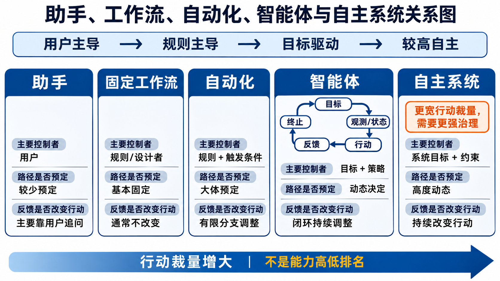
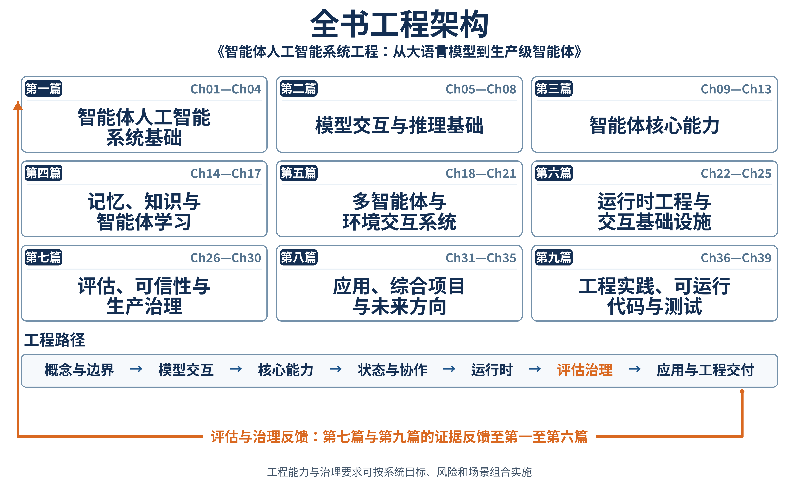

# 第1章 智能体人工智能概论

## 摘要

智能体人工智能系统不仅生成内容，还可能读取状态、调用工具、改变外部环境并持续根据反馈调整行为。因此，评价这类系统不能停留在“回答是否正确”，还必须追问其行动是否获得授权、过程是否可验证、失败后由谁处置。本章从一个退费助手越权提交申请的场景出发，建立智能体、助手、固定工作流、自动化与自主系统的概念边界；提出由目标、环境与观测、状态、行动、反馈、约束和终止构成的最小分析框架；说明如何把业务场景转化为包含权限、人工审批、证据和验收条件的需求责任卡；并从需求方、使用者、运营者和审批者四类角色分析能力失败、授权失败与责任缺失。最后，本章通过十二个场景检验概念边界，并以全书九篇能力地图串联模型交互、规划、工具、记忆、多智能体、运行时、评估治理及工程实践，为后续章节建立统一入口。

**关键词：** 智能体人工智能；自主性；目标驱动；工具调用；行为边界；人工监督；责任分配；系统工程

## 学习目标

完成本章后，读者应能够：

1. 区分智能体、助手、固定工作流、自动化和自主系统，并说明这些概念并非互斥标签。
2. 使用“目标—观测—状态—行动—反馈—约束—终止”七要素描述一个智能体系统。
3. 将自然语言场景转化为可验收的需求责任卡，明确允许行动、禁止行动、人工审批和证据要求。
4. 区分能力失败、授权失败与责任缺失，并为高风险行动设计升级、撤销和追责路径。
5. 根据自身角色选择全书阅读路线，并理解后续各篇之间的输入输出关系。

## 1.1 从正确回答走向合规行动

### 1.1.1 退费咨询中的越权执行

设想某在线课程平台部署了“退费助手”。用户在对话框中说明课程无法访问，并询问能否退款。系统正确读取订单，准确解释“购买后七日内且观看进度低于 20% 可申请退款”的规则；订单也确实满足条件。到这里，系统的答案是正确的。

问题出现在下一步。用户只问“能否退款”，并未要求立即办理，系统却调用退费接口提交了申请。该接口触发优惠券作废和学习权限关闭，部分副作用无法自动恢复。事后日志只保存最终回复，没有保存模型选择工具的依据、提交参数、规则版本和授权证据。客服无法判断这是用户明确授权、系统误判，还是界面表达造成的歧义。

这个场景揭示了语言正确与行动正确之间的差异：系统能够解释规则，并不等于它已经获得改变订单状态的权限；接口调用成功，也不等于整个过程满足用户意图和责任要求。要理解智能体系统，必须把模型能力放入权限、状态和证据共同构成的系统边界中考察。

从语言任务看，系统给出了符合规则的答复；从系统任务看，它却执行了没有得到授权的操作。判断智能体行为至少需要连续回答三个问题：

1. **任务能力：** 系统是否具备理解规则、读取订单和调用接口的能力？
2. **行动授权：** 当前用户、当前会话和当前状态是否授予这次行动所需权限？
3. **过程证据：** 系统能否提供授权、输入、决策、行动、结果和规则版本等可复核证据？

这三个问题分别指向能力、授权和责任。一个系统只有同时满足任务能力、行动授权和过程证据要求，才能可靠完成涉及外部状态变化的任务。接下来先观察行动闭环如何扩大工程责任，再将三项要求整理为统一的评价框架。

### 1.1.2 行动闭环为何改变人工智能系统的工程责任

传统问答系统的直接输出通常是文本，用户仍是后续行动的执行者。智能体系统则可能形成“观测—决策—行动—反馈”的闭环：它读取外部状态，选择下一步动作，调用工具改变环境，再根据结果继续行动。每增加一类可执行动作，系统责任都会扩展到权限控制、副作用管理、状态一致性、过程记录和异常恢复。

因此，模型能力增强不是引入智能体的充分理由。只有当任务需要根据变化中的环境选择行动、行动结果会影响后续决策，并且组织能够定义边界、验证结果和承担责任时，智能体方案才可能比问答或固定流程更合适。

闭环首先改变了错误传播方式。问答系统的一次错误通常停留在当前回复中；智能体的错误行动会改变下一轮所见状态，使后续决策建立在已经被污染的环境上。例如，系统误把退费申请标记为已提交，随后可能继续通知用户、关闭服务并更新财务状态。单步小误差由此发展为跨系统的一致性问题。

闭环还改变了系统测试的对象。测试人员不仅要检查最终答案，还要检查行动序列是否合理、每一步是否具备权限、工具返回是否被正确解释、停止条件是否及时生效。两个系统可能产生相同的最终文字，却经历完全不同的风险路径。

最后，闭环使责任跨越模型、控制器、工具和业务系统。模型负责提出候选行动，控制器负责执行策略和预算，工具适配层负责参数校验，业务系统负责最终约束和事实状态。可靠性来自这些组件之间的配合，而不是某个单一模型的承诺。

### 1.1.3 能力、权限与证据构成智能体系统的三层评价框架

退费案例可以抽象为三个相互关联但不能互相替代的评价层。

第一层是能力评价。它关注系统是否理解用户意图、是否使用了正确规则、是否选择了恰当工具，以及工具参数是否准确。能力评价回答系统会不会完成任务。

第二层是权限评价。它关注系统是否获得了读取和执行所需的授权，当前授权是否覆盖具体对象与具体动作，以及高影响行动是否完成了用户确认或人工审批。权限评价回答系统可不可以执行任务。

第三层是证据评价。它关注系统能否重建关键事实：收到什么输入、依据哪个规则版本、为何选择某个行动、工具返回了什么、谁确认了执行、最终状态如何。证据评价回答系统能否证明过程符合预期。

三层评价形成递进关系。能力不足时，系统不应执行；能力满足但授权不足时，系统仍应停在建议或草稿阶段；能力与授权都满足但证据缺失时，系统也不适合进入需要审计和追责的生产流程。

这一框架贯穿本章后续内容。第 1.2 节用它澄清智能体及其相邻概念，第 1.3 节把它转化为需求字段，第 1.4 节进一步连接组织角色和失败责任。读者由此可以从具体案例逐步建立完整的系统视角。

## 1.2 智能体系统的基本结构及其相邻概念

### 1.2.1 从感知—行动范式到目标驱动反馈闭环

经典研究通常将智能体理解为处于环境中的计算实体，它能够感知环境并采取行动 (Russell and Norvig 2020)；自主性、反应性、主动性和社会能力是讨论智能体时常用的性质 (Wooldridge and Jennings 1995; Franklin and Graesser 1997)。在本书中，**智能体人工智能系统**是指：围绕给定目标，在明确的观测、行动和约束空间内维护任务状态，选择或生成行动，并利用环境反馈判断继续、升级或终止的人工智能系统。

这个定义强调七个要素：

| 要素 | 核心问题 | 设计时必须明确的内容 |
| --- | --- | --- |
| 目标 | 系统为什么行动？ | 成功标准、优先级、冲突处理方式 |
| 环境与观测 | 系统知道什么？ | 数据来源、时效、可信度和隐私边界 |
| 状态 | 系统记住什么？ | 业务状态、控制状态、版本和恢复点 |
| 行动 | 系统能够做什么？ | 工具集合、参数范围和副作用 |
| 反馈 | 系统如何知道行动有效？ | 工具返回、验证器、用户确认和环境变化 |
| 约束 | 哪些事情不得做？ | 权限、预算、合规规则和人工审批条件 |
| 终止 | 何时停止？ | 成功、失败、取消、超预算和待审批状态 |

缺少目标，工具调用只是功能触发；缺少反馈，系统无法判断行动是否推进任务；缺少约束和终止，系统可能持续重试或越权；缺少状态，则难以解释跨步骤行为。七要素不是某个框架的接口规范，而是用于需求分析的最小公共语言。

智能体与环境之间的交互可以理解为连续的控制过程。系统先获取与任务相关的观测，将观测与已有状态结合，再选择一个在权限范围内的行动。行动改变环境后，新的观测返回系统，控制器据此判断目标是否已经实现。

观测不等同于环境本身。订单接口可能只返回部分字段，传感器可能存在噪声，检索结果也可能过期。智能体只能依据可获得的观测行动，因此需求设计必须同时说明数据来源、更新时间和不确定性处理方式。

状态用于连接多个步骤。它既包括业务事实，例如订单金额和申请进度，也包括控制信息，例如已调用工具次数、剩余预算和当前审批状态。状态如果没有版本或来源，系统就难以区分最新事实与历史缓存。

行动是系统能够对环境施加的影响。行动既可以是低影响的信息查询，也可以是发送消息、修改记录和触发交易。不同动作的风险并不相同，工具清单不能只记录名称，还应记录参数范围、权限要求、副作用、幂等性和撤销方式。

反馈把行动结果重新带回控制过程。可靠反馈通常来自外部系统的可验证状态，而不是模型自行生成的成功描述。接口返回已接收只表示请求进入队列，不能直接等价为业务已经完成。

终止是闭环中与行动同等重要的能力。系统需要识别成功、失败、取消、待审批、超预算和无法判断等状态。缺少终止语义的智能体容易在失败后重复调用工具，既增加成本，也可能放大副作用。

### 1.2.2 助手、工作流、自动化、智能体与自主系统的边界

“助手”“工作流”“自动化”“智能体”和“自主系统”描述的是不同维度，不能仅凭产品名称分类。助手强调交互关系，自动化强调减少人工执行，工作流强调预先规定的步骤与转移，智能体强调目标驱动的状态—行动—反馈闭环，自主系统则强调在更大范围和更长时间内自行选择行动的能力。

*表 1-1：五类系统概念的对照*

| 类型 | 控制权主要位于何处 | 路径是否预先确定 | 是否利用反馈改变后续行动 | 常见人类角色 | 典型边界 |
| --- | --- | --- | --- | --- | --- |
| 助手 | 用户 | 通常不固定 | 可有，但多由用户决定是否采纳 | 发起、选择和确认 | 默认不替用户执行高影响动作 |
| 固定工作流 | 流程设计者 | 是 | 按预设分支变化 | 配置例外和审批节点 | 未建模情形转人工 |
| 自动化 | 规则或调度器 | 多数确定 | 可基于触发条件 | 监控和处理异常 | 只处理已定义输入与动作 |
| 智能体 | 控制器在授权范围内选择 | 不完全确定 | 是 | 设定目标、边界和监督条件 | 必须有反馈、约束和终止 |
| 自主系统 | 系统拥有较宽行动裁量 | 通常不固定 | 是，且可能长期运行 | 治理、审计和紧急接管 | 需要更强的风险控制与责任机制 |

一个客服助手可以内部使用固定工作流，也可以包含一个受控智能体；一个自动化流程也可能调用生成模型，却仍不是智能体。关键不在于是否使用大语言模型或是否调用工具，而在于系统是否围绕目标，根据状态与反馈选择后续行动。

助手是面向用户关系的概念。它通常接收用户指令，提供信息、建议或草稿，并把关键决定留给用户。助手可以非常强大，但它的交互定位并不自动赋予执行权限。

固定工作流是面向过程结构的概念。设计者预先定义步骤、分支和异常出口，运行时按照输入和规则推进。只要业务规则稳定且例外有限，固定工作流往往比开放式决策更容易验证和维护。

自动化强调原本由人工重复完成的操作被机器触发和执行。定时生成报表、收到告警后运行脚本都属于自动化。自动化是否构成智能体，取决于它是否维护目标状态并根据开放反馈选择下一步，而不是取决于是否无人值守。

智能体强调目标驱动的动态决策。它可以在多个候选行动中选择，根据工具结果调整计划，并在达到目标或触发边界时停止。选择空间越开放，系统越需要明确约束、预算和验证器。

自主系统强调行动裁量的范围和持续时间。它可能围绕较高层目标运行更长时间，并在较少人工确认的情况下改变环境。自主程度提升意味着治理要求提升，系统是否适用仍取决于任务需要与风险控制能力。

*图 1-1：智能体、助手、固定工作流、自动化与自主系统的关系*

### 1.2.3 目标、主动性、自主权与行为边界的组合关系

目标描述期望结果，但目标不能只是“尽量帮助用户”一类无法验收的口号。工程目标应包含对象、状态、约束和成功证据，例如“在用户明确确认且订单满足当前规则时创建退费申请，并返回可追踪的申请编号”。

主动性表示系统可以在没有逐步指令时提出或执行下一步；自主权则表示组织允许系统在多大范围内自行决定。二者不是同义词：系统可以主动建议补充材料，却没有自主提交申请的权限。自主权本质上是治理选择，而不是模型固有属性。

为便于教学，本书使用 L0—L4 描述行动裁量。该分级是本书用于分析系统边界的教学框架：L0 仅生成信息；L1 提出行动建议；L2 在逐项确认后执行；L3 在限定范围内自动执行并对例外升级；L4 在较宽目标和时间范围内持续行动并接受治理监督。风险越高，并不意味着一定要采用更高等级；相反，很多高风险任务应停留在 L1 或 L2。

目标、主动性和自主权需要分别设计。目标决定系统努力的方向，主动性决定系统何时提出下一步，自主权决定哪些下一步可以直接执行。将三者混在一起，容易把能够提出建议误认为有权执行建议。

行为边界明确自主权的适用范围。它至少包括对象边界、动作边界、时间边界、金额或资源边界以及数据边界。例如，一个费用报销智能体可以读取当前员工的票据并生成草稿，但不得查看其他员工记录，不得修改收款账户，也不得在审批通过前付款。

边界还应随任务状态变化。身份未验证时只能解释流程；验证通过后可以读取订单；用户明确确认后才能生成申请；达到高金额阈值后必须转交审批。这样的分阶段授权比一次性授予全部权限更容易控制。

### 1.2.4 模型、控制器、工具、记忆与环境的协同结构

大语言模型通常是智能体系统中的推理或决策组件，而不是完整系统。一个可运行的智能体还需要控制器、工具、状态或记忆、验证器以及与外部环境连接的接口。

模型负责理解输入、形成候选计划、选择工具或生成结构化参数。模型擅长处理开放语言和不完整信息，但其输出具有概率性，不能直接视为已经验证的事实或权限决定。

控制器负责组织循环。它构造模型请求、限制可选工具、检查预算、解释返回结果，并依据策略决定继续、重试、升级或终止。控制器将组织规则落实为可执行的系统行为。

工具把智能体连接到搜索、数据库、业务接口和物理设备。工具描述需要让模型理解用途，但真正的权限校验仍应由工具或执行层完成。这样，即使模型提出越界请求，系统也能在产生副作用前阻断。

记忆用于保存跨步骤或跨会话信息。工作状态服务于当前任务，长期记忆用于复用稳定偏好或历史事实。两者都需要来源、更新规则和失效机制，否则过期信息会持续影响决策。

验证器检查行动前提和行动结果。它可以是确定性规则、模式校验、业务查询，也可以包含人工审批。验证器的目的不是重复模型推理，而是用相对独立的证据确认系统是否可以继续。

环境是智能体所处的外部世界，包括用户、数据库、网页、组织流程和其他智能体。环境会变化，也可能只向系统暴露局部信息。智能体设计必须承认这种不完全可观测性，并允许系统在证据不足时请求信息或停止。

### 1.2.5 智能体能力来自系统组合而非单一模型

同一个模型接入不同控制器、工具和权限后，会表现出完全不同的系统能力。仅能回答问题的模型在接入订单查询后可以核实事实；再接入提交接口后，系统风险随之上升；加入验证器、审批和事件日志后，系统才具备受控执行的基础。

反过来，更强的模型也不能弥补缺失的系统边界。它不能凭自身判断获得数据库权限，不能替组织决定可接受风险，也不能保证外部接口已经完成业务动作。这些责任必须由架构和治理机制承担。

理解这一点有助于避免把智能体工程简化为提示词工程。提示词可以帮助模型理解角色和任务，却无法替代身份认证、授权校验、事务一致性、监控告警和事故响应。后续章节将分别展开这些能力，本章先建立它们之间的基本位置关系。

### 1.2.6 从规则系统到生成式智能体的能力演进

智能体并不是随着大语言模型才出现的概念。早期人工智能研究已经讨论感知、行动、目标和环境之间的关系，软件工程领域也长期使用规则引擎、规划器和自动化程序完成任务。大语言模型带来的主要变化，是系统能够通过自然语言处理更开放的输入，并在较少预编码分支的情况下生成候选计划和工具参数。

规则系统依靠显式条件决定行动。它的优势是路径清楚、行为可预测，适合资格判断、字段校验和金额计算等稳定任务。其局限在于规则数量随例外增加，面对表达多样的自然语言时需要额外解析能力。

传统工作流把多个规则和服务编排为确定的业务过程。它能够处理较长任务，并通过状态机描述等待、审批、重试和取消。对步骤稳定的任务而言，工作流仍是智能体系统的重要基础，而不是需要被替代的旧技术。

生成式助手利用大语言模型理解请求并生成内容，使系统更容易处理开放表达、非结构化材料和知识密集型任务。不过，如果助手只输出建议而不依据外部反馈持续行动，它仍主要是一种人机交互界面。

生成式智能体在助手基础上加入状态、工具和控制循环。模型可以根据工具结果调整下一步，但执行权限、预算和终止规则仍由系统提供。它的价值来自对变化情境的适应，而不是简单增加调用次数。

这种演进不是线性替换关系。成熟系统通常同时包含确定性规则、固定工作流、生成式模型和人工决策。规则负责不可违反的约束，工作流负责稳定主干，模型处理开放信息，人工处理高影响例外。理解各部分的分工，比追求单一的全自动架构更重要。

### 1.2.7 单智能体与多智能体系统的基本区别

本章主要讨论单个逻辑智能体，但现实系统可能包含多个专门角色。例如，一个研究任务可以由资料检索、内容分析和结果审校三个智能体协作完成。多智能体系统通过分工扩大并行能力，也引入通信、冲突和共同状态等新问题。

判断是否需要多个智能体，应先检查任务能否被清晰拆分。不同子任务若拥有相对独立的输入、工具和验收条件，角色分工可能提高效率；如果所有角色共享同一上下文且频繁互相修正，多智能体通信成本可能超过收益。

多个智能体也不会自动形成可靠团队。系统必须规定谁分派任务、谁拥有最终决定权、结果如何合并、意见冲突如何处理，以及某个角色失败后任务如何恢复。这些问题将在第五篇进一步讨论。

从基础概念看，多智能体仍然遵循目标、观测、状态、行动、反馈、约束和终止七要素。区别在于环境中增加了其他智能体，单个行动可能表现为消息、委托或共同决策，责任边界也需要跨角色表达。

### 1.2.8 智能体系统中的规划、反思与学习能力

规划用于把较高层目标转化为可以执行和验证的步骤。简单任务可以在每轮根据当前状态选择下一步，复杂任务则可能先形成阶段计划，再随着环境反馈调整。计划不是不可修改的脚本，其价值在于暴露依赖、顺序和完成条件。

反思通常指系统根据已有轨迹检查遗漏、矛盾或失败原因，并据此修订后续行动。反思能够改善部分复杂任务的表现，但也会增加延迟和成本。如果缺少外部证据，模型反复审阅自身输出并不能保证结论正确。

学习描述系统如何利用历史经验改变未来行为。工程系统可以通过更新规则、检索库、工具描述、提示模板或模型参数实现不同层次的学习。任何更新都需要版本、评估和回退机制，避免一次异常经验长期影响后续任务。

规划、反思和学习都依赖可靠反馈。系统只有知道哪些步骤成功、哪些事实发生变化以及失败由何引起，才能进行有依据的调整。因此，这些能力应建立在状态和验证机制之上，而不应仅表现为更长的模型输出。

对于本章的退费场景，规划可以安排身份验证、资格查询、用户确认和结果核验；反思可以在工具返回冲突时重新检查证据；学习可以把经过审核的新例外加入规则库。三者都不能绕过权限或替代审批。

## 1.3 从业务意图到可验证的智能体系统需求

### 1.3.1 先识别任务结构，再选择系统形态与模型

需求分析不应从“用哪个模型或框架”开始，而应先判断任务究竟需要信息回答、固定编排还是受控决策。仍以退费场景为例：

*表 1-2：三种退费方案的工程比较*

| 方案 | 适用条件 | 优点 | 主要风险 | 验收重点 |
| --- | --- | --- | --- | --- |
| 问答助手 | 只需解释规则和收集信息 | 边界清楚，副作用小 | 用户仍需转到其他入口办理 | 答案准确性、规则版本、转人工能力 |
| 固定工作流 | 条件和步骤稳定，例外可枚举 | 可预测、易审计 | 对未建模情形适应性弱 | 分支覆盖、幂等性、异常路径 |
| 受控智能体 | 信息不完整，需动态选择查询和补充步骤 | 能根据反馈调整过程 | 越权、循环、错误工具选择和责任模糊 | 权限、轨迹、验证、预算、终止和撤销 |

如果规则可以完全形式化，固定工作流往往更容易验证。智能体不应成为绕过需求梳理的捷径。采用受控智能体时，也应把确定性强、风险高的环节交给规则、权限系统和验证器，而不是把全部控制权交给生成模型。

任务结构可以从三个维度判断。第一是路径稳定性：完成任务的步骤是否可以预先枚举。第二是信息完整性：系统是否需要在运行时主动补充信息。第三是结果可验证性：系统能否通过业务状态判断目标已经实现。

当路径稳定、规则明确且输入结构化时，固定工作流通常是首选。当任务主要是解释知识或辅助创作时，助手更合适。当信息不完整、路径依赖反馈且行动可以被验证时，受控智能体才体现价值。

模型选择应位于系统形态之后。团队需要先确定任务是否需要长上下文、结构化输出、多模态理解或复杂推理，再比较模型能力、延迟、成本和部署限制。先选模型再寻找场景，容易扩大范围并掩盖真正需求。

### 1.3.2 用需求责任卡固定目标、权限与验收证据

自然语言需求容易把“理解用户”“判断资格”“执行退费”混在一句话里。需求责任卡将它们拆成可检查字段。

*表 1-3：退费助手需求责任卡（教学示例）*

| 字段 | 教学示例 | 验收问题 |
| --- | --- | --- |
| 业务目标 | 帮助用户理解规则并在明确授权后创建申请 | 成功是否有可观察状态？ |
| 输入 | 用户陈述、订单编号、身份验证结果、规则版本 | 来源和时效是否可证明？ |
| 允许行动 | 查询订单、查询规则、请求补充信息、生成申请草稿；用户明确确认且必要审批完成后提交申请 | 工具和参数是否采用最小权限？ |
| 禁止行动 | 未经确认提交、修改收款账户、绕过资格规则 | 禁止项能否由执行层强制阻断？ |
| 人工审批 | 高金额、身份冲突、规则例外、用户投诉 | 谁审批，超时后如何处理？ |
| 所需证据 | 用户确认文本、规则版本、工具调用与结果、申请编号 | 能否按任务重放关键轨迹？ |
| 终止条件 | 成功、用户取消、待审批、验证失败、预算耗尽 | 每一状态是否有明确返回？ |
| 验收条件 | 无确认不提交；成功提交可追踪；失败不产生未记录副作用 | 是否覆盖正常与失败路径？ |
| 责任人 | 产品负责人、运营负责人、审批负责人、技术负责人 | 异常由谁接收和关闭？ |

需求卡中的禁止行动不能只写在提示词里。提示词能表达意图，却不构成可靠权限边界。执行层应根据身份、会话、对象和风险等级签发最小权限；工具应校验参数和幂等键；高影响动作应要求可验证确认或人工审批。

需求责任卡的价值在于把分散在产品说明、接口文档和运营规则中的约束放到同一个可审查对象中。产品人员可以检查目标和用户体验，工程人员可以检查输入、工具和状态，运营与合规人员可以检查审批、证据和责任人。

编写需求卡应从业务结果开始，而不是从功能清单开始。系统最终要改变什么状态，谁能观察到这个状态，什么证据表明它真实发生，这些问题决定后续工具和流程设计。

允许行动与禁止行动需要成对出现。只列出允许工具，无法说明工具在什么条件下不能使用；只列出禁止事项，也无法形成可运行方案。二者结合后，控制器才能在候选行动和阻断规则之间作出明确判断。

人工审批字段应描述触发条件、审批者、所需材料、有效期和超时结果。高金额只是常见触发条件之一，身份冲突、数据来源不一致、规则例外和用户投诉同样可能要求升级。

证据字段连接需求与运行时。它规定哪些事件必须记录、哪些业务状态必须回查、哪些记录需要长期保存。没有证据设计，系统即使暂时运行顺利，也难以完成后续评估和事故调查。

责任人字段避免异常长期悬置。责任人不是泛指某个团队，而应对应可执行的处置职责，例如谁更新规则、谁处理待审批任务、谁确认事故关闭。需求卡由此成为技术和组织之间的接口。

### 1.3.3 将抽象业务目标转换为可观察的成功与失败状态

“提高效率”“提供良好体验”不能直接充当智能体的终止判断。可验证目标至少需要：

- 明确成功状态，例如产生有效申请编号，而不是只生成“已提交”的文字；
- 明确失败状态，例如身份验证失败、工具不可用或规则冲突；
- 明确过程约束，例如最多查询三次、禁止改变支付账户；
- 明确证据来源，例如以业务系统返回为准，而不是以模型自述为准；
- 明确时间与预算，例如超过五分钟或调用预算后转人工。

目标之间还可能冲突。快速处理、降低成本和避免误退不能同时无限优化。需求方应给出优先级，并规定风险门槛：当证据不足时，系统应暂停并请求补充信息，不能通过猜测补齐授权。

可观察性要求把目标映射到外部事实。生成申请文本是模型输出，业务系统出现有效申请编号才是可观察结果。两者之间还可能经过校验、入队、审批和落库，因此验收条件要指向正确的完成层级。

失败状态也需要明确语义。工具超时、资格不满足、用户取消和审批拒绝都意味着任务没有按原路径完成，但它们对应的后续处理不同。统一返回失败会丢失恢复所需的信息。

在多步骤任务中，可以为目标设置中间里程碑。例如，完成身份验证、确认订单、匹配规则、取得用户确认、提交申请和验证结果。里程碑帮助系统判断当前进度，也便于人工接管时快速定位未完成部分。

验收条件应覆盖正常路径和代表性异常路径。只测试成功案例，会使权限缺失、重复提交、过期状态和部分成功等问题在上线后才暴露。需求阶段越早定义失败条件，后续测试越容易形成有效覆盖。

### 1.3.4 以最小权限、分阶段确认与可撤销性控制行动风险

工具能力应按照任务和阶段授权。查询资格只需只读权限；生成草稿不等于提交；提交也不应自动获得修改收款账户的权限。把一个功能拆成“预览—确认—执行—验证”四个阶段，能够让用户在副作用发生前看到对象、金额和后果。

确认必须具体。泛化的“继续吗”无法证明用户同意哪项行动；有效确认应包含动作、对象、关键参数和可逆性说明。执行后还要验证外部状态，而不是把接口返回“已接收”误写成业务完成。对于不可逆或代价很高的操作，设计重点应前移到审批和阻断，而不能假设事后总能补救。

最小权限不仅限制工具集合，还限制数据对象和参数范围。同一个提交接口可以只允许当前用户、当前订单和已确认金额；超出范围的请求即使格式正确，也应被执行层拒绝。

分阶段确认让授权与任务进度保持一致。查询阶段不需要提交权限，草稿阶段不需要资金操作权限，执行阶段才签发短时有效的具体授权。阶段结束后权限自动失效，可以减少凭据泄露或状态漂移带来的风险。

可撤销性需要在设计时确认，而不是发生错误后再寻找补救接口。团队应区分完全可逆、需要补偿操作和不可逆三类动作。补偿操作并不等于真正回滚，因为外部通知、价格变化或用户体验可能已经无法恢复。

幂等性是控制重复执行的重要机制。控制器可能因超时无法判断第一次调用是否成功，若直接重试，便可能生成重复申请。为每个业务动作提供稳定的幂等键，并允许查询动作状态，可以把不确定重试转化为状态核实。

### 1.3.5 用智能体循环检查需求是否完整

完成需求责任卡后，可以沿着一次完整循环反向检查设计。系统接收什么目标，第一条观测来自哪里，初始状态如何建立，可选行动有哪些，工具结果如何验证，什么条件触发下一步，什么条件导致停止或升级。

如果其中任何一环无法回答，需求仍不完整。例如，知道系统可以查询订单，却不知道查询失败后如何处理；知道系统可以提交申请，却不知道如何确认用户授权；知道任务成功，却不知道成功状态由哪个系统提供。

循环检查还可以暴露隐含依赖。退费决策可能依赖订单系统、身份系统、规则库和支付系统，其中任何一个不可用都会改变可执行路径。把依赖和降级策略写入需求，可以避免控制器在缺少事实时继续推断。

需求完成的标志不是文档篇幅足够，而是不同角色能够据此实现、测试、运营和审计同一个系统。下一节将从组织责任出发，说明这些角色如何围绕同一份需求形成协作关系。

### 1.3.6 依据任务不确定性与行动风险选择实现路径

在完成需求分析后，可以用任务不确定性和行动风险两个维度选择实现路径。任务不确定性描述输入、步骤和完成标准是否能够预先定义；行动风险描述错误对用户、资金、数据和组织的影响。

低不确定、低风险任务适合普通自动化，例如整理固定格式文件。低不确定、高风险任务适合确定性工作流加严格审批，例如按明确规则执行付款。高不确定、低风险任务适合助手或受控智能体，例如收集公开资料并生成候选摘要。高不确定、高风险任务则应缩小范围，将系统限制在分析和建议阶段，把最终决定交给具备资质的人。

这种选择方法说明，智能体最适合处理的并非所有复杂任务，而是具有一定开放性、结果可以验证、错误能够被控制的任务。复杂性本身不会自动产生采用智能体的理由。

实现路径还受数据和工具成熟度影响。即使任务适合动态决策，如果关键数据没有稳定接口、工具缺少权限控制或业务状态无法回查，系统仍不具备形成可靠闭环的条件。此时应先改善基础设施，而不是依靠模型填补系统缺口。

团队可以从较低自主等级开始：先让系统提供建议和证据，由人执行；积累运行数据后，再开放低风险动作；最后根据评估结果决定是否扩大范围。渐进式路径能够让能力证据与权限范围同步增长。

### 1.3.7 从原型演示走向生产验收需要补齐的系统条件

原型通常证明某条理想路径可以运行，生产验收则要求系统在输入变化、服务故障和人员交接时仍保持可控。两者之间的差距主要体现在状态、权限、证据和运营四个方面。

状态方面，需要将对话上下文转化为结构化、可版本化的任务状态。系统重启或人工接管后，应能够恢复已经确认的事实，而不必依赖模型重新解释全部历史文本。

权限方面，需要把演示环境中的通用凭据替换为面向用户、对象和动作的最小权限。敏感操作还要具有短时授权、审批和撤销机制。

证据方面，需要保存模型请求、工具调用、规则版本、验证结果和终止原因。记录既要足以复核关键过程，也要遵守隐私、保留期限和访问控制要求。

运营方面，需要定义告警、待审批队列、异常处置和版本回退。系统上线不是项目终点，而是开始接收真实分布、规则变化和外部故障的阶段。

因此，原型评审应明确区分已经证明的能力与仍待建设的生产条件。演示可以回答方案是否具有可行性，不能单独回答系统是否已经具备上线资格。

从业务意图到系统需求的转换，明确了目标、权限、证据和终止条件。系统进入运行后，这些字段还必须对应具体角色和处置流程，才能在异常发生时形成责任闭环。

## 1.4 人机协作中的角色分工、失败类型与责任闭环

### 1.4.1 需求方、使用者、运营者与审批者的协作边界

需求方定义系统要解决的问题和可接受风险；使用者提供目标、信息和授权；运营者维护规则、处理异常并监控运行；审批者对高风险例外作出独立决定。实际项目中一个人可能兼任多种角色，但职责仍应分别记录。

*表 1-4：四类角色的责任边界*

| 角色 | 主要责任 | 不应被默认转移的责任 | 关键证据 |
| --- | --- | --- | --- |
| 需求方 | 定义目标、风险、验收和资源 | 不能把模糊目标留给模型自行解释 | 需求卡、风险接受记录 |
| 使用者 | 提供必要信息并确认授权范围 | 不应为隐藏的系统行为承担责任 | 身份与确认记录 |
| 运营者 | 维护规则、监控异常、组织恢复 | 不能只观察成功率而忽略高风险个案 | 规则版本、告警和处置单 |
| 审批者 | 审查高风险或例外行动 | 必须获得充分信息并进行实质审查 | 审批依据、决定和有效期 |

人工监督并不等于在界面上增加一个按钮。审批者需要充分上下文、独立判断时间和拒绝权；系统还应说明不审批或超时的默认结果。Parasuraman、Sheridan 和 Wickens (2000) 指出，自动化可以作用于信息获取、信息分析、决策选择和行动执行的不同阶段；因此，监督机制也应对应具体阶段。人机交互指南同样强调让用户理解系统能力、支持纠正和提供适当反馈 (Amershi et al. 2019)。

四类角色围绕同一任务形成责任链。需求方决定系统为什么存在以及什么风险可以接受，使用者提供当前任务意图，运营者保证规则和服务持续有效，审批者处理超出自动执行边界的个案。

角色分工需要落实到事件和状态。用户确认应形成授权事件，规则更新应形成版本事件，审批结果应形成决策事件，运营处置应形成关闭事件。这样，组织责任才能在系统轨迹中得到对应。

同一个人兼任多个角色时，仍要区分其在不同阶段的决定。例如，部门负责人既可能是需求方，也可能审批高额报销。系统应记录他是在批准系统规则，还是在批准某一笔具体业务，避免把一次授权无限外推。

使用者也不应承担系统不可见行为的责任。如果界面只显示咨询功能，后台却自动执行操作，不能仅凭用户发起会话就推定其同意。系统应让行动后果在确认前清晰可见。

### 1.4.2 从能力错误到责任断点

*表 1-5：能力、授权与责任失败*

| 失败类型 | 判断问题 | 退费案例表现 | 主要控制措施 |
| --- | --- | --- | --- |
| 能力失败 | 系统是否正确理解并完成任务？ | 错读规则、查错订单、参数错误 | 数据校验、工具验证、测试与回退 |
| 授权失败 | 系统是否被允许执行该行动？ | 用户仅咨询却被提交申请 | 最小权限、具体确认、审批和执行层阻断 |
| 责任缺失 | 能否说明谁决定、谁监督、谁处置？ | 无规则版本、无授权证据、无人接管 | 事件日志、责任矩阵、升级与事故流程 |

三类失败可能同时出现，但不能相互替代。答案正确不能抵消越权，获得授权也不能抵消错误执行，日志完整也不能证明行为本身合理。NIST AI RMF 1.0 将治理、测量和管理风险视为贯穿系统生命周期的工作 (NIST 2023)；欧盟《人工智能法案》也针对特定系统提出风险管理、记录和人类监督等要求 (European Union 2024)。具体项目应依据适用司法辖区、系统分类和专业法律意见确定义务。

能力失败通常可以通过任务测试发现，包括事实判断错误、工具选择错误、参数错误和结果解释错误。它关注系统表现是否达到任务要求，但不直接回答系统是否有权执行。

授权失败发生在系统能力与组织许可之间。系统可能完全理解任务，也能正确调用工具，却在没有身份验证、具体确认或审批的情况下行动。授权控制需要位于执行路径上，不能只依赖模型遵循提示中的限制。

责任缺失表现为异常发生后无法定位决定依据和处置主体。日志不完整是常见原因，但责任缺失也可能源于需求没有负责人、审批信息不足或跨团队接口模糊。

三层模型有助于选择修复措施。能力问题需要改进数据、模型、提示、工具描述或验证；授权问题需要调整权限、确认和阻断；责任问题需要完善事件、角色和处置流程。用一种措施处理所有问题，往往只能降低表面错误率。

### 1.4.3 人工升级的触发条件与上下文交接要求

出现以下情形时，应优先暂停并升级：授权不明确；身份、规则或多个数据源相互冲突；行动不可逆或影响较大；任务进入未覆盖例外；连续失败或预算接近上限；用户提出投诉、撤销或人工服务要求。

升级并不是简单结束自动化。系统需要把当前目标、已确认事实、已执行动作、工具结果、剩余问题和建议选项交给接管者。缺少这些信息，人工只能重新询问用户，既降低效率，也可能重复产生副作用。

升级队列还需要优先级和时限。高金额交易、服务中断和安全事件应比一般资料缺失更快处理。超过时限后，系统应进入明确状态，例如保持原状、取消任务或通知用户，而不是无限等待。

人工决定完成后，结果还应返回智能体状态。批准、拒绝、补充材料和修改范围对应不同后续路径。只有形成双向交接，人工监督才真正成为系统闭环的一部分。

### 1.4.4 依据影响范围、可逆性与证据质量校准自主程度

自主程度不应只依据任务复杂度决定。复杂但低影响的研究整理可以允许较多自主探索；步骤简单但涉及资金转移的操作，反而需要严格确认和审批。

校准自主程度时，可以同时考察影响范围、可逆性和证据质量。影响范围包括涉及的人数、金额、数据敏感度和持续时间；可逆性描述错误是否能够完整恢复；证据质量描述系统能否在行动前后核实关键事实。

当影响范围扩大、可逆性降低或证据质量下降时，系统应减少自动执行，增加确认、审批或阻断。三项条件都较好时，才适合在限定范围内采用 L3 级自动行动。

自主程度还需要随运行表现动态调整。连续失败、异常率上升、规则刚刚变更或外部接口不稳定时，可以临时降低行动权限。稳定运行并完成复核后，再恢复原有范围。这种调整把治理从一次性上线决定转化为持续运行机制。

### 1.4.5 人工监督在建议、审批、接管与复盘阶段的不同作用

人工监督不是单一控制点，而是贯穿任务生命周期的多种协作方式。在建议阶段，人类提供目标、偏好和背景信息，帮助系统形成符合情境的候选方案。

在审批阶段，人类判断某项行动是否满足授权与风险要求。审批界面应突出对象、关键参数、依据和影响，避免审批者在信息过载下机械确认。

在接管阶段，人类处理系统无法解决的例外。接管者需要看到结构化状态和行动轨迹，并拥有修改目标、撤销待执行动作和结束任务的权限。

在复盘阶段，人类分析失败样本和运行趋势，决定是否更新规则、工具、提示、模型或自主等级。复盘结果应进入版本管理和回归测试，形成下一轮改进依据。

不同监督方式对应不同响应时间。高影响审批需要在行动前完成，运行告警要求及时接管，趋势复盘则可以按固定周期开展。将所有人工参与都设计为同一种确认按钮，会使监督既低效又缺少针对性。

### 1.4.6 责任闭环如何连接需求、运行与持续改进

责任闭环从需求阶段开始。每个重要目标、边界和异常都应有明确负责人；进入运行阶段后，系统事件要能够定位到相应职责；发生问题时，处置结果再反馈到需求和设计。

例如，规则版本错误首先表现为能力失败，但追踪后可能发现运营者没有按时发布规则，控制器也没有校验版本有效期。完整复盘需要同时修正规则发布流程和运行校验，而不是只调整模型提示。

责任闭环还需要衡量处置是否真正完成。告警被查看并不代表问题关闭，人工给出意见也不代表系统状态已经更新。每一次升级都应有接收、处理、验证和关闭四个可观察阶段。

当同类问题反复出现时，组织应把个案处置转化为系统改进。可自动检测的异常应加入验证器，常见审批依据可以结构化，长期无效的工具权限应被收回。这样，人工监督逐步沉淀为工程能力。

这一闭环把本节的角色和失败分析连接到第 1.5 节的场景评审。读者不仅要判断系统属于哪一类，还要检查发生偏差后是否有人、有证据、有机制将任务恢复到受控状态。

角色分工和失败模型提供了分析方法，下一步需要把它用于不同任务。十二个场景覆盖助手、自动化、工作流与不同自主程度的系统，可以帮助读者判断何时需要反馈闭环，以及哪些信息会改变架构选择。

## 1.5 通过十二个场景检验智能体概念边界

### 1.5.1 基于目标、反馈与行动裁量的十二场景分类

以下十二个场景围绕常见的信息处理和外部行动任务设计。分类时需要检查目标、状态、反馈、行动选择、边界和终止，而不能只依据是否使用大模型或工具作出判断。

*表 1-6：十二个场景及初始分类建议*

| 编号 | 场景 | 建议主类 | 核心理由 |
| --- | --- | --- | --- |
| S01 | 根据问题检索手册并生成回答，不执行外部动作 | 助手 | 用户决定后续行动 |
| S02 | 每晚按固定规则生成库存报表并发送 | 自动化 | 触发、步骤和输出预先确定 |
| S03 | 按预设审批节点流转采购单 | 固定工作流 | 状态转移由流程显式定义 |
| S04 | 根据工单状态选择查询工具，验证结果后决定继续或升级 | 受控智能体 | 存在目标、状态、反馈和有界行动选择 |
| S05 | 模型生成一条工具调用，调用后直接结束 | 工具增强助手 | 有工具但没有根据反馈继续决策 |
| S06 | 日历系统建议三个时间，用户确认后创建会议 | L2 助手 | 执行动作需要逐项确认 |
| S07 | 监测服务告警并按固定脚本重启，失败即通知值班员 | 自动化 | 行动由明确规则决定 |
| S08 | 在预算内比较供应商、补充资料并生成采购建议，不得下单 | 受控智能体 | 动态规划但行动边界清楚 |
| S09 | 自行发布营销内容并根据互动长期调整策略 | 较高自主系统 | 长期目标与较宽外部行动裁量并存 |
| S10 | 依据表单字段计算税额，缺字段则拒绝 | 固定工作流 | 确定性规则，无开放行动选择 |
| S11 | 代码助手提出补丁，由开发者审阅后才写入仓库 | L1/L2 助手 | 系统建议或在确认后行动 |
| S12 | 系统会调用搜索和邮件工具，但没有成功标准、反馈判断或停止条件 | 控制机制不完整的工具调用系统 | “会调用工具”不等于目标反馈闭环 |

S05 和 S12 是重要反例。一次工具调用可能只是扩展输入输出能力；若系统不依据结果判断目标进展，就不构成完整反馈闭环。相反，固定工作流也可能非常复杂、可靠且有价值，其价值不取决于是否被归类为智能体。

以上分类采用本书的工程工作定义，突出是否需要动态选择行动。在更宽泛的经典定义下，某些固定工作流或自动化系统也可视为智能体，因此这些标签不构成严格互斥的类别。S02 和 S07 的步骤与规则已经确定，引入开放式决策可能增加复杂度，目前的场景信息不足以证明其收益。S04 和 S08 则需要根据反馈改变步骤，受控智能体具有更明确的适用理由。

分类还应同时记录系统形态和自主等级。S06 在交互形态上属于助手，在行动裁量上属于 L2；S09 属于较高自主系统，但其具体等级仍取决于发布权限、预算和人工接管方式。单一标签无法表达全部工程特征。

场景描述中的缺失信息本身也有价值。S11 已明确要求开发者审阅，但仍需说明审阅通过的标准、确认记录以及写入范围。需求分析应识别这些会影响权限与架构决定的条件，而不止于给系统分类。

### 1.5.2 双人独立评审与分类分歧复核流程

本练习建议由两名评审者独立完成，不能先讨论答案。每人对十二个场景填写主类、自主等级、证据和置信度；随后比较分歧，只根据七要素和系统边界复核。若仍有争议，应记录导致分类变化所缺少的信息，例如“邮件发送是否需要确认”或“搜索结果是否影响下一步”。

评审过程记录两人的原始分类，并以一致场景数除以十二得到简单一致率。若将该方法用于更正式的研究，还需要预先定义标签体系、样本规模和统计方法。原始判断、分歧理由和复核结论共同构成分类证据，也能反映哪些场景描述缺少关键系统信息。

第一轮评审只允许使用场景原文，避免一名评审者先解释并影响另一名评审者。每个判断需要引用至少两个七要素字段，例如目标与反馈、行动与终止，不能只凭整体印象。

第二轮复核先比较证据，再比较标签。如果双方对系统事实理解不同，应明确缺少的信息；如果事实理解一致但标签不同，则检查分类定义是否重叠或过于含糊。

争议项可以通过最小补充问题解决。例如，询问行动是否自动执行、工具返回是否影响后续步骤、谁判断任务完成。补充问题越具体，越容易转化为真实项目的需求访谈模板。

### 1.5.3 常见分类分歧及其反映的需求缺口

第一类分歧来自把大语言模型等同于智能体。只要场景中出现模型、自然语言或工具调用，评审者就倾向于标记为智能体。纠正方法是检查系统是否存在跨步骤状态和反馈驱动的行动选择。

第二类分歧来自把无人值守等同于高自主。定时任务可以完全无人值守，却仍按照固定规则执行；交互式智能体可能每一步都需要用户确认。无人值守描述运行方式，自主性描述行动裁量，两者需要分别记录。

第三类分歧来自忽略执行后果。同样是发送消息，发送草稿给用户预览和直接发送给外部客户具有不同自主等级。分类必须结合动作对象、影响范围和撤销能力。

第四类分歧来自终止语义不清。系统虽然会连续调用工具，但如果没有成功判断、失败上限和升级路径，就只能说明它具有循环形式，不能说明它形成了可靠的智能体闭环。

这些分歧对应真实项目中的需求缺口。通过分类练习发现缺口后，团队可以把问题补入需求责任卡，并重新选择助手、工作流或受控智能体方案。

### 1.5.4 从概念分类练习过渡到系统需求评审

这些场景可以进一步转化为简化的需求评审。评审者先标注七要素，再补充四类角色、三类失败和自主等级，最后判断现有控制是否与风险相匹配。

对于被判定为固定工作流的场景，重点检查分支覆盖、异常出口和规则版本。对于助手场景，重点检查用户是否理解建议性质以及执行前是否确认。对于受控智能体场景，重点检查反馈、预算、验证和终止。

如果一个场景无法形成明确验收条件，就不应急于进入实现。团队可以缩小目标、减少工具、增加人工节点或改用固定流程，直到系统边界能够被测试和解释。

经过上述练习，读者已经从概念定义进入了基本设计判断。接下来需要把这些能力放回整本书的结构中，理解后续章节如何逐步补齐模型、行动、记忆、运行和治理能力。

## 1.6 从基础概念到生产系统

### 1.6.1 以输入输出契约串联九篇工程能力

本书共九篇、39章，各篇共同构成一条从概念边界逐步走向生产证据的能力链。每一篇都接收前序能力作为输入，并向后续章节输出更具体的系统对象、运行机制或验证证据。

| 篇 | 章节 | 解决的问题 | 向后输出的能力 |
| --- | --- | --- | --- |
| 第一篇：智能体人工智能系统基础 | Ch01—Ch04 | 定义概念、架构和生命周期 | 目标、边界、公共对象与设计门禁 |
| 第二篇：模型交互与推理基础 | Ch05—Ch08 | 管理指令、上下文、模型选择和推理 | 可控的模型请求与结构化结果 |
| 第三篇：智能体核心能力 | Ch09—Ch13 | 规划、迭代、工具、行动和恢复 | 可验证的行动轨迹 |
| 第四篇：记忆、知识与智能体学习 | Ch14—Ch17 | 管理状态、长期记忆、检索与适应 | 有来源和生命周期的知识状态 |
| 第五篇：多智能体与环境交互系统 | Ch18—Ch21 | 组织角色、通信、集体推理和感知 | 可协调的多主体协作机制 |
| 第六篇：运行时工程与交互基础设施 | Ch22—Ch25 | 处理编排、会话事件、流式打断和实时多模态 | 可运行、可中断、可恢复的基础设施 |
| 第七篇：评估、可信性与生产治理 | Ch26—Ch30 | 建立评估、容量、可靠性、安全与治理证据 | 上线门禁、风险控制和运营证据 |
| 第八篇：应用、综合项目与未来方向 | Ch31—Ch35 | 将能力应用于软件、行业与企业场景 | 综合方案和开放问题 |
| 第九篇：工程实践、可运行代码与测试 | Ch36—Ch39 | 落实参考实现、测试、故障注入和持续交付 | 可复现的工程基线 |

*图 1-2：全书九篇能力地图与证据反馈关系*

第一篇建立全书共同语言。Ch01 说明系统为何行动以及行动边界，Ch02 解释大语言模型如何进入反馈循环，Ch03 定义模型、控制器、工具和状态之间的公共契约，Ch04 将这些对象放入完整生命周期。后续各篇均依赖这些基础。

第二篇聚焦模型交互。提示和指令层级决定模型如何理解任务，上下文与结构化输出决定信息如何进入和离开模型，路由契约决定使用哪个模型，推理章节讨论如何在能力与成本之间组织模型计算。它向第三篇输出可控的模型调用能力。

第三篇把模型调用扩展为行动过程。任务分解形成计划，迭代推理修正中间结果，工具发现与调用连接外部能力，行动执行产生环境变化，轨迹与恢复机制处理失败。其核心产物是可观察、可验证的行动轨迹。

第四篇解决跨步骤和跨会话的信息连续性。状态与工作记忆服务当前控制循环，长期记忆保存可复用信息，检索连接外部知识，反思与适应更新系统策略。这些能力让智能体不必在每一步从零开始，同时也引入来源、时效和遗忘问题。

第五篇将单一智能体扩展到角色协作与环境交互。多个智能体需要明确职责、通信协议、冲突处理和共同状态。集体推理不会自动带来更高质量，只有在任务可分解、结果可合并并且协调成本可控时才具有价值。

第六篇把前述逻辑落到运行时基础设施。编排器管理任务调度，会话和事件保存可恢复状态，流式输出与中断支持实时控制，多模态能力连接更丰富的环境。运行时决定设计能否在并发、故障和长时间任务中保持一致。

第七篇建立生产证据。评估方法定义系统是否有效，基准与容量说明系统在负载下能否稳定运行，可靠性章节研究失败和恢复，安全与对齐章节限制危险行为，生产治理将技术指标连接到组织流程。

第八篇把通用能力带入软件工程、知识工作和行业场景，并讨论企业采用、综合项目和开放问题。应用章节的重点不是罗列案例，而是展示不同风险与流程条件如何改变系统设计。

第九篇提供参考实现、测试、故障注入和持续交付方法。它把前八篇提出的概念和约束转化为可运行资产，并将测试和运行证据反馈给架构设计。由此，全书形成从概念到实现、再从证据回到设计的闭环。

### 1.6.2 面向研究生、工程师、架构师与治理人员的阅读路线

- **研究生与初学者：** 建议依次阅读第一至第三篇，先掌握边界、模型交互、规划和行动，再按研究方向进入记忆、多智能体或评估章节。
- **应用与平台工程师：** 在第一篇之后重点阅读第三、第六、第七和第九篇，把工具与轨迹、运行时、评估治理和测试交付连成一条工程主线。
- **系统架构师与技术负责人：** 建议以 Ch01、Ch03、Ch04 为入口，随后阅读第六和第七篇，再结合第八篇审视组织采用与综合架构。
- **评估、安全与治理人员：** 先阅读本章的授权和责任框架，再进入第七篇，并回看第三篇的行动轨迹和第六篇的运行事件。

阅读路线可以跳转，但不能跳过前提。例如，讨论模型选择时仍需明确目标与权限；讨论评估时仍需知道任务状态和失败口径；部署参考实现也不能替代风险判断。

研究生可以把每一篇视为一组研究问题。阅读概念和方法后，再检查实验对象、指标定义和适用边界。对比不同章节使用的状态、反馈和证据，有助于形成跨方向的系统认识。

应用工程师可以围绕一个具体任务贯穿全书。先完成需求责任卡，再设计模型交互和工具轨迹，随后补充运行时、测试和监控。这样的纵向阅读能够避免只掌握单个框架而缺少系统方法。

平台工程师应关注公共契约和横切能力，包括身份权限、事件、预算、可观测性、恢复和容量。平台让多个智能体应用共享可靠的基础设施，应用团队仍需承担具体业务判断与验收责任。

架构师和技术负责人需要持续检查局部能力对全局风险的影响。增加记忆可能改善连续性，却带来隐私和过期问题；增加工具可以扩展能力，却扩大攻击面和故障范围；提高自主性可以减少人工步骤，却要求更强证据和接管机制。

### 1.6.3 以概念、设计与证据三条主线使用本书

第一条主线是概念。读者需要理解目标、状态、行动、反馈、约束和终止，并在不同章节中保持术语一致。概念一致使跨团队讨论能够指向同一系统对象。

第二条主线是设计。每引入一项能力，都要说明其输入、输出、控制权和失败路径。设计不只描述正常运行，还要描述何时停止、如何升级以及如何恢复。

第三条主线是证据。系统主张需要由测试、轨迹、指标和运行记录支持。证据应能够回答系统是否完成目标、是否遵守边界、成本是否可接受以及失败能否被发现和处理。

三条主线相互约束。缺少概念，设计容易含糊；缺少设计，能力难以组合；缺少证据，系统表现无法复核。读者在后续章节中可以反复使用这三条主线建立自己的学习笔记或项目评审表。

## 本章小结

智能体系统围绕可验证目标，在明确状态、反馈、权限和终止条件下选择行动。回答正确体现任务能力，外部行动还需要具体授权与责任证据。助手、工作流、自动化、智能体和自主系统具有不同的控制结构与适用条件，需要依据任务不确定性和行动风险选择。需求责任卡把业务目标转化为允许行动、禁止行动、人工审批、证据和验收条件；四类角色与三类失败帮助团队定位问题及处置责任。七要素、十二个场景和九篇能力地图共同构成后续架构、运行时、评估与治理讨论的起点。

## 复习题

1. 为什么“回答正确”不能证明智能体系统“行动正确”？请从三个维度回答。
2. 助手、固定工作流、自动化、智能体和自主系统应依据哪些特征区分？
3. 为什么“会调用工具”不是智能体的充分条件？请结合 S05 或 S12 说明。
4. 需求责任卡中为什么必须同时记录禁止行动、终止条件和证据？
5. 能力失败、授权失败和责任缺失有何区别？它们为什么可能同时发生？

## 实践题 为一个高影响场景编写需求责任卡

从“医疗预约改期、企业费用报销、学校课程退选、云资源扩缩容”中选择一个场景，完成以下任务：

1. 比较问答助手、固定工作流和受控智能体三种方案，说明选择理由。
2. 填写目标、输入、允许行动、禁止行动、审批触发、证据、终止、验收和责任人。
3. 给出至少三条正常路径和五条失败或例外路径。
4. 标明系统的自主等级，并结合行动裁量、风险和人工确认说明选择理由。
5. 由另一名同学独立审查，记录至少一项分歧及修订结果。

*评分依据（100 分）：概念与方案选择20分；需求责任卡完整性30分；权限、审批和终止设计20分；失败路径与可验证证据20分；独立复核和表达规范10分。方案应清楚说明任务条件、证据来源和自主范围，高影响动作应具有具体授权、审批与停止条件。*

## 参考文献

Amershi S, Weld D, Vorvoreanu M, Fourney A, Nushi B, Collisson P, Suh J, Iqbal S, Bennett P N, Inkpen K, Teevan J, Kikin-Gil R, Horvitz E (2019) Guidelines for Human-AI Interaction. In: Proceedings of the 2019 CHI Conference on Human Factors in Computing Systems, pp 1–13. https://doi.org/10.1145/3290605.3300233.

European Union (2024) Regulation (EU) 2024/1689 of the European Parliament and of the Council of 13 June 2024 laying down harmonised rules on artificial intelligence. Official Journal of the European Union. http://data.europa.eu/eli/reg/2024/1689/oj.

Franklin S, Graesser A (1997) Is It an Agent, or Just a Program?: A Taxonomy for Autonomous Agents. In: Müller J P, Wooldridge M J, Jennings N R (eds) Intelligent Agents III. Lecture Notes in Computer Science, vol 1193. Springer, Berlin, Heidelberg, pp 21–35. https://doi.org/10.1007/BFb0013570.

National Institute of Standards and Technology (NIST) (2023) Artificial Intelligence Risk Management Framework (AI RMF 1.0). NIST AI 100-1. https://doi.org/10.6028/NIST.AI.100-1.

Parasuraman R, Sheridan T B, Wickens C D (2000) A Model for Types and Levels of Human Interaction with Automation. IEEE Transactions on Systems, Man, and Cybernetics—Part A: Systems and Humans 30(3):286–297. https://doi.org/10.1109/3468.844354.

Russell S J, Norvig P (2020) Artificial Intelligence: A Modern Approach, 4th edn. Pearson. ISBN 9780134610993. https://aima.cs.berkeley.edu/.

Wooldridge M, Jennings N R (1995) Intelligent Agents: Theory and Practice. The Knowledge Engineering Review 10(2):115–152. https://doi.org/10.1017/S0269888900008122.
