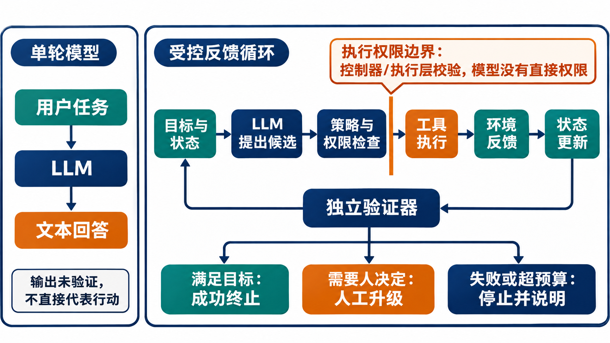
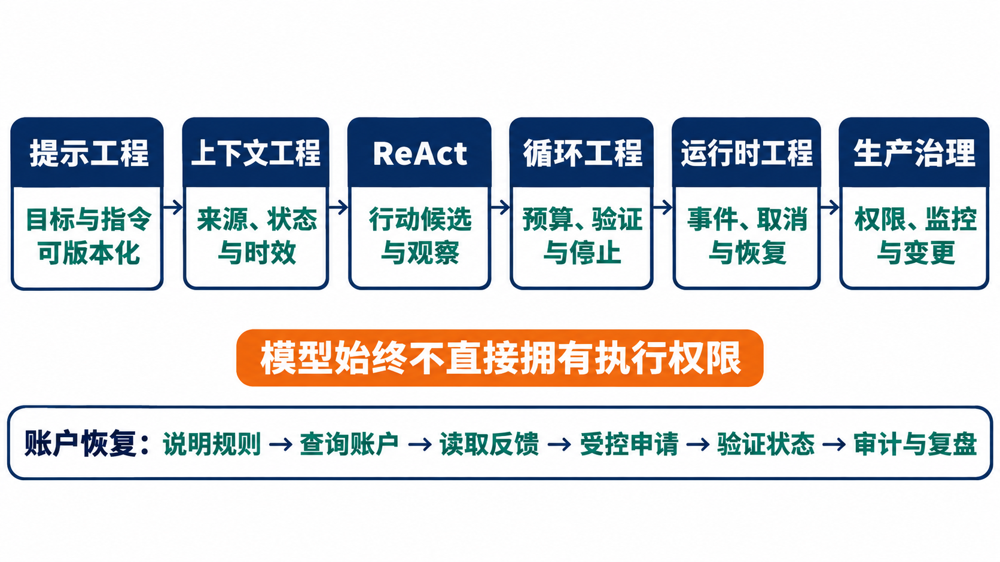

# 第2章 从大语言模型到 AI 智能体

## 摘要

大语言模型（large language model，LLM）可以把自然语言输入转化为续写、答案、计划草案或结构化候选动作，但一次生成本身并不构成一个能够对环境负责的智能体。系统只有在目标、状态、权限、工具、反馈、验证和终止规则共同作用时，才可能形成受控的行动闭环。本章从模型反复调用失效接口的场景出发，分析模型作为推理与决策组件的能力和不确定性，区分知识、推理、指令遵循与自报信心；继而说明如何逐步加入任务状态、环境反馈、工具适配、行动验证和停止判断。针对事实错误、指令违背、格式错误、校准不足和长程漂移，本章建立可观测信号、独立验证者与系统补救之间的对应关系。随后以同任务、同模型版本和同总预算的三路对照实验，比较单轮生成、固定检索工作流和有界反馈循环的质量、成本与风险。最后，本章沿提示工程、上下文工程、ReAct、循环工程、运行时工程和生产治理展开责任演进路线，为后续章节建立共同起点。

**关键词：** 大语言模型；AI 智能体；反馈闭环；工具调用；模型不确定性；行动验证；终止条件；运行时

## 学习目标

完成本章后，读者应能够：

1. 说明 LLM 如何参与计划生成、工具选择、反馈解释和行动修订，并区分候选输出与已执行行动。
2. 分析模型知识、推理、指令遵循和自报信心的不同含义，说明它们各自适用的判断范围。
3. 将单轮生成逐步扩展为维护状态、受限行动、读取反馈、独立验证和有界终止的控制循环。
4. 为事实错误、指令违背、格式错误、校准不足和长程漂移分别指定可观测信号、验证者和补救措施。
5. 设计公平的系统对照实验，报告成功率、无效调用、终止、耗时与资源成本，并区分控制逻辑验证、模型能力评估与生产观察。
6. 将提示、上下文、ReAct、循环、运行时和生产治理映射到相应工程责任及后续章节。

## 2.1 一个失效接口如何变成无休止的失败

### 2.1.1 确定的语言表达不能保证接口可用

设想一个内部 IT 服务台使用大语言模型帮助员工排查账户问题。用户说：“我昨天还能登录，现在提示凭据过期，请帮我恢复访问。”系统的工具目录中实际注册的是 account_status 和 credential_reset_request 两个接口。模型却从旧文档或相似任务中生成了一个看似合理的名称 reset_password_now，并给出符合格式的调用参数。

执行层返回：工具不存在，可用工具为 account_status、credential_reset_request。模型没有读取这条错误反馈，也没有重新检查允许的工具清单，而是再次输出 reset_password_now。第二次调用仍失败。若外围程序只做“模型输出—执行工具”的机械转发，没有最大调用次数、无效调用检测或人工升级，失败就会重复；若外围程序把错误文本直接拼进上下文，却没有明确要求模型修订并检查工具名，模型也可能原样重复。

模型连续提出同一个失效接口，表面上看是工具名称错误，实际暴露出三项相互关联的缺口：模型依据旧知识生成候选，执行反馈没有改变下一步决策，外围程序也没有设置重复检测和停止条件。要阻止局部错误演变为无休止的失败，系统需要同时管理候选、反馈和终止，而不能只在提示中追加一句“请使用正确工具”。

| 步骤 | 输入或事件 | 无反馈的转发程序 | 可观察的问题 |
| --- | --- | --- | --- |
| 1 | 用户请求恢复账户访问 | 将请求交给模型 | 模型不一定知道当前部署的工具目录 |
| 2 | 模型生成 reset_password_now | 按输出名称直接执行 | 名称可能从旧示例、联想或上下文噪声中产生 |
| 3 | 执行器返回“工具不存在” | 忽略错误，或原样附加后再次请求 | 错误没有转化为下一步决策所需的状态 |
| 4 | 模型重复相同调用 | 再次执行 | 出现重复无效调用，预算被消耗 |
| 5 | 达到外部超时或人工终止 | 任务突然结束 | 没有结构化失败原因、恢复信息或用户说明 |

系统的根本缺陷不是“模型偶尔会错”这一单一事实，而是模型输出被当成可执行命令，错误反馈没有进入控制决策，且没有任何层负责判定何时停止。即使将模型换成更强版本，这三处责任缺口仍然存在，只是故障概率可能变化，并不能据此证明故障消失。

### 2.1.2 需要分清模型错误与系统错误

在这个案例中，模型提出了一个不存在的工具名，是模型层面的错误；执行器已经拒绝该名称，但控制器没有依据失败结果修订候选或停止，是系统层面的设计缺陷；重复调用耗尽预算而没有升级与解释，则是运行策略和责任安排的问题。执行边界还应独立校验工具是否在允许集合中。将所有问题统称为“幻觉”，会掩盖可以在非模型层确定性解决的风险。

修复至少涉及三个不同问题：

- 模型是否能在当前上下文中提出合理的工具候选？
- 执行层是否只接受已注册、已授权且参数符合契约的调用？
- 一次调用失败后，控制器如何基于真实错误更新状态、选择修订、升级或终止？

第一项可以通过提示、上下文、模型选择或训练数据改善，但通常仍是概率性控制。第二项应由工具注册表、模式校验、鉴权和执行策略保证，不能只依赖模型遵循提示。第三项必须有明确的反馈映射、预算与终止状态。可靠系统需要限制模型错误造成的影响，并让失败可见、可处理。

### 2.1.3 错误响应为何没有自然变成有效反馈

工具返回错误，并不意味着系统已经获得了可用于决策的反馈。原始错误消息首先要被执行层捕获，然后被转换成稳定的错误类别，写入当前任务状态，并在下一次模型请求或控制器分支中发挥作用。如果错误只作为一段普通文本混入长对话，它可能被模型忽略、误解，甚至被后续内容覆盖；如果错误已经写入状态，但控制策略没有读取相应字段，它同样不会改变系统行为。

有效反馈至少包含来源、对象、时间、结果类型和下一步约束。以“工具不存在”为例，来源应是工具注册表或执行器，对象是被请求的工具名称，结果类型是不可执行的契约错误，下一步约束可以是“不得原样重试，应重新读取当前工具集合”。缺少这些结构化语义时，控制器很难区分网络暂时不可用、参数缺失、权限不足和工具永久下线，而这几类错误对应的处理方式并不相同。

反馈还必须与目标相关。接口调用成功只说明某个技术动作完成，不一定说明用户目标取得进展；接口调用失败也不一定意味着任务必须结束，系统可能仍能选择其他已授权路径。控制器需要判断新事件是否改变了目标可达性、剩余行动集合、预算和风险，而不是把所有成功响应都视为完成，把所有错误响应都视为可重试。

最后，反馈需要具有信息增益。若第二次调用与第一次使用同一工具、同一参数和同一前置状态，且没有新的证据表明环境已经变化，那么再次执行通常只是重复消耗资源。系统可以通过请求指纹、错误签名和状态版本识别这类重复；检测到无信息增益的重试后，应转向修订、升级或终止，而不是继续依赖模型自行发现循环。

*表 2-1：原始响应转化为控制反馈所需的信息*

| 字段 | 需要回答的问题 | 账户恢复案例中的示例 | 缺失后的风险 |
| --- | --- | --- | --- |
| 事件来源 | 谁产生了这条结果 | 工具注册表、账户服务或审批服务 | 无法判断结果是否权威 |
| 关联对象 | 结果对应哪个请求和业务对象 | request_id 与 employee_id | 可能把其他任务结果写入当前状态 |
| 结果类别 | 成功、拒绝、暂时错误还是永久错误 | TOOL_NOT_FOUND | 对永久错误进行无效重试 |
| 发生时间 | 结果在何时产生 | 执行器接收响应的时间 | 无法判断信息是否已经过期 |
| 状态版本 | 结果基于哪个环境状态 | 账户记录版本 17 | 并发变化可能被旧结果覆盖 |
| 可重试性 | 相同请求何时可以重试 | 仅工具目录刷新后可重新选择 | 形成紧密重复循环 |
| 副作用状态 | 行动是否可能已经部分生效 | 未执行任何写操作 | 在结果未知时重复产生副作用 |
| 后续约束 | 下一步允许和禁止什么 | 不得再次请求失效名称 | 错误不能收缩候选行动空间 |

### 2.1.4 重复失败反映出的四类系统缺口

第一类缺口是知识与现实脱节。模型可能依据训练数据、旧文档或名称模式生成已经不存在的接口。工具目录属于部署环境中的动态事实，不能由模型参数记忆提供最终保证；系统必须在请求时把当前注册表或允许工具集合置于可信上下文，并在执行边界再次检查。

第二类缺口是表示与契约脱节。模型输出的是自然语言或结构化候选，而执行器接受的是具有准确名称、版本、参数和错误语义的接口请求。两者之间需要适配器完成解析、模式校验和版本映射。没有这一层，模型的一个拼写或字段猜测就会直接传播到业务系统。

第三类缺口是反馈与控制脱节。执行器虽然返回错误，但外围程序没有根据错误更新状态和改变分支。反馈只有进入控制规则才会产生行为影响，因此“把错误消息放回提示”只是可能的实现手段，不是闭环已经成立的证据。

第四类缺口是资源与责任脱节。系统没有步数、费用、时间或重复错误上限，也没有达到上限后的责任人。于是任务只能依靠外部超时被动结束，用户不知道发生了什么，运营者也难以从日志中确定失败位置。明确的终止状态和升级接收者，是闭环设计的组成部分而不是上线后的运维补丁。

这四类缺口相互强化。过期知识产生错误候选，薄弱契约让候选到达执行器，反馈脱节使错误无法修订，资源脱节最终把局部错误放大成持续故障。分析这条传播链有助于团队把修复分配到正确组件，而不是不断追加更强措辞的提示。

### 2.1.5 本章的论证路线

本章先说明模型能够提供哪些候选能力，以及知识、推理、指令遵循和自报信心为何不能相互替代。随后从单轮生成开始，逐步加入目标、状态、工具、反馈、验证、预算与终止，展示模型调用如何被组织成受控行动循环。这个顺序刻意先建立概念再讨论实现，避免读者把“多次调用模型”误认为“已经拥有智能体”。

在闭环结构清楚之后，本章把事实错误、指令违背、格式错误、校准不足和长程漂移映射到可观察信号、独立验证者和补救措施。接着使用统一任务、模型版本和总预算设计三路对照实验，比较循环的质量收益与额外资源成本。最后把提示工程、上下文工程、ReAct、循环工程、运行时工程和生产治理串成责任演进路线，并为后续章节划定接口。

从大语言模型走向 AI 智能体，意味着把概率性候选生成组件放入一个具有目标、状态、授权边界、外部行动、可验证反馈和停止语义的系统。模型提供开放语言处理与候选生成能力，控制器、工具、验证器和组织角色共同承担行动责任。下一节先从模型能力本身入手，明确哪些输出可以作为候选，以及这些候选需要怎样的外部证据。

## 2.2 大语言模型作为受约束的推理组件

### 2.2.1 从条件生成到任务内的候选判断

自回归语言模型根据已有上下文逐步生成后续 token。工程上可以把它看作一种以输入为条件产生候选文本或结构化内容的组件。经过指令微调、偏好优化、工具调用训练或检索增强后，模型可在一定范围内执行问答、摘要、分类、计划草拟、参数填充和工具选择等任务。不同模型、版本、上下文和解码设置会改变表现，因此“LLM 能做某任务”必须落实到具体任务分布与评测条件，而不能仅凭通用能力描述。

少样本学习研究表明，模型可以利用上下文中的任务说明和示例完成多种任务，而不必针对每项任务更新参数；这一结果具有特定模型规模、任务和提示条件下的适用范围 (Brown et al. 2020)。Toolformer 则通过自监督数据构造研究模型如何学习 API 调用时机与参数生成，说明工具使用能力可以通过训练获得，但其候选调用仍需由执行层校验 (Schick et al. 2023)。

对智能体而言，模型输出可能扮演不同角色：解释用户意图、提出计划、在候选工具中做选择、生成工具参数、解释工具返回，或用自然语言说明下一步。把这些输出合并成一个笼统的“推理能力”，容易忽略每一种决策的错误代价不同。比如，生成计划文字通常不会立即改变环境；生成一条未校验的付款参数则可能带来外部副作用。

模型接收的并不是抽象意义上的整个任务世界，而是一次请求中可见的 token 序列及相关输入表示。系统提示、用户消息、工具描述、检索片段、历史事件摘要和输出约束都要竞争有限的上下文空间。某项事实没有进入当前请求，模型就不能直接依据它判断；某项事实虽然进入请求，但位置、表达和冲突信息也会影响模型使用它的方式。

生成过程通常根据前文对后续 token 的条件分布选择输出。解码策略可能偏向最高概率候选，也可能通过温度、top-p 等参数引入采样变化。即使关闭明显随机采样，服务端实现、模型版本或并行计算差异仍可能造成输出变化，因此工程测试要记录配置并允许必要的重复运行。概率生成的这一特征说明，系统应将模型输出作为待验证候选处理，在将其写入权威状态或用于外部行动前完成相应检查。

“候选”一词同时表达能力与边界。模型能在开放空间中快速提出可能的解释、计划和工具选择，这是它在智能体系统中的主要价值；但候选还没有通过当前事实、业务规则、权限和副作用检查。控制器应保存候选与最终行动之间的区别，避免审计日志只记录已经执行的请求而丢失被拒绝的高风险提议。

因此，使用模型之前要说明它承担的具体功能、允许的输出类型、可见证据、失败后果和独立检查方式。模型可被系统安排为建议者或候选生成器，不应被默认视为事实数据库、权限服务、事务管理器或最终验收者。

### 2.2.2 参数记忆不能替代当前事实源

模型通过训练数据获得统计性语言知识，能够回答许多常见事实问题，也能在熟悉领域产生连贯解释。但训练知识不是有明确更新时间、来源链和一致性保证的业务数据库。模型可能记住过期规则、混淆相近实体，或将多个来源中的信息组合成表面完整但无法核验的回答。即使某条回答事实上正确，模型自身也未必能给出可靠的来源定位。

对需要当前状态的任务，系统应区分静态背景知识和动态业务事实。组织政策、账户状态、库存、订单、权限与价格等信息，应从有权威性、可追踪且时效明确的系统查询。检索可以把相关材料带入上下文，但检索结果仍须经过来源、日期、覆盖范围和冲突检查。模型可以帮助总结证据，但对当前业务事实的总结不能替代其所依据的权威来源。

一个实用的问题是：“如果这条信息错误，系统能否在行动前从外部权威源发现？”如果答案是否定的，而错误又会触发高影响行动，就不应仅凭模型记忆继续执行。对关键事实，至少应保留来源标识、版本或读取时间，并让验证器判断所需字段是否齐全、是否仍有效。

### 2.2.3 可用的求解行为不等于保证正确

大语言模型能在许多任务中表现出多步问题求解能力。链式思维提示研究表明，在特定模型和基准上，要求模型分步生成中间文本可能改善某些复杂任务的表现 (Wei et al. 2022)。但这并不证明模型总能忠实呈现其内部计算，也不代表生成的每一步都经过事实校验。合理的解释文本可以与错误答案同时出现。

工程上应把“推理”操作化为任务结果、约束满足、证据使用和行动后果，而不是模型输出的解释长度。若任务允许，可要求模型给出简洁、可检查的计划或必要依据；同时应由独立测试、规则或外部数据核对关键结论。面对无法独立验证的开放任务，应把不确定性转化为澄清、有限试探或人工复核，而不是通过更长的文字制造确定感。

### 2.2.4 提示可以影响行为但不能构成执行控制

指令微调模型通常能按照自然语言要求组织回答，遵守格式并选择工具。但遵循程度取决于指令是否清晰、是否冲突、上下文是否拥挤、模型版本、解码条件和输入内容。用户要求、系统策略、开发者配置、工具返回和检索文档之间出现冲突时，不能只靠一句“请严格遵守”获得可验证的优先级保证。

提示的作用是塑造模型的候选行为；执行权限必须由程序边界执行。例如，提示中写明“未经用户确认不要提交申请”，并不能替代执行器在提交接口前检查授权事件。提示适合表达任务、角色、限制和输出契约；鉴权、对象范围、金额上限、审批状态和幂等性等控制，应由可测试的系统组件强制实施。指令层级与提示回归将在 Ch05 详细讨论。

### 2.2.5 语言上的确定性不等于概率校准

模型可以被要求报告信心等级或给出“我有 90% 把握”的回答，但自然语言自评不必然对应经过校准的正确概率。即使某模型的置信分数在特定数据集上校准良好，换任务、提示、领域或分布后也可能发生偏移。Guo 等人对神经网络校准的研究说明，预测置信度与准确率之间的校准关系可以测量和改进，但校准是依赖模型、数据和条件的性质，而不是通过自我陈述自动取得的属性 (Guo et al. 2017)。

因此，不应以模型自报信心作为高风险动作的唯一门槛。若置信度对决策有用，应使用具有明确定义的外部测量：例如在代表性验证集上的分桶准确率、置信度校准误差或选择性预测覆盖率，并按业务风险设定拒答与复核阈值。即便完成校准，也要监控数据漂移和模型更新后的变化。信心值更不能替代来源检查、权限核验和结果验证。

### 2.2.6 不确定性来自模型、任务和环境的共同作用

不确定性不只来自模型采样随机性，还来自输入歧义、证据不完整、工具状态变化、任务分布偏移、长上下文信息丢失和系统接口差异。一个确定性解码的模型也可能稳定地给出错误答案；一个模型置信度较高的输出也可能由于数据源过期而不适用于当前环境。

设计系统时应明确各类不确定性由谁处理：

| 不确定性来源 | 典型表现 | 首选处理位置 | 不宜采用的替代做法 |
| --- | --- | --- | --- |
| 用户意图不清 | “尽快帮我处理”未说明是否授权提交 | 交互层澄清，必要时保持草稿 | 让模型推断用户已同意 |
| 事实或来源不明 | 规则版本和订单状态不匹配 | 权威数据查询、来源标注与冲突校验 | 让模型从记忆中补齐当前状态 |
| 模型输出不稳 | 同输入生成不同工具或结论 | 候选约束、测试集、验证器与预算 | 只挑一次看起来最合理的输出 |
| 环境状态变化 | 查询后、提交前对象状态被修改 | 执行前重读、版本检查或条件写入 | 使用过期快照继续提交 |
| 契约不匹配 | 参数缺失、类型不符或接口变更 | 模式校验、适配器和兼容性测试 | 让模型反复猜字段 |
| 评测分布偏移 | 上线任务与测试集不同 | 切片监测、漂移告警和回归集更新 | 将历史平均分当作永久保证 |

处理不确定性的目标不一定是强迫系统得出答案。一个可靠控制器可以选择继续查询、请求澄清、生成待审批草稿、转交人工，或以明确状态终止。拒绝在证据不足时采取高影响行动，是有边界的系统能力，不是任务失败的同义词。

### 2.2.7 模型能力边界决定系统如何分工

模型较适合处理语言歧义、候选生成、信息归纳和需要灵活表达的子任务；程序、工具、业务规则和人工角色则分别承担确定性校验、权威状态、权限决策和高影响例外判断。划分不是绝对的：模型可以辅助发现异常，规则也可以处理语言输入；关键在于关键责任是否可验证、失败是否可控。

本书采用如下分工原则：模型提出候选，控制器管理过程，执行层检查权限，外部系统提供权威事实，验证器核对前提和结果，人类处理超出已定义范围的例外。模型越开放、行动影响越大，系统就越应把可判定的边界移到模型之外。该原则将在 Ch03 转化为 ModelRequest、ToolCall、ToolResult、Event 等公共对象和契约。

### 2.2.8 Token、上下文窗口与任务状态的区别

token 是模型处理文本时使用的离散单元，可能对应一个字、词的一部分、标点或其他符号。token 数量影响可输入内容、生成长度、调用成本和延迟，但 token 并不等同于字数，也不带有业务字段的稳定语义。将一段订单记录转换成 token 后，模型可以读取其文字模式，却不会自动知道哪个字段必须保持不可变、哪个时间戳决定信息是否过期。

上下文窗口是一次模型调用能够处理的输入与输出总容量。窗口扩大可以容纳更多历史、文档和工具描述，但并不保证模型能够同等准确地利用每一处信息，也不解决冲突、过期和来源不明的问题。系统若简单地把所有对话、错误和文档持续追加，可能使关键约束被噪声淹没，并使成本随任务步数增长。

任务状态则是系统对当前任务事实和控制进度的显式表示。它应具有字段定义、来源、写入者、版本和不变量，可以存放在数据库、事件流或状态机中，并在每轮调用时选择必要部分构造模型上下文。任务状态可以超过单次上下文窗口长期保存，也可以在模型切换后继续使用；模型上下文只是状态的一种临时视图。

三者的关系可以概括为：状态保存系统认为需要持续维护的事实，提示构造器从状态和外部证据中选择当前步骤需要的信息，再将其编码为模型可处理的 token。模型生成的新 token 只有经过解析和校验，才可能触发状态更新。这个方向性能够防止模型输出未经检查地覆盖权威状态。

*表 2-2：Token、上下文与状态的概念对照*

| 概念 | 所属层次 | 主要作用 | 生命周期 | 常见误解 |
| --- | --- | --- | --- | --- |
| token | 模型输入输出表示 | 承载模型可处理的序列单元 | 单次请求及计费记录 | 把 token 当成具有稳定业务含义的字段 |
| 上下文窗口 | 模型调用约束 | 限制一次请求可见的信息总量 | 单次模型调用 | 认为放入窗口的信息都会被可靠使用 |
| 提示 | 模型行为配置 | 表达任务、指令、示例和输出要求 | 可版本化并跨调用复用 | 认为提示可以强制执行权限 |
| 模型上下文 | 当前请求视图 | 汇集提示、历史、证据和工具描述 | 一次或少数相关调用 | 把对话历史等同于结构化状态 |
| 任务状态 | 系统控制数据 | 保存目标、事实、授权、预算和进度 | 整个任务，可持久化和恢复 | 让模型自由改写所有字段 |
| 事件轨迹 | 可追溯记录 | 保存状态变化的原因与顺序 | 任务及审计保留期 | 只保留最后状态，不保留如何到达 |
| 长期记忆 | 跨任务信息 | 保存经过治理的偏好或历史知识 | 多个任务或会话 | 把所有历史对话永久存储并视为真相 |

### 2.2.9 采样、版本与可重复性的工程含义

模型输出受模型权重、服务版本、系统提示、用户输入、工具描述、上下文顺序、解码参数和服务实现共同影响。只记录一个营销名称不足以复现实验；至少应保存可获得的模型标识或快照、调用日期、API 版本、温度、top-p、最大输出长度和结构化输出设置。供应商若不提供固定快照，报告应明确说明版本漂移风险。

温度较低通常会使输出更集中，却不等于事实正确或完全确定。模型可能稳定地产生同一个错误工具名；反之，适度采样可能帮助探索多个候选，但也提高轨迹差异和评估成本。选择解码参数应根据任务需求，而不是把“更确定”直接等同于“更可靠”。高影响行动更需要候选约束和独立验证，不应仅通过降低温度寻求安全。

多步循环会放大早期差异。第一轮一个词的变化可能导致选择不同工具，环境返回不同结果，后续状态和路径由此完全分叉。因此，评估智能体不能只重复比较最终文本，还要保存步骤级事件、工具调用和终止原因。对于随机运行，应报告重复次数和结果分布；对于确定性 mock，应说明它验证的是控制逻辑而非真实模型能力。

可重复性不要求每次自然语言完全相同，而要求关键实验条件可定位、任务验收规则稳定、原始事件可检查，并能解释不可控变化来自哪里。若模型服务更新后结果改变，团队应能够区分模型版本变化、提示变化、任务数据变化和工具变化。版本记录因此是模型能力进入系统工程的基础设施。

### 2.2.10 能力声明需要绑定任务与证据

“模型具备推理能力”“模型会使用工具”或“模型能够自主完成工作”等说法过于宽泛，无法直接支持设计决策。可核验的能力声明需要绑定任务分布、输入条件、可用工具、成功判定、资源预算、模型版本和失败范围。例如，可以先提出“在冻结的 20 个模拟 API 任务上，给定注册工具描述并限制三次模型调用，系统满足独立状态断言的比例将高于固定基线”这一假设，再用运行结果补充具体比例与置信范围。

能力证据也要区分组件与系统。模型在离线工具选择题上的准确率，只说明它在该输入表示下选择名称的表现，不能证明执行层权限、工具可用性或端到端任务成功。反过来，系统任务成功可能依赖确定性规则控制或人工审批，不能全部归因于模型。报告应将模型候选质量、控制器决策、工具执行和最终验收分别记录。

不同任务切片可能产生相反结论。模型对常见工具名称表现良好，却在工具版本变更或缺少参数时频繁失败；平均成功率会掩盖这些关键边界。能力声明至少应覆盖正常任务、缺失信息、冲突证据、权限拒绝、工具错误和长程任务，并注明未测试的语言、领域和风险等级。

证据还要能够被复核。原始输入、配置、模型输出、工具事件、验收脚本和失败样本应按许可和隐私要求保存。无法公开的数据可以提供字段说明、聚合统计和受控复现路径，统计结果同时标明分母与适用条件。明确模型输出的证据边界后，下一步便是把候选判断组织成可推进、可停止的行动闭环；Ch26 将进一步讨论任务、行为和轨迹的分层评估。

## 2.3 从单轮输出到有界行动闭环

### 2.3.1 第一步用单轮生成提出结果

最小的模型调用接收一个请求并返回答案。它适用于低风险、无需读取变化状态、用户可以自行审核和执行的任务，例如草拟邮件或概述给定文本。单轮系统的主要验收点是输出是否满足内容与格式要求；若模型没有调用工具，也不代表它已验证答案。

对账户恢复案例，单轮模型可以解释常见的账户恢复步骤，或建议查询账户状态。若目标要求“确认此员工账户当前是否锁定”，仅靠生成仍不够；若要求“发起重置凭据申请”，则还需要身份、授权、业务条件和执行后验证。将目标从文本输出改为环境状态变化，系统责任随之扩展。

### 2.3.2 第二步把目标与状态显式化

多步任务需要维护当前目标、已知事实、待验证事项、已执行行动、错误、权限、预算和终止状态。仅把全部历史对话拼接回提示中，并不能确保系统理解哪项信息是当前事实、哪项已过期、哪项是工具错误，也不能可靠地统计调用次数或剩余预算。

状态至少应区分三类内容：

1. **任务语义状态：** 目标、对象、成功条件、用户澄清和待处理问题。
2. **环境事实状态：** 由查询得到的账户、订单或业务对象信息，以及来源、版本和时间。
3. **控制状态：** 当前阶段、已执行工具、失败次数、预算消耗、审批状态、取消信号和结束原因。

状态需要有明确写入规则。模型可以建议更新任务摘要或识别待办事项，但授权状态、工具执行结果、调用计数和最终终止原因应由控制器或执行层产生。把模型生成的“操作已完成”当成事实，等于让系统以自身陈述验证自身行动。

状态字段还需要定义不变量。不变量是任务运行期间必须始终成立的条件，例如已消耗预算不得减少、审批状态只能由审批服务写入、终止后不得再次产生写操作、工具结果必须关联已经记录的调用。模型可能参与生成下一步候选，却不能取消这些条件；控制器应在每次状态转换前后检查不变量，并把违反情况记录为系统错误。

状态更新最好与产生它的事件关联。系统不只保存“失败次数为 2”，还应能定位到哪两次调用、调用使用了什么参数、执行器返回什么错误以及控制器如何处理。最终快照便于快速读取，事件轨迹便于回放和审计，两者结合才能解释状态为何变成现在这样。

*表 2-3：账户恢复任务中的最小状态字段*

| 字段 | 含义 | 权威写入者 | 关键约束 |
| --- | --- | --- | --- |
| goal_id | 当前任务目标标识 | 任务入口或控制器 | 任务开始后不可由模型改写 |
| subject_id | 账户所属主体 | 身份服务与任务入口 | 必须与当前授权主体匹配 |
| desired_state | 可验收目标状态 | 需求配置 | 不得使用“尽量解决”等模糊表述 |
| observed_account_state | 最近读取的账户状态 | 账户查询工具 | 必须携带来源、时间和版本 |
| allowed_tools | 当前步骤允许的工具集合 | 策略服务 | 模型只能从集合中提出候选 |
| authorization_state | 身份、确认与审批状态 | 身份或审批服务 | 模型不得自行提升权限 |
| pending_action | 尚未执行的候选动作 | 控制器 | 执行前必须通过策略与契约检查 |
| executed_actions | 已执行动作及结果 | 执行器 | 只追加，不覆盖历史记录 |
| error_history | 分类后的错误事件 | 控制器与适配器 | 记录错误签名和可重试性 |
| remaining_budget | 剩余调用、时间和费用预算 | 预算管理器 | 消耗后单调减少 |
| termination_state | 当前是否以及为何终止 | 控制器 | 终止后禁止新的副作用动作 |
| evidence_refs | 支撑结论的事件或外部记录 | 验证器 | 成功结论必须可定位到证据 |

### 2.3.3 第三步让环境反馈改变后续决策

行动闭环的关键不是“多调用几次模型”，而是新的、可信的环境观察会改变后续行动。系统通常经历如下逻辑：

1. 根据目标、约束和当前状态准备模型输入。
2. 从模型输出中解析候选答案、计划或工具请求。
3. 由执行层验证工具名称、参数契约、身份和权限。
4. 在允许范围内执行行动，并记录真实返回值或错误。
5. 更新状态，将必要的反馈作为下一轮决策依据。
6. 判断目标是否达到、是否需要进一步验证、升级或终止。

ReAct 将推理文本与行动交替组织，使模型可根据观察结果继续调整；其研究展示了在若干任务上的方法价值，但并不意味着将“Thought/Action/Observation”写进提示就自动得到安全执行 (Yao et al. 2023)。任何工具调用仍须经过权限和契约检查；任何观察仍要考虑来源与可信度。工程系统应重视可见的决策输入、行动事件和结果，而不应要求记录或暴露模型所有隐含思维过程。

### 2.3.4 第四步将工具调用视为待审请求

模型输出工具调用候选时，系统必须把它视为未授权的请求。执行之前至少要检查：

- 工具是否在当前任务允许的注册表中，名称和版本是否匹配；
- 参数是否通过结构模式验证，是否满足业务前置条件；
- 当前主体是否具有针对该对象和动作的权限；
- 用户是否明确授权，或所需人工审批是否已经完成；
- 行动是否可重复，失败重试是否会造成重复副作用；
- 预算、速率、时间范围和风险级别是否允许继续。

只要其中一项不满足，执行层就应阻止产生副作用，并以结构化拒绝或错误事件告知控制器。提示可以减少越界提议，但不能用来替代以上检查。对于不可逆或高影响动作，确认事件应绑定具体对象、动作和有效期限，不能被泛化为整个会话的空白授权。

### 2.3.5 第五步判读反馈并独立验证结果

工具返回的“请求已接受”通常只代表请求进入队列，并不等于业务目标完成。反馈需要有稳定语义，例如成功、拒绝、暂时失败、永久失败、待审批、状态未知等；最好同时携带对象标识、时间、版本或可查询的操作编号。

验证器可根据任务定义独立检查结果：重新读取业务状态，比较预期字段，确认操作没有重复，检查目标对象是否仍在授权范围内。对于关键任务，应让“执行成功”与“任务成功”分开记录。模型可以解释验证结果，但验证结论应来自独立证据。

账户恢复示例中，credential_reset_request 返回 request_id 只能证明请求被系统接收。系统还应确认该请求对应正确账户、审批状态适当，并向用户说明接下来需要做什么。若状态查询暂时不可用，系统应报告“已发起但尚未确认”，而不是宣称“账户已恢复”。

### 2.3.6 第六步建立有界循环与终止语义

闭环必须有边界。至少要配置最大迭代次数、最大工具调用次数、时间上限、token 或货币预算、连续失败上限、重复请求检测和可随时生效的取消机制。预算应在调用前预留和扣减，避免控制器在预算耗尽后还启动新的模型或工具请求。

终止状态不宜压缩成单一的成功/失败标记。常见状态包括：

- **成功：** 预先定义的目标和验证条件均已满足。
- **失败：** 发生不可恢复错误，或任务结果无法满足验收条件。
- **待审批：** 当前行动需要人类决定，尚未获得授权。
- **待补充信息：** 关键输入缺失，系统已请求用户补充。
- **取消：** 用户、运营者或安全策略发出有效取消信号。
- **超预算：** 达到调用、时间、费用或风险预算上限。
- **结果未知：** 外部系统无法确定行动是否已生效，需要查询或人工确认。

终止是控制结果，不等于关闭对话。系统还需要向用户提供准确的状态说明、下一步和必要证据。对超预算任务，停止继续消耗资源后仍可保存可恢复状态；对结果未知的写操作，不能盲目重试，而应先通过幂等键或状态查询判断第一次请求是否已生效。

### 2.3.7 最小控制逻辑示例

下面的伪代码只说明责任边界，不绑定任何框架，也不是已实现的参考代码。实际系统需为数据类型、并发、事务、日志和错误恢复补充细节。

    state = initialize(task, budget, authorization)
    while state.terminal is false:
        if cancellation_received():
            return terminate(state, "cancelled")
        if budget.exhausted() or state.steps >= step_limit:
            return terminate(state, "budget_exhausted")
        request = build_request(task, state, allowed_tools(state))
        proposal = model.generate(request)
        candidate = parse_and_validate_shape(proposal)
        decision = policy_check(candidate, state, authorization)
        if decision.denied:
            state.record_rejection(decision.reason)
            return terminate_or_escalate(state, decision)
        result = execute(candidate)
        state.record_event(candidate, result)
        outcome = independent_verifier(task, state, result)
        state.update(outcome)
        if outcome.success:
            return terminate(state, "succeeded")
        if outcome.requires_human or outcome.is_ambiguous:
            return terminate_or_escalate(state, outcome)
    return terminate(state, "unknown")

伪代码中，模型只生成候选；策略层在行动前检查边界；执行层返回真实结果；状态由事件更新；独立验证器判断目标状态；预算和取消能够中断循环。真实实现还应处理超时、重复消息、并发更新和执行结果迟到等情况。Ch03 将定义公共对象与终止契约，Ch09—13 展开规划、工具和恢复，Ch22—24 讨论调度、会话事件、流式中断和异步运行时。

### 2.3.8 从单次失败走向可控恢复

回到失效接口案例。一个受控循环收到工具不存在的反馈后，不应直接重试，而应将工具错误记录为结构化事件，并检查它属于临时故障、参数错误、注册表版本不匹配还是权限拒绝。若错误明确给出当前允许工具，模型可在预算内提出一次新的候选；控制器仍需根据注册表验证。若没有兼容工具，或第二次候选仍重复失败，系统应停止自动尝试并转人工。这样，反馈不仅“被看见”，还改变了状态、候选空间和后续控制分支。

*图 02-1：单轮模型与受控反馈循环*

### 2.3.9 从模型请求到环境事件的对象转换

为了保持责任清楚，系统不应使用同一个“消息”对象承载用户意图、模型建议、执行请求和工具结果。用户消息表达自然语言需求，ModelRequest 表示给模型的当前视图，模型输出经过解析后成为候选行动，ToolCall 是通过契约检查后准备执行的请求，ToolResult 是外部工具产生的事实性结果，Event 则记录系统中已经发生的状态变化。每次转换都应有明确的输入、校验和责任组件。

若模型直接生成一个名为 ToolResult 的对象，开发者容易把模型陈述误当成真实工具返回。正确做法是由执行适配器创建结果，并关联调用 ID、工具版本、开始和结束时间、状态码及原始响应引用。模型可以对结果进行总结，但总结与结果本体要分别保存。

类似地，模型提出“任务完成”只能形成候选判断，不能直接写入终止状态。验证器要依据目标断言和环境事实检查是否完成，控制器再发出终止事件。这个对象边界看似增加了步骤，却使测试能够分别注入模型错误、契约错误、工具失败和验证错误，并确定哪一层没有履行责任。

*表 2-4：闭环中的主要对象及其责任边界*

| 对象 | 主要内容 | 产生者 | 消费者 | 不能被它直接证明的事项 |
| --- | --- | --- | --- | --- |
| UserRequest | 用户目标、材料和明确授权 | 用户或可信入口 | 任务解析器 | 用户身份已经核验 |
| Goal | 可验收目标与约束 | 需求配置和控制器 | 模型、策略、验证器 | 目标一定可达 |
| ModelRequest | 当前步骤所需上下文和候选工具 | 提示构造器 | 模型 | 所有输入事实均正确 |
| ModelProposal | 答案、计划或行动候选 | 模型适配器 | 解析器和控制器 | 候选已获授权或已执行 |
| ToolCall | 已解析的工具请求 | 控制器 | 策略层和执行器 | 业务目标已经完成 |
| ToolResult | 工具的真实返回或错误 | 工具适配器 | 状态更新器和验证器 | 返回语义已被正确解释 |
| VerificationResult | 对前提或结果的独立检查 | 验证器或人工审批者 | 控制器 | 后续所有状态不会变化 |
| Event | 已发生变化及其因果关联 | 控制器、执行器等 | 事件存储与监控 | 单个事件等于完整任务状态 |
| TerminationRecord | 终止类型、原因和证据 | 控制器 | 用户界面、运营与审计 | 所有失败均已自动恢复 |

### 2.3.10 观测、反馈和验证具有不同作用

观测是系统从环境获得的信息，例如账户状态、工具目录、审批记录或错误响应。观测可能不完整、延迟或带噪声，系统应记录其来源和时效。一次查询返回的数据首先是观测，只有当控制器用它更新状态并改变下一步时，它才成为有效反馈。

反馈描述观测对控制决策的作用。账户查询显示“账户未锁定但凭据已过期”，这一结果使系统从“解锁账户”转向“发起凭据重置申请”，因此它改变了行动选择。若程序忽略返回字段并继续执行原计划，环境虽然产生了观测，闭环却没有真正利用反馈。

验证是依据独立规则判断前提或结果是否满足。验证器可以读取同一观测，但采用预先定义的断言，例如主体标识必须一致、审批必须有效、最终账户状态必须达到目标。模型可以帮助解释观测，验证结论仍应由规则、权威查询或人工决定支撑。

区分三者能澄清一个常见误解，即只要把工具响应重新放进模型上下文，系统就已经具备验证能力。事实上，模型可能误读响应或忽略关键字段，反馈路径也可能没有停止条件。可靠设计要求分别记录“看到了什么”“这改变了什么”和“据此证明了什么”。

### 2.3.11 计划、行动和执行结果需要分别管理

计划是对未来步骤的候选安排，不等于系统承诺执行全部步骤。环境变化、权限拒绝或新证据可能使计划失效，因此控制器应在每个行动前重新检查当前状态。较长计划可以帮助协调任务，但过早把所有步骤固定下来，也可能使系统忽视中间反馈。

行动候选是模型或规则提出的下一步，其粒度应足以检查对象、参数和风险。诸如“解决用户问题”不是可执行行动；“查询 employee_id 对应账户状态”才具有明确工具和参数。候选解析失败时，系统应停留在未执行状态，不能猜测性补齐高风险参数。

执行结果是环境已经发生或明确未发生的事实。结果必须来自执行器，并与候选和批准记录建立关联。对于异步工具，“已接收”“处理中”“已完成”和“已拒绝”是不同状态；控制器要根据工具契约决定是否等待、查询、取消或结束。

计划更新应基于结果和目标，而不是仅基于模型偏好。当执行结果证明计划某一步不可行，系统可以删除、替换或转人工，但应记录修改原因。这样，轨迹能够回答系统为什么偏离原计划，并支持复盘计划质量与环境变化的相对影响。

### 2.3.12 人类介入是显式状态而不是异常出口

人工介入常被描述为“模型不确定时找人”，但这一表述缺少触发条件和交接契约。系统应规定哪些情况必须升级，例如权限不足、高影响行动、证据冲突、连续失败、结果未知或用户明确要求人工服务；同时规定谁接收、多久响应、可以作出哪些决定以及超时后的默认行为。

进入待审批或待人工处理状态后，自动循环应暂停可能产生副作用的动作。交接包应包含目标、主体、已确认事实、候选行动、风险、已执行步骤、错误记录、剩余预算和需要人类回答的具体问题。只转发整段聊天记录，会迫使接管者重新重建状态，也容易遗漏隐藏的工具事件。

人类决定也必须作为结构化事件返回系统。批准应绑定具体对象、动作、参数范围和有效期；拒绝应说明任务是否终止或允许其他路径；补充信息应标明来源。控制器不能把一次人工批准外推为后续所有动作的通用授权。

人工环节自身也需要评估。团队应监控升级是否准确、交接信息是否完整、审批等待是否超时，以及人工是否频繁纠正同一类模型错误。高升级率不一定是坏事，它可能说明系统在边界处谨慎；但如果升级内容缺少上下文，人工监督就会变成低效且难以审计的形式节点。

### 2.3.13 部分失败、幂等与结果未知

外部行动可能在网络响应到达前已经生效。控制器发送写请求后连接超时，不能据此断言工具没有执行；若立即重复相同请求，可能创建两个申请或发送两次通知。系统需要幂等键、操作编号或写后查询来判断第一次行动的真实状态。

幂等意味着相同逻辑请求被重复提交时，环境状态不会产生额外效果。它可以由业务接口原生支持，也可以由适配器配合持久化去重记录和结果查询实现；仅生成任务 ID 和动作 ID 并不足以保证幂等，还需处理并发与执行过程中断。消息发送等操作能否安全重试，取决于底层服务是否提供相应保证。无法保证幂等的操作，尤其是不可逆的物理动作，应在结果不明时停止自动重试，转入状态核实或人工恢复。

部分失败还可能发生在复合任务中。账户恢复申请创建成功，但通知发送失败；系统不应把整个任务简单标为全失败并重复申请。状态需要分别记录核心业务动作和辅助动作，再根据目标定义决定“部分成功”“需要补偿”或“待人工处理”。

结果未知是独立且重要的终止状态。它表示系统缺少足够证据判断动作是否生效，不能安全继续。可靠系统承认未知，并提供查询、等待或人工核实路径；不可靠系统则用模型生成的乐观描述填补事实空白，使后续行为建立在虚假状态上。

### 2.3.14 事件轨迹使闭环能够回放和评估

只保存最终答案无法解释系统如何得到结果，也无法判断是否出现越权提议、重复失败或无效调用。事件轨迹应覆盖任务创建、模型请求、模型候选、策略判断、工具调用、工具结果、状态更新、验证、人工决定和终止。每个事件需要唯一标识、任务关联、时间、产生者、对象版本和因果关联。

轨迹设计要兼顾可观测性与数据最小化。原始提示和工具响应可能包含个人信息、凭据或商业数据，不能因为“便于调试”而无期限完整保存。团队应定义脱敏、访问控制、保留期限和删除机制，同时保留足以复核目标、权限、错误和结果的结构化字段。

可回放不一定意味着重新执行所有副作用。安全回放通常使用记录的 ToolResult 或确定性模拟器，让控制器在不改变真实环境的情况下重演决策。若要验证外部集成，应在隔离测试环境使用专用账户和可撤销数据，并确保真实通知、付款或删除操作不会被触发。

轨迹还为评估提供分层证据。最终任务失败时，可以判断是模型没有提出正确候选、策略误拒绝、工具失败、状态更新错误，还是验证器判断错误。组件级诊断使改进能够针对具体环节，也为下一节建立“失效—信号—验证者—补救措施”的对应关系提供数据基础。

## 2.4 典型失效、信号与系统补救

### 2.4.1 失效映射的原则

失效分类的目的不是给模型贴缺陷标签，而是让团队能够回答四个问题：出了什么错、从哪里可以观察、谁或什么能够独立验证、阻止后果扩大的措施在哪里。一个信号只有在可采集、可定位且有负责人处理时，才有运行价值。模型生成的“我可能错了”不是独立信号；工具调用错误率、来源缺失率、模式校验失败、预算超限和验证失败则可被系统记录。

*表 2-5：模型能力与典型失效的检测和防护矩阵*

| 失效类型 | 典型表现 | 可观察信号 | 验证者 | 主要防护与补救 |
| --- | --- | --- | --- | --- |
| 事实错误 | 把过期规则、错误对象或未证实内容当成事实 | 关键字段与权威查询不一致；来源缺失；引用版本过期 | 权威数据源、规则校验器、抽样人工复核 | 查询当前状态；保存来源和时间；关键事实不全时澄清或停止 |
| 指令违背 | 忽略禁止事项、审批门槛或指定顺序 | 拒绝规则被触发；权限检查失败；不应出现的动作候选 | 执行策略、访问控制、审计规则 | 将关键约束移到执行边界；最小权限；高影响动作审批 |
| 格式错误 | 输出不能解析或违反工具参数契约 | JSON/模式校验失败率；必填字段缺失；类型错误 | 解析器、schema 验证器、契约测试 | 受约束输出；失败即拒绝执行；有限修复后仍不合格则终止 |
| 校准不足 | 高风险错误没有触发拒答或升级 | 高置信样本错误率；选择性预测曲线恶化；复核命中率异常 | 代表性留出集、人工标注、监控切片 | 按任务校准阈值；低证据走拒答/复核；版本更新后重新测量 |
| 长程漂移 | 多步任务偏离原目标、状态或授权范围 | 目标字段变化；重复工具调用；状态与事件轨迹不一致；预算异常 | 状态机不变量、轨迹检查器、运营抽样 | 结构化状态；每步目标检查；步数与预算上限；检查点和人工接管 |

这些类别可能同时出现。比如工具参数类型错是格式问题，但如果系统在错误参数下仍完成了删除操作，它同时是执行边界问题；多轮任务忘记已获得的拒绝反馈，既可能是状态管理失败，也可能表现为重复调用。诊断时应记录触发条件、影响对象、检测时间、控制失效位置和恢复结果，而不是只记录模型回答。

### 2.4.2 事实错误与来源核验

事实错误的补救首先依赖任务风险。对一般性解释，可以清楚标注不确定性并提供用户核对方式；对会改变业务状态的事实，必须指定权威来源和新鲜度要求。检索增强能把外部材料放进模型可见上下文，但不能自动保证材料正确、完整或彼此一致。检索系统本身也可能返回过期、重复或不相关内容。

Hallucination 研究综述对自然语言生成中的事实不一致和评估问题进行了系统整理 (Ji et al. 2023)。工程团队可以借此建立测试类别，但不能把综述中的任务定义直接等同于所有业务错误。对于本系统，应把“事实正确”定义成具体字段、来源与时间的可验证条件，例如目标对象 ID 必须与用户请求一致、规则版本不得早于当前生效版本。

### 2.4.3 指令违背与权限隔离

拒绝文本不等于拒绝执行。若模型说“我不会提交”，但程序仍因另一个候选或错误解析调用写接口，实际保护并未生效。反之，模型即使提出不合规调用，只要策略层在执行前拒绝，也不会产生副作用。测试应在执行边界注入越界候选，确认拒绝事件产生且外部状态未改变。

工具输出和检索文档可能包含与当前任务冲突的内容，其中的恶意指令还可能构成提示注入。LLM 安全与隐私综述系统讨论了此类攻击及相关防护问题 (Yao et al. 2024)。系统应把外部文本视为待分析数据而非权限来源，并由可信策略定义谁能批准哪些动作。这一问题在 Ch05 的指令层级与 Ch29 的安全威胁讨论中深入处理；本章的基本要求是权限判断必须由模型外部的执行控制实现。

### 2.4.4 格式错误与契约验证

结构化输出只约束形式，不保证语义正确。例如，格式完全有效的请求仍可能引用错误账户、过期规则或超出授权的金额。因此，验证应分层：先检查语法和schema，再检查业务约束、身份与权限，最后检查结果状态。工具适配器要把供应商接口变化映射为稳定的内部契约，并报告可分类错误，而不把底层堆栈或敏感数据原样暴露给模型或用户。

当调用解析失败，系统可以在明确预算内要求模型修复格式，但不得将不合格候选送入执行层。重复出现相同的解析失败，应作为停止和上报条件，而不是无限自我修复。Ch06 将讨论结构化上下文和输出契约，Ch03 将进一步给出公共对象和错误语义。

### 2.4.5 校准不足与选择性执行

某些任务允许系统在证据不足时不作答或请求复核，这被称为选择性预测或选择性执行。团队可以在保留样本上分析覆盖率与错误率之间的权衡：阈值越严格，自动处理比例可能降低，但剩余自动结果的错误风险也可能改变。具体关系必须按任务切片测量，不能从一个通用基准直接推断。

自报信心可作为一种待评估特征，却不能未经验证就作为概率。可用指标包括分桶后的置信度与经验准确率差异，以及在不同拒答阈值下的覆盖率和错误率。对稀少但高影响的错误，仅看总体平均值会掩盖风险，应单独报告高风险切片、置信区间或原始计数，并由业务责任人确定可接受门槛。Ch26 将统一分母、切片与评估协议。

### 2.4.6 长程漂移、累积错误与停止策略

多步系统会积累错误：一次错误状态摘要可能影响下一轮计划，错误的工具返回解释可能产生错误行动，某一步的部分成功也可能被误报为目标完成。长上下文模型还可能对位于上下文中部的信息利用不足；“Lost in the Middle”等研究显示，长上下文任务中的信息位置会影响模型表现 (Liu et al. 2024)。这提示工程师不能假定把全部历史追加到上下文就等于可靠记忆。

缓解长程漂移应把关键状态外置、结构化并逐步更新；为目标、授权和预算设置不可由模型自由改写的不变量；使用事件记录保存事实顺序；在关键副作用前重新读取必要状态；对重复错误、目标变化和超长轨迹设定停止条件。若状态摘要需要由模型生成，应与原始事件分开存储，并允许从事件重建或校验。

### 2.4.7 防护应分布在行动前、行动中和行动后

行动前防护用于判断候选能否进入执行路径。它包括输入完整性检查、工具白名单、参数模式、身份与对象权限、用户确认、审批状态、预算和风险策略。行动前阻断通常最有效，因为错误尚未改变环境；但它不能发现所有问题，例如外部服务可能在检查后发生变化，或工具本身返回错误结果。

行动中防护用于控制正在发生的执行。常见措施包括超时、速率限制、资源配额、事务边界、幂等键、取消信号和沙箱。对于长时间任务，运行时还要检查租约或授权是否仍然有效，不能假设任务开始时的许可永久覆盖后续步骤。

行动后防护用于验证结果、发现偏差和支持恢复。系统可以重新查询权威状态、比较预期与实际字段、检查不应发生的副作用、执行补偿动作或转交人工。行动后验证不能成为放松行动前控制的理由；对于不可逆动作，事后发现错误可能已经无法完整恢复。

三类防护应围绕同一目标和事件标识关联起来。若执行前使用对象版本 17 检查权限，执行时却操作版本 19，事后又查询另一个对象，三层控制就没有形成一致证据链。设计评审要检查每项关键行动在前、中、后分别有哪些约束，以及某一层失效后由哪一层发现。

*表 2-6：防护层次与可验收证据*

| 时点 | 防护问题 | 典型机制 | 应保存的证据 | 失败时的默认处理 |
| --- | --- | --- | --- | --- |
| 模型请求前 | 当前输入是否完整且可信 | 来源检查、状态选择、敏感信息过滤 | 上下文来源和状态版本 | 请求澄清或停止构造请求 |
| 候选解析后 | 输出是否符合结构契约 | JSON/schema 校验、枚举约束 | 原始候选、解析错误和版本 | 拒绝执行，有限修复 |
| 行动授权前 | 主体是否有权执行 | 身份、对象权限、用户确认、审批 | 授权主体、范围、时间和审批 ID | 拒绝并记录策略原因 |
| 工具执行中 | 调用是否在资源和时间边界内 | 超时、速率、配额、取消 | 开始时间、资源消耗和取消事件 | 中断或进入结果未知 |
| 写操作提交时 | 重复请求是否会产生额外副作用 | 幂等键、条件写入、事务 | 动作 ID、版本条件和操作编号 | 先查询状态，不盲目重试 |
| 工具返回后 | 返回能否被可靠解释 | 错误分类、响应模式、完整性检查 | 状态码、分类结果和原始响应引用 | 更新错误状态或升级 |
| 任务结束前 | 目标是否真正满足 | 独立查询、状态断言、人工复核 | 验证结果与证据引用 | 不得标记成功 |
| 任务结束后 | 是否存在遗漏副作用或趋势异常 | 审计、监控、抽样回放 | 轨迹、告警和处置记录 | 进入事故或改进流程 |

### 2.4.8 检测信号需要明确分母和阈值

“经常出现格式错误”不是可运作的检测定义。团队要说明统计对象、分子、分母、窗口和阈值，例如“过去 24 小时中，模型候选进入结构解析器的 1 200 次尝试里有 36 次未通过 schema，失败率为 3%”。若只报告失败数，调用量变化会误导判断；若只报告比例，小样本又可能造成剧烈波动，因此两者都应保留。

信号阈值应与行动风险和任务切片相关。低风险草稿生成可以允许用户自行修正少量格式问题，高影响写操作则应在任何校验失败时禁止执行。不同工具、模型版本和语言可能具有不同基线，把所有调用合并为一个平均值会掩盖局部退化。

阈值还需要持续时间条件。单个偶发失败可能只触发任务级重试，连续多个相同错误或短时间内大幅升高则可能触发工具熔断、模型版本回滚或人工接管。告警规则要防止一次错误造成全系统停摆，也要避免长期小比例的高影响违规被平均值稀释。

监控信号必须连接处置。每项告警应有责任人、响应时间、调查入口和关闭条件；没有处置路径的仪表盘只提供视觉信息，不能构成控制。关闭告警时还应记录根因、修复版本和回归测试，确保同类问题进入持续改进。

### 2.4.9 防护机制自身也需要验证

验证器不是天然正确的。规则可能过期，schema 可能遗漏业务约束，人工审批者可能缺少信息，另一个模型裁判也可能产生偏差。因此，防护需要独立测试、版本管理和覆盖分析，不能因为它位于安全层就免于评估。

规则型验证器应测试正常、边界、拒绝和异常输入，并检查规则版本与业务生效时间。模型型验证器应使用人工标注样本评估一致性、偏差和稳定性，不应让同一个模型用相同上下文同时生成答案并裁判自身。人工复核应提供足够信息和拒绝权，避免审批疲劳使控制流于形式。

多个防护机制还可能共享同一错误来源。例如，模型根据过期文档生成候选，模型裁判又读取同一文档并判定正确，看似独立的两步实际上没有增加证据多样性。真正独立的验证应尽量使用权威数据库、确定性业务规则、不同来源或有明确职责的人类判断。

防护失败同样需要可观测。团队可以记录规则命中后仍发生事故的漏检、正常请求被错误阻断的误报、人工覆写率和验证器版本变化。只有把验证器看作需要持续校准的系统组件，才能避免防护层逐渐偏离实际业务。

### 2.4.10 失败目录需要连接测试与运行

模型失效目录不应只是概念清单。每一项失败至少要登记触发条件、可见信号、影响、检测组件、自动处置、人工责任人、测试用例和历史事件。这样，章节中的分类才能进入回归测试和运行手册，而不是停留在术语解释。

失效项应有稳定标识，例如 MF-FACT-01 表示关键事实与权威源不一致，MF-INST-01 表示候选动作违反禁止规则。标识可出现在测试名称、轨迹事件和事故记录中，使团队能够统计某类问题是否随模型或提示版本变化。名称本身不必追求穷尽，重要的是定义不重叠、证据可定位。

目录还应记录适用范围。一个用于英文客服任务的格式失败模式，未必覆盖多语言工具参数；一个只读检索任务的权限目录，不能直接用于写操作。新增工具或改变自主范围时，应重新检查失效目录是否包含新的副作用、错误语义和恢复路径。

失效目录可以集中保存在 `model_failure_catalog.md` 中，至少包含五类核心失效和完整样例。独立复核者可以随机选择失效项，检查其能否由测试触发、是否能在轨迹中观察，以及相应控制能否按设计阻断或升级。这样，失效分类便从概念列表转化为可持续维护的测试资产。

*表 2-7：失效目录的建议字段与完整样例*

| 字段 | 样例内容 |
| --- | --- |
| failure_id | MF-TOOL-01 |
| 名称 | 模型提出未注册工具 |
| 适用范围 | 账户恢复教学任务，工具选择步骤 |
| 触发条件 | 上下文含旧接口示例，当前注册表已删除该名称 |
| 观测信号 | 工具注册表校验返回 TOOL_NOT_FOUND |
| 影响 | 任务无法推进；若无上限会重复消耗调用预算 |
| 独立验证者 | 执行前工具注册表检查器 |
| 自动处置 | 拒绝执行，记录错误签名，最多允许一次基于新目录的修订 |
| 升级条件 | 第二次仍请求相同失效名称或不存在兼容工具 |
| 终止状态 | failed 或 requires_human，依据任务是否存在人工路径 |
| 测试用例 | test_stale_tool_name_is_rejected_without_side_effect |
| 所需证据 | 候选、拒绝事件、外部状态未变化断言、终止记录 |
| 已知限制 | 不验证工具描述本身是否语义准确 |

### 2.4.11 适用边界决定防护强度

同一种模型错误在不同场景中的后果差异很大。摘要草稿中的措辞偏差可以由用户编辑，医疗建议、资金转移或权限变更中的事实错误则可能造成严重后果。防护强度应结合影响范围、可逆性、证据质量、时间敏感性和监管要求，而不是仅依据模型平均准确率。

低风险并不意味着无需边界。即使系统只生成文本，也可能泄露敏感信息、误导用户或产生大规模低质量内容；相应控制可以更轻，但仍需来源说明、隐私过滤和用户纠正入口。高风险也不必意味着完全禁用模型，模型可以停留在检索、草拟或风险提示环节，把最终判断和执行交给确定性系统或专业人员。

系统边界要写入需求和验收，而不能只出现在免责声明。明确“不处理身份无法核验的账户”“不自动执行高权限重置”“证据冲突时必须升级”等条件，可以直接转化为测试。泛泛写“模型可能出错，请谨慎使用”无法指导控制器行为，也无法在事故后判断系统是否遵守设计。

随着任务、工具或组织政策变化，原有边界可能失效。增加写工具、扩大用户范围或允许更长运行时间，都应触发风险重评和回归测试。模型能力提升可以改变候选质量，却不会自动扩大系统授权；权限范围仍需由责任主体明确批准。失效目录和风险边界明确之后，便可以用统一任务与预算比较不同控制方案，判断反馈循环在哪些条件下真正产生收益。

## 2.5 如何比较单轮、固定流程与有界反馈循环

### 2.5.1 比较对象与问题定义

实验围绕一个具体问题展开：在包含明确目标、有限模拟工具和指定错误条件的任务集上，有界反馈能否提高端到端任务成功，以及它为此增加了多少调用、时间和成本。进一步按任务类型分析，可以判断收益主要来自需要动态查询或修订的场景，还是仅增加了资源消耗。

设置三个对照方案：

- **A：单轮生成。** 模型只读任务描述并生成最终答案，不执行外部工具。对于必须读取模拟环境才能完成的任务，无法满足条件时应如实失败，不允许事后人工补充信息。
- **B：固定检索工作流。** 程序按预定步骤读取指定模拟接口或资料，再由模型组织答案；不根据模型自由选择后续工具或迭代修改路径。
- **C：有界反馈循环。** 模型可在注册工具集合中提出有限次查询或行动候选；控制器校验、执行并将返回值写入状态，验证器检查目标；达到步数、调用或预算上限时停止或升级。

三种方案应使用同一任务输入、相同底层模型与版本、相同初始静态资料、相同成功判定和相同总资源上限。动态工具访问及反馈方式的差异属于方案定义的一部分；方案 B 与 C 应使用同一组底层接口、返回数据、权限条件和故障注入，以比较控制方式的影响。方案 A 与其他方案的比较同时包含工具访问差异，不能把结果差异全部归因于反馈循环。若某方案没有使用全部预算，需报告实际使用量；不能在运行后临时增加调用机会，除非实验预注册时明确如此。

### 2.5.2 任务集与任务卡

任务集由 20 个带明确目标的模拟 API 任务组成，使用原创、无个人信息的合成记录。任务卡至少标明目标、初始状态、允许工具、权限条件、预期成功状态、注入故障、可判定验收规则和案例难度。类别可以覆盖：

| 任务类别 | 任务数 | 示例目标 | 需要检验的能力 |
| --- | ---: | --- | --- |
| 只需生成或解释 | 4 | 根据给定政策说明下一步 | 单轮是否已足够，避免不必要调用 |
| 需要读取当前状态 | 5 | 查询某工单是否已审批并报告证据 | 工具选择、来源使用、状态读取 |
| 工具名称过期或别名变化 | 4 | 在注册表变更后找到有效查询接口 | 读取错误反馈、避免重复无效调用 |
| 参数缺失或类型不符 | 3 | 对正确对象查询但先补齐必需字段 | 契约检查、澄清与有限修正 |
| 需要权限或人工审批 | 2 | 生成待审批草稿，不得执行提交 | 边界遵守、升级和安全终止 |
| 重复错误或结果不确定 | 2 | 遇到超时后判断先查询状态还是重试 | 幂等性、结果未知处理和停止条件 |

表中类别与数量共同定义实验输入。运行前需要冻结任务清单、模拟 API 版本、模型标识、提示、解码参数、工具注册表和验收脚本，并保存任务集校验和。若任务包含随机变化，则固定随机种子或记录每次生成的实例，使三个方案始终面对可比较的条件。

### 2.5.3 同预算原则与资源账本

公平比较需要同时限制模型调用、工具调用、输入/输出 token、墙钟时间和费用。不同方案的调用结构不同，因此应预先定义统一的上限，而不是只限制某一种资源。模型版本和推理设置应保持一致；如果底层模型服务无法保证完全确定，应进行多次重复并报告波动，不把单次结果当作稳定规律。

*表 2-8：实验预算与记录字段*

| 字段 | 设计值或记录方式 | 目的 |
| --- | --- | --- |
| 任务集 | 20 个冻结的模拟 API 任务，并记录版本和校验和 | 确保各方案面对相同输入 |
| 模型 | 固定模型名称、服务版本或快照，并随实验登记 | 避免把版本差异误当方案收益 |
| 单任务模型调用上限 | 3 次；所有方案共享同一上限 | 限制重复生成开销 |
| 单任务工具调用上限 | 4 次；不适用方案记为 0 | 限制交互次数和副作用机会 |
| 单任务 token 上限 | 输入与输出分别记录，并使用统一上限 | 避免循环方案无界增加上下文 |
| 单任务墙钟上限 | 由运行环境冻结后登记 | 衡量时延并限制挂起 |
| 费用口径 | 记录供应商价格日期或本地推理资源口径 | 保持成本计算可追溯 |
| 运行重复 | 每个任务、每个方案至少重复 5 次；若使用确定性 mock 另报告确定性回放 | 估计随机波动并便于复现 |
| 成功条件 | 依据任务卡上的状态断言，由独立验收程序检查 | 不以模型自评或最终措辞判断成功 |
| 故障注入 | 记录工具名过期、缺参、超时和重复错误的实例与比例 | 检验恢复与停止，而不只看顺利路径 |

表中的数值提供一组可复现的起始配置，具体实验可以根据资源条件调整，并在运行前冻结。确定性 mock 适合验证控制器和验收逻辑，真实模型重复运行用于观察候选质量与随机波动，生产环境监控则反映实际延迟、成本和业务分布。三类证据对应不同问题，报告时分别登记即可形成清楚的证据层级。

### 2.5.4 指标定义与独立判定

至少报告以下指标，并保存每个任务的分子、分母和失败轨迹：

1. **任务成功率**：满足独立验收规则的任务运行数 / 有效任务运行总数。待审批任务只有在系统正确停在待审批状态时才算满足该类任务的验收；不能要求它执行被禁止的动作。
2. **无效工具请求率**：请求未注册工具、违反契约或无信息增益且不符合重试策略的重复请求数 / 全部工具请求数。分母包含执行前被拒绝的请求，分子不重复计数；符合策略的暂时故障重试不自动视为无效。应同时报告无效请求绝对数；没有工具请求时，比率记为不适用。
3. **终止合规率**：按预期进入成功、待审批、取消、超预算、失败或结果未知状态的运行数 / 有效运行总数。达到步数上限却没有记录终止原因，不视为合规终止。
4. **预算消耗**：每任务模型调用数、工具调用数、输入/输出 token、墙钟时间和可核实费用。报告中位数、分位数和原始范围，不只报告平均值。
5. **违规或越权动作数**：未经授权或不符合任务策略却到达执行边界的动作数。若被策略层正确拒绝，应分别记为“违规提议”和“已执行违规”，不能混为一项。
6. **恢复与升级**：失败后成功修订、正确请求人工、错误重试以及无法判定结果的计数。

成功与否应由与生成过程分离的验收脚本或人工盲审判断。验收者尽量不知道方案标签；有分歧时保留原始判断、裁决规则和修订记录。所有方案必须使用同一验收标准。对“看起来合理但未满足目标”的答案，按任务卡判为未成功。

### 2.5.5 实验运行、记录与复现

建议的运行顺序如下：

1. 冻结任务集、方案定义、模型配置、工具模拟器和验收脚本。
2. 在正式运行前用少量独立样例检查接口和日志格式，不计入正式结果。
3. 对每个任务按预先安排的顺序运行三个方案，避免总是让同一方案先运行而受到服务状态影响。
4. 保存输入、候选动作、权限判断、工具返回、状态变更、终止原因、token 和时间等结构化事件；脱敏或合成数据不得含真实凭据。
5. 运行独立验收脚本，再由复核者检查抽样轨迹和所有失败轨迹。
6. 计算指标和不确定性范围，公布任务级原始结果、未完成运行和环境限制。
7. 用新环境按记录的命令重放，核对工具版本、任务校验和及预期输出。

机器可读轨迹可保存为 `llm_loop_comparison.jsonl`，每行记录一个带版本的事件。实验脚本直接写入模型候选、策略判断、工具返回、状态变化和终止原因，汇总程序再从原始事件计算任务成功率、无效调用数、耗时分布与费用。将原始轨迹、汇总报告和复现命令一并保存，可以让复核者从任一指标追溯到具体任务和运行条件。

### 2.5.6 如何解释结果，以及循环何时不值得

如果循环提高了需要动态查询的任务成功率，同时无效调用、时延、费用和违规动作仍在可接受范围内，就可以确认它在当前任务集、模型版本和预算下产生了收益。若收益集中在个别故障类别，任务切片能够进一步指出适合启用循环的条件。若循环增加成本却没有改善成功或终止质量，则说明静态、低风险、信息充分的任务更适合单轮生成或固定工作流。

结果解释需要同时考虑成功率、调用成本、终止质量和行动风险。一个方案可能完成更多任务，却伴随较多重复调用或未授权提议；另一个方案成本较高，但能够识别结果未知并及时停止，从而避免重复写入。20 个合成任务主要用于比较控制逻辑和故障处理，进入生产评估后还需要加入代表性数据、隐私与安全审查、负载测试、长期监控和变更回归，相关方法见 Ch26—30。

### 2.5.7 任务切片揭示平均值隐藏的差异

总体成功率只能回答全部运行合并后的表现，不能说明系统在哪些条件下可靠。实验至少应按任务是否需要工具、是否注入过期名称、是否缺少参数、是否需要审批、是否出现暂时错误和是否涉及写操作进行切片。每个切片都要报告任务数、运行数、成功数、无效调用和终止类型，以免一个规模很大的简单切片掩盖少量高风险失败。

切片应在查看结果前定义，或明确标注为探索性分析。研究者若在看到结果后不断寻找表现最好的子集，容易形成选择性报告。预先定义的切片用于检验失效假设，探索性切片可以发现新问题，但需要在新的任务或后续运行中重新验证。

小切片不宜只报告百分比。两个审批任务全部正确停止可以写为 2/2，但不能据此声称审批可靠性达到 100%。原始计数、任务内容和重复次数能够让读者判断证据强度，也提醒团队为关键风险增加更多样本。

任务集提高了过期工具和缺参样本的比例，以便充分观察控制逻辑在这些故障下的行为。估算线上总体表现时，需要依据真实或合理估计的业务权重重新汇总，并分别标明故障注入分布、评测分布和自然业务分布。

*表 2-9：三路对照实验的任务级结果记录模板*

| task_id | 切片 | 方案 | 重复编号 | 是否成功 | 模型调用 | 工具调用 | 无效调用 | 终止状态 | 违规提议 | 已执行违规 | token | 耗时 | 费用 | 备注 |
| --- | --- | --- | ---: | --- | ---: | ---: | ---: | --- | ---: | ---: | ---: | ---: | ---: | --- |
| API-001 | 只需解释 | A/B/C | — | — | — | — | — | — | — | — | — | — | — | 记录任务级结果 |
| API-009 | 过期工具名 | A/B/C | — | — | — | — | — | — | — | — | — | — | — | 保存错误签名 |
| API-016 | 人工审批 | A/B/C | — | — | — | — | — | — | — | — | — | — | — | 正确待审批可判成功 |

### 2.5.8 运行顺序和环境变化影响比较公平性

若三个方案总按 A、B、C 的顺序运行，后运行方案可能受到服务拥塞、缓存预热、速率限制或模型端版本切换影响。实验应随机化或平衡运行顺序，并记录开始时间、环境版本和服务异常。使用本地模型时，还要记录硬件、并发、批处理和资源占用，防止把基础设施差异误判为控制方案差异。

工具模拟器也可能产生顺序效应。前一个方案若修改了共享状态，后一个方案看到的任务就不再相同。每次运行应从独立快照初始化，或为各方案使用隔离命名空间；写操作结束后要通过状态断言检查清理完成，不能只相信重置脚本的返回文字。

缓存会同时影响延迟和费用。检索缓存命中可能使固定工作流更快，提示缓存也可能降低后续模型调用费用。缓存不是必须消除的干扰项，但实验要明确策略并公平应用；若同时关注冷启动和稳定运行，应分别报告而不是混合计算。

外部服务的价格和速率可能在实验期间变化。费用计算应保存请求级 token 或计量数据以及价格日期，不能在报告阶段只用当前价反推历史成本。无法获得精确价格时可以报告资源单位和区间，不应制造精确到小数点后的虚假成本。

### 2.5.9 结果分析需要同时检查质量、资源与风险

单一综合排名会掩盖多目标权衡。三种方案可以分别比较任务成功、终止合规、无效调用、延迟、费用和违规提议，再由预先定义的业务约束判断可接受性。成功率略高但出现已执行越权动作的方案，可能因为触犯硬性安全门槛而直接不合格。

资源指标应采用适合其分布的统计量。智能体轨迹的延迟和调用数通常具有长尾，平均值容易被少数极端任务拉动；报告中位数、P90、最大值和原始失败样本更有解释力。样本很小时，分位数也不稳定，仍需同时给出计数和范围。

随机模型运行需要重复测量。团队可以为每个任务计算各方案成功次数，再使用配对方法比较同一任务上的差异；具体分析方法应在实验前确定，并避免在小样本下过度解释显著性。即使观察到差异，也只能归因于当前组合方案，除非实验进一步隔离提示、控制器或工具的贡献。

失败分析与总体统计同等重要。团队应逐条检查越权候选、死循环、结果未知、预算耗尽和错误成功声明，描述错误传播路径以及防护是否生效。一个被执行层正确阻断的违规候选既说明模型层仍有风险，也说明系统控制发挥作用，报告必须保留这两个层次。

### 2.5.10 实验有效性的主要威胁

构念有效性关注指标是否真正代表研究对象。如果任务成功只由最终文字是否含关键词判断，它不能证明环境状态正确；如果把终止率直接理解为可靠性，一个立即失败的系统也可能得到很高终止率。每个指标必须回到目标、约束和独立证据解释。

内部有效性关注观察差异是否由方案本身造成。提示长度、可见工具、调用预算、任务顺序或验收脚本若在方案间不同，都可能成为混杂因素。实验记录需要让审稿者确认除方案定义外的条件尽量一致，并说明无法控制的变量。

外部有效性关注结果能否推广。20 个合成 API 任务适合教学和故障注入，却不能代表复杂企业流程、不同语言、长时间任务或真实用户行为。报告应列出覆盖与未覆盖条件，避免把局部结果写成所有智能体系统的一般规律。

结论有效性关注样本量、随机波动和分析方法是否支撑结论。只运行一次、只报告最佳结果或删除未完成运行都会夸大表现。正式报告应保留所有预定运行，说明缺失原因，报告原始计数和不确定性，并由独立复现者核对脚本和结果。

### 2.5.11 负结果和未完成运行同样构成证据

如果有界循环在只需解释的任务上消耗更多 token 和时间，却没有提高成功率，这说明该类任务可能不需要动态行动路径。这样的负结果可以支持路由策略，使系统优先采用单轮或固定流程，而不应因不符合预期而被删除。

某些运行若因服务中断、日志缺失或验收脚本错误而未完成，应单独记录，不得擅自归入失败或从分母移除。团队要说明缺失机制是否可能偏向某个方案，并在修复后按预定规则重跑；原运行记录与重跑结果都应保留。

若循环提高成功率但成本超过预设上限，结论应是当前资源约束下不可接受，而不是只突出质量提升。相反，系统正确拒绝高风险任务可能降低表面完成率，却提高边界遵守；验收规则应事先把这类安全停止定义为相应任务的正确结果。

完整报告还应包含没有收益的任务、所有越权提议、达到上限的轨迹和人工升级样本。负结果能够限制适用范围，帮助后续读者选择更简单的架构，也能防止团队只对成功演示进行优化。

### 2.5.12 从受控实验到工程证据

受控实验首先验证概念和控制逻辑。合成数据与模拟工具可以稳定制造过期名称、缺参、权限拒绝和结果未知，使开发者观察系统是否按设计修订、停止或升级。确定性 mock 用于回归控制器和验证器，并提供容易定位的失败轨迹。

进入模型能力评估时，使用冻结的模型配置重复运行，并记录随机波动。此阶段仍可使用模拟业务环境，将模型行为与真实副作用隔离，重点观察模型与控制器在当前任务集上的组合表现。

进入预生产验证时，需要采用更接近真实的接口契约、代表性数据切片、权限系统和运行条件，同时保持隔离账户、可撤销状态和严格访问控制。团队应测试并发、超时、取消、审计和恢复，而不只是理想路径下的任务成功。

生产阶段再通过长期监控、变更管理和事件反馈补充离线证据。真实用户表达、数据漂移、供应商更新和组织流程变化会持续产生新的任务切片；模型、提示、工具或策略变更触发相应回归，线上发现的新失效则回写目录与测试集，形成从运行证据到设计改进的闭环。由此得到的证据层级也为下一节理解工程责任如何逐层扩展提供了基础。

## 2.6 从提示工程到生产治理的责任演进

### 2.6.1 六个工程层次承担不同责任

提示工程、上下文工程、ReAct、循环工程、运行时工程和生产治理分别处理不同层面的责任：提示影响模型如何理解任务；上下文决定模型能够看到什么证据和约束；ReAct 组织候选推理与观察交替；循环工程把状态、行动和终止写入控制流程；运行时工程处理并发、超时、取消、恢复和事件；生产治理连接权限、监控、变更、责任和持续评估。它们按照系统需要逐层组合，共同形成从模型输入到持续运营的工程体系。

仍以账户恢复为例：用户请求恢复访问，系统需要确认账户、检查状态并在适当条件下发起申请。每增加一层，原有层仍然存在，同时新增验证和运作责任。

| 层次 | 在账户恢复案例中新增的机制 | 新增责任 | 仍需配合的机制 | 后续章节 |
| --- | --- | --- | --- | --- |
| 提示工程 | 明确目标、工具使用条件、禁止直接重置、输出格式 | 使任务和候选输出更清晰，并测试提示变更 | 身份鉴权、工具权限与审批 | Ch05 |
| 上下文工程 | 提供当前工具目录、账户查询结果、规则版本和任务状态 | 控制来源、时效、冲突和上下文完整性 | 权威数据本身的正确性及执行边界 | Ch06 |
| ReAct | 根据账户查询观察结果提出下一步候选 | 把候选决策与外部观察关联起来 | 稳定状态机、预算、鉴权和终止 | Ch09—13 |
| 循环工程 | 保存每步状态、限制调用、验证目标和处理错误 | 使继续、修订、升级与终止可测试 | 并发调度、持久化与跨服务恢复 | Ch09—13 |
| 运行时工程 | 管理会话、事件、超时、取消、重试和检查点 | 保证系统在异步、并发和部分失败下运作 | 组织风险接受、权限政策和审计职责 | Ch22—25 |
| 生产治理 | 监控失败与成本，审批权限变更，回滚模型或工具版本 | 明确责任、变更门禁、事件响应和持续评估 | 对所有未来输入的绝对正确保证 | Ch26—30 |

六层之间是组合关系。提示清楚但上下文过期，模型仍可能选错工具；上下文完整但执行器不校验权限，系统仍可能越权；循环有界但运行时无法可靠取消，任务仍可能在服务超时后继续执行；运行时稳定但没有治理，组织仍可能不知道谁接受了风险、何时回滚或如何复盘。

### 2.6.2 从模型输入逐步走到可运营系统

**提示工程**把目标、任务规则、示例和输出要求组织为可版本化的配置。提示变更应有版本、原因、回归样例和回滚方法。Ch05 进一步处理指令层级和提示测试。

**上下文工程**决定模型在当前步骤可见的任务状态、外部证据、工具描述和历史信息。上下文需要来源、时效、优先级和容量管理；检索到内容并不意味着内容可靠。Ch06 讨论上下文结构化与输出契约。

**ReAct 方法**将思考与行动交替组织，让模型有机会利用观察结果调整候选。它有助于描述推理—行动接口，但工具调用安全、状态管理和执行权限仍由系统提供。Ch09—13 分别展开规划、迭代、工具、行动及恢复。

**循环工程**为多步任务设定状态转换、预算、反馈、验证、重试、升级和终止条件。循环不是无条件地“再问一次模型”，而是每次迭代都应有可检验的信息增益或明确结束理由。

**运行时工程**负责在真实服务条件下管理任务生命周期。除了控制单次循环，还需处理会话持久化、事件排序、并发冲突、断线重连、超时、取消、资源回收和状态恢复。相关设计由 Ch22—25 深入讨论。

**生产治理**将技术配置与组织责任相连接。模型、提示、工具、权限、数据和评测集都可能变更；组织需要版本记录、上线门禁、监控、回滚、审计和事故响应。评估与容量见 Ch26—27，可靠性、安全和生产治理见 Ch28—30。

### 2.6.3 工程演进应由任务需要驱动

六个层次不要求所有系统一次性全部采用。若任务只是基于给定材料生成可由用户编辑的草稿，清晰提示、必要上下文和输出检查可能已经足够；引入自由工具选择和多轮循环反而会增加延迟、成本和故障面。架构选择应从目标与风险出发，而不是把组件数量当成成熟度。

当任务必须读取动态事实，但步骤固定且分支有限时，固定检索工作流通常更容易验证。它可以调用权威接口、将结果交给模型解释，并由预定规则决定结束，无需让模型在开放行动空间中选择。只有当任务路径不能完全预先列举、环境反馈确实会改变下一步，而且这种适应价值足以覆盖额外风险时，有界循环才具有明显理由。

运行时工程的需求也取决于任务持续时间和并发条件。短暂同步请求可能使用简单进程内控制；长时间、异步或可中断任务则需要持久事件、检查点、租约、取消和恢复。采用更复杂运行时前，应明确哪些故障只能由这些机制解决，并把恢复目标写入测试。

生产治理不是最后才添加的一层。即使系统只进行单轮生成，也需要模型与提示版本、数据边界、质量评估和责任人；系统获得工具和执行权限后，治理范围进一步扩展到授权、监控、事故和回滚。所谓演进，是责任随能力逐层增加，而不是早期阶段可以完全不受治理。

*表 2-10：依据任务条件选择最小充分方案*

| 任务条件 | 优先考虑的方案 | 必须具备的控制 | 升级到下一层的理由 |
| --- | --- | --- | --- |
| 信息已给定、只产出可编辑文本 | 单轮生成 | 提示版本、输出检查、用户复核 | 需要读取外部当前事实 |
| 动态事实明确、步骤固定 | 固定检索工作流 | 来源、接口契约、状态断言 | 反馈会产生无法预先列完的分支 |
| 路径有限变化、动作低风险 | 有界反馈循环 | 状态、预算、工具白名单、终止 | 任务异步、长时或需要可靠恢复 |
| 多会话、并发、可取消任务 | 持久化运行时 | 事件、检查点、幂等、取消和恢复 | 需要跨团队规模化运营与变更 |
| 生产级多用户系统 | 运行时与持续治理 | 评估、权限、监控、回滚和事故响应 | 不存在免除责任的更高阶段 |

### 2.6.4 各层需要不同的完成证据

提示工程通过版本、变更原因、代表性测试和回滚记录形成完成证据；上下文工程的完成证据包括来源、选择规则、时效、冲突处理和敏感数据边界。两者共同说明模型输入如何受到管理，外部行动安全则继续由权限、执行与验证证据支撑。

ReAct 或类似推理—行动方法的完成证据应展示观察如何改变候选，并检查模型是否引用真实工具结果。循环工程还要证明预算、重复检测、验证、升级和各种终止状态能够按预期触发。仅展示一次顺利演示，不能覆盖失败路径和边界。

运行时工程需要在断线、超时、并发冲突、取消和进程重启条件下保存一致状态。测试不仅检查任务最终能否完成，还要检查重复消息是否产生额外副作用、恢复后事件顺序是否正确，以及已取消任务是否仍会继续执行。

生产治理的证据包括负责人、风险接受、上线门禁、监控指标、权限审查、回滚演练和事故处置。治理文件必须连接实际系统版本与事件，不能只是通用清单。每一层的证据共同回答系统是否有效、是否在边界内运行以及失败后是否能够恢复。

### 2.6.5 后续章节的扩展路径

本章建立了从模型候选到受控行动循环的基本关系。第3章进一步把 `Goal`、`AgentState`、`ModelRequest`、`ToolCall`、`ToolResult` 和 `Event` 固化为公共契约，使目标、状态、行动、结果和事件能够落实到稳定接口与不变量上。

第5—8章沿模型交互继续展开，分别讨论指令层级、结构化上下文、模型路由和推理方法；第9—13章扩展计划、工具选择、行动执行、轨迹和恢复，使反馈循环能够处理更复杂的任务路径；第14—17章进一步连接工作状态、长期记忆、检索知识和受控适应，使上下文窗口成为状态与记忆体系中的一个可管理视图。

第22—25章把行动循环放入支持会话、事件、流式交互、取消和实时协同的运行时，第26—30章则建立评估、容量、可靠性、安全和生产治理证据。随着机制逐层增加，模型提出候选、系统授予权限、环境提供事实、独立证据验证结果这条责任链始终贯穿其中。

*图 02-2：从提示到生产治理的六阶段工程演进*

### 2.6.6 模型生成可能性而系统承担行动责任

LLM 为智能体系统提供了处理开放语言和生成候选方案的能力，但模型的知识、推理、指令遵循与自报信心各自具有条件和边界。模型输出需要结合当前状态和权威证据解释，工具请求必须经过执行策略和权限检查，动作结果必须通过独立证据验证。反馈只有在真正改变状态、候选集合和后续控制分支时，才构成工程闭环；闭环还必须有预算、取消、失败、升级和终止语义。

不同任务需要不同程度的智能体能力。静态、低风险、信息充分的任务通常由单轮生成或固定工作流更经济；需要根据环境变化作出有限选择的任务，才可能从有界反馈中获益。比较方案时，应同时观察收益、成本、无效调用和风险，并结合任务分布解释结果。本章建立的模型—控制器—工具—状态—验证器分工，将在第3章固化为公共架构接口，并由后续章节逐步扩展为完整的交互、规划、运行与治理体系。

## 复习题

1. 为什么模型生成一个格式有效的工具调用，仍不能证明该调用有权执行？请说明至少三个执行前检查。
2. 请区分模型知识、任务推理、指令遵循和自报信心，并各举一种不能据此推出的结论。
3. 对“工具返回请求已接受”的操作，为什么不能直接报告“业务目标已完成”？还需要哪些验证？
4. 事实错误、指令违背、格式错误、校准不足和长程漂移分别可以用什么可观测信号发现？请任选两项说明独立验证者。
5. 比较单轮生成、固定检索工作流和有界反馈循环。在哪类任务中循环可能不值得，为什么实验仍需报告成本和无效调用？

## 实践题 有界反馈循环的设计与评审

选择“账户恢复、退费申请、工单分派、云资源扩缩容”中的一个场景，使用原创数据完成以下任务：

1. 定义可验收目标、权威事实源、允许工具、禁止行动、用户授权和人工审批条件。
2. 写出至少 6 个状态字段，区分业务事实、控制状态和授权信息；注明哪些只能由控制器或外部系统写入。
3. 画出或列表说明正常闭环、工具名称失效、参数缺失、超时、重复错误和用户取消等路径。
4. 配置最大模型调用、工具调用、时间或费用预算，并定义成功、失败、待审批、取消、超预算和结果未知等终止状态。
5. 编写至少 8 条确定性验收断言，其中包括“越权候选不得产生外部副作用”和“结果未知不得盲目重试”。
6. 与另一位同学交换设计，复核对方方案，记录一个发现的问题、修改内容和重新验收结果；使用 mock 时，同时说明它所验证的控制逻辑和证据范围。

*评分依据（100 分）：目标、事实源与验收条件 15 分；状态划分与事件可追踪性 15 分；权限和人工审批边界 20 分；失败路径与终止语义 20 分；预算及重复调用控制 10 分；独立验收断言 10 分；同伴复核、证据范围说明与记录质量 10 分。验收设计应由外部状态与独立证据支撑，并清楚区分控制逻辑验证、模型能力观察和生产运行指标。*

## 参考文献

Brown T B, Mann B, Ryder N, Subbiah M, Kaplan J, Dhariwal P, Neelakantan A, Shyam P, Sastry G, Askell A, Agarwal S, Herbert-Voss A, Krueger G, Henighan T, Child R, Ramesh A, Ziegler D M, Wu J, Winter C, Hesse C, Chen M, Sigler E, Litwin M, Gray S, Chess B, Clark J, Berner C, McCandlish S, Radford A, Sutskever I, Amodei D (2020) Language Models are Few-Shot Learners. Advances in Neural Information Processing Systems 33:1877–1901. https://proceedings.neurips.cc/paper/2020/hash/1457c0d6bfcb4967418bfb8ac142f64a-Abstract.html.

Guo C, Pleiss G, Sun Y, Weinberger K Q (2017) On Calibration of Modern Neural Networks. Proceedings of the 34th International Conference on Machine Learning, PMLR 70:1321–1330. https://proceedings.mlr.press/v70/guo17a.html.

Ji Z, Lee N, Frieske R, Yu T, Su D, Xu Y, Ishii E, Bang Y J, Madotto A, Fung P (2023) Survey of Hallucination in Natural Language Generation. ACM Computing Surveys 55(12), Article 248. https://doi.org/10.1145/3571730.

Liu N F, Lin K, Hewitt J, Paranjape A, Bevilacqua M, Petroni F, Liang P (2024) Lost in the Middle: How Language Models Use Long Contexts. Transactions of the Association for Computational Linguistics 12:157–173. https://doi.org/10.1162/tacl_a_00638.

Schick T, Dwivedi-Yu J, Dessì R, Raileanu R, Lomeli M, Hambro E, Zettlemoyer L, Cancedda N, Scialom T (2023) Toolformer: Language Models Can Teach Themselves to Use Tools. Advances in Neural Information Processing Systems 36:68539–68551. https://proceedings.neurips.cc/paper_files/paper/2023/hash/d842425e4bf79ba039352da0f658a906-Abstract-Conference.html.

Wei J, Wang X, Schuurmans D, Bosma M, Ichter B, Xia F, Chi E, Le Q V, Zhou D (2022) Chain-of-Thought Prompting Elicits Reasoning in Large Language Models. Advances in Neural Information Processing Systems 35:24824–24837. https://proceedings.neurips.cc/paper_files/paper/2022/hash/9d5609613524ecf4f15af0f7b31abca4-Abstract-Conference.html.

Yao S, Zhao J, Yu D, Du N, Shafran I, Narasimhan K, Cao Y (2023) ReAct: Synergizing Reasoning and Acting in Language Models. International Conference on Learning Representations. https://openreview.net/forum?id=WE_vluYUL-X.

Yao Y, Duan J, Xu K, Cai Y, Sun Z, Zhang Y (2024) A Survey on Large Language Model (LLM) Security and Privacy: The Good, the Bad, and the Ugly. High-Confidence Computing 4(2), Article 100211. https://doi.org/10.1016/j.hcc.2024.100211.
