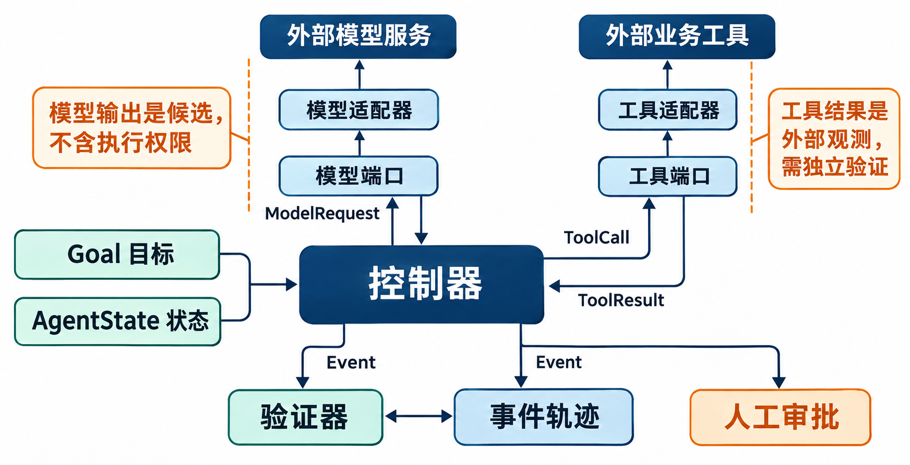
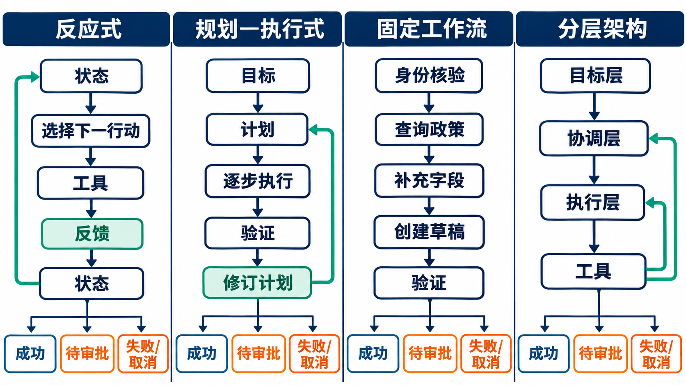

# 第3章 智能体架构基础

## 摘要

智能体系统不仅需要模型、工具和状态组件，还需要稳定的对象语义与控制契约，使不同实现能够组合、替换、测试和回放。本章从多人协作开发中的接口分歧出发，说明参数名称相近并不代表含义相同，返回格式可解析也不代表错误语义一致。随后定义 `Goal`、`AgentState`、`ModelRequest`、`ToolCall`、`ToolResult` 和 `Event` 六类公共对象，逐一说明字段、生产者、消费者、不变量、隐私等级和扩展边界。在同一工单任务上，本章比较反应式、规划—执行式、固定工作流和分层架构的控制权、状态、反馈与终止方式，并给出具备步数、预算、权限和验证检查的最小同步循环。针对跨组件运行，本章进一步建立轨迹、错误和终止契约，覆盖成功、失败、待审批、取消、超预算和验证失败。最后，通过适配器替换实验和公共参考架构，将对象契约、控制逻辑与可验证证据连接起来，为后续的异步调度、持久会话和生产运行时奠定基础。

**关键词：** 智能体架构；控制循环；状态契约；工具调用；事件轨迹；错误语义；适配器；终止状态

## 学习目标

完成本章后，读者应能够：

1. 解释公共契约为何不仅统一字段名称，还必须统一字段含义、所有权、不变量和错误语义。
2. 定义六类公共对象的输入输出、生产者、消费者、版本和隐私边界。
3. 在同一任务下比较反应式、规划—执行式、固定工作流和分层架构的控制流及适用条件。
4. 设计一个具有步数限制、预算检查、工具权限、结果验证和明确终止路径的最小同步循环。
5. 使用事件轨迹、错误码和终止记录定位模型、控制器、工具、状态或验证器中的失败。
6. 通过端口与适配器隔离供应商差异，并设计可证伪的适配器替换实验。

## 3.1 接口分歧如何使可运行模块无法合并

### 3.1.1 六份实现各自正确却不能共同运行

设想六名开发者并行实现一个工单智能体。任务目标是查询组织政策，根据用户描述生成工单草稿，并在需要高权限操作时请求审批。每名开发者的独立演示都能运行，但合并时出现了系统性冲突。有人把工具参数写成 `ticket_id`，有人使用 `caseId`；有人返回字符串 `"ok"`，有人返回布尔值 `true`，还有人返回包含 `status`、`data` 和 `error` 的对象。

错误语义更加混乱。模型适配器 A 用空字符串表示没有内容，适配器 B 抛出异常，适配器 C 返回 `finish_reason="error"`。政策查询工具把网络超时标为可重试，草稿工具却把相同超时解释为执行结果未知。控制器无法判断某次写操作是否已经发生，只能选择盲目重试或整体失败。

状态字段也没有共同定义。一个实现用 `done=true` 表示模型结束生成，另一个实现把它理解为业务目标已经完成；一个实现把审批状态放在对话历史中，另一个实现用枚举字段保存。合并后，控制器可能在模型停止生成时提前宣布工单创建成功，也可能在已经取消的任务上继续调用工具。

这些差异使独立可运行的模块在集成后失去共同语义：字段无法稳定传递，错误无法统一处理，状态也无法可靠推进。要让多个组件真正协同，接口统一就不能停留在字段名称和序列化格式，还需要进一步明确语义所有权、状态不变量以及跨组件的处理规则。

### 3.1.2 表面格式问题背后是语义所有权问题

把 `caseId` 批量重命名为 `ticket_id` 只能修复一部分语法冲突。团队还必须回答这个标识由谁生成、是否全局唯一、能否为空、是否包含个人信息、跨重试是否保持不变，以及工具返回的标识是否允许覆盖状态中的标识。没有这些约束，相同字段名仍可能表达不同概念。

返回格式也不能只追求“都能转成 JSON”。`status="success"` 可能表示 HTTP 请求成功、工具接受请求、业务动作完成或验证通过，这四种含义对应完全不同的下一步。公共契约必须把传输成功、执行成功和任务成功分开，使控制器能够依据稳定语义更新状态。

错误不是正常结果之外的一段自由文本。错误需要分类、来源、可重试性、副作用状态和证据。网络超时若发生在只读查询上，有限重试通常可接受；发生在非幂等写操作上，则应先查询动作状态。只统一错误消息文字而不统一处理语义，会把风险留给每个调用者自行猜测。

最关键的是字段所有权。模型可以提出工具参数，却不能写入“权限已批准”；工具可以报告外部结果，却不能决定整个任务成功；验证器可以判断目标条件，却不能擅自扩大预算。每个字段都需要唯一或受控的权威生产者，其他组件只能提出候选或通过事件请求变更。

### 3.1.3 公共契约连接组件、测试和组织责任

公共契约是组件之间可测试的约定，包括对象结构、字段语义、不变量、版本、错误和扩展规则。它不是特定编程语言中的一个类，也不是某家模型 API 的直接镜像。Python 数据类、TypeScript 类型和 JSON Schema 可以分别实现同一契约，只要它们保持相同语义并通过共同样例。

契约首先降低组合成本。控制器只依赖稳定的 `ModelRequest` 和模型适配器端口，不需要理解每家供应商的消息角色；工具执行器只接收通过策略检查的 `ToolCall`，不需要读取模型原始文本。组件替换时，变化被限制在适配器或明确的契约版本中。

契约也提供测试边界。团队可以构造缺失字段、非法状态转换、未知错误码和乱序事件，验证系统是否拒绝不合格对象。相比只测试一次顺利对话，契约测试更容易定位问题属于解析、策略、执行、状态更新还是验证。

最后，契约把技术字段连接到责任。隐私等级决定日志能否保存原值，授权字段决定谁可以写入，终止记录决定谁接管失败任务。架构不是组件方框的集合，而是控制权和证据如何在组件之间流动的安排。

### 3.1.4 本章的分析路径

本章先定义六类最小公共对象，再比较四种控制结构，随后建立轨迹、错误与终止契约。适配器实验用于检验这些契约能否隔离模型差异，参考架构则将对象、组件和信任边界组织为全书后续章节可以复用的基础。

分析从单任务的最小同步循环开始，使每一步的输入、决策、执行和状态变化都可以清楚观察，并据此解释控制语义与确定性回放。在这套基础语义之上，第22章扩展异步 worker、队列调度和资源治理，第23章讨论跨进程持久会话、事件状态机与恢复，第24章进一步处理流式输出与用户打断。这样的递进关系使后续运行时能力能够沿用同一组对象和控制边界。

## 3.2 六类公共对象与字段语义

### 3.2.1 契约设计从语义而不是字段列表开始

一个可复用对象至少要说明用途、生产者、消费者、必填字段、不变量、敏感性、版本和失败方式。只列字段名和类型，无法判断值从哪里来、何时有效，也无法阻止组件写入不属于它的事实。公共对象应先定义语义，再选择 JSON、数据库表或语言类型等具体表示。

必填不等于任意值都有效。`goal_id` 即使是字符串，也不能接受空白；时间字段需要统一时区和格式；枚举遇到未知值时应拒绝或进入兼容分支，而不能自动映射成最接近的状态。JSON Schema Draft 2020-12 提供结构验证与词汇表机制，但业务不变量仍需在应用层表达 (JSON Schema 2022)。

对象还要区分核心字段和扩展字段。核心字段跨章节共享，改变语义需要提升主版本；扩展字段允许特定应用添加信息，但不得覆盖核心字段，也不得改变默认安全行为。消费者必须忽略明确允许的未知扩展，同时拒绝未知的核心枚举或版本，以避免静默误解。

隐私等级是契约的一部分。本章采用公开、内部、机密、受限四级教学分类，具体项目应映射到组织政策。日志和事件默认保存标识引用而非敏感原文；受限数据进入模型请求前，需要确认模型端点、区域、保留策略和用途均获得授权。

*表 3-1：六类公共对象的责任与核心字段总览*

| 对象 | 主要职责 | 权威生产者 | 主要消费者 | 核心字段 | 关键不变量 | 默认隐私等级 |
| --- | --- | --- | --- | --- | --- | --- |
| `Goal` | 固定任务目标、成功标准和边界 | 任务入口与需求配置 | 控制器、模型请求构造器、验证器 | `goal_id`、`objective`、`success_criteria`、`constraints`、`priority`、`termination_policy` | 目标开始后不能被模型静默改写 | 内部，按目标内容上调 |
| `AgentState` | 保存业务事实、控制进度和恢复信息 | 状态管理器 | 控制器、验证器、提示构造器 | `state_id`、`goal_id`、`facts`、`control`、`authorization`、`version`、`checkpoint_ref` | 版本单调增加，终止后禁止新副作用 | 机密，按事实内容上调 |
| `ModelRequest` | 构造一次受约束的模型请求 | 模型请求构造器 | 模型适配器 | `request_id`、`messages`、`capabilities`、`allowed_tools`、`output_schema`、`budget`、`model_ref` | 只暴露当前步骤必要信息 | 机密或受限 |
| `ToolCall` | 表达一个尚待执行的工具请求 | 控制器 | 策略层、工具适配器 | `call_id`、`tool_name`、`arguments`、`authorization_ref`、`idempotency_key`、`timeout_ms` | 未通过策略和模式校验不得执行 | 机密 |
| `ToolResult` | 记录工具的真实返回和副作用状态 | 工具适配器 | 状态管理器、验证器、控制器 | `call_id`、`outcome`、`data_ref`、`error`、`side_effect`、`retry`、`evidence` | 必须对应已记录调用，不能由模型伪造 | 机密或受限 |
| `Event` | 记录已发生变化及其因果关系 | 各权威组件 | 事件存储、监控、回放器 | `event_id`、`event_type`、`occurred_at`、`producer`、`correlation_id`、`causation_id`、`payload_version` | 事件追加后不可就地改写 | 按载荷最高等级 |

### 3.2.2 Goal 固定目标与验收边界

`Goal` 描述系统要达到的可观察结果，而不是一段宽泛愿望。工单任务可以写成“根据当前政策和用户提供的信息生成一份未提交的工单草稿，并在草稿字段通过验证后结束”；成功标准包括政策来源有效、必填字段齐全、工单保持草稿状态和没有未经授权的提交动作。

`objective` 用人和系统都能理解的方式表达目的，`success_criteria` 列出可由验证器检查的断言，`constraints` 记录禁止行动、允许数据源和业务边界，`priority` 用于多个目标冲突时排序，`termination_policy` 定义成功、失败、审批、取消与预算出口。目标对象还应保存版本和创建来源，避免运行期间读取到未经评审的新定义。

目标的不变量是模型不能自行扩大目标。模型可以提出澄清问题或建议分解，但把“生成草稿”改为“提交工单”需要新的用户授权或上层目标事件。若需求确实允许目标修订，控制器应创建新版本并记录修订者、理由和受影响的成功标准，而不是覆盖原值。

目标也不能与实现步骤绑定过紧。规定必须先调用某家供应商接口属于计划或工作流配置，不是业务目标本身。把目标与实现分开，使团队能够在不改变验收意义的前提下比较不同架构和适配器。

### 3.2.3 AgentState 连接业务事实与控制进度

`AgentState` 是当前任务的显式状态，不等同于对话历史。它至少包含业务事实、控制状态、授权状态、预算、错误摘要、当前计划引用和版本。业务事实来自权威工具或经过确认的用户输入，控制状态来自控制器，授权状态来自身份或审批服务；这些字段不能由模型自由写入。

状态更新采用读版本、验证事件、写新版本的顺序。`version` 每次有效变更后单调增加，更新操作声明所依据的旧版本；若并发更新已经产生新版本，应拒绝旧写入并重新读取。即使本章的最小循环是同步的，版本字段仍为后续并发和恢复保留一致语义。

`checkpoint_ref` 指向可恢复快照或事件位置，但本章不规定持久化技术。内存对象、关系数据库和事件存储都可以实现同一契约。重要的是检查点对应哪个目标、状态版本和最后事件，以及恢复后哪些动作可以安全重放。

状态摘要与原始证据必须分开。模型生成的任务摘要可以帮助构造上下文，却不能覆盖工具结果、授权事件或预算计数。若摘要与事件冲突，系统以权威事件和业务查询为准，并把摘要不一致记录为可观察错误。

### 3.2.4 ModelRequest 隔离模型供应商差异

`ModelRequest` 表达控制器希望模型完成的一次受限认知任务。`messages` 包含当前步骤必要的系统策略、用户输入和证据视图；`capabilities` 说明需要文本生成、结构化输出或工具候选；`allowed_tools` 只暴露当前状态允许的工具；`output_schema` 规定候选结构；`budget` 限制 token、调用或时间；`model_ref` 指向逻辑模型配置和可用版本信息。

对象不直接复制某家供应商的全部请求字段。模型适配器负责把公共消息、工具和输出模式映射到具体 API，并把不支持的能力显式报告给控制器。若某端点不支持严格结构化输出，适配器不能默默忽略要求，而应返回能力不满足或使用经过批准的解析路径。

请求构造遵循最小披露原则。控制器从状态和事件中选择当前步骤需要的信息，不把完整历史、密钥或无关个人数据交给模型。进入请求的每项外部事实应保留来源引用，使后续验证能够区分模型生成内容与权威证据。

模型响应不是六类公共事实对象之一，而是适配器产生的候选结果。工具候选经过解析和结构验证后形成待审的 `ToolCall`，通过策略检查后才能执行；答案候选也需完成相应的事实与输出检查后才能展示。这样可以避免供应商特有的响应结构渗透到控制器和业务状态。

### 3.2.5 ToolCall 表达未获最终执行的行动请求

`ToolCall` 表达控制器准备交给策略层检查的行动请求。`tool_name` 必须来自版本化注册表，`arguments` 必须通过该工具的输入 schema，`authorization_ref` 指向当前主体和动作范围的授权证据，`timeout_ms` 规定执行窗口。写操作还应具有 `idempotency_key`，用于识别同一逻辑动作的重复提交。

工具调用对象与模型候选分离。模型可以建议工具和参数，控制器负责生成稳定的 `call_id`、关联目标和状态版本，并补入不能由模型决定的权限与预算信息。策略层在执行前检查工具、对象、参数、授权、预算和风险；任何拒绝都产生事件，而不是仅返回一段自然语言。

参数需要区分用户提供、工具查询、系统生成和模型推断的来源。高风险字段若来自模型推断，应要求确认或权威查询。例如模型可以从文本中提取工单类别作为候选，却不能根据姓名猜测员工权限组。字段级来源让验证器能够对不同证据采用不同信任策略。

超时不应被模型随意指定。工具注册表提供默认值与上限，控制器可在允许范围内选择；适配器必须把超时结果与副作用状态一并报告。对于非幂等写操作，超时通常进入结果未知，而不是自动重试。

### 3.2.6 ToolResult 记录环境事实与重试语义

`ToolResult` 只能由执行工具的适配器或可信模拟器产生，并必须引用既有 `call_id`。`outcome` 区分成功、拒绝、暂时失败、永久失败、超时和结果未知；`data_ref` 指向规范化结果或受控存储；`error` 使用公共错误对象；`side_effect` 描述未发生、已发生、部分发生或未知；`retry` 给出是否允许以及需要满足的条件。

工具返回的 HTTP 200 或进程退出码 0 只能作为传输或程序信号，不能直接映射为业务成功。适配器要依据工具契约检查响应字段和业务状态，再生成规范化结果。若接口只表示请求已受理，`outcome` 应体现异步受理，不能写成任务已完成。

错误对象至少包含稳定错误码、类别、来源、可重试性、面向运营者的诊断引用和可安全展示给用户的信息。原始错误可能包含堆栈、内部地址或敏感数据，不应原样进入模型上下文或用户回复。控制器依据公共类别决定修订、等待、查询、升级或终止。

`evidence` 保存支撑结果的操作编号、对象版本、校验和或查询引用。验证器依赖这些证据检查成功标准，而不是相信模型对结果的复述。若证据不足，任务可以保持处理中或进入验证失败，不能为了结束循环而宣布成功。

### 3.2.7 Event 提供顺序、因果和回放依据

`Event` 记录已经发生的事实，例如目标创建、候选被拒绝、工具调用开始、工具返回、审批完成、状态更新和任务终止。事件采用追加语义；若先前事件内容错误，应追加更正事件并引用被更正项，而不是就地修改历史。CloudEvents 为跨系统事件提供了一组通用上下文属性，本章借鉴其事件标识、来源和类型等设计 (CNCF 2022)。本章的载荷版本由公共契约另行定义，不能与 CloudEvents 的规范版本 `specversion` 混同；各实现也不必采用同一种传输绑定。

`correlation_id` 把同一任务的事件关联起来，`causation_id` 指向直接导致当前事件的事件或命令。二者不能混用：同一任务中的多个并行分支共享关联标识，却具有不同因果链。清楚的因果关系使回放器能够判断工具结果对应哪次调用，也能发现乱序或孤立事件。

事件时间至少区分发生时间与记录时间。分布式系统中，某个工具动作可能先发生、稍后才被事件存储接收；仅按写入顺序排序会造成误解。本章最小同步循环可以保持简单顺序，但公共契约为后续异步运行保留这两个语义。

事件载荷使用版本化 schema，并遵循数据最小化。事件存储不是无限制日志仓库，受限字段应使用引用、散列或脱敏值，访问和保留由政策控制。回放所需证据与隐私要求发生冲突时，应通过分层存储和权限解决，而不是在事件中复制所有原始内容。

### 3.2.8 六类对象如何组成一致的任务语义

六类对象划分闭环中的信息与控制责任。`Goal` 定义成功与边界，`AgentState` 保存当前事实和控制进度，`ModelRequest` 从二者构造有限视图，工具候选经结构检查后形成 `ToolCall`，获准执行后的环境返回被规范化为 `ToolResult`，每次已发生变化以 `Event` 留下证据。结果更新状态并影响下一轮请求，验证器使用目标、状态与结果证据判断是否满足终止条件，由控制器执行相应转移。

对象之间通过标识和版本连接，而不是依赖相似文本。`ToolCall` 引用 `goal_id`、`state_version` 和 `request_id`，`ToolResult` 引用 `call_id`，事件使用关联与因果标识串联。若引用不存在或版本不匹配，系统应拒绝状态更新并记录契约错误。

契约版本采用兼容性原则。增加消费者可以忽略的可选扩展字段通常可以提升次版本；改变必填字段、枚举含义或不变量需要主版本升级。生产者在升级前应运行所有消费者的契约样例，消费者也要对未知主版本采取明确拒绝，而不是按旧语义猜测。

一个完整工单样例会同时产生六类对象。正文通过字段表、对象关系和关键片段解释设计依据。实现时可将机器可读定义集中保存在 `agent_contracts.json` 中，并配套 schema 正反样例校验。两种表达相互配合：正文帮助读者理解字段为什么存在，机器可读契约约束不同实现对这些字段采用一致解释。

### 3.2.9 字段注册表补足类型、必填性和扩展规则

对象级概览不能替代字段级注册。实现者需要知道数组是否允许为空、时间使用什么格式、引用指向什么对象，以及字段缺失时是拒绝对象还是采用默认值。表 3-1A 给出公共最小字段，领域扩展应在命名空间中登记。

“必填”表示对象进入公共边界前必须存在且通过约束，不表示模型必须生成该字段。`authorization_ref` 由控制器依据身份与审批状态补入，`event_id` 由事件组件生成，`side_effect` 由工具适配器根据真实执行结果填写。来源与类型共同阻止模型伪造系统事实。

隐私等级按字段实际内容上调而不下调。`messages` 若包含个人信息，整个请求应按受限数据处理；`data_ref` 虽然只是引用，也可能暴露对象关系，仍至少为机密。扩展字段继承所属对象和所引用数据的最高等级。

*表 3-1A：六类公共对象的字段注册表*

| 对象.字段 | 类型 | 必填 | 权威来源 | 主要消费者 | 最小约束 | 隐私 | 扩展规则 |
| --- | --- | --- | --- | --- | --- | --- | --- |
| `Goal.goal_id` | 非空字符串 | 是 | 任务入口 | 全部组件 | 任务内唯一且不可变 | 内部 | 不允许改名 |
| `Goal.objective` | 字符串 | 是 | 需求配置/用户确认 | 控制器、模型、人工 | 必须可映射到成功标准 | 按内容 | 可增加领域说明 |
| `Goal.success_criteria` | 断言数组 | 是 | 需求配置 | 验证器 | 至少一项，具有断言 ID | 内部 | 可增加领域断言 |
| `Goal.constraints` | 约束数组 | 是 | 策略配置 | 控制器、策略层 | 禁止动作不能为空语义 | 内部 | 只能收紧默认边界 |
| `Goal.priority` | 受限枚举/整数 | 是 | 任务入口 | 调度器、控制器 | 值域由契约版本定义 | 内部 | 不得用自由文本替代 |
| `Goal.termination_policy` | 对象 | 是 | 需求配置 | 控制器 | 覆盖成功、失败和预算 | 内部 | 可增加领域原因码 |
| `AgentState.state_id` | 非空字符串 | 是 | 状态管理器 | 控制器、事件存储 | 与 `goal_id` 一一关联或明确分支 | 内部 | 不允许覆盖 |
| `AgentState.facts` | 键值对象 | 是 | 工具/确认输入 | 模型构造器、验证器 | 每项带来源和新鲜度 | 按内容 | 使用领域命名空间 |
| `AgentState.control` | 对象 | 是 | 控制器 | 控制器、监控 | 记录阶段、步骤和重复签名 | 内部 | 新字段默认不可放宽 |
| `AgentState.authorization` | 对象 | 是 | 身份/审批服务 | 策略层 | 主体、对象、动作、有效期完整 | 受限 | 只允许可信服务扩展 |
| `AgentState.version` | 非负整数 | 是 | 状态管理器 | 所有写入者 | 成功更新后单调增加 | 内部 | 不允许自定义语义 |
| `AgentState.checkpoint_ref` | 可空引用 | 否 | 状态存储 | 恢复器 | 指向同一目标和状态版本 | 机密 | 可用不同存储 URI |
| `ModelRequest.request_id` | 非空字符串 | 是 | 请求构造器 | 模型适配器、事件 | 单次调用唯一 | 内部 | 不允许模型生成 |
| `ModelRequest.messages` | 消息数组 | 是 | 请求构造器 | 模型适配器 | 至少一条，来源可定位 | 按内容上调 | 角色映射留给适配器 |
| `ModelRequest.capabilities` | 枚举集合 | 是 | 控制器 | 模型适配器 | 与模型能力声明相容 | 内部 | 可增加版本化能力 |
| `ModelRequest.allowed_tools` | 工具引用数组 | 是 | 策略层 | 模型适配器 | 只含当前允许工具 | 机密 | 不得由模型扩大 |
| `ModelRequest.output_schema` | schema 引用 | 是 | 控制器 | 模型适配器、解析器 | 版本和校验和可定位 | 内部 | 破坏性变更升主版本 |
| `ModelRequest.budget` | 对象 | 是 | 预算管理器 | 适配器、控制器 | 上限非负且不可由模型增加 | 机密 | 可增加资源维度 |
| `ModelRequest.model_ref` | 对象 | 是 | 模型路由器 | 模型适配器、审计 | 逻辑名与可用版本明确 | 机密 | 供应商字段留在适配器 |
| `ToolCall.call_id` | 非空字符串 | 是 | 控制器 | 工具适配器、事件 | 每个逻辑尝试唯一 | 内部 | 不允许重用 |
| `ToolCall.tool_name` | 注册表枚举 | 是 | 控制器 | 策略层、工具适配器 | 当前版本存在且允许 | 内部 | 新工具需登记 |
| `ToolCall.arguments` | schema 对象 | 是 | 模型候选加控制器 | 策略层、工具适配器 | 通过结构与业务校验 | 按内容 | 由工具 schema 管理 |
| `ToolCall.authorization_ref` | 非空引用 | 是 | 控制器 | 策略层、审计 | 范围覆盖对象与动作 | 受限 | 不得使用会话空白授权 |
| `ToolCall.idempotency_key` | 可空字符串 | 写操作必填 | 控制器 | 工具适配器 | 同逻辑动作稳定 | 机密 | 只读工具可省略 |
| `ToolCall.timeout_ms` | 正整数 | 是 | 工具注册表/控制器 | 工具适配器 | 不超过工具上限 | 内部 | 单位固定为毫秒 |
| `ToolResult.call_id` | 非空字符串 | 是 | 工具适配器 | 状态、验证器 | 必须引用已有调用 | 内部 | 不允许模型产生 |
| `ToolResult.outcome` | 受限枚举 | 是 | 工具适配器 | 控制器、验证器 | 区分拒绝、超时与未知 | 内部 | 新值需兼容评审 |
| `ToolResult.data_ref` | 可空引用 | 否 | 工具适配器 | 状态、验证器 | 成功结果按契约提供 | 按内容 | 原始数据不直接复制 |
| `ToolResult.error` | 可空错误对象 | 失败时必填 | 工具适配器 | 控制器、监控 | 采用公共错误契约 | 机密 | 允许领域子码 |
| `ToolResult.side_effect` | 受限枚举 | 是 | 工具适配器 | 控制器、审计 | 未发生、已发生、部分或未知 | 机密 | 不得省略未知状态 |
| `ToolResult.retry` | 对象 | 是 | 工具适配器 | 控制器 | 包含允许条件和建议等待 | 内部 | 控制器仍作最终决定 |
| `ToolResult.evidence` | 引用数组 | 是 | 工具适配器 | 验证器、审计 | 至少能定位响应或操作 | 按内容 | 可增加证据类型 |
| `Event.event_id` | 非空字符串 | 是 | 事件组件 | 事件存储、回放器 | 全局或命名空间内唯一 | 内部 | 不允许覆盖 |
| `Event.event_type` | 版本化名称 | 是 | 权威组件 | 消费者 | 使用已发生事实语义 | 内部 | 新类型必须登记 |
| `Event.occurred_at` | RFC 3339 时间 | 是 | 权威组件 | 排序、监控 | 含时区；记录时间另存 | 内部 | 不允许本地模糊时间 |
| `Event.producer` | 组件引用 | 是 | 权威组件 | 审计、回放器 | 必须是注册组件 | 内部 | 不接受自由用户输入 |
| `Event.correlation_id` | 非空字符串 | 是 | 任务入口 | 全部事件消费者 | 同一任务保持一致 | 内部 | 子任务另有因果引用 |
| `Event.causation_id` | 可空引用 | 否 | 事件组件 | 回放器 | 非起始事件通常必填 | 内部 | 指向事件或命令 |
| `Event.payload_version` | 语义版本 | 是 | schema 注册表 | 全部消费者 | 与载荷 schema 对应 | 内部 | 主版本不兼容时拒绝 |

### 3.2.10 完整对象生命周期展示契约如何协作

工单任务开始时，入口组件根据用户确认创建 `Goal`，状态管理器创建版本为 0 的 `AgentState`，事件组件追加 `task.started`。控制器检查目标与状态一致后，从必要事实、允许工具和预算构造第一个 `ModelRequest`，并记录请求事件。

模型适配器返回查询政策的候选。解析器确认候选符合输出 schema，控制器从候选生成 `ToolCall`，补入 `call_id`、授权引用、超时和当前状态版本。策略层确认工具是只读、主体有权查询且预算充足后，工具适配器执行调用。

适配器将外部政策响应规范化为 `ToolResult`，保存政策版本和证据引用。状态管理器依据结果事件写入新事实并把状态版本从 0 推进到 1。模型无法直接完成这次写入，它只能在后续请求中看到经过选择的政策视图。

当草稿创建完成后，验证器读取 `Goal.success_criteria`、状态和工具证据，检查字段、主体、政策版本和副作用。全部断言通过时，控制器创建 `succeeded` 终止记录并追加事件；任何断言失败都进入 `verification_failed` 或受控修订，而不是覆盖工具结果。

这个生命周期显示六类对象不是六份孤立数据。每个对象都在明确时点由权威组件产生，并通过标识、版本和事件连接。实现团队只要改变其中一个对象的含义，就必须评估所有生产者、消费者和回放样例。




*图 3-1：模型、控制器、工具、状态、验证器及信任边界参考架构*

六类对象解决了组件之间“传递什么、由谁写入”的问题。接下来还需要回答“谁决定下一步、何时停止以及如何根据环境反馈调整行动”。这正是控制结构需要处理的核心问题。

## 3.3 四种控制结构与最小循环

### 3.3.1 使用同一工单任务建立可比基线

为了避免用不同任务为不同架构制造优势，本节统一使用“查询当前政策并生成未提交的工单草稿”。输入包括用户问题、经过身份核验的主体标识和当前工具注册表；允许工具只有 `search_policy`、`get_user_context` 和 `create_ticket_draft`；禁止工具提交或发布工单。成功条件是政策来源有效、草稿必填字段齐全、草稿主体与用户一致，并且验证器确认没有提交副作用。

任务包含三类变化。用户可能没有给出工单类别，需要系统从允许枚举中提出候选并请求确认；政策查询可能返回多个版本，需要选择当前生效版本；草稿工具可能返回缺失字段或暂时错误。所有架构面对相同输入、工具、权限、预算和成功条件，区别仅在下一步由谁决定以及状态如何组织。

比较架构时不能只看能否完成顺利样例。还要观察错误政策、缺失参数、工具拒绝、用户取消和预算耗尽时的行为。一个方案在正常路径上步骤最少，却没有取消出口或无法区分工具失败，仍不能被视为更合适。

架构在本章中表示控制结构，不等于具体框架。相同框架可以实现多种结构，同一种结构也可以用不同语言和运行时实现。选择依据应是任务路径的确定性、环境变化、行动风险、可验证性和团队运维能力，而不是库的流行程度。

经典智能体研究从感知、行动、自主性和理性行为等角度建立了基础语言 (Wooldridge and Jennings 1995; Russell and Norvig 2020)。本章在此基础上聚焦软件架构，把这些能力落实为组件责任、对象契约和可观察控制流，而不把某一种实现模式定义为智能体的唯一形式。

### 3.3.2 反应式结构直接根据当前状态选择下一步

反应式架构根据当前观测和状态选择下一行动，不预先生成完整计划。控制器将目标、状态和允许工具构造成 `ModelRequest`，模型提出一个候选；执行与反馈更新状态后，再进行下一轮选择。经典分层反应式思想强调通过感知与行动的紧密连接处理变化环境，Brooks 的层级控制研究是相关早期代表 (Brooks 1986)。

在工单任务中，系统先观察到缺少政策证据，于是调用政策查询；得到政策后发现缺少工单类别，于是请求用户确认；信息齐全后创建草稿并验证。每一步只需要依据当前状态决定下一步，路径能够随工具返回变化。

这种结构的优势是适应性强，状态变化后不必维护一份已经过期的长计划。实现可以较小，适合步骤不多、反馈频繁、动作可逐步验证的任务。它也适合作为最小教学循环，因为模型、工具、状态与验证器之间的责任比较直观。

ReAct 将推理与行动观察交替组织，是大语言模型场景下相关控制思路的代表 (Yao et al. 2023)。但方法提示本身不提供工具权限、状态所有权或停止保证，本章的控制器仍需在模型候选之外落实这些责任。

局限在于局部选择可能缺少全局协调。模型可能在两个工具之间往返，重复收集已有信息，或只追求下一步合理而忘记总预算。控制器因此必须提供目标检查、重复检测、步数和预算上限；复杂任务还可能需要显式计划或分层结构。

### 3.3.3 规划—执行式结构先形成计划再逐步修订

规划—执行式架构把“决定总体步骤”和“执行当前步骤”分开。规划器根据目标和初始状态生成带依赖关系的计划，执行器逐项调用工具；每次结果由验证器检查，必要时触发重新规划。计划是可修订候选，不是绕过权限的批量执行凭证。

对工单任务，一个初始计划可能包含查询用户上下文、查询有效政策、生成字段、创建草稿和验证草稿五步。若政策查询发现任务不在支持范围，执行器停止后续步骤；若用户信息已经在可信状态中，规划器可以跳过重复查询；若草稿验证失败，只修订相关步骤而不是从头生成全部内容。

规划带来全局可见性。系统可以在执行前估算工具数量、识别依赖、安排并行的只读步骤，并让人工审查高风险计划。对于步骤较多、依赖清晰且计划质量可以评估的任务，它比纯反应式选择更容易解释整体路径。

信念—愿望—意图（BDI）研究用显式认知状态讨论智能体如何形成和维持意图，是理解计划与执行关系的重要理论背景 (Rao and Georgeff 1995)。本章的 Goal、状态和计划并不直接等同于 BDI 的形式语义，只借鉴其区分环境认知、期望目标与行动承诺的思路，避免将语义不同的信息合并为同一状态字段。

规划也引入计划陈旧、修订成本和错误传播。模型生成的计划可能引用不存在的工具，执行环境变化会使后续步骤失效，过度详细的计划还可能限制必要适应。控制器需要定义何时局部修订、何时整体重规划、何时停止，并确保每个执行步骤仍接受独立权限与契约检查。

### 3.3.4 固定工作流用预定义状态转移控制路径

固定工作流由设计者预先规定节点、条件和合法转移。模型可以在某些节点完成分类或字段生成，但不能自由改变主干流程。工单任务可以固定为身份已核验、政策查询、字段提取、缺失信息确认、草稿创建、结果验证和结束几个状态。

工作流的主要优势是可预测和可审计。每个状态有明确进入条件、允许动作和后继状态，测试人员可以枚举主要路径。对规则稳定、例外有限、合规要求强的业务流程，固定工作流通常比开放式规划更简单，也更容易证明没有跳过审批。

工作流并不排斥大语言模型。在“字段提取”节点，模型可以把用户自然语言映射到受限类别；在“说明结果”节点，模型可以生成易懂回复。关键在于模型输出仍由节点契约约束，不能直接把任务跳转到任意状态。

局限在于流程外情形需要显式设计。新政策或新工具可能要求修改状态图，分支数量随例外增加，开放任务难以预先枚举。系统应把无法匹配的输入转交人工，或进入另有权限和预算限制的探索流程，避免在未定义控制规则的默认分支中重新引入无约束决策。

### 3.3.5 分层架构将目标、协调和执行责任分开

分层架构把系统划分为不同时间尺度和抽象层次。高层负责目标、策略和任务分解，中层协调子任务与资源，低层负责具体工具调用和局部反馈。每一层只通过明确接口交流，低层执行不能改写高层目标，高层也不应绕过执行层权限。

在工单任务中，高层确定目标只是生成草稿；协调层选择政策查询和字段准备子任务；执行层调用具体工具并规范化结果。验证层虽然可以作为横切组件，却不能自行发起未经控制器批准的工具。若将来扩展为多个专业智能体，分层还可以限定每个角色的工具与状态视图。

分层适合目标包含多个子域、工具数量较多或需要复用低层能力的系统。它能够隔离策略与基础设施，使高层计划不依赖某个具体 API，低层适配器也不理解全部业务目标。端口与适配器架构同样强调把应用核心与外部技术隔离 (Cockburn 2005)。

分层会增加接口数量和协调开销。层次过多时，一次简单查询可能经过多个转发，错误责任难以定位；上下层模型也可能给出冲突决定。团队应只在确有不同责任、变化速度或信任边界时引入层次，并为跨层命令、结果和错误定义共同契约。

*表 3-2：四种控制结构在同一工单任务上的比较*

| 维度 | 反应式 | 规划—执行式 | 固定工作流 | 分层架构 |
| --- | --- | --- | --- | --- |
| 下一步控制权 | 控制器结合当前状态与模型候选决定 | 规划器提出步骤，执行器逐项校验 | 工作流定义合法转移 | 高层定目标，中层协调，低层执行 |
| 状态表示 | 当前事实和控制计数为主 | 状态加计划、依赖和修订版本 | 显式流程状态与节点数据 | 分层状态与受控共享视图 |
| 反馈作用 | 直接影响下一轮候选 | 更新步骤结果并触发局部或整体重规划 | 触发预定义分支 | 低层反馈逐层汇总和升级 |
| 终止依据 | 目标验证、步数、预算或错误 | 计划完成且目标验证，或重规划上限 | 进入合法终止节点 | 高层目标验证与各层资源边界 |
| 主要优势 | 灵活、实现较小、适应局部变化 | 全局路径可见，依赖可分析 | 可预测、易审计、易枚举测试 | 策略与执行隔离，适合复杂组合 |
| 主要风险 | 局部循环、缺少全局协调 | 计划陈旧、修订复杂、错误传播 | 流程外输入和分支膨胀 | 接口与协调成本，跨层冲突 |
| 优先场景 | 短任务、频繁反馈、逐步可验收 | 多步骤、依赖清楚、需要计划审查 | 稳定流程、高合规、例外有限 | 多子域、多团队或多时间尺度 |
| 不宜使用 | 长依赖且需全局优化 | 简单固定任务 | 开放探索、路径难以枚举 | 小型任务或责任无法清楚分层 |

### 3.3.6 固定流程足够时不应引入开放控制

判断是否需要智能体控制，先问任务路径是否已经稳定。如果步骤、分支、工具和异常都能由业务规则明确列出，固定工作流通常更容易测试和维护。模型可以作为节点内部的语言处理器，而不必掌握整个流程的下一步控制权。

第二个问题是环境反馈是否会产生新的行动选择。如果反馈只决定“继续或失败”两个预定义分支，状态机已经足够；如果反馈内容会改变工具集合、任务分解或目标可达性，反应式或规划式控制才可能提供价值。动态性必须来自任务，而不是为了展示模型能力人为制造。

第三个问题是开放控制是否有可验证边界。工具没有稳定契约、目标不能验收或错误后无人接管时，增加模型自主选择只会扩大不确定性。此时应先完善需求、接口和工作流，再讨论开放循环。

架构选择可以分层组合。稳定主干采用工作流，某个研究节点内部使用有界规划，底层工具统一走适配器与策略检查。组合的前提是每层控制权清楚，不能让模型既决定流程又绕过工作流直接调用高风险工具。



*图 3-2：反应式、规划—执行式、固定工作流和分层架构对照*

### 3.3.7 最小循环保留关键控制责任

下面的最小循环把一次任务运行压缩为若干关键步骤，重点呈现预算检查、模型候选解析、工具授权、结果验证和状态终止之间的先后关系。数据类、存储和网络等基础设施通过端口接入，不影响这里展示的控制语义。

```python
def run(goal, state, model, tools, verifier, limits):
    emit("task.started", goal_id=goal.id, state_version=state.version)

    while not state.is_terminal:
        if state.cancel_requested:
            return terminate(state, "cancelled")
        if limits.exhausted(state.usage) or state.steps >= limits.max_steps:
            return terminate(state, "budget_exhausted")

        request = build_model_request(goal, state, tools.allowed_for(state))
        proposal = model.generate(request)
        candidate = parse_and_validate(proposal, request.output_schema)

        if candidate.kind == "final_answer":
            verdict = verifier.check(goal, state, candidate)
            return terminate(state, "succeeded" if verdict.ok else "verification_failed")

        call = build_tool_call(candidate, goal, state)
        decision = authorize_and_validate(call, state)
        if not decision.allowed:
            state = record_rejection(state, call, decision)
            return terminate_or_escalate(state, decision)

        result = tools.execute(call)
        state = apply_result(state, call, result)
        verdict = verifier.check_progress(goal, state, result)

        if verdict.goal_satisfied:
            return terminate(state, "succeeded")
        if verdict.requires_approval:
            return terminate(state, "requires_approval")
        if verdict.unrecoverable:
            return terminate(state, "failed")

    return terminate(state, "failed")
```

循环先检查取消、预算和步数，再构造模型请求。模型只生成候选，解析器检查结构，策略层检查工具与授权，执行器生成真实结果，状态管理器应用事件，验证器判断目标进展。此处省略了端口异常捕获、用量记账和状态持久化；完整实现还须为解析失败、模型不可用及工具超时等情况记录事件，并提供明确的终止或升级路径。

这个顺序不是唯一实现，但关键责任不能省略。若把权限检查放在工具执行之后，防护已经太晚；若让模型直接返回 `state.is_terminal=true`，模型就越过验证器；若预算只在调用后检查，系统可能已经超支。最小循环的价值在于把这些边界集中展示，而不是提供通用生产框架。

### 3.3.8 控制循环仍需面对若干实现取舍

验证频率影响成本和风险。每一步都查询权威状态可以降低错误传播，却增加延迟与工具负载；只在最终验证则可能让错误状态影响多个步骤。高影响动作应在执行前后验证，低风险只读步骤可以根据证据新鲜度和任务预算调整。

状态粒度影响可回放性。只保存最终快照实现简单，但难以解释变化；保存所有原始内容便于调查，却带来隐私和存储成本。推荐保存结构化事件、必要证据引用和受控快照，原始敏感内容进入有权限与保留期的独立存储。

错误恢复也存在取舍。自动重试可以处理暂时故障，但会增加尾延迟并可能重复副作用；立即转人工更安全，却增加运营负担。工具契约应明确幂等性与可重试条件，控制器再按错误类别、剩余预算和任务风险决定。

最后，模型调用次数不是智能体能力的直接指标。更多循环可能带来修订，也可能只是重复。架构评估应检查目标成功、边界遵守、事件完整、成本和终止质量，而不是用轨迹长度代替质量。

### 3.3.9 架构选择需要留下可复核的决定依据

团队不应在讨论中简单记录“选择分层架构，因为更灵活”。设计决定至少要列出任务结构、候选方案、关键质量属性、被否决原因和重新评审触发条件。这样，当工具数量、任务风险或团队规模变化时，可以判断原决定是否仍然成立。

对于本节工单任务，固定工作流和反应式结构都可能合理。若政策与草稿步骤稳定、例外能够枚举，工作流降低测试与运维成本；若政策结果会动态决定需要收集哪些字段，受控反应式循环减少分支膨胀。决定依据来自任务证据，而不是架构名称。

规划—执行式和分层架构应有更高引入门槛。只有计划依赖需要全局审查，或高层策略与低层执行确有不同变化速度和责任团队时，新增组件才抵消协调成本。未来可能复杂不是当前过度设计的充分理由。

*表 3-2A：工单任务的架构决定记录样例*

| 项目 | 记录内容 |
| --- | --- |
| 决策目标 | 在政策动态变化时生成可验证草稿，禁止自动提交 |
| 候选方案 | 固定工作流、受控反应式、规划—执行式、分层架构 |
| 优先质量属性 | 边界可验证、错误可定位、实现与运维成本可控 |
| 当前选择 | 固定工作流主干加受控模型节点 |
| 选择依据 | 主干步骤稳定，开放性主要位于字段理解和政策解释 |
| 被否决方案 | 完全开放反应式会增加循环风险；分层架构对当前任务过重 |
| 必须保持 | 公共对象、工具权限、验证和终止契约 |
| 重新评审触发 | 工具超过既定规模、任务出现跨域依赖、例外无法枚举 |
| 已知限制 | 新政策类型仍需更新工作流节点与回归样例 |

控制结构确定了行动如何产生，却还不能说明一次运行是否留下了足够证据。为了让错误能够定位、状态能够恢复、终止结论能够复核，下一节把循环中的关键变化组织为事件轨迹，并统一错误与终止语义。

## 3.4 轨迹、错误与终止契约

### 3.4.1 轨迹是可验证事件序列而不是聊天记录

轨迹（trace）是同一任务中按照关联和因果关系组织的事件序列。它记录系统看到了什么、提出了什么、执行了什么、环境返回什么、状态如何变化以及为什么终止。聊天记录只是其中一种输入输出，不能替代工具、权限和验证事件。

一条可回放轨迹至少从 `task.started` 开始，以一个终止事件结束。中间可以包含 `model.requested`、`model.proposed`、`tool.rejected`、`tool.started`、`tool.completed`、`state.updated`、`verification.completed` 和 `approval.requested`。事件名称使用稳定过去时语义，避免把命令与已发生事实混淆。

轨迹完整性可以由不变量检查。每个 `tool.completed` 必须对应一个已有 `tool.started`，每个状态版本只能由一个被接受事件推进，终止事件之后不能再出现新的副作用工具开始事件。缺失或乱序不一定证明业务失败，却说明证据链不完整，应触发运行时调查。

轨迹还需要视图隔离。运营人员可以看到错误码和资源消耗，业务审批者看到对象、行动与依据，最终用户只看到与其任务相关且可安全披露的信息。所有角色共享同一事件语义，但不必共享全部载荷。

### 3.4.2 错误契约区分来源、影响和恢复方式

公共错误对象包含 `code`、`category`、`source`、`retryable`、`side_effect_state`、`message_safe`、`diagnostic_ref` 和 `details_version`。`code` 稳定供程序分支，`category` 支持统计，`source` 定位责任组件，`message_safe` 用于对外说明，`diagnostic_ref` 指向受控的内部细节。

错误类别至少区分契约错误、模型错误、策略拒绝、工具错误、状态冲突、预算错误和验证错误。契约错误表示对象不符合 schema 或不变量；模型错误表示端点失败或候选不可解析；策略拒绝是按设计阻止行动，不应与系统故障混为一类。

可重试性必须结合操作语义。`retryable=true` 不是立即重试命令，还需要重试条件、退避、最大次数和副作用判断。写操作结果未知时，即使底层网络错误通常可重试，也应先查询幂等键或操作状态。

RFC 9457 使用稳定类型和结构化字段表达 HTTP API 问题，本章的公共错误对象采用相似的机器可处理思想，但面向智能体内部组件，额外加入可重试性、副作用和诊断引用 (Nottingham et al. 2023)。具体传输可映射到 HTTP、消息队列或进程内异常，语义保持一致。

*表 3-3：公共错误码与默认处理*

| 错误码 | 类别 | 典型触发 | 默认处理者 | 是否可自动重试 | 必须记录的证据 |
| --- | --- | --- | --- | --- | --- |
| `CONTRACT_INVALID` | 契约 | 缺字段、类型或枚举非法 | 解析器/适配器 | 否，可允许一次模型格式修复 | 原始候选引用、schema 版本、校验路径 |
| `MODEL_UNAVAILABLE` | 模型 | 端点暂时不可用 | 模型适配器 | 有界重试 | 模型引用、状态码、次数和退避 |
| `MODEL_EMPTY` | 模型 | 空响应或无候选 | 控制器 | 最多一次，随后失败或换路由 | 请求 ID、响应元数据 |
| `POLICY_DENIED` | 策略 | 工具或对象未获授权 | 策略层 | 否 | 主体、动作、对象和策略版本 |
| `TOOL_TIMEOUT` | 工具 | 超过执行时限 | 工具适配器 | 只读可有界重试，写入先查询 | 调用 ID、幂等键、副作用状态 |
| `TOOL_PERMANENT` | 工具 | 工具不存在或参数语义不支持 | 控制器 | 否 | 工具版本、错误分类和候选 |
| `STATE_CONFLICT` | 状态 | 旧版本更新新状态 | 状态管理器 | 重新读取后再决定 | 期望版本、实际版本和事件 |
| `BUDGET_EXHAUSTED` | 预算 | 步数、token、时间或费用耗尽 | 控制器 | 否 | 预算类型、上限和消耗明细 |
| `VERIFICATION_FAILED` | 验证 | 结果不满足成功断言 | 验证器 | 依据失败项决定 | 断言 ID、实际值和证据引用 |
| `RESULT_UNKNOWN` | 工具/状态 | 无法确认写操作是否生效 | 控制器和人工 | 不得盲目重试 | 操作编号、查询结果和交接信息 |

### 3.4.3 终止状态表达系统已经停止的原因

终止状态是控制器作出的系统结论，不是模型生成的结束词。本章区分运行段结束与业务任务结束：一次运行段可以因等待审批而停止，业务任务仍待后续处理。每条终止记录包含 `termination_id`、`status`、`reason_code`、`goal_id`、`final_state_version`、`evidence_refs`、`remaining_actions` 和 `decided_by`。记录一旦产生，该运行段不得再开始新的副作用动作。

`succeeded` 表示全部必要成功标准经验证满足，不等于模型给出答案或工具返回成功。`failed` 表示任务无法在当前目标和边界下完成，并且没有等待中的安全恢复路径。失败记录应指明用户可做什么、运营者是否需要处理以及哪些部分已经产生副作用。

`requires_approval` 表示任务暂停在明确审批点，尚未获得继续行动的授权。它结束当前自动运行段，但不表示业务任务失败或完成；交接包要包含候选动作、对象、风险、证据和审批范围。审批通过后，控制器重新检查目标、状态、授权有效期和剩余预算，以新的运行段恢复处理，并保留原终止记录。

`cancelled` 表示有效取消信号已经被控制器接受。取消并不保证此前副作用自动撤销，终止记录需要列出已经完成和仍在进行的动作。`budget_exhausted` 表示某类硬预算达到上限，系统必须停止新调用，并保存可恢复或人工接管信息。

`verification_failed` 表示执行结果存在，但未通过目标断言。这一状态与工具失败不同，例如草稿已经创建，字段却引用过期政策。控制器若在当前预算内修订，应保持 `running` 并记录验证失败事件；若以 `verification_failed` 结束当前运行段，后续恢复必须经过明确的策略检查并建立新运行段，不得直接继续执行或把工具成功写成任务成功。

### 3.4.4 状态转换限制非法后继状态

状态机不是为了把所有业务变成固定工作流，而是定义控制层允许的生命周期。开放式模型可以在运行态提出不同动作，仍必须遵守从运行到审批、取消、预算耗尽或验证失败的合法转移。控制自由存在于边界之内。

*表 3-4：任务状态转换与终止契约*

| 当前状态 | 触发事件 | 处理者 | 合法后继状态 | 禁止行为 |
| --- | --- | --- | --- | --- |
| `created` | 目标与初始状态通过校验 | 控制器 | `running`、`failed` | 未校验目标就调用工具 |
| `running` | 模型提出合法只读调用 | 控制器 | `running` | 绕过策略层执行 |
| `running` | 高影响动作需要审批 | 策略层 | `requires_approval` | 审批前执行动作 |
| `running` | 成功标准全部验证 | 验证器/控制器 | `succeeded` | 仅凭模型声明成功 |
| `running` | 不可恢复错误 | 控制器 | `failed` | 无上限重复相同调用 |
| `running` | 用户取消被接受 | 控制器 | `cancelled` | 取消后启动新副作用 |
| `running` | 任一硬预算耗尽 | 预算管理器 | `budget_exhausted` | 借新请求绕开预算 |
| `running` | 工具结果未通过断言 | 验证器 | `verification_failed`、`running`、`requires_approval` | 把工具成功等同任务成功 |
| `requires_approval` | 审批通过，状态、授权与剩余预算检查通过 | 审批服务/控制器 | `running`（新运行段） | 扩大批准对象或参数范围 |
| `requires_approval` | 审批拒绝或超时策略触发 | 控制器 | `failed`、`cancelled` | 无限等待且不通知用户 |
| 已结束的运行段 | 只读审计或导出 | 审计组件 | 原终止记录不变 | 改写历史记录或在原运行段启动新副作用 |

状态转换同时产生事件并推进状态版本。若事件写入成功但快照更新失败，恢复过程可以从事件重建；若工具已经执行但结果事件未写入，则进入结果未知并通过幂等键查询。这里建立的外部可观察语义，也为第23章进一步讨论事务、一致性与恢复策略提供了共同基础。

### 3.4.5 取消、预算和验证具有相同控制地位

取消不是用户界面上的装饰按钮，而是控制器持续检查的高优先级信号。模型请求、工具执行和等待审批都需要定义取消传播方式。无法立即停止的外部动作应返回“取消已请求”与实际完成状态，不能把请求接受误报为动作已停止。

预算包括步数、模型调用、工具调用、token、墙钟时间、费用和风险配额。软预算用于告警或降级，硬预算用于终止；各类预算的权威计数由控制器或计量组件维护，模型不能重置。预算检查发生在调用前，调用后再记录实际消耗。

验证与预算共同决定是否继续。即使还有资源，只要目标已经满足就应停止；即使模型认为再调用一次可能改进，只要硬预算耗尽就必须终止。架构由此把“能力可以继续”与“系统允许继续”分开。

高风险系统还需要风险预算，例如某类敏感工具最多尝试一次，或验证失败后只能转人工。风险预算不能简单换算成 token 或费用，因为一次越权动作的代价不与调用量线性相关。

### 3.4.6 确定性回放检查契约而不是重新制造副作用

确定性回放使用冻结的输入、模型候选和工具结果，重新运行控制器与状态转换，检查事件顺序和终止状态。回放适合验证业务策略、错误分支和版本兼容，不要求再次调用真实模型，也不应重新执行写操作。

回放夹具需要包含初始 `Goal`、初始 `AgentState`、按顺序提供的模型候选和工具结果、期望事件类型、期望最终状态以及禁止出现的事件。若控制器请求了夹具中不存在的调用，测试应失败，这能发现实现路径意外变化。

随机模型行为与确定性控制要分开测试。契约回放证明给定候选和结果时控制器行为稳定；真实模型实验再测量产生这些候选的概率。用 mock 回放通过不能证明模型能力，用真实模型偶然成功也不能证明错误路径已经覆盖。

事件时间和标识在回放中可以使用固定生成器，避免每次运行产生不同快照。生产实现仍使用真实唯一标识和时间源，但通过依赖注入保持测试可控。这个设计也是端口与适配器思想在基础设施上的应用。

### 3.4.7 轨迹质量需要完整性、顺序和数据边界共同保证

轨迹完整性关注必要事件是否存在。模型调用、工具执行、策略拒绝、状态更新、验证和终止都应有对应记录；缺失事件会使评估分母、错误定位和责任复核失真。完整性检查可以针对事件类型和引用关系自动运行。

轨迹顺序关注因果而不只是时间。不同主机的时钟可能有偏差，异步结果也可能晚到，因此回放器优先使用 `causation_id`、状态版本和调用标识建立顺序。时间戳用于观测延迟，不能单独决定哪个事件导致哪个结果。

轨迹一致性关注事件与状态是否相符。若事件显示工具被拒绝，状态中不应出现该工具的成功结果；若最终状态为 `succeeded`，轨迹必须存在全部成功断言的证据。发现不一致时，应停止高风险后续动作并保存调查信息。

数据边界关注记录多少内容。为了回放而保存完整提示、文档和工具响应可能违反最小化原则；只保存哈希又可能不足以复核语义。团队应按字段选择原值、脱敏值、受控引用或校验和，并记录保留期限和访问角色。

*表 3-4A：轨迹质量的检查问题*

| 质量维度 | 检查问题 | 自动检查示例 | 失败后的处理 |
| --- | --- | --- | --- |
| 完整性 | 必要事件是否全部存在 | 每个调用有开始与结果，每次运行有终止 | 标记证据不完整并调查 |
| 因果性 | 事件能否连接到直接原因 | `causation_id` 指向有效事件或命令 | 拒绝孤立状态更新 |
| 顺序性 | 状态版本是否单调且无跳跃 | 版本 n 只能推进到 n+1 | 进入状态冲突处理 |
| 一致性 | 状态与事件是否表达相同事实 | 被拒绝调用不得产生成功结果 | 停止后续副作用 |
| 唯一性 | 标识是否被不当复用 | `call_id`、`event_id` 不重复 | 拒绝写入并告警 |
| 最小化 | 是否记录了无关敏感数据 | 字段级隐私策略扫描 | 脱敏、隔离并触发审查 |
| 可用性 | 证据引用是否仍可解析 | 引用对象存在且权限可验证 | 标记不可复现限制 |

当对象、控制流和事件轨迹具有稳定语义后，组件替换才有了可检验的共同基线。下一节以模型适配器为例，说明如何用同一组契约样例判断供应商差异是否被限制在适配层内。

## 3.5 可替换适配器实验与契约验证

### 3.5.1 实验问题与可证伪假设

实验问题是模型适配器能否在不修改 `Goal`、`AgentState`、控制器、工具端口和验证器的情况下替换，并对相同确定性任务产生符合契约的事件序列。这里的“可替换”不要求两个模型生成完全相同的文字，而要求供应商差异被适配器吸收，核心系统仍能解析候选、执行相同策略并进入合法终止状态。

可证伪假设 H1 是更换模型适配器只需要修改适配器构造和配置，不需要修改业务状态字段或控制器分支。H2 是两个适配器遇到空返回、非法字段、超预算和验证失败时，都能映射到相同公共错误与终止契约。H3 是所有回放中的事件顺序满足轨迹不变量。

如果替换适配器时必须修改业务状态字段或控制器分支，例如让控制器读取供应商专有字段，H1 被拒绝。真实模型端点不能稳定生成合法候选，说明其任务能力或格式遵循能力不足，需单独评估，并不直接否定 H1。如果适配器把空返回分别映射成成功和失败，H2 被拒绝。如果某次工具完成事件没有对应开始事件，或已终止的运行段仍启动新的工具调用，H3 被拒绝。

实验不以“两个模型答案相似”为主要成功标准。文本相似度不能证明状态、权限、事件和终止语义兼容。真正的验收对象是接口、行为边界和替换影响范围。

### 3.5.2 模型端口只暴露核心系统真正需要的能力

模型端口可以概括为 `generate(request: ModelRequest) -> ModelProposal`。`ModelProposal` 至少区分最终答案候选、工具调用候选、澄清请求和拒绝，并保留模型引用、使用量和结束原因。端口不向控制器暴露某家供应商的完整响应对象。

适配器负责消息角色映射、工具描述转换、结构化输出配置、响应解析、token 使用量规范化和供应商错误转换。若供应商使用不同的工具调用字段，差异只存在于适配器内部；公共候选仍使用相同字段和枚举。

端口还需要能力协商。模型配置声明是否支持工具候选、严格 schema、流式输出和使用量回传。本章实验只要求非流式同步调用、文本与工具候选、最终使用量；不支持的能力必须在任务开始前报告，不能运行到中途才静默降级。

模型端口不负责权限、业务状态和任务终止。适配器可以报告端点拒绝或响应不合格，但不能决定工具是否有权执行，也不能把供应商的 `stop` 原因直接映射为任务成功。控制器和验证器仍是公共行为的权威组件。

### 3.5.3 工具端口隔离外部接口与业务控制

工具端口接收已经过策略检查的 `ToolCall`，返回规范化 `ToolResult`。适配器负责参数名称、传输协议、身份凭据引用、超时和原始错误映射。它不能因为底层接口支持更多动作就扩大当前任务允许的工具集合。

工具注册表提供逻辑名称、版本、输入和输出 schema、风险等级、幂等性、默认超时及所需权限。控制器依赖注册表而不依赖具体 URL。更换政策数据库或工单平台时，只要逻辑契约保持兼容，核心循环不应改变。

适配器还要阻止供应商数据泄漏到公共状态。例如底层响应包含内部调试字段、访问令牌或未脱敏个人信息，适配器只能将允许字段写入 `ToolResult`，敏感原文进入受控诊断存储并通过 `diagnostic_ref` 引用。

若外部接口无法表达公共契约所需的关键语义，适配器不能伪造。例如底层写接口超时后无法查询操作状态，适配器必须返回 `RESULT_UNKNOWN`，而不能为了满足公共字段而声称未执行。契约暴露能力缺口比隐藏缺口更安全。

### 3.5.4 两种模型适配器的实验设置

适配器 A 是确定性脚本模型。它按照测试用例返回冻结候选，不访问网络，用于验证控制器、状态、工具和事件。每条候选都有版本和校验和，相同输入得到相同结果。它不用于证明真实模型的语言理解或工具选择能力。

适配器 B 是实际模型端点适配器。它通过环境配置引用端点和凭据，使用冻结的模型标识、提示版本、解码参数和输出 schema。正式运行前必须确认数据许可、价格日期和端点保留策略；密钥不进入正文、样例或轨迹。

两种适配器共享同一个 `Controller`、`ToolRegistry`、内存状态存储、确定性工具模拟器和验证器。实验不允许为适配器 B 增加特殊业务分支。若实际模型需要供应商专属预处理，预处理留在适配器内部，并记录代码改动行和配置项。

任务材料是原创的模拟政策和工单数据，不含个人信息。工具模拟器提供当前政策、用户上下文和草稿写入，并能够注入超时、空结果、字段缺失和验证失败。所有副作用只发生在内存夹具中，不连接真实工单系统。

实验要求保存模型和提示版本、适配器提交版本、schema 版本、工具夹具校验和、运行环境、随机参数、命令、退出码和原始事件。真实模型至少重复运行若干次以观察随机变化，具体次数在执行前冻结；确定性适配器每条样例运行一次并做完全事件断言。

*表 3-5：适配器替换实验的冻结条件*

| 项目 | 固定内容 | 允许变化 | 必须记录 |
| --- | --- | --- | --- |
| 任务 | 同一组 10 条工单样例 | 不允许 | 任务版本与校验和 |
| 公共契约 | 六类对象及错误、终止枚举 | 不允许 | `agent_contracts.json` 版本 |
| 控制器 | 相同代码与配置 | 不允许 | Git 提交标识 |
| 工具 | 相同注册表和确定性模拟器 | 不允许 | 工具版本与夹具 |
| 验证器 | 相同成功断言 | 不允许 | 断言 ID 和版本 |
| 预算 | 相同步数、调用和 token 上限 | 不允许 | 配置与实际消耗 |
| 模型适配器 | A 与 B 两种实现 | 允许 | 类型、版本和构造配置 |
| 模型输出 | 由各适配器产生 | 允许 | 原始响应受控引用与公共候选 |
| 最终说明文字 | 可不同 | 允许 | 脱敏文本与结构校验 |
| 事件语义 | 类型、顺序不变量与终止集合 | 不允许 | 完整事件轨迹 |

### 3.5.5 十条确定性契约与回放样例

十条样例覆盖正常路径和任务卡指定故障。每条都具有冻结输入、候选序列、工具结果、期望事件、最终状态和禁止事件。样例数量用于契约覆盖，不代表真实业务分布或统计样本规模。

*表 3-6：确定性契约与回放样例*

| case_id | 场景 | 注入条件 | 期望终止 | 关键断言 |
| --- | --- | --- | --- | --- |
| `C03-01` | 正常生成草稿 | 有效政策与完整用户输入 | `succeeded` | 草稿创建一次，政策版本正确 |
| `C03-02` | 缺少工单类别 | 候选没有必填类别 | `failed` 或请求澄清后继续 | 不得猜测高影响字段 |
| `C03-03` | 空模型返回 | 适配器返回空响应 | `failed` | 产生 `MODEL_EMPTY`，不调用工具 |
| `C03-04` | 非法候选字段 | 工具名不在枚举中 | `failed` | 产生 `CONTRACT_INVALID`，无副作用 |
| `C03-05` | 目标明确禁止的工具 | 候选请求提交工单 | `failed` | 产生 `POLICY_DENIED`，未提交；普通审批不得扩大原目标范围 |
| `C03-06` | 政策工具暂时超时 | 首次只读查询超时 | `succeeded` 或 `failed` | 只按上限重试，事件顺序完整 |
| `C03-07` | 草稿写入结果未知 | 写操作超时且无法确认 | `failed` 或人工升级 | 不得盲目重复创建 |
| `C03-08` | 步数预算耗尽 | 候选反复查询同一政策 | `budget_exhausted` | 终止后不再调用模型或工具 |
| `C03-09` | 验证失败 | 草稿引用过期政策 | `verification_failed` | 工具成功不等于任务成功 |
| `C03-10` | 用户取消 | 工具调用前收到取消 | `cancelled` | 取消后没有草稿副作用 |

样例 `C03-01` 验证顺利路径，但不能替代其他九条。若团队只保存成功轨迹，适配器可能在空返回或权限拒绝时产生不同语义而未被发现。每条失败样例都要断言不应发生的行为，尤其是被拒绝的工具未被执行、已终止的运行段没有新副作用动作；审计和交接事件仍可按契约追加。

样例 `C03-06` 与 `C03-07` 刻意区分只读和写入超时。前者可以按工具契约有界重试，后者必须依据幂等与状态查询决定。相同底层错误不能被适配器粗暴映射成相同恢复动作。

样例 `C03-09` 检查验证器独立性。草稿工具可以返回成功，验证器仍因政策版本不满足目标而拒绝任务成功。该用例防止控制器把 `ToolResult.outcome` 直接复制成终止状态。

### 3.5.6 适配器替换的验收指标

第一项指标是契约通过率，分子为公共对象、错误和事件断言全部通过的运行数，分母为有效运行总数。任何被删除或未完成的运行都要单独报告原因，不能从分母静默移除。确定性适配器应逐条完全通过，否则核心控制实现尚不稳定。

第二项是核心修改范围。更换适配器时，`Goal`、`AgentState`、控制器、工具、验证器和回放样例的业务代码修改文件数应为零；允许修改依赖注入配置和适配器实现。若必须增加供应商名称判断或专有响应字段分支，说明端口抽象泄漏。

第三项是事件语义一致性。文本内容和 token 数可以不同，但每种场景必须进入合法终止集合，关键事件的前后关系必须满足不变量。正常路径应保持“模型候选—工具开始—工具完成—状态更新—验证—终止”的因果关系。

第四项是边界遵守。统计违规候选数、策略拒绝数和已执行违规数，并分别报告。模型提出未授权调用不等于系统已经越权；如果执行层成功阻断，应同时记录模型层风险和控制层有效性。

第五项是资源与错误透明度。记录模型调用、工具调用、token、墙钟时间、错误类别和重试次数。实验的主要目标是契约替换，不据此比较模型优劣；资源数据用于发现适配器是否隐藏重试或漏报用量。

*表 3-7：实验指标与判定口径*

| 指标 | 分子或记录 | 分母或基线 | 通过条件 |
| --- | --- | --- | --- |
| 契约通过率 | 全部对象与不变量断言通过的运行 | 有效运行总数 | 确定性回放 10/10；真实模型按预注册门槛 |
| 非法对象拒绝率 | 被正确拒绝的非法对象 | 注入的非法对象总数 | 所有注入的非法对象均须被拒绝，且不得产生副作用 |
| 合法终止率 | 进入任务允许终止集合的运行 | 有效运行总数 | 所有运行都有单一终止记录 |
| 事件顺序通过率 | 轨迹不变量全部满足的运行 | 有效运行总数 | 100%，不允许终止后副作用 |
| 核心修改文件数 | 适配器替换造成的核心文件修改 | 替换前核心基线 | 0 |
| 已执行违规数 | 越权且到达外部工具的动作 | 全部运行 | 0 |
| 用量完整率 | 有模型调用且记录用量的运行 | 全部模型调用运行 | 按端点能力说明，缺失不得伪造 |

### 3.5.7 故障注入验证错误映射和停止条件

空返回测试要求适配器生成 `MODEL_EMPTY`，并保留请求 ID 和模型元数据。控制器可以在预算内进行一次明确重试，也可以直接失败，但两个适配器必须遵循同一配置。空字符串不能被当成合法最终答案。

非法字段测试把未知工具名、缺失参数和错误枚举注入模型候选。解析器应在创建 `ToolCall` 前拒绝，并记录 schema 路径。为了“提高容错”而猜测工具名，会使契约错误变成不可控业务动作，因此默认不允许模糊修复。

超预算测试让脚本适配器反复请求同一只读工具。控制器应在调用前发现步数或模型预算耗尽，产生单一 `budget_exhausted` 终止记录。测试还应检查适配器内部没有未计入公共预算的自动重试。

验证失败测试让草稿工具返回结构有效但语义错误的政策版本。验证器产生 `VERIFICATION_FAILED`，控制器不能把工具的 `success` 结果当成任务成功。若策略允许修订，应消耗新的预算并记录状态版本；达到修订上限后明确终止。

### 3.5.8 实验执行与结果登记

实验应提供稳定入口运行确定性回放，例如 `uv run pytest examples/ch03/tests/test_contract_replays.py`。离线回放使用冻结候选验证控制行为；真实模型路径则通过显式环境开关启用，并记录端点配置、模型版本和预算。两条路径分别生成结果，便于区分契约验证与模型能力观察。

原始事件建议保存为 JSONL，每行一个带 schema 版本的事件；汇总报告记录环境、命令、退出码、运行数量、未完成项和失败轨迹。敏感模型响应使用受控引用，不在公开仓库提交凭据、个人信息或供应商返回的受限内容。

实验结果与 `agent_contracts.json`、`minimal_loop.py` 和回放夹具一同保存。报告至少包含契约通过率、运行耗时、token 使用量、适配器修改范围和失败轨迹，使读者能够从数据追溯到具体配置与事件。确定性回放说明控制器在冻结输入下的行为，真实模型实验则反映特定模型、提示和预算下的候选表现；将两类结果分开登记，才能准确判断问题来自控制契约还是模型输出。

适配器实验从局部替换角度检验契约，参考架构则把这些契约放回完整系统，说明模型、控制器、工具、状态、验证器和人工审批如何围绕同一条证据链协作。

## 3.6 公共参考架构与跨章接口

### 3.6.1 参考架构围绕控制权而不是组件数量组织

参考架构的中心是控制器，它读取 `Goal` 和 `AgentState`，构造 `ModelRequest`，解析模型候选，创建 `ToolCall`，应用 `ToolResult`，调用验证器并产生 `Event`。模型、工具和验证器都通过端口接入，状态管理和事件记录作为横切能力支撑回放。

模型信任边界强调输出只是候选。无论模型能力多强，候选都要经过结构、策略和权限检查。工具信任边界强调外部返回是观测，不自动成为任务结论；适配器规范化结果，验证器再根据目标判断。

人工审批位于控制循环的明确出口和入口。控制器在需要时生成审批请求并终止当前自动运行段，审批系统返回带范围和有效期的事件，后续运行再依据新状态继续。审批请求、决定范围与有效期均通过契约表达，使人工参与也能进入统一的状态与证据链。

事件轨迹贯穿所有组件，但不会拥有业务控制权。它记录已发生事实，为监控、审计和回放提供证据。日志系统失效应被告警，不能让控制器在高风险操作缺少必要证据时继续运行。

### 3.6.2 端口与适配器划分业务策略和基础设施责任

业务策略包括目标解释、允许动作、状态转换、验证断言、预算和人工审批条件。基础设施包括模型 API、数据库客户端、消息传输、时间源、标识生成器和日志后端。端口把业务需要表达为稳定接口，适配器把外部技术映射到接口。

这种划分将供应商差异集中在适配层。不同模型在能力、上下文、工具调用和计费方式上仍有差异，适配器通过能力协商和限制说明把这些差异显式传递给控制器，从而减少它们对业务逻辑的影响。

企业应用架构与集成模式长期强调领域逻辑、数据映射和消息边界的分离 (Fowler 2002; Hohpe and Woolf 2003)。智能体系统新增了概率性候选和行动权限问题，但仍应复用成熟的软件边界原则，而不是让模型响应格式成为整个系统的内部模型。

工具适配器同样不能掩盖业务语义差异。如果新工单平台没有草稿状态，用“已提交但不通知”模拟草稿会改变副作用和权限边界，这不是兼容适配。团队应提升工具契约主版本或重新评审目标，而不是在适配器中静默转换。

状态与事件存储也通过端口接入，核心操作包括版本检查、追加事件和读取当前状态。关系数据库、事件溯源等技术都可以实现这些端口；第23章将在相同对象语义之上进一步讨论持久化、一致性和恢复策略。

### 3.6.3 公共接口向后续章节提供稳定输入

Ch06 使用 `ModelRequest` 的消息、上下文来源和输出 schema 设计结构化交互；它可以扩展上下文选择策略，却不能让模型请求写入权威授权。Ch11 使用 `ToolCall` 和工具注册表讨论发现、选择与调用，工具参数和权限仍沿用本章契约。

Ch14 扩展 `AgentState` 的工作记忆和状态管理，区分当前任务状态与长期记忆。Ch19 可以把 `Event` 扩展为多智能体消息与协调事件，但需要保留生产者、关联、因果和载荷版本。Ch22 使用相同终止和错误语义进行调度，Ch23 则实现持久会话和状态机。

Ch26 的评估可以从轨迹中计算目标成功、非法调用、终止合规和验证失败，但指标定义不能反向改变原始事件。Ch28 的故障工程可以注入本章错误码，Ch29 复用授权和信任边界，Ch30 将版本、审计和变更纳入生产治理。

附录 C 应收录冻结后的 schema、错误码、事件样例和兼容性说明。正文负责解释为什么存在这些字段，附录与机器可读资产负责集中维护版本；后续章节引用同一 ID，不复制一份容易漂移的定义。

*表 3-8：公共对象的主要生产章与消费章*

| 公共对象或契约 | 本章定义的稳定语义 | 主要消费章节 | 允许扩展 | 不允许改变 |
| --- | --- | --- | --- | --- |
| `Goal` | 目标、成功标准、约束和终止政策 | Ch04、Ch09、Ch26 | 领域目标字段 | 模型不得静默扩大目标 |
| `AgentState` | 事实、控制、授权、预算和版本 | Ch14、Ch22、Ch23 | 记忆引用、运行时租约 | 权威字段所有权与版本单调性 |
| `ModelRequest` | 当前请求视图、能力和预算 | Ch05、Ch06、Ch07、Ch08 | 供应商能力提示 | 供应商字段不得泄漏到核心控制 |
| `ToolCall` | 待审行动、参数、权限和幂等 | Ch11、Ch12 | 领域参数与风险标签 | 未授权调用不得执行 |
| `ToolResult` | 结果、错误、副作用与证据 | Ch12、Ch13、Ch28 | 工具领域数据引用 | 模型不得伪造结果 |
| `Event` | 标识、类型、时间、关联、因果和版本 | Ch19、Ch22、Ch23、Ch38 | 新事件类型和载荷 | 历史事件不得就地改写 |
| 错误契约 | 来源、类别、重试与副作用 | Ch13、Ch22、Ch28 | 领域错误子码 | 未知错误不得静默当成功 |
| 终止契约 | 成功、失败、审批、取消、预算、验证失败 | Ch22、Ch23、Ch26 | 领域原因码 | 每次运行必须单一明确终止 |

### 3.6.4 允许扩展点必须维持核心不变量

模型适配器、工具适配器、状态存储、事件存储、验证器和策略引擎都是允许替换的扩展点。替换实现必须通过共同契约样例，并报告不支持的能力。扩展点的存在不代表任意插件都值得信任，加载、权限和数据访问仍需治理。

领域应用可以为六类对象添加命名空间扩展，例如工单的优先级理由或医疗场景的专业复核引用。扩展字段不能与核心字段同名，也不能让旧消费者在忽略字段时产生更宽松行为。安全相关的新条件应通过主契约或策略版本表达。

错误码允许增加领域子码，但必须映射到公共类别和默认处理。例如外部系统的 `POLICY_ARCHIVED` 可以映射到永久工具错误，控制器据此停止使用该政策；不能让每个领域自创无法统计或恢复的自由文本。

事件类型可以增加，但因果、关联、载荷版本和不可变语义保持稳定。新增事件应说明生产者、消费者、隐私等级和回放行为。只有显示在图上的组件而没有事件和测试，不构成可验证扩展。

### 3.6.5 从同步循环到完整运行时

最小同步循环先建立一条容易观察和回放的控制链：读取状态、构造请求、检查候选、执行工具、验证结果并更新状态。进入并发环境后，这条控制链会扩展为多个 worker 共同消费任务，因此需要增加队列、任务租约、重复投递处理和资源配额。第22章将以本章的调用标识、幂等键和终止语义为基础，讨论这些调度机制如何协同工作。

当任务跨越进程重启或长时间等待时，状态快照和内存事件需要进一步转化为持久会话、事件状态机与恢复点。第23章将说明持久化顺序、结果未知和状态重建等问题；第24章则把一次完整请求拆分为流式输出片段，并将用户中断纳入同一套取消与终止机制。同步循环由此逐步扩展为能够处理并发、等待、恢复和交互的运行时。

长期记忆、模型路由和多智能体协作也建立在这些公共语义之上。记忆检索为 `ModelRequest` 提供带来源的上下文，模型路由根据能力与预算选择适配器，多智能体协作通过目标、事件和工具权限划分角色。无论上层能力如何变化，状态版本、权限检查、结果证据和终止记录始终构成可验证运行的基础。

部署阶段还要把逻辑架构映射为实际拓扑，包括副本、网络区域、队列、缓存、监控后端和故障域。第4章的生命周期与设计评审将结合能力、成本、延迟、可靠性和风险选择控制结构，后续运行章节再通过容量测试、威胁建模和责任划分完善生产配置。这样，图3-1中的语义关系就能逐步落实为可运行、可观测和可治理的系统。

### 3.6.6 参考实现的组成

公共契约需要同时具备可读说明与可执行定义。以下文件名和目录是参考实现的建议组织方式，不表示本章目录中已提供这些文件。实现者可在 `agent_contracts.json` 中集中保存六类对象、公共错误和终止记录的机器可读 schema，为每个字段标明类型、必填性、版本和扩展规则，并配套完整工单样例与非法样例。正文解释字段之间的语义关系，schema 测试则检查各语言实现是否遵循相同结构和边界。

`minimal_loop.py` 应展示依赖注入、模型端口、工具端口、状态更新、事件记录、预算检查和验证。实现应聚焦控制责任，使读者能够沿代码顺序观察候选如何转化为受控行动，以及工具结果如何转化为状态与终止结论。并发、持久化和遥测可通过端口继续扩展，无须改变循环中的公共对象。

`examples/ch03/` 应保存表 3-6 所列的 10 条确定性回放。样例需固定标识、时间、模型候选和工具结果，并断言最终状态、关键事件顺序以及不应出现的副作用。确定性模型适配器支持离线回归，真实模型适配器用于观察不同端点的能力映射和输出差异。表 3-9 汇总这些组成部分及其作用。

*表 3-9：参考实现的组成与验证重点*

| 组成 | 主要内容 | 验证方式 | 主要作用 |
| --- | --- | --- | --- |
| `agent_contracts.json` | 六类对象、错误、终止、版本和样例 | schema 正反样例测试 | 统一跨语言对象结构与语义 |
| `minimal_loop.py` | 步数、预算、权限、工具、验证和终止 | 单元测试与 10 条回放 | 展示控制责任及其执行顺序 |
| `examples/ch03/` | 10 条冻结输入和预期事件 | 离线确定性测试 | 覆盖成功、失败与边界分支 |
| 确定性模型适配器 | 按样例返回冻结候选 | 完整事件断言 | 隔离控制逻辑与模型随机性 |
| 真实模型适配器 | 端点映射、能力声明和用量归一化 | 受控扩展实验 | 检查供应商差异的隔离范围 |

这些材料把公共语义落实到 schema、控制代码和回放证据中。读者既可以从正文理解设计理由，也可以通过同一组样例比较不同实现，从而把组件可替换性转化为可以重复检验的工程结论。

### 3.6.7 公共契约的持续演进

公共契约稳定不等于永远不变。新章节可能需要新的事件类型、工具结果或终止原因，外部标准也会演进。团队需要提案、影响分析、消费者确认、迁移窗口和弃用日期，使变化可预期而不是由某个实现先行定义。

变更提案至少说明问题、现有契约为何不足、候选设计、兼容性、隐私影响、测试和回滚。新增可选字段也要判断旧消费者忽略它是否安全；若忽略后会放宽权限或误判成功，就不能作为向后兼容扩展。

破坏性变更采用新主版本，并在迁移期支持显式转换器。转换器必须说明信息是否丢失，不能把未知新状态强制映射为旧的成功状态。事件历史保持原版本，回放器根据 `payload_version` 选择解析器，不批量改写审计记录。

契约维护人负责语义一致性，消费章节负责人确认实现影响，独立审稿者检查安全和证据。变更完成的标准不是 schema 文件能够解析，而是共同样例、控制器、适配器和所有登记消费者通过回归。

临时兼容分支也需要期限。为旧字段保留的双写、默认映射或降级路径会增加状态组合，如果没有移除日期和使用监控，就可能成为永久技术债务。迁移期间应记录新旧版本调用量、转换失败和未知枚举，达到退出条件后再删除旧路径。

契约治理还应防止文档与代码分离。正文解释语义，schema 约束结构，测试验证行为，接口登记维护生产者和消费者；四者任何一项变化都要触发其余项检查。只更新表格或只修改代码，都不能视为公共接口已经完成升级。

*表 3-10：公共契约变更门禁*

| 门禁 | 必须回答的问题 | 证据 |
| --- | --- | --- |
| 问题确认 | 现有字段或语义为何不足 | 失败样例或消费需求 |
| 兼容性 | 旧生产者和消费者如何表现 | 兼容矩阵与契约测试 |
| 安全与隐私 | 是否扩大权限或数据暴露 | 威胁与字段隐私复核 |
| 迁移 | 谁在何时升级，是否需要转换器 | 消费者清单与迁移计划 |
| 回滚 | 新版本失败后如何恢复 | 双版本或配置回滚演练 |
| 验收 | 哪些样例和章节证明变更有效 | 回归报告与审稿记录 |

## 本章小结

智能体架构首先要明确目标、状态、请求、行动、结果与事件的语义和所有权。`Goal` 固定验收与边界，`AgentState` 保存权威事实和控制进度，`ModelRequest` 隔离模型供应商差异，`ToolCall` 表达待审行动，`ToolResult` 记录环境事实，`Event` 提供因果与回放证据。六类对象通过标识、版本和不变量连接，使模型候选经过控制与验证后再进入业务状态。

反应式、规划—执行式、固定工作流和分层架构没有统一优劣。任务路径稳定时固定流程通常足够，环境反馈会动态改变行动时才需要开放控制，多子域和多时间尺度任务才值得承担分层成本。无论采用哪种结构，步数、预算、权限、验证、错误和终止都必须由控制层明确执行。

适配器实验通过可证伪假设和 10 条确定性回放检验公共契约，参考架构则把对象、控制、证据和信任边界组织为统一整体。后续章节将在这一基础上依次扩展异步调度、持久会话、长期记忆和生产治理，使复杂能力继续沿用可观察、可验证的架构语义。

## 复习题

1. 为什么统一字段名称和 JSON 格式仍不足以形成公共契约？请从语义所有权、不变量和错误处理三个方面说明。
2. 比较 `Goal`、`AgentState` 和 `Event` 的职责。为什么模型不能直接写入授权状态或最终终止状态？
3. 在同一工单任务中，反应式、规划—执行式、固定工作流和分层架构的控制权分别位于哪里？什么条件下固定工作流更合适？
4. `ToolResult.outcome=success` 为什么不能直接映射成 `succeeded`？请给出工具成功但任务验证失败的例子。
5. 如何用确定性回放和真实模型实验分别验证控制器与模型适配器？为什么两类证据不能互相替代？

## 实践题 公共契约与可替换适配器的设计

围绕“查询政策并创建未提交工单草稿”完成以下任务：

1. 为六类公共对象分别给出一个合法 JSON 样例和一个非法样例，标明字段生产者、隐私等级与不变量。
2. 选择反应式或固定工作流实现 100—150 行最小循环，必须包含步数、模型调用、工具调用和时间预算。
3. 实现确定性模型适配器、政策查询工具和草稿工具，不连接真实外部服务。
4. 编写本章表 3-6 所列 10 条回放，断言终止状态、关键事件顺序和禁止副作用。
5. 再实现一个不同响应格式的模型适配器，记录替换时修改的核心文件和适配器文件。
6. 由另一名同学注入未知字段、写操作超时和乱序事件，记录发现的问题、修复和重新验收。

*评分依据（100 分）：六类对象语义与不变量 20 分；最小循环的权限、预算和终止控制 20 分；错误、状态与事件契约 15 分；四种架构选择理由 10 分；10 条回放及禁止副作用断言 20 分；适配器隔离与修改范围记录 10 分；独立复核和限制说明 5 分。证据说明应区分确定性回放与真实模型观察，授权和任务成功应由相应的权威组件判定。*

## 参考文献

Brooks R A (1986) A Robust Layered Control System for a Mobile Robot. IEEE Journal on Robotics and Automation 2(1):14–23. https://doi.org/10.1109/JRA.1986.1087032.

Cloud Native Computing Foundation (CNCF) (2022) CloudEvents Specification, Version 1.0.2. https://github.com/cloudevents/spec/tree/v1.0.2.

Cockburn A (2005) Hexagonal Architecture. https://alistair.cockburn.us/hexagonal-architecture/.

Fowler M (2002) Patterns of Enterprise Application Architecture. Addison-Wesley. ISBN 9780321127426. https://martinfowler.com/books/eaa.html.

Hohpe G, Woolf B (2003) Enterprise Integration Patterns: Designing, Building, and Deploying Messaging Solutions. Addison-Wesley. ISBN 9780321200686. https://www.informit.com/store/enterprise-integration-patterns-designing-building-and-9780321200686.

JSON Schema (2022) JSON Schema Core, Draft 2020-12. https://json-schema.org/draft/2020-12/json-schema-core.

Nottingham M, Wilde E, Dalal S (2023) Problem Details for HTTP APIs. RFC 9457. Internet Engineering Task Force. https://www.rfc-editor.org/rfc/rfc9457.

Rao A S, Georgeff M P (1995) BDI Agents: From Theory to Practice. In: Proceedings of the First International Conference on Multiagent Systems, pp 312–319. https://cdn.aaai.org/ICMAS/1995/ICMAS95-042.pdf.

Russell S J, Norvig P (2020) Artificial Intelligence: A Modern Approach, 4th edn. Pearson. ISBN 9780134610993. https://aima.cs.berkeley.edu/.

Wooldridge M, Jennings N R (1995) Intelligent Agents: Theory and Practice. The Knowledge Engineering Review 10(2):115–152. https://doi.org/10.1017/S0269888900008122.

Yao S, Zhao J, Yu D, Du N, Shafran I, Narasimhan K, Cao Y (2023) ReAct: Synergizing Reasoning and Acting in Language Models. International Conference on Learning Representations. https://openreview.net/forum?id=WE_vluYUL-X.
