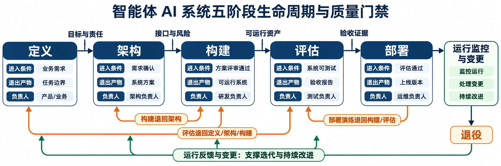
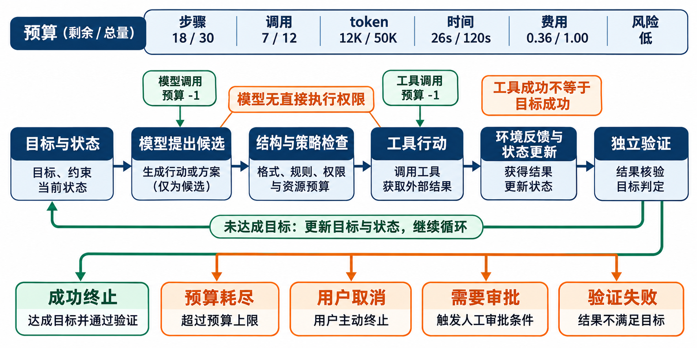

# 第4章 智能体 AI 系统生命周期与设计原则

## 摘要

智能体原型能够完成一次演示，并不意味着系统已经具备进入真实流程的条件。任务分布、外部工具、并发、费用、权限、审计和组织责任都会在生产环境中放大原型阶段被忽略的问题。本章从一个演示顺利却因成本失控、无法回放和责任未定而停用的采购系统出发，建立“定义—架构—构建—评估—部署”五阶段生命周期，并为每一阶段规定进入条件、退出产物、负责人、证据和退回路径。随后，本章把模块化、可观测、可复现与安全原则转化为可检查的架构要求，完整定义智能体循环中的状态、观测、行动、反馈和终止，说明预算、取消、人工审批和验证失败如何成为控制条件。针对方案选择，本章使用能力、成本、延迟、可靠性和风险比较两种不同自治程度的架构，并通过独立设计评审检验回放、权限与成本控制。最后，工程启动包将目标、接口、风险、实验和责任组织为相互引用的设计资产，为后续评估、容量、可靠性、安全与部署工作提供一致输入。

**关键词：** 智能体生命周期；系统设计；质量门禁；循环工程；可观测性；可复现性；安全边界；设计决策记录

## 学习目标

完成本章后，读者应能够：

1. 区分原型演示、工程验证和生产验收，说明三者所需证据为何不同。
2. 为定义、架构、构建、评估和部署阶段指定进入条件、退出产物、负责人、证据与退回路径。
3. 将模块化、可观测、可复现和安全原则转化为字段、接口、测试与运行检查。
4. 完整设计状态、观测、行动、反馈和终止，并把预算、取消、审批与验证作为控制条件。
5. 使用能力、成本、延迟、可靠性和风险对架构方案进行多目标比较。
6. 组织独立设计评审，记录被否决方案、修复责任和重新验收条件。

## 4.1 原型成功为何没有形成生产证据

### 4.1.1 一次顺利演示掩盖了三个关键缺口

设想一家企业开发了内部采购智能体。演示中，开发者输入“为研发团队采购十台显示器”，系统查询商品目录、生成比价摘要、创建采购草稿，并用自然语言说明理由。三次预设演示全部通过，模型回复清晰，平均完成时间也在现场可接受范围内。团队据此宣布原型成功，并将其接入一小部分真实申请。

真实使用后，系统表现迅速恶化。部分申请需要多次查询目录与预算，模型在失败后重复调用工具，单任务费用超过预期；外部接口偶发超时，控制器无法判断采购草稿是否已经创建，产生重复草稿；发生争议时，日志只有最终回复，没有模型版本、工具结果、授权或验证事件，运营人员不能回放任务。

责任问题同样突出。需求方认为开发团队应控制费用，开发团队认为平台应限制调用，平台团队认为业务部门应给预算阈值。审批者收到的页面只显示模型生成的推荐理由，没有原始报价、政策版本和风险提示。由于成本、证据和责任均未形成闭环，系统被迫停用。

这些问题说明，顺利完成几条预设路径只能验证局部功能，无法覆盖真实任务分布、工具故障、资源约束和组织协作。要让采购智能体进入实际流程，团队还需要把成本、状态、证据和责任纳入同一套生命周期设计，使系统在异常条件下同样能够停止、恢复和交接。

### 4.1.2 问题不只是模型准确率下降

直观修复可能是更换能力更强的模型，但案例中的主要缺口并非都位于模型。重复调用来自控制器没有预算和重复检测，重复草稿来自写操作缺少幂等与结果查询，无法回放来自事件契约不完整，责任争议来自需求阶段没有指定风险负责人。模型升级可能改变候选质量，却不能自动补齐这些系统责任。

原型通常在单用户、低并发、预先整理的数据和开发者协助下运行。开发者可以人工解释异常、重置状态或补充缺失参数，这些隐性工作没有进入系统设计。生产环境通常无法为每次运行提供同等程度的人工协助，用户表达、权限、接口状态和任务长度也更加多样，原型中的隐含假设因而暴露。

评估对象也发生了变化。演示关注最终回答和顺利路径，生产系统还要检查行动是否获权、失败是否停止、状态是否一致、费用是否受控、日志是否足以调查。只使用一个最终任务分数，会把高风险少数事件和不可恢复副作用隐藏在平均值中。

因此，工程问题不是“怎样让演示再成功一次”，而是“怎样为系统主张提供与风险相称的证据”。生命周期门禁的作用就是在进入下一阶段前检查目标、架构、实现、评估和运行责任是否已经具备，而不是等到部署后再补。

### 4.1.3 过早宣布成功来自证据层级混淆

概念可行性证据说明关键想法是否值得继续，例如模型能否从给定材料生成采购草稿。工程可行性证据说明组件能否按契约组合，错误能否被发现，关键路径能否在受控环境复现。生产准备证据则进一步覆盖代表性数据、容量、安全、监控、回滚和责任安排。

这三类证据不能互相替代。一次模型实验不能证明权限系统有效，单元测试通过不能证明生产容量足够，压力测试通过也不能证明业务目标合理。每项主张应明确证据类型、版本、适用条件和未覆盖范围。

原型结论应与证据范围一致。例如，三条预设任务可以说明给定模型版本在人工陪同条件下生成了符合格式的采购草稿；成本、回放、权限、故障和容量则需要各自的验证材料。将主张拆分到对应证据层级，可以为下一阶段提供清楚入口，也便于后续补充和更新结论。

生命周期中的每个门禁都应检查证据是否足以支持下一项扩大影响范围的决定。扩大数据访问、接入写工具、向真实用户开放和提高自治程度，都需要新的证据。系统验证需要随权限、使用范围和潜在影响的扩大而逐步完善。

### 4.1.4 本章的分析路径

本章以第3章定义的 `Goal`、`AgentState`、`ModelRequest`、`ToolCall`、`ToolResult` 和 `Event` 为基础，将公共对象放入完整的工程生命周期。分析首先建立五阶段门禁，再把模块化、可观测、可复现和安全转化为循环中的检查点，随后比较不同自治程度的架构，并通过独立评审和启动包把设计决定落实为可执行工作。

在这条路径上形成的目标、风险切片、调用结构、恢复要求和发布条件，将分别成为第26章评估、第27章容量规划、第28章可靠性、第29章安全以及第30章生产治理的输入。后续章节在各自领域补充更细的实验与运行方法，同时沿用本章建立的责任和证据关系。

## 4.2 从定义到部署的五阶段生命周期

### 4.2.1 生命周期是可退回的证据循环

本书使用定义、架构、构建、评估和部署五个阶段组织系统工程。阶段名称描述主要决策焦点，不表示严格瀑布过程。团队可以进行小规模迭代，但每次扩大权限、用户或影响范围前，都要通过相应门禁。ISO/IEC/IEEE 15288 将系统生命周期组织为相互关联的技术与管理过程，本章借鉴其生命周期思维，并针对智能体的概率性模型、工具行动和轨迹证据进行简化 (ISO/IEC/IEEE 2023)。

每个阶段都有五类信息。进入条件说明开始该阶段前必须已经清楚什么；退出产物说明团队交付什么；负责人说明谁有权接受或退回；证据说明主张如何被复核；退回路径说明缺口回到哪里修复。缺少退回路径的门禁容易变成只签字不纠错的形式。

阶段之间并非单向顺序关系。评估发现成功标准无法计算，应退回定义阶段；构建发现工具无法提供幂等语义，可能退回架构阶段；部署演练发现回滚不可用，应退回构建和评估。退回用于修正证据与设计缺口，避免未经验证的风险继续扩散。

生命周期也覆盖运行后的监控、变更和退役。部署不是最后一次决定；线上证据会触发重新评估、架构调整或权限收缩。模型、提示、工具、数据和策略变更应根据影响回到相应阶段，而不是直接覆盖生产配置。

*表 4-1：五阶段生命周期门禁*

| 阶段 | 进入条件 | 主要退出产物 | 接受负责人 | 必要证据 | 主要退回路径 |
| --- | --- | --- | --- | --- | --- |
| 定义 | 场景、利益相关者和问题边界已识别 | 需求责任卡、`Goal`、成功与禁止条件、风险初表 | 需求方与风险责任人 | 用户流程、任务样例、政策依据、验收断言 | 目标含糊或责任缺失时继续需求澄清 |
| 架构 | 目标、权限、数据和成功标准可审查 | 组件与信任边界、状态和事件契约、方案比较、ADR | 架构负责人和安全/运营代表 | 接口样例、威胁分析、故障路径、成本假设 | 契约不可实现时退回定义；方案缺口留在架构 |
| 构建 | 架构决定、接口版本和测试入口已冻结 | 可运行增量、配置、测试、回放、构建清单 | 开发负责人 | 单元/契约/集成测试、依赖与版本、代码审查 | 接口冲突退回架构；实现缺陷留在构建 |
| 评估 | 版本化系统、任务集、预算和判定规则可用 | 评估报告、失败目录、容量与安全结果、限制 | 评估负责人和业务验收人 | 原始结果、分子分母、切片、重复运行、复现记录 | 目标不可判定退回定义；设计缺陷退回架构/构建 |
| 部署 | 验收门槛通过，监控、回滚与责任已就绪 | 发布包、运行手册、告警、权限、回滚和退役计划 | 服务负责人和变更批准人 | 演练记录、配置校验、上线/回滚证据、责任排班 | 演练失败退回构建/评估；风险超限停止发布 |

### 4.2.2 定义阶段把场景转化为可验收目标

定义阶段回答系统为什么存在、服务谁、允许做什么以及怎样算完成。输入是业务问题、用户流程、政策和风险背景，输出不是“做一个智能体”这样的技术愿望，而是可验证的 `Goal`、允许和禁止行动、人工审批条件以及证据要求。

团队首先识别利益相关者。需求方定义价值和风险接受，使用者提供任务意图，数据与工具所有者控制访问，运营者承担运行处置，审批者处理高影响例外。一个人可以兼任角色，但每项决定仍要区分身份，防止系统上线后责任相互推诿。

任务边界应包含正常路径和失败路径。采购场景不仅定义如何生成草稿，还要说明身份不明、预算不足、政策冲突、商品不可用、接口超时和用户取消时如何处理。不能验收的异常最终会变成模型自由决定的空白区域。

定义阶段还要选择是否需要智能体。若流程固定、规则稳定且例外有限，工作流或普通自动化可能更合适。只有任务需要根据开放信息和环境反馈选择有限行动，并且组织能够提供控制与证据时，智能体架构才有合理性。

退出门禁要求每个高层需求都有验证方法和责任人。诸如“回答要高质量”“系统应安全”不能直接通过，必须转化为任务断言、禁止事件、风险门槛或人工检查。无法定义证据的主张不得进入架构阶段作为已接受需求。

### 4.2.3 架构阶段分配控制权和质量责任

架构阶段把需求映射到组件、接口、数据流、信任边界和运行约束。Ch03 的六类公共对象提供基本语义，本阶段决定哪些组件生产和消费对象、哪些字段跨越信任边界、何处执行权限与验证。ISO/IEC/IEEE 42010 强调架构描述应回应利益相关者关注点并使用明确视点 (ISO/IEC/IEEE 2022)。

架构不是选择模型和框架的同义词。团队要比较反应式、规划—执行式、固定工作流和分层结构，说明控制权、状态、终止和失败范围。模型只是组件之一，身份、策略、工具、状态、验证、事件、监控和人工审批同样属于架构。

质量属性必须进入具体场景。可用性问题可以写成“政策查询服务 30 秒不可用时，系统在两次有界重试后停止并保存可接管状态”；安全问题可以写成“未经审批的采购提交候选在工具边界被拒绝，外部状态不变化”。质量场景比“高可靠”“强安全”更可测试。

架构阶段还要形成设计决策记录（architecture decision record，ADR）。记录包含问题、候选、约束、收益、风险、选择依据、被否决原因、验证方法和重新评审触发条件。决定不是证明某方案永久正确，而是保留当时条件和可推翻证据。

退出门禁要求核心接口有正反样例，所有高影响行动有权限与恢复路径，每项主要风险有负责人和验证计划。若工具不能提供结果查询或幂等，团队必须降低自治、增加人工确认或更换接口，不能把问题推到构建阶段由开发者临时处理。

### 4.2.4 构建阶段将设计约束变成可执行检查

构建阶段把架构契约实现为代码、配置、测试和可复现环境。每个公共接口需要 schema 或类型定义，每个状态转换需要测试，每个外部适配器需要错误映射。代码审查不仅检查功能，也检查权限、预算、事件和终止是否符合设计。

模型提示、工具描述、路由规则和验证器都属于版本化构建资产。把提示保存在控制台而不记录版本，会使评估结果无法对应实际行为；把工具权限写在模型指令里而不在执行层检查，则违反架构边界。配置与代码需要共同进入变更和回滚。

测试形成层次。单元测试检查解析、预算和验证规则；契约测试检查模型与工具适配器；集成测试检查状态和事件；端到端测试检查代表性任务；故障注入检查超时、取消、重复与结果未知。不同层次回答不同问题，不能只用端到端演示替代。

构建环境应记录语言和依赖版本、模型引用、工具模拟器、配置、随机种子和执行入口。NIST 安全软件开发框架强调把安全实践整合到开发生命周期中，而不是发布前一次性补充 (NIST 2022)。智能体构建还需额外保护模型凭据、工具权限和敏感评测数据。

退出门禁要求基础路径在干净环境运行，关键失败测试通过，构建产物可定位到源版本，并且不存在必须由开发者手工修补的隐藏步骤。若实现迫使公共契约改变，应创建架构变更记录，而不是让代码成为事实上的新规范。

### 4.2.5 评估阶段检验能力、行为与边界

评估阶段在冻结的系统、任务、工具和预算下验证主张。它不仅检查最终答案，还检查计划、工具选择、行动、轨迹、终止、成本和风险。NIST AI RMF 将治理、映射、测量和管理组织为持续风险工作，本章将评估证据视为发布门禁的核心输入 (NIST 2023)。

任务集需要覆盖正常、边界、失败和高风险切片。平均成功率不能掩盖审批跳过、越权调用或少量不可恢复错误。所有比例要说明分子、分母和未完成任务处理，随机模型要报告重复运行与波动。

判定规则应在运行前冻结。确定性断言优先用于字段、权限、状态和副作用，人工或模型裁判用于开放质量时需要校准和分歧处理。不能在看到结果后修改成功标准，使某个方案恰好通过。

评估还包括性能、可靠性和安全。延迟应覆盖成功、失败和超时运行；成本应包含全部尝试，并同时报告每个验证成功任务的成本。压力测试覆盖负载和排队，故障注入验证恢复，安全测试检查提示注入、权限和数据泄漏。第26—29章将分别细化这些协议，本章则把相应问题纳入阶段退出条件，使任务质量、容量、恢复和安全共同构成评估证据。

退出门禁由评估负责人和业务验收人共同接受。技术指标通过但业务风险不可接受，仍不得部署；业务方希望上线但关键证据缺失，也不得绕过门禁。被接受的限制必须写入部署范围、监控和回滚条件。

### 4.2.6 部署阶段建立可观察、可回滚的运行边界

部署阶段把经过评估的版本放入受控环境，并验证配置、权限、监控、回滚和责任。发布包应绑定模型、提示、工具、策略、schema 和代码版本，不能只记录应用镜像。配置漂移会使离线评估与线上系统失去对应。

上线可以分为影子、内部试用、小流量、扩大流量和全面开放等阶段。每次扩大都需要检查成功、风险、成本、容量和人工负担。渐进发布不是放松门槛，而是限制未知问题的影响范围并收集新的运行证据。

监控至少覆盖目标成功、工具错误、验证失败、预算耗尽、人工升级、越权拒绝、延迟和成本。日志、指标和轨迹需要关联到任务与版本，告警需要负责人、响应时限和关闭条件。只有仪表盘而没有处置流程，不构成可运营系统。

回滚不仅回滚代码，还要考虑模型、提示、工具配置、权限和已经产生的业务副作用。对非幂等行动，回滚软件不能自动撤销外部结果，运行手册必须定义补偿和人工处理。发布前应演练回滚，而不是只确认存在一个按钮。

部署后，监控事件和事故进入生命周期反馈。模型漂移、成本超限、政策变化或工具升级可以触发重新评估、架构修改或权限收缩。系统停止使用时还需撤销凭据、处理状态与日志保留、通知用户并归档证据，形成退役闭环。

### 4.2.7 变更按影响返回相应阶段

并非所有变更都需要重走全部生命周期。文字纠错若不改变行为，可以从构建和局部回归开始；提示或模型版本变化可能影响候选行为，应重新评估；新增写工具或扩大自治范围改变权限与风险，需要返回定义和架构阶段。

影响分析至少检查目标、接口、数据、工具、权限、预算、指标和运行责任。团队可以维护变更矩阵，把变更类型映射到必跑测试和审批人。无法判断影响时采用更严格路径，而不是默认当成低风险配置。

紧急修复可以缩短流程，却不能取消证据。事故中先限制权限、切回固定工作流或禁用工具，是可逆的风险控制；恢复服务后仍要补充根因、测试和正式变更记录。以紧急为理由长期保留未经评审配置，会形成新的系统性风险。

持续交付研究强调小批量变更、自动化验证和快速反馈与软件交付表现之间的关系 (Forsgren et al. 2018)。这些经验可以帮助智能体系统降低变更范围，但模型、工具权限和概率性评估仍需要本章所述的额外门禁。

生命周期成熟度不体现在文档数量，而体现在决定是否可追踪、门禁能否阻止不合格版本、退回是否真正发生。若所有阶段最终都自动通过，团队应检查门禁是否只是形式。

### 4.2.8 常见生命周期反模式会使阶段失去约束

第一个反模式是以模型选型代替需求定义。团队先决定使用某个模型或框架，再寻找适合的业务任务，导致目标、用户和风险围绕技术演示调整。纠正方法是先冻结场景和验收，再允许多个技术候选进入架构比较。

第二个反模式是架构决定只存在于代码。实现者为了赶进度直接增加状态字段、工具权限或重试逻辑，其他消费者无法知道语义已经变化。任何影响公共契约、信任边界或风险的修改都应回到 ADR 与契约评审。

第三个反模式是评估成为发布后的观察。团队用线上用户发现错误，没有代表性离线任务、故障注入或安全门禁。分阶段发布可以限制未知风险，却不能替代上线前对已知风险的验证。

第四个反模式是部署即完成。没有持续监控、变更重评和退役计划，模型与工具升级会使既有证据逐渐失效。生命周期需要让运行证据返回前面阶段，而不是在发布节点停止。

*表 4-1A：生命周期反模式与纠正门禁*

| 反模式 | 可观察信号 | 被绕过的阶段 | 纠正门禁 |
| --- | --- | --- | --- |
| 先选模型再定义任务 | 目标随演示结果变化 | 定义 | 冻结用户、目标、禁止动作和验收 |
| 代码成为唯一架构说明 | 公共字段无维护人和版本 | 架构 | ADR、schema 与消费者影响评审 |
| 只测顺利路径 | 失败没有终止和恢复证据 | 构建/评估 | 故障注入、禁止副作用断言 |
| 用平均分批准上线 | 风险切片和分母缺失 | 评估 | 硬门槛、切片和原始计数 |
| 监控代替上线前验证 | 已知故障交给真实用户发现 | 评估/部署 | 预生产演练与渐进发布 |
| 发布后不重评 | 配置变化但证据版本不变 | 部署 | 变更影响矩阵和证据失效规则 |
| 无正式退役 | 凭据、任务和日志无人负责 | 部署/退役 | 退役清单和最终验收 |

*图 4-1：定义、架构、构建、评估和部署的生命周期门禁与退回路径*

五阶段生命周期说明了证据如何随系统权限逐步增加。要让阶段门禁真正可执行，还需要把抽象设计原则转化为每次循环中可观察、可测试的结构，下一节由此进入循环质量门禁。

## 4.3 可检查的设计原则与循环质量门禁

### 4.3.1 设计原则必须能够被观察和否证

“模块化、可观测、可复现、安全”常被写成愿景，却没有验收方法。原则只有转化为接口、字段、测试、运行事件和责任时，才能约束设计。每项原则都应回答检查对象是什么、谁检查、何时检查、失败后做什么以及证据保存在哪里。

可检查不等于只使用数值。模块边界可以由依赖测试和适配器替换验证，安全可以由权限拒绝和禁止副作用断言验证，责任可以由评审记录和接管事件验证。关键是结果能够由独立人员复核，而不是依赖设计者口头说明。

原则之间可能冲突。完整记录有助于回放，却增加隐私与存储风险；模块层次增加隔离，却增加延迟和错误面；严格复现固定模型版本，却可能与供应商强制升级冲突。设计记录应承认权衡，并说明选择依据和补偿措施。

*表 4-2A：四项设计原则的可检查要求*

| 原则 | 设计要求 | 构建检查 | 评估证据 | 运行信号 | 失败处置 |
| --- | --- | --- | --- | --- | --- |
| 模块化 | 模型、控制器、工具、状态和验证器经稳定端口连接 | 禁止核心层引用供应商专有字段 | 替换适配器时核心状态与策略不改 | 组件版本与契约错误率 | 回退适配器或提升契约版本 |
| 可观测 | 目标、候选、权限、工具、状态、验证和终止有事件 | 事件 schema 与关联 ID 测试 | 失败轨迹可定位到责任组件 | 缺失事件、孤立事件和轨迹完整率 | 限制高风险动作并修复证据链 |
| 可复现 | 代码、模型、提示、工具、数据和预算均版本化 | 干净环境执行和锁定依赖 | 相同夹具可确定性回放，随机运行报告波动 | 版本漂移与复现失败 | 冻结发布或记录不可复现限制 |
| 安全 | 最小权限、执行前校验、人工审批、取消与恢复 | 越权候选和敏感数据测试 | 已执行违规数为零，高风险失败可停止 | 策略拒绝、权限异常和结果未知 | 收缩权限、停用工具或回滚 |

### 4.3.2 模块化以变化和责任边界为依据

模块化不是把代码拆成尽可能多的服务。一个模块应封装相对一致的责任和变化原因，并通过明确契约暴露最小能力。模型适配器因供应商变化而改变，业务验证器因政策变化而改变，状态存储因基础设施变化而改变；把三者混在同一函数中会使任何变更都影响整个循环。

依赖方向应从业务控制指向抽象端口，再由适配器连接外部系统。控制器不读取供应商响应字段，验证器不直接调用模型，工具适配器不决定任务成功。Ch03 的公共对象为这种分离提供语义基础。

模块边界还要与部署边界区分。进程内模块也可以具有清楚接口，微服务也可能高度耦合。是否拆成独立服务，应根据扩缩容、故障隔离、团队责任和数据边界决定，而不是把网络调用等同于良好架构。

模块化的验收方法之一是替换测试。更换模型或工具适配器时，核心目标、状态和策略不应改变；若必须修改业务分支，说明抽象泄漏。另一种方法是故障隔离测试，检查某个工具失败是否只影响依赖该工具的任务，而不是使全部系统状态不可用。

### 4.3.3 可观测性连接系统行为与责任证据

可观测性要求从外部信号推断内部状态和行为。对智能体系统，指标和日志不足以单独说明任务过程，还需要结构化轨迹，将模型请求、候选、策略决定、工具调用、状态更新、验证和终止连接起来。Ch03 定义的关联与因果标识应贯穿这些事件。

观测内容围绕问题设计。任务为何失败需要目标、断言和错误；成本为何升高需要模型与工具调用及用量；系统是否越权需要候选、策略和外部副作用；人工为何接管需要审批触发和交接包。无目的地记录全部原始内容既昂贵又增加隐私风险。

指标要有分母和切片。只看“今日 20 次验证失败”无法判断是流量增长还是质量下降；应同时记录有效任务数、版本、工具和风险类型。少量高影响违规不能被总体平均值稀释，需要独立计数和硬告警。

可观测性还包含处置。告警必须关联运行手册、负责人和关闭条件；轨迹要能从用户事件定位到模型、工具和状态版本。若团队只能看到错误却无法采取行动，系统只是可见，并未真正可运营。

### 4.3.4 可复现性区分确定性控制与概率性模型

完全复现自然语言输出并非总是可能。模型服务可能更新，采样产生波动，外部数据也会变化。因此，可复现性的核心是保存足够条件重建实验和解释差异，包括代码、模型引用、提示、工具、数据、预算、参数、环境和时间。

确定性控制部分应尽量完全复现。冻结模型候选和工具结果后，控制器应产生相同状态转换、事件和终止。若同一回放得到不同权限或终止，说明实现存在未控制的状态、时间或随机依赖。

真实模型评估允许输出变化，但任务、配置和判定应稳定，并通过重复运行报告分布。供应商无法提供固定快照时，要记录调用日期和版本限制，结论只适用于可观察条件。不能用“模型有随机性”解释未保存提示或任务集。

复现还要求失败可用。报告不仅保存成功聚合值，还要保存失败任务、未完成运行、退出码和环境。另一名人员应能在干净环境执行基础路径；需要付费端点的扩展路径与确定性 mock 路径分开说明。

### 4.3.5 安全原则落实为最小权限和受控失败

安全需要系统在输入、权限、工具、数据和运行边界上限制影响。模型拒绝危险请求是其中一项措施，还需配合执行层控制。最小权限要求每个任务只获得必要工具、对象和时间范围，模型只能看到当前允许集合。提示中的禁止规则不能替代执行层授权。

高影响行动需要明确确认或审批。确认绑定具体对象、参数、影响和有效期，不能把一次同意扩展到整个会话。审批者必须看到目标、证据、风险和可选决定，否则人工监督只是形式节点。

安全还包括受控失败。遇到未知工具结果、状态冲突、预算耗尽或证据不足时，系统应停止、降级或转人工，而不是为了完成率继续猜测。取消需要传播到模型、工具和运行时，无法立即停止的动作要报告真实状态。

系统安全研究强调事故来自组件、控制和约束之间的交互，而不只是单个部件失灵 (Leveson 2012)。智能体设计因此要检查模型、控制器、工具、人工和组织流程如何共同产生风险，不能把安全责任集中为一个提示或分类器。

数据安全要求区分用户输入、检索材料、工具返回和系统策略。外部文本作为低信任数据进入模型，不得覆盖高优先级策略；敏感数据按目的最小化、访问、保留和删除要求处理。架构阶段先明确数据流、信任边界与控制点，第29章再据此展开威胁建模、攻击测试和对齐方法。

### 4.3.6 状态记录任务事实与控制进度

循环工程从状态开始。状态包含业务事实、控制进度、授权、预算、错误、计划引用和版本。每个字段都有权威来源，模型生成的摘要不能直接覆盖工具结果、权限或计数。状态版本用于检测更新冲突，并为检查点和回放提供对应的状态依据。

业务状态与控制状态要分开。采购草稿字段、预算余额和政策版本属于业务事实；当前步骤、连续失败数和剩余调用属于控制信息。混合后，模型可能把“步骤完成”误认为“业务完成”，或让业务字段变化重置控制预算。

状态还要表达未知。接口超时后，草稿是否创建可能无法判断；把字段默认设为 false 会导致重复写入。使用明确的未知或结果待确认状态，控制器才能选择查询、等待或人工接管。

终止后状态并非立即删除。审计、用户查询、补偿和复盘仍需要读取最终快照与事件。保留期限、访问和删除由数据政策决定，退役阶段要处理这些资产。

### 4.3.7 观测是带来源和时效的环境信息

观测是系统从用户、工具、传感器或其他服务获得的信息，不等于环境本身。政策查询可能返回缓存，商品价格可能在行动前变化，用户输入也可能不完整。每项关键观测需要来源、时间、对象、版本和可信度。

控制器应选择与当前决策相关的观测进入模型上下文，而不是持续拼接全部历史。选择过程保留证据引用，使验证器能够定位原始事实。模型对观测的解释属于候选，不替代观测本体。

观测冲突要有规则。用户提供的预算与财务系统不同，系统不能自行选一个更方便的值；应依据权威来源、时效和任务政策处理，无法判断时请求澄清或升级。冲突本身也应形成事件。

观测的时效要求与行动风险相关。低风险建议可以使用稍旧目录，高价值采购提交前则要重新确认价格、预算和审批。架构门禁应为关键字段定义有效期或执行前重新读取的条件。

### 4.3.8 行动把候选转换成受控环境变化

行动包括读取、写入、通知、委托和请求人工决定。每项行动需要工具、参数、主体、对象、权限、预算、副作用、幂等和超时语义。模型提出的是候选，控制器与策略层决定是否形成可执行调用。

读取也不是零风险。查询可能泄露敏感数据、触发费用或受速率限制，因此需要授权和预算。写操作还要检查幂等、版本条件和补偿方式；不可逆行动应降低自动化等级并加强确认。

行动开始、完成、拒绝和结果未知分别形成事件。控制器不能只记录成功调用，否则失败轨迹无法回放。外部工具返回成功也不能直接结束任务，仍要经过状态更新和独立验证。

允许的行动集合应随状态和授权动态调整。身份未核验时只允许解释，身份、政策与必要条件核实后才允许生成草稿，审批通过后才可能提交；授权撤销或过期时应立即限制相应动作。一次性向模型暴露所有工具，会扩大错误和攻击面，也使评估难以说明当前权限。

### 4.3.9 反馈必须改变状态或控制选择

工具响应只有被分类、写入状态并影响下一步时才构成反馈。原始错误文本被附加到提示却没有改变候选空间，不是可靠反馈。控制器需要把成功、拒绝、暂时失败、永久失败、超时和结果未知映射到不同处理分支。

反馈的价值在于信息增益。如果相同状态、工具和参数已经得到相同永久错误，再次调用没有新证据，只会消耗资源。重复签名和连续错误计数可用于触发停止或升级。

反馈还包括用户与人工决定。用户补充字段、取消任务、审批者批准或拒绝，都应更新结构化状态并产生事件。自由文本说明可以附加，但控制分支不能只依赖模型从对话中猜测授权。

结果验证是反馈闭环的关键。验证器把外部结果与 `Goal.success_criteria` 比较，区分动作完成和目标满足。验证失败可以触发有限修订，却不能被模型的自我评价覆盖。

### 4.3.10 终止条件与行动具有同等地位

循环必须定义成功、失败、待审批、取消、超预算、验证失败和结果未知等出口。终止由控制器依据目标、状态、预算和验证产生，模型的停止生成只表示一次响应结束。没有明确终止，系统会把“不知道下一步”表现为重复调用或无期限等待。

成功需要全部必要断言与证据。部分完成应说明哪些结果已经产生、哪些仍未完成以及是否需要补偿。失败记录包含原因、最终状态、用户说明和运营处置，不能只返回“出错了”。

待审批暂停自动副作用，并提供结构化交接。取消在每轮和长工具执行中检查，超预算在新调用前检查，验证失败在工具结果写入后检查。各出口有不同证据和恢复路径，不能统一映射为异常。

终止也保护资源和责任。达到边界时停止，是系统遵守设计的表现，不一定是能力不足。评估应把正确拒绝、正确审批和正确超预算结束纳入相应任务的成功定义。

### 4.3.11 预算把资源与风险转化为控制条件

预算至少包括步骤、模型调用、工具调用、token、墙钟时间和费用。风险预算还可以限制高影响工具次数、连续验证失败和人工升级等待。预算由控制器或计量组件维护，模型只能读取剩余量，不能增加上限。

硬预算达到即终止，软预算可以触发降级或告警。接近 token 上限时系统可以压缩非关键上下文，接近时间上限时可以停止低优先级探索，但任何降级都不能绕过权限和验证。预算策略需要在评估前冻结。

预算与成功率共同解释方案。一个方案获得更高质量却成本和尾延迟不可接受，不能仅凭分数通过；另一个方案成本低但频繁转人工，也可能把负担转移到运营。每成功任务成本和人工工作量应进入 Ch26—27 的评估。

预算耗尽要形成明确终止与交接。保存已完成动作、剩余问题和证据，使用户或人工能够继续；不能让外部超时突然杀死进程并丢失状态。

### 4.3.12 人工监督需要触发、信息和决定契约

人工参与分为澄清、审批、接管和复盘。澄清补充输入，审批决定具体高影响动作，接管处理异常，复盘更新系统。四者的时机、权限和信息不同，不能用同一个“人工确认”字段表示。

触发条件包括身份或授权不清、证据冲突、不可逆行动、连续失败、结果未知、预算临界和用户明确要求人工。触发规则由风险政策定义并测试，不能只依赖模型自报信心。

交接包包含目标、当前状态、已执行动作、工具证据、候选决定、风险、剩余预算和需要回答的问题。审批者应能拒绝、缩小范围或要求补充，系统记录决定的主体、对象、参数和有效期。

人工决定返回循环后仍要经过状态与契约检查。审批事件过期、对象变化或参数超出范围时，不能沿用旧批准。监督机制本身也需监控等待时长、覆写率和信息完整性。

人机交互研究提出应让用户理解系统能力、支持纠正并提供适时反馈 (Amershi et al. 2019)。这些原则在智能体场景中还需落实为可见行动、明确后果和可撤销或升级路径，不能只改写界面说明。

*表 4-2B：循环要素的设计与验收字段*

| 循环要素 | 必须定义 | 权威生产者 | 验收问题 | 典型失败出口 |
| --- | --- | --- | --- | --- |
| 状态 | 业务事实、控制、授权、预算、版本 | 状态管理器及可信服务 | 字段来源和版本是否可定位 | 状态冲突、失败 |
| 观测 | 来源、对象、时间、版本、新鲜度 | 用户、工具或环境 | 是否足以支持当前决定 | 澄清、结果未知 |
| 行动 | 工具、参数、权限、副作用、幂等、超时 | 控制器与策略层 | 未授权候选是否在执行前阻断 | 拒绝、待审批 |
| 反馈 | 结果类别、信息增益、状态更新 | 工具适配器和状态管理器 | 是否实际改变后续控制 | 修订、失败、升级 |
| 验证 | 断言、证据、判定和版本 | 独立验证器/人工 | 动作完成是否满足目标 | 验证失败 |
| 终止 | 状态、原因、证据、剩余动作 | 控制器 | 是否单一、明确且阻止后续副作用 | 成功、失败、取消、超预算 |

### 4.3.13 质量门禁覆盖每一次循环迭代

循环开始前检查目标有效、身份已核验、状态版本一致、预算可用。构造模型请求前检查上下文来源和敏感数据，解析候选后检查 schema 和重复，执行工具前检查权限、对象、风险和幂等。

工具返回后检查响应契约、副作用和证据，再更新状态。验证器比较目标断言，控制器决定继续、修订、审批或终止。任何检查失败都生成可定位事件，而不是在长提示中留下自由文本说明。

质量门禁不应全部由同一模型完成。确定性规则适合 schema、权限、预算和状态版本，权威查询适合业务事实，人工适合高影响例外，模型裁判只在经过校准的开放质量任务中使用。证据来源的多样性降低共同错误。

门禁本身也需要版本和测试。策略错误可能误拒绝合法任务，验证器过期可能接受错误政策，预算计数可能漏掉适配器重试。对防护组件进行回归，是安全设计的一部分。

### 4.3.14 门禁责任矩阵明确各组件的检查职责

控制器负责组织顺序，但不应承担全部判断。请求构造器检查上下文和敏感数据，解析器检查结构，策略层检查权限，工具适配器检查外部契约，状态管理器检查版本，验证器检查目标，预算组件检查资源。责任分散后，每项仍通过事件连接。

把所有检查放进一个控制器函数，会使变更难以定位和测试；把所有检查交给下游工具，则会失去任务级目标和预算。合理划分依据是信息所有权和失败影响，而不是追求组件数量。

门禁之间还要定义先后关系。权限检查发生在副作用前，预算检查发生在新调用前，结果验证发生在状态证据写入后。顺序错误可能使单个正确检查失去作用。

*表 4-2C：循环门禁的责任与时点*

| 时点 | 门禁 | 权威组件 | 失败事件 | 默认控制结果 |
| --- | --- | --- | --- | --- |
| 任务创建 | 目标、主体和初始状态合法 | 任务入口/状态管理器 | `goal.invalid` | 失败，不进入循环 |
| 模型请求前 | 上下文必要、来源可定位、数据可披露 | 请求构造器 | `context.rejected` | 澄清或失败 |
| 候选解析后 | schema、枚举和引用有效 | 解析器 | `proposal.invalid` | 有限修复或失败 |
| 工具执行前 | 权限、对象、风险和预算允许 | 策略/预算组件 | `tool.rejected` | 待审批或失败 |
| 工具执行中 | 超时、取消和幂等有效 | 工具适配器 | `tool.interrupted` | 查询状态或结果未知 |
| 结果写入前 | 调用关联、状态版本和错误语义一致 | 状态管理器 | `state.conflict` | 重读或失败 |
| 任务结束前 | 成功断言与证据全部满足 | 验证器 | `verification.failed` | 修订、审批或终止 |
| 终止之后 | 禁止新副作用，只允许审计 | 控制器/策略层 | `terminal.action_blocked` | 阻断并告警 |

*图 4-2：循环控制、预算消耗、中止与升级出口*

循环门禁解决了单次运行中的控制问题，架构选型则需要进一步比较不同方案在任务质量、资源消耗和失败后果上的整体表现。下一节将用同一采购草稿任务建立多目标比较基线。

## 4.4 能力、成本、延迟、可靠性与风险权衡

### 4.4.1 方案选择不是模型排行榜

模型任务得分说明在给定数据和条件下的能力表现，却不能单独决定系统方案。一个得分更高的模型可能调用更慢、费用更高、结构化输出不稳定或无法在所需区域处理数据；一个得分稍低的方案如果使用固定流程和强验证，端到端任务可能更可靠。

系统比较至少包括能力、成本、延迟、可靠性和风险。能力关注任务与切片表现，成本关注模型、工具、基础设施和人工，延迟关注首响应和完整任务，可靠性关注故障、恢复和终止，风险关注权限、副作用、数据和责任。这些维度使用不同单位，不能不加说明地压成一个分数。

质量属性还受到任务分布影响。大多数简单任务的平均表现可能很好，少量高金额、权限冲突或结果未知任务却决定系统是否可上线。比较应先设硬门槛，再在合格方案之间讨论效率，而不是让高平均分抵消一次不可接受的越权。

架构选择还要考虑组织能力。需要全天人工审批的方案即使技术可行，也可能因没有排班而无法运行；依赖复杂事件平台的方案若团队没有维护能力，会增加新的故障源。系统设计必须包含人员和流程，而非只比较组件。

### 4.4.2 两套采购草稿架构形成对照

方案 A 使用较高自治的反应式智能体。模型可以从允许工具中选择目录查询、预算查询和草稿创建，根据反馈多轮修订；控制器限制工具、步数和预算，高金额或政策冲突转人工。它适合路径变化较多、信息分散的请求。

方案 B 使用固定工作流主干。系统依次核验身份、查询预算、查询目录、提取字段、创建草稿和验证；模型只在字段提取、候选排序和说明生成节点工作，不能改变主干状态转移。流程外输入进入人工，不进行开放式工具探索。

两套方案共享相同 `Goal`、成功标准、工具、权限、验证器和终止契约，避免把接口或评估差异误当架构差异。两者都只生成草稿，不自动提交采购。比较关注控制结构带来的收益与额外成本。

教学假设是常见请求路径稳定，少部分请求包含政策例外或商品替代。这个假设需要在真实任务数据上验证；如果例外比例很高或字段依赖复杂，固定工作流的维护成本会增加。如果路径高度稳定，方案 A 的开放选择可能没有质量收益。

### 4.4.3 先定义共同门槛再收集方案证据

共同门槛包括所有高影响动作经过授权、已执行违规数为零、每次运行具有单一终止、成功任务具备完整证据、结果未知时不盲目重试。任一硬门槛未通过，方案不得进入效率排序。

能力指标可以使用任务成功率、字段准确、政策引用正确和正确升级率。每项都说明任务数、运行数和失败处理。开放文本质量若使用人工或模型裁判，需要校准和分歧记录，不能只报告平均偏好。

每个验证成功任务的成本应分摊全部尝试所产生的费用。设评估期间总成本为所有成功、失败、取消及超时运行的模型、工具、基础设施和人工成本之和，成功任务数为独立验收通过的任务数，则：

$$
C_{\mathrm{success}} =
\frac{C_{\mathrm{model}} + C_{\mathrm{tool}} + C_{\mathrm{infra}} + C_{\mathrm{human}}}
{N_{\mathrm{verified\ success}}}
$$

其中，$C_{\mathrm{success}}$ 是每个验证成功任务的成本，$N_{\mathrm{verified\ success}}$ 不包含仅工具成功但未通过验证的运行。若分母为零，指标未定义，不能把全部成本除以总请求数来掩盖失败。

延迟至少报告首个有效反馈和完整任务两个时间点，并使用中位数、尾部分位和超时数。可靠性报告工具错误、重复、恢复、预算耗尽和结果未知。风险同时报告违规提议与已执行违规，以区分模型风险和系统防护。

### 4.4.4 设计估算需要标明依据与不确定性

设计阶段常需要使用估算做初步选择。估算可以来自供应商价格、历史接口延迟、团队人工成本或原型观察，但必须标明来源、日期、范围和不确定性。没有运行原始数据时，表格字段应写“待测”或区间假设，而不是填入看似精确的数值。

*表 4-2：采购草稿方案的设计决策记录*

| 字段 | 方案 A 受控反应式 | 方案 B 固定工作流主干 |
| --- | --- | --- |
| 目标 | 生成经过验证且未提交的采购草稿 | 相同 |
| 控制权 | 模型提出下一工具，控制器校验 | 工作流决定节点，模型只处理节点任务 |
| 路径适应性 | 较高，可根据工具反馈改变顺序 | 中等，仅在预定义分支内变化 |
| 状态复杂度 | 需保存动态候选、重复和预算 | 需保存流程节点和例外状态 |
| 能力证据 | 代表性任务与风险切片待实验 | 使用同一任务与切片待实验 |
| 模型调用估算 | 随路径变化，调用上限待冻结 | 节点数量较稳定，待测 |
| 工具调用估算 | 可能探索多个查询，待测 | 由流程限定，待测 |
| 延迟风险 | 多轮与重试形成长尾 | 主干可预测，人工例外可能较慢 |
| 可靠性风险 | 循环、重复和状态漂移 | 流程外输入、分支遗漏和规则过期 |
| 安全控制 | 动态工具白名单、预算、验证 | 节点权限、状态机、验证 |
| 人工负担 | 边界和冲突时升级 | 所有流程外输入升级 |
| 主要收益 | 适应未完全预定义的查询路径 | 可预测、易审计、易回归 |
| 被否决条件 | 无法证明重复检测和预算有效 | 例外比例导致流程不可维护 |
| 当前决定 | 待相同预算实验和独立评审 | 教学基线，优先作为低风险候选 |
| 重新评审触发 | 任务分布、工具或自治范围变化 | 例外率、人工负担或政策结构变化 |

表中的“较高”“中等”和“待测”表达设计阶段的相对判断。ADR 应链接相应的价格依据、原型观察和运行数据；随着实验结果增加，团队再更新这些字段。若方案 A 在复杂切片上没有形成收益，可以采用更简单的方案 B；若方案 B 的流程外升级过多，则优化工作流或有限引入开放控制。

### 4.4.5 硬门槛、帕累托关系和加权选择各有作用

硬门槛首先排除不合格方案，例如任何已执行违规、无法取消、无回滚或成本上限缺失。安全和合规底线不应通过加权分数被其他优势抵消。门槛需要由责任人批准，并在实验前冻结。

通过硬门槛后，可以观察帕累托关系。若方案 A 在质量、成本、延迟、可靠性和风险上都不差于方案 B，且至少一个维度更好，A 支配 B；更多情况下，各方案互有优劣，决策者需要明确偏好和约束。

加权评分可以帮助记录偏好，但权重并非客观事实。团队要保存权重来源并做敏感性分析，例如成本权重从 15% 增到 30% 时决定是否改变。如果小幅调整就反转结论，说明证据不足或方案接近，不应宣称存在明显最优。

风险最好使用门槛和场景分析，而不是简单平均。一次不可恢复写入的后果可能远高于多次普通格式错误，不能按事件数量等权相加。应分别考虑发生可能性、影响、可检测性和可恢复性。

### 4.4.6 可靠性与风险必须考虑失败后的状态

两个方案可能具有相同成功率，却在失败方式上不同。方案 A 失败时可能留下结果未知的写操作，方案 B 失败时停在未创建草稿状态；后者更容易恢复。评估要记录失败后的外部状态、证据和人工工作，不只记录错误码。

可靠性不仅是可用时间。智能体需要正确停止、保持状态一致、避免重复副作用并支持接管。某个系统从不报错却错误宣布成功，比明确进入验证失败更危险。终止合规率和错误成功率应分别测量。

风险还会跨组件传播。过期政策进入上下文，模型产生错误候选，工具创建草稿，验证器又因共享同一过期来源而接受，多个局部组件都“正常”却形成系统失败。设计评审要检查证据独立性和共同故障来源。

恢复能力是设计属性。幂等写入、检查点、补偿、人工交接和回滚需要在架构阶段规划并在评估阶段演练。没有恢复方案时，只报告故障概率不能说明系统风险可接受。

### 4.4.7 敏感性分析检验决定是否依赖脆弱假设

方案决定通常依赖任务复杂度、模型价格、工具延迟、例外比例和人工成本。团队可以在合理范围内改变这些参数，观察选择是否稳定。敏感性分析使用假设或实测区间，必须与真实测量区分。

例如，若流程外任务比例从 5% 增至 25%，方案 B 的人工负担可能显著增加；若模型价格翻倍，方案 A 的多轮调用成本可能超限；若政策接口延迟增加，两个方案的尾延迟都会变化，但开放重试可能放大差异。

敏感性分析还帮助定义监控和重新评审触发。设计不是在上线日永久冻结，当例外率、成本或错误超过决定使用的范围时，应重新比较方案。阈值进入运行配置和 ADR，而不是只留在会议记录。

无法估算的参数应登记不确定性，并通过小范围试验获取证据。用单个乐观数值填补未知，会使读者误以为估算具有充分依据。保守边界、分阶段授权和可逆发布可以在证据不足时限制影响。

### 4.4.8 决策结论需要同时表达选择与信心

方案记录除了写“选择 A 或 B”，还应说明证据充分度。任务集很小、价格未确认或人工成本未知时，可以做临时选择并限制流量，不能使用确定性语气宣布方案最优。决定信心与系统运行权限应相匹配。

证据充分度可以分为概念、工程、预生产和生产四级。概念证据支持继续投入，工程证据支持集成，预生产证据支持有限发布，生产证据支持在已监控范围内扩大。级别不是通用认证，只是帮助团队防止外推。

当多个方案接近时，优先选择更可逆、更容易观察和权限更小的方案。可逆性使团队能够通过有限发布获得新证据，而不必在一开始承担全部风险。复杂方案需要证明其额外价值，不应由简单方案证明自己完全不可能失败。

*表 4-2D：决定信心与允许行动范围*

| 证据级别 | 已有证据 | 可以支持的决定 | 证据适用边界 |
| --- | --- | --- | --- |
| 概念 | 少量场景和可行性原型 | 继续设计和建立契约 | 给定场景与原型条件 |
| 工程 | 契约、回放、集成和故障测试 | 进入受控评估 | 已覆盖的组件与测试条件 |
| 预生产 | 代表性任务、容量、安全和回滚演练 | 小范围、低权限发布 | 预生产数据、负载和权限范围 |
| 生产 | 持续运行、监控、事件和变更证据 | 在已验证范围内逐步扩大 | 当前版本、流量和监控周期 |

## 4.5 独立设计评审与故障删减实验

### 4.5.1 评审目标是寻找反证而不是确认作者意见

独立评审检查需求是否可验收、架构是否覆盖风险、证据是否支撑结论以及责任是否完整。评审者不负责把所有方案改成自己的偏好，而是依据预先定义的门禁提出可复核问题。独立性意味着评审者没有编写被评部分的主要责任，并能拒绝缺少证据的结论。

评审材料至少包含需求责任卡、架构图、公共契约、ADR、风险清单、实验协议、失败轨迹、运行预算和未决问题。只展示顺利演示会诱导评审关注界面效果，无法检查系统边界。

评审会议之前，评审者独立填写清单并给出通过、条件通过或退回。会议用于澄清证据与分歧，不应现场用口头承诺关闭问题。每项问题需要严重级别、负责人、修复期限、验收证据和重新检查者。

评审完成后保留被否决方案和原因。删除异议会使后续团队不知道为何选择当前架构，也无法判断条件变化是否需要重启讨论。决策记录应把“当时为什么不选”与“什么变化后可以再选”同时保存。

### 4.5.2 评审角色覆盖业务、技术、运行和风险

需求代表检查目标、用户流程和价值，架构评审者检查控制权、接口与故障域，安全代表检查权限与数据，运营代表检查监控、接管和回滚，评估代表检查指标、任务和证据。小团队可以由同一人承担多个角色，但不得遗漏关注点。

审批者或领域专家检查高影响行动所需信息是否充分。若界面只显示模型理由，没有对象、参数、政策和副作用，人工监督不能通过。最终用户代表则检查系统状态与限制是否可理解，避免内部技术状态被误导性地表述为完成。

评审主持人维护范围和结论，不应替问题负责人降低门槛。记录人保存问题、证据链接和决定。发布批准人只有在所有阻断项关闭或明确接受剩余风险后签署，不把“赶进度”当作技术理由。

角色独立不等于与开发隔离。开发者需要说明设计、提供可运行证据并修复问题；评审者需要理解现实约束。关键是同一个未经验证的假设不能由提出者自己同时作为唯一验收者。

### 4.5.3 门禁清单把原则转成逐项判断

*表 4-3：智能体系统设计评审清单*

| 评审域 | 核心问题 | 通过证据 | 典型退回原因 |
| --- | --- | --- | --- |
| 目标 | 成功、禁止和停止是否可验收 | `Goal`、断言和失败样例 | “提高效率”等目标无分母 |
| 角色 | 需求、运营、审批和事故责任是否明确 | 责任矩阵与排班 | 风险无人接受或接管 |
| 状态 | 事实、控制、授权和版本是否分开 | schema、状态转换和回放 | 模型可覆盖权威字段 |
| 工具 | 权限、副作用、幂等和超时是否定义 | 注册表、拒绝测试和结果查询 | 写操作结果未知仍自动重试 |
| 模型 | 能力、版本、输入和输出边界是否记录 | 模型卡、请求契约和失败样例 | 供应商字段泄漏到核心控制 |
| 预算 | 步数、调用、token、时间、费用和风险是否限制 | 配置、耗尽测试和终止事件 | 只有外部超时，没有硬上限 |
| 验证 | 工具成功与目标成功是否分开 | 独立断言和证据引用 | 模型自评作为唯一依据 |
| 事件 | 关键决定和副作用能否回放 | 关联轨迹和完整性测试 | 只保存最终回复 |
| 安全 | 最小权限、审批、取消和数据边界是否执行 | 权限测试、威胁分析和脱敏检查 | 禁止规则只写在提示中 |
| 评估 | 任务、切片、预算和判定是否冻结 | 协议、原始结果和复现记录 | 看到结果后修改门槛 |
| 部署 | 监控、告警、回滚和退役是否可操作 | 演练、运行手册和责任人 | 回滚只覆盖代码 |

清单不应机械打勾。每个“是”都要指向具体证据和版本，每个“不适用”都要说明为什么。清单随系统风险调整，高影响领域还需专业、法律或合规评审。

### 4.5.4 两套架构草案采用相同评审门槛

评审材料使用 4.4 节的方案 A 和方案 B。两者共享目标、数据、工具和成功标准，评审者不知道作者偏好，先独立检查各方案。评审不比较界面美观或模型措辞，只比较需求覆盖、可验证性、资源和风险。

方案 A 需要证明动态选择带来收益，同时控制重复、预算和权限。方案 B 需要证明预定义流程覆盖主要任务，流程外输入有明确出口，规则更新不会静默使流程过期。两者都必须提供取消、验证和回放。

评审结果可以是两个方案都退回。对照实验不是为了强迫选出赢家；若共同接口或成功标准本身不完整，应先修复基线。只要一个方案通过，也不代表它适用于任务范围之外。

### 4.5.5 删除回放能力检验可观测与责任门禁

第一项故障删减从方案中移除结构化事件，只保留最终回复和聚合指标。功能演示仍可能通过，但评审应发现工具调用、权限决定、状态版本和验证证据无法重建。任何高影响任务都不应在此条件下通过。

预期评审问题包括无法判断重复草稿来源、无法计算无效调用分母、无法复核审批范围和无法区分模型失败与工具失败。修复不是增加更多自由文本日志，而是恢复版本化事件、关联标识和最小证据引用。

重新验收要求用一条成功和至少三条失败轨迹回放，检查开始、候选、权限、工具、状态、验证和终止事件。隐私检查同时确认事件没有复制无关敏感数据。

### 4.5.6 删除执行权限检验安全门禁

第二项故障删减保留提示中的“未经审批不要提交”，却移除工具执行前的授权校验。模型在大多数顺利样例中可能遵守指令，评审仍必须退回，因为安全控制依赖概率性候选，无法确定性阻止越权。

故障样例注入一个 `submit_purchase` 候选。通过条件是策略层产生 `POLICY_DENIED`，工具适配器未收到调用，外部状态无变化。若系统只在执行后发现并尝试撤销，不满足最小权限原则。

修复责任由架构和安全负责人共同承担，开发者实现策略检查，评估者维护越权回归样例。重新验收还要检查授权绑定主体、对象、参数和有效期，避免用一个全局布尔值形式化过关。

### 4.5.7 删除成本上限检验循环终止门禁

第三项故障删减移除步数、调用和费用硬上限，只依赖接口超时。模型与工具在重复暂时错误下可能持续运行，成本和用户等待不可预测。评审应将其视为阻断项，而不是上线后通过监控观察。

修复需要为模型调用、工具调用、token、墙钟时间和费用设定预算，并明确接近上限和耗尽后的行为。预算值可在评估后调整，但“存在且可执行”是架构要求。适配器内部重试也必须计入资源账本。

重新验收注入重复错误并断言控制器在上限前停止，生成 `budget_exhausted`，保存最终状态和接管信息。测试还要确认终止后没有迟到工具结果触发新的副作用。

### 4.5.8 评审问题需要修复责任和重新验收条件

*表 4-4：设计评审问题与处理记录样例*

| review_id | 问题 | 严重级别 | 决定 | 修复负责人 | 修复证据 | 重新验收条件 |
| --- | --- | --- | --- | --- | --- | --- |
| `RV-04-01` | 缺少结构化轨迹，无法回放 | 阻断 | 两方案均退回 | 可观测性负责人 | 事件 schema、成功和失败轨迹 | 轨迹完整性测试通过且隐私复核完成 |
| `RV-04-02` | 权限只存在于模型提示 | 阻断 | 方案 A 退回 | 架构与安全负责人 | 策略检查、越权候选测试 | 工具未收到调用，外部状态不变 |
| `RV-04-03` | 无调用和费用硬上限 | 阻断 | 方案 A 退回 | 控制器负责人 | 预算配置、耗尽事件 | 重复错误在上限内终止 |
| `RV-04-04` | 工作流外输入全部转人工但无容量估算 | 重要 | 方案 B 条件通过 | 运营负责人 | 例外率与人工负担评估计划 | 评估后确认排班和时限 |
| `RV-04-05` | 回滚只覆盖应用代码 | 阻断 | 部署门禁退回 | 发布负责人 | 模型、提示、工具和权限回滚演练 | 演练成功并记录副作用处置 |

表4-4展示评审记录的组织方式。实际评审应结合具体系统填写证据位置、日期和审查者，并将每项修复与重新验收条件关联，形成从问题发现到门禁关闭的完整链路。

### 4.5.9 被否决方案保留条件和重新评审触发

方案 A 的高自治版本若无法证明动态工具选择在复杂切片上带来净收益，应被否决或收缩。具体原因是额外循环、状态和权限成本没有对应质量收益，而不是笼统地说“风险太高”。重新评审触发可以是任务例外率上升或固定流程维护成本超过阈值。

方案 B 若把所有未知输入转人工，而运营没有容量和时限，也不能直接上线。它的技术控制更确定，但可能把风险转移给人工队列。重新设计可以增加受控澄清或有限动态查询，而不是一次性变成完全开放智能体。

某些被否决方案可以保留为研究原型，但必须与生产权限和数据隔离。原型结果不能进入发布证据，除非它使用相同任务、契约和验收并完成独立复现。

记录被否决条件有助于未来团队理解上下文。若模型、工具或业务发生变化，团队可以重新使用原 ADR 和证据，而不是重复无历史的争论。

### 4.5.10 评审实验需要稳定材料与判定方法

独立评审实验应冻结架构材料、门禁清单、参与角色、评审时限、沟通方式和判定规则，使不同评审者面对相同问题。实验可以记录问题发现数、阻断项识别率、误报、评审时间和意见分歧，并保留评审者定位问题时使用的证据与推理路径。

为了检验清单本身是否有效，参与者不预先获知具体删减项。实验材料可以混入未修改方案和其他类型缺陷，再由独立标注者建立参考答案。这样既能观察回放、权限和预算问题是否被发现，也能识别含糊或容易误导的门禁条目。

实施评审时，可将结果集中保存在 `ch04_review_log.md` 中，记录问题、证据、严重程度、修复责任、重新验收和最终决定。记录应与表4-4的字段保持一致，使评审方法能够从桌面推演逐步扩展到真实项目的设计复核。

独立评审确认设计是否具备进入实现的条件，工程启动包则把已经接受的目标、接口、风险和责任交给不同角色执行。下一节将二者连接起来。

## 4.6 工程启动包与跨章证据交接

### 4.6.1 启动包把已接受决定转成可执行工作

生命周期门禁通过后，团队需要一套工程启动包，把目标、接口、风险、实验和责任交给实现者。启动包不是把会议材料全部打包，而是提供唯一、版本化且相互引用的源文件，使开发、评估和运营看到同一系统边界。

最小启动包包括需求责任卡、`Goal` 样例、架构与信任边界、公共接口版本、ADR、风险清单、生命周期门禁清单、评估问题、运行预算和负责人。每份资产注明维护人、状态、版本、最后评审时间和使用者。

启动包还要区分已接受、待验证和明确不做。已接受决定可以进入实现，待验证假设进入实验卡，范围外事项写入限制。把未知内容留空会被不同团队各自解释，最终形成不兼容实现。

软件架构实践强调用质量属性场景连接利益相关者关注和架构决定 (Bass et al. 2021)。智能体启动包在此基础上增加模型、工具、轨迹、预算和人工接管，使概率性行为与外部行动进入同一工程语境。

### 4.6.2 设计决策记录保存问题、选择和可推翻条件

ADR 一次记录一个重要决定，例如选择固定工作流主干、采用事件轨迹、禁止自动提交采购。记录太大时，后续变更很难判断影响；记录太碎时，又无法理解系统级权衡。决定之间通过引用建立关系。

状态至少包括提议、接受、否决、取代和弃用。接受表示在当前证据下采用，不表示永久正确；新决定取代旧决定时，旧记录保留并指向新记录。这样能够回放系统为何演进。

*表 4-5：设计决策记录模板*

| 字段 | 填写要求 | 采购草稿样例 |
| --- | --- | --- |
| adr_id | 稳定唯一标识 | `ADR-04-001` |
| 标题 | 一句话说明决定 | 使用固定工作流主干和受控模型节点 |
| 状态 | 提议/接受/否决/取代/弃用 | 提议 |
| 问题 | 需要解决的具体矛盾 | 路径稳定但自然语言字段开放 |
| 决策驱动 | 质量、成本、延迟、可靠性和风险 | 可审计、低越权风险、例外可升级 |
| 候选 | 至少列出合理替代 | 固定工作流、反应式、规划式 |
| 证据 | 数据、实验、来源与版本 | 任务分布待测、契约样例、评审记录 |
| 选择 | 采用什么及边界 | 主干固定，模型不能提交 |
| 被否决原因 | 对每个未选方案给出具体理由 | 开放循环收益尚未证明 |
| 后果 | 正面、负面和新增责任 | 易审计；流程外人工负担增加 |
| 验证 | 如何证明决定有效 | 相同预算对照、越权和回放测试 |
| 重新评审触发 | 哪些条件变化时重新评审 | 例外率、工具数或人工负担越界 |
| 责任人和日期 | 谁接受、何时接受 | 待主编与责任人确认 |

ADR 中的证据字段不能只链接最终报告，还要注明支持哪个主张。一个容量报告不能证明权限安全，一个安全测试也不能证明成本可接受。主张与证据映射使评审者能够发现证据错配。

### 4.6.3 生命周期门禁清单维护进入与退出条件

`lifecycle_gate_checklist.md` 应按五阶段维护门禁，而不是复制本章段落。每项包含检查 ID、适用范围、证据、负责人、状态、阻断级别和重新验收条件。缺失证据填“待补”并指定负责人，不允许用空白表示默认通过。

清单需要至少一个完整填写样例。采购系统的部署门禁可以记录模型与提示版本已冻结、回滚演练待完成、人工排班未确认，因此整体状态为退回。一个阻断项存在时，其他项目通过不能把总状态平均成“基本就绪”。

门禁结果与版本绑定。模型、工具、权限或评测集变化后，旧检查不自动适用于新版本。影响分析决定哪些项目重新打开，并在清单中记录原因。

清单不能替代专业判断。高风险行业还需满足相应的领域、安全、隐私和合规要求；本章模板仅提供通用结构。项目负责人负责将适用义务落实到额外门禁。

*表 4-6：生命周期门禁条目样例*

| gate_id | 阶段 | 检查项 | 证据 | 负责人 | 状态 | 阻断 | 重新验收 |
| --- | --- | --- | --- | --- | --- | --- | --- |
| `G-DEF-01` | 定义 | 成功与禁止行动可验证 | `Goal` 与断言清单 | 需求负责人 | 通过 | 是 | 目标变化后重新评审 |
| `G-ARC-03` | 架构 | 写操作有权限、幂等和结果查询 | 工具契约与故障样例 | 架构负责人 | 待补 | 是 | 契约测试全部通过 |
| `G-BLD-04` | 构建 | 预算耗尽产生合法终止 | 自动测试与轨迹 | 控制器负责人 | 待实验 | 是 | 注入重复错误后终止 |
| `G-EVL-02` | 评估 | 风险切片与分母完整 | 评估协议和原始结果 | 评估负责人 | 待实验 | 是 | 独立复现完成 |
| `G-DEP-05` | 部署 | 模型、提示、工具与权限可回滚 | 演练记录 | 发布负责人 | 待演练 | 是 | 回滚演练通过 |

### 4.6.4 工程证据索引防止主张与材料失联

工程证据索引为每项关键主张登记来源、位置、版本、条件、负责人和状态。主张可以是“未授权提交会在工具边界被阻断”或“给定负载下尾延迟满足预算”，证据分别来自权限测试和性能实验，不能用设计文档代替结果。

证据状态区分计划、已执行、已复现、失败和失效。模型升级后，旧模型评估可能失效；工具契约变化后，旧回放需要重新检查。索引使团队知道哪些结论仍有效，而不是只知道文件存在。

证据索引同时标明确定性 mock、模拟器、预生产和生产环境。确定性 mock 用于验证控制分支，模拟端点用于稳定注入故障，真实端点实验用于测量模型与服务行为，生产监控用于观察实际流量和长期变化。证据类型由此直接限定主张范围。

*表 4-7：主张与工程证据索引样例*

| claim_id | 主张 | 证据类型 | 证据位置 | 适用条件 | 状态 | 负责人 |
| --- | --- | --- | --- | --- | --- | --- |
| `CL-04-01` | 越权候选不会到达采购工具 | 确定性权限测试 | 权限测试轨迹与断言 | 当前策略与工具版本 | 已执行/已复现 | 安全负责人 |
| `CL-04-02` | 重复错误会在预算内终止 | 故障注入回放 | 预算耗尽轨迹 | 固定预算配置 | 已执行/已复现 | 控制器负责人 |
| `CL-04-03` | 方案 A 在复杂切片有质量收益 | 对照实验 | 任务级结果与汇总报告 | 冻结任务、模型和预算 | 计划/已执行 | 评估负责人 |
| `CL-04-04` | 发布版本可以完整回滚 | 部署演练 | 回滚记录与状态核对 | 预生产环境 | 计划/已执行 | 发布负责人 |
| `CL-04-05` | 所有高风险行动有责任人 | 责任与审批复核 | 需求卡与门禁清单 | 当前组织范围 | 已复核 | 需求负责人 |

### 4.6.5 向评估与容量章节交接可测问题

Ch26 接收目标、任务类型、失败目录、风险切片和验证断言，形成任务、行为与轨迹评估。交接时要说明哪些终止算正确、违规提议与执行如何区分、人工审批任务如何计入成功。没有这些定义，指标分母会在评估阶段反复争论。

Ch27 接收调用结构、预算、工具依赖、并发假设和延迟目标，设计负载、剖析和容量实验。设计估算与实测区间分开，不能把单用户原型延迟用于生产容量推算。

*表 4-8：向 Ch26—27 的证据交接*

| 交接项 | Ch26 评估使用 | Ch27 性能使用 | 本章要求 |
| --- | --- | --- | --- |
| `Goal` 与成功断言 | 定义任务成功和失败 | 定义完成时点 | 版本化且可自动或人工判定 |
| 风险切片 | 高影响任务单独报告 | 高风险任务负载比例 | 来源和分布假设明确 |
| 轨迹事件 | 评估工具、权限、终止 | 分解模型、工具与等待时间 | 关联、时间和版本完整 |
| 预算 | 公平限制方案资源 | 性能预算与容量边界 | 硬/软上限及单位明确 |
| 人工升级 | 评估正确升级与负担 | 估算队列和响应时间 | 触发、接收者和时限明确 |
| 失败目录 | 建立故障任务和切片 | 建立超时与错误负载 | 错误码、恢复和责任明确 |

### 4.6.6 向可靠性、安全和生产治理章节交接风险

Ch28 接收错误码、结果未知、重试、幂等、检查点和恢复目标，设计故障注入与事故演练。每个主要失败至少有检测信号、影响、自动处置和人工责任。没有恢复定义的风险不能只靠告警接受。

Ch29 接收信任边界、数据流、工具权限、审批和禁止行动，建立威胁模型与安全测试。提示注入、工具输出污染和权限提升需要在实际数据流上分析，而不是独立列一份通用威胁清单。

Ch30 接收发布单元、配置版本、监控、告警、回滚、责任排班和退役计划，形成生产门禁。Google SRE 实践强调以服务目标和错误预算连接可靠性与变更决策；智能体还需要把任务质量、风险和人工负担纳入运行判断 (Beyer et al. 2016)。

*表 4-9：向 Ch28—30 的风险与治理交接*

| 目标章节 | 必须交接 | 需要返回的证据 |
| --- | --- | --- |
| Ch28 可靠性 | 故障目录、状态不变量、幂等与恢复目标 | 故障注入结果、恢复时间、数据一致性 |
| Ch29 安全 | 信任边界、权限、敏感数据、审批和禁止动作 | 威胁测试、策略覆盖、剩余风险 |
| Ch30 生产治理 | 发布单元、版本、监控、回滚、排班和退役 | 演练、告警处置、变更与审计记录 |

### 4.6.7 运行反馈使设计原则持续接受检验

上线后，设计原则需要由运行信号持续验证。模块化可以观察契约错误和变更影响范围，可观测性可以检查轨迹完整率，可复现性可以定期回放失败样本，安全可以监控拒绝、违规和结果未知。原则不是通过一次评审后永久成立。

技术债务会在智能体系统中以数据依赖、配置耦合、隐藏反馈和外部服务变化出现。机器学习系统的隐性技术债务研究提醒团队关注纠缠、反馈环和数据依赖，而不只关注模型代码 (Sculley et al. 2015)。智能体进一步增加工具、副作用和长期状态，需要更严格的变更追踪。

定期复盘把运行问题映射回生命周期。需求不适配回到定义，边界或契约问题回到架构，实现缺陷回到构建，指标和数据问题回到评估，监控与回滚问题回到部署。应先定位责任层，再决定是否需要调整提示或其他系统组件。

组织还应观察人工工作。审批积压、接管时间、频繁覆写和同类故障重复，可能说明自治边界不合理或交接信息不足。减少人工数量不是唯一目标，适当的人工控制可以降低高影响风险。

### 4.6.8 退役是生命周期的正式阶段

系统退役可能因业务结束、模型或工具停止支持、风险不可接受或新系统替换。退役计划在部署前就应定义，避免服务停止后留下有效凭据、孤立任务、无人维护的日志和用户误解。

退役过程冻结新任务，处理运行中状态，通知用户与责任人，撤销模型和工具凭据，归档或删除数据，保存必要审计证据，并确认下游不再依赖接口。不能只关闭前端，后台 worker 和定时任务也需检查。

迁移到新系统时，状态和事件转换需要版本与语义验证。未知旧状态不能默认映射为成功，未完成高影响任务要人工核对。迁移后的旧系统保持只读或按政策销毁。

退役完成也需要验收。负责人确认没有新调用、凭据失效、数据处理符合政策、用户有替代路径、事故和决定记录已归档。退役证据进入生命周期索引，支持未来审计与经验复用。

### 4.6.9 工程启动包的组成

工程启动包由需求责任卡、`architecture_decision_record.md`、`lifecycle_gate_checklist.md`、评估与风险交接以及 `ch04_review_log.md` 组成。需求责任卡统一目标、边界、角色和验收；ADR 保存候选方案与选择依据；门禁清单维护五阶段的进入、退出和退回条件；证据交接连接第26—30章；评审日志记录问题、修复和重新验收。

这些材料通过稳定标识相互引用。例如，ADR 引用对应的 `Goal`、风险项和实验卡，门禁条目引用证据索引，评审问题再引用需要修改的决定和验收条件。实现者、评估者和运营者因而能够从各自入口追溯到同一系统边界。

*表 4-10：工程启动包的组成与验证重点*

| 组成 | 主要内容 | 验证方式 | 主要作用 |
| --- | --- | --- | --- |
| 需求责任卡 | 目标、边界、角色、证据和验收 | 需求评审 | 统一系统价值与责任边界 |
| `architecture_decision_record.md` | 候选、权衡、选择、否决和触发 | 独立架构评审 | 保存决定依据与重新评审条件 |
| `lifecycle_gate_checklist.md` | 五阶段进入、退出、证据和退回 | 门禁复核 | 控制阶段推进与缺口回流 |
| 评估与风险交接 | 第26—30章所需问题和证据 | 接收方确认 | 连接设计、实验与生产治理 |
| `ch04_review_log.md` | 问题、修复、责任和重验 | 独立复核 | 形成问题关闭与重新验收链路 |

启动包的完成标准，是各角色能够依据同一目标、接口与门禁独立开展工作，并在发现缺口时知道退回哪个阶段。表4-11进一步从材料使用者的视角检查这项能力。

### 4.6.10 启动包就绪评审检查跨角色可执行性

启动包提交前，应分别让开发者、评估者和运营者执行一次桌面推演。开发者从需求和接口判断要实现哪些控制，评估者从目标和失败目录设计任务，运营者从事件和终止判断如何告警与接管。三方若需要依赖作者口头补充，启动包尚未完成。

桌面推演选择一条正常路径、一条权限拒绝、一条工具超时和一条取消路径。参与者指出每一步读取的对象、产生的事件、责任人和证据；任何“系统自行处理”都要继续追问具体组件与规则。

就绪评审还检查文件之间是否一致。ADR 选择固定工作流，架构图却显示模型自由控制工具；需求禁止提交，工具注册表却暴露提交权限；评估定义成功为草稿生成，监控却只记录模型回复。这些冲突应在构建前解决。

*表 4-11：工程启动包就绪检查*

| 使用角色 | 必须能够独立回答 | 失败信号 | 退回位置 |
| --- | --- | --- | --- |
| 开发者 | 实现哪些接口、门禁、错误和终止 | 依赖口头解释或自行发明字段 | 定义/架构 |
| 评估者 | 成功、违规、预算和风险切片如何判定 | 分母、证据或失败处理不明 | 定义/评估协议 |
| 运营者 | 告警由谁处理，如何接管、回滚和关闭 | 只有指标，没有运行手册和责任 | 架构/部署 |
| 审批者 | 看什么证据，能批准什么范围 | 只看到模型理由或全局确认按钮 | 定义/安全设计 |
| 发布者 | 发布单元、依赖和回滚是否完整 | 只能回滚应用代码 | 构建/部署 |

评审结论同样采用通过、条件通过或退回，并把条件绑定负责人和日期。启动包进入实现阶段后仍可变化，但必须通过影响分析更新相关材料并通知所有使用者，不能仅依赖口头同步。

## 本章小结

智能体系统生命周期将原型的功能验证扩展为对系统证据、行动边界和失败处置的完整要求。定义、架构、构建、评估和部署分别建立目标责任、控制结构、可运行资产、验收证据和运行能力；各阶段都具有进入条件、退出产物、负责人、证据和退回路径。部署后的监控、变更和退役继续反馈到前述阶段。

模块化、可观测、可复现和安全只有落到接口、字段、测试、事件与责任时才可验收。循环工程通过状态、观测、行动、反馈、验证和终止组织模型与工具，预算、取消、审批和验证失败与正常行动具有同等控制地位。

方案选择需要先通过权限、终止和恢复等硬门槛，再比较能力、成本、延迟、可靠性和风险。独立评审通过删除回放、权限或成本上限检验设计，并为每个问题指定修复责任与重新验收条件。工程启动包将这些决定、门禁和证据连接起来，使后续实现、评估和运营能够沿同一生命周期持续推进。

## 复习题

1. 为什么三次顺利原型演示不能证明系统具备生产条件？请分别从任务分布、运行证据和组织责任说明。
2. 五阶段生命周期中，每个阶段为什么都需要进入条件、退出产物、负责人、证据和退回路径？
3. 如何把模块化、可观测、可复现和安全从原则转化为可检查要求？请各举一个例子。
4. 在智能体循环中，状态、观测、行动、反馈、验证和终止分别承担什么责任？为什么预算与取消必须由控制器执行？
5. 比较受控反应式方案与固定工作流方案时，为什么不能只看任务成功率或模型得分？

## 实践题 智能体系统工程启动包设计

选择“采购草稿、云资源扩缩容、课程退选或费用报销”中的一个场景，完成以下任务：

1. 编写包含目标、允许行动、禁止行动、人工审批、证据与验收条件的需求责任卡。
2. 为定义、架构、构建、评估和部署分别填写至少五条门禁，注明负责人、证据和退回路径。
3. 设计两套自治程度不同的架构，使用能力、成本、延迟、可靠性和风险进行比较。
4. 完成一条 ADR，具体说明选择、被否决方案、负面后果和重新评审触发。
5. 删除回放、执行权限或成本上限中的一项，让另一名同学独立评审并记录发现过程。
6. 修复问题并提供重新验收条件，同时说明 mock、设计估算和运行测量各自支持的结论。

*评分依据（100 分）：需求与责任边界 15 分；五阶段门禁和退回路径 20 分；循环状态、观测、行动、反馈、验证与终止 20 分；多目标方案比较 15 分；ADR 与被否决方案 10 分；独立评审、修复责任和重新验收 15 分；证据边界与表达规范 5 分。方案比较应覆盖质量、资源与风险，高影响行动应具有明确权限和停止条件，设计估算与运行测量应分别说明依据。*

## 参考文献

Amershi S, Weld D, Vorvoreanu M, Fourney A, Nushi B, Collisson P, Suh J, Iqbal S, Bennett P N, Inkpen K, Teevan J, Kikin-Gil R, Horvitz E (2019) Guidelines for Human-AI Interaction. In: Proceedings of the 2019 CHI Conference on Human Factors in Computing Systems, pp 1–13. https://doi.org/10.1145/3290605.3300233.

Bass L, Clements P, Kazman R (2021) Software Architecture in Practice, 4th edn. Addison-Wesley. ISBN 9780136886099. https://www.informit.com/store/software-architecture-in-practice-9780136886099.

Beyer B, Jones C, Petoff J, Murphy N R (eds) (2016) Site Reliability Engineering: How Google Runs Production Systems. O’Reilly Media. https://sre.google/sre-book/table-of-contents/.

Forsgren N, Humble J, Kim G (2018) Accelerate: The Science of Lean Software and DevOps. IT Revolution Press. ISBN 9781942788331. https://itrevolution.com/product/accelerate/.

ISO/IEC/IEEE (2022) ISO/IEC/IEEE 42010:2022 Software, systems and enterprise — Architecture description. International Organization for Standardization. https://www.iso.org/standard/74393.html.

ISO/IEC/IEEE (2023) ISO/IEC/IEEE 15288:2023 Systems and software engineering — System life cycle processes. International Organization for Standardization. https://www.iso.org/standard/81702.html.

Leveson N G (2012) Engineering a Safer World: Systems Thinking Applied to Safety. MIT Press. Electronic edition. ISBN 9780262298247. https://doi.org/10.7551/mitpress/8179.001.0001.

National Institute of Standards and Technology (NIST) (2022) Secure Software Development Framework (SSDF) Version 1.1. NIST Special Publication 800-218. https://doi.org/10.6028/NIST.SP.800-218.

National Institute of Standards and Technology (NIST) (2023) Artificial Intelligence Risk Management Framework (AI RMF 1.0). NIST AI 100-1. https://doi.org/10.6028/NIST.AI.100-1.

Sculley D, Holt G, Golovin D, Davydov E, Phillips T, Ebner D, Chaudhary V, Young M, Crespo J-F, Dennison D (2015) Hidden Technical Debt in Machine Learning Systems. Advances in Neural Information Processing Systems 28:2503–2511. https://proceedings.neurips.cc/paper/2015/hash/86df7dcfd896fcaf2674f757a2463eba-Abstract.html.
