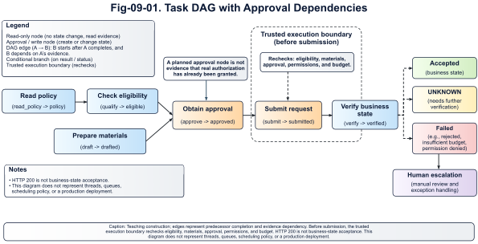
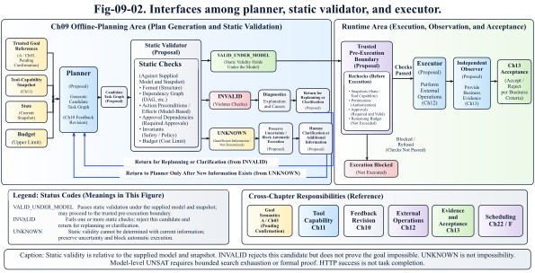

# Ch09 任务分解与规划

**Task Decomposition and Planning**

版本：ch09-zh-0.3，2026-11-20。

**摘要**：任务规划的难点，是把自然语言目标转成有依赖、约束、预算和验收条件的可检查对象。本章从遗漏审批的教学事故出发，定义目标、子任务、前后置条件、资源与验收证据，比较线性、DAG和层级分解，给出与可信工具能力分离的计划提案及静态校验器。通过20项合成目标和三组确定性实验，区分候选不合法、目标模型内不可行、验证未知与执行失败，说明结构合法仍可能因工具变化或证据缺失而失败。读者将学会交付可供后续修订和执行系统检查的计划，并理解本地模拟与真实模型测量的边界。

**关键词**：任务分解 / task decomposition；规划 / planning；有向无环图 / directed acyclic graph；层级任务网络 / hierarchical task network；前置条件 / precondition；计划验证 / plan validation；验收证据 / acceptance evidence。

前置知识：[Ch03架构与目标语义](../part1/ch03_agent_architecture.md)、[Ch08模型推理](../part2/ch08_foundation_model_reasoning.md)，以及集合、图和基本Python。代码与数据入口为仓库`examples/ch09/`，行为测试为`tests/ch09/`；本章代码只需Python 3.11+标准库，运行仓库测试另需已锁定的pytest。原创代码和合成数据沿用仓库MIT许可证，无第三方业务数据。数据及源码SHA-256在`examples/ch09/results/exp09-01/summary.json`中记录。

本章两幅图已接入矢量图，并附 PDF 与可编辑 AI 源文件；原绘图 prompt 保留；两张指定表的可编辑CSV位于`docs/images/ch09/`。本章的 Plan 字段用于教学示例，范围限定于本章代码。全文以离线规划为范围，执行后的计划修订交Ch10，实际外部操作交Ch12，调度交Ch22。

## 9.1 遗漏依赖的计划事故

### 9.1.1 一个读起来完整、执行时越界的计划

**Case-09-01，原创教学构造。** 用户希望助手查阅企业政策，确认自己是否满足申请条件，整理材料，并在负责人审批后提交工单。模型给出四步：“查询政策；整理材料；提交申请；检查状态。”每一步都像合理工作，最后还有检查环节。工程师把四行文字按顺序交给工具调用层，提交接口返回成功，助手便报告“申请已完成”。

问题并不在于提交工具没连通。计划里没有“核验资格”和“取得审批”两个可跟踪的工作单元，也没有把它们写成提交动作的前置条件。执行器若只校验参数类型，会在资格未核验、审批未取得时接受提交。接口成功反映的是请求处理过程，不能说明该业务操作符合要求，更不能证明工单已经达到用户指定状态。

这个事故暴露了三个缺口。首先，目标中的约束没有进入任务图。“在负责人审批后”是执行门槛，不能被压缩为说明文字。其次，计划没有说明什么观察能证明资格与审批已经成立。最后，系统把操作请求成功与目标验收混为一谈。即使加上一句“请确保合规”，也没有补上可供执行边界检查的数据与证据。

定位应从目标逐项回查，而不是先让模型解释自己为何认为计划正确。把“核验资格”映射到可信资格检查结果，把“审批”映射到有主体、对象、有效期和授权范围的审批证据，再检查提交节点的所有前驱。若无法找到生产这些条件的步骤，缺口就已确定；无需先执行真实写入来观察是否出错。

> **Fig-09-01 带审批依赖的任务DAG。** 政策检索→资格核验；资格核验与材料准备共同汇入审批；审批→提交→状态验证。边表示前驱完成及证据依赖。提交时仍须由可信执行边界核验审批、权限和预算。来源：本章原创教学构造。[绘图prompt](../../images/ch09/Fig-09-01.prompt.txt)；[中英标签表](../../images/ch09/labels.csv)。



[查看 PDF](../../images/ch09/illustrator_20261116/Fig-09-01.pdf) · [下载可编辑 AI](../../images/ch09/illustrator_20261116/Fig-09-01.ai)

### 9.1.2 修复需要改变什么

修复后的候选应至少包含六个节点：政策检索、资格核验、材料准备、审批、提交、状态验证。政策检索与材料准备可以独立进行；审批要同时等待资格和材料；提交等待审批；状态验证读取提交后的业务状态。图中表示的只是应该如何做，不表示任何节点已经完成。

本章配套mock故意在所有组保留运行时前置条件与审批守卫。遗漏审批的候选会被静态校验器拒绝，若绕过静态门控直接送到mock，也会在提交前被阻止。这验证的是两个控制层能否识别缺口。它没有复现真实越权事故，更没有向真实企业系统提交申请。开篇的“若执行器只查参数就会越界”是教学事故假设，后文数据不是该假设下的生产测量。

残余风险同样需要留下。规划时审批有效，不代表执行时仍有效；政策版本变化、审批撤销、用户身份改变都会使计划过期。经典STRIPS原文已经区分规划阶段的操作符与实际行动例程[R1]。本章据此采用工程分层：计划约束候选结构，可信执行边界决定当前操作能否发生，独立业务证据决定任务是否完成。

## 9.2 目标与约束建模

### 9.2.1 从意图到可测目标

目标（goal）是用户或业务希望达成的状态及其约束。任务（task）是为实现目标而组织和跟踪的工作单元；子任务（subtask）是相对于父任务进一步分解的工作单元。它们不是模型输出中的任意句子。“了解政策”可能只是一个方向，“取得版本为v的政策来源，并记录适用条件”才足以成为可追踪的子任务。

目标与任务的关系并非一一对应。同一目标可能有多种任务分解，一项任务也可能同时支持多个验收条件。用户要求“确认申请是否被接受”，可以通过读取工单系统状态来验证；“我已经提交”只是对动作的叙述。若目标只要求形成草稿，系统不应为了显得完整而额外加入提交动作。规划要同时防止少做和越做。

本章使用有限命题模型说明这些区别。令初始状态为事实集合S₀，目标条件集合为G，动作集合为A。动作a具有前置条件Pre(a)、增加效果Add(a)和删除效果Del(a)。只有Pre(a)属于当前事实时，模型才允许应用该动作；后继状态为：

```text
S' = (S - Del(a)) ∪ Add(a)，条件是 Pre(a) ⊆ S
```

其中S是可检查的模型状态，符号不直接指代真实外部世界。对一个串行计划，模拟所有动作后检查G是否属于最终状态。STRIPS的原始建模包含世界模型、操作符及目标描述[R1]；这里采用更小的命题集合以便读者完整检查代码，没有实现原文的一阶定理证明过程。

目标的业务含义与公共状态语义仍由A定义。本章实验以`goal_ref`引用目标，以`goal_conditions`承载沙箱中的谓词，不把本地正命题与封闭世界假设推广为全书事实规范。生产中的“没有查到批准”通常应保留未知或未满足，而不能推断“批准从未发生”。

### 9.2.2 前置、后置与证据

前置条件（precondition）是动作被允许或能够执行前必须成立的条件。后置条件（postcondition）是动作模型承诺在成功执行后应成立的条件。两者都属于可检验的断言，不能只写“输入正确”或“结果良好”。例如，提交的前提可以包括资格已核验、材料版本固定、审批覆盖当前对象；后置可以是产生可查询的工单标识。

验收证据（acceptance evidence）是独立观察者用来判断验收条件是否成立的记录。它应能关联目标、任务、对象和条件，并说明来源、时间与版本。计划中写有`postconditions: [submitted]`只是期望，不是提交成功的证据。只有读取外部状态、验证回执内容或由独立测试观察到结果，才能支持相应结论。证据结构的公共定义交Ch13和D维护，本章只保存最小mock记录。

“独立”也要具体解释。本章mock观察者不会相信候选中填入的完成标志，而是依据可信动作模型实际更新的状态生成证据；这与规划生成路径分离。但生成器、模拟器和测试仍出自同一写作对话，因此这只是逻辑路径分离，不能替代D的独立人员审稿与干净环境复现。

验收粒度应与任务粒度匹配。政策检索可以验收来源标识与版本，资格核验可以验收条件计算结果，提交可以验收工单存在，最终状态验证可以验收工单达到指定状态。若一个节点同时“检索、决定、审批、写入、确认”，失败时几乎无法知道哪些条件已经成立，也难以避免重复写入。若每个词都拆成任务，则会增加无意义的依赖与跟踪成本。可独立观察、单独失败、单独验收的边界通常是更好的起点。

### 9.2.3 硬约束、偏好与资源

约束（constraint）规定方案必须满足的边界。审批、权限、禁止写入、总预算上限属于硬约束；优先用某个工具、尽量减少等待、输出简洁通常属于偏好。偏好不能覆盖硬约束。若低成本工具没有权限，规划器应寻找其他合法路径，或说明当前目标无法在给定条件下完成。

资源（resource）是执行需要消耗、占用或等待的能力与额度，例如调用次数、模型token、货币成本、处理时长、并发槽位或人工审批容量。资源字段必须带单位和适用口径。本章只使用整数`credit`与串行估算`duration_ms`；credit是教学计量单位，不能解释为货币，duration_ms也不是实测网络延迟。

对于串行预算，最简单的检查是把可信工具成本逐项相加并与上限比较。若任务成本为cᵢ，总成本C为各cᵢ之和，则需要C≤B。真实工具成本可能随参数、重试、输出长度改变，需要保留不确定范围与执行中的剩余额度。候选不能通过把写入成本改成0来绕过预算；校验器必须对照可信能力快照中的成本定义。

时间和金钱也不能混用。并行分支的总资源消耗通常仍需累加，而在忽略资源冲突的前提下，关键路径长度可以构成完成时长的下界。人工审批等待不是模型可以凭空压缩的延迟。若计划要求两人同时占用唯一设备，DAG无环也不能消除容量冲突；本章串行mock不模拟这类调度问题，容量分配交Ch22。

SayCan把语言指令中的技能选择与机器人在特定状态下执行技能的能力联系起来[R7]。企业工具规划可借鉴的原则是：语义上合理的下一步还必须与当前可用能力相连。本章使用可信工具目录与快照表达这种联系，没有移植机器人value function或原论文成功率。

### 9.2.4 子任务Schema提案

结构化计划把依赖、前提和验收放到可检查字段中，但结构化本身不保证计划正确。JSON Schema的`type`、`required`、`minimum`和`uniqueItems`能表达类型、必填、下界和数组唯一性[R9]；“所有节点ID唯一”“依赖形成无环图”“审批发生在提交前”仍需要专门语义检查。把JSON解析成功当作规划完成，会把自然语言中的遗漏换成字段完整的遗漏。

**Tab-09-01 子任务Schema（本章proposal）**。可编辑源：[CSV](../../images/ch09/Tab-09-01.csv)。权威实验模式位于`examples/ch09/proposals/plan_schema.json`；下表只解释字段，不构成第二份公共定义。

|字段|类型/样例|本章语义与检查|限制|
|---|---|---|---|
|`id`|字符串，`submit`|本计划内唯一、非空|ID作用域限于本章示例|
|`depends_on`|字符串数组，`["approve"]`|前驱须存在；不可成环；必要因果边不能遗漏|不是线程或队列定义|
|`tool` / `tool_version`|`submit` / `mock-1`|稳定能力引用及精确版本|版本兼容策略待Ch11确认|
|`preconditions`|`eligible, drafted, approved`|必须与可信动作模型一致，检查所有允许的串行化|本章只有正命题|
|`postconditions`|`["submitted"]`|期望增加效果，不是完成证据|实际效果由观察确认|
|`delete_effects`|字符串数组|被动作撤销的事实；用于检查因果威胁|不支持连续效应|
|`resources`|`credit=2, duration_ms=10`|与目录一致；总和不得超过计划和环境预算|未模拟并发容量与真实计费|
|`acceptance`|非空谓词数组|候选声明的条件须能由该动作产生；执行时另收证据|完整证据卡交Ch13|

计划外层另有目标引用、计划版本、前一版本引用、工具/状态快照ID、目标谓词、互斥约束、预算和任务数组。目标谓词与约束必须和可信输入相符。保留这些字段是为了让消费者能拒绝陈旧或被篡改的候选，不表示A、F或Ch10已经接受本章命名。

以`submit`为例，可信目录规定它消耗2 credit，前提为`eligible`、`drafted`和`approved`，增加`submitted`。候选如果删除`approved`，静态检查会报告动作模型不一致；如果保留前提但删去审批前驱，则报告审批依赖缺失或因果条件不受支持。执行器也要重新检查当时的审批，不能因为模型填写了字段而放行。

### 9.2.5 把一句请求拆成可核查的目标记录

回到“查政策，符合条件且获批后提交申请，并确认受理状态”这句话。第一遍处理不宜直接生成工具列表，而应先识别对象、期望结果、必须遵守的过程与未提供的信息。对象是具体申请；结果是能观察到的受理状态；过程约束是资格与审批先于提交。如果申请对象没有确定，规划器可以继续查询一般政策，却不能把一个猜测对象放进写入分支。

第二遍把这些要素落实到可检查的记录。目标引用标识这一次需求，不能只标识“办理申请”这一类模板；验收条件说明要观察哪个对象的什么状态；预算注明本次任务可用额度；禁止条件指出不能执行的动作。例如“只整理，不提交”要求图中没有未经授权的提交路径，而不只是最终回复少提一句提交。由自然语言抽取这些要素仍可能出错，因此工具语义再严格，也不能弥补最初目标被曲解的问题。

在本章沙箱中，这次请求被简化为初始事实`request`、最终目标`verified`及互斥条件`verified/denied`。其中`request`只表示存在可供演练的请求，不包含真实用户身份；`verified`也只是模拟观察事实。真实系统应把对象标识和条件计算结果一同带入证据。若申请甲的审批被错误地用于申请乙，两个布尔值都为真，仍然不能组成正确的业务证据。

第三遍检查条件是否有生产者。`verified`由verify产生；verify需要submitted；submit需要eligible、drafted与approved；approved由approve产生；approve又要求资格和材料。沿这条链追溯到初始状态，可以看见政策检索与材料准备两个起点。这一步把“应该有审批”转成“谁生产审批、消费者是谁、需要哪条依赖”，也给遗漏检测提供了依据。

这里还应检查信息条件和业务条件的区别。拿到一份政策不等于申请人符合政策；检索到“负责人可以审批”也不等于负责人已经审批。前者为判断提供输入，后者才是判断或授权结果。规划若把证据来源与结论压成一个节点，后续执行器只能看到一个含糊的“政策检查完成”，无法知道它支持的是哪项前提。

最后，检查验收条件是否过强或过弱。要求“工单已受理”时，仅验证工单存在过弱；用户只要求得到工单编号时，等待最终业务处理结束又可能过强。目标记录应使用用户要求的判据，不能为了让演示更容易成功而更换判据。无法在当前工具域观察的条件，应作为缺失观察能力明确报告，而不是被模型的一句自信陈述代替。

### 9.2.6 预算要覆盖完整链，而不是只覆盖写入

本章完整计划的6个动作成本依次为1、1、1、1、2、1 credit，总计7 credit。提交动作本身只占2，前面的资格、材料和审批以及后面的状态验证仍然要计入预算。若只为写入预留2，系统可能能创建记录，却没有额度确认结果；此时既不能宣称目标完成，也不应通过删除verify节点让预算表变得好看。

资源估算需要先说明约束的是哪一个过程。本章`duration_ms`把每个动作的教学估值相加，因此完整链是60毫秒的串行估值；它不是图的并行最短完成时间。仅从依赖看，政策、资格、审批、提交、验证构成5个动作的最长链，即50毫秒的依赖下界。这个下界忽略资源竞争、审批等待和网络波动，不能作为对用户的完成时限承诺。

还要区分计划预算与可信环境预算。候选写100 credit，不能把环境实际提供的6变成100；候选自限为6，即使环境有10，也需要遵守当前候选的自限或重新提交清楚的版本。代码使用两个上限的较小者。这样可以同时防止候选扩大授权额度，以及消费方忽略计划自身的成本约束。

在实际系统中，估算通常需要留出验证和失败处理额度。若工具费用不确定，可以给估计区间并说明哪些输入决定上界；若没有可靠上界，就不能把一个均值当硬保证。本章确定性目录使用固定整数，目的是让预算拒绝的理由可以手工核算。它没有测量真实调用价格，也没有把重试储备、人工容量或取消费用纳入现有7 credit数字。

## 9.3 分解算法与计划校验

### 9.3.1 线性分解：顺序清楚，约束可能被隐藏

线性计划把任务排列成一个总序。输入是目标、初始信息及可用动作，输出是有先后关系的步骤序列。在工具少、依赖基本串行、外部状态相对稳定时，这种表示容易解释，也容易逐步验收。对于Case-09-01，完整链可以写成查询、资格、材料、审批、提交、验证。

顺序列表的成本是可能引入不必要的等待。材料准备未必需要等政策查询完成，如果强制串行，系统失去提前准备的机会。更隐蔽的问题是列表顺序掩盖依赖理由：审批出现在提交前，究竟因为审批是提交的必要条件，还是因为作者恰好把它写在前一行？一旦后续优化器重排步骤，没有显式因果边的计划就可能失效。

生成一个长度为n的列表只是在记录n项内容。搜索怎样的动作序列能达到目标，可能需要探索大量分支；不能把输出线性误说成规划复杂度线性。检查已给定串行计划则更直接：从S₀开始逐步检验前提、应用效果，最后检查目标。检查相对于所给模型成立，模型遗漏了真实条件时仍会漏检。

### 9.3.2 DAG与偏序：只固定必要的先后关系

任务DAG以节点表示任务，以有向边表示依赖，无环保证存在拓扑序。它适合表达多个独立分支和汇合点。在本例中，政策→资格与材料准备是两个分支，审批是汇合点。规划器需要输出依赖，调度器才有依据选择当前就绪任务。

图无环只解决“能否排出顺序”，没有解决“每一种允许顺序是否都能成功”。假设审批前提需要资格与材料，但图中只保留材料→审批。某一次执行可能恰好先核验资格再审批，测试成功；另一次调度先完成材料，随后启动审批，就会缺少资格事实。验证一个幸运拓扑序无法证明该任务图足以约束执行。

偏序规划进一步关注因果链接。若动作u产生条件p，动作v使用p，就需要保护u到v之间的p不被其他步骤破坏。UCPOP将未支持前提和对因果链接的威胁作为需要消解的问题[R2]。本章采用一个小反例说明：审批产生`approved`，撤销动作删除`approved`，提交又需要它。若撤销与提交都只依赖审批，则可能出现“审批→撤销→提交”的失败顺序。把撤销安排到提交之后，才消除了这一威胁。

因此，任务DAG是一种表示；偏序规划是一类建立和保护顺序约束的求解方法。二者不能仅因都画箭头就视为同一个算法。配套校验器没有实现UCPOP的完整ADL搜索，而是在小规模离散模型上枚举DAG的串行拓扑序。它要求每一种允许的串行化都合法，采用比“找到一个可执行顺序”更保守的准入规则。

### 9.3.3 层级分解：把领域方法写进规划过程

层级分解从复合任务出发，把“办理申请”分解为资格准备、材料准备、审批提交与状态核验，再继续分解到可执行动作。HTN通常通过方法（method）描述一个复合任务可以怎样由子任务网络完成；方法选择还要满足条件与约束[R3]。若领域已经存在可维护流程，层级方法可以帮助复用领域知识。

HTN中的“办理申请”和最终状态“拥有已受理工单”也有区别。后者描述想达到的状态，前者可能要求遵守指定过程；绕过审批而直接制造受理状态，并不能满足过程要求。Erol等人在原文中用复合任务与目标任务的区别说明表达性问题[R3]。本章借此提醒：验收既可能针对结果，也可能针对过程中的必须条件。

输入一个HTN问题，至少需要初始任务网络、原子动作以及分解方法。求解过程反复选择复合任务和适用方法，用子网络替换它，再合并约束，直到只剩原子动作且存在合法执行顺序。方法缺失可能导致分解失败；方法有环可能使分解不断展开；不同分支的资源和状态影响也可能冲突。维护一棵好看的工作分解树，并没有自动解决这些问题。

层级方法增加领域结构，同时增加知识维护责任。原始HTN复杂度分析依赖是否允许变量、任务是否全序及非原子任务的限制[R3]，不能概括成“用了层级就更快”。本章实验只实现平坦任务图，HTN属于方法比较；没有把普通JSON嵌套数组冒称为HTN求解器。

三种表示可以组合。先用领域方法展开复合任务，得到带因果约束的DAG，再由运行时选择满足约束的执行顺序。选择依据应是可维护的领域知识、并行需求和验证成本，而不是图形是否复杂。只需顺序执行的短任务可以用线性计划；独立分支明显时可用DAG；稳定流程家族较多时才值得维护层级方法。

### 9.3.4 分层静态检查

静态检查的输入是候选Plan与一份可信环境快照，输出是状态、结构化诊断、所用快照与可选失败见证。候选和可信环境必须分开传入；否则模型可以在计划中把“提交不需要审批”写成工具定义，随后让校验器验证自己编出的规则。

本章校验器分四层。第一层检查形状，包括类型、必填、非空、非负整数及未知字段；第二层检查图与引用，包括节点唯一、前驱存在和无环；第三层对照工具版本、前提、效果、资源和审批属性；第四层模拟允许的执行顺序，检查前提、互斥不变量和最终目标。这种分层先排除便宜、明确的错误，再把计算预算用于因果检查。

```python
# examples/ch09/plan_validator.py，ch09-proposal-0.1
report = validate(candidate_plan, trusted_environment, max_orders=1000)
if report["status"] == "VALID_UNDER_MODEL":
    # 只表示可以进入执行前的可信检查，尚不能记为已完成。
    pass
```

代码中的形状检查器只支持本章schema实际使用的关键词子集，不是通用JSON Schema实现。若未来采用正式公共schema，应调用团队选定、支持相应方言的验证器，并进行版本迁移。本章保留该小实现，是为了不修改共享依赖或锁文件，也让读者看见结构检查与业务检查的职责分界。

检查预算也属于算法边界。使用邻接表与入度队列的拓扑检查可以做到O(V+E)；本章小实现反复扫描就绪节点，最坏上界更高，不据此作性能承诺。枚举所有拓扑序最坏可能达到V!种；每一种还要模拟动作。代码以完整串行化数量1000为预算，超限报告UNKNOWN。若任务图很大，应选择更有针对性的威胁分析、约束求解或模型检查，不能直接移用教学枚举器。

VAL将计划验证建立在明确的PDDL语义上，并覆盖比本章更丰富的时间与连续效应[R4]。本章从该研究得到的工程启示是要说明验证语义；这里的串行化检查不支持动作重叠、连续量变化、随机效果或外部并发写入。把工具标成“可并行”之前，仍需另行分析资源、锁和外部系统一致性。

> **Fig-09-02 规划、静态检查与执行器的接口。** 可信输入→候选→分层检查→执行前重新检查→执行器→独立验收。INVALID与UNKNOWN进入诊断通路；观测后修订交Ch10。来源：本章原创设计，非已冻结全书架构。[绘图prompt](../../images/ch09/Fig-09-02.prompt.txt)。



[查看 PDF](../../images/ch09/illustrator_20261116/Fig-09-02.pdf) · [下载可编辑 AI](../../images/ch09/illustrator_20261116/Fig-09-02.ai)

### 9.3.5 候选校验与目标可行性是两个问题

校验器返回INVALID，只证明当前候选不能按规定使用。遗漏审批节点的计划不合法，但只要环境仍有可用审批能力，目标可能有另一份合法计划。若系统把每次候选失败都报告为“你的目标无法完成”，就把生成器的不足错误归给了用户需求。

本章另外实现`search_feasibility`。它从可信初始状态出发，枚举可用动作产生的状态，并记录累计credit和duration预算。找到满足目标的状态，返回SAT_MODEL及一条动作序列见证；穷尽有限模型中的可达状态仍找不到目标，返回UNSAT_MODEL；超过10000个状态预算，则返回UNKNOWN。搜索不读取候选计划的真假标签，也不修改用户目标。

这一路径不是完整现实可行性判定。它假定动作、事实、效果、预算都已知且离散确定；未纳入的人工协商、新增权限或替代工具都不在搜索域内。SAT_MODEL证明存在一个模型内串行解，不证明原候选DAG的每一种调度都安全。UNSAT_MODEL则必须连同工具快照、约束与预算一起解释，不能省略限定词。

在最多F个命题、离散预算分别为B和T的粗略界限下，状态与资源组合可能达到2^F×(B+1)×(T+1)，再乘动作扩展成本。代码通过去重和跳过不改变事实的动作控制重复，但并未提供最优规划保证。搜索状态数作为成本保存，不能把额外求解工作隐入“校验很便宜”的叙述。

LLM-Modulo提出由模型生成候选、外部critics检查硬软约束的框架[R6]。本章采用候选与可信检查分工，但不把这篇立场论文的标题当作所有模型永远不能规划的定理。无论候选来自LLM、人工还是模板，硬约束检查的依据和适用范围都应独立说明。

### 9.3.6 静态有效仍会执行失败

本章状态VALID_UNDER_MODEL应完整读作“在给定可信模型、状态快照和串行化规则下有效”。它不保证快照之后工具持续在线，不保证人工审批不会撤销，不保证外部接口返回的语义与模型完全一致，也不保证业务记录已经持久化。可以把这些缺口缩小，但不能靠更强的状态命名把它们抹去。

执行前应重新核验工具版本、权限、审批作用域与剩余预算。若发生变化，停止准入并保留诊断；如何更新计划交Ch10。操作已经发出后发生超时或不确定结果，不能仅凭静态计划选择重放；实际副作用、幂等与重试由Ch12处理，跨步骤恢复与验收由Ch13处理。远程调用也不因计划有唯一ID就天然获得exactly-once语义。

在本地实验中，CH09-SYN-14将submit在快照之后设为下线；CH09-SYN-15让submit返回HTTP 200却不更新业务事实。两者静态检查都可以通过，实际mock均失败。前者说明能力快照会漂移，后者说明接口成功与业务证据不是同一对象。它们是按代码注入的反例，不是外部企业故障统计。

### 9.3.7 从目标反向追溯，再向前检查状态

一种容易手工核查的分解过程，是先从目标向前置条件反向追溯，再用初始状态向前验证。对于本章唯一产生`verified`的verify动作，选择它就产生了一个新的需求`submitted`；为支持submitted选择submit，又引出eligible、drafted和approved。继续展开，直到每个叶子条件都由初始事实或已有动作支持。这个过程沿用了动作前提与效果的建模方式[R1]，下面的选择规则是本章小工具域的教学推导。

反向追溯至少维护三种对象：尚未支持的条件、已经选择的动作，以及条件的支持关系。不能只维护一份待办文字，否则相同条件可能被不同分支反复展开。以eligible为例，submit和approve都需要它；在本章单请求、无撤销的基本模型里，一个qualify动作可以同时支持两个消费者，不必核验两次。

共享生产者有适用前提。若两次使用之间允许删除eligible，或两个消费者针对不同对象，就不能仅因谓词名称相同而合并。类似地，两个任务都叫“准备材料”，也不意味着它们使用相同政策版本和输出。可合并的是语义、对象、版本与有效范围相容的工作；字符串相同只是发现候选合并点的线索。

当一个条件有多个生产者时，需要保留选择。目标是得到政策内容，可以从缓存读取，也可以查询权威源；二者成本与新鲜度可能不同。若先选了成本最低但不满足版本要求的工具，不应通过放松目标来接受它，而应回到选择点尝试另一个生产者。当前示例每个关键事实只有一个生产者，因此没有实现这种完整回溯求解；工具域扩大后，这一限制需要在算法层面解决。

反向展开结束后，必须正向模拟。反向追溯只说明“每个需求看起来有人能提供”，还没有保证这些提供者可以在同一次执行中共存。两个动作可能各自产生一个目标事实，却互相删除对方的结果；它们单独都相关，组合起来却没有满足全部目标的最终状态。前后两遍配合，分别回答支持来源与状态演化，不能省去其中一遍。

也不能把分解图中的环都理解为同一种错误。可执行候选中A依赖B、B依赖A，没有任何节点能先完成，是需要拒绝的依赖环；领域方法递归调用自身，则是另一类问题，可能需要规模递减或深度限制来保证展开结束。HTN方法可以描述重复结构[R3]，但最终交给本章校验器的有限候选仍必须满足既定任务图规则。

### 9.3.8 完整候选怎样被逐层检查

以CH09-SYN-01为例，根记录给出`plan-01`、版本1、目标引用与快照ID，任务数组包含六个动作。读者不必把全部JSON抄到书中；从JSONL读取第一行，就能拿到实验使用的完整对象。`trace_plan.py`提供了这一入口，并把校验、可行性诊断及mock执行的输出分别保存，避免只展示一个最终“通过”。

```powershell
python examples/ch09/trace_plan.py
```

第一层检查的是对象能否按约定解释。例如，`acceptance`为空就不能说明如何验收该子任务；把credit填为负数会破坏预算比较。Python中bool与整数存在类型关系，因此本章实现显式要求整数类型，而不把`True`当作1 credit接受。类型检查所拒绝的是输入形状，尚未讨论业务目标是否可行。

第二、三层查图与可信目录。节点ID不能重复，否则一个字典项可能遮盖另一个任务；依赖不能指向不存在的ID，否则消费者可能等待永远无法完成的前驱。对submit的前提、版本和成本进行目录对照，则防止候选把“不需要审批”或“成本为0”包装成自洽但错误的描述。工具描述是可信输入的假设必须落实在调用边界，不能由候选同时提供一份可随意修改的环境冒充它。

最后一层从`{request}`开始模拟。本例存在三种允许顺序：政策→资格→材料，政策→材料→资格，以及材料→政策→资格；它们随后都必须经过审批、提交与验证。不同前缀最终都建立eligible与drafted，故在审批前汇合。提交后才有submitted，验证后才有verified。该例通过全部三种串行化，而不是只展示其中一条成功轨迹。

校验报告中的`checked_orders`用于说明本次覆盖了多少完整顺序，不能当作执行次数。状态模拟没有真的提交三次申请。报告的`witness`在失败时是产生错误的顺序前缀，可能在到达最终目标前就结束；它是定位材料，不是已发生行动的日志。把反例顺序保存为运行轨迹，会错误制造一次从未发生过的写入。

CH09-SYN-06提供另一条链。候选保留submit的审批前提，却删除approve节点；目录仍说明submit需要审批。校验在进入顺序模拟之前就可以报告`APPROVAL_DEPENDENCY_MISSING`。与此同时，单独的可行性搜索仍可以利用环境中存在的approve工具找到目标的解。两个结果并不冲突：当前候选被拒，目标依然有解。

### 9.3.9 校验结论为什么必须带语义范围

对给定有限任务图，可以用逐步状态更新解释校验器的判断。若初始状态正确，每一步的前提都在当时状态中，动作效果又准确描述状态转移，那么模拟得到的状态就与该模型中执行相同步骤一致。再检查每一步的不变量和最终目标，可以判断该顺序是否满足模型要求。对所有允许顺序都完成这一检查，才支持本章定义的图级准入结论。

这一推导依赖具体假设。若一个工具可能随机失败，效果就不能再当作必然增加的事实；若有外部参与者删除状态，单靠图内动作无法描述后继状态；若两个操作重叠执行，逐个串行转移也未必覆盖真实交错。本章通过限制模型来使检查完整可读，而不是宣称代码已经解决这些更一般的问题。VAL对于时间与连续效应的处理说明，扩展语义需要相应扩展验证机制[R4]。

目标可行性搜索也依赖状态表示能否保留决策所需信息。只以事实集合去重可能漏掉资源差别：达到同一事实集合，一条路径花2 credit，另一条花5，剩余可行后缀可能不同。本章去重键因此同时包含事实、累计credit与累计duration。它没有只保留“见过这个状态”就丢弃其他资源组合。

保留全部资源组合容易增加状态数。更大系统可以在证明支配关系成立后剪枝，例如同一事实状态下，一条路径的两种非负资源消耗都不高于另一条，且没有遗漏其他路径相关约束时，后者才可能被安全舍弃。若审批有效期、操作次数或风险额度没有进入状态，贸然套用这种剪枝就可能丢掉必要路径。本章未实现该优化，也不报告未经测量的加速效果。

最后要约定验证器自身失败的输出。已找到具体前提反例时可以拒绝候选；未覆盖完搜索空间就耗尽预算时，只能返回UNKNOWN。接口消费者必须识别这一区别。将任何非通过统一写成“需求不可能”，会让一个纯计算预算问题变成错误的业务判断；将UNKNOWN当作通过，则把尚未完成的证明交给了执行器承担。

## 9.4 不可行与不完整计划

### 9.4.1 先区分问题所在

计划不完整、目标不可行和当前无法判定，需要不同处理。计划不完整是候选缺少必要步骤、条件或证据；通常退回生成或补足信息。目标不可行是在明确模型与约束下没有解；应说明冲突及允许改变的条件。无法判定可能来自状态未知、工具说明缺失或搜索预算耗尽；应保留UNKNOWN，并指出还需要观察或计算什么。

“审批情况不明”和“没有任何可获得审批的通路”就不是同一情况。前者可以先查询；后者在固定工具域内可能导致UNSAT。用户未指定申请对象时，规划器也不该猜一个对象完成整个流程；可以准备与对象无关的政策材料，同时将写入分支保持未就绪。可独立推进的只读任务与必须等待澄清的动作可以在计划里分开表达。

**Tab-09-02 计划缺陷矩阵**。可编辑源：[CSV](../../images/ch09/Tab-09-02.csv)。错误码用于区分本章校验器的诊断结果。

|缺陷|可观察信号|检测位置|处理与证据|
|---|---|---|---|
|缺步/缺条件|审批无生产者、资格不受支持|动作对照与因果模拟|拒绝当前候选，给失败前缀；不能自动宣称目标无解|
|依赖环|没有完整拓扑序|图检查，`CYCLE`|返回依赖冲突；修订候选|
|悬空依赖|前驱ID不存在|引用检查|返回缺失ID，禁止悄悄删除边|
|工具缺失/下线|能力不存在或快照标不可用|可信目录对照|查合法替代；不能伪造调用成功|
|预算不足|必要链最低成本超过上限|资源累加/可行性搜索|保留成本口径；请求改变预算或缩小目标|
|目标冲突|同时要求互斥谓词|目标不变量检查|解释冲突，等待用户取舍|
|未排序因果威胁|某拓扑序在前提处失败|全部串行化或专门威胁分析|增加必要约束，保存反例顺序|
|验证预算耗尽|未覆盖所有允许顺序|验证器预算|返回UNKNOWN，不能当作通过或无解|
|执行时漂移|旧快照通过、执行时工具不可用|执行前复核|停止新操作；观测后修订交Ch10|
|缺独立业务证据|HTTP成功却无状态事实|Ch13式验收边界/mock观察者|保持失败或不确定，不填完成标志|

### 9.4.2 让不可行说明可以核查

有用的不可行说明要指向一组具体约束。例如“目标需要verified；唯一生成verified的动作需要submitted；唯一submit动作不可用；初始无submitted”，比“系统暂不支持”更能帮助用户决定下一步。预算反例也应给出必要链的最低消耗与上限，而不是只说“资源不足”。

本章五个不可行实例分别固定一个原因。16没有可用可信审批能力；17唯一提交工具下线；18完整必要链最低7 credit而预算仅6；19目标同时要求互斥的verified与denied；20要求archived，但初始没有且任何动作都不产生它。每个理由都能在小工具目录中逐项核查。

这些理由还说明“目标冲突”和“候选缺步”的差异。补一个审批节点可修复候选缺步；给互斥目标补更多步骤并不能让两个条件同时成立。发现真实硬约束冲突后，系统应请求对目标或约束作出选择，不能自行删除用户的一半要求再报告成功。若只是偏好之间冲突，可以按照用户已授权的优先级选择，并记录取舍。

校验反馈应是可操作的诊断，而非再次输出冗长推理。`APPROVAL_DEPENDENCY_MISSING: submit`把缺口定位到一个节点；失败顺序则指出在什么允许次序下前提不满足。日志保存这些显式依据、版本和输入散列即可，不需要保存不必要的隐藏推理文本。修订器如何使用反馈、何时结束迭代，见Ch10。

### 9.4.3 变化中的工具能力与审批

工具能力快照至少需要稳定ID、版本、可用状态、输入输出语义、成本和权限边界。工具目录中“支持提交”是能力声明，不能代替用户授权；计划中“需要审批”也不能自行生成审批。真正的审批必须覆盖正确主体、对象和操作，且仍在有效期内。本章`approved`只是单请求沙箱事实，不能直接用于多用户或多租户系统。

工具下线也有时点区别。规划时已下线，可以拒绝使用该能力并寻找替代；校验后下线，则需要执行前复核。即使工具仍可连通，返回数据版本可能已经不同。若政策v1允许申请，而执行时生效政策已变为v2，系统需要重新核查资格及审批适用性，不能只检查URL还能打开。

静态工具清单的价值是限定候选能引用的能力，减少“凭空发明一个工具”的空间；它并不把世界变成静态。SayCan在具体机器人环境中区分语言上的适合与技能在当前状态下的可做性[R7]，支持了这种能力落地的必要性。这里的企业例子仅是相同设计问题的类比，权限和政策效力仍需各自领域定义。

### 9.4.4 资源不足时保留什么

计划应同时保留目标预算、候选估算和执行中的实际消耗。预算不够时，最先检查单位、范围和必要链：是否把单次调用价格当成全流程成本，是否漏掉状态验证，是否把重试额度藏在工具内部。检查器不应通过接受候选低报的成本来让预算“通过”。

可选择的处理包括采用成本更低且语义等价的能力、减少用户允许省略的非必要步骤、暂存草稿并等待新增预算，或明确当前模型无解。删除审批或最终验收通常不属于合法降本。若用户只授权查询，可以完成查询并返回有证据的部分结果；部分结果必须与完整目标完成区分。

资源不足还可能由验证本身造成。候选包含大量相互独立节点时，枚举顺序可能先耗尽计算预算。此时系统知道的是“尚未完成证明”，并不知道“计划必定失败”。UNKNOWN应阻止自动写入，但可以供人工审查或更适合的验证方法继续处理。把超时一律映射成不可行会损害可解释性，也会使评测误把验证器限制记成目标限制。

### 9.4.5 从失败见证走向可核查的处置

诊断应先回答失败位于哪一层，再决定是否需要改变目标。对于CH09-SYN-08，错误是候选图中的环；系统可以退回该图，保留原目标和工具快照，不需要用户为模型的图错误重新描述全部需求。对于CH09-SYN-18，必要链的可信成本高于预算；若预算是硬限制，换一种文字表达并不能解决问题。两者都拒绝当前派发，但后续动作不同。

预算实例可以给出一个小型无解依据。初始只有request，要得到verified，必须使用唯一的verify；为了满足它的前提，必须先submit；submit又需要资格、材料和审批。根据目录继续追溯，这六个动作都不可省略，可信成本下界为7。当前上限为6，因此不存在预算内完整解。这里的“最低7”依赖生产者唯一且没有初始缓存事实；若环境已经有可信submitted，或增加了成本更低的等价动作，就必须重新计算下界。

冲突目标则采用不同依据。若不变量禁止verified与denied同时成立，而目标要求两者同时成立，那么任何满足不变量的最终状态都不可能满足该目标。不需要尝试更多候选来“看看能不能碰巧成功”。但不能据此替用户选择保留哪一个条件：可能是目标录入错误，也可能需要重新澄清否定词或对象范围。诊断应指出冲突对，而不是悄悄把其中一个条件移除。

不可达目标的依据也应足够具体。archived不在初始状态，工具目录没有任何增加archived的效果，因此任何现有动作序列都不能建立该事实。这个解释明确限定在当前能力域内；现实中可能存在未接入的归档流程。它给出的下一步是补充可信能力或调整需求范围，而不是让模型编造一个名为archive的工具就继续执行。

UNKNOWN需要说明缺少的是什么。若审批状态尚未查询，应列出需要观察的对象与状态；若工具能力说明缺失，应标明不能核实的前提或效果；若只是枚举达到上限，则保留已检查范围与当前预算。三者都不宜自动写入，但只有第三者直接指向增加计算预算。一个笼统的“系统不确定”无法帮助维护者选择正确补救手段。

这些处置有共同边界：计划只可以在用户已授权的范围内改进。补足遗漏的只读核验步骤，通常仍在原目标内；提高费用上限、扩大对象范围、降低审批要求，则改变了硬约束，需要外部决定。计划修订器应明确区分自己能修正的表示错误与必须等待选择的业务取舍。执行后修订的状态管理见Ch10，本章只把这一分界写入第一次派发前的诊断。

### 9.4.6 诊断依据与约束变更应分别记录

一条诊断应让接收者判断三件事：它否定的是哪个对象，依据来自哪里，允许采取什么修复。`CYCLE`否定当前依赖图，依据是剩余节点无法排出拓扑序；`BUDGET_EXCEEDED`否定当前成本与上限的组合，依据是可信目录的逐项累加；UNSAT_MODEL否定给定模型中的预算内目标可达性，依据则需要目标冲突、必要成本下界或完整可达空间的穷尽分析。它们不能共用一句“计划失败”而不保留细节。

本章校验器在`errors`中保存错误码与定位文字，在`witness`中保存相关顺序前缀；可行性搜索另有状态、扩展数和成功见证。这些字段可以帮助读者复查判断，却不意味着已经输出一种可被另一个证明检查器独立验证的无解证书。尤其是“搜索穷尽”仍依赖当前搜索实现与环境建模正确；D的独立复现需要检查这两个前提，而不只是核对报告中有没有UNSAT字样。

多个错误并存时，还要避免过早推断。一个候选既有悬空依赖，又使用已停用的工具；先发现悬空引用足以拒绝候选，但不能据此解释全部业务限制。修复引用之后，还应重新检查工具与预算。当前实现会在某些层发现错误后提前返回，报告不是全部缺陷的保证，更没有声称给出最小冲突集合。消费者应把诊断理解为已发现的问题，并在候选变化后重跑相应检查。

修改约束需要单独记录变化原因。比如将预算从6提升到7，与修复候选的漏填字段不是同一类操作。前者改变了问题输入，需要保留谁允许变化、适用哪个目标以及从哪一版开始生效；后者可以在原预算下重新生成候选。否则，系统可能在多次尝试中逐渐放宽限制，最后返回一份“成功计划”，却无法说明它还满足多少原始需求。

比较两个计划版本时，应先比较目标与可信环境，再比较任务图。如果目标从verified改成submitted，原本缺少最终验证的候选会突然变得可接受；这不是规划能力改进，而是验收范围缩小。类似地，工具从不可用变为可用可能恢复目标可达性，但不能把环境改善归功于候选生成器。评测与运行日志都需要保留这些变化，才能解释结果差异。

### 9.4.7 信息不足时明确可推进的范围

信息不完整并不总意味着整份工作都必须停止。用户尚未确定申请对象时，查询一般政策、列出所需材料可能仍可完成；但资格判断、审批与提交应保持未就绪。计划可以把这两个范围分开，让已完成的只读工作形成有来源的中间产物，同时明确它尚不能支持针对具体对象的写入。

中间产物必须保留其适用条件。例如查询得到政策v1，并据此整理材料清单，随后对象与政策版本都发生改变，不能沿用旧清单直接进入提交。此前工作的价值是提供可追溯输入，而不是换来一次永久有效的“前置条件通过”。执行前需要判断产物是否仍覆盖当前对象与版本；如何持久保存这些关联，交状态和运行时章节处理。

澄清请求也应指向阻止规划的最小信息缺口。若唯一缺口是申请对象，反复询问用户是否仍想完成原任务没有帮助；若缺口是审批主体与范围，则应明确需要哪类授权信息。这里的“最小”是交互设计目标，不表示本章实现了形式化最小问题集算法。可执行教学资产仍使用完整输入，信息不全的段落给出的是设计判据。

部分完成的反馈应按证据陈述：“已取得政策来源与材料清单；尚未核验具体资格，也未提交。”这使用户能决定如何继续，同时避免助手把计划中的未来动作写成过去事实。计划图与业务记录都应保留未就绪节点，不能为了获得一个整齐的完成状态而将它们删除。

## 9.5 计划质量评测

### 9.5.1 先规定评什么

计划质量至少涉及可解析性、依赖合法性、因果可执行性、目标可行性识别、预算符合性与证据满足情况。它们可以分别失败。例如一份JSON字段齐全且无环，依然可能遗漏资格；一个有解目标也可能收到坏候选；一份静态有效候选也可能因工具变化而执行失败。单一“成功率”若没有分母和判定位置，很难解释差异。

Valmeekam等人的规划研究明确提供动作域、问题描述、抽取规则与外部验证路径，并区分自主生成与辅助规划模式[R5]。本章借鉴其可核验的评估组织方式，不将其2023年模型上的结果推广为当前所有模型表现。这里所有输入、候选和故障均为原创合成，模型调用数为0。

**Exp-09-01，确定性mock实验。** 输入为20个有稳定ID的业务目标实例，共用6种工具，15个在给定模型和预算内有解，5个故意无解。实例包含完整计划、缺审批、缺资格、依赖环、未排序前提、低报资源，以及执行期漂移和证据缺失。数据高度同源，属于教学控制实验，不能估计真实业务中的故障概率。

### 9.5.2 三组如何运行

自由文本组使用候选的工具名称列表。适配器只识别`- 使用 tool。`这一精确短语，按列表建立串行链，并从可信目录填入前后置条件与资源。它不是通用自然语言解析器，也不是模型。结构化组使用原候选DAG；静态报告仅用于离线评分，执行前不据此门控。结构化加校验组则只准入VALID_UNDER_MODEL候选，并额外运行有界状态空间搜索，诊断目标在模型中是否有解。

三个组保留相同运行时审批、前提与预算守卫，没有为了比较而关闭写入边界。所有组都运行离线校验以计算指标；只有第三组把结果用于准入。第三组不修复被拒候选，不调用模型，也不删除失败样本。这些计数仅说明确定性处理配置的行为，不构成模型测量。

这里存在一个公开的混杂：文本适配器把列表变成链，会消除候选原有的环或缺边，也会从目录纠正低报资源；结构化组保留这些缺陷。第三组的目标可行性诊断又增加了搜索。故该实验比较的是三个明确的本地处理配置，不能把差异解释为自由文本与JSON格式的纯因果效果。

### 9.5.3 分母、成本与复现入口

结构依赖合法率按无形状错误、重复ID、悬空依赖和环的候选数除以20计算；文本组是在适配后的链上评分。静态有效率则要求模型中的全部允许串行化都满足前提、互斥约束和目标。目标可行性识别按SAT/UNSAT诊断与人工可核查真值一致的数量计，并另报UNKNOWN；前两组默认认为目标有解，第三组使用额外搜索。

执行成功按独立mock观察者的证据满足目标计算，主分母始终为20，被拒绝候选计未成功。同时列出15个有解目标上的成功数，以及准入候选上的条件成功率。若只报告准入后的8/10而隐去总分母8/20，会把拒绝策略误写成更强的完成能力。两者回答不同问题，应同时保留。

规划成本记录载荷UTF-8字节、本地适配/校验/搜索处理时间和搜索扩展状态数。时间不含执行，所有组又都做离线评分，不能称为纯生成延迟。没有模型调用，因此token为未测的null、付费成本为0；不能把字节数换算成未经测量的token。mock执行credit另列，不等于货币。

在仓库根目录运行：

```powershell
python examples/ch09/make_cases.py
python examples/ch09/run_experiment.py
python -m pytest tests/ch09 -q
```

参考运行使用固定数据、无随机种子、每组重复1次。解释器、平台、运行时刻及源码 SHA-256 记录在`summary.json`中。完整60条逐例逐组记录位于`examples/ch09/results/exp09-01/results.jsonl`。逐例结果可通过上述命令重新生成。

### 9.5.4 真实结果如何解释

**Tab-09-03 三组计划处理配置的确定性实验结果。** 下表为本地确定性mock计数，不是模型能力测量。未知判定均为0/20，超限UNKNOWN路径另由测试覆盖。

|指标|文本适配链|结构化DAG|DAG加校验/搜索|
|---|---:|---:|---:|
|结构依赖合法|20/20|19/20|19/20|
|候选静态有效|13/20|10/20|10/20|
|目标可行性识别正确|15/20|15/20|20/20|
|无解目标识别|0/5|0/5|5/5|
|准入执行|20/20|20/20|10/20|
|有解目标的候选被拒|0/15|0/15|5/15|
|执行成功/全部目标|11/20|9/20|8/20|
|执行成功/有解目标|11/15|9/15|8/15|
|执行成功/准入候选|11/20|9/20|8/10|

文本配置在某些实例上更高，是因为适配器额外提供串行化与目录归一化，不说明自由文本天然优越。加校验配置的总成功数低于直接执行结构化配置，是因为它拒绝低报资源的候选，即使可信运行时在本次具体顺序与真实目录成本下能完成该目标。校验发现了契约不一致，但本实验没有后续修复过程。

第三组拒绝了5个有解目标的坏候选，这不应自动标成“误判目标不可行”。有界搜索仍给出这些目标SAT_MODEL。候选准入与目标可行性诊断是两个输出：前者要求当前图足够正确，后者只要求模型存在某条解。使用者可以据此重新生成候选，而不是放宽硬约束。

三组载荷总量分别为2149、33401和33401字节；第三组可行性搜索共扩展154个状态。它们只描述当前序列化和求解工作量。数据中显式字段越多，载荷越大，并不等于模型费用必然增加相同比例。单次本地纳秒计时受机器状态影响，原始记录保留，不作吞吐或延迟比较。

### 9.5.5 失败、未执行与外推限制

CH09-SYN-14和15同时提供了静态有效仍执行失败的证据。14在运行时发现submit下线，停止新操作；15虽然产生HTTP 200事件，却没有`submitted`业务效果，也没有对应验收证据，不能继续伪造`verified`。被静态拒绝的记录事件与证据数组为空，失败或未执行的步骤没有被填写成已完成。

这些记录支持“本章控制逻辑在给定故障注入下按定义工作”，不支持真实模型规划能力、真实人类审批效率或生产可靠性结论。数据、动作模型与真值都由本章编写；测试虽然覆盖多条独立逻辑路径，仍有共同设计偏差。复现时应核对动作语义、输入版本和统计分母。

若继续进行实际模型评估，应保持目标、工具域、预算和验收条件一致，分别报告候选生成、解析、校验、搜索、修复和执行的成本。通用文本抽取器需要固定并测试其拒绝规则；无法解析的响应计入分母。重复方案应在运行前确定，保存模型/端点版本、请求配置、原始输出与失败，不把人工提示中的额外信息悄悄算作模型独立能力。

### 9.5.6 如何阅读一个实例的三类证据

汇总表适合比较处理配置，但定位问题需要逐例输出。`examples/ch09/results/worked_traces.json`从原20条数据中选取10个实例，不改变主实验分母，分别保存静态报告、可行性搜索及直接mock结果。`direct_mock`表示在保留可信运行时守卫的情况下模拟该候选；`gated_dispatch`则表示静态门控是否准入，不能把二者当作同一次真实外部派发。

先看CH09-SYN-01。静态报告为VALID_UNDER_MODEL，搜索为SAT_MODEL，直接mock结果为accepted_mock。搜索见证说明存在一条模型内动作序列，运行证据说明本次模拟确实建立了目标事实。两者支持的命题不同：不能拿搜索见证代替执行证据，也不能用一次模拟成功反推任务图的所有允许顺序都安全。

再看CH09-SYN-06。静态报告为INVALID，搜索仍为SAT_MODEL，直接mock因缺少前提而阻止提交。这个实例把“当前候选不可用”与“目标无解”分开了；修复方向是补回审批及依赖，不是要求用户放弃目标。静态报告没有产生业务动作，直接mock的阻止事件也不能写成已提交记录。

最后比较14和15。二者都静态有效且模型内有解；14在准备完成后遇到submit不可用，15则出现HTTP200但验收证据缺失。两次运行都没有最终verified证据，却需要不同故障定位：前者检查能力快照和运行时可用性，后者检查响应语义与权威业务状态。若只把它们合并成“工具失败”，系统会丢失决定下一步的关键差别。

逐例材料还可以检验汇总口径。拒绝候选的门控组没有派发事件，仍在20项总分母中计为未成功；有解目标子集单独计算；真实模型调用数始终为0。新增演练脚本只是把既有结果组织得更容易检查，不增加模型测量、独立复现或生产案例的证据等级。

## 9.6 小结与任务图契约

### 9.6.1 交付给谁，保留哪些边界

一份可供后续系统使用的计划应交付目标引用、不可变候选版本、任务及依赖、可信能力快照引用、资源估算、约束、验收条件和校验报告。报告还要说明其验证语义、覆盖范围、失败见证及UNKNOWN原因。只给出一段“接下来我会……”的文字，会让消费者在执行时重新猜测这些信息。

Ch10消费候选及诊断，在新观察后修订计划，并保留已发生行动的边界；Ch11提供工具能力和调用前授权资料；Ch12负责真正的外部操作与副作用；Ch13负责跨步证据和业务验收；Ch22负责调度与运行时。这些交接关系说明各层职责，具体字段通过显式适配衔接；本章不另立全书公共模式。

离线计划并非唯一运行方式。ReAct在动作与环境观察之间交错生成后续内容[R8]，适合说明计划如何在交互中调整。该机制不自动提供完整计划验证、权限控制或独立验收。本章交出第一次执行前可检查的候选；观测后如何决定继续、修订、停止或升级，见[Ch10](ch10_iterative_reasoning_revision.md)。工具语义见[Ch11](ch11_tool_discovery_calling.md)，实际操作见[Ch12](ch12_action_execution.md)，结果证据见[Ch13](ch13_action_traces_recovery.md)，调度见[Ch22](../part6/ch22_orchestration_runtime.md)。

本章的核心判据是：目标是否可测，任务是否有明确条件，依赖是否足以保护这些条件，资源是否有口径，计划结论是否被限定在其模型内，完成结论是否由独立证据支持。线性、DAG和层级表示都可以服务这些判据，也都可能产生无法执行的候选。

### 9.6.2 关键术语

**Tab-09-04 关键术语与易混淆项。**

|中文 / English|本章用法|易混淆项|
|---|---|---|
|目标 / goal|期望达成的业务状态及约束|计划文字不是目标完成|
|子任务 / subtask|可跟踪、可单独验收的分解单元|不是把每个词拆成节点|
|前置条件 / precondition|动作执行前必须满足的条件|描述不是授权证据|
|后置条件 / postcondition|模型中成功动作应建立的条件|不等于实际观察|
|因果链接 / causal link|生产者到消费者之间受保护的条件关系|普通排序边未必写明原因|
|层级任务网络 / HTN|用方法分解复合任务的规划表示|普通目录树不是完整HTN|
|模型内有效 / valid under model|相对于给定模型通过规定检查|不等于真实完成|
|验收证据 / acceptance evidence|支持验收条件的独立观察记录|模型自评不是独立验收|

### 9.6.3 复习题

1. 区分目标、子任务、后置条件与验收证据。为什么计划中出现`submitted`不能证明已完成？
2. 政策核验与材料准备可独立进行，审批等待两者。比较线性、DAG与HTN表示各自增加的信息、维护成本和适用条件。
3. 一个无环图里，审批只依赖材料，但其动作前提还要求资格。某次测试先完成资格并成功，是否足以验收该图？给出反例顺序及修复。
4. 第三组准入10个候选、成功8个，总任务20个，其中15个模型内有解。分别计算三种成功率，并说明它们为何不能互相替代。
5. 静态通过后，提交接口返回200却没有业务状态证据。分别说明Ch09、Ch10、Ch12、Ch13和Ch22的责任边界，为什么不能直接重放提交？

### 9.6.4 实践题与教师参考

实践题：使用本章20条合成输入，扩展一个“审批在提交前被撤销”的场景。输入中新增可信`revoke`动作，其前提为approved、增加revoked、删除approved。先使revoke与submit都依赖approve，再通过修改依赖消除因果威胁。不得删除审批前提，不得改写真值或把HTTP事件充作证据。

预期产物为新增JSONL实例、动作/依赖差异说明、两份校验报告及反例顺序、至少一个失败与一个成功mock轨迹、复现命令和边界说明。保持原20项数据不变，新增实例单独报告，不悄悄改变原实验分母。进阶选项是模拟审批作用域或有效期，并讨论它们为何不能由一个全局布尔值充分表达；无需接入真实审批服务。

教师评分为100分：动作语义和条件正确25分；捕获未排序威胁并保存失败见证25分；合法修复与独立mock证据20分；数据版本和命令可复现20分；适用限制10分。删除审批边界、伪造证据或不能复现核心失败路径应退回修改。

复习题参考：第1题应区分业务状态、工作单元、模型期望与实际观察；第2题指出线性易执行、DAG显式分支汇合、HTN增加领域方法与维护责任，不给无条件性能排序；第3题可用“材料→审批→资格”展示缺前提，应增加资格到审批的依赖；第4题分别为8/20=40%、8/15约53.3%、8/10=80%，对应全部目标、有解子集和准入子集；第5题应保留结果不确定，先由可信状态核验定位效果，不能因为返回码或超时擅自重放已可能产生副作用的操作。

实践题参考修复是让revoke依赖submit，以免它在提交前删除approved。这样只保证这一次提交的模型前提；它没有证明后续其他操作也仍有审批。配套`test_delete_effect_threat_requires_ordering`包含最小参考断言，教师还需检查学生是否说明所有允许顺序与一次特定顺序之间的区别。

### 本章局限

校验器仅适用于本章有限离散命题和串行化规则，不是完整PDDL、HTN或生产调度器；形状检查只覆盖本地schema子集。真实资源不确定性、作用域审批、并发与分布式一致性需后续系统处理。

实验为20项同源合成实例的单次确定性mock，模型调用为0，不涉及真实模型或外部系统效果测量。三组包含适配器和搜索差异，不能作格式优劣或模型能力比较。UNSAT只限模型和预算，UNKNOWN不等同失败，静态有效不代替独立业务验收。不能把这些合成实例上的计数外推为生产性能。

### 参考文献

- **[R1]** Fikes, R. E., & Nilsson, N. J. (1971). STRIPS: A New Approach to the Application of Theorem Proving to Problem Solving. *IJCAI*, 608–619. [会议原文](https://ijcai.org/proceedings/1971/0063.pdf)。
- **[R2]** Penberthy, J. S., & Weld, D. S. (1992). UCPOP: A Sound, Complete, Partial Order Planner for ADL. *KR*, 103–114. [大学托管原文](https://www.cs.uky.edu/~sgware/reading/papers/penberthy1992ucpop.pdf)；[作者项目书目](https://aiweb.cs.washington.edu/ai/ucpop.html)。
- **[R3]** Erol, K., Hendler, J., & Nau, D. S. (1994). HTN Planning: Complexity and Expressivity. *AAAI*, 1123–1128. [官方原文](https://cdn.aaai.org/AAAI/1994/AAAI94-173.pdf)。
- **[R4]** Howey, R., Long, D., & Fox, M. (2004). VAL: Automatic Plan Validation, Continuous Effects and Mixed Initiative Planning Using PDDL. *ICTAI*, 294–301. DOI: [10.1109/ICTAI.2004.120](https://doi.org/10.1109/ICTAI.2004.120)。[作者接受稿](https://strathprints.strath.ac.uk/2550/6/strathprints002550.pdf)。
- **[R5]** Valmeekam, K., Marquez, M., Sreedharan, S., & Kambhampati, S. (2023). On the Planning Abilities of Large Language Models: A Critical Investigation. *NeurIPS*, 36. [会议原文与书目](https://papers.neurips.cc/paper_files/paper/2023/hash/efb2072a358cefb75886a315a6fcf880-Abstract-Conference.html)。DOI: 10.52202/075280-3320。
- **[R6]** Kambhampati, S., et al. (2024). Position: LLMs Can't Plan, But Can Help Planning in LLM-Modulo Frameworks. [arXiv:2402.01817v3](https://arxiv.org/abs/2402.01817v3)，2024-06-12。
- **[R7]** Ahn, M., et al. (2022). Do As I Can, Not As I Say: Grounding Language in Robotic Affordances. [arXiv:2204.01691v2](https://arxiv.org/abs/2204.01691v2)，2022-08-16。
- **[R8]** Yao, S., et al. (2023). ReAct: Synergizing Reasoning and Acting in Language Models. [arXiv:2210.03629v3](https://arxiv.org/abs/2210.03629v3)，2023-03-10，ICLR 2023。
- **[R9]** Wright, A., Andrews, H., & Hutton, B. (2022). JSON Schema Validation: A Vocabulary for Structural Validation of JSON. [Draft 2020-12 validation](https://json-schema.org/draft/2020-12/json-schema-validation)，draft-bhutton-json-schema-validation-01，2022-06-16；work in progress，非RFC。
