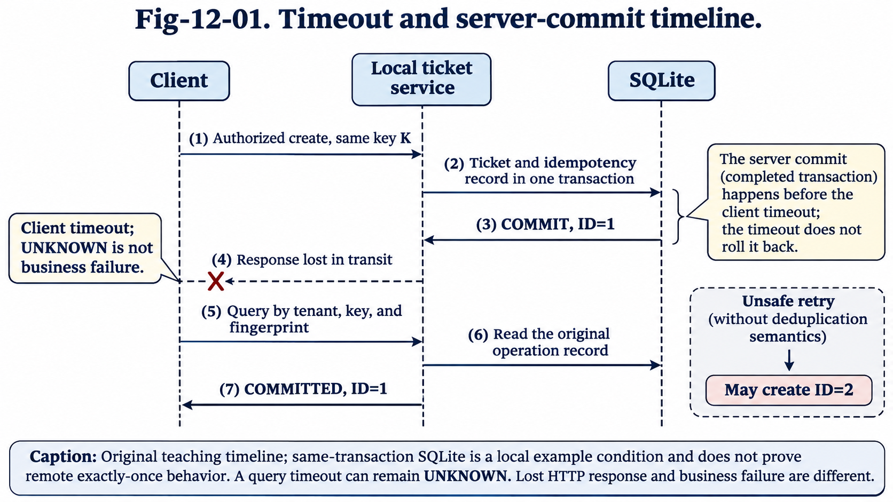

# Ch12 行动执行与外部操作

> **写作占位页**：本页提供稳定的章节路径和任务字段，学生将用正式中文正文替换占位内容。

| 字段 | 当前基线 |
| --- | --- |
| 主责学生 | C |
| 目标等效成书页 | 33 |
| 所属篇 | 第三篇：智能体核心能力 |
| 前置/后续 | Ch11 → 本章 → Ch13 |
| 版本状态 | zh-scaffold-0.1 |

## 一、章节定位

创建工单时，客户端超时可能发生在服务端已经提交、响应却没有送达之后。此时客户端只知道结果未知；若换一个请求键再创建，可能得到两张工单。

*Fig-12-01 服务端提交成功后响应丢失（英文图稿）*

图中的示例让服务端在同一事务里写入工单和幂等记录。客户端超时后按原键查询，若查到对应工单，就能确认这次操作已提交。这依赖服务端提供可查询的幂等记录，接入其他服务时应先核实这项保证。

## 二、学习目标

完成本章后，读者应能：

1. 解释本章核心概念、输入输出和关键假设。
2. 设计一个与全书公共接口兼容的最小方案。
3. 识别失败信号、验证证据和需要人工介入的边界。

## 三、建议结构

1. 问题场景与失败模式
2. 核心概念、模型或系统边界
3. 工程流程、接口与实现取舍
4. 案例、实验与限制
5. 小结、复习题和实践题

## 四、图表与表格占位

- `Fig-12-02`：失败路径或验证流程图。
- `Tab-12-01`：术语、接口或指标对照表。
- `Tab-12-02`：案例、实验或验收矩阵。

## 五、代码与实验

- 实验卡：`Exp-12-01`，记录问题、假设、数据/许可、版本、对照、重复次数、成功标准和原始结果。
- 代码入口：`examples/ch12/`（待创建）。
- 可复现命令、预期输出和已知限制：待补充。

## 六、交付检查

- [ ] 中文正文达到目标页数附近，六个结构板块均有实质内容。
- [ ] 图表、引用、术语和跨章链接使用公共 ID。
- [ ] 案例、模拟结果和真实测量清楚区分。
- [ ] 复习题、实践题及评分依据完整。

## 参考文献与版本记录

正式稿记录至少 8 项关键来源，并在 `claim_sources.md` 中保存主张、原文位置、适用条件和核验者。

- 当前版本：zh-scaffold-0.1
- 最后更新：2026-09-09
