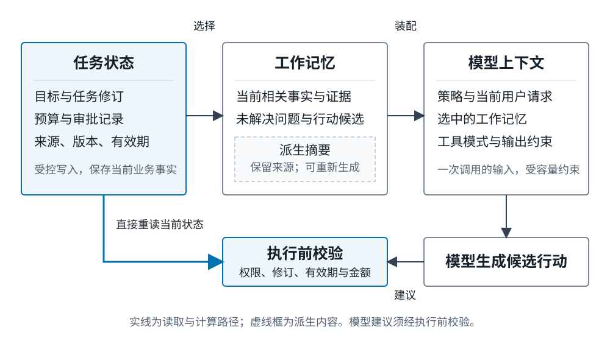
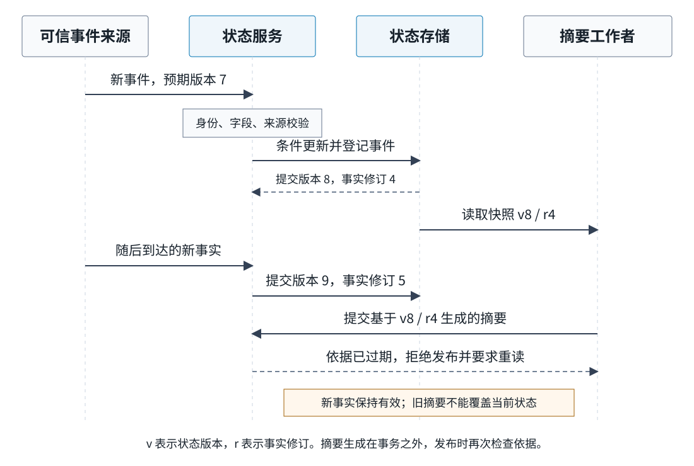

# Ch14 任务状态与工作记忆

**Task State and Working Memory**

**作者：王柯**

**摘要**　长程任务需要保留的不只是对话内容，还包括当前目标、预算、审批状态以及判断这些信息是否仍然有效的依据。本章从摘要遗漏审批条件的案例出发，区分任务状态、工作记忆与模型上下文，建立带来源、版本、有效期和写入权限的状态表示。随后讨论观测校验、条件更新、摘要生成、并发冲突、过期读取与敏感信息投影，给出基于 SQLite 的可运行实现。通过十条长会话的表示保留实验和状态故障测试，说明如何分别检查信息保留、状态一致性与行动前置条件，为长期记忆和持久会话提供明确接口。

**关键词**　任务状态（task state）；工作记忆（working memory）；模型上下文（model context）；状态摘要（state summary）；来源（provenance）；乐观并发控制（optimistic concurrency control）；有效期（validity interval）；数据最小化（data minimization）。

**前置知识与配套材料**　本章需要理解 [Ch03](../part1/ch03_agent_architecture.md) 的智能体控制循环，以及 [Ch06](../part2/ch06_context_structured_outputs.md) 的上下文装配和结构化输出。代码采用 Python 3.11 及以上版本和标准库 SQLite；从仓库根目录运行，基础路径无需模型账号。实现、数据、模式与实验记录位于 `examples/ch14/`，行为测试位于 `tests/test_ch14_state.py`。本章采用 `agent-state-draft-0.1` 状态模式，图表均为本书原创。

完成本章后，读者应能为一项业务任务定义可更新、可验证的状态；解释工作记忆与一次调用上下文的区别；为摘要、并发写入和快照恢复确定接受规则；并用可核验事实保留率、过期使用次数和表示开销评估状态设计。

## 14.1 摘要遗失审批条件

### 14.1.1 从一段正确对话到一次错误提交

企业政策研究与工单助手正在帮助一名员工准备差旅申请。员工给出了目的地、日期和预算，又明确说明：“可以先准备申请，但主管还没有批准，请不要提交。”助手检索政策、比较行程并形成草稿。经过多轮补充，对话越来越长，系统用一段摘要替换了早期消息。摘要写道：“差旅方案已经确定，预算在限额内，接下来提交申请。”

后续一轮中，员工问：“现在到哪一步了？”助手根据摘要回答“材料齐全，可以提交”，并调用提交工具。工具只检查参数格式和预算，于是创建了正式工单。系统保存了全部对话，也生成了看似连贯的摘要，却仍然越过了用户设定的审批边界。这个案例为教学构造，用于定位状态表示与执行检查之间的关系。

故障并不发生在“有没有记住差旅”这个宽泛层面。目的地、日期与金额都被保留了，丢失的是一句决定行动合法性的否定信息。自然语言摘要把“已经准备好草稿”与“已经获得提交许可”合并成了一个叙事阶段。之后，系统又把这段叙事当作当前业务事实，使一次信息压缩变成了授权变更。

如果只有摘要，排查人员需要重新阅读原始会话才能确认审批是否存在。如果系统另有明确的 `approval.status = pending`，问题就容易定位：摘要与状态不一致。再进一步，若提交工具在执行前读取这条状态并要求有效审批，那么错误摘要可以造成一次错误建议，却不能直接变成正式提交。这两种系统的区别在于业务事实和派生文本各自拥有多大权力。


**Fig-14-03　工作桌上的摘要与当前任务（场景插画）。** 便笺可能遗漏条件，夹板上的当前批准状态仍为待审批。行李和申请材料将抽象状态放回具体任务。来源：本书原创，教学情境示意，可编辑 SVG。

### 14.1.2 把问题定位到三个边界

第一处边界位于观察与事实之间。用户说“主管应该会同意”，表达的是预期；审批服务返回“已批准”，才可能形成相应业务事实。系统不能因为两者都出现在对话里，就赋予同等效力。来自模型的推断、用户的陈述与外部服务的记录，需要按照字段的证据要求分别处理。

第二处边界位于事实与摘要之间。摘要有助于理解任务，但它是对已有材料的压缩表达。摘要中出现“已批准”，并不等于审批系统产生了批准记录。允许摘要直接更新审批字段，相当于允许压缩器创造原始材料中没有的业务权限。

第三处边界位于建议与行动之间。模型可以提出“下一步提交申请”，执行入口还应检查当前任务、审批、预算和调用者权限。模型建议属于候选行动；工具是否执行，取决于业务系统接受哪些条件。有关副作用、幂等和补偿的细节由 [Ch12](../part3/ch12_action_execution.md) 展开，本章先为这些检查提供可读取的事实。

这三处边界对应不同的修复。对观察增加来源与核验状态，可以防止猜测直接成为事实；将摘要保存为派生对象，可以限制压缩错误的传播；在行动入口重新检查当前状态，可以阻止失效信息继续驱动操作。只修改摘要提示词，无法同时完成这三项修复。

### 14.1.3 记录任务，而不只是记录聊天

对话历史回答“发生过哪些交流”，任务状态回答“此刻依据什么继续处理”。两者相互关联，却不能彼此替代。任务已经改了目的地，历史中仍会保留原目的地；审批已经撤销，较早的批准通知仍然是一条真实历史记录。当前状态需要解释哪些历史记录仍然生效。

可以用一个简单问题检查设计是否充分：进程在任何一步中断后，另一执行者只读取允许交接的材料，能否知道当前目标、尚未满足的条件、已经产生的副作用，以及下一步可以做什么？如果答案必须依赖“原来的助手应该记得”，状态接口就还不完整。

本章按这一问题展开。先区分任务状态、工作记忆与上下文，再给出更新流程，随后讨论一致性和隐私，最后用长会话与故障测试检验这些机制。[Ch15](ch15_long_term_memory.md) 负责跨任务、跨会话的信息保留；[Ch23](../part6/ch23_sessions_events_state.md) 负责事件持久化和会话恢复。本章集中说明：哪些信息构成当前任务事实，以及它们怎样合法地改变。

## 14.2 状态、工作记忆与上下文的边界

### 14.2.1 任务状态是带解释依据的当前记录

一份任务状态至少需要包含任务标识、目标与范围、约束、进度、未解决问题和必要的业务条件。对于差旅助手，目标可以是“准备某项目的差旅申请草稿”，约束包括预算、日期和审批要求，进度则区分草稿形成、等待审批与正式提交。不同业务可以采用不同字段，但字段必须能够支持继续处理和独立验收。

“当前”不是简单地选取最后到达的一条消息。较早生成的审批撤销事件可能因为网络延迟最后到达；成员的晚到结果也可能依据旧目标。系统需要结合来源、源版本、任务修订和有效期判断一条更新。到达时间可以记录接收过程，却不应独自决定业务事实。

状态可抽象为一组带元信息的记录。对于字段 `budget_minor`，除了金额，还需要知道金额属于哪个任务、由哪个预算服务提供、依据哪版预算、何时失效。金额采用整数最小货币单位，避免浮点比较带来的解释歧义。这里的字段名说明单位，不承诺不同币种可以直接相加；涉及多币种时还必须记录币种与换算依据。

状态通常是对历史的投影，而不是历史本身。历史保留“预算先为两千元，后改为一千五百元”；当前投影提供“一千五百元及其更新依据”。当读者需要追问为何改变时，来源引用再引导其查看相应记录。这样既能快速读取，也保留了纠错入口。

### 14.2.2 工作记忆组织当前正在处理的信息

工作记忆服务于正在进行的任务。它可以包含当前问题、相关事实、检索到的证据片段、尚待验证的假设、候选计划与最近工具结果。其价值在于把下一步推理所需的信息组织到一起，而非尽可能保存所有输入。

心理学中的工作记忆研究为理解暂时保持与加工信息提供了概念背景。[^r01] 在智能体工程中，应进一步给出可操作的接口：哪些对象进入工作区、什么时候替换、由谁写入，以及工作区与业务事实之间如何关联。不能从“工作记忆”这个名称直接推导出一种数据库结构或某种特定模型能力。

CoALA 将语言智能体的记忆组件、行动空间和决策过程放在同一架构中讨论，为区分内部信息操作与外部行动提供了组织方式。[^r02] 对差旅助手而言，检索一条政策、把它加入当前工作区和提交正式申请是不同操作。前两项改变信息可见性，后一项改变业务世界；它们应具有不同的接受条件。

工作记忆中允许存在不确定信息。例如，“附件可能缺少项目编号”可以作为待核验假设保留，并触发读取附件的下一步。问题在于能否在使用时识别它仍是假设。若系统只存一段无标记文字，再把这段文字转交给另一执行者，猜测就容易在交接中被读成事实。

因此，一条工作记忆宜能够回答内容、来源、证据状态、任务作用域和使用期限。并非每条便签都需要复杂对象，但与审批、预算或事实结论相关的记录，应具有这些可检查属性。简短的标记往往比一段更长的解释更有用。

### 14.2.3 模型上下文是一次调用的具体输入

模型上下文由本次调用实际传入的信息构成，包括指令、用户请求、选中的工作记忆、工具模式和输出要求。任务状态可以长期存在，工作记忆可以跨多个推理步骤调整，而某次上下文只对应一次具体调用。下一次调用可以使用不同的片段、顺序和容量分配。

因此，状态中存在某项事实，并不意味着模型已经看见它；模型看见某段文本，也不意味着这段文本已经成为状态。前一种差异影响回答质量，后一种差异影响控制边界。排查“助手忘了审批”时，要先判断审批记录是否存在，再判断装配器是否把适当记录提供给了本次调用。

MemGPT 通过不同记忆层之间的数据移动管理有限上下文，说明上下文可见性本身需要专门的控制机制。[^r03] 不过，拥有更灵活的信息调入方式，与某条信息是否具有业务效力仍然是两回事。把一份批准通知调入上下文后，系统还要检查它所针对的任务、金额、有效期及是否已经撤销。

“把所有历史都放进去”也不能结束设计。Lost in the Middle 在多文档问答和键值检索任务中观察到，相关信息在长输入中的位置会影响模型表现。[^r04] 这一结果支持检查模型实际如何利用输入；它不意味着所有长上下文模型都会以相同方式失败。工程上仍需分别测量输入中是否存在事实，以及模型能否据此作出正确判断。



**Fig-14-01　任务状态、工作记忆与模型上下文的关系。** 蓝色路径表示执行前直接读取当前业务状态；摘要是工作记忆中的派生内容，不能通过生成文本自行改变审批与预算。图中省略了具体模型与存储适配器，强调信息读取和行动控制的不同路径。来源：本书原创，SVG 源文件位于 `docs/images/ch14/`。

### 14.2.4 观测、推断、已验证事实与缓存摘要

观测是系统接收到的输入，例如一条用户消息、一份政策片段或一次工具返回。保留观测时，首先需要保留它来自哪里以及观察到它的时间。工具返回“连接失败”是一条观测，不足以证明远端操作没有发生；同样，用户转述“已经批准”也不自动等于审批服务已接受该决定。

推断是根据现有材料形成的解释，例如“这项申请可能适用加急流程”。推断可以推动下一步检索或询问，但其证据不足时，应保持候选身份。即使模型非常确信，也不能用模型的信心数值代替相应业务机构的决定。

已验证事实是在给定规则下被接受的记录。“验证”总要说明验证了什么。预算服务提供了一条可认证、版本有效的预算记录，可以支持当前预算字段；这不意味着系统已经证明了申请中每项费用的真实性。工程接口应避免用一个笼统的 `trusted = true` 同时表达身份可信、内容正确和行动获准。

缓存摘要是为减少重复阅读而生成的派生文本。它应带有生成依据，例如 `based_on_state_version` 与 `facts_revision`。状态发生变化后，系统可以重新生成摘要，也可以只保留仍有有效依据的部分。决定是否重用的依据是内容依赖，而非“这段文字看起来仍然通顺”。

本章配套实现将可驱动业务检查的记录放在 `facts` 中，只接受指定来源角色的写入；模型工作者只能写摘要。待核验观察保留在输入记录中，模型可以据此提出候选更新，但不能自行把候选升级为审批事实。JSON Schema 可以检查对象结构与字段值约束；来源身份和业务规则还需要程序检查。[^r08]

### 14.2.5 字段应同时表达来源、期限和写入责任

**Tab-14-01　任务状态字段及更新责任。下列字段对应本章 `agent_state_schema.json`；有效期是事实可用于当前检查的期限，不等于日志的存储期限。**

| 字段 | 含义与来源 | 写入责任 | 版本与有效性 |
| --- | --- | --- | --- |
| `task_id`、`tenant_id`、`owner_id` | 任务、租户与申请人标识，由业务入口建立 | 任务创建服务 | 本实现创建后不通过事实更新接口修改 |
| `state_version` | 每次接受状态变更后的版本 | 状态服务 | 条件写入和旧快照检查依据 |
| `task_revision` | 任务目标与范围的修订 | 目标更新规则 | 目标改变后递增；批准记录需绑定当前修订 |
| `facts_revision` | 业务事实集合的修订 | 状态服务 | 事实更新时递增，摘要更新不递增 |
| `facts.goal` | 当前任务目标，来源为申请人请求 | 当前任务申请人 | 保留请求来源、源版本与有效期 |
| `facts.budget_minor` | 以整数最小货币单位表示的预算 | 预算服务 | 较旧源版本不得覆盖较新预算 |
| `facts.approval` | `pending`、`approved` 或 `revoked`，以及适用的任务修订与金额上限 | 审批服务 | 必须检查状态、修订、上限和期限 |
| `facts.preference` | 仅适用于本任务的出发偏好 | 当前任务申请人 | 不自动升级为跨任务用户画像 |
| 每项事实的 `source_ref`、`source_version` | 可定位来源及该来源的更新次序 | 事实写入规则 | 同一字段使用明确的源版本域 |
| 每项事实的 `writer`、`status`、`valid_until` | 接受该记录的来源身份、核验状态与使用期限 | 状态服务 | 只有接受后的事实具有 `verified` 状态 |
| `summary` | 文本、所依据的事实修订与状态版本 | 摘要工作者，经状态服务接受 | 依据失效时重读或重新生成；不赋予行动权限 |

字段的写入责任必须与运行时身份绑定。模型输出中即使出现 `writer = approvals`，也不能因此获得审批服务权限。状态服务使用的身份应来自经过认证的连接或应用调用上下文。OWASP 对提示注入的讨论说明，外部材料可能包含试图改变模型行为的指令。[^r09] 将这种材料放入工作记忆时，仍应将其作为数据处理，而不是把它转换成高权限写入请求。

`source_version` 与 `state_version` 也不可混用。假设预算服务的第十二版预算在状态服务中被接受为状态版本三十，前者描述预算来源的更新次序，后者描述本任务所有合法变更的次序。摘要更新可以使状态版本变为三十一，但预算源版本仍为十二。下一条预算更新同时需要满足状态前置条件与预算来源顺序。

如果同一字段有多个独立来源，不能直接比较各自自报的整数大小。来自服务甲的版本二十不天然比服务乙的版本八更新。需要先指定权威来源、建立版本命名空间，或把多个候选并列保存并进入冲突处理。本章实验为每项业务字段指定一个写入来源，因而可以使用单调递增的字段源版本。

### 14.2.6 信息保留应服从任务的下一步

选择工作记忆时，可以先列出下一步决策必须满足的条件，再寻找支持这些条件的事实。准备草稿需要目的地、日期、政策与费用；正式提交还需要当前授权和完整材料；解释一条政策则可能完全不需要申请人的联系方式。这种选择由任务决定，而不是固定地把最近若干轮全部传入模型。

有些内容适合优先保留，例如目标、禁止事项、剩余预算与未解决问题；有些内容适合压缩，例如已经核验的重复解释；还有些内容只需保存引用，例如较长的政策正文。选择规则应能解释为何一条信息进入工作区，以及它被移出后是否仍然可以重新获取。

Generative Agents 将经验记录、检索与反思结合，用于组织跨时刻的行为。[^r10] 本章借此强调信息进入与退出工作区需要机制，但不把所有经验都视为当前事实。一次临时要求可以在当前任务中十分重要，在另一个任务中却完全不适用。跨任务保留和个性化的写入标准将在 Ch15 单独讨论。

一个实用的检查方法是为每项关键约束指定唯一的读取入口。审批从当前审批事实读取，预算从预算事实读取，模型解释则从工作记忆读取。若同一检查在不同路径中分别读取聊天、摘要和缓存，各路径就可能在同一时刻给出不同答案。清楚的读取责任能够减少这种分歧，并为后续一致性设计确定对象。

## 14.3 从观测到可使用状态的更新流程

### 14.3.1 先保留观察，再提出更新

状态更新从一项明确输入开始。系统接收到申请人改变目的地的消息，可以提出目标修订；接收到预算服务的新记录，可以提出预算更新；接收到模型生成的摘要，则只能提出派生文本更新。将输入分类后，接收方才知道要检查哪种身份、结构和业务前提。

输入标识用于区分“一条新信息”和“同一条信息再次到达”。本章把 `event_id` 与任务及可信调用者身份共同作为去重键。重试时保持事件标识和载荷不变；若复用了标识却改变载荷，接收方拒绝请求。去重键的作用是限制重复状态变更，并不判断一条业务结论是否真实。

观察时间与接收时间最好分开记录。前者描述来源声称何时产生记录，后者描述本服务何时接收。若来源时间来自用户文本，它并不能直接用于判断记录是否最新。当前实现使用来源版本推进同一字段；时间用于检查有效期和解释处理过程。涉及跨系统因果关系和完整事件格式时，再与 Ch23 的事件契约衔接。

模型可以参与从原始文本中抽取候选字段。例如，它可以把“把预算改成一千五百元”解析为整数 `150000`。但抽取结果仍需绑定原始请求，并经业务入口确认调用者有权修改该预算。在本章示例中，预算由预算服务维护，申请人说出的数字只能触发预算查询或变更申请，不能直接覆盖正式预算。

这种做法也保留了纠错的依据。若模型把“一千五百”解析为“一万五千”，系统可以定位到原始输入和候选提取步骤。若只保存最后一个数值，错误将表现为“当前预算异常”，难以分清是用户输入、模型抽取还是状态写入规则出了问题。

### 14.3.2 把结构校验与业务校验分开

结构校验先判断对象能否解释。例如，预算必须是非负整数，审批状态只能取规定值，时间必须包含时区，未知字段不被默默接受。JSON Schema 的验证词汇提供了类型、枚举、必需字段与组合约束等结构表达方式。[^r08] 这能阻止字段拼错、类型漂移和部分无效载荷进入后续处理。

业务校验回答另一组问题：调用者是否有权改变该字段，来源是否属于该任务，更新依据是否比当前记录更新，批准是否针对当前目标，以及金额是否落在允许范围。一个完全满足 JSON Schema 的对象仍然可能缺少这些条件。把格式正确等同于业务有效，会把结构化输出的价值扩大到它并未承担的范围。

本章的审批对象保存 `status`、`task_revision` 和 `amount_limit_minor`。一份批准既要具有 `approved` 状态，还要针对当前任务修订，并覆盖计划申请的金额。假如员工在获得国内差旅批准后，把目标改为另一项目的国际差旅，旧批准不能因为状态字符串仍是 `approved` 就继续生效。

有效期也应检查到使用时刻。记录被写入时仍然有效，不表示一天后仍然有效。系统可以保留已经过期的记录用于解释历史，但行动检查应将其识别为需要重新确认的信息。将“仍保存在数据库中”误解为“仍可支持行动”，与将历史批准误解为当前批准具有相同根源。

下面是一项接受后的审批事实。金额采用分，示例批准上限为一千八百元；`task_revision` 绑定第一版任务目标。`writer` 由调用上下文写入，模型不能通过修改这个字符串取得相应身份。

```json
{
  "value": {
    "status": "approved",
    "task_revision": 1,
    "amount_limit_minor": 180000
  },
  "source_ref": "approval:T01:2",
  "source_version": 2,
  "valid_until": "2026-12-01T00:00:00Z",
  "writer": "approvals",
  "status": "verified"
}
```

这里有两种不同的状态：外层 `status = verified` 表示这份来源记录已被状态服务按规则接受；内层 `value.status = approved` 表示业务审批结果。审批被撤销时，外层仍可以是 `verified`，因为一条有效的撤销记录也是已核验事实。字段命名相近，语义却不应合并。

### 14.3.3 用条件更新处理读后写

执行者先读取状态，再计算更新，计算期间其他成员可能已经改变了同一任务。为避免无条件覆盖，更新请求携带 `expected_version`。接收方仅当当前版本仍然匹配时接受，并在同一事务中写入新状态与处理回执。

假设研究者和摘要工作者都读取了版本七。研究者先补入新的政策适用事实，状态推进到版本八；摘要工作者随后提交基于版本七生成的摘要。若执行无条件写入，较早的工作视图可能覆盖较新事实。若执行条件更新，后一个写入得到明确冲突，调用者重新读取后决定哪些计算仍然适用。

HTTP 条件请求中的 `If-Match` 通过实体标签表达更新前提，可用于防止丢失更新；RFC 9110 对这种用途和强比较规则作了规定。[^r05] 本章使用整数状态版本实现相同类别的前置条件。二者的共同点在于“依据仍然成立时才修改”，而不是强制所有接口采用同一种传输形式。

本章实现把完整状态保存为一份 JSON 文档，并在数据库行中单独保存状态版本。写入的关键语句如下，完整函数位于 `examples/ch14/state_store.py` 的 `StateStore.apply`：

```sql
UPDATE states
SET state_version = ?, document = ?
WHERE task_id = ? AND state_version = ?;
```

受影响行数为一，表示条件更新成功；为零，则表示前提不匹配或目标不存在，调用者不能把“请求发送成功”解释为“状态已经改变”。实际代码先查明任务与租户，再执行事务，因此可以分别返回任务未知、权限拒绝与版本冲突。

事务中的状态写入与事件回执必须共同提交。若状态已改变但回执未保存，重试就可能再次改变状态；若回执先保存而状态没有提交，重试又可能被误认为已经完成。将两者放在同一事务中，才能让去重记录准确反映这次状态变更是否被接受。

配套实现使用 SQLite 的 `BEGIN IMMEDIATE` 提前取得写事务资格，再执行版本检查与更新。这个实现适合本章的本地演练，不据此推导多机存储的吞吐和可用性。使用其他数据库时，应检查其隔离级别、锁与冲突语义。PostgreSQL 的事务隔离和显式锁文档分别说明了不同隔离方式与行级锁的行为，应用不能把“使用了数据库”直接等同于满足所有跨行不变量。[^r06][^r07]

### 14.3.4 冲突后重新解释，而不是盲目重试

版本冲突本身没有说明哪一方的业务结论正确。它只说明本次修改依据的快照已经不是当前快照。处理方式取决于更新类型：一个仅增加来源引用的候选也许仍可重新验证后接受；一个涉及预算、审批或目标的变更则需要重新检查当前业务条件。

“重新读取后换成最新版本号，再原样提交”可能绕过原本想保护的语义。假设预算来源的第十二版已经生效，迟到的第十一版更新失败。调用者把预期状态版本改为最新值，但第十一版预算仍然是旧业务信息。程序因此还检查同一字段的 `source_version`，拒绝旧来源覆盖新来源。

也存在可以合并的情况。例如，两名研究者分别为不同问题补充独立的文档引用，可以先检查引用仍然有效，再做集合并集。合并规则要说明是否允许重复、是否保留顺序、是否存在互斥条件。审批状态就不适合用集合并集；同时保留“已批准”和“已撤销”并不能直接回答当前是否允许提交。

对于预算等总量约束，简单覆盖或相加都可能不合适。把“已用金额”作为两个执行者各自计算的绝对值写入，会造成丢失更新；把重试中的扣减量再次相加，又会重复扣减。正确设计需要把独立操作标识、条件变更和业务不变量一起考虑。行动副作用的幂等边界由 Ch12 进一步处理。

因此，冲突处理至少应产出一种清晰结果：重新计算后接受、保留并列候选、拒绝旧依据，或升级到有权决定的角色。无限自动重试会掩盖任务已发生实质变化，也可能消耗大量模型和工具预算。重试次数和剩余预算应属于执行策略，而非被当作状态一致性的替代品。

### 14.3.5 在事务之外生成摘要，在发布时检查依据

摘要生成可能需要较长时间，不适合占用数据库写事务等待模型响应。一个合理流程是先读取已提交快照，在事务之外生成摘要，再携带依据版本申请发布。状态服务重新检查依据，决定摘要是否仍可作为当前工作视图的一部分。

需要区分状态版本变化与摘要依赖变化。状态版本可能因为另一段摘要写入而变化，业务事实却没有改变。为便于解释，本章另外维护 `facts_revision`：任何业务事实更新都会递增，只有摘要更新时保持不变。摘要记录包含所依据的事实修订，因此可以识别生成期间是否出现了新事实。

当前实现采取偏保守的接受规则。请求首先满足 `expected_version`；若调用者重读后尝试发布先前计算的摘要，还需要保证 `facts_revision` 未变。这样既防止旧状态的整份覆盖，也防止调用者仅替换版本号后发布依据过时的文本。更精细的实现可以跟踪摘要实际依赖的字段，但需要维护相应依赖关系。

例如，摘要只解释某一政策证据，而任务中无关的显示偏好发生变化，完全重算也许没有必要。字段级依赖能缩小失效范围，代价是每份派生对象必须记录完整依赖，且依赖变更要能传播。如果依赖记录漏掉审批字段，精细缓存反而可能比整份失效更难排查。



**Fig-14-02　状态更新与摘要生成时序。** 状态版本八对应事实修订四；摘要计算尚未完成，新事实已经推进到状态版本九与事实修订五。旧摘要不能仅因生成完成而覆盖当前工作视图，调用者应重新读取。实线表示请求或数据交付，虚线表示回执。来源：本书原创，可编辑 SVG。

摘要还要保留否定、条件和未解决事项。将“尚未批准”改写为“等待最后一步”，可能保留了叙事流畅性，却丢失了明确业务条件。可以让摘要结构单独列出未完成条件，并检查摘要与权威状态是否矛盾。即使这种检查没有发现问题，行动入口仍然读取原始业务字段，摘要质量与授权检查各自承担自己的责任。

### 14.3.6 为下一次调用装配工作视图

提交状态之后，系统还需要决定下一步读什么。可以把工作视图看成状态、证据和未解决问题的受控投影。投影选择当前子任务所需字段，同时保留能解释这些字段的来源与期限；摘要提供背景连接，长文档则通过可访问引用补充。

装配顺序可以从固定约束开始。先放入本次调用必须遵守的行为边界和输出要求，再放入当前目标与用户请求，随后提供支持下一步判断的事实和证据。最近对话与历史摘要使用剩余容量。具体比例由 Ch06 讨论，本章关注的是：装配器必须知道哪些信息可以压缩，哪些条件不能被默默删去。

如果最低必需信息已经超过上下文容量，系统应缩小子任务、按需读取证据，或使用能够容纳该输入的调用方案。无声地截掉审批要求后继续执行，相当于改变了问题本身。对于只需解释政策的步骤，可以不提供全部工单历史；对于申请正式提交的步骤，则需要携带明确的行动前提，并由工具端再次检查。

来源标签也应跟随内容进入上下文。可信策略、申请人请求、检索文档和模型便签不应被拼成一段无法区分的文字。模型可以利用低信任数据解释问题，但数据中的命令不因此获得策略地位。上下文装配的信任分区，与状态写入的字段权限应保持一致。

最后记录本次调用使用的状态版本、证据版本和摘要依据。这些标识帮助排查模型当时看到了什么。记录不必复制所有敏感原文；可以保存访问受控的输入引用和必要元信息。信息留存的粒度需要与隐私和诊断用途一起设计。

### 14.3.7 行动前重新检查当前事实

模型调用结束时，输入中的状态可能已经过期。若用户在模型思考期间撤销了审批，模型仍然可能给出“提交”的建议。工具入口应重读当前状态，并检查模型建议所依据的版本、当前审批状态、适用任务修订、事实有效期和金额限制。

配套实现的 `StateStore.authorize` 读取当前状态，要求调用者为执行角色，再逐项检查必要事实。为了说明边界，返回值使用 `allowed_at_check_time`，表达“在这次检查时满足条件”。这份返回结果不直接执行外部操作，也不会把预算自动预留。

检查和外部执行之间仍可能出现新的变化。若任务需要保证撤销与执行的严格次序，业务服务必须在接受行动时再次验证授权或使用相应的事务、预留与版本栅栏。仅在智能体本地检查一次，无法让另一个独立服务中的动作自动具有相同原子性。Ch12 的执行控制与 Ch19 的分配代次正是在各自边界上继续解决这些问题。

对于只读回答，重查频率可以按用途设计。一次不涉及敏感操作的解释也许允许显示带时间标记的缓存结果；正式提交则需要更强的当前性要求。系统应明确哪些读取允许过期以及最多容忍多久，避免将所有路径都称为“实时状态”。

### 14.3.8 更新流程的成本与可替换部分

全量历史读取的开销随历史长度增长。如果历史包含 `n` 条记录，完整扫描当前事实需要处理这些记录；维护好的状态投影则可以直接读取当前任务对象，其主要大小由当前保留字段和相关引用决定。投影降低重复扫描成本，但增加了每次写入时维护规则和来源关系的工作。

设一次摘要计算处理的输入长度为 `L`，输出容量为 `B`。规则压缩通常可以按输入线性扫描，模型摘要的延迟和费用则取决于端点、输入输出规模及调用策略。减少摘要更新次数，可以节省重复计算；但若工作视图因此长期落后，后续调用可能继续使用失效材料。可以在关键事实改变时立即使相关摘要失效，在普通对话增加时批量刷新。

状态服务不必绑定某个模型框架。它暴露的核心能力是读取快照、申请条件变更和检查业务前提。模型适配器负责生成候选，工具适配器负责落实外部动作，持久会话负责保存事件与恢复执行位置。只要这些边界明确，更换摘要模型不需要同时改变审批写入规则。

实现时也应区分状态规范与存储选择。相同的字段与不变量可以由关系数据库、文档存储或单任务事件投影实现；存储是否支持原子条件更新、怎样处理事务冲突，以及恢复后如何确认当前版本，才决定相应实现能否满足本章的接受规则。

## 14.4 一致性、信息保留与隐私

### 14.4.1 不同读取需要不同的当前性

智能体系统中的多份视图通常不会同时更新。数据库可能已经接受一条预算变化，工作区仍保存旧预算，模型调用又在使用更早的上下文。不能仅凭所有组件都引用同一个任务标识，就认定它们具有相同状态。

设计时可以先给读取分类。用于界面显示的进度允许短暂落后，但应说明更新时间；用于规划的工作视图需要知道它依据的目标与预算修订；用于正式操作的检查需要读取业务入口认可的当前条件。允许哪些过期信息参与什么操作，是接口的语义约定。

在需要“读到自己刚刚写入”的路径中，写入回执最好返回接受版本，后续读取再要求不早于该版本。若读请求被路由到尚未同步的副本，返回更旧状态会使用户以为修改没有生效，进而再次提出相同请求。版本标识既帮助客户端识别这个问题，也能避免用重复操作去修补显示延迟。

本章 SQLite 示例使用同一数据库中的已提交读取，不模拟读副本延迟。迁移到复制存储时，需要另外选择读取路由和一致性要求；一个应用层版本字段不能独自让副本立即追上主节点。有关运行时与存储部署的选择分别由 Ch22 和 Ch23 承接。

### 14.4.2 并发写入要保护业务不变量

版本条件首先保护一份记录免受丢失更新，但业务不变量有时跨越多份记录。两项不同任务可能同时申请同一部门的剩余额度：每项任务各自的状态版本都未变化，也不意味着两次支出合计不会超额。若约束对象是共享额度，就需要在共享额度所在的业务边界执行预留或条件扣减。

因此，“每项任务都有乐观锁”与“所有业务约束都保持成立”之间还差一个范围判断。读者需要明确不变量涉及一条任务记录、若干关联行，还是外部系统。数据库隔离级别可以约束并发可见性，但适当的约束、锁定对象和重试处理仍属于应用设计。[^r06][^r07]

对于单任务内的更新，整份状态的版本条件容易解释，但会让互不相关的字段竞争同一个版本。字段级条件更新可以减少冲突，不过也需要识别字段之间的依赖。目标、审批与金额相互关联，不能因为存放在不同字段就允许任意独立更新。若拆分写入使批准绑定了旧目标，细粒度更新反而破坏了原本需要保护的关系。

一种可操作的原则是：先把必须一起成立的条件放进同一接受规则，再根据实际冲突量决定是否拆分。不要先追求尽可能并行，再依靠摘要解释已经出现的不一致。并发设计最终要让接收方能够明确回答“这次更新为什么被接受”。

### 14.4.3 旧状态恢复不能复活旧授权

工作进程重启后，可能从检查点恢复一份任务快照。这份快照说明保存时刻的状态，不保证恢复时刻的业务条件仍然成立。进程中断期间，申请人可能改变目标，预算可能被下调，审批也可能已经撤销。

恢复流程应先定位任务，再读取当前权威状态，比较任务修订与状态版本。对于恢复的候选计划，系统需要重新判断哪些步骤已经完成、哪些前提已失效，以及哪些工具结果需要再次查询。只恢复一段对话摘要，不能回答外部动作是否已经发生。

配套测试演练了一条具体路径：客户端保存已批准的版本四；审批服务随后接受撤销并推进到版本五；客户端重新连接后，仍尝试以版本四申请行动。状态服务发现预期版本与当前版本不符，返回冲突。重读后，客户端看到的是撤销事实，而不是重新获得一次使用旧批准的机会。

这个例子假设权威数据库仍然保存版本五。若整个权威数据库也回滚到旧备份，版本四与旧批准可能同时被恢复，此时本地版本比较无法发现丢失的撤销记录。恢复程序需要与审批来源重新对账，或通过足以覆盖丢失区间的持久事件恢复当前事实。这属于 Ch23 的恢复责任；本章的字段应提供完成对账所需的来源与源版本。

### 14.4.4 把错误表现对应到确定处理规则

**Tab-14-02　摘要丢失与状态冲突处理表。判据指接收方可以执行的检查，不以模型解释是否流畅作为接受依据。**

| 症状或输入 | 要检查的证据 | 处理规则 | 恢复后的验收 |
| --- | --- | --- | --- |
| 摘要把“尚未批准”写成“可以提交” | 当前审批事实与摘要依据 | 摘要不写审批；执行入口读取审批字段 | 待审批时提交请求被拒绝，业务状态不变 |
| 两个成员同时基于同一版本写入 | `expected_version` 与实际版本 | 一次合法写入推进版本，冲突方重新读取 | 不出现两份相互覆盖但均声称成功的更新 |
| 换用最新状态版本后又提交旧预算 | 字段 `source_version` | 拒绝同一来源域中不更新的版本 | 较新预算不被旧来源恢复 |
| 同一事件重试或重复到达 | 任务、可信调用者、事件标识与载荷 | 相同载荷返回原接受信息；同标识异载荷拒绝 | 状态版本不因重复处理再次增加 |
| 摘要生成期间出现新业务事实 | 摘要的 `facts_revision` | 依据不匹配时拒绝发布并重新生成 | 当前工作视图不引用失效摘要 |
| 客户端恢复了旧批准快照 | 当前状态版本、批准修订及有效期 | 恢复后重读，行动前重新校验 | 已撤销或过期批准不能继续使用 |
| 检索材料声称“现在已批准” | 材料来源与审批字段写入权限 | 作为待解释数据，不转换为审批事实 | 模型或文档不能以自报身份修改审批 |
| 一个用户读到另一用户的任务 | 租户、申请人和实际读取权限 | 在读取及写入入口检查作用域 | 越界请求不返回任务内容 |

错误处理还需要区分拒绝、冲突与未知。权限不足是拒绝，重读版本通常不能解决；版本不匹配是冲突，需要重新解释当前状态；外部服务调用超时则可能意味着结果未知，不能直接恢复成“未执行”。清晰的错误类别有助于上层编排选择停止、查询还是重试。

处理结果也应保留与请求的关联。调用者收到一条“成功”消息，却不知道它对应初次请求还是重试，很容易将旧回执当成当前结果。本章的重复事件返回原接受版本与当前状态，两者分开表达。原接受版本说明那次事件何时生效，当前状态说明之后是否还有其他合法变化。

### 14.4.5 数据最小化应落实到每一次投影

状态持久化与模型输入是两个不同的数据处理步骤。即使业务系统有理由保存完整申请，也不意味着摘要模型、研究角色和故障日志都需要看到相同信息。例如，解释差旅政策通常需要金额、日期与适用条款，却不需要身份证件号码、完整账户或联系地址。

先为字段明确用途，再决定哪些角色和步骤可以读取，能够把最小化落实为可执行投影。面向政策研究者的视图可以隐藏申请人直接身份，保留与政策适用有关的职位类别；面向预算核验者的视图可以突出金额与成本归属，而不附带无关的聊天细节。一个租户内仍可能存在不同权限，租户隔离不能代替任务级和字段级授权。

本章示例检查租户边界，以及申请人访问本人任务的边界；服务角色由应用层提供，并被视为已在其职责范围内获得授权。生产集成时，应由认证和授权适配器进一步约束这些服务可以访问哪些任务，而非把代码中的角色字符串开放给模型填入。这里明确的接口前提，也让读者能够判断哪些控制已经由示例覆盖，哪些应由外层服务提供。

脱敏需要考虑用途是否仍能完成。若诊断状态冲突只需要任务代号与版本，就不必保存原始请求全文；若要核验模型抽取错误，可能需要在受控位置保留对应文本片段。将所有文本都替换为同一个占位符会破坏诊断能力；在每条日志中保留所有原文又扩大了接触范围。应该围绕具体诊断问题选择最少但充分的信息。

对假名化标识也应保持准确理解。把姓名改成 `user-1` 能减少直接身份暴露，但若系统仍能通过映射找回本人，这不等于完全匿名。实验数据中使用本书原创人物和任务代号，可以避免把真实人员信息带入教学仓库；业务运行中的假名映射则应单独控制访问。

### 14.4.6 使用期限、保留期限与删除是不同操作

事实的有效期决定它还能否用于当前判断。存储保留期决定系统为什么、以及保存多久。删除则改变数据是否仍可被查询或恢复。三者可以有关联，但不应共用一个含糊的过期标记。

例如，一份批准在十二月一日失效后，可能仍需用于解释十一月的一次合法提交。系统可以保留这份历史记录，同时禁止它继续支持新行动。反过来，某段包含无关个人信息的聊天可能仍与当前任务同时存在，却没有必要进入摘要或长期存储。

制定保留策略时，应分别列出当前状态、原始观察、派生摘要、调用输入、诊断日志和备份的用途及责任。摘要与缓存尤其容易遗漏：主记录已经纠正，旧摘要仍然展示错误偏好；业务数据已经删除，调试日志却保留了完整副本。跨层删除传播将在 Ch15 展开，本章先要求工作视图有可追踪来源和失效入口。

状态中的期限字段不会自动删除 SQLite 里的数据，本章代码也不将过期检查描述为删除服务。实现删除需要另外明确清理对象、执行时机和验收范围。对读者而言，这种区分有实际作用：看到一次授权因过期被拒绝，只能说明使用检查生效，不能据此推断所有存储副本已经清除。

### 14.4.7 为状态变化保留足够的诊断证据

一次状态问题的最短诊断链通常包括输入标识、可信来源、原读取版本、请求修改的字段、接受或拒绝原因，以及最后形成的状态版本。对于摘要，还需要能定位其生成依据。这些信息能让排查者重建“为什么当时认为可以继续”。

记录应服务于判断，而不是变成第二份无规则的业务数据库。日志中的审批状态若被其他组件重新当成权威记录使用，就会制造新的状态源。诊断视图可以显示历史值，但应保留时间与版本语义；当前行动仍从规定的业务入口读取。

本章的 `accepted_events` 表用于事务内去重，保存接受事件的载荷与版本。它没有记录完整的拒绝日志、调用链和外部业务结果，因此不能替代 Ch13 的行动轨迹或 Ch23 的持久事件流。后续章节可以使用同一任务与事件标识扩展观测，而不改变本章的事实写入责任。

## 14.5 长会话状态与恢复实验

### 14.5.1 把信息保留和判断正确分开测量

要评估状态设计，首先区分三类问题。信息保留问题检查当前表示中是否仍然存在所需事实及其依据；事实有效性问题检查这些记录是否为当前版本、是否过期；决策问题检查系统最终是否根据有效事实选择了允许的动作。前一项通过，并不自动意味着后一项通过。

例如，全量历史包含所有审批消息，信息没有丢失，但模型仍可能选用较早批准而忽略稍后的撤销。结构化状态也可能保存错误抽取的值，或者字段正确却缺少期限。因此，本章分别执行表示保留实验与状态规则测试；真实模型在长会话中的理解能力需要另外测量。

表示实验使用可检查的事实标注，将每项需要保留的信息明确到字段和值。这样可以独立定位信息是否被压缩策略移除，不必先把模型回答作为事实判断器。状态规则测试则直接向接收方输入会导致冲突、过期或越权的更新，检查接受结果与业务字段是否变化。

二者对应不同的证据。前者给出确定性序列化表示的保留与开销数据；后者验证本章程序在指定故障路径中的行为。它们可以支持对表示和规则的解释，但不产生一个面向真实模型的综合能力排名。

### 14.5.2 数据、检查点与对照

`Exp-14-01` 包含十条本书原创的合成长会话，每条六十轮。每条会话都包含目标、预算、审批和出发偏好四项事实，以及不改变这些事实的行程补充说明。第十九轮修改偏好，第二十七轮下调预算，第三十五轮批准申请；第四十三轮对其中五条会话撤销审批，另五条再次确认批准。检查点固定为第十二、二十四、三十六、四十八和六十轮。

在每个检查点，根据已到达的事实记录生成当前答案键，共得到五十个任务快照、二百个必需事实项。数据中的 `fact` 和 `source_ref` 是教学标注，直接表示字段更新与来源，实验不包含从自由文本中抽取事实的模型。结构化状态能够保留事实，依赖于这些合法输入已经被正确提供；自然语言抽取错误应另作为上游实验。

三项对照共享相同会话与检查点。全量历史保存当前检查点之前的全部轮次。抽取式自然语言摘要从最近一轮向前选取完整语句，累计正文不超过二百四十个 Unicode 码点，再恢复时间顺序。结构化状态加摘要保存四项当前事实及来源，并附带同一份抽取式摘要。

抽取式摘要完整保留选中语句，没有使用模型，也没有主动删去否定词。它代表按最近信息压缩的一种明确规则，不代表所有摘要方法。使用这条规则的原因是可以将事实移出表示的时刻直接定位到保留策略，排除生成模型采样带来的其他变化。

为比较当前值，评估器按时间顺序读取表示中保留的已标注事实，取同一字段的最后一条。若值、来源和更新轮次均与答案键一致，则计为正确保留；字段不存在则计为缺失；存在但仍是旧记录则计为陈旧。结构化对照通过应用同样的已标注更新生成当前字段，因此本实验考察表示机制的差异，不比较不同抽取器。

### 14.5.3 指标、分母与开销口径

关键事实保留率的分母是所有检查点需要的事实项数，分子是当前表示中正确保留的事实项数。对本实验而言，分母为十条会话乘以五个检查点，再乘以四项事实，即二百。若只按“至少记住了一件事”的会话比例计分，摘要保留了某次偏好却丢失审批的情形就容易被掩盖。

陈旧事实项数单独统计。缺失与陈旧具有不同含义：缺失提示下一步需要重新查询；陈旧则可能给系统一个看似完整但已经失效的答案。如果把缺失默认补为“已批准”，评估器本身就引入了危险规则。本章统计时保持缺失状态，不把它转换为任意业务值。

表示开销按 UTF-8 序列化字节数和 Unicode 码点数测量。序列化使用固定键排序和紧凑分隔符，包含保留文本、事实标注及来源元信息。表中的平均值是五十个检查点的平均表示大小，不是数据库磁盘占用，也不是模型计费 token。

二百四十个码点的限制只约束抽取摘要的语句正文。序列化还包含轮次、字段名和来源引用，因此摘要对象的码点数可以高于二百四十。这个区别说明为什么实验需要明确“限制哪一层大小”；把正文容量、JSON 大小和模型 token 预算统称为上下文长度，会使不同实现难以比较。

若接入真实模型，还应使用该模型对应的 tokenizer 记录输入与输出 token、请求次数和实际价格日期。中文码点、UTF-8 字节和 token 之间不存在一个可通用于所有模型与文本的固定换算系数。本章只报告本地直接测得的表示大小。

### 14.5.4 运行与结果解释

从仓库根目录执行以下命令。第一条生成十条会话，第二条运行固定检查点实验并保存逐项结果。配套环境使用 Python 3.12；数据与策略均为确定性过程，当前记录为一次完整运行。

```bash
uv run python examples/ch14/build_cases.py
uv run python examples/ch14/representation_experiment.py \
  --output examples/ch14/results/representation_report.json
```

**Tab-14-03　确定性表示保留实验的本地运行结果。每种表示均评估50个快照、200项当前事实；均值以完整序列化对象计算。未调用语言模型。**

| 表示 | 正确保留事实项 | 保留率 | 陈旧事实项 | 平均 UTF-8 字节 | 平均码点 |
| --- | ---: | ---: | ---: | ---: | ---: |
| 全量历史 | 200/200 | 100% | 0 | 6127.2 | 2990.4 |
| 最近语句抽取式摘要 | 10/200 | 5% | 0 | 745.6 | 343.2 |
| 结构化状态加同一摘要 | 200/200 | 100% | 0 | 1143.9 | 704.3 |

全量历史保留了所有事实，因为当前检查点之前的输入没有被删除。结构化状态同样保留二百项当前事实，但只保存每个字段的当前记录，再附上相同的近期摘要，其平均序列化大小低于全量历史。这一差异来自当前投影与历史累积的不同增长方式。

最近语句摘要只保留十项当前事实。检查点往往位于若干轮行程补充说明之后，目标、预算和审批早已移出最近语句窗口；在第三十六轮附近，较近的批准记录还能够进入摘要。它没有出现陈旧记录，并不意味着表示已经充分，而是大多数关键事实已经缺失。因此需要把“缺失多少”与“保留的信息是否陈旧”一起阅读。

该结果也不能解释为结构化字段天然理解得更好。输入已经提供可直接应用的标注，程序只是维护当前值。若上游把审批撤销误标为批准，结构化投影也会保存错误内容。要检查真实系统，应在本实验之前增加从原始消息到候选事实的提取评估，并保留独立答案键。

原始报告逐行记录会话、检查点、表示、分母、保留数与大小。读者可以定位某个丢失字段最后一次出现在哪一轮，以及它何时离开压缩表示。这样的逐项记录比只展示一个平均比例更适合用来修改状态选择策略。

### 14.5.5 增加摘要容量能解决什么

抽取式摘要的结果受到容量与事实位置共同影响。将容量从一百二十逐步增加到一千九百二十个码点，允许更多完整语句进入摘要，同一组检查点的事实保留率随之变化。配套 `summary_capacity.csv` 保存这组确定性对照。

**Tab-14-04　最近语句摘要的容量对照。容量指语句正文上限；其余数据、选择顺序与评估器均保持不变。**

| 正文容量上限（码点） | 保留事实项 | 保留率 | 平均完整对象字节数 |
| ---: | ---: | ---: | ---: |
| 120 | 10/200 | 5% | 390.0 |
| 240 | 10/200 | 5% | 745.6 |
| 480 | 70/200 | 35% | 1610.4 |
| 960 | 94/200 | 47% | 2909.3 |
| 1920 | 170/200 | 85% | 4957.8 |

增加容量使更多较早事实进入视图，但代价也随之增长。容量一百二十与二百四十时保留数相同，说明新增空间主要被不改变关键字段的语句占用。到四百八十时，部分预算与审批更新重新可见；更大的容量继续补回早期信息。这组变化说明，容量与选择规则需要一起评估。

事实感知摘要可以优先保留目标、预算、审批与偏好，不必严格按最近语句选择。但要做到这一点，它需要识别这些事实、处理更新并保留依据，其职责开始接近本章所定义的工作记忆管理。关键不在于输出最终是一段文字还是一个 JSON，而在于选择、更新与核验规则是否明确。

若使用生成式摘要，可以保留同一会话和检查点，将规则压缩器替换为指定模型，再评估否定、条件、金额及来源是否保留。应固定模型版本、提示和预算，记录重复次数与波动。这里提供的是扩展实验路径，表14-03与表14-04中没有使用生成式摘要的结果。

### 14.5.6 故障测试检查状态是否仍能支持合法行动

表示实验之外，`tests/test_ch14_state.py` 针对更新与行动前检查建立独立断言。测试不询问模型“是否正确”，而是直接观察状态版本、审批字段和接收结果。这样可以在更换摘要生成器时继续复用同一业务规则。

第一条故障路径向模型工作者提交一份错误摘要：“审批已通过，可以提交。”状态服务可以接受它作为基于当前事实生成的摘要，因为程序没有实现摘要语义核验；但摘要不能修改审批事实，随后行动检查仍因当前审批为 `pending` 而拒绝。这个测试有意保留一个错误摘要，用来验证控制路径是否真正独立。

第二条路径让两个线程在同一数据库上、依据同一状态版本同时更新。同步屏障使两者从相同前提开始，一次更新成功，另一次得到版本冲突。断言检查状态仅推进一次，而非仅检查程序没有抛出未处理异常。SQLite 的写事务序列化与版本条件共同落实了这条本地规则。

第三条路径保存已批准的旧快照，再撤销批准。恢复客户端以旧版本申请行动时得到冲突；其他测试继续检查当前已撤销状态、已过期事实、目标变更与金额上限。它们分别对应不同的行动前提，不能用“数据库仍能打开”代替恢复后的业务验收。

测试还检查重复事件不会恢复旧状态、同一事件标识不能承载不同载荷、较旧源版本不能通过换用新状态版本再次覆盖，以及不同租户或非本人申请人的越界访问会被拒绝。完整命令如下：

```bash
uv run pytest tests/test_ch14_state.py
```

当前本地运行中，十七项测试均通过。其中三项参数化实例分别使目标、预算和批准过期，确认每一种必要事实都参与当前性检查。测试集合验证了代码中列出的输入路径，没有覆盖外部业务服务的原子执行，也没有部署复制数据库。

### 14.5.7 从观测症状回到修复动作

回到开篇案例，完整诊断可以按证据逐步推进。先检查审批来源，确认没有合法批准；再查看摘要依据，发现模型将“等待批准”压缩成“可以提交”；随后检查工具入口，发现它只验证参数和预算，没有读取审批字段。这样可以区分内容错误与控制缺口。

修复动作也分层进行。状态层为审批建立受控字段与来源，摘要层保留未完成条件和生成依据，工具层检查当前审批与任务修订。完成后再次注入同一份错误摘要，预期结果是模型仍可能提出错误建议，但正式提交被拒绝。再向审批服务输入一条合法、有效且覆盖当前金额的批准记录，行动前检查应当通过。

这个正反对照很重要。若只测试拒绝错误提交，程序可能通过“拒绝所有请求”满足断言，却无法完成正常任务。本章另外提供有效批准的正向测试，确认当前记录、任务修订与金额条件均满足时，会返回允许检查结果。由此能够判断规则是否在约束与任务完成之间保持了明确边界。

在真实系统里，还应继续观察用户是否收到可理解的反馈。待审批时可以说明草稿已完成、仍需谁批准，以及如何继续；状态冲突时可以指出任务发生变化，需要重新核对。把结构化拒绝原因转换成解释是模型可以参与的工作，但解释不能改变拒绝结果本身。

### 14.5.8 实验报告应保留的解释范围

本节结果支持两项结论：在给定的标注输入与确定选择规则下，显式当前状态可以保留更新后的关键事实；在本章实现与测试输入中，摘要更新、冲突和旧快照不能绕过指定的行动前检查。这些结论分别来自逐项表示报告和行为断言。

模型能否从长会话可靠抽取事实、生成式摘要是否保留否定词，以及多人多机服务在压力下的延迟，需要独立实验。当前报告不填入未测得的 token、费用、模型准确率和生产容量。读者扩展系统时，可以沿用任务标识与检查点，把新增测量接到相同证据链上。

实验环境、生成命令、输入规模、比较方法、结果路径和已知边界在 `examples/ch14/experiment_card.md` 中集中记录。章末实践题将继续使用这些资产，要求读者新增一个事实字段，并展示它如何经过来源校验、状态更新与行动检查，而不是只在提示中增加一句要求。

## 14.6 小结、状态规范与跨章交接

### 14.6.1 从“记住内容”到“维护可继续的任务”

任务状态为继续执行提供当前事实，工作记忆围绕下一步组织信息，模型上下文承载一次调用实际可见的输入。三者之间需要选择与装配，但任何一次压缩都不应暗中改变业务权限。明确区分它们，可以把“助手忘了”这样的宽泛描述转化为可定位的问题。

更新规则同样需要明确。来源、写入身份、任务修订、状态版本与有效期分别回答不同问题；条件写入保护读后写前提，源版本限制旧业务记录重新生效，摘要依据则帮助识别派生文本是否仍可使用。行动入口读取当前事实，让信息组织与业务执行具有可检查的连接。

本章实验展示了为什么表示、当前性与决策应分别验收。完整历史可以保留信息，却不能保证选用正确记录；压缩摘要可以减少表示大小，却可能移出关键条件；结构化状态能够稳定保存指定字段，但仍依赖正确来源与输入。把这些责任分开，才能知道下一次改动应发生在提取器、选择器、更新规则还是工具入口。

### 14.6.2 交接给后续章节的状态契约

向 Ch15 交接时，本章提供任务内的作用域、来源与期限。后续长期记忆需要决定哪些记录可以跨任务保留，并增加用户身份、纠正、撤销与删除传播机制。本任务中“下午出发”的偏好，不应因为在状态里出现过就自动成为永久画像。

向 Ch16 交接时，工作记忆需要使用带文档版本和片段定位的证据。状态可以保存当前采用的证据引用，但不能把“检索到一段内容”直接等同于“该内容适用于本任务”。来源、权限和时效检查会继续沿着知识流水线展开。

向 Ch23 交接时，状态服务提供任务标识、版本、源记录与更新接受规则。会话和事件系统负责将这些对象持久保存、回放或重新构建，并在恢复时确认外部事实与行动结果。本章的去重表不替代完整事件流，模式文件也不决定底层选主或备份策略。

向附录C交接时，`agent_state_schema.json` 是本章状态字段的机器可读草案，避免从表格再手抄一份不同结构。该草案与公共接口统稿时需要核对名称和消费者；正文路径保持稳定，接口版本明确变化原因。Schema 描述结构，`StateStore` 中的规则补充来源权限、版本次序与行动前提。

### 14.6.3 关键术语

| 术语 | 本章定义 | 易混淆点 |
| --- | --- | --- |
| 任务状态 | 继续处理一项任务所依据的当前记录及其解释依据 | 不等于全部聊天历史 |
| 工作记忆 | 为当前任务和下一步处理选择的信息工作区 | 可以含待核验假设，不都具有业务效力 |
| 模型上下文 | 一次模型调用实际接收的输入 | 状态存在不表示本次调用已经可见 |
| 事实投影 | 根据接受规则从输入记录维护的当前字段集合 | 正确维护不替代上游事实提取与来源核验 |
| 派生摘要 | 基于指定事实或观察生成的压缩文本 | 不产生审批或执行权限 |
| 条件更新 | 前置版本或业务条件仍成立时才接受写入 | 与无条件覆盖、盲目重试不同 |
| 源版本 | 同一来源域中业务记录的更新次序 | 不等于整个任务的状态版本 |
| 有效期 | 事实还可用于指定判断的时间范围 | 不等于数据保留与删除期限 |

### 14.6.4 复习题

1. 一条用户消息、一份自然语言摘要和一条审批服务记录都包含“已经批准”。它们分别属于哪一类信息？哪些条件满足后，系统才能据此提交申请？
2. 两个工作者都读到状态版本十七，一个更新预算，另一个更新摘要。请给出两种可能的执行次序，并说明后提交者何时需要重新计算，何时可以基于未变化的依赖重新申请发布。
3. 故障日志显示：用户已撤销审批，但重启后的助手仍提出提交。请按任务状态、摘要依据、上下文装配与工具检查四个位置，分别给出要查的证据与验收条件。
4. 某表示在二百项关键事实中保留了一百六十项，保留项中有八项来自旧版本。请分别计算正确保留率、缺失项数与陈旧项数。为什么只报告“保留了80%”不能说明它适合控制行动？
5. 设计 Ch14 与 Ch23 的最小恢复交接：除了最后一段摘要，还需要传递哪些标识、来源与状态？若权威数据库本身恢复到旧备份，还要额外完成什么核对？

### 14.6.5 实践题：为任务增加出行日期约束

在配套示例中增加 `departure_date` 字段，表示当前任务的出发日期。申请人可以提出日期变更；审批记录需要明确其覆盖的任务修订。使用本章的目标、预算、审批和偏好数据，新增一次改期和一次审批撤销，展示恢复后哪些旧信息仍然可以解释历史，哪些已经不能支持当前行动。

交付一份字段模式、更新逻辑、运行记录和简短解释。运行记录至少包含：合法日期写入、无权写入被拒绝、旧源版本拒绝、两个并发修改的冲突、改期使原审批失效，以及新批准后正向检查通过。对于日期格式与时区，说明其业务含义；不要把一个只有日期的字段直接当成 UTC 时间戳。

基础要求是保持本章已有行为测试通过，并为新增约束设置独立断言。不能只断言函数返回某个固定字符串，要检查任务修订、当前日期、批准适用范围和最终接受结果。评分按字段与语义设计20分、更新和来源规则25分、并发与恢复25分、正反行为测试20分、解释与复现记录10分。

进阶任务可选其一：实现按字段依赖失效的摘要；在同一组长会话中接入真实生成式摘要并测量否定与条件保留；或设计不同角色的字段投影并检验敏感信息是否进入模型输入。真实模型实验另记版本、预算、重复次数及结果，不与本章确定性表示数据混合汇总。

### 14.6.6 本章适用范围与后续实验

本章实现处理一份任务 JSON 的条件更新、来源角色、字段源版本、摘要依据与行动前检查。它使用本地 SQLite，调用者身份由外层应用提供，未实现真实身份认证、复制存储、全量事件回放、删除传播或外部副作用提交。选择这些边界是为了让每一项可运行规则都能与正文中的责任对应。

长会话实验使用原创合成数据和显式事实标注，规则摘要按最近语句保留。由此得到的保留率描述给定表示策略，不是某个模型或真实部署的记忆准确率。扩展到自由文本抽取、生成式摘要和外部工具时，应分别增加相应测量，同时保留本章对当前状态与行动条件的检查。

## 参考文献

[^r01]: Baddeley, A. D.; Hitch, G. *Working Memory*. Psychology of Learning and Motivation, 1974, pp. 47–89. DOI: [10.1016/S0079-7421(08)60452-1](https://doi.org/10.1016/S0079-7421(08)60452-1)。
[^r02]: Sumers, T. R.; Yao, S.; Narasimhan, K.; Griffiths, T. L. *Cognitive Architectures for Language Agents*. arXiv:2309.02427, 2023，核对版本 v3, 2024. [原文](https://arxiv.org/abs/2309.02427)。
[^r03]: Packer, C.; Wooders, S.; Lin, K.; Fang, V.; Patil, S. G.; Stoica, I.; Gonzalez, J. E. *MemGPT: Towards LLMs as Operating Systems*. arXiv:2310.08560, 2023，核对版本 v2, 2024. [原文](https://arxiv.org/abs/2310.08560)。
[^r04]: Liu, N. F.; Lin, K.; Hewitt, J.; Paranjape, A.; Bevilacqua, M.; Petroni, F.; Liang, P. *Lost in the Middle: How Language Models Use Long Contexts*. arXiv:2307.03172, 2023，核对版本 v2. [原文](https://arxiv.org/abs/2307.03172)。
[^r05]: Fielding, R.; Nottingham, M.; Reschke, J., eds. *HTTP Semantics*. RFC 9110, 2022. §8.8、§13.1.1、§13.2. [规范](https://www.rfc-editor.org/rfc/rfc9110.html)。
[^r06]: PostgreSQL Global Development Group. *PostgreSQL 18 Documentation: 13.2 Transaction Isolation*. [官方文档](https://www.postgresql.org/docs/18/transaction-iso.html)，访问日期：2026-11-09。
[^r07]: PostgreSQL Global Development Group. *PostgreSQL 18 Documentation: 13.3 Explicit Locking*. 尤其是行级锁与死锁小节。[官方文档](https://www.postgresql.org/docs/18/explicit-locking.html)，访问日期：2026-11-09。
[^r08]: JSON Schema. *JSON Schema: A Media Type for Describing JSON Documents*；*JSON Schema Validation: A Vocabulary for Structural Validation of JSON*. Draft 2020-12. [核心规范](https://json-schema.org/draft/2020-12/json-schema-core)，[验证词汇](https://json-schema.org/draft/2020-12/json-schema-validation)，访问日期：2026-11-09。
[^r09]: OWASP Gen AI Security Project. *LLM01:2025 Prompt Injection*. [项目条目](https://genai.owasp.org/llmrisk/llm01-prompt-injection/)，访问日期：2026-11-09。
[^r10]: Park, J. S.; O'Brien, J. C.; Cai, C. J.; Morris, M. R.; Liang, P.; Bernstein, M. S. *Generative Agents: Interactive Simulacra of Human Behavior*. arXiv:2304.03442, 2023，核对版本 v2. [原文](https://arxiv.org/abs/2304.03442)。
