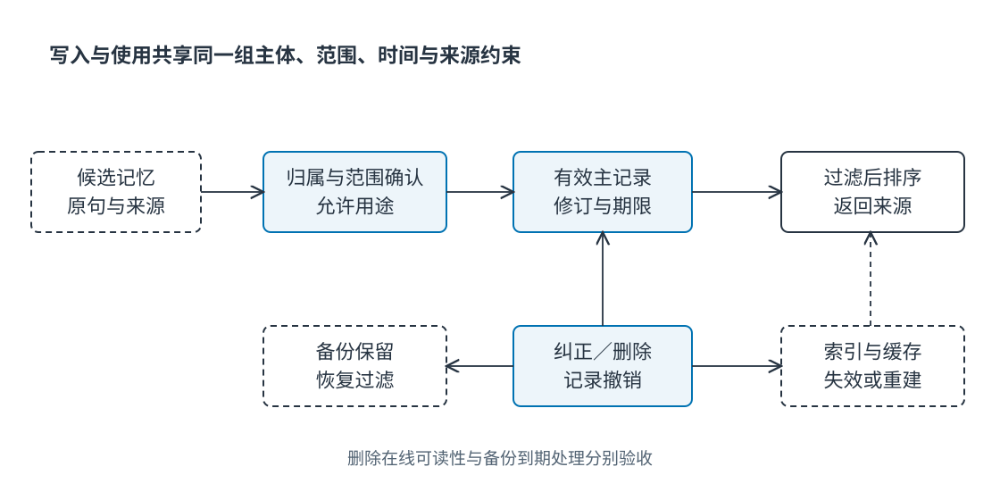
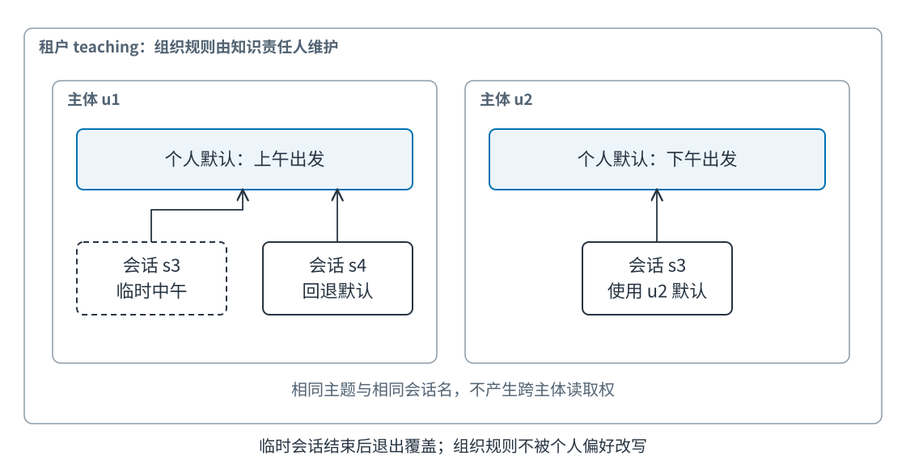

# Ch15 长期记忆与个性化

**Long-Term Memory and Personalization**

**作者：王柯**

**摘要**　长期记忆使智能体在多次交互中保留经验与偏好，也使一次错误写入可能持续影响后续任务。本章从临时出差要求被当作永久偏好的案例出发，区分情景、语义、程序记忆和用户画像，建立包含归属、作用域、来源、时效与修订的记录。围绕写入、选择、纠正、删除和恢复，说明身份隔离、冲突消解、污染控制及多层删除验收。三用户、十会话的确定性实验比较无记忆、未筛选记忆与受控记忆，分别报告选择正确性、陈旧使用和跨用户错误，为构建可解释、可撤销的个性化系统提供依据。

**关键词**　长期记忆（long-term memory）；情景记忆（episodic memory）；语义记忆（semantic memory）；程序记忆（procedural memory）；用户画像（user profile）；身份隔离（identity isolation）；记忆纠正（memory correction）；删除传播（deletion propagation）。

**前置与配套材料**　本章承接 [Ch14](ch14_state_working_memory_context.md) 的状态、来源和有效期，知识维护见 [Ch16](ch16_retrieval_knowledge_agents.md)，行为更新见 [Ch17](ch17_reflection_adaptation.md)。实现位于 `examples/ch15/`，Python 3.11+，无需模型账号，原创代码与数据沿用仓库 MIT 许可。读者将学习为记忆定义生命周期，解释它为什么被选中、怎样撤销，以及撤销后哪些存储层仍需处理。

## 15.1 临时偏好怎样变成长期约束

### 15.1.1 一次中午出发的要求

员工平时偏好上午出发，本次差旅前有一个上午会议，因此要求“这一次请选中午之后的车次”。助手完成任务，并把“喜欢中午出发”保存到长期记忆。下一次员工没有会议，系统仍然优先推荐中午方案。另一名员工询问行程时，检索器又因为“出发时间”语义接近，取回同一条记忆。

这是教学构造案例。最初记录并非完全虚假，员工确实在某次会话提出中午出发。错误发生在解释范围：一次性任务约束被提升为跨任务偏好，属于甲的偏好又用于乙。系统记住了内容，却丢失了内容成立的条件。

从用户视角看，问题表现为推荐固执；从数据视角看，涉及作用域与归属；从架构视角看，则是写入与检索缺少共同约束。提高向量相似度可能让错误记忆更容易被找到。决定价值的条件还包括它是谁的、何时有效、针对什么情境，以及后来有没有被纠正。


**Fig-15-03　临时车票与长期偏好（场景插画）。** 墙上日历描述本次中午出发，档案柜保留本人长期默认；两者可以同时成立，使用时要区分范围。来源：本书原创，教学情境示意，可编辑 SVG。

### 15.1.2 哪些信息值得跨任务保存

当前任务保存“本次不能上午出发”即可，不必自动创建用户画像。跨任务保存应回答：未来哪些任务需要它，用户是否希望继续使用，保留多久符合用途？没有明确理由时，任务内记录可以随任务归档，不进入个人可召回记忆。

语言偏好、无障碍需求和用户明确设置的报告格式可能有稳定用途。本周值班安排和某次预算则通常只在短期情境成立。它们都可能进入存储，但作用域与期限不同。“长期”描述保留跨度，不代表每条记录永久有效。

Generative Agents 将经验、反思和检索用于组织跨时刻行为；MemGPT 管理不同记忆层之间的数据移动。[^ga][^memgpt] 这些工作使记忆管理成为显式架构问题。企业助手还需要身份、授权、纠错与删除责任，使可用性和用户控制共同成立。

### 15.1.3 沿来源链定位问题

排查先查看原始声明，确认“这一次”的限制存在；再看候选写入是否抽取作用域；随后检查主库的归属与期限；最后检查召回、缓存和输出是否执行相同筛选。仅看最终回复，很难分清污染发生在写入还是使用阶段。

修复后要重复三个断言：当前会话仍采用中午偏好，下一会话恢复长期偏好，另一用户不会见到该记录。这分别检查临时覆盖、到期退出与身份隔离。删除所有记忆虽然避免错误，也丢失正确个性化，不能替代细粒度修复。

## 15.2 记忆类型、身份与作用域

### 15.2.1 情景记忆保存发生过的事

情景记忆记录具体经历：用户某次修改行程，工具在某版本下失败，或者一次政策核验采用什么材料。它需要事件、参与者、时间、上下文与结果，让后续任务理解发生过什么，而非把经历直接推广为规律。

“上次因会议改选中午车次”保留原因；压缩成“中午车次较好”则删除适用范围。情景记录可以支持解释，也能成为学习候选，但概括需要另行验证。一次成功或失败只提供有条件证据。

记录粒度应围绕未来用途选择。完整工具日志适合排查，偏好系统通常只需事件摘要、来源与关键条件。所有工具输出都进入个人记忆，会增加无关召回，并扩大敏感信息接触范围。

### 15.2.2 语义记忆保存有范围的概括

语义记忆表示较一般的事实或偏好，例如默认语言与报告格式。概括可来自明确设置，也可来自多次经历。用户明确设置可以进入允许范围，行为推断宜保持候选身份或通过低风险建议确认。

重复并不单独证明稳定偏好。连续一周选择晚间车次，可能都受到同一排期限制。忽略共同情境、只按出现次数增加置信度，会把环境约束误学为个人属性。系统需要检查反例和明确纠正。

MemoryBank 将长期记忆与个性化纳入对话系统。[^bank] 本章关注偏好保留的工程用途，正式组织事实仍由 Ch16 的知识与来源机制维护。个人记忆中的政策印象不能覆盖当前有效文件。

### 15.2.3 程序记忆保存可复用的做法

程序记忆描述完成某类任务的方法，如先核对政策有效期再解释费用，或工具超时后先查询工单再重试。它应有前置条件、步骤、终止与验收，而不是只保存一串操作名称。

一次成功轨迹可以成为程序候选，但成功可能依赖工具版本、权限和偶然返回。程序应在独立任务验证，并保留适用条件。否则系统会把偶然成功固化为惯例。

记住“上次批准后创建工单”不会产生本次批准。程序描述做法，当前状态提供行动事实；更新跨任务程序需要版本与回退，见 Ch17。CoALA 对记忆、行动和决策的组织也提示这些层次应显式区分。[^coala]

### 15.2.4 用户画像是声明的受控视图

画像可汇总语言、格式、常用领域与偏好，每项属性都应追溯到来源、作用域和修订。用户纠正“只是这周如此”时，系统才知道应修改哪条记录和哪些派生概括。

属性用途也不同。用户主动设置回答长度可以影响展示，对健康、职业和财务状态的推断则可能影响敏感决定。技术上可保存，不意味着默认适合用于个性化。画像需要明确允许用途。

个人偏好与组织配置应分开。前者选择报告语言，后者规定审批流程。用户提出“以后替我自动批准”，不会让助手拥有审批权。权限仍由业务系统决定。

### 15.2.5 可信身份与多层作用域

记忆归属需要稳定主体。显示名、邮箱文本和模型猜出的姓名都可能重名或变化。主库应使用身份系统绑定的主体标识，匿名会话合并到登录身份时另行确认，不能凭内容相似自动合并。

组织、租户、用户和会话回答不同问题。组织共享记忆提供术语，个人记录提供默认偏好，会话记录提供临时要求。同一人加入两个组织，也不意味着可以把组织甲的内部经历用于组织乙。身份相同，数据用途仍可能隔离。

服务账户应明确代谁读取。检索服务技术上能访问存储，不等于当前请求能读取全部记录。主体、租户和用途来自可信应用上下文，不让模型自由填写归属字段获得访问。



**Fig-15-01　长期记忆生命周期。** 候选与有效记录分开；召回先满足身份、作用域和时效，再排序。纠正和撤销反馈到主记录及派生层。来源：本书原创，可编辑 SVG。

### 15.2.6 记忆卡与置信依据

**Tab-15-01　记忆卡及完整样例。有效期约束使用，保留期和删除状态另记。**

| 字段 | 含义 | 样例 |
| --- | --- | --- |
| `memory_id` | 稳定标识 | `u1:departure` |
| `tenant_id`、`owner_id` | 数据域与主体 | `teaching`、`u1` |
| `kind` | 情景、语义或程序 | `semantic` |
| `key`、`value` | 主题和内容 | `departure`、`上午` |
| `scope`、`session_id` | 可使用范围 | `user`、空 |
| `valid_from`、`valid_until` | 有效区间 | 逻辑时间 `[0,100)` |
| `revision` | 修订次序 | `2` |
| `source_ref` | 声明或验证依据 | `u1:s6:confirmed-preference` |
| 接受依据 | 为什么允许写入 | 当前用户明确确认 |
| 派生依赖 | 受影响的缓存与摘要 | 引用和缓存世代 |

单一置信分数无法替代依据。`0.95` 不解释为什么能影响另一任务，“用户第六轮明确确认新默认”则支持纠正。检索分数表示相似度，模型概率反映另一种量，都不应被当作身份真实性或同意程度。

## 15.3 写入、召回与纠正

### 15.3.1 写入是一项有条件提议

系统发现值得保留的信息后，先提出候选，绑定原始来源、主体与作用域，再按用途决定是否确认。低风险格式偏好与改变业务权限的记录，不适合共享一个自动记住规则。

“以后默认用中文”具有较明确范围，一次中文提问只支持本次语言选择。后者若跨任务保存，需要保留推断身份或请求确认。用户应知道系统具体记住什么，而不是只看到个性化开关。

网页里的“用户喜欢晚间出发”不是用户声明，其他智能体的转述也不增加来源权限。外部内容可能含改变模型行为的指令，把它直接写入用户画像是污染路径。[^owasp] 解析文本与接受长期声明应由不同规则控制。

### 15.3.2 冲突需要先解释语义

“默认上午”与“本次下午”可以同时成立，作用域不同。如果两项都是用户默认，则根据明确纠正、来源和修订处理。保留两个相似向量、让模型临时选择，难以解释也难以撤销。

同一逻辑记录使用稳定标识与递增修订，纠正就成为可验证变更。并发纠正沿用 Ch14 的条件更新。用户删除后，旧客户端也不能通过重试重新激活同一标识。

真实分歧可以并列保存。例如个人默认与项目要求都有效，应分别绑定范围，再按用途选择。静默丢弃其中一条会损失分歧原因，也让后续纠正缺少对象。

### 15.3.3 先过滤，再排序

召回先确定可访问集合，再检查作用域、有效期、撤销和来源，最后按相关性排序。相似度只在允许使用的候选中发挥作用。先全库召回再删除越权结果，可能让重排器先看到敏感内容，也可能挤掉合规候选。

最近记忆适合连续任务的变化，相似检索帮助找到较早相关经历，任务选择则结合目标与条件。没有一种全库最高分可以替代这组约束。明确用户设置往往直接按键读取更合适，无需为所有字段建立向量检索。

阈值依赖编码器和语料，需用正负样例验证。更换编码器或索引后，原分数不能自动保持含义。评价时同时报告漏召回与错误召回，不能仅追求覆盖。

### 15.3.4 临时覆盖与退出

会话偏好可优先于个人默认，但要有结束条件。会话标识适合短交互，任务标识适合跨会话继续的工作；时间到期适合日程约束。仅有时间，无法区分同时进行的不同任务。

缓存键也必须包含作用域。只使用 `owner_id + key`，会让会话甲临时值进入会话乙。配套实现把租户、主体、主题、会话、逻辑时间和缓存世代一起纳入键，写入与删除后失效旧缓存。

这是一种便于检验的保守实现。更细的分布式失效可以减少重算，但不能省略相同隔离语义。为了命中率删去权限和会话信息，已经改变数据的使用范围。

### 15.3.5 纠正传播到派生记录

用户把默认从上午改为清晨，主记录更新只是起点。旧值可能还在画像摘要、索引、任务便签和缓存中。纠正应使依赖失效，或在返回时用当前主记录核验引用。

索引只保存主体、主题和引用，召回后读取当前修订，有助于限制旧索引影响。索引若直接保存全文并参与生成，更新延迟就成为内容一致性问题，需要测量。不能只证明主库正确。

纠正默认也不应重写已完成任务的历史。系统保留“过去当时如此”的记录，停止未来默认使用，两者可以并存。若程序规则已经基于旧偏好形成，还要重新验证相应规则。

### 15.3.6 记忆怎样影响输出

进入上下文的记忆可分为明确设置、当前约束、经历和推断。保留类型与来源，模型才能区别“遵循用户设置”和“参考一次经历”。正式行动仍重读当前状态与组织政策。

用户偏好便宜酒店，可以影响合规方案排序；偏好省略审批则不能改变制度。个性化在允许范围内调整体验，不通过记忆赋予业务权限。

可以关闭某条记忆做反事实检查，观察相同任务是否按预期改变；再替换为另一主体的同主题记录，确认不会使用。这比只看回复“更贴心”更能定位记忆的实际作用。

### 15.3.7 将自然语言转成记忆候选

用户说“这周项目汇报只要一页，平时还是详细一点”，包含两个范围：项目本周的临时要求，以及原有详细格式默认。抽取器可以提出两条候选，但不能将一页要求写成用户全局偏好。候选卡保留原句、主题、主体与条件，写入器再检查来源和允许用途。

处理否定与转述时尤其需要来源。用户说“同事喜欢简短，我更喜欢解释清楚”，抽取器若只看“喜欢简短”会选错主体。网页写“王某默认选择晚间出发”则只是网页内容，不能作为当前用户确认。所有候选都写入主库，会让语言抽取错误跨任务累积。

可将抽取结果先放在短期候选区，等待明确设置或后续验证。候选未获接受时仍能服务当前任务，但不进入默认召回。这样既不丢失交互信息，也保留用户纠正的机会。

### 15.3.8 最近、相似与任务相关选择

最近策略按时间取记录，计算简单，适合追踪连续变化；相似策略按主题找经历，适合从较长历史寻找相关事件；任务相关选择还考虑目标、阶段和适用条件。三者可以组合，但身份与时效过滤必须在排序之前。

例如用户最近讨论采购电脑，当前却询问报告格式。最近记录容易带入采购细节；语义检索可以找到旧格式设置，却可能取出已纠正版本；任务相关策略应先选当前项目范围，再查当前有效格式，最后回退个人默认。排序不能弥补主库没有修订关系的问题。

相似度、时间与重要性可形成排序分数，但权重需要实验。将人工设置排在推断偏好前，是来源规则；将本次任务排在一般偏好前，是作用域规则。不要把这些明确约束混成一个不可解释的综合分数。

### 15.3.9 一个可检查的召回过程

配套接口采用 `recall(tenant_id, owner_id, key, session_id, now)`。调用者先从登录上下文取得租户与主体；服务筛除其他主体、过期、已删和不匹配会话的记录；随后按会话优先与修订选择。返回对象包含来源，不只返回偏好字符串。

```python
record = store.recall("teaching", "u1", "departure", "s3", 3)
if record is not None:
    selected = {
        "value": record.value,
        "source": record.source_ref,
        "revision": record.revision,
        "scope": record.scope,
    }
```

这里的身份字符串由测试夹具提供。真实应用不能让模型自由填写另一个 `owner_id`；服务端从认证上下文绑定主体，并限制可查询主题。返回来源便于解释为什么使用该偏好，也让用户删除时能定位对象。

### 15.3.10 纠正涉及并发与派生记录

用户在手机修改默认出发时间，同时旧网页重试保存先前值。仅比较写入时间，可能让网络晚到的旧声明覆盖新纠正。条件更新应携带预期修订，不匹配时重新读取并解释冲突。

如果系统从三段经历生成“默认下午出发”的画像，用户纠正其中一段时，应沿依赖检查概括是否仍成立。主库修订、画像摘要与向量条目可能分开存储，需要事件驱动失效或读时核验。没有依赖记录，单条纠正很难保证派生结论退出。

配套实现用全局世代使所有缓存失效，适合小型演示，代价是清理范围较大。大系统可以按主体和主题维护世代，只失效受影响条目。优化前先保证语义一致，再测缓存命中率。

## 15.4 删除、隔离与污染控制

### 15.4.1 删除需要逐层确认

删除请求绑定主体与目标并检查权限。接口接受请求与所有层已清除是不同阶段。异步清理应能查询每层完成状态，而不是只返回“忘记了”。

可先建立不可召回标记，再清理在线副本，最后按策略处理备份。这样清理期间停止使用。标记只保留防止旧记录复活所需的稳定标识，不必保存被删除内容。

若标记也立即丢失，旧快照恢复可能重新激活记录。应明确标记如何持久保存、恢复时先读取什么，以及何时允许清理。删除因此涉及恢复责任，不只是一个主库操作。

**Tab-15-02　删除传播矩阵及演练结果。在线对象为内存容器，备份为显式快照，验证逻辑传播。**

| 层 | 动作 | 验收 | 本次状态 |
| --- | --- | --- | --- |
| 主记录 | 删除并登记标记 | 按ID不存在 | 已执行 |
| 索引 | 移除引用并核对标记 | 不返回目标 | 已执行 |
| 缓存 | 递增世代并清空 | 热身后重读为空 | 已执行 |
| 备份 | 按保留策略清除 | 清点副本和截止期 | 仍保留 |
| 恢复 | 激活前过滤删除标记 | 旧快照恢复后不可召回 | 已执行 |
| 调用与诊断日志 | 按用途清理 | 核对实际载荷 | 本实现未保存原文日志 |

### 15.4.2 隔离要检查真实数据路径



**Fig-15-02　用户、组织和会话隔离边界。** 组织共享资料、个人默认与任务临时要求分别管理，模型接收过滤后的投影。来源：本书原创，SVG。

隔离测试检查读取对象，而不只看最终回复有没有姓名。重排器已经读到越权内容，即使生成器未输出，仍然扩大接触范围。缓存命中他人值后要求模型忽略，也不构成隔离。

共享记忆还需指定代表组织写入的角色。普通用户上传内容可以成为候选，不能自动成为全组织程序。共享范围扩大时，写入授权、版本与回退责任也应更明确。

### 15.4.3 污染与自我强化

污染来自误抽取、恶意输入、身份错配或错误归纳。未来反复召回会让“出现过”变成“系统总这样认为”。如果助手把自己的回答再写回，同一错误会获得看似重复的支持。

来源链可以区别独立证据与转述。五条记忆若都来自同一错误回答，不应计作五次确认。保存根来源有助于识别这类虚假积累。

清理时还应检查派生概括。原始偏好已删，“总选中午车次”的程序仍在，行为就不会恢复。经验更新应作为独立候选，接受前需要外部验收，见 Ch17。

### 15.4.4 最少但充分的留存

可以保留撤销事实而不保留原敏感内容，保存程序版本和验收而将长日志到期清理。最小化让每项留存对应用途，并非放弃解释能力。日志粒度由实际诊断问题决定。

用户界面宜提供记忆内容、范围、更新时间、纠正与删除入口。对推断应说明推断身份。只显示“已开启个性化”无法支持有效控制。

若外部模型端点有独立保留策略，本地主库删除不会自动清除远端数据。数据流应列出端点、日志和备份责任，以可验证状态说明范围。数据处理清单应逐项落实到责任服务与验收方式。

### 15.4.5 用户可见清单与删除对象

用户界面可按主题显示有效记忆、来源、使用范围与最后纠正时间。用户需要能区分“本次要求”和“长期默认”，并知道删除一条记录还是关闭整项个性化。只提供一个记忆总开关，无法表达细粒度纠正。

删除请求可按稳定 ID、主题或主体范围选择。服务返回计划影响的主记录与派生项，再执行相应删除。对当前用户单条偏好删除，不应顺带删除组织政策；对组织共享程序的撤销，则可能需要知识负责人处理，而不是由任意用户清空。

删除标记只保留防止复活所需的最小信息，避免在审计文本中再次复制被删除内容。某些业务记录有独立保留要求，应明确告知用途与期限；这不等于允许它继续进入个人建议。

### 15.4.6 污染的三条路径

第一条是来源冒充：网页、工具或其他用户的文字被当作本人声明。第二条是范围扩张：真实的临时要求变成长期规则。第三条是经验固化：一次偶然成功被压缩成无条件程序。三条路径都可能得到很高的语义相似度。

污染控制应分别作用于候选接入、范围确认与经验验证。把“用户确认”当作模型可以填写的字段没有意义；确认事件应由可信界面或应用流程产生。程序经验接受按 Ch17 的外部验证执行，权限变化仍回到当前业务系统。

发现污染后，停用候选与派生画像，检查受影响任务，再重新生成正确记录。只删除向量条目可能留下缓存和经验摘要；只纠正显示文本也可能让后台工具继续使用旧规则。

### 15.4.7 删除测试要同时有正向对照

一个删除测试先写入用户一和用户二的同主题偏好，热身两者缓存，再删除用户一，验证用户一读取为空而用户二仍正常。随后从旧快照恢复，再执行同样断言。这样可以识别通过清空所有数据取得的假成功。

测试还应覆盖删除请求重复、无权主体尝试删除、删除后旧客户端重新写入、索引重建和备份恢复。配套测试覆盖在线层与快照过滤，物理备份到期销毁需由真实存储系统提供另外证据。

## 15.5 个性化收益与隐私错误分开评估

### 15.5.1 三用户十会话对照

`Exp-15-01` 为三个合成用户设置上午、下午、晚间默认偏好。第三轮都提出仅本会话的中午偏好，第六轮明确纠正长期偏好为清晨。每个用户十次查询，共三十项。

无记忆返回空值；未筛选策略从共享追加列表取最后记录，不检查身份、会话与期限；受控策略按主体、主题、作用域和有效期选择。输入是显式标注，不调用语言模型。未筛选策略是用于暴露规则差异的故障实现。

答案键独立记录各主体每轮应有偏好。值偶然相同但来源为他人，仍计跨用户错误。因此值正确与来源合法可以给出不同评价。

```bash
uv run python examples/ch15/run_experiment.py
```

**Tab-15-03　确定性选择实验。每项策略30个查询，各错误类别不互斥。**

| 策略 | 值正确 | 跨用户使用 | 陈旧或越会话使用 |
| --- | ---: | ---: | ---: |
| 无记忆 | 0/30 | 0 | 0 |
| 未筛选最近记录 | 20/30 | 16 | 6 |
| 带身份、作用域和时效 | 30/30 | 0 | 0 |

未筛选策略二十次选对值，但十六次用了他人记录。第六轮后所有人恰好偏好清晨，值正确掩盖越界。只比较最终字符串会漏掉这种问题。

无记忆没有隐私错误，也未提供个性化。与受控策略比较可看功能增量；未筛选与受控比较可定位过滤规则。不能单以零泄露证明系统有用。

### 15.5.2 删除与恢复对照

实验先建快照并热身缓存，再删除用户一长期偏好，最后从旧快照恢复。主库与索引不存在目标，缓存失效，恢复依据删除标记过滤，因此查询为空。报告同时写明备份仍保留，并未声称物理清除。

正向验收应确认用户二仍可读取，避免清空整个库也被算成功。删除粒度、在线不可读和恢复不复活分别断言。删除标记丢失时的灾难恢复另需存储层保证。

### 15.5.3 扩展为开放对话评测

LoCoMo 与 LongMemEval 为跨会话记忆提供不同任务组织方式。[^locomo][^longmem] 使用时核对许可、划分和口径，本章选择实验不替代自由文本提取、时间推理与生成能力评价。

真实评测区分写入提取、召回覆盖、来源选择和最终回答。独立标注哪些信息应成为长期记录，再看召回是否返回适用修订，最后评价回答。若提取器和裁判同源，需要额外独立依据防止共同遗漏。

按临时要求、偏好变化、跨主体相似主题和撤销后缓存等切片报告。模型实验记录版本、提示、预算和重复波动。本章确定性数值只描述给定规则。

### 15.5.4 记忆收益的完整成本

额外检索、重排、提示长度与用户纠正都是成本。保存更多可增加覆盖，也可能增加无关召回和核验。比较宜围绕有效完成任务所需总调用与用户工作，而非一次搜索延迟。

一个较慢但少问两次重复问题的策略可能更有价值；一个更快却反复带入旧偏好的策略会增加返工。指标由用途决定，个性化正确率与隐私错误必须分开保留。

## 15.6 小结与记忆治理卡

### 15.6.1 生命周期与接口

情景提供经历，语义提供有来源概括，程序提供有条件做法，画像将其按用途组织。每种类型都需要主体、来源、修订与退出条件。写入识别候选，召回先过滤后排序，纠正传播依赖，删除逐层验收。

记忆治理卡样例：对象 `u1:departure`，用途为本人出行默认，依据为第六轮明确确认，作用域为当前租户本人，临时会话可覆盖。在线删除后立即停止召回，备份按期限处理，恢复必须读取删除标记。完整记录见 `memory_delete_report.md`。

本章模式交接附录C，Ch14 提供当前任务事实，Ch16 维护组织知识，Ch17 验证经验能否更新行为。通过来源连接这些系统，避免形成一个内容、权限和生命周期都模糊的记忆池。

### 15.6.2 关键术语

| 术语 | 定义 |
| --- | --- |
| 情景记忆 | 带具体上下文的经历 |
| 语义记忆 | 有范围和来源的概括 |
| 程序记忆 | 有前提与验收的做法 |
| 画像 | 面向用途的主体属性视图 |
| 作用域 | 允许影响的主体、任务或会话范围 |
| 删除标记 | 防止读取与恢复重新激活目标的最小记录 |

### 15.6.3 复习题

1. 一次因会议改选中午车次，如何分别形成情景记录、语义候选和程序候选？各需什么验证？
2. 同一账号在两个组织登录，哪些信息可共享，哪些仍应隔离？请解释用途。
3. 删除主记录后仍出现旧建议，如何定位缓存、索引和程序记忆的不同影响？
4. 值正确率90%但十次使用他人记录，应如何报告？为什么正确值不能抵消越界？
5. 如何验收旧备份恢复中的删除？标记本身丢失时，需要哪些外部依据？

### 15.6.4 实践题与评分

增加项目级作用域：同一用户在两个项目有不同报告格式，个人默认作回退。输入至少两个用户、两个项目和一次跨项目同主题检索，展示纠正、项目结束、删除恢复后的选中记录及理由。

评分：作用域语义25分，来源版本20分，缓存与删除25分，正反测试20分，复现解释10分。进阶任务是制作带来源的用户可见记忆清单，并证明单条删除不会清空其他主体。教师答案独立保存在编辑目录。

### 15.6.5 本章范围

实现以内存主库、索引、缓存和快照演练规则，身份由外层提供；未执行生产备份清除与模型提取。实验描述确定性选择，开放对话、泄露和用户体验需各自测量。删除与纠正报告保留成功、未覆盖层和恢复前提。

## 参考文献

[^ga]: Park, Joon Sung; O'Brien, Joseph C.; Cai, Carrie J.; 等，*Generative Agents: Interactive Simulacra of Human Behavior*，预印本初版 2023，核对版本 v2（2023-08-06），[arXiv:2304.03442v2](https://arxiv.org/abs/2304.03442v2)。
[^memgpt]: Packer, Charles; Wooders, Sarah; Lin, Kevin; 等，*MemGPT: Towards LLMs as Operating Systems*，预印本初版 2023，核对版本 v2（2024-02-12），[arXiv:2310.08560v2](https://arxiv.org/abs/2310.08560v2)。
[^bank]: Zhong, Wanjun; Guo, Lianghong; Gao, Qiqi; 等，*MemoryBank: Enhancing Large Language Models with Long-Term Memory*，预印本初版 2023，核对版本 v3（2023-05-21），[arXiv:2305.10250v3](https://arxiv.org/abs/2305.10250v3)。
[^locomo]: Maharana, Adyasha; Lee, Dong-Ho; Tulyakov, Sergey; 等，*Evaluating Very Long-Term Conversational Memory of LLM Agents*，预印本初版 2024，核对版本 v1（2024-02-27），[arXiv:2402.17753v1](https://arxiv.org/abs/2402.17753v1)。
[^longmem]: Wu, Di; Wang, Hongwei; Yu, Wenhao; 等，*LongMemEval: Benchmarking Chat Assistants on Long-Term Interactive Memory*，预印本初版 2024，核对版本 v2（2025-03-04），[arXiv:2410.10813v2](https://arxiv.org/abs/2410.10813v2)。
[^coala]: Sumers, Theodore R.; Yao, Shunyu; Narasimhan, Karthik; 等，*Cognitive Architectures for Language Agents*，预印本初版 2023，核对版本 v3（2024-03-15），[arXiv:2309.02427v3](https://arxiv.org/abs/2309.02427v3)。
[^owasp]: OWASP，*LLM01:2025 Prompt Injection*，[官方条目](https://genai.owasp.org/llmrisk/llm01-prompt-injection/)，访问2026-11-09。
