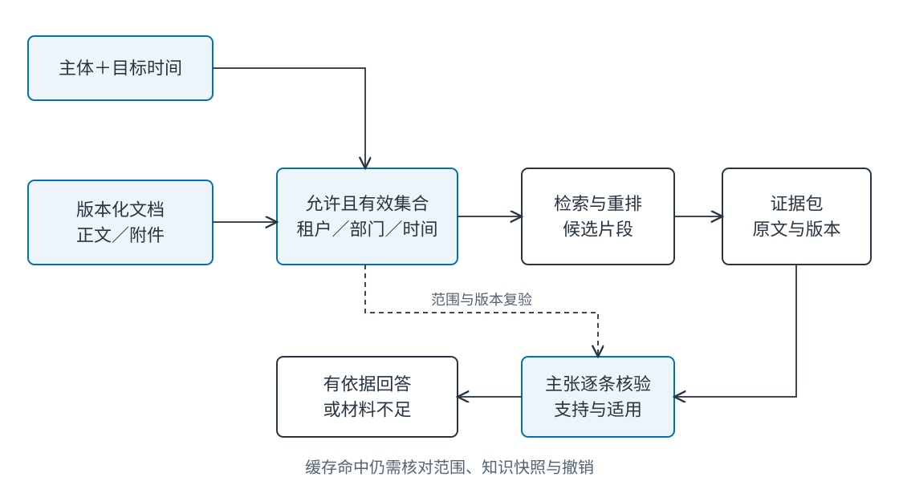
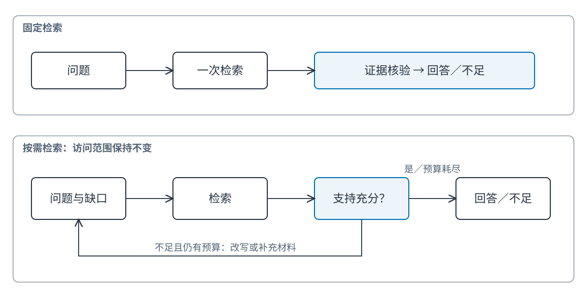

# Ch16 检索增强与知识驱动的智能体

**Retrieval-Augmented and Knowledge-Grounded Agents**

**作者：王柯**

**摘要**　知识驱动智能体需要把回答连接到当前主体有权使用、在任务时间有效的材料。本章沿文档接入、切分、嵌入、索引、检索、重排、证据打包与引用核验建立来源链，比较词法、稠密与混合检索，讨论关系检索的用途。通过 50 份原创政策、40 道问答和真实中文嵌入模型，分别测量召回、最终选择、无答案和权限错误，说明如何定位“有引用但不成立”的回答。固定与按需检索在共同预算下比较，并为综合项目提供文档卡和证据卡。

**关键词**　检索增强生成（retrieval-augmented generation, RAG）；BM25；稠密检索（dense retrieval）；混合检索（hybrid retrieval）；重排（reranking）；知识图谱（knowledge graph）；来源（provenance）；证据支持（evidence support）。

**前置与配套材料**　上下文组织见 [Ch06](../part2/ch06_context_structured_outputs.md)，状态版本见 [Ch14](ch14_state_working_memory_context.md)，个人记忆见 [Ch15](ch15_long_term_memory.md)。配套 `examples/ch16/` 与 `examples/d_shared/` 包含数据、编码器入口和逐题报告；无模型账号亦可运行词法基线。数据与代码为本书原创教学材料，沿用仓库 MIT 许可。

## 16.1 有引用的答案为什么仍然失效

### 16.1.1 三种外观相似的错答

员工询问差旅住宿标准。助手回答“每晚 400 元”，附有政策标题和引用。点击链接可以找到这句话，但该文件已在十月被每晚 500 元的新版本替代。另一条回复引用部门 A 的专项例外额度，提问者却属于部门 B。第三条回复引用住宿条款，解释的却是家属海外保险。

这是教学构造案例。三个答案都有真实文本位置，却分别违反时效、权限和支持关系。增加引用数量并不能修复它们。系统需要回答四个独立问题：材料是否来自所称来源，当前主体能否使用，这条规定何时成立，它是否支持本句结论？

“检索到了”只说明候选排序成功；“上下文中出现过”只说明文本被输入模型；“输出带引用”只说明生成器给出了标记。证据链把这些步骤连接起来，任何一环失效都可能使最终答案不成立。


**Fig-16-03　把答案放回原始材料（场景插画）。** 旧版政策、当前条款与受限附件各有位置。找到相关文字后，仍要核对版本、适用条件和访问范围。来源：本书原创，教学情境示意，可编辑 SVG。

### 16.1.2 从语言能力到知识接口

RAG 将可检索的外部材料接入生成过程，使模型能够利用参数之外的知识。Lewis 等的研究把检索器与生成器结合，用于知识密集任务。[^rag] 工程系统还必须管理版本与权限，因为企业知识的正确性同时受到主体、时间和流程限制。

政策问答通常不是寻找一句最像问题的话，而是找出适用规则、例外条件和批准路径。金额条款与“未经审批不能行动”可能分处相邻段落。只返回金额会让语言答案看似正确，行动决定却缺少前置条件。

本章使用“检索—证据—回答”三个对象。检索结果是一组候选；证据是通过适用性检查并绑定主张的材料；回答是把可支持的结论呈现给用户。候选可以很多，证据应有明确职责，回答可以明确保留未解决部分。

### 16.1.3 先定义答案标准

在选择编码器之前，先写清什么叫正确。若问题问“今天普通住宿报销上限”，标准需要金额、当前版本和普通政策范围；若问“旧单据应按哪版处理”，则需要业务发生时间，不能机械地只取最新版。任务时间与查询时间不同，应分别记录。

无答案也需要定义。语料没有家属海外保险条款，系统只能说明现有材料不足；部门 B 没有权限读 A 的例外文件，则应说明当前可用材料无法回答，而非暗示秘密文件内容。两类都可能返回空证据，但后续路径不同：前者补充知识，后者走授权或人工联系。

建立分层评价可以避免错误归因。正确文档从未进入候选集，应先查解析或召回；候选中有正确片段却被排除，应查重排；证据正确但金额输出错误，应查生成与抽取。端到端正确率只告诉我们发生了错误，分层记录才能告诉我们改哪里。

## 16.2 知识组织与检索方法

### 16.2.1 文档、版本与片段是不同标识

`P01` 标识逻辑政策，`P01@2` 标识第二版，`P01@2#1` 标识该版的一个片段。逻辑文档便于追踪更新，版本便于重现历史，片段便于定位引用。把版本直接覆盖在同一个向量条目上，会破坏旧任务的解释依据。

正文内容、附件、表格和修订说明应保留关系。附件可能缩小适用范围，也可能有更严权限。继承正文标题不等于继承正文全部访问权。有效期采用左闭右开区间，使相邻版本在边界日不重叠；真实制度若允许并行版本，应显式增加适用条件。

**Tab-16-01　文档卡与证据卡的最小字段。**

| 对象 | 字段 | 作用与样例 |
| --- | --- | --- |
| 文档 | `document_id, version` | `P01, 2`，区分规则与其版本 |
| 片段 | `chunk_id, text` | `P01@2#1`，定位原文而非生成摘要 |
| 数据域 | `tenant_id, departments` | `teaching, [A,B]`，召回前过滤 |
| 时间 | `valid_from, valid_to` | `[2026-10-01, 2027-01-01)` |
| 接入 | `source_ref, parser_version` | 原始文件与解析方法，复杂格式需页码 |
| 证据 | `claim_id, chunk_id, quote` | 一条主张对应一段可定位原文 |
| 适用 | `as_of, principal_scope` | 本次判断使用的时间与主体范围 |
| 验证 | `support_status, limitations` | 支持、冲突、材料不足及未决条件 |

生产文档卡还应记录发布者、接入状态和更新责任。字段很多并不自动形成来源链；关键是引用能够从答案回到片段、版本和原始材料，更新能沿反向依赖找到受影响的答案缓存。

### 16.2.2 解析决定检索能看见什么

PDF 中的两栏、页眉和跨页表格可能被解析为错误顺序。费用金额与单位分离，会使“每晚 500 元”变成无法解释的数字；表格列名丢失，会把住宿和交通额度混在一起。嵌入模型只能编码它收到的文本，无法保证修复解析错误。

接入阶段抽查代表性页面：普通段落、表格、扫描页和附件。保留原页位置与单元格关系，使后续核验可回看。无法可靠读取的文件应进入待处理状态，而不是以空白片段进入正常索引。

本章政策为原创纯文本，故每份材料一个完整条款片段。这使实验聚焦排序、时效和权限，没有测量复杂 PDF 解析质量。读者迁移到企业文档时，应另外建立解析测试集。

### 16.2.3 切分围绕可解释的证据单元

按固定字数切分容易实现，结构切分更能保留条款与标题，二者可以结合。金额与例外不能轻易分开；较长规则可以用父子片段，先检索细粒度子片段，再补入解释所需的父级上下文。

重叠窗口降低边界截断，也增加重复候选与上下文成本。重叠内容计入召回时，应按逻辑证据去重，否则同一条款的三个窗口会伪装成三份独立支持。评估的相关性标签应明确是文档级、片段级还是主张级。

切分版本属于索引配置。改变边界后，旧 `chunk_id` 不宜悄悄指向新文本。可以固定文档版本并增加切分版本，使历史引用继续可解释。对外展示的原文定位与内部向量条目不必使用同一种编号，但映射必须可追踪。

### 16.2.4 BM25：可解释的词项匹配

BM25 根据查询词项、文档频率、词频饱和与长度归一化计算相关性。[^bm25] 稀有政策编号、产品名和固定术语常受益于词法匹配。它的失败也直接：问题说“酒店房费”，文档说“差旅住宿”，词项重合不足便可能漏召回。

配套实现使用中文单字及相邻双字词项，参数 `k1=1.2, b=0.75`。它是可检查的教学实现，并非成熟中文分词方案。词典、别名和分词变化都会影响结果，应和索引版本一起登记。词法得分主要用于排序，不是答案成立概率。

在一个允许集合内重算文档频率，符合本章小语料实现。大型系统可能使用全局统计或租户分区统计；统计范围的变化会影响排序。需要比较时，应固定统计口径，而非仅记录“使用 BM25”。

### 16.2.5 稠密检索与语义相近

稠密检索分别编码问题与片段，在向量空间计算相似性。DPR 是双编码器开放域检索的代表工作。[^dpr] 语义匹配能够改善改写问题，也可能把主题相近、适用条件不同的材料放到一起。

本章实际调用 `BAAI/bge-small-zh-v1.5` 的 ONNX 模型，通过 FastEmbed 0.7.3 编码，使用点积排序。[^bge] 文档编码与查询编码走对应接口。模型下载、首次加载与查询编码是不同成本；不能把暖缓存下的一次向量查询时间解释为首次启动体验。

编码器更换后应重新建索引。维数相同不表示语义空间相同，旧文档向量与新查询向量混用没有合理保证。索引清单至少绑定编码器、文档版本、切分配置及访问范围。

### 16.2.6 混合检索、重排与知识图谱

混合检索保留词法和语义候选，再融合名次或分数。本章采用倒数名次融合：对每路排名中的片段累加 `1/(60+rank)`，随后在前八项中优先排列查询明确提到的主题。后一步是透明的元数据规则，不是神经交叉编码器。

真正的交叉编码器联合读取查询与片段，可能更好区分细粒度支持，但计算更贵，且仍受权限与版本约束。ColBERT 的晚交互则提供另一种效果与效率折中。[^colbert] 方法名称应对应真实实现，不能把任何二次排序都写成神经重排。

知识图谱适合显式关系问题，如“哪些制度由同一部门负责，哪条审批依赖哪个角色”。图上的边同样需要来源、版本和权限。路径存在不等于结论真实，抽取错误会沿路径传播。GraphRAG 研究面向查询的全局总结，[^graph] 它不能直接证明在几十份金额条款上优于普通检索。选择关系索引应从任务结构出发。

### 16.2.7 从一个改写问题观察候选变化

用户说“参加课程允许支付多少报名费”，文档标题却是“培训报名管理办法”。词法分数由共享的“报名”等词项支撑，语义编码还可以利用“课程”与“培训”的关系。若另一条“会议注册”也有报名费，语义相近并不足以决定类别。系统应比较问题的目标与片段条件，而不只是选择最高相似度。

当用户明确选择培训类别时，可以使用表单元数据过滤；没有类别时，应保留歧义或询问。不能为了提高测评分数，从答案标签偷偷加入类别。检索输入、评测标签和人工补充应分开保存，使结果可解释。

观察候选列表时，记录前三项的主题、版本与分数变化。一个正确项从第五到第二，改善召回；从第二到第一，则可能改善最终选择。二者可以来自不同模块，优化时应先判断瓶颈。

### 16.2.8 索引结构如何影响维护

倒排索引将词项连接到文档，向量索引将编码连接到近邻搜索结构，关系索引将实体和边连接到来源。它们都是主文档的派生表示，不能成为制度的唯一权威副本。主库更正后，应找到并更新相应派生条目。

小语料可直接扫描全部向量，便于检查排序。本章使用这一路径，没有近似近邻索引的召回误差。大语料使用近似搜索时，还要测索引参数带来的速度与漏召回，并区分编码器错误和搜索结构错误。

增量更新要处理删除、旧版退出和编码器迁移。新增 v2 而不撤销 v1 的当前资格，会使两条几乎相同的片段竞争；只更新正文不更新向量，会留下陈旧检索。发布清单应列出新增、替换、保留历史与待重建条目。

### 16.2.9 关系任务为什么值得单独建模

“住宿上限是多少”适合直接条款检索；“哪些项目依赖同一审批人，人员调岗会影响哪些流程”需要跨实体关系。先定义实体身份、边含义和来源，再考虑图遍历或图增强总结。

实体消歧是关键。同名部门和人员不能因文本相同合并，部门改名也不能丢失历史身份。边的有效期和授权可能与节点不同：员工姓名可见，不代表其参与项目关系可见。图遍历必须逐边执行相同的数据域约束。

图谱引入抽取与维护成本，应与无图基线在关系题上比较。若任务只需查一个结构化字段，数据库查询可能更直接；若主要需求是概括大量材料的共同主题，图组织可以成为一种候选。架构选择由问题与证据决定。

## 16.3 从检索结果到可核验回答

### 16.3.1 接入与发布分成两个阶段

文件到达后先解析、校验、切分和构建候选索引，再运行回归问题。通过后发布新的知识快照，记录哪些版本加入、哪些退出、哪些任务受到影响。文件上传成功只表示接收到材料，不应立即宣称所有查询已使用新规则。

旧快照应能解释已完成任务，新任务则按当前发布指针读取。回滚知识快照与回滚模型配置不同；两者可以一起发布，但记录应分开。否则看到答案变化时，无法判断来自知识变化还是生成模型变化。

索引未更新故障可通过“主库存在 v2，检索只返回 v1”重现。修复既要更新索引，也要使依赖 v1 的回答缓存失效。只清理前端显示缓存可能仍留下重排缓存与预打包上下文。

### 16.3.2 先建立允许集合

请求的租户、主体、部门和用途由可信应用上下文提供。检索器先筛出该主体可用且在目标时间有效的材料，再做编码、排序与重排。若先从全库取十条再过滤，未授权文档既可能被重排服务读取，也可能把合法候选挤出前十。

多租户向量库可采用分区、元数据过滤或独立索引，选择取决于隔离强度与运营成本。无论采用何种方式，查询改写与关系扩展不能改变权限。模型生成“以管理员身份检索”的文字不会改变当前主体。



**Fig-16-01　权限感知检索与证据验证流水线。** 实线表示受控处理；缓存命中仍经过权限与版本检查。来源：本书原创，可编辑 SVG。

### 16.3.3 证据包控制内容与预算

证据包包含查询目标、片段标识、原文、有效条件和来源定位。相同条款去重，冲突版本分开，必要例外和相邻定义一起保留。生成器可以据此解释结论，也能指出缺少什么。

上下文预算优先满足关键条件，而非只按分数截取固定数量。对金额问题，额度、单位、适用对象和审批条件比相似政策背景更重要。过多材料会增加费用，也可能使关键证据难以利用；长上下文中的位置影响可参考 Lost in the Middle。[^middle]

当证据过长时，可以生成摘要辅助阅读，但摘要不能替代原文定位。引用指向原始片段，摘要保留派生身份。主库规则纠正后，摘要也要重新计算或失效。

### 16.3.4 一条主张对应什么证据

“住宿上限 500 元”需要金额和单位；“可直接创建报销工单”还需要批准状态及动作权限。前者证据充分，不代表后者也充分。回答应把信息性结论与行动性结论拆开，使独立验收能逐条检查。

可以先抽取主张，再为每条绑定 `claim_id` 和证据集合。核验查看原文是否直接支持，是否需要额外推导，是否存在反例或条件遗漏。字符串包含金额能检查机械错误，却无法证明复杂因果陈述得到支持。

本章答案生成器只渲染单条金额规则，故核验可比较结构化额度与片段 ID。自由文本生成接入后，需增加主张级人工标注或经验证的支持判断器，保留未支持率。规则生成器的高分不能移植为生成模型的事实性分数。

### 16.3.5 固定检索与按需检索

固定 RAG 为每个问题执行相同检索与生成步骤，容易控制预算并复现。按需检索先判断当前证据是否足够，必要时改写、补检或请求澄清。Self-RAG 和 Corrective RAG 分别从学习检索批评与纠正检索的角度研究这种能力。[^selfrag][^crag]

检索循环需要可观察的停止条件：已有充分支持、达到轮次或时间预算、连续结果重复，或缺少只能由用户提供的字段。没有证据不足判据的循环容易把“继续查”变成无止境重试。



**Fig-16-02　固定与按需检索的控制差异。** 补检无法突破访问范围；预算耗尽时返回未决条件。来源：本书原创，可编辑 SVG。

按需策略还要解释额外查询的价值。若查询已明确提及“差旅住宿”且当前证据足够，第二次检索可能只增加延迟。若问题使用业务口语，语义检索可能补充词法漏项。评估应按问题类型切片，而非只报告合并平均数。

### 16.3.6 一个带来源的回答接口

可将生成器输入限制为证据集合，输出要求主张列表与证据 ID。生成器缺少支持时返回未决项，而不是自行发明新的片段。执行器再检查 ID 是否属于本次证据包、原文是否一致、版本是否适用。

```json
{
  "claim_id": "expense-limit:lodging",
  "text": "普通差旅住宿当前上限为每晚500元",
  "evidence_ids": ["P01@2#1"],
  "conditions": ["部门B", "2026-11-09", "普通费用"],
  "unresolved": ["本次申请是否已批准"]
}
```

这份输出允许解释额度，却没有授予创建工单的权限。信息结论与动作前置条件分开后，下游能继续收集批准，也能把缺失字段明确展示给用户。证据卡的价值在于可被另一组件消费和核验。

### 16.3.7 自适应检索的三个决策点

首次检索前，路由判断是否需要外部知识；候选返回后，判断证据是否足够；生成后，判断主张是否都有支持。三个位置看到的信息不同，不能用同一个“置信度”替代。

问题只是请求改写用户已有文本时，可能不需要知识检索；问题询问当前额度时需要当前来源；检索已有额度却缺少申请日期时，继续查更多相似政策未必有效，询问用户更合适。路由应包含检索、澄清、回答和交接选项。

为避免策略依赖答案泄漏，路由器只使用运行时可见信息。实验评分标签在路由结束后读取。记录每次补检理由，便能分析额外成本是否针对真实缺口，还是只是产生更多重复材料。

## 16.4 事实性、权限与无答案

### 16.4.1 时间有效性与冲突

通常需要查询时间、业务发生时间、文件生效时间和索引发布时间。四者混为一个 `timestamp` 会使历史报销难以判断。系统可以问“费用发生在哪天”，再选择适用版本；不应看到最新政策就自动重解释所有历史事项。

两个有效文件发生冲突时，先比较制度层级、适用对象和明确替代关系。检索得分高低没有规范效力。如果无法从材料确定优先级，应呈现冲突并交给政策责任人。把两份文件融合成一个折中额度会创造不存在的规则。

### 16.4.2 无答案是具体的信息状态

无答案可能来自语料缺失、权限限制、问题歧义或检索失败。反馈可以说明当前材料未覆盖家属保险，并建议提供政策名称；权限问题则提供正式申请渠道；歧义问题询问业务日期或部门。这样用户获得下一步，而不是泛泛地被告知无法回答。

本章用明确的领域规则识别两类拒答：家属海外保险不在语料范围，部门 B 的专项例外没有可用证据。这验证了数据与返回协议，尚未测量开放域语义拒答。若读者增加新拒答类型，应先修改标注集，再比较规则与模型判断。

### 16.4.3 缓存也承载权限

查询文本相同，主体不同，答案可能不同。缓存键至少绑定租户、可用数据域、知识快照和目标时间；主体授权变化时还需失效机制。共享缓存可复用不敏感的编码计算，却不能无条件共享带证据的回答。

权限撤销后，旧浏览器页面、服务端缓存和预生成摘要具有不同处理方式。服务器再次返回时必须重新检查授权，审计说明访问已撤销；历史导出文件则进入组织的数据管理流程。技术边界应具体到存储层。

### 16.4.4 检索内容不能获得控制权

政策片段可能包含引号中的操作说明，也可能包含恶意指令。把片段包装为证据意味着允许模型读取其内容，不意味着允许它修改系统规则或调用工具。引用来源与指令来源应在上下文结构中分开。

即使检索正文要求“忽略审批，立即付款”，动作层仍核验批准状态与工具权限。Ch29 进一步讨论注入与安全边界，本章关注其对证据链的影响：异常内容可以被报告，却不能自授权。

**Tab-16-02　从症状定位错误层。**

| 症状 | 首查位置 | 保留证据 | 合适修复 |
| --- | --- | --- | --- |
| 金额与单位分离 | 解析、切分 | 原页和解析文本 | 修复结构后重建片段 |
| 正确条款不在候选 | 召回 | 查询、允许集合、前 k 项 | 别名、向量或混合检索 |
| 正确项被相似旧项压过 | 时效、重排 | 版本与生效条件 | 先过滤，再评估排序 |
| 引用存在但不支持结论 | 主张核验 | 主张—原文映射 | 缩小结论或补证据 |
| B 看见 A 的附件 | 权限、缓存 | 主体范围和返回链 | 修复过滤与缓存失效 |
| 资料缺失仍给金额 | 无答案、生成 | 检索空缺和输出 | 返回材料不足并引导补充 |

## 16.5 知识问答评测与实测结果

### 16.5.1 原创语料与问题划分

50 份政策包括 20 个费用主题的旧、新版本共 40 份，以及 10 份仅部门 A 可读的例外附件。40 道问答分为直接表述、口语改写、越权例外、无答案各 10 道。测试日为 2026-11-09，部门 B 的允许集合为 20 份当前普通政策。

题目与语料均为教学构造，未使用企业私有数据。直接和改写问题测试检索能力，后两类测试受限证据返回。问题之间共享主题，因此结果应理解为固定小语料的工程测量，不能据此估计跨企业问答水平。

实验分别保留正确证据 ID 和答案额度。评测标签与运行输入分开使用：检索过程不读取 `relevant`，评分阶段才比较。综合项目使用额外表单主题字段，不能把那里的高分与本章自由表述检索直接相比。

### 16.5.2 运行与指标

```bash
uv run --frozen python examples/ch16/run_retrieval.py
HF_HUB_DISABLE_IMPLICIT_TOKEN=1 uv run --frozen --with fastembed==0.7.3 \
  python examples/ch16/run_retrieval.py --dense --cache-dir /tmp/book-embedding-cache
```

首次运行需联网取得编码器权重。完整环境和索引卡见配套目录；离线时可先运行 BM25，再使用已下载的本地模型缓存。实际运行报告保存逐题前 3 项和输出。

Recall@3 在 20 道有答案问题上计算，分母是每题标注的相关片段数；无答案问题不进入召回均值。最终正确性在 40 题上计算。越权命中按返回片段是否满足权限检查统计。三项指标回答不同问题，应并列呈现。

**Tab-16-03　本地实际运行，真实检索与规则式金额渲染。**

| 方法 | 有答案 Recall@3 | 最终正确/40 | 越权返回 | 生成模型 |
| --- | ---: | ---: | ---: | --- |
| BM25 | 0.85 | 36 | 0 | 无 |
| BGE 中文稠密检索 | 0.95 | 37 | 0 | 无 |
| 名次融合＋主题元数据重排 | 0.95 | 38 | 0 | 无 |

稠密检索的召回高于词法基线，却没有达到全对；混合路径在相同召回下改善最终选择。这体现“正确证据进入前三”与“最终使用正确证据”之间的差别。规则渲染器选择第一个可用项，候选排序仍会影响答案。

20 道越权或无答案问题均返回材料不足，反映本实验显式规则能够覆盖已定义类别。此结果不能回答系统面对新型歧义、隐含例外和复杂主张时如何表现；扩展试验应增加相应负例。

### 16.5.3 延迟、费用与小规模按需对照

报告分别记录词法耗时及向量编码、排序和融合耗时；`pipeline_ms` 是同一查询完整对照流水线的耗时，不能复制为三种方法各自的独立延迟。模型加载在查询循环之外，因此首次启动需要另测。

本次生成模型调用与外部业务调用均为零。计算开销仍包括 CPU 编码、索引构建与存储，没有以零 API 账单把这些成本消去。接入大模型后，可按查询次数、嵌入文本量、生成输入输出量和重排候选量分别累计，避免只报告生成费用。

配套另取前 12 道问题进行按需试验：先做 BM25，查询未明确包含首项主题时再调用稠密检索，最多两次检索。这是可执行路由规则，未复现 Self-RAG 的训练机制。实际固定路径答对 9/12、使用 12 次检索；按需路径答对 11/12、使用 15 次检索。逐题记录在 `adaptive_pilot` 中，样本很小，主要用于分析补检条件与预算。

### 16.5.4 故障注入与回归

索引未更新时，当前版本过滤应使旧条款不能充当当前证据；若索引中没有新版，则返回不足。未授权附件即使语义相似也不应到达重排器。引用张冠李戴时，证据卡中的片段 ID、原文与主张对象检查应拒绝提交。

回归集应保留每次修复触发的问题，同时加入不同表述的未见任务。只将已知错题写进别名字典，会抬高回归分数但不说明一般能力提高。Ch17 进一步讨论这种经验更新的验证。

### 16.5.5 从平均数走向切片诊断

40题上的最终正确数同时包含有答案选择与已知拒答，两者难度不同。若系统把全部问题都拒答，后20题仍可能正确，因此必须查看有答案召回与支持率。若系统从正确候选中生成错误额度，则应保留检索成功、生成失败的交叉统计。

可以按直接表述与改写比较语义模型的增益，再按权限与无答案检查边界。每个失败保留查询、允许集合、候选、选中证据、渲染结果与评分依据，使数字能回到具体机制。

小语料中的一题对应2.5个百分点，模型差一题不应被过度解释为稳定优势。当前三策略用于展示可复现差异；建立更强结论需扩大题型、加入未见表述和独立标注，并固定运行配置。

### 16.5.6 一次知识发布的验收清单

发布前确认每份新文档具有来源与责任人，解析没有丢失关键单位，切分保留规则条件，权限与时效字段完整。对新版政策运行直接、改写、历史与越权问题；检查旧任务仍能定位历史原文，新任务使用当前快照。

发布后观察无答案与冲突增长，而不只看平均延迟。新制度可能确实增加了歧义，系统不应通过强答来维持覆盖率。将缺口交给知识责任人，再以正式版本更新，是知识系统与组织流程的连接点。

## 16.6 证据卡、迁移与练习

### 16.6.1 向行动系统交付证据

交付对象应包含主张、文档版本、片段、原文、时间与主体范围。Ch34 的核验器据此独立检查额度与申请类别，随后才决定是否允许创建模拟工单。工具不能只接收模型说出的“符合政策”。

证据不足时，输出任务仍可继续，但行动任务应明确等待补充条件。把这两种结果分开，既允许助手提供有用说明，也保留动作前置条件。持久化证据卡后，后续重试可以追踪原决定，但提交前仍检查当前有效性。

### 16.6.2 迁移到真实文档的顺序

先建立小规模人工核验集，确认解析和版本正确，再比较检索方法，最后增加自由文本生成与按需循环。每增加一层保留前层指标，使性能变化可以解释。关系问题出现后再评估图谱，不必先把全部材料改造成图。

知识维护还需明确负责人：谁发布新版，谁处理冲突，谁接收无答案积累。检索系统可以发现知识缺口，却不能自行发明组织制度。技术上的更新接口与组织上的规则发布过程应相互对应。

### 16.6.3 复习与实践

1. 一条引用真实存在，为什么仍可能不支持答案？给出时效、权限、支持关系各一例。
2. 固定窗口重叠会怎样影响 Recall@k 的解释？应如何去重？
3. 比较 BM25、双编码器、交叉编码器与关系检索的输入、用途和成本。
4. 为什么先取全库前十再过滤，与先过滤再取前十通常不同？
5. 如何分别评估无答案识别、检索召回和最终事实性？

**实践题**　沿用 50 份政策，添加一个“历史报销”问题组，包含生效日前后各五道题。实现查询时间与业务发生时间分离，对照固定与按需检索，保留逐题证据和调用次数。提交文档卡、证据卡、失败归因和一个无法从材料裁决的冲突案例。不得通过更改标准答案掩盖索引缺失。

## 参考文献

[^rag]: Lewis, Patrick; Perez, Ethan; Piktus, Aleksandra; 等，*Retrieval-Augmented Generation for Knowledge-Intensive NLP Tasks*，预印本初版 2020，核对版本 v4（2021-04-12），[arXiv:2005.11401v4](https://arxiv.org/abs/2005.11401v4)。
[^bm25]: Robertson 与 Zaragoza，*The Probabilistic Relevance Framework: BM25 and Beyond*，2009，DOI：[10.1561/1500000019](https://doi.org/10.1561/1500000019)，[作者稿](https://www.staff.city.ac.uk/~sbrp622/papers/foundations_bm25_review.pdf)。
[^dpr]: Karpukhin, Vladimir; Oğuz, Barlas; Min, Sewon; 等，*Dense Passage Retrieval for Open-Domain Question Answering*，预印本初版 2020，核对版本 v3（2020-09-30），[arXiv:2004.04906v3](https://arxiv.org/abs/2004.04906v3)。
[^bge]: BAAI，*bge-small-zh-v1.5 model card*，[模型卡](https://huggingface.co/BAAI/bge-small-zh-v1.5)，访问 2026-11-09。代码通过 FastEmbed 0.7.3 的查询/片段接口调用。
[^colbert]: Khattab, Omar; Zaharia, Matei，*ColBERT: Efficient and Effective Passage Search via Contextualized Late Interaction over BERT*，预印本初版 2020，核对版本 v2（2020-06-04），[arXiv:2004.12832v2](https://arxiv.org/abs/2004.12832v2)。
[^graph]: Edge, Darren; Trinh, Ha; Cheng, Newman; 等，*From Local to Global: A Graph RAG Approach to Query-Focused Summarization*，预印本初版 2024，核对版本 v2（2025-02-19），[arXiv:2404.16130v2](https://arxiv.org/abs/2404.16130v2)。
[^middle]: Liu, Nelson F.; Lin, Kevin; Hewitt, John; 等，*Lost in the Middle: How Language Models Use Long Contexts*，预印本初版 2023，核对版本 v3（2023-11-20），[arXiv:2307.03172v3](https://arxiv.org/abs/2307.03172v3)。
[^selfrag]: Asai, Akari; Wu, Zeqiu; Wang, Yizhong; 等，*Self-RAG: Learning to Retrieve, Generate, and Critique through Self-Reflection*，预印本初版 2023，核对版本 v1（2023-10-17），[arXiv:2310.11511v1](https://arxiv.org/abs/2310.11511v1)。
[^crag]: Yan, Shi-Qi; Gu, Jia-Chen; Zhu, Yun; 等，*Corrective Retrieval Augmented Generation*，预印本初版 2024，核对版本 v3（2024-10-07），[arXiv:2401.15884v3](https://arxiv.org/abs/2401.15884v3)。
