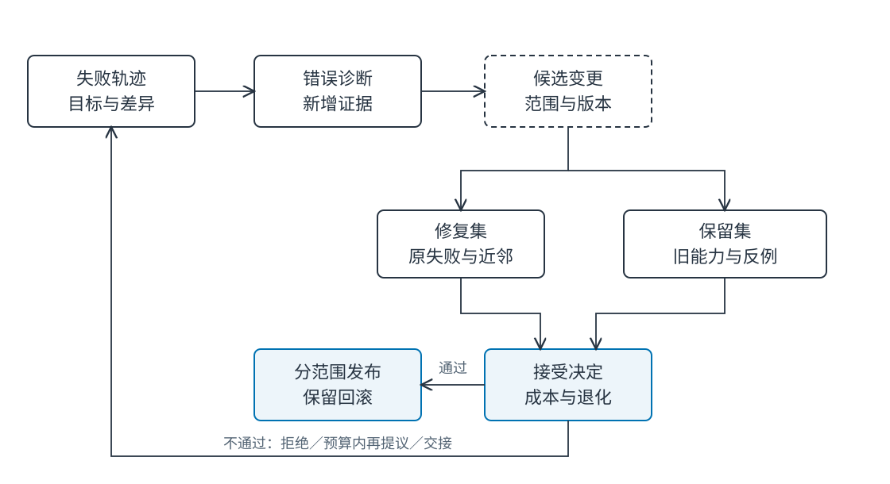
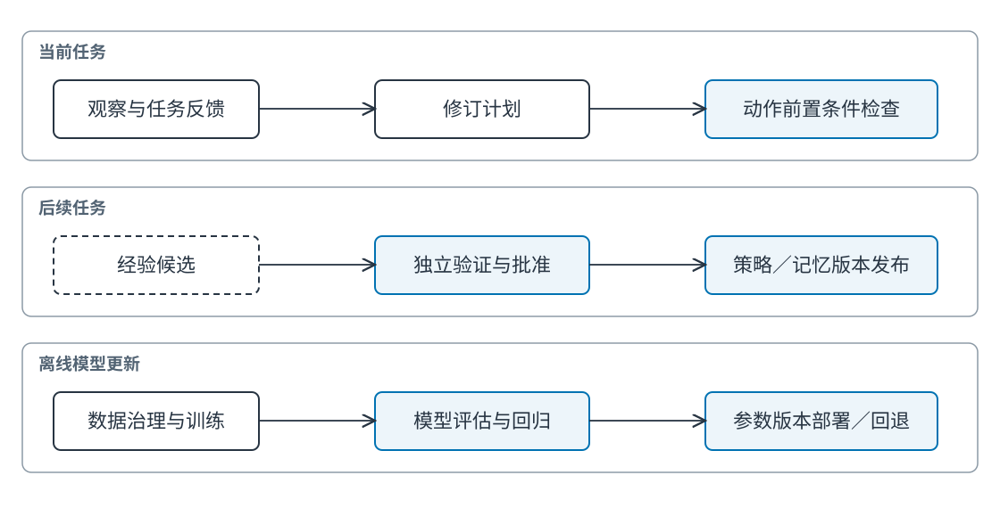

# Ch17 反思、经验学习与持续适应

**Reflection, Learning from Experience, and Continual Adaptation**

**作者：王柯**

**摘要**　智能体能够分析自己的回答，但自我评价并不自动带来可靠改进。本章区分自我批评、环境测试、外部验证与人类反馈，建立从错误诊断、候选修复、独立验证到接受、发布和回滚的流程。经验记录连接具体失败与可复用策略，提示、记忆、策略和参数更新分别管理。通过 30 个可执行失败任务，在相同候选上比较不更新、自评接受和外部验证接受，保留过拟合、错误裁判与无收益案例，说明如何在有限预算中改进系统并约束跨任务退化。

**关键词**　自我批评（self-critique）；外部验证（external verification）；经验学习（learning from experience）；运行时适应（runtime adaptation）；回归测试（regression testing）；持续学习（continual learning）；回滚（rollback）。

**前置与配套材料**　当前计划修订见 [Ch10](../part3/ch10_iterative_reasoning_revision.md)，行动验收见 [Ch13](../part3/ch13_action_traces_recovery.md)，记忆与知识分别见 [Ch15](ch15_long_term_memory.md)、[Ch16](ch16_retrieval_knowledge_agents.md)。代码位于 `examples/ch17/`，使用独立输入输出断言检验程序补丁，无需模型服务。实验候选为预设程序，测量更新接受机制；研究论文中的模型反思效果另按原文讨论。

## 17.1 一次错答怎样变成持续错误

### 17.1.1 自我肯定的循环

助手引用旧政策，认为报销上限为 400 元。系统随后要求它评价答案，模型看到自己刚写的解释，给出“依据充分”的判断。运行时将“先采用最早出现的金额”概括为经验，后续任务都检索这条经验，再用相同理由肯定自己。

这是教学构造案例。错误并不只是模型第一次答错，而是系统把同源判断当作独立证据，将暂时输出提升为长期规则。反思文本增加了确信，却没有增加新的观测。

如果问题来自检索时效，最有价值的反馈是文件生效日期与当前索引状态；如果来自工具重复提交，最有价值的反馈是实际工单查询结果。要求模型“再认真想一遍”可能改变表述，却未触及错误发生的位置。


**Fig-17-03　修好一处，也要检查其他地方（场景插画）。** 候选修复被放到工作台上，同时检查原任务和保留任务；未通过的候选留下可追踪记录。来源：本书原创，教学情境示意，可编辑 SVG。

### 17.1.2 三个需要区分的过程

推理时反思在一次任务内批评和修订候选答案；运行时适应改变后续任务会使用的提示、策略、程序记忆或配置；离线模型更新通过训练改变参数。三者可能形成连续流程，但状态对象、验证成本和回退方法不同。

Self-Refine 研究通过模型生成反馈并迭代改进输出；Reflexion 将语言反馈保留为经验以影响后续尝试。[^selfrefine][^reflexion] 这些工作展示了特定任务与反馈机制下的改进路径，不能推出任何任务都应增加反思轮次。

Huang 等研究在缺少外部反馈时的推理自纠错局限。[^limits] 阅读正反结果时，要同时查看任务、模型、反馈形式、选择规则与预算。将一种任务的有效结论推广到全部智能体，容易忽略决定收益的条件。

### 17.1.3 改进目标必须先于批评

“让回答更好”无法决定何时停止。政策任务的修复目标可以是使用当前条款、匹配主体范围、不改变批准要求；代码任务则可以是修复特定测试并保持既有行为。每个目标都应有可观察的验收依据。

目标本身也可能冲突：更完整的解释增加延迟，更积极的行动降低等待却提高误操作代价。系统应在任务定义中确定优先级，而非让自我评分临时决定。没有验收规则时，反思可能只是围绕语言风格来回修改。

## 17.2 反馈信号与验证层级

### 17.2.1 自我批评适合产生候选

模型可以检查遗漏字段、列出可能反例、比较两个解释的内部一致性。这类反馈成本较低，也容易与原答案共享盲点。它适合指导下一步取证，不能仅凭“我确信”批准业务动作。

为了提高反馈可用性，可要求批评指向具体主张、原文位置或失败断言。相比“答案不够严谨”，“引用 P01@1 已过期，应查询适用 v2”能够转成操作。批评仍需验证，但其结构便于后续核验。

自评发生变化也不等于事实发生变化。如果新一轮只重写相同证据，应记录为重新判断；如果增加了工具结果或新文件，则记录新增信息。这个区分帮助解释反思收益来自计算还是来自取证。

### 17.2.2 环境反馈提供什么

程序测试、工具返回、模拟环境奖励和用户实际完成情况，都可提供外部反馈。它们观测的是不同结果。HTTP 成功说明请求被接收，不一定说明工单内容正确；工具返回“已处理”也不说明审批合法。

执行反馈最好连接到业务后置条件：查到唯一工单、申请人与主体一致、金额符合证据、未发生禁止副作用。对不可逆操作，应在沙箱或影子路径验证候选，不以真实付款作为试错方式。

测试也会遗漏行为。一个补丁通过“500 元可报销”测试，可能把所有金额都批准。负例、边界值和权限例外用于扩大验证范围，不能以单个成功断言代替完整修复。

### 17.2.3 人类反馈需要角色与任务

用户可以确认自己的偏好，政策负责人解释制度，业务审批人批准具体申请，安全负责人判断权限设计。人类反馈的可靠性取决于是否掌握相应信息和权限，不能将所有“人工确认”视为同一种证据。

反馈界面应展示候选变更、支持材料、预期影响和撤销方式。只让审核者阅读最终答案，无法判断系统准备长期保存什么。接受当前报告与接受今后自动采取同类动作，应使用不同的决定对象。

相互矛盾的反馈先定位范围：两名用户有不同格式偏好可以并存，两位政策负责人对同一规则有分歧则需要组织裁决。简单多数票无法解决权限与制度层级。

### 17.2.4 独立性来自信息与控制

独立验证不必总是使用另一模型。程序断言、数据库查询、原文对照或人工复核都可能提供独立依据。关键在于它是否重新观察目标状态，以及候选生成者能否随意修改验证规则。

另开一个提示但复用同一错误材料，独立性有限。使用不同模型也可能共享训练偏差。若验证器直接看到候选自评分数，甚至可能受其影响。记录验证器输入与版本，才能判断证据到底增加了什么。

**Tab-17-01　反馈信号的用途与成本。**

| 信号 | 直接观测 | 适合用途 | 主要局限 | 成本来源 |
| --- | --- | --- | --- | --- |
| 模型自评 | 候选及既有上下文 | 产生诊断与修复建议 | 同源错误、确信偏差 | 推理调用 |
| 测试断言 | 指定输入输出行为 | 代码、结构化规则回归 | 覆盖不全 | 编写与执行 |
| 环境反馈 | 工具及状态变化 | 核验动作后置条件 | 奖励代理失真 | 沙箱与业务查询 |
| 原文核验 | 主张与证据 | 版本、引用、适用性 | 复杂推导仍需判断 | 检索与审阅 |
| 人类审核 | 角色掌握的信息 | 歧义、制度、高影响变更 | 分歧、负荷、专业边界 | 等待与人工工时 |

### 17.2.5 验证成本怎样影响选择

并非每条反馈都值得触发同等昂贵的过程。结构化字段缺失可以用模式检查发现；引用版本不符可以读元数据；制度解释冲突则需要负责人。先执行便宜且有针对性的检查，再把未决问题升级，通常比无差别增加模型轮次更有效。

验证成本还包括等待与人员切换。自动测试只需毫秒，却可能需要工程师先写用例；人工审核只花一分钟阅读，却可能等待一天。报告应区分机器耗时、人工操作与日历延迟，避免把一种成本隐藏在另一种指标之外。

反馈路由可按错误层建立：格式→模式校验，数值→结构化比较，引用→原文，副作用→工具查询，制度歧义→负责人。路由本身也需要失败路径，验证器无法工作时不能默认通过。

### 17.2.6 反例与证据充分性

候选宣称“新规则适用于所有费用”时，可以主动寻找另一费用类别、历史日期、超额或无批准的反例。反例的价值在于暴露范围过大，不要求生成器一次找到全部边界。

发现反例后应缩小候选或补充前置条件，而不是删除反例让分数恢复。若反例来自不同制度范围，则记录边界并确认是否应纳入本次变更。接受标准应在比较候选前固定。

在开放自然语言任务中，无法穷尽所有反例。结论应绑定已检查范围，正式发布采用分阶段观察。清楚的范围帮助下一轮研究选取更有区分力的任务。

## 17.3 从失败到经验的受控更新

### 17.3.1 先把错误定位到层

失败记录至少包含任务目标、输入范围、行动轨迹、期望与实际差异、可疑组件和证据。分类可以从知识错误、状态错误、工具执行错误、权限错误与目标误解开始，不必一开始建立庞大本体。

同样表现为“额度错误”，原因可能是旧索引、错误主题、单位解析或生成误读。对旧索引改提示往往只掩盖问题，对生成误读反复重建索引也没有针对性。分类的价值在于约束修复位置。

可同时保留多个诊断假设，然后执行能区分它们的检查。查主库版本与候选列表，便能区分未接入新版和排序漏项。诊断证据不足时，记录未决原因比强行编出唯一根因更有用。

### 17.3.2 候选修复是一项有范围的变更

候选应写明改什么、不满足哪些条件时退出、影响哪些任务、如何回滚。提示修改可以改变输出格式；检索规则修改可以改变候选集合；程序记忆修改可以改变执行顺序。它们都需要稳定版本，使旧任务可以复现。

将“以后都先查政策”写成全局提示可能增加所有任务的成本。更合理的候选是“涉及费用判断且当前没有有效证据时先检索”。范围来自诊断，避免把局部修复扩大成不必要的全局行为。

**Tab-17-02　一次经验更新记录。**

| 字段 | 填写样例 |
| --- | --- |
| 失败与原因 | `F01` 使用过期规则；主库 v2 已存在 |
| 当前版本 | `policy-selector@1` |
| 候选变更 | `@2` 增加目标时间过滤；保留历史查询入口 |
| 修复集 | 原失败及同义改写，使用当前日期 |
| 保留集 | 历史日期、权限差异、未知类别 |
| 接受条件 | 修复通过、保留集无新增失败、成本在预算内 |
| 发布范围 | 教学租户费用查询 |
| 回滚入口 | 恢复 `@1` 指针并使相关缓存失效 |
| 审核记录 | 自动测试结果；制度变化另交政策负责人 |

### 17.3.3 验证同时看修复与退化

修复集包含触发问题及近邻案例，保留集覆盖原本应保持的能力。两者混在一个均值中，可能掩盖“修复十题、损坏九题”。应分别报告修复率、新增错误和跨任务变化。

检验边界值尤其重要。把 `amount < limit` 改成 `amount <= limit` 可能修复等额申请，但若同时删除批准条件，就引入权限错误。候选是否通过，应检查完整业务谓词，而非只看最初出错的字段。



**Fig-17-01　反馈到更新的批准闭环。** 验证结果与接受决定分开保存；发布后仍可回滚。来源：本书原创，可编辑 SVG。

### 17.3.4 经验记录连接事件与规则

经验不是把整段对话复制进数据库。可复用记录包含失败类型、适用条件、推荐做法、反例、验证结果与有效版本。例如“网络超时后先按幂等键查工单，再决定重试”，应绑定支持查询的工具版本。

原始轨迹保留排查材料，经验卡提炼条件化规则，两者通过来源引用连接。多次相同失败可以合并证据，但不能因为出现频繁就自动提升权限。一次恶意页面中的指令也不能通过反思渠道变成程序记忆。

召回经验仍执行 Ch15 的归属和时效筛选。一个部门的例外处理程序不一定能用于另一部门；工具升级后，旧经验需要再验证。经验库的规模增长应伴随失效与合并机制。

### 17.3.5 接受、发布与回滚是三个动作

接受表示候选通过已定义验证，发布表示让某范围任务开始使用，回滚表示停止使用并恢复先前版本。分开后可以先接受但暂缓发布，也可以只对教学租户启用。

新任务读取发布指针，进行中的任务绑定启动时版本；需要紧急停止时，执行层另有撤销与取消机制。回滚提示不会撤销已经创建的工单，业务副作用仍按 Ch13 的查询、补偿与人工处理路径管理。



**Fig-17-02　计划修订、经验更新与参数学习。** 三条路径具有不同影响范围与验收周期。来源：本书原创，可编辑 SVG。

### 17.3.6 参数更新的边界

运行时记录经验并不改变模型权重。离线微调需要训练数据治理、任务划分、训练与评估、部署及回退。模型在当前上下文学会一个规则，也不意味着该规则会在无上下文的新会话自动保留。

持续参数学习还面临灾难性遗忘。EWC 通过限制重要参数变化研究保留旧任务能力。[^ewc] 该工作提供一个机制视角，但本章没有训练神经模型，也不将记忆写入效果解释为解决参数遗忘。

### 17.3.7 从轨迹到可复用程序的例子

一次创建工单请求超时，助手直接重试，得到两张工单。失败轨迹显示第一次请求已成功，只是回执丢失。经验候选因此是“超时后先查询幂等键对应结果，存在则返回，不存在再重试”。

验证至少包含三种情况：首次成功回执丢失、首次未生效、查询服务暂不可用。第三种不能盲目当作不存在，应等待或人工处理。还要检查工具是否真的支持幂等键，旧版本工具不满足前提时不得召回这条程序。

通过后，程序记忆记录工具版本、查询接口和停止条件。它不直接更改每个任务批准，也不修改模型参数。若后续工具弃用查询接口，程序被标记待验证并退出自动使用。

### 17.3.8 发布范围与依赖关系

一个检索修复可能影响引用、摘要、经验与缓存。变更记录列出这些依赖，发布时使受影响派生对象失效；不受影响主体保持原版本。大范围清空容易实现，但会增加重建成本和不可用时间。

影子执行可以先观察新旧策略在同一输入上的差异而不产生真实动作。差异需要归因：新政策导致决定改变是预期变化，错误删除批准条件则不是。影子一致率本身也不是正确率，要结合独立标准。

发布后回滚触发条件可以是严重权限错误、修复无收益或成本超限。阈值由用途确定，记录“为什么回滚”以及哪些任务已经使用新版本，为后续修复提供输入。

## 17.4 漂移、奖励投机与停止

### 17.4.1 验证器也有版本

验证器决定什么被奖励。如果它只检查答案包含数字，候选可能输出所有可能额度；如果只看测试返回码，候选可能绕过测试。验证依据应接近业务目标，并记录版本，避免一边比较候选一边改变评分标准。

公开修复集可以指导调试，最终保留集应防止被候选生成过程直接拟合。教材示例将用例全部公开便于学习，正式评测则需另外保留未见任务。读取过的测试不再具有同等未见性。

### 17.4.2 错误裁判与自我肯定

若裁判重复原答案并给高分，系统应请求新证据或停止，而不是将高分当作无限重试依据。比较两个自评分数也不能说明更高者正确。人工反馈若只赞同语气，同样不能支持事实变更。

可以设计反向检查：让核验器寻找一条使候选失败的输入，或将候选与原方案在相同任务上并排执行。反例未找到不构成证明，但能增加诊断信息。对高影响动作仍由确定的前置条件与业务验收约束。

### 17.4.3 预算与无收益案例

反思预算包含候选数量、取证次数、工具调用、时间和人工工时。本章最多两个候选；候选重复、无新增证据、预算耗尽或缺少用户输入时停止。停止输出应保存失败原因，使人工可以继续处理。

一个已正确的格式化任务，反思可能把精确输出改成冗长解释，导致结构校验失败。另一个任务所需材料根本不在知识库，增加十轮自评也无法找到金额。两类都应保留为无收益或负收益案例，用于检验选择何时反思。

### 17.4.4 受控漂移与持续观察

用户需求和制度会变化，保持旧行为也可能错误。系统需要区分适应真实变化与追逐短期噪声。显式政策发布可以触发知识版本更新，少数用户反馈则先进入候选，不直接改变全体用户策略。

发布后观察任务切片：新用户、不同部门、长任务、低频例外。均值上升但少数群体错误增加，应回到影响范围和验收目标，而非把退化藏在总体收益里。Ch26 提供更完整的评估设计，Ch30 负责生产变更过程。

## 17.5 反思与更新接受的消融实验

### 17.5.1 任务、候选与外部判定器

配套构造 30 个失败任务，按额度判断、版本判断、归属判断三类各十个。每个任务有原失败输入和四个保留输入，覆盖合法申请、超额、跨主体和旧版本。候选是实际执行的 Python 决策程序，判定器比较预先定义的期望布尔结果。

所有更新路径看到相同的至多两个候选。第一候选部分正确，部分保留原错误，五个刻意只适配已知输入；第二候选实现完整谓词。自评分固定为通过，用来模拟错误裁判。候选生成质量在本实验中是控制条件，不能据结果推断某个语言模型会生成多少有效修复。

对照分别为：保持原程序；遇到自评通过即接受；修复集和保留集均通过才接受。三者共享最大候选预算，实际使用量随停止规则不同。该设计检验接受机制，并非 Self-Refine 或 Reflexion 的模型复现实验。

### 17.5.2 实际结果与解释

```bash
uv run --frozen python examples/ch17/run_adaptation.py
uv run --frozen pytest tests/test_d_remaining.py
```

**Tab-17-03　30 个脚本候选任务的实际执行结果。**

| 接受机制 | 修复原失败/30 | 保留集失败任务/30 | 实际候选检查数 |
| --- | ---: | ---: | ---: |
| 不更新 | 0 | 30 | 0 |
| 仅依赖自评 | 10 | 25 | 30 |
| 修复集＋独立保留集 | 30 | 0 | 55 |

“保留集失败”表示当前程序在至少一个保留输入上失败，包含原有问题，不能全部称为新增退化。自评路径的十个修复中，五个仍然只适配暴露输入，说明修复率与一般行为保持必须分开看。

外部验证用了更多候选检查。结果由脚本候选和用例覆盖共同决定：第二候选被有意设置为正确，故不能将 30/30 解释为现实修复的成功率。它说明当存在合格候选且验证覆盖这些条件时，接受机制能够拒绝已知不合格候选。

### 17.5.3 一个负收益修复的逐步追踪

`F01` 的第一候选只批准金额为 500 的请求。暴露用例恰好要求拒绝 800 元，候选通过；保留输入要求批准合法的 550 元，候选却拒绝。若只看原错题，系统会认为修复成功，实际上增加了不必要的拒绝。

外部路径保存第一候选、失败断言及拒绝原因，然后验证第二候选。自评路径在第一候选停止，后续没有触发同等检查。这条轨迹说明停止规则也是算法的一部分，不能只比较最终反思文本长度。

### 17.5.4 扩展为模型实验

接入语言模型时，固定模型版本、提示、温度、随机种子策略和总预算。使用相同失败轨迹分别提供无反馈、自我批评、外部测试结果，统计实际模型调用、修复率、新增错和保留集变化。测试结果与候选程序都应保存。

如果模型无法生成可执行候选，应计为失败；如果预算耗尽，保留原版本；如果外部判定器不能裁决，单列未判定。这样可以把生成、验证和接受三个环节分开评估，而不是用成功样例筛选后的平均值代表全体任务。

### 17.5.5 错误裁判的独立消融

当前自评路径把所有第一候选都评为通过，故用于测试极端同源肯定。如果想研究真实裁判质量，需要单独准备候选集，让裁判在不知道正确标签的情况下判断，再比较误接收与误拒绝。

裁判对正确候选过于保守会增加成本，对错误候选过于宽松会扩散失败。可以按错误类型画出接受情况，查看它擅长格式检查还是事实判断。将裁判和生成器一起改动，会使收益来源难以分离。

增加另一模型并不自动形成独立证据。实验应说明裁判是否读取原文、执行测试或仅阅读候选解释，是否能被候选中的自信措辞影响。外部信息与控制边界才是独立性的关键。

### 17.5.6 从一次修复到持续适应评估

持续适应实验将任务按时间分批，前批提供反馈，后批测迁移，再回到旧任务检查退化。不要随机打散后宣称时间适应，因为真实系统无法使用未来反馈修复过去。

可在中途更换政策或工具版本，要求系统识别经验过期。记录每次更新的范围、接受原因、回退和失败积累。最终报告既有任务收益，也有维护调用与人工负担，才能判断适应是否值得。

## 17.6 更新记录与练习

### 17.6.1 可以交给下一任务的东西

当前任务完成后，可以留下已验证的经验卡、被拒绝的候选、未解决问题和版本变更。经验卡供后续召回，拒绝记录防止重复尝试同一失败方案，未决问题引导人工或补充实验。

每条接受更新应能解释其依据与影响范围。没有长期收益证据时，可以仅在当前任务使用，不必立即写成全局规则。把一次修复保留为候选，是控制影响范围的正常工程选择。

### 17.6.2 复习与实践

1. 自我批评、环境反馈和人类批准分别提供什么信息？哪些组合仍缺少独立性？
2. 举例说明计划修订、程序记忆更新和参数训练的区别。
3. 为什么原错题修复不等于没有跨任务退化？
4. 如果验证器只检查“存在工单”，候选可能怎样投机？如何改进？
5. 提示回滚后，已经发生的业务副作用应怎样处理？

**实践题**　增加“单位错误”类十个失败任务，候选至少包含一个修复暴露用例但破坏保留用例的方案。在同一预算下比较三种接受机制，报告修复、保留集失败、实际检查与停止原因。再加入一次错误人工反馈，说明哪些对象进入候选库、哪些可以发布。提交 `reflection_update_log.jsonl` 与接受、拒绝、回滚记录。

## 参考文献

[^selfrefine]: Madaan, Aman; Tandon, Niket; Gupta, Prakhar; 等，*Self-Refine: Iterative Refinement with Self-Feedback*，预印本初版 2023，核对版本 v2（2023-05-25），[arXiv:2303.17651v2](https://arxiv.org/abs/2303.17651v2)。
[^reflexion]: Shinn, Noah; Cassano, Federico; Berman, Edward; 等，*Reflexion: Language Agents with Verbal Reinforcement Learning*，预印本初版 2023，核对版本 v4（2023-10-10），[arXiv:2303.11366v4](https://arxiv.org/abs/2303.11366v4)。
[^limits]: Huang, Jie; Chen, Xinyun; Mishra, Swaroop; 等，*Large Language Models Cannot Self-Correct Reasoning Yet*，预印本初版 2023，核对版本 v2（2024-03-14），[arXiv:2310.01798v2](https://arxiv.org/abs/2310.01798v2)。
[^ewc]: Kirkpatrick, James; Pascanu, Razvan; Rabinowitz, Neil; 等，*Overcoming catastrophic forgetting in neural networks*，*PNAS* 114(13): 3521–3526，2017，DOI：[10.1073/pnas.1611835114](https://doi.org/10.1073/pnas.1611835114)。预印本初版 2016，核对 [arXiv:1612.00796v2](https://arxiv.org/abs/1612.00796v2)。
