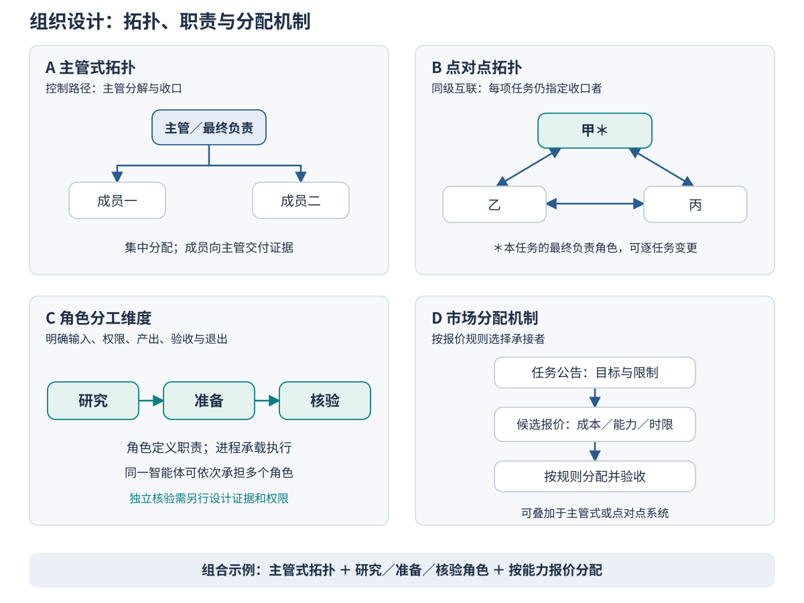
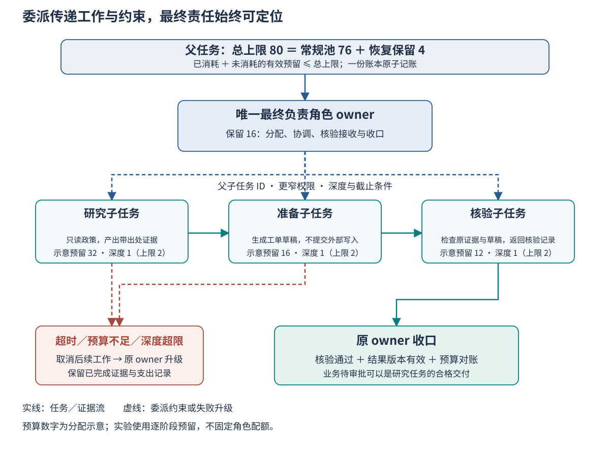

# Ch18 多智能体角色与组织结构

**Multi-Agent Roles and Organizational Structures**

**摘要**　多智能体系统的收益取决于任务如何拆分、权限如何分配，以及结果由谁负责收口。本章从企业政策研究助手的协作失败出发，区分组织拓扑、角色职责与任务分配机制，比较主管式、点对点、角色分工和市场分配的适用条件。随后以角色契约定义输入、权限、输出、验收与退出，建立有界预算、委派深度和升级规则。章末使用十二项原创政策任务构造组织比较算例，结合写作阶段的确定性模拟记录，分析并行收益、协调开销以及故障后的责任和预算边界。

**关键词**　角色（role）；组织结构（organizational structure）；委派（delegation）；最终负责角色（accountable role）；角色契约（role contract）；任务分配（task allocation）；协调成本（coordination cost）。

## 18.1 团队增大却没有收益

### 18.1.1 一份始终没有交付的政策答复

一家企业希望建立政策研究与工单助手。员工提交费用事实，助手查阅指定版本的政策，解释是否符合条件，再准备后续处理所需的工单草稿。团队最初把工作交给一个智能体：读取任务，检索政策，形成答复，检查证据，再将结果交给申请人。开发者希望提高可靠性，于是增加研究、准备和核验三个角色，并让它们相互讨论。以下情节是用于分析组织问题的教学构造，并非企业部署记录。

一项申请金额在额度以内，附有凭据，但尚未取得主管批准。研究角色读取额度条款后给出“金额符合条件”；准备角色据此生成了标记为可提交的草稿；核验角色发现缺少批准，要求重新查找审批规则。研究角色再次读取了额度条款，重复原结论。准备角色认为自己的交付已经完成，核验角色则认为还应由其他角色判断审批状态。对话继续增长，申请人始终没有收到一份带出处、明确说明“待审批”的最终答复。

这里至少存在三个不同问题。第一，研究对象没有完整界定，成员不知道需要同时检查额度、凭据和审批三个条件。第二，“生成草稿”与“获准提交”没有分开，准备角色把文字完成当作行动授权。第三，没有指定谁必须在成员意见不一致时组织核验、说明未解决事项并交付结果。增加成员扩大了活动量，却没有补上这些缺失的组织规则。

此时，继续增加一个“专家”可能带来更多解释，但不能保证结果获得签收。组织设计首先要回答：一项任务由谁接受，哪些工作可交给别人，谁能判定证据足够，谁能结束任务，以及失败后谁必须作出下一步安排。这些问题先于角色名称、对话轮数和模型规模。

### 18.1.2 把症状转成可检查的问题

诊断这类失败时，应先固定任务和政策版本，再观察轨迹。一次重复读取未必代表浪费：独立核验者回到原条款，可能是在防止摘要遗漏。只有当再次读取既没有新的问题、没有版本变化，也没有形成新的验证记录时，才应将其归为无效重复。相反，两名成员分别引用不同版本政策，即使语言一致，也不能据此认定协调成功。

本例可以从四条记录定位。任务输入中缺少完整的适用政策集合；草稿中没有把政策结论与提交许可分开；核验意见没有明确接收者及下一步义务；根任务没有最终负责角色。相应修复也应落到这些记录：固定输入，规定草稿状态，要求核验意见指向可执行的修订项，并指定一名负责者对研究任务收口。只有在检查了这些边界之后，讨论是否更换拓扑才有意义。

修复后的合理结果可以是：“金额及凭据条件满足；主管批准尚缺；当前状态为待审批；已准备草稿，但未提交。”研究任务可以合格结束，而费用申请继续等待批准。这里关闭的是“解释政策并准备后续材料”这一研究任务，并不意味着业务申请已经获批。若系统把所有层次都压成一个 `done` 字段，成员就容易对“完成”作出不同解释。

本章据此提出三个贯穿问题：拆分能解决什么具体限制，最终责任落在哪里，收益是否覆盖协调成本。多智能体组织研究已经提出多种组织范式，但这些范式是分析与设计工具，不能直接代替特定任务的验证。[^r02] 本章后半部分将用固定任务检验这三个问题，保留单体更经济的反例。

### 18.1.3 本章要交付什么

完成本章后，读者应能为一个任务画出控制关系和证据关系，解释为何保留单体或引入团队；能够把角色写成可检查的契约，而不仅是一段人物设定；能够限制委派深度、根预算与失败后的继续工作；能够从结果和轨迹判断任务是否真正收口。这些能力共同服务于一个目标：让组织中的每一次增加成员、交接和恢复都有可说明的用途。

本章讨论职责、授权与任务归属。[Ch19](ch19_multi_agent_communication.md) 将继续讨论消息的字段、顺序、超时和交接协议，[Ch20](ch20_collective_reasoning.md) 将讨论分歧、辩论和集体判断。这里不以消息数量推断通信可靠性，也不以成员一致推断答案正确。

## 18.2 角色与组织结构

### 18.2.1 区分智能体、角色和组织

**智能体**是承载任务、状态、行动和反馈循环的执行实体；**角色**描述某类职责及其行为边界；**组织结构**规定这些执行实体如何分配任务、获得授权、交换结果并解决责任问题。三者相关，但不能简单一一对应。一个智能体可以先做研究再做准备；同一研究角色可以由多个隔离的执行实例承担；同一个模型也可以被配置成具有不同工具和上下文的多个实例。

这一区分有直接的工程含义。将提示词中的身份从“助手”改成“高级审核专家”，不会自动产生独立证据、独立权限或独立失败域。若生成者与核验者共享相同的错误摘要，第二次调用可能只是重复第一轮结论。若多个实例共享写入凭据，一个角色声明“只读”也不足以限制实际操作。角色需要通过输入、工具授权和验收条件体现，运行时再负责实施这些约束。

经典多智能体理论讨论自主实体之间的信息、决策和交互关系，为分析分布式控制及利益差异提供了基础。[^r01] 在基于大语言模型的应用中，多个角色往往由同一应用维护，不一定具有不同经济利益。因此，本章主要讨论协作式组织；市场机制部分会另外说明报价与激励的限制，不把所有团队都建模成自利参与者。

组织设计至少包含三个相互关联的维度。**拓扑维度**回答控制和联系经过谁；**职责维度**回答每个角色应该交付什么；**分配维度**回答候选成员中由谁承接具体任务。主管式与点对点主要描述拓扑，研究—准备—核验描述职责，市场式方法主要描述分配机制。Fig-18-01 将它们放在四个面板中，是为了对照观察，不代表四个互斥选项。



*Fig-18-01　主管、点对点、角色与市场四类结构视角。A、B 表示拓扑，C 表示职责划分，D 表示任务分配机制；三类维度可以组合。点对点系统中的星号标记该任务的最终负责角色。*

### 18.2.2 从单体基线判断是否需要拆分

单体基线并不等于只允许一次模型调用。它可以检索多个来源、执行多步工具操作、修订答案，并在一个明确的任务循环中收口。比较团队之前，应先让这个基线具有相同的信息源、工具机会和验收标准。若基线缺少团队可用的政策资料，得到的差异就混合了信息优势与组织优势。

引入多个执行实例通常有三类可检验的理由。其一是**可并行工作**：不同政策的读取在证据汇合之前没有依赖，能够同时进行。其二是**能力或权限专业化**：某个成员只能检索，另一个成员可准备结构化工单，核验者有原始材料访问权但没有提交权。其三是**上下文隔离**：不同材料可以分开处理，避免单个上下文持续膨胀，并只在汇合时传回有版本的证据。这三类收益都需要具体机制支撑。

相应地，拆分也有明确的不适用条件。若任务只是查询一个额度，单体读取一次即可回答，分配、回传和签收可能占据大部分工作。若后一步必须等待前一步作出不可并行的决定，增加实例未必缩短关键路径。若每名成员都需要完整历史才能理解问题，上下文分离之后还要反复复制历史，所谓隔离可能转化为传递成本。若系统没有可执行的权限边界，添加角色名称也不能形成职责隔离。

因此，设计者应把“多一个成员能解决什么限制”写成可以被结果否定的假设。例如，“三个独立政策来源的读取可以并行，从而降低该类任务的虚拟完成延迟”，就比“多智能体更聪明”容易检验。后者既没有明确比较对象，也没有说明质量、成本和时间中哪一项应改善。

### 18.2.3 主管式：集中分配与集中收口

主管式组织由一个协调者分解任务、分配子任务、接收证据，并决定是否继续、修订或交付。成员之间可以完全通过主管通信，也可以获得有限的直接联系；关键特征是任务控制与最终整合集中在主管。对于政策助手，主管可以分别派发额度和审批研究，再将证据合并成一个对申请人的答复。

它的优势是责任路径容易表达。成员知道结果交给谁；主管可以统一解释目标、控制剩余预算，并阻止多个成员同时提交同一外部操作。层级还可以隔离成员的上下文：研究成员只看到被分配的材料与问题，而主管保留根任务和最终验收条件。Anthropic 对研究系统的工程报告提供了这种组织方式的应用实例，同时强调了清晰委派和协调成本的实际影响；这是特定系统的经验材料，不能作为所有任务性能提升的保证。[^r08]

集中也会形成瓶颈。主管若逐条重写所有成员的完整内容，节省的研究时间可能被汇总工作抵消。主管若只看成员结论而不保留证据引用，则会成为失真的汇聚点。若主管不可用，成员完成的子任务也可能无法交付。因此，应限制主管必须处理的对象：任务状态、带出处的结论、冲突与需要决策的异常，而不是要求它重新完成每一项研究。

主管具有协调权，不等于具有无限工具权限。它可以被允许决定任务分配，而没有费用提交凭据；成员可以读取政策，而不能改变任务终态。这里需要把“决定由谁做”与“本人能做什么”分开配置。18.3 将说明根授权范围、角色直接权限和最终关闭权限之间的区别。

### 18.2.4 点对点：同级联系与明确归属

点对点组织允许成员直接交换信息，协同处理局部依赖。政策研究者可以直接向准备者解释条款，而不必等待主管转述。当成员具有互补知识、交接频繁且可以局部解决问题时，直接联系可能减少中转路径。点对点也可以采用稀疏连接，不必让所有人向所有人广播。

这类组织的难点是任务边界可能变得模糊。甲向乙提了一个建议，乙是否必须执行？丙报告“核验通过”，谁要向申请人交付？如果甲、乙都决定继续检索，谁判断剩余预算是否足够？这些问题无法由“平等协作”自动回答。点对点减少了固定层级，却仍然需要任务分配、状态管理和最终责任规则。

一个实用做法是为每项根任务指定唯一最终负责角色。该角色可以随任务类型变化，也可以在满足显式移交条件后由另一成员接管。它不必指挥每次局部交流，但必须知道哪些交付仍未完成、哪些冲突影响验收，以及何时停止继续工作。本章实验中的 `peer_0` 承担这一任务归属；其他成员保持直接证据交换。这是一种有任务负责者的点对点方案，结论只适用于这一具体方案。

成员增加时，潜在的联系关系会增长，但潜在关系数量与实际消息量不同。三个成员有若干可用通信边，不代表每轮都必须使用所有边。设计者应规定哪些事件触发消息、哪些信息只交给负责者、哪些信息需要广播。具体投递和确认机制由 Ch19 展开；本章在比较中只对已经定义的消息阶段计数。

### 18.2.5 角色式分工：把职责落到交付物

角色式设计将工作按研究、准备、核验、负责等职责组织起来。这种分工可以部署在主管式或点对点拓扑之上，也可以在单个智能体内按顺序执行。其价值主要来自职责清晰、权限可限制和产物可验收，而不来自角色数量本身。

例如，研究角色的产物是“条款引用、适用条件及未解决事项”，准备角色的产物是“依据已接受结论形成的工单草稿”，核验角色的产物是“对证据和草稿的检查记录”。把研究角色的输出写成“充分分析”，会让接收者无法判断交付是否完整；把核验角色的输出写成“你是最严格的专家”，则没有提供可执行的验收条件。

MetaGPT 将软件工作中的标准作业流程与角色分工纳入多智能体协作，是角色职责和中间交付物结合的研究实例。[^r06] AutoGen 则展示了通过可配置代理及可编程交互组织应用的方法。[^r05] 这些工作说明多种实现路径是可行的；是否适用于政策助手，还需要检查其证据边界、外部操作限制与失败行为。本章不依赖某个框架完成基本实验。

职责划分还应考虑检查的独立程度。不同成员可以分别生成与核验，从组织上减少“生成者直接宣布自己成功”的情况；但如果它们使用同一段错误输入，组织分离并不能消除共同错误。真正有意义的核验还需要原始来源、明确检查项和与生成过程相分离的验收条件。

### 18.2.6 市场式分配：将承接选择写成规则

市场式方法让候选成员根据公告的任务提交报价，再按规则选择承接者。报价可以表达预估成本、交付时间、可用能力或资源占用，并不一定涉及真实货币。合同网协议是这类任务公告、候选响应和承接关系研究的经典起点。[^r03] 引入这一视角的目的，是让“为什么由这个成员来做”成为可说明的决定。

一个教学例子是：主管公告“读取审批政策并返回条款和适用判断”，候选成员报告自己是否有该版本资料、预计需要的工作量，以及能否在时限内完成。分配规则先排除权限不足或时间不可行的候选者，再在其余成员中依据事先确定的指标选择承接者。这样的顺序避免只按最低成本分配一个事实上无法完成的任务。

报价自身也需要边界。成员自报“成本最低”不是实际成本证据，自报“最擅长”不是能力认证。若参与者有不同利益，还要考虑虚报、抢占任务或长期不交付的激励问题；即使所有成员服务于同一应用，不准确的估计也会造成错误分配。市场机制既不天然保证全局最优，也不自动提供可靠验收。公告、报价、分配和后续确认还会引入新的协调工作。

因此，小型且固定的政策任务可以先用简单的确定性规则分配；只有当成员能力、负载或任务规模存在足够差异时，再比较市场机制的价值。本章基础实验没有实现竞价，也不报告市场方案的性能。Fig-18-01 中的市场面板用于解释分配维度，读者可在实践题中扩展并单独验证。

**Tab-18-02　组织结构选择：任务特征、协调成本与失败影响。表中为设计判断框架，性能结论须由具体任务验证。**

| 判断维度 | 单体 | 主管式 | 点对点 | 选型时需要核实的证据 |
| --- | --- | --- | --- | --- |
| 并行性 | 一个执行循环，内部工具仍可并发 | 成员可并行，汇合受主管约束 | 多成员可直接并行，局部依赖需协调 | 独立工作有哪些；汇合后还剩多少串行工作 |
| 专业化与隔离 | 配置较少，角色切换由同一循环完成 | 容易按子任务限制材料和工具 | 可保留成员专长，授权关系更分散 | 是否有真实工具差异、证据边界或上下文收益 |
| 冲突处理 | 单一循环修订 | 主管接收冲突并裁决或升级 | 要明确谁能结束争议 | 冲突属于事实、规则解释还是授权问题 |
| 通信成本 | 无跨成员交接 | 分配、回传、整合成本 | 直接交换可缩短中转，也可形成广播开销 | 实际消息、内容规模及等待路径 |
| 最终责任 | 单一任务循环持有 | 通常由主管持有 | 每项任务必须另外指明 | 缺失结果时能否定位唯一收口者 |
| 失败影响 | 执行循环失败影响整个任务 | 成员失败可局部处理，主管失败影响整合 | 局部成员失败影响其依赖，归属不清会扩散 | 已完成证据是否保留；接管是否合法 |
| 职责与分配扩展 | 可采用角色顺序 | 可叠加角色契约和市场分配 | 同样可叠加角色契约和市场分配 | 扩展产生的收益是否超过新增协调工作 |

阅读 Tab-18-02 时，应先找任务约束，再找组织候选。不能因为任务“复杂”就直接选择更多成员。复杂性可能来自证据缺失、授权不清或目标冲突，而这些问题可能需要澄清输入、人工批准或修改验收条件。组织结构只能处理其机制能够覆盖的那部分复杂性。

## 18.3 委派与责任契约

### 18.3.1 从人物设定改为角色契约

**角色契约**规定一个角色接受什么输入，可以使用哪些权限，应交付什么结果，由谁依据什么条件验收，以及何时必须停止。它连接组织设计和执行实现：正文中的职责通过契约变成字段，通过运行时检查变成约束，通过轨迹和验收记录变成证据。

“请担任政策研究专家”可以帮助模型理解语气和任务，但无法回答材料是否完整、是否能访问外部网站、是否允许创建工单，以及找不到证据时怎么办。契约应把这些问题写清楚。对于研究角色，输入不能只有自然语言问题，还应包括任务标识、事实集合、适用政策引用及版本、允许的检索范围、返回对象和可用预算。否则，一个看似合理的成员回复可能无法接入后续流程。

契约中的输出也要区分结论、依据和状态。`decision` 表达当前判断；`evidence` 指向可定位材料；`reason_codes` 说明未满足的条件；退出状态说明角色是完成交付、拒绝承接，还是由于限制停止。把这几类信息分开之后，接收者才能在不重新阅读全部对话的情况下决定下一步。

**Tab-18-01　政策助手的角色契约。准备角色对应行动执行前的草稿阶段；本章基本实现不提交外部工单。**

| 角色 | 必需输入 | 直接权限 | 规定产出 | 验收者与条件 | 停止条件 |
| --- | --- | --- | --- | --- | --- |
| 最终负责／主管 | 根任务、事实、政策版本、总预算与验收条件 | 分配与协调、提出整合判断、关闭本人负责的任务；不据此取得提交权限 | 唯一终态、合并答复、未解决事项和预算对账 | 根据核验记录收口；离线答案夹具另行检查 | 输入不合法时拒绝；超限、证据冲突或成员失败时停止并升级 |
| 研究 | 有界问题、指定政策及版本、子任务和返回目标 | 在授权范围只读检索 | 条款引用、适用事实、候选判断及缺失证据 | 核验者检查原条款、版本和适用关系 | 范围不符、证据不足、取消或预算限制 |
| 准备／执行前处理 | 已接受的政策判断、必要事实及输出模式 | 生成本地工单草稿；不提交、不批准 | 标记业务状态的结构化草稿 | 核验者检查字段、依据与状态，不把待审批改成获批 | 缺少必需事实、授权不足、取消或预算限制 |
| 核验 | 原始政策引用、候选判断、草稿和检查标准 | 读取证据并形成检查记录；不修改政策、不直接关闭根任务 | 通过、退回或需升级的记录及理由 | 最终负责者接收；离线夹具检查最终答案与责任记录 | 无法核验、版本冲突、取消或预算限制 |

Tab-18-01 中的职责不要求固定四个进程。实验的主管式方案使用一名主管和两名成员，其中成员一承担研究及准备，成员二承担研究及核验。一个智能体承担多个职责时，应明确它在哪个阶段使用哪个权限。单体方案则由一个执行者完成这些阶段，内部检查属于自检；离线验收仍然与其决策过程分开。

### 18.3.2 固定输入与可追溯输出

任务输入需要同时确定问题和证据边界。本章任务 `T09` 给出金额 450、已有凭据、已获主管批准三个事实，并指定额度、凭据和审批三项政策。成员不能为了提高通过率删掉审批政策，也不能把没有提供的事实补成“已批准”。若事实未给出，合理处理是标记缺失并请求补充；若政策不存在或版本有冲突，合理处理是停止自动决定或转入规定的人工路径。

证据引用应足以让另一个检查者找回材料。本章用 `P04@1.0:P04#1` 表示政策 P04 的 1.0 版本及其中的具体条款。实际系统可以使用文档版本、内容摘要、段落定位和访问记录，但不能只保留“政策规定如此”。若一个结论依赖三条规则，引用集合也应覆盖三条规则，而不是仅列一项最容易找到的依据。

输出可由任务标识、判断、理由、证据和核验者构成。教学夹具中的三个业务判断是 `eligible`、`ineligible` 和 `needs_approval`，分别表示满足当前条件、不满足条件和待批准。它们描述申请状态；研究任务另有 `closed`、`escalated` 等执行状态。一个 `needs_approval` 的判断只要符合证据、说明清楚并通过检查，就可以成为已关闭研究任务的合格产物。

本章将“完整”定义为满足已给出的答案与引用模式，未声称这些简化字段足以表达所有企业政策。真实政策还可能涉及例外、优先级、适用日期和地域冲突，应在数据与验收层增加相应规则。将这些未知条件默认为通过，会使组织看起来工作顺利，却降低业务可信度。

### 18.3.3 执行责任、核验责任与最终责任

一项子任务可以有多个执行者，例如分别研究不同政策；一份草稿也可以有多个核验意见。但每项已接受的根任务应有且只有一个最终负责角色。它承担的义务是推动任务进入可解释的终态：向用户交付已验收结果，或说明为何停止、哪些工作已完成、还需要谁采取什么行动。

唯一最终负责角色不意味着其他成员没有责任。研究者要对其引用和范围负责，准备者要对草稿字段和权限边界负责，核验者要对检查记录负责。最终负责角色则要确认这些局部交付足以支撑根任务收口。将最终责任分给“整个团队”，往往无法在缺失结果时形成明确的行动义务。

委派通常转移的是一部分工作及其约束，最终责任并不随消息自动转移。成员回复“我做完了”，最多表示它声称完成了局部交付；接收者仍须检查产物是否属于当前任务、是否在有效版本和范围内、是否满足验收条件。核验通过也只是根任务收口的前提之一，不能替代最终负责者的交付记录。

如果确需更换最终负责者，应将其视为显式接管。接管记录至少需要旧负责者、新负责者、当前任务版本、已完成证据、未完成工作、剩余预算以及接管生效点。没有生效点，旧负责者可能仍在关闭任务，新负责者也在发起新工作。如何用分配代次等字段拒绝迟到结果属于 Ch19 与运行时章节的实现范围；本章基本模拟固定负责者，没有实现在线接管。

### 18.3.4 把验收与生成分开

独立验收条件是指依据外部事实、业务状态或预先确定的标准检查结果，避免只接受生成者自报成功。它不必总由另一模型执行。对于结构化政策任务，人工编写的答案夹具、原条款引用检查和唯一关闭事件检查，都比“成员觉得答案不错”更容易复核。

应区分三层检查。第一层是模式检查，确认必需字段和引用格式存在。第二层是内容检查，确认判断与具体事实、政策条款一致。第三层是组织与行动检查，确认核验记录有效、关闭者获授权、预算有界，而且没有发生未经批准的写入。通过模式检查并不意味着内容正确；内容正确也不能抵消越权操作。

独立性有程度。本章的答案文件与求值器分开编写，离线验收代码不调用求值器，能发现最终判断、理由、引用或关闭事件被改动的情况。但代码和夹具仍由同一写作过程维护，尚未经过团队成员独立复核。因此，它提供的是可检查的外部答案条件，不是已完成第三方认证。实际研究还需要让独立人员检查题目、来源和预期答案。

框架可以提供消息路由、代理生命周期或交互模式，但应用开发者仍要实现具体行为契约。AutoGen 的应用栈文档对此有明确区分：运行时承担基础消息设施，应用需要定义并实现消息所形成的行为约定。[^r09] 采用一个支持多智能体的库，并不会自动回答谁能关闭业务任务。

### 18.3.5 预算从根任务统一记账

委派最常见的预算错误是将同一份剩余额度重复发给多个成员。例如，父任务剩余 40 单位，向甲和乙分别承诺“最多可用 40”，随后两人都开始执行。即使每个子任务都遵守自己的上限，根任务仍可能超支。预算必须由统一账本登记，而不能只复制一个数字到消息中。

可以把预算分成已消耗、尚未消耗的有效预留和恢复保留。常规工作进入执行前，账本检查以下关系：

```text
已消耗 + 所有并发工作的有效预留 + 恢复保留 <= 根任务总上限
```

预留不是新增预算。工作完成后，预留转为已消耗；未启动的工作取消时，可以释放未使用额度；对已经启动、消费情况尚不明的工作，应按系统规定保守记账或等待可靠结算。本章模拟对已被接纳的阶段按整阶段成本记账，包括随后被取消的在途阶段，以免故障时低估支出。它没有模拟真实服务按 token、调用或时间结算的账单。

恢复保留用于取消、记录和升级，使系统在常规额度不足时仍能完成有界收口。若常规工作可以把所有额度用尽，系统可能连停止和报告失败所需的资源都没有。本章默认根上限为 80 个逻辑工作单位，常规阶段最多占用 76，另留 4 个恢复单位；一次升级消耗 2 个单位。这些是透明的教学配置，不是推荐的生产比例。

单次授权还应受多个边界共同限制：根任务余额、子任务配额、当前执行阶段上限和授权有效期。真正可用额度是这些约束的共同可行范围，而不是把上限相加。真实模型接入后，应另记输入输出 token、工具费用和实际等待时间；本章不把逻辑工作单位换算成人民币，也不把虚拟时间当作秒。



*Fig-18-02　委派链中的责任与预算传递。父任务维护总额，最终负责角色持有收口义务，研究、准备和核验接受有界工作。图中 16、32、16、12 是常规池 76 的分配示意，不是实验的固定角色配额；实验按阶段进行原子预留。预算、超时或深度越界时停止后续工作并由原负责者升级。图为本章原创。*

### 18.3.6 深度、权限与升级边界

委派深度限制解决的是任务链不断延伸的问题。一个成员遇到困难后再创建“更专业的助手”，新助手又继续创建下一层，可能使职责和预算远离原任务。深度应相对于根任务定义，并在创建子任务之前检查。仅在提示词中写“请不要无限递归”，无法保证创建接口不会继续接收请求。

权限限制解决的是另一类问题。子任务可以获得完成工作所需的授权子集，不能因为进入下一层就自动获得更多工具。这里需要区分**根任务可委派的授权范围**与**协调者本人的直接执行权限**。主管本人可以没有政策读取工具，但在根任务批准的范围内为研究成员分配只读权限。检查子任务权限时，应对照有权委派的范围，而不是认为主管必须直接执行所有工作。

角色契约应分别记录根任务的可委派授权范围与每个角色的直接权限。创建子任务时检查深度和授权子集，执行阶段再检查该角色是否具有所需直接权限。这两道检查用途不同：前者阻止非法授权，后者阻止角色在执行时越过已获授权。生产系统还需要在工具或外部服务边界实施这些限制，不能只依赖应用里的字符串比较。

升级应被定义为有产物的退出路径。成员需要返回失败原因、已完成证据、已消耗和在途工作、影响范围以及建议接收者。最终负责者再根据契约选择补充输入、合法重分配、等待人工处理或结束当前研究。升级不是重新给所有成员一份完整预算，也不是让同一个失败调用无限重试。

超时则需要明确“等待什么”。成员可能已经处理完成但回传失败，也可能仍在执行，或者从未接受任务。三种情况对应的恢复动作不同。本章故障模拟只构造“读取已开始但在等待上限内没有返回”的情形：取消后续阶段，保守计入已接纳工作，再由负责者升级。它不实现真实进程终止、服务取消确认或网络消息恢复，这些必须在接入运行时时另外验证。

### 18.3.7 用于组织设计的契约片段

下面用一段 YAML 表达预算与最终负责角色的关系，供阅读和组织设计使用。它是教学接口草案，字段名称仍需与全书公共协议对齐；本章不要求读者建立独立工程包。

```yaml
schema_version: ch18-teaching-contract-0.1
limits:
  total_work_units: 80
  recovery_reserve: 4
  max_delegation_depth: 2
  member_timeout_ticks: 20
  escalation_work_units: 2
roles:
  owner:
    input: shared.input
    permissions: [task.coordinate, decision.propose, task.close]
    output: final_result_or_escalation
    verifier: independent_research_verification
    exit: task_closed_or_escalated
```

其中 `shared.input` 是输入说明标签，不是通用 YAML 引用语法；实际设计还应展开任务事实、证据范围和验收条件。数值限制与角色字段分别说明工作边界和责任归属，不能仅凭一份配置声称约束已生效。完整模式、配置加载与检查逻辑将在第九篇公共工程基线中统一组织。

根预算登记的规则可以概括为：先原子预留，再启动阶段，阶段结束后转为消耗；若预留失败，则停止排入新工作并使用恢复保留完成升级。根账本同时计算已消耗和所有在途预留，因此两名成员不能各自把同一份余额当作自己的可用额度。

18.5 的比较算例采用固定阶段依赖，成员按角色权限执行；普通委派深度为一，越界情形在新工作启动前拒绝。这个范围便于逐步核对责任和开销，不覆盖任意智能体动态生成任务树，也不能直接替代生产编排系统。

## 18.4 组织失效与协调成本

### 18.4.1 从对话问题回到组织问题

多智能体失败经常以对话形式出现：成员重复说明、互相等待、过早宣布完成，或不断要求别人继续工作。排查时应把这些语言现象映射到任务和职责。重复说明可能源于分配范围重叠；互相等待可能源于两个角色都认为对方应先验收；过早完成可能源于角色只检查了局部产物；继续委派可能源于没有定义停止规则。

MAST 研究从系统设计、智能体间不一致和任务核验等类别分析多智能体失败，为观察这些问题提供了研究参照。[^r07] 本章的故障分类服务于政策助手的教学控制逻辑，并不声称覆盖该研究中的全部失败类型。实际定位还应检查任务轨迹，不能仅因一句回复看起来重复，就推断某个内部故障必然发生。

**Tab-18-03　组织失效的信号、控制措施与验证位置。**

| 失效 | 可观察信号 | 组织控制 | 本章验证范围 |
| --- | --- | --- | --- |
| 无效重复 | 同任务、同版本、同一目的的读取重复且未产生新证据 | 分配不重叠的范围；明确必要交叉核验 | 统计已完成的重复政策读取；未模拟所有语义重复 |
| 角色越权 | 研究者尝试准备、准备者尝试批准或关闭根任务 | 角色直接权限与工具边界检查 | 测试移除读取权限后的拒绝；没有真实外部工具 |
| 委派递归 | 子任务不断产生更深子任务，根任务没有进展 | 启动前检查深度、范围和根预算 | 尝试深度 3、上限 2，拒绝并升级 |
| 成员不返回 | 有启动记录，超过等待上限仍无结果 | 有界等待、取消后续阶段、保留证据并升级 | 注入一次读取不返回；模拟逻辑取消 |
| 责任悬空 | 存在产物却没有合法关闭者 | 接受任务前校验唯一最终负责角色 | 缺失负责者时在零支出状态拒绝启动 |
| 主管瓶颈 | 成员完成但长时间等待集中整合 | 限定汇总对象；减少不必要转述 | 通过阶段依赖观察集中路径；未测真实服务排队 |
| 错误共识 | 多个成员同意，但结论与原材料不一致 | 保留原证据，使用独立内容验收 | 外部夹具拒绝被改动的判断；未模拟模型相关错误 |

### 18.4.2 总成本与关键路径不能互相替代

总工作量反映所有成员合计进行了多少活动，关键路径反映任务最早何时能够交付。两名成员同时各工作十个时间单位，可能在十个时间单位后完成二十个单位的工作；这解释了团队为什么可能降低延迟，却增加或维持总资源消耗。若随后需要长时间汇总和复核，并行阶段的收益又可能被串行尾部抵消。

可以用以下记账框架拆分组织成本：

```text
总成本 = 任务处理 + 通信交接 + 核验 + 组织管理 + 故障恢复
```

这个表达式是分类口径，不是通用计费公式。一次工具调用可能同时发生在核验阶段，统计时必须确定如何归类，避免重复相加。独立核验有价值，但仍消耗资源；必要通信有价值，也不能从总成本中抹去。与单体比较时，双方都应包含其实际的检查和收口阶段。

关键路径由依赖与资源共同约束。三个政策可以并行读取，但最终判断必须等待必要证据；同一成员不能在本章模型中同时执行两个阶段；负责者的分配消息也可能依次占用它的时间。因此，不能只用最长一项政策的读取时长作为团队总延迟。还应加上前置组织、证据汇合、草稿、核验与关闭路径。

协调研究将活动之间的依赖作为分析对象，有助于理解为什么共享资源、先后关系和任务分解都会产生协调工作。[^r04] 对政策助手而言，最值得优化的可能是重复传递完整文本，也可能是主管逐条重写摘要，或是在来源尚未完整时过早准备草稿。只有看到具体依赖和支出，才能选择相应措施。

### 18.4.3 成员失联之后谁继续负责

当成员没有返回，首先要保护任务和预算边界。最终负责者应停止向依赖该结果的阶段继续分配工作，确认已有证据能否使用，并保留在途工作的账目。若缺失材料是最终结论的必要前提，就不能把“未收到结果”解释为“没有发现问题”。

接下来才是恢复选择。可以等待一次有界补传，可以将同一子任务重新分配给有权限的成员，也可以向人请求处理。重分配之前需要确认旧任务的结果是否可能迟到、是否已经发生外部副作用，以及根预算是否容纳重做。政策只读研究的接管相对简单；涉及提交工单或付款时，必须接入行动协议中的审批和幂等约束。

恢复并不总以成功答案结束。有时正确终态就是升级：说明哪些政策已经读取、哪个子任务缺失、为何不能完成判断，以及尚未发生哪些外部操作。负责人交付这份记录，说明组织对任务进行了有界处理；它不等于原研究目标已经达成。在实验中，`escalated` 不计入正常答案通过数。

### 18.4.4 重复工作和必要核验的边界

要求所有成员绝不读同一条款，可能降低必要的检查能力；允许任何重复都叫“多角度思考”，又可能掩盖无效开销。较清楚的办法是同时记录活动对象和活动目的。研究读取为了提取适用规则，核验读取为了检查候选结论；两者即使访问同一来源，也应在轨迹中拥有不同的阶段与检查结果。

本章的重复指标刻意采用窄定义：同一任务中，研究读取阶段对同一政策的额外成功读取次数。核验阶段作为固定检查工作单独计费，不再次增加研究读取计数。三种基础方案采用不重叠的研究分配，因此该指标都为零。这不证明它们不存在语义重复、相似摘要或冗余推理，只说明程序没有重复完成已分配的政策读取阶段。

若要研究真实模型的重复工作，应补充内容层面的标注标准，例如两次检索是否针对同一未解决问题、后一次是否带来新证据，以及是否属于预定交叉核验。仅靠字符串相似度难以区分这些情况。实践中应保存足以复核的任务、证据和目的记录，同时遵守数据访问边界。

### 18.4.5 防止为组织形式优化指标

组织比较容易被不对称设置影响。团队有三份完整预算，单体只有一份；团队可见更多来源，单体只能看摘要；团队在成功后才计时，单体从检索开始计时；团队的主管和核验调用不计费，单体的自检却计入成本。这些设置得到的差异无法单独归因于组织结构。

本章采用相同任务、相同材料、相同规则求值器和相同逐任务根预算，并保留所有调度阶段。它没有强迫三种方案花掉相同数量的预算，因为上限公平与支出相同是两个不同概念。某个方案在相同上限下更早结束、花费更少，本来就是需要报告的结果。

另一个风险是只报告有利任务。四项多来源任务可能表现出并行收益，但多数小任务可能仍以单体更快。把小任务删除后，结论就只适用于剩下的任务分布。组织选择需要同时观察整体结果与任务分层，并说明任务占比来自教学设计还是实际业务。下一节将同时报告十二项任务及其中的单体反例。

## 18.5 组织结构比较

### 18.5.1 实验问题与证据边界

实验卡 `Exp-18-01` 比较单体、主管加两名成员，以及三成员点对点方案。问题是：在任务、政策、判断规则和根预算相同的条件下，选定的并行调度能否降低交付延迟，新增交接会消耗多少工作量，以及故障后预算与责任是否仍然有界。全部材料由本章原创，不包含真实员工、真实企业政策或受限数据库。

本节以**确定性离散事件模型**组织教学算例，判断规则、阶段依赖和成员资源均预先固定，可以通过表格和时间线核对。写作阶段已运行内部模拟检查这些计算，原始记录保存在内部编辑归档中；本章不安排读者安装和运行独立代码包。逻辑工作单位与虚拟时间刻度是模型参数，不是实际模型 token、货币或墙钟时间。算例用于分析给定假设下的调度、角色、预算与验收条件，不能证明任何大语言模型的推理准确率、生产吞吐量或团队增益。

模拟特意保持相同的内容求值器。若团队使用更强求值器而单体使用更弱求值器，就无法区分组织与能力差异。相同求值器也意味着本实验不期待通过增加成员提高判断质量；正常路径的质量验收主要检查组织是否正确传递和交付既定答案。真实模型研究应在这个控制逻辑之外增加模型版本、提示、采样设置、重复试验和独立标注。

### 18.5.2 材料、任务与答案标准

政策文件包含六条虚构规则，版本均为 1.0：P01 规定 A 类金额不超过 500 单位，P02 规定 B 类金额不超过 200 单位，P03 要求凭据，P04 要求主管批准，P05 限制地域，P06 限制成本中心。金额为虚构计量单位。读取六条政策的阶段分别占用 6、8、10、12、14、16 个时间刻度，同时消耗相同数量的逻辑工作单位；差异用于构造负载不均，并非测得的文档阅读时间。

十二项任务分成三组：四项只需一条政策，四项需要两条，四项需要三条。每项任务预先固定事实和适用政策集合。程序不需要推断应当检索哪条政策，也不模拟开放互联网搜索。若存在硬性条件不满足，则返回 `ineligible`；仅缺主管批准时返回 `needs_approval`；全部条件满足时返回 `eligible`。该优先次序属于教学规则，而不是对真实企业制度的概括。

每项任务预先给定独立答案标准，包括判断、未满足条件代码和带版本的条款引用。写作阶段的内部验收对照这些标准检查结果，同时检查草稿状态、核验标记、唯一合法关闭事件及预算收口；标准没有调用生成判断的函数来产生。原始题目、答案与检查记录保存在内部归档，仍待另一位团队成员复核题意与答案。读者可依据本节规则与 Tab-18-05 的预期判断检查组织设计。

每项任务的总上限都是 80，十二项任务的可用上限合计为 960；各任务之间不借用余额。三种方案享有同样的上限，不是每名成员各得 80，也不要求实际消耗相等。没有跨任务缓存，每项任务从新的预算和状态开始。本文将十二个根任务依次运行，成员并行发生在各根任务内部，因此批次总时间不代表允许多个根任务并发时的服务吞吐量。

### 18.5.3 三个具体调度方案

单体依次读取全部所需政策，然后进行判断、草稿准备、检查和关闭，四个阶段分别为 4、3、4、1 个刻度。它没有跨成员消息，也没有单独的分配阶段。这样的设置对应任务已被一个具备所需工具的执行循环接受；并不主张所有单体系统都应采用串行工具读取。

主管式先用 2 个刻度组织任务，每条政策通过一条分配消息交给成员；两名成员轮流承接政策，读取后各向主管回传一次。所有必要证据回到主管后，主管进行判断，再通过请求与回传组织成员一准备草稿、成员二检查草稿，最后由主管关闭。分配、回传、准备请求、准备回传、核验请求、核验回传都计入消息与工作量。

点对点方案由 `peer_0` 登记该任务的最终责任，再向另外两名成员各发送一次任务公告。三条及以下政策按顺序分给三个成员，成员将读取所得证据分别交给另外两名成员；负责者等待这轮证据交换完成后作出判断。草稿由 `peer_1` 准备，检查由 `peer_2` 完成，根任务由 `peer_0` 关闭。这里使用明确的全体证据共享，便于观察通信开销；稀疏共享或共享存储可能改变结果。

每条模拟消息占用发送者 1 个刻度和 1 个工作单位，完成后接收者立即可见。每个成员同一时刻只执行一个阶段。调度器只有在依赖完成、执行者空闲、直接权限允许且根预算可以预留时，才启动阶段；同一时刻按固定阶段顺序处理。它不搜索全局最优排程，不模拟丢包、网络抖动或真实服务排队。

设一项任务需要 `n` 条政策，读取工作之和为 `R`。这三个选定方案的正常工作量分别为：

```text
单体：       R + 12
主管式：     R + 12 + 2 + (2n + 4)
点对点：     R + 12 + 2 + (2n + 6)
```

其中 12 是共同的判断、准备、检查与关闭工作；2 是团队组织工作；括号内是消息工作。这些表达式只描述本节设定的三个调度方案。虚拟延迟仍需沿阶段依赖和资源占用计算，不能把上述总工作量直接除以成员数。

草稿准备阶段会实际形成一个本地结构化对象，记录任务、业务状态、引用和 `external_submitted: false`。模拟中的核验阶段检查引用集合及草稿一致性，并留下核验标记；政策判断是否正确则由离线答案夹具另外检验。这里的固定检查阶段没有模拟人类阅读质量，也没有通过再调用一个模型完成语义复核。

### 18.5.4 算例结果与解释

以下数字来自写作阶段对固定模型所作的内部模拟，三次运行得到相同的结果摘要。重复用于检查确定性，不构成三个独立统计样本，也不支持显著性推断。输入摘要、运行环境及原始事件已保存在内部编辑归档中；本节呈现可按上述阶段规则核对的结果，完整运行与测试在第九篇工程实践中统一组织。

**Tab-18-04　十二项任务正常路径的算例汇总。质量为固定答案及组织条件验收；工作量和时间均为模拟单位。**

| 方案 | 通过任务数 | 研究重复读取 | 消息总数 | 总工作单位 | 平均任务延迟／刻度 | 顺序批次总刻度 |
| --- | ---: | ---: | ---: | ---: | ---: | ---: |
| 单体 | 12/12 | 0 | 0 | 390 | 32.50 | 390 |
| 主管＋两成员 | 12/12 | 0 | 96 | 510 | 34.83 | 418 |
| 三成员点对点 | 12/12 | 0 | 120 | 534 | 33.17 | 398 |

三种方案均通过固定验收；这表示正常调度没有丢掉本实验要求的判断、引用和收口条件。由于规则求值器相同，不能把 12/12 写成“多智能体达到百分之百正确率”，也不能用它说明多成员提高了推理能力。真正的比较信息主要来自工作量、消息和路径差异。

总体看，两种团队方案都花费了更多工作单位，平均延迟也没有低于单体。主管式额外消耗 120 个工作单位，点对点额外消耗 144 个工作单位。点对点方案在三个政策的任务中能利用第三名读取者，但每条证据向另外两人共享，又产生更多通信。这一任务组合没有支持“扩大团队会使整体更快或更省”的预期。

**Tab-18-05　逐任务对照。单元格为“工作单位／虚拟延迟刻度”；适用政策及答案固定，原始模拟事件保存在内部编辑归档中。**

| 任务 | 政策集合 | 预期业务判断 | 单体 | 主管＋两成员 | 点对点 |
| --- | --- | --- | ---: | ---: | ---: |
| T01 | P01 | eligible | 18／18 | 26／26 | 28／28 |
| T02 | P02 | eligible | 20／20 | 28／28 | 30／30 |
| T03 | P03 | ineligible | 22／22 | 30／30 | 32／32 |
| T04 | P04 | needs_approval | 24／24 | 32／32 | 34／34 |
| T05 | P01、P03 | ineligible | 28／28 | 38／31 | 40／31 |
| T06 | P02、P03 | eligible | 30／30 | 40／31 | 42／31 |
| T07 | P01、P04 | needs_approval | 30／30 | 40／33 | 42／33 |
| T08 | P02、P04 | ineligible | 32／32 | 42／33 | 44／33 |
| T09 | P01、P03、P04 | eligible | 40／40 | 52／39 | 54／34 |
| T10 | P02、P03、P05 | eligible | 44／44 | 56／43 | 58／36 |
| T11 | P01、P05、P06 | ineligible | 48／48 | 60／43 | 62／38 |
| T12 | P04、P05、P06 | needs_approval | 54／54 | 66／49 | 68／38 |

### 18.5.5 保留单体更划算的任务

T01 只需读取 P01，检查金额 280 是否超过 500。单体用 6 个单位读取，再用 12 个单位完成共同尾部，工作与延迟均为 18。主管式增加组织、分配、回传和两次角色交接，达到 26；点对点增加对另外两名成员的公告及证据共享，达到 28。可并行的读取只有一项，新增成员没有独立工作可以分担，因此全部新增阶段都成为开销。

这一反例说明，使用多智能体的决定应由任务特征支持。在本例中，单体已经具有必需来源与权限，也没有超出其上下文边界，保留单体是合理选择。不能为了证明团队有效而删除 T01，或将它改为需要更多政策后再声称原问题获得提升。

T12 展示了另一种取舍。三个读取阶段分别为 12、14、16，总读取工作为 42。单体完成需要 54 个刻度；主管式通过两名成员交错处理，将延迟降到 49，但总工作增至 66；点对点让三人分别读取，延迟进一步降到 38，总工作则为 68。若此类任务有严格交付时限，增加 14 个工作单位以换取 16 个刻度可能值得考虑；若目标是最小资源消耗，则单体仍然更省。

从任务分层还可以看出，收益不能只按“有多个来源”判断。两来源组在本调度下仍未战胜单体延迟，因为组织和交接超过了可节省的读取时间。三来源组出现并行收益，也依赖读取时长、资源分配和共享规则。这些结果是给定模型的观测，不能外推为“两个来源用单体，三个来源必用团队”的通用阈值。

### 18.5.6 注入组织故障

故障实验以 T12 和主管式方案为基础，分别注入成员不返回、递归委派和缺失最终负责者。三次是独立故障情形，并非在同一次运行中叠加。目标是检查非法工作是否被拒绝、已启动工作是否被终结记账，以及负责者是否保留根任务处理义务。

**Tab-18-06　故障注入结果。升级是有界失败处理，不计为正常任务成功。**

| 故障 | 触发与检查 | 实际终态 | 工作单位／刻度 | 责任与预算证据 |
| --- | --- | --- | ---: | --- |
| 成员不返回 | 第一项非主管读取已启动，20 刻度内没有返回 | escalated | 34／25 | 主管负责升级；未产生关闭事件；所有已接纳阶段结算，末尾预留为 0 |
| 递归委派 | 请求深度 3，允许上限 2 | escalated | 2／2 | 非法子任务未启动；只消耗升级工作，主管仍为负责者 |
| 无人收口 | 根任务没有最终负责角色 | rejected | 0／0 | 在任何工作启动前拒绝；不存在已接纳而无人负责的任务 |

成员不返回时，程序保留已完成的政策证据与事件，停止后续判断、草稿和关闭阶段，并记录 `member_timeout`。由于缺少必要证据，不能生成一个看似完整的成功答复。读取失败阶段按全部已接纳成本计入，随后使用恢复保留中的 2 个单位升级。34 个工作单位与 25 个刻度不同，体现了并行工作量和完成路径的区别。

递归故障在创建请求处被拒绝，证明深度检查发生在新工作启动之前。缺失负责者的故障则更早失败，根任务根本没有被接纳。这与“先让所有成员执行，最后再发现无人关闭”有本质不同：责任条件成为了启动条件。

写作阶段的内部检查还覆盖并发预算预留、低预算升级、直接权限不足、错误答案、非法关闭者和重复关闭事件。它们分别检查不同约束，不能互相替代。固定图并未自然产生无限递归；递归情形是对授权检查显式发起的越界请求。这里也没有真实进程失联或网络隔离，故障结果应理解为控制逻辑验证，完整测试实现留待第九篇统一说明。

### 18.5.7 从算例到工程验证

本章先用角色契约、阶段规则和时间线解释组织取舍，读者可以检查每项工作由谁执行、消息如何增加开销，以及故障后由谁负责退出。完整代码、测试夹具、运行清单、实验命令和原始记录将在第九篇参考实现与测试章节中统一组织；写作阶段的已有材料保留在内部编辑归档，不作为本章必做工程。

若希望扩展到真实模型，首先应冻结任务事实、来源版本和独立答案，再接入相同模型档位与工具边界。记录所有成员、主管与核验调用的实际成本，明确超时、取消和迟到结果的处理方式。至少分别分析答案质量、支出、延迟和故障终态，并为随机输出安排足够的重复及合适的不确定性报告。不能给确定性模拟换上模型名称后就称其为模型实验。

另一个有价值的扩展是允许单体并发调用只读工具。这样可以把“多次读取的并发收益”与“多执行循环的组织收益”分开。还可以比较点对点稀疏交换与全体共享、主管仅接收证据摘要与接收全文，以及使用市场分配与固定分配的差异。每次只改变明确的设计因素，重新记录消息和核验成本，才能解释结果来源。

## 18.6 小结与组织选择

### 18.6.1 按任务选择组织

选择组织可以从一个小而完整的单体方案开始：给它相同资料、相同工具机会和明确验收条件，记录它完成任务所需的工作与时间。接着检查可独立执行的子任务、实际存在的专业化和信息隔离需求。如果没有具体收益来源，角色契约仍可帮助澄清职责，但无需立刻增加执行实例。

当拆分理由成立时，再选择控制拓扑。需要集中目标解释、预算统筹和统一交付时，可以先考虑主管式；成员之间有大量局部交接且能明确任务归属时，可以比较点对点。职责设计与分配机制随后叠加：明确谁研究、谁准备、谁核验，决定用固定规则、能力路由还是报价机制选择承接者。不能用一个拓扑名称替代完整设计。

随后把每个角色写成契约，指定唯一最终负责角色，限制根预算、子任务范围、权限和深度，并写出不返回、证据不足和授权冲突时的退出路径。最后以同任务、同预算上限比较结果，在故障中检查责任是否仍能定位。只有正常路径更快而失败路径失控的方案，还不足以作为可靠组织采用。

这套步骤不要求所有指标同时改善。一种方案可以更贵但更快，也可以因权限隔离而值得采用，即使延迟没有优势。关键是说明目标、代价和接受条件，并让证据对应这些条件。本章模拟支持的是具体调度和契约机制的分析，没有建立普遍的组织优劣排序。

### 18.6.2 术语回顾与跨章接口

**角色**说明职责和边界，**智能体实例**承载执行，**组织拓扑**规定联系与控制路径，**分配机制**选择承接者。**委派**传递子任务及授权约束；**最终负责角色**持有根任务收口义务；**核验者**检查局部或整体产物；**独立验收条件**依据生成过程之外的标准判定交付。**总工作量**衡量合计活动，**关键路径延迟**衡量在既定依赖和资源条件下何时能够完成，两者应分别报告。

向 Ch19 交付的接口是任务及父子关系、角色、最终负责者、证据引用、预算与退出状态的语义。消息标识、确认、顺序和迟到结果控制由 Ch19 细化。向 Ch20 交付的是哪些分歧需要处理、谁有权接受判断以及争议何时升级；事实正确性不能由组织中的多数票自动保证。

与行动章节的接口是草稿、批准与提交的区别。准备者即使生成了完全正确的工单，也必须满足 [Ch12](../part3/ch12_action_execution.md) 的行动授权和 [Ch13](../part3/ch13_action_traces_recovery.md) 的验收恢复条件，才能进入真实外部写入。[Ch36](../part9/ch36_reference_implementation.md)、[Ch37](../part9/ch37_agent_testing.md) 将把本章的契约和接受条件落实为公共配置、环境记录、测试夹具与断言；本章仅保留概念片段和教学算例，公共接口尚未冻结。

### 18.6.3 复习题

1. 一个执行循环按顺序扮演研究、准备和核验三个角色，是否必然构成多智能体系统？请分别从职责、状态和执行实例解释，并说明怎样才能加强核验的独立性。
2. 政策助手分别面对单条额度查询、三项独立政策核对，以及具有不同权限的工单处理。请说明三种情形的拆分理由，并解释主管式、角色式与市场式为何可以组合。
3. 两名成员都认为自己的局部任务已完成，但根任务没有交付。请写出需要检查的契约字段，并区分正常关闭、失败升级和业务待审批三种状态。
4. 父任务剩余 40 个单位，同时向两个成员各承诺 30 个单位。为什么“各子任务都未超限”不能保证根预算安全？请给出包含并发预留与恢复保留的检查规则，并解释工作量与延迟的差别。
5. 点对点方案中的两名成员对政策结论一致，负责者却收到迟到的不同版本证据。哪些问题属于本章的责任与授权，哪些需要 Ch19 的消息控制，哪些属于 Ch20 的判断与分歧处理？为何一致本身不足以关闭任务？

### 18.6.4 实践题：为一个新增任务选择组织

参照 18.5，设计一项原创政策任务 T13。可以引入一条新政策，或组合现有政策，但必须说明事实、适用版本、预期业务判断及其依据。先独立给出答案标准，再设计组织流程，不能为了证明某种组织更好而改变标准。本题用文字、表格和时间线完成，无需编写或运行独立代码包。

提交一份角色契约和组织说明，明确三种方案如何处理 T13，以及谁负责关闭它。按本节阶段规则列出质量验收条件、重复读取、消息、总工作量和虚拟延迟，给出计算过程，并选择一个预算或时间约束说明自己的组织选择。结合原有任务保留至少一个团队没有优势的反例，解释其原因。再构造一种成员故障，用时间线推演合法终态和预算记录；推算值不能称为实际运行测量。

交付物为任务与独立答案说明、角色契约、一张对照表、故障时间线和一页分析。评分按 100 分：任务与独立答案 20 分，职责及唯一负责者 25 分，预算、深度与退出边界 20 分，公平比较与故障推演 25 分，解释与计算可核对性 10 分。将每名成员的预算各设为完整根预算，或把升级算成任务成功，均需修正后才能取得对应项目的分数。教师参考答案与评分细则随本章内部教学材料保存。

### 18.6.5 本版限制与后续工作

本版提供中文概念稿、原创结构图、关键契约片段、组织比较算例和分析题。算例所用的写作阶段模拟、原始记录与检查材料保存在内部归档，完整公开工程资产由第九篇统一组织。它尚未完成真实模型比较、真实企业政策研究或独立团队复核。内部核验只实现了引用和草稿一致性检查；离线夹具承担既定判断的对照验收。没有模拟网络消息故障、动态任务树、在线责任接管或外部操作副作用。

这些限制决定了结论范围：不能由模拟单位推断真实费用与响应时间，不能由固定答案通过率推断开放任务可靠性，也不能把三种选定排程的结果扩展为所有拓扑的结论。后续统稿应由相关成员确认公共任务、证据和行动接口，补齐正式作者单位及声明，并由 F 独立审阅。当前完成的是可供内容审阅的中文初稿，成书页数待最终排版核定。

### 参考文献

以下来源用于概念、组织机制和相关实现的论述；章内算例数据来自本章原创任务的内部模拟，不取自文献的性能结果。主张、来源位置与适用边界的核对记录随内部编辑材料保存。在线资料核验日期：2026-11-04。

[^r01]: Shoham, Y. & Leyton-Brown, K. *Multiagent Systems: Algorithmic, Game-Theoretic, and Logical Foundations*. Cambridge University Press (2009). [作者维护的书籍页面](https://www.masfoundations.org/)，含授权电子版入口。

[^r02]: Horling, B. & Lesser, V. A survey of multi-agent organizational paradigms. *The Knowledge Engineering Review* **19**(4), 281–316 (2004 卷期；2005 年在线发表). [doi:10.1017/S0269888905000317](https://doi.org/10.1017/S0269888905000317)。

[^r03]: Smith, R. G. The Contract Net Protocol: High-Level Communication and Control in a Distributed Problem Solver. *IEEE Transactions on Computers* **C-29**(12), 1104–1113 (1980). [doi:10.1109/TC.1980.1675516](https://doi.org/10.1109/TC.1980.1675516)。

[^r04]: Malone, T. W. & Crowston, K. The interdisciplinary study of coordination. *ACM Computing Surveys* **26**(1), 87–119 (1994). [doi:10.1145/174666.174668](https://doi.org/10.1145/174666.174668)。

[^r05]: Wu, Q., Bansal, G., Zhang, J. et al. AutoGen: Enabling Next-Gen LLM Applications via Multi-Agent Conversation. *arXiv* 2308.08155v2 (2023). [原始预印本](https://arxiv.org/abs/2308.08155v2)。本章引用该版本，不以其后框架版本代替原论文内容。

[^r06]: Hong, S., Zhuge, M., Chen, J. et al. MetaGPT: Meta Programming for A Multi-Agent Collaborative Framework. *International Conference on Learning Representations* (2024). [ICLR 正式论文页面](https://proceedings.iclr.cc/paper_files/paper/2024/hash/6507b115562bb0a305f1958ccc87355a-Abstract-Conference.html)。

[^r07]: Cemri, M., Pan, M. Z., Yang, S. et al. Why Do Multi-Agent LLM Systems Fail? *Advances in Neural Information Processing Systems* **38**, Datasets and Benchmarks Track (2025). [正式论文页面](https://proceedings.neurips.cc/paper_files/paper/2025/hash/b1041e52d3be19f0a9bc491657488e4a-Abstract-Datasets_and_Benchmarks_Track.html)。

[^r08]: Anthropic. How we built our multi-agent research system. 工程报告，2025-06-13. [官方页面](https://www.anthropic.com/research/multi-agent-research-system)。属于特定系统的工程经验，非通用性能定理。

[^r09]: Microsoft. Application Stack. *AutoGen Core* 开发版文档. [官方文档](https://microsoft.github.io/autogen/dev/user-guide/core-user-guide/core-concepts/application-stack.html)。访问于 2026-11-04；该开发版页面可能继续变化，本章没有依赖此文档安装 AutoGen。
