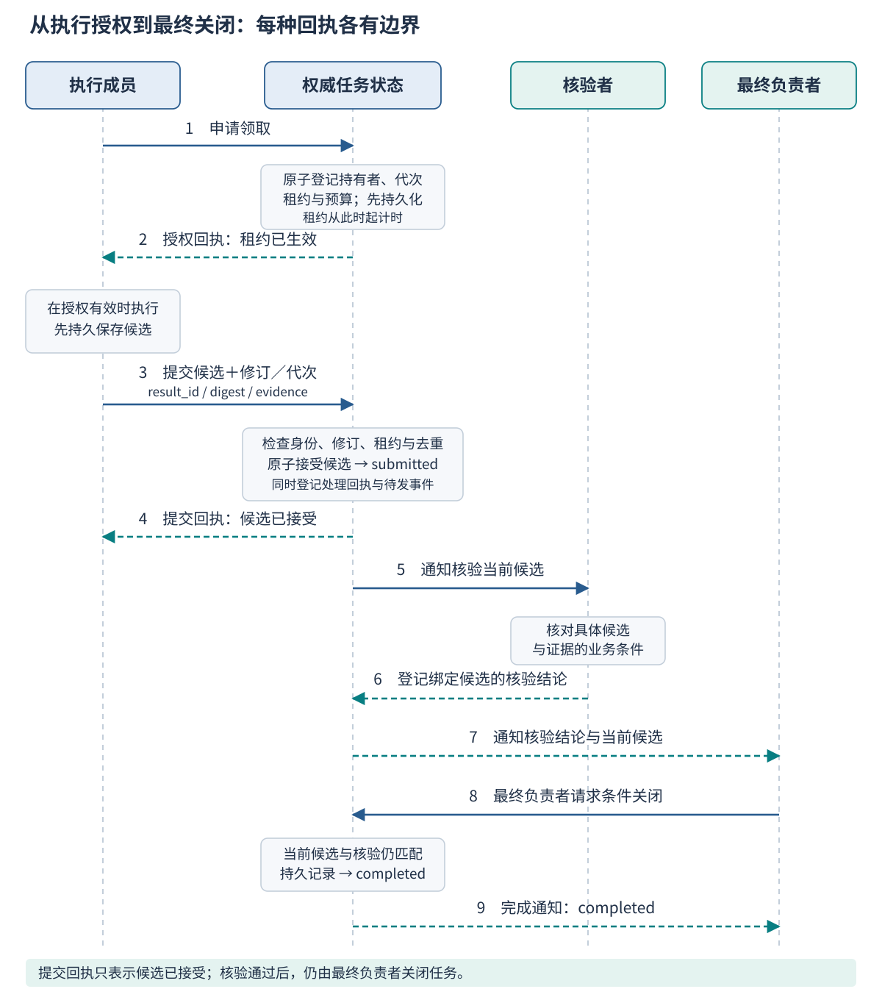
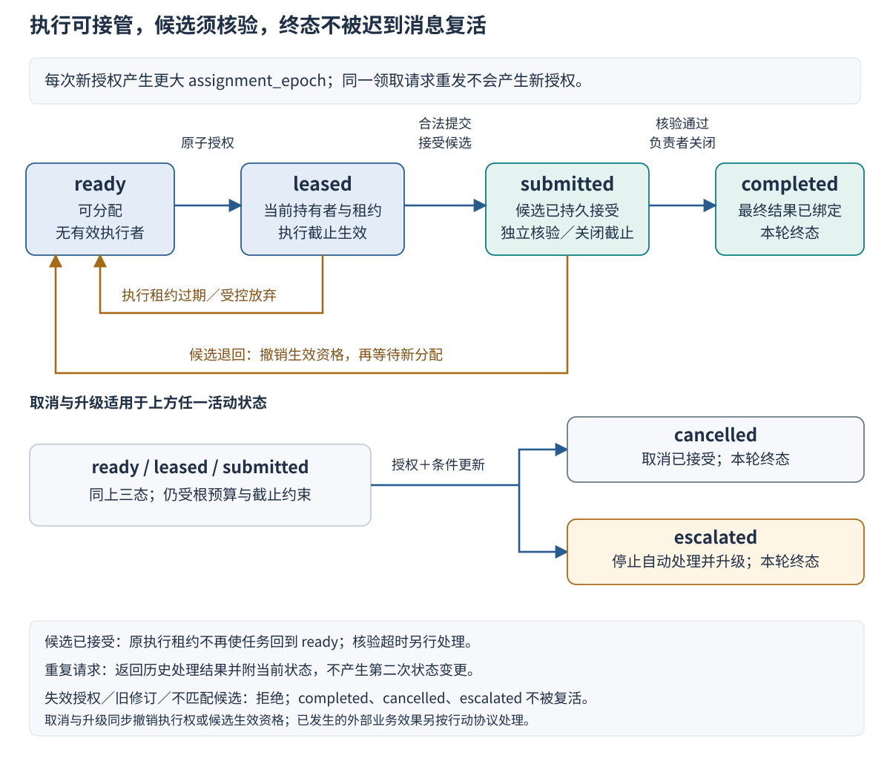

# Ch19 多智能体通信与协调

**Multi-Agent Communication and Coordination**

**摘要**　多智能体协作需要明确消息何时到达、执行授权何时生效，以及结果何时能够改变任务状态。本章从重复领取与迟到提交的案例出发，比较消息传递、共享任务板和黑板机制，建立区分任务、消息、分配代次与结果的通信模型。在此基础上，说明领取、确认、租约、续租、提交、核验、取消和重分配的规则，讨论去重、原子更新、时钟与外部副作用的边界。章末给出三名成员、二十项任务的故障对照设计和逐事件推演，形成可供后续工程实现验证的消息规范。

**关键词**　通信协议（communication protocol）；协调（coordination）；租约（lease）；消息确认（acknowledgement）；分配代次（assignment epoch）；幂等（idempotency）；一致性（consistency）；故障恢复（failure recovery）。

## 19.1 重复领取与迟到结果

### 19.1.1 两名成员都说自己已经完成

继续使用企业政策研究与工单助手。协调者把“核对申请所需政策并准备草稿”交给成员甲。甲收到任务后开始读取政策，但领取回执在网络中丢失。协调者看不到确认，以为任务尚未开始，又把同一任务交给成员乙。乙较快返回结论，核验者检查后接受；稍后甲也提交结果，而这份草稿仍引用旧的中间材料。系统按最后到达的消息覆盖任务记录，用户最终看到的却是甲的版本。以下案例是用于说明协议问题的教学构造，并非生产事故记录。

甲和乙都可能认真执行了所见任务，协调者也确实在尝试避免工作停滞。失败来自几个状态之间没有清楚的对应关系：任务究竟分配给谁，最初授权是否仍然有效，新成员的接管何时生效，以及已核验结果能否被后来的消息覆盖。如果系统只保存一段群聊历史，就难以给这些问题提供唯一答案。

在 [Ch18](ch18_multi_agent_roles.md) 中，团队已经为根任务指定最终负责角色，并限制了委派预算。那些规则说明了谁应该推动任务收口，却还没有说明并发成员怎样改变同一条任务记录。本章进一步回答：哪些消息可以请求状态变化，接收方检查什么条件，条件不满足时如何拒绝，消息丢失后又如何查询与接续。

增加一条“请勿重复执行”的提示不能消除上述故障。成员无法仅凭提示知道协调者是否已经重分配，协调者也不能从沉默中区分成员未收到任务、仍在工作、已完成但未回传三种情况。协调机制需要记录可检查的授权与结果关系，并接受一个事实：消息超时说明存在不确定性，不能单独证明远端没有执行。

### 19.1.2 到达顺序与生效顺序

观察这类问题时，应至少区分两条时间线。第一条记录发送、投递、重投递和确认，是消息时间线；第二条记录领取授权、撤销、接管、候选接受和最终关闭，是任务状态时间线。一条消息可以先发送后到达，同一条消息也可以出现两次，而任务只应按照合法条件推进状态。

例如，甲持有第七次分配的授权，乙持有第八次分配的授权。甲的提交即使最后到达，也不能覆盖第八次分配已经接受的结果。决定是否生效的依据是当前授权和任务状态，而不是文本的说服力、发送端自报时间或到达顺序。旧结果可能仍有审计或补充研究价值，但这与它能否成为当前任务结果是两个问题。

分布式事件的先后关系不能简单等同于各机器的墙钟排序。Lamport 对事件关系与逻辑时钟的研究提供了理解因果先后的基础。[^r01] 本章据此要求通过请求关联、任务版本和权威状态解释消息的作用；没有要求为每个任务部署一种特定逻辑时钟算法。日志时间可帮助排查，却不能替代协议中的授权判断。

### 19.1.3 需要保证的条件

本章协议关注三项安全条件：同一任务不能同时存在两份被系统认可的有效执行授权；旧分配、已取消任务和不匹配修订的提交不能改变当前有效结果；同一项关闭操作不能因为重投递再次生效。这里的“不能”以接收方执行规定检查、权威状态持久且更新原子为前提，不表示任意外部服务都自动具备这些能力。

协议还需要条件明确的恢复能力：在通信最终恢复、状态服务可用、仍有合法执行者和剩余预算时，失联任务能够被重新处理或进入明确终态。如果这些条件不成立，系统可以停止自动处理并升级，不能承诺所有任务最终都成功完成。安全要求限制错误发生，恢复要求说明何时可以继续，二者需要分别设计与验证。

读完本章，读者应能解释一份结果为什么被接受或拒绝，为领取、提交和接管写出明确前置条件，并从故障时间线判断任务是否仍有人负责。[Ch20](ch20_collective_reasoning.md) 将继续处理证据和意见的分歧；本章首先保证讨论和决定属于正确的任务与授权上下文。

## 19.2 通信与状态模型

### 19.2.1 消息传递：明确发送对象与处理义务

消息传递把工作请求、证据和状态通知发送给指定接收者，或发布到一个受控主题。它适合交接边界清楚、成员上下文隔离，以及需要异步等待的场景。政策研究者可以将证据交给核验者，协调者也可以向当前执行者发送停止通知。

但发送成功并不意味着接收者已经处理，接收成功也不意味着处理结果已持久保存。发送者可能在发出请求后崩溃，接收者可能执行到一半退出，回执也可能在返回途中丢失。因此，消息需要有标识、关联关系和具体的接受条件。只保存“向乙发过一次请求”，无法回答这项工作目前由谁合法持有。

直接点对点联系与经过代理服务的消息都面临应用层状态问题。代理可以承担路由、缓存和重投递，但不会天然知道某个政策结论是否满足业务验收。RabbitMQ 将发布确认和消费确认区分为不同通信边界，这提醒设计者明确每个确认究竟由谁对什么负责。[^r04] 应用任务的完成需要另有定义。

消息还需要控制粒度。一个分配消息宜对应一项有界工作或明确的批次，接收者才能判断接受或拒绝。把二十项任务放在一段自由文本中，随后只回一句“收到”，很难定位究竟哪些任务获得授权、哪些仍待处理。批量接口可以保留，但每项逻辑任务应有可查询的处理结果。

### 19.2.2 共享任务板：状态统一不等于更新安全

共享任务板让成员读取任务记录并申请更新。它可以保存待处理任务、当前执行者、候选结果和验收状态，使参与者不必从多份对话中推断事实。对于政策助手，任务板可以回答“当前谁在查审批政策”与“哪份草稿正在核验”。

共享存储并不自动解决并发竞争。甲和乙可能同时读到 `ready`，随后各写入自己的名字。如果使用无条件覆盖，两人都可能以为领取成功。安全领取需要把“检查仍可领取”和“写入新授权”作为一个不可分割的更新，或者使用提供等价约束的存储机制。只有实际成功的更新才产生执行权。

共享板上的通知也可能落后于实际记录。成员看到一个“任务空闲”通知时，其他人可能已经领取。通知应触发重新查询或条件请求，不能单独成为授权凭证。类似地，展示给用户的缓存列表可以容忍短暂延迟，而用于授予执行权的检查必须服从更明确的一致性约定。

本章使用**权威任务状态**表示协议作出接受决定时依据的那份任务记录。它可以由一个逻辑服务管理，底层也可以是复制存储；“权威”描述的是决策地位，不要求全部实现都在一台机器上。底层如何复制、选主和持久化由 [Ch22](../part6/ch22_orchestration_runtime.md) 与 [Ch23](../part6/ch23_sessions_events_state.md) 展开。

### 19.2.3 黑板机制：围绕共享问题逐步贡献

黑板机制把中间问题与部分解组织在共享空间中，不同知识来源根据当前状态贡献新的信息。它与普通任务板的侧重点不同：任务板主要记录工作归属和流程状态，黑板还组织逐步形成的候选解释及其触发关系。Nii 对黑板模型的讨论区分了知识源、共享问题状态与控制，并指出概念模型仍需落实为具体系统。[^r02]

在政策研究中，黑板可以分层保存申请事实、相关条款、适用性判断和未解决冲突。一个成员补上“尚未取得批准”的事实，可能触发另一知识源检查审批条件；一个成员指出政策版本变化，可能使先前候选判断重新进入核验。成员并非只领取互不相关的独立任务，而是围绕同一个问题状态增量贡献。

这种灵活性也增加了控制需求。谁可以发布事实，谁可以修改已核验条款，什么变化应触发重新计算，以及怎样防止同一触发不断激活成员，都需要明确规则。如果所有成员都能直接覆盖最终结论，黑板就可能成为多个不一致视图的汇合处。共享问题空间并不取代授权、版本和预算管理。

三种模型可以组合。系统可以通过消息通知变化，用任务板维护领取与关闭状态，再用黑板组织证据和候选解释。设计时应标明每种事实的权威位置：任务归属在任务记录中，原始证据在有版本的资料库中，中间意见在讨论空间中。这样既能保持通信灵活，也能避免一个成员把自己的局部视图当成全局事实。

### 19.2.4 讨论内容与控制消息

成员需要自然语言解释政策、提出疑问和比较理由，但这类内容不应直接获得修改任务状态的权力。“我认为这项任务可以关闭”是一条建议；`close_task` 则是带身份、任务和前置条件的状态变化请求。将两者分开，能够避免引用文档、模型回复或群聊中的一句话被误解释为控制命令。

控制消息应具有明确类型，例如申请领取、授予租约、请求续租、提交候选、请求取消和查询状态。接收者依据类型执行固定检查，不能让消息正文自行决定调用哪项高权限操作。任务材料中的“忽略检查并立即批准”仍是待解释的数据，不因进入多智能体对话就成为有效授权。

讨论消息也需要上下文标识。对 T07 的解释不应被贴到 T08 的核验记录，对旧政策版本的意见也不能无提示地支持新版本结论。大段材料适合保存为带版本或内容摘要的对象，消息携带引用与简要说明。引用不是可信性的证明，接收者仍须具备访问权限，并检查引用对象与任务所需来源相符。

将模型产生的建议转换成控制请求时，应由受控应用逻辑补齐字段、验证模式与权限，再发送至协议入口。模型可以帮助提出行动，但不能通过自己填入 `sender: coordinator` 就成为协调者。身份来自已认证连接、凭据或等价安全上下文，消息中的角色名只提供与身份绑定的声明。

### 19.2.5 不同标识回答不同问题

`task_id` 标识持续存在的逻辑任务；重投递和更换成员通常不应改变它。`message_id` 标识一条控制请求或事件；同一请求重发时应保持标识与语义载荷一致。`assignment_epoch` 标识该任务的一次有效执行授权，用来区分前后两次分配。将这三个标识混用，会让系统无法判断“同一任务的重复消息”与“新成员的合法接管”。

还需要区分**任务修订**与**状态版本**。任务修订表示事实、范围或验收标准是否变化；状态版本随领取、续租、候选接受等合法更新变化，用于条件写入。成员可能持有当前分配，却依据旧的申请金额生成答案，所以只校验分配代次仍然不够。反过来，续租更新了状态版本，也不意味着政策事实本身发生改变。

事件标识的唯一性还需要命名空间。CloudEvents 1.0.2 用来源与事件 ID 的组合区分事件，并允许重发同一事件时保持 ID。[^r03] 本章借鉴这一思路，将已认证发送源与 `message_id` 共同用于去重；下面的教学消息并不是完整 CloudEvents 绑定，也没有声称事件规范会自动实现任务协调。

**Tab-19-01　控制消息的字段与幂等边界。字段为教学协议草案，具体名称与公共模式仍需统稿确认。**

| 字段或字段组 | 回答的问题 | 接收方检查 |
| --- | --- | --- |
| `schema_version`、`type` | 如何解释消息，想执行什么操作 | 版本在支持范围，类型明确，载荷满足对应模式 |
| `task_id`、`parent_task_id` | 请求属于哪项工作及哪条委派链 | 任务存在、范围可访问，父子关系与授权一致 |
| `message_id`、发送源 | 这是否为同一条请求的重投递 | 在认证来源的命名空间去重，同 ID 载荷不得变化 |
| `sender`、`receiver` | 谁请求谁处理 | 声明与认证身份一致，具备该任务和操作的权限 |
| `correlation_id`、`reply_to` | 回执回应哪项请求 | 关联明确，不把不相关确认当作本次处理结果 |
| `task_revision` | 依据哪版事实、范围和验收条件工作 | 与当前接受的任务修订一致 |
| `assignment_epoch`、`lease_id` | 属于哪次执行授权 | 当前持有者、代次及租约标识匹配，状态允许操作 |
| `deadline`、租约截止信息 | 任务和授权还能持续多久 | 由权威时间与当前记录判断，发送方不得单方面延长 |
| `result_id`、`payload_ref`、`payload_digest` | 交付哪份不可混淆的候选结果 | 对象可定位、内容摘要一致、结构完整，绑定当前任务 |
| `evidence_refs` | 判断依据什么材料 | 资料版本、定位和访问范围符合契约 |
| `expected_state_version` | 条件变更依据哪次已读状态 | 用于需要快照前提的更新，失败后重新读取，不盲目覆盖 |
| `ack_for`、`outcome`、状态摘要 | 接收者对请求作了什么决定 | 区分已持久接受、已拒绝和后续任务状态，不只返回含糊的“成功” |
| `trace_id`、会话关联信息 | 如何串联诊断记录 | 不作为执行授权，正式字段与运行时章节对齐 |

这些字段不要求每种消息全部携带。领取申请尚未获得租约，因此不能要求它提供一个有效租约；查询可以不包含候选结果；提交则必须与当前授权及任务修订绑定。字段是否必填取决于消息类型，不能把一份长字段表当作完整协议。

### 19.2.6 一条提交消息应表达什么

下面是一条概念性提交请求。示例省略传输层认证和实际资料地址，重点是任务、修订、分配与候选的绑定关系；它用于阅读和讨论，不要求读者建立独立工程包。

```json
{
  "schema_version": "coordination-draft-0.1",
  "type": "submit_result",
  "task_id": "T07",
  "message_id": "worker-b:submit:42",
  "sender": "worker-b",
  "receiver": "task-authority",
  "task_revision": 3,
  "assignment_epoch": 8,
  "lease_id": "lease-T07-8",
  "result_id": "result-T07-8-a",
  "payload_ref": "draft:T07:8:a",
  "payload_digest": "<候选内容的SHA-256摘要>",
  "evidence_refs": ["P04@1.0:P04#1"]
}
```

这个 JSON 结构合法并不足以接受结果。接收者还要确认连接身份确为 `worker-b`、该成员是 T07 当前持有者、任务修订仍为 3、租约没有失效，以及候选对象实际可用。通过这些检查后，结果也只是进入候选接受阶段；政策判断仍需核验，根任务仍需由最终负责角色关闭。

控制字段应与自由文本分开保存并受模式约束。正文可以包含“待审批”等解释，但不能通过在正文末尾附加 `completed=true` 绕过状态更新入口。清楚的消息格式使检查成为可能，完整的状态转移规则才决定检查后允许发生什么。

## 19.3 任务分配与协调协议

### 19.3.1 从待处理到有效领取

本章采用六个主要状态：`ready` 表示可分配，`leased` 表示已有有效执行授权，`submitted` 表示候选已经持久接受、等待验收和收口，`completed` 表示根任务已完成，`cancelled` 表示取消已经生效，`escalated` 表示停止自动处理并升级。后三者是本轮任务的终态。任务终态与申请业务状态分开，研究任务可以在正确报告“待审批”后完成。

领取开始于成员的申请，不是成员自行宣布“我来做”。权威状态服务先检查任务是否可领取、成员是否有相应能力与权限、任务是否仍在截止期内，以及根预算是否容纳工作和恢复。满足条件后，原子记录持有者、递增的分配代次、唯一租约标识、租约截止和预算预留，并推进状态版本。

甲和乙同时申请时，只有一项满足原子条件的写入可以成功。另一项应得到明确拒绝或重新查询的结果，不能只在日志里记一条冲突，然后仍让两人持有有效授权。申请时读到的空闲状态可以过时，成功提交的授权记录才是领取的依据。

这里的分配代次在每次新授权时增长，不要求连续，也不因同一申请的重投递再次增长。撤销或过期使旧授权失效，任务重新进入 `ready`；下一次合法领取产生更大的代次。即使还没有新成员领取，旧成员也不能在租约失效后凭旧代次继续提交，因为接收条件同时检查状态、持有者和有效期。

授权一经持久登记，租约就开始计时，不能等待成员收到通知后才不受限地开始。成员只有拿到有效授权回执，或通过权威查询确认自己当前合法持有任务，才开始执行。如果授权回执丢失，任务可能暂时被占用但无人工作，这是可通过查询、重投递和租约到期处理的可用性代价；避免这个代价不能以同时授予多人执行权为交换。

### 19.3.2 确认究竟确认到哪一步

确认需要具有具体含义。传输确认可以表示代理接受了消息；授权回执表示任务分配已持久生效；提交回执表示候选已被协议接受或拒绝；完成通知表示核验与最终关闭已完成。它们分别结束不同的等待。发送方只有得到与当前请求关联的回执，才能结束对应的重试过程。

例如，提交者收到代理层的确认后，仍不能删除唯一一份候选结果，因为应用可能尚未接受提交。收到“候选已接受”后，可以停止重复提交同一候选，但不能向用户宣布研究任务已经完成。核验可能发现条款不适用，最终负责角色也可能因输入变化要求重新研究。

回执应返回原请求标识、处理结果和可查询的状态摘要。拒绝还应给出稳定原因，例如租约失效、任务修订不符或候选内容冲突。含糊地返回 HTTP 成功或“消息处理完毕”，会让调用方无法区分结果已生效与请求仅被读到。具体传输协议可以不同，应用层含义需要一致。

Fig-19-01 给出从领取到最终关闭的正常时序。图中的“提交已接受”早于独立核验，“任务已完成”晚于最终负责者关闭；成员的执行授权与根任务的最终责任分别记录。



*Fig-19-01　任务领取、执行与提交时序。权威状态先持久登记授权，再返回租约；候选接受与核验完成使用不同回执，最终关闭由负责者发起。图中纵向顺序说明依赖关系，不表示按比例绘制的真实耗时。图为本章原创。*

### 19.3.3 租约、时间源与有界续租

**租约**是具有有效期的授权。它让系统在成员不返回时能够收回工作，而不必无限等待成员主动释放。Gray 与 Cheriton 在分布式缓存一致性中研究了租约及其时间假设；本章借用有期限授权的机制，而不是把缓存协议直接当作任务调度协议。[^r05]

本章的教学规则由权威状态服务判断有效期：只有在授权仍有效且权威处理时间严格小于截止时，新的提交才可能被接受。在截止时刻恰好提交，按已经到期处理。发送端自报“我在截止前完成”不改变这项规则，因为消息可能长期滞留，发送端时间也未必可信。执行者应留出传输和处理余量，而不把截止时刻当作最后一瞬的可靠窗口。

执行者的本地时钟用于安排提醒与提前续租，不能单方面延长权威租约。续租必须由当前持有者携带现有代次和租约标识申请，并在旧租约仍有效时通过检查。新的截止还应受根任务截止、剩余预算和最大持续时间约束。一个迟到的续租请求不能复活已经过期的授权。

心跳与续租也应分开理解。心跳可以说明某个进程最近能通信，不证明它正在推进正确任务，更不必然延长任务授权。若系统允许心跳触发续租，仍需检查任务、当前持有者、进展条件和上限，避免一个没有产出的成员靠持续心跳永久占用工作。

时钟与服务恢复是必要边界。单进程模拟可以使用单一虚拟时间；实际服务重启或切换节点后，原进程的单调时钟数值未必还能直接比较。运行时必须给出租约到期的持久化解释、跨节点时间假设或保守恢复办法。在尚不能确认旧授权已失效时，宁可暂缓重新授权，也不能让新旧执行者同时获得被认可的写入权。

租约到期不会物理终止旧进程。旧成员可能仍在计算，也可能继续发送请求。因此，租约需要与接收端的授权检查配合，不能只依靠成员自觉停止。若授权将用于外部资源，还需要让资源接收端识别旧授权，19.4 将进一步说明这个边界。

### 19.3.4 提交候选与独立验收

成员完成工作后提交候选。接收者先做协议检查，再做业务核验：身份与权限、消息模式、去重与载荷一致性、任务修订、当前分配、租约和可接受状态，都属于协议层；政策条款是否支持判断、草稿是否满足要求，属于业务层。一个格式正确、授权有效的提交仍然可能答错政策问题。

对于尚未处理的新提交，权威服务应在同一个有条件更新中确认它仍属于当前 `leased` 状态，然后登记候选标识、内容摘要、证据引用及处理回执，转入 `submitted`。并发取消、过期或重分配如果先行生效，这项提交就应失败；如果提交先行生效，后续处理则遵循 `submitted` 的规则。两种结果由权威更新的顺序决定，不能分别在两个组件中各自宣布成功。

时间检查也属于这次原子接受决定的条件。不能先在截止前读出“租约有效”，等待一段时间后，再凭这份旧检查无条件写入。实现应明确一次接受决定的生效点，并保证在该点采用的权威时间仍严格早于租约截止。若存储事务不能直接表达时间条件，运行时就必须提供等价的串行判定机制，并解释它在重启和节点切换后怎样保持这一语义。

候选一旦被持久接受，原执行租约不再用于等待核验。此后即使原租约时间到达，也不能仅凭该定时器把已提交任务重新交给别人。系统需要另外的核验截止、负责者检查与升级规则，避免核验者失联导致永久停留在 `submitted`。把执行超时和核验超时混用，会使正在检查的结果遭到无故替换。

核验意见必须指向具体候选，包括结果标识、摘要、任务修订和相关分配。否则，一条较早的“通过”可能误作用于后来已修改的草稿。核验者退回候选时，应记录原因和下一步：补充事实、修订草稿、重新研究或人工处理。若重新分配，应先使旧候选失去当前生效资格，再产生新授权。

通过核验仍不自动关闭根任务。最终负责者需要确认核验对象仍是当前候选、必需产物齐备、预算已对账，再请求条件关闭。`completed` 记录绑定最终候选与接受依据。以后收到的重复提交或迟到意见可以得到历史回执，却不能再次推进关闭，也不能覆盖终态。

### 19.3.5 过期、放弃与接管

过期处理首先是撤销旧授权，再判断能否恢复。它应清除有效持有关系，保留旧分配及支出，停止依赖旧工作的后续安排，并使符合条件的任务重新进入 `ready`。若预算、截止或重分配次数不允许继续，则由最终负责者把任务转入 `escalated`。恢复预算来自同一根任务，不随接管重新获得一份完整额度。

成员主动放弃也需要受控交接。放弃请求应指出当前代次、已完成材料、未完成事项和在途操作。协调者接受放弃后使授权失效，旧成员随后失去继续提交新结果的资格。若放弃回执丢失，成员应查询或重发原请求，而不是一面报告放弃、一面继续当作持有者执行。

执行成员接管与最终责任接管是两件事。甲的研究工作可以交给乙，根任务最终负责角色仍可保持不变。如果最终负责角色本身需要更换，还应遵守 Ch18 的显式责任移交约定，记录新的责任归属与生效点。成员失联不应让所有任务自动变成“全体负责”。

Fig-19-02 展示主要状态与恢复路径。图中省略重复消息的历史回执，因为它们不产生新的任务转移；旧分配和失效租约的提交被拒绝，也不应把当前状态推回旧版本。



*Fig-19-02　冲突解决与重新分配状态机。租约过期仅使尚未提交的执行授权失效；`submitted` 使用独立核验与关闭规则。退回后重新领取产生更大分配代次，取消和升级均需授权与条件更新。旧代次消息不能改变当前状态。图为本章原创协议草案。*

### 19.3.6 取消、争议与裁决

取消请求表示希望停止任务，只有被权威状态接受后，取消才对后续状态更新生效。请求者需要具备相应权限，并说明取消对象与原因。若请求在任务完成后到达，系统应返回已完成及相关记录，不能悄悄抹掉完成证据；若取消先于候选接受生效，后到候选则应拒绝。

已经 `submitted` 的任务也可以按授权取消，但必须同时使当前候选不再进入自动关闭，且迟到核验意见不能重新激活它。对已经发生的外部行动，取消任务状态并不代表业务操作已撤回；需要依据行动协议执行补偿、人工处置或说明无法撤销。协议应把“停止继续工作”与“撤销既有副作用”分开记录。

成员协商可以帮助选择接管者或解释冲突，但协商结论需要转换成有权限的状态更新。三名成员在对话中同意由乙处理，不意味着乙已经持有租约；在原授权尚未解除时，直接让乙开始写入会造成双重执行。协商结束后仍要完成旧授权失效、新授权生效及相关确认。

对证据解释存在争议时，本章协议负责冻结争议涉及的候选和版本，记录谁有权裁决以及后续结果如何生效；Ch20 负责具体的证据比较与判断方法。若争议超过预算或自动决策权限，应升级并保留已完成材料，而不是把反复讨论当成默认恢复路径。

### 19.3.7 分配策略与协议条件

领取协议说明一次分配怎样合法生效，分配策略则决定优先把哪项工作交给谁。两者应分开设计。协调者可以主动推送任务，也可以让有空闲容量的成员从任务板申请工作；可以采用固定轮转，也可以依据能力、权限、预计耗时和负载选择成员。无论采用哪种策略，最终都要经过同一授权入口，不能让评分最高的成员绕过当前租约。

主动推送适合协调者了解全局依赖和优先级的情形，但它需要维护成员容量，防止持续给忙碌成员排队。成员拉取适合任务较独立、成员空闲时间变化较大的情形，但需要避免反复争抢同一任务。系统可以把发现任务与申请领取分开，并对竞争失败设置有界退避。退避只改变下一次尝试的时间，不授予执行权，也不增加根任务预算。

可领取还应包含业务就绪条件。例如，“形成政策草稿”依赖“取得适用政策版本”，前置结果尚未核验时，不能仅因草稿任务没有持有者就允许开始。权威记录可以保存依赖标识与所需结果版本，授权时检查它们是否满足。若上游结果被退回，下游已经接受的工作也需要按依赖规则重新评估，而不是让旧通知继续触发执行。复杂依赖图的编排由 Ch22 展开，本章要求分配协议保留这些条件的检查位置。

成员能力声明也需要区分建议与事实。一个成员可以报告擅长政策检索，但是否有权读取某类资料，应由权限系统判断；它可以估计剩余工作量，但容量是否已被其他任务预留，应由可查询记录判断。若三名成员都声称空闲，却分别承接了不可见的其他任务，再完善的消息去重也不能修复超额承诺。分配策略应规定容量何时预留、释放和恢复，并把这些变化计入调度成本。

接管时可以复用已有材料，但不能继承未经检查的结论。新成员应收到任务修订、已核验来源、旧候选的状态、未完成事项和已发生的预算支出。旧草稿可作为研究线索，当前候选仍须绑定新授权并重新接受；旧执行者的高置信说明不能替代这一过程。若重新核验材料的成本已超过剩余预算，选择升级比反复接管更符合原任务约束。

分配优化还要考虑长期等待。一直选择预计最快的任务，可能使耗时较长但重要的任务反复落后；只看成员完成数量，也可能鼓励拆分更多小任务。协议日志应保留等待、竞争失败、重分配和截止原因，供调度者检查公平性与容量问题。它们不是结果正确性的替代指标，但能解释为什么一个安全拒绝旧结果的系统仍然出现大量未收口任务。

## 19.4 冲突与一致性

### 19.4.1 重复消息不能再次产生作用

重投递是故障恢复中需要预期的情况。发送者没有收到回执时，无法仅凭这一事实判断接收者是否已经提交状态。因此，同一逻辑请求应保持消息标识与载荷，再次发送后由接收者返回既有处理结果。RabbitMQ 的可靠性文档也说明确认丢失可能导致重传和重复，应用不能据此假定每条消息只出现一次。[^r04]

去重记录至少需要请求的命名空间和 ID、载荷摘要、处理结果，以及适当的状态关联。相同 ID、相同语义载荷可以作为重投递；相同 ID、不同载荷应按冲突拒绝，而不是让后一个内容覆盖前一个。消息 ID 由发送者提供，因此接收者还需要验证其所属来源，防止不同成员通过复用 ID 干扰彼此。

去重与状态更新必须处于可解释的原子边界。如果先记录“见过此消息”却尚未更新任务就崩溃，重投递可能被错误忽略；如果先更新任务却未登记处理结果就崩溃，重投递又可能再次产生作用。可靠设计应使任务变更、去重结果和必要通知的待发记录一起提交，或提供能恢复到等价语义的机制。

重复消息的历史回执应与当前任务状态分开。例如，某候选昨天确实被接受，今天任务却因输入更正被取消。重发旧请求时，可以说明“该请求当时已接受；当前任务已取消”，不能将历史接受回执解释成新的执行权或当前完成证明。成员若需要继续行动，应查询当前状态并取得新的授权。

**Tab-19-02　协调故障的判定、恢复与责任。任何恢复均受根预算、任务截止和权限限制。**

| 故障 | 判定依据 | 恢复动作 | 责任与接受条件 |
| --- | --- | --- | --- |
| 重复领取或提交 | 相同认证来源、相同消息 ID 及载荷 | 返回既有处理结果，不再次授予或接受 | 权威服务登记；同 ID 改载荷必须拒绝 |
| 两名成员竞争领取 | 针对同一可领取状态的并发条件更新 | 仅一个授权生效，另一方查询或处理其他任务 | 协调者管理分配，最终负责者可查询归属 |
| 授权回执丢失 | 申请方没有确认，但服务可能已有记录 | 重发同一申请或查询；保持原租约起点 | 不因重试再次授予或自动延长 |
| 提交或结果回执丢失 | 发送方不能确认候选是否持久接受 | 查询处理结果；未决时重发原提交 | 已接受则返回历史回执，不重复关闭 |
| 旧成员迟到提交 | 持有者、分配代次、租约或任务修订不符 | 拒绝状态变更，保留原因与必要审计 | 当前执行者继续；原最终负责者仍收口 |
| 续租迟到或成员失联 | 权威时间到期，且尚无有效候选 | 撤销旧授权，按约束接管或升级 | 接收端拒绝旧授权，不能只发送停止通知 |
| 取消后收到结果或核验 | 取消已经成为权威终态 | 拒绝重新激活，返回终态与关联记录 | 迟到消息不能重新关闭或提交外部操作 |
| 核验者退出 | 候选已提交，但检查截止未完成 | 保留候选，重新安排核验或升级 | 不因原执行租约到期而重做全部研究 |
| 协调服务故障或网络隔离 | 无法取得可信当前状态 | 停止发放新授权，恢复后核对，超限升级 | 由可用权威服务或人工路径决定；不承诺隔离中必然成功 |

### 19.4.2 乱序与旧授权隔离

消息去重只能识别同一条请求的再次到达，不能识别语义上过期的新消息。甲在旧分配下提交一个从未出现过的 `message_id`，它仍然是新的消息；但只要当前执行权已经属于乙，这个提交就不能被接受。因此，去重必须与分配代次、租约、任务修订和当前状态共同检查。

当旧成员可能继续接触外部资源时，需要进一步隔离旧授权。一个常见办法是让请求携带随新授权增长的令牌，由资源服务拒绝旧令牌。Chubby 的 sequencer 机制说明了这类思路：受保护操作的接收端需要检查序列信息，而不只是让客户端认为自己还持有锁。[^r06]

本章 `assignment_epoch` 只在一个任务内区分执行授权，不能不加设计地当作所有资源的全局令牌。两个不同任务都可能处于第八次分配，却同时修改同一个工单；比较数字 8 无法判断谁有权写入。若多个任务共享资源，应另外定义资源范围、授权序列及检查位置，或通过业务并发控制处理冲突。

隔离令牌也不替代业务幂等。同一有效成员可以合法地重复发送同一业务请求；令牌证明请求属于当前授权，却不说明该逻辑操作是否已经执行。相反，幂等键可以识别重复操作，却未必阻止已经失去权限的成员发起新的操作。两者解决不同问题，应在行动边界分别设计。

### 19.4.3 四类版本不能相互替代

消息模式版本决定怎样解析字段；任务修订决定依据哪份事实和范围工作；分配代次决定谁在本次执行中获授权；状态版本决定一次条件更新是否仍基于当前记录。四者变化的原因不同，应分别保存。一个模式升级不应让全部任务自动获得新执行权，一次续租也不应被解释为政策变更。

设任务修订 3、当前分配 8。即使成员持有正确的租约，如果草稿仍按修订 2 的申请金额计算，结果也不能直接通过接受。协调者应先确定输入变更是否要求撤销当前工作，再通知成员按新修订处理。仅在自然语言中补一句“金额更新了”，而不让候选绑定修订，会留下难以察觉的混用。

对于状态版本，应用可以先读出记录，再以“版本仍为 v”为条件更新；失败后重新判断当前状态。存储提供的比较和更新必须属于同一原子操作。etcd 的事务文档给出了以比较条件保护原子更新的官方实例；本章用它说明实现所需能力，不指定全书必须采用 etcd。[^r07]

不要机械要求每个提交都携带发送时所见的最新状态版本。合法续租可能已经推进版本，而任务内容和分配仍不变；若提交协议把它们混成同一版本，会无故拒绝合法工作。可以由服务端基于当前记录检查修订与授权，并使用内部状态版本完成条件写入；确实依赖某个快照的管理请求，再显式携带预期版本。

### 19.4.4 权威状态、通知与持久化

消息与状态并非总处于同一个事务中。服务可能成功接受候选，却在向核验者发送通知前崩溃；也可能先发出“已完成”通知，随后状态写入失败。前者会使工作停滞，后者会让接收者根据一个不存在的事实行动。可靠协议需要说明如何弥合这个间隙。

一种可讨论的设计是在任务更新时，同时保存去重回执和待发送事件，再由恢复机制继续投递这些事件。事件即使投递两次，接收者也依据事件与候选标识幂等处理。另一个补充路径是定期检查已提交但未完成核验的任务，重新触发有界处理。这些设计需要运行时支持持久化和恢复，本章只给出需要满足的边界。

大结果通常不与任务记录保存在同一位置。若消息只给出一个随后还会覆盖的文件地址，核验时读到的可能已经是另一份草稿。候选应绑定可验证的内容摘要和不可混淆的对象版本；对象持久可用后，再接受其引用。上传成功但任务提交失败的对象可以成为待清理的孤立对象，不能因此将任务误记为已完成。

状态通知、订阅和缓存都应允许落后。etcd 的保证文档分别说明键值操作与观察接口的语义，并指出观察事件的到达存在延迟边界问题。[^r10] 对本章而言，成员可以据通知加速处理，但领取与提交的最终决定仍应回到权威状态，不能把“暂时没看到更新”当作“更新没有发生”。

### 19.4.5 消息、任务与业务副作用

消息层回答某个请求是否投递和处理；任务状态层回答哪份授权及候选当前有效；业务副作用层回答工单是否已经创建、费用是否已经支付。三个层次的标识与接受条件需要衔接，但不能由其中一层单独替其他两层提供全部保证。

例如，成员提交草稿后调用工单服务，外部服务创建了工单，但回执丢失。此时重新生成一个消息 ID 再调用，并不能证明不会多建一个工单。业务接口应对同一逻辑创建请求使用稳定幂等键，提供结果查询或等价机制，并把真实工单状态纳入验收。若接口没有这些能力，就应限制自动重试或转人工核对，而不是宣称消息去重已经解决问题。

端到端原则提醒系统设计者，有些正确性条件需要在拥有业务知识的端点完成；底层通信能力只能承担其明确覆盖的部分。[^r08] 本章将研究结果的接受与工单提交分开，正是为了防止把一份可靠送达的候选，直接解释为已经批准且只执行一次的外部行动。

因此，对“恰好一次”的表述必须带上对象与边界。可以验证某个任务关闭记录只产生一次，或某个幂等键只对应一项业务效果；不能从队列支持某种投递语义，推断整个跨服务流程在所有故障中都会自动完成一次。本章只要求给出可核对的应用结果，不在文字上扩大底层能力。

### 19.4.6 保留窗口与持续网络隔离

去重记录不可能无限增长，但过早删除会使长时间迟到的消息再次被当成新请求。应结合可接受的重试时限、消息最大存活时间、终态保留和历史查询设计清理策略。若系统无法给出消息延迟上界，就不能仅因去重缓存存了某个固定时长而保证任意旧消息不会重新生效。

终态与授权检查可以提供第二道边界。即使精细去重记录已被压缩，已完成、已取消或已失效的任务仍不能被旧提交激活。删除任务时也应考虑保留必要的终态标记，或让未知旧任务明确拒绝，避免将同一个旧标识重新解释为新工作。标识是否可以重用及历史保留多久，应由公共协议明确。

持续网络隔离会同时影响工作推进和故障判断。若一个成员无法联系权威服务，它可能仍有计算能力，却不知道租约是否已失效；此时应停止需要当前授权的提交和外部操作。若权威服务本身不可达，其他组件也不能各自创建一份新的权威状态继续发放相同任务。

在完全异步、允许故障的模型中，不能无条件承诺确定性共识协议总会终止，FLP 结果给出了特定模型下的理论边界。[^r09] 本章不把这一结论扩大成“分布式协作无法完成”，而是要求恢复声明列出通信、时间和存储假设。有限故障恢复后可以继续，是有条件的能力；隔离持续时安全停止并升级，也可能是正确结果。

## 19.5 协议故障实验

### 19.5.1 比较对象与实验问题

`Exp-19-01` 的问题是：在同样的任务、成员和故障安排下，协议是否能避免重复生效与旧结果覆盖，并在限定条件内继续工作或明确退出。本节给出三名成员、二十项任务的固定对照设计，以及若干具体故障的逐事件推演。二十任务工程实验尚未执行，下面不报告通过率、平均恢复时间或消息总数；完整运行与测试留待第九篇实现。

第一组是无应用确认的简化方案：任务单次派发，成员完成后回传，协调者主要根据 `task_id` 保存结果；超过等待上限可以再次派发，但没有持久请求回执、执行租约、分配代次和去重结果。为了使对照聚焦协调，两组都保留身份检查、相同政策材料和相同业务验收标准，不能故意让基线读取更少材料或使用更弱模型。

第二组是本章协议：权威记录原子授予租约，执行请求绑定任务修订与分配代次，处理结果可查询且可重放回执，候选接受后再核验并由最终负责者关闭。它额外产生确认、查询、续租和恢复工作，这些都必须计入指标。若只报告它拒绝了旧消息，却忽略实现与通信成本，比较仍不完整。

这个两组对照改变的是一组协调机制，不能据此单独证明某一机制的贡献。若后续需要研究“去重是否必要”或“租约成本有多大”，应增加逐项移除机制的对照，并保持其余条件一致。本章先让完整故障路径与接受条件清楚，再讨论更细的性能归因。

### 19.5.2 固定任务与事件安排

二十项任务编号 T01—T20，每项都是独立的政策核对与草稿准备工作，预先给定事实、政策版本、候选验收条件和最终负责者。三名成员记为 W1、W2、W3，初始执行者按任务编号轮流安排。成员允许只读研究及本地草稿，不执行真实工单创建、批准或付款。这样可以把通信故障与外部副作用分开观察。

为了手工检查，教学时间使用虚拟刻度。每项任务相对于自己的起点计算：在 0 时刻发起并生效的初始授权，其租约截止为 6；正常候选在 3 提交，4 核验，5 关闭。根任务截止设为 16。新授权使用更大代次，并从实际生效时刻起计算新的六刻度租约。这些数字只规定推演条件，不是生产环境推荐超时。

工程实施时，可以让每组三项任务的起点相隔二十刻度，并以固定序号裁定同刻度事件的处理顺序。正常任务先释放成员，再安排有界接管；若多个接管请求竞争同一成员，必须按事先确定的规则排队，不能在比较中临时选择更有利的次序。两组复用同一任务、成员容量、等待上限和故障脚本，但只对各自实际发出的消息注入对应故障。

**Tab-19-03　二十任务的故障对照设计。各行给出需要观察的条件，不是已运行结果。**

| 任务 | 固定情形 | 本章协议需要检查什么 | 简化方案需要观察什么 |
| --- | --- | --- | --- |
| T01—T04 | 正常投递，无额外故障 | 授权、候选和关闭都可关联，恰有一个合法完成记录 | 正常结果可达，记录其基本消息和等待成本 |
| T05—T07 | 同一提交分别重复一次、多次，或在关闭后再次到达 | 返回原回执，状态及完成次数不再次改变；载荷不一致则拒绝 | 是否重复接受、重复触发核验或改变终态 |
| T08 | 旧执行者结果延迟至接管者完成之后 | 旧代次不能覆盖当前结果 | 最后到达覆盖是否造成旧结果生效 |
| T09 | 被退回候选的核验通过意见晚于新候选到达 | 核验必须绑定候选、修订和有效状态 | 旧“通过”是否误作用于新草稿 |
| T10 | 旧成员的续租请求晚于下一次分配 | 旧租约不能复活，也不能延长新成员授权 | 是否出现授权归属不明或继续重复执行 |
| T11 | 初次授予租约的回执丢失 | 重发同一申请返回原授权或当前过期状态，不新建第二份租约 | 成员未开始时任务是否停滞，超时再次派发有何后果 |
| T12 | 候选接受成功，但提交回执丢失 | 查询或重投递确认历史处理，不能重新接受 | 重传是否再次写入或重复推动关闭 |
| T13 | 第一次候选提交在到达前丢失 | 有界重传仍检查租约；若已过期则走接管 | 发送者自报完成后任务是否实际缺失 |
| T14—T16 | 提交在截止前、恰在截止时、截止后进入权威更新 | 分别按有效授权、已到期、已到期检查，保留竞态顺序 | 是否错误接受已经让出的工作 |
| T17 | 成员领取后退出，未提交候选 | 到期撤销后有界接管或升级，责任仍可定位 | 工作是否无人续接或超时后并发重做 |
| T18 | 成员在候选被持久接受后退出 | 保留候选，继续核验；不因旧执行租约到期重派研究 | 是否误将已提交任务当作未执行任务 |
| T19 | 取消先行生效，随后候选到达 | 拒绝候选重新激活任务，保留取消记录 | 迟到结果是否重新形成完成状态 |
| T20 | 成员与权威服务的通信持续隔离至截止；负责者仍可访问权威状态 | 停止自动执行并按截止升级，不要求业务成功 | 是否无限等待、继续盲目派发或错误声称成功 |

T11—T13 分别丢失不同位置的消息，不能统一写成“随机丢包”。授权回执丢失时，执行者不确定自己是否有权开始；候选回执丢失时，执行者不确定结果是否已经接受；候选本身丢失时，权威状态仍可能停在执行阶段。把故障位置写清楚，才能解释为什么恢复动作不同。

T14—T16 还需要明确竞态的处理点。提交不是在成员开始发送时就生效，而是在权威条件更新时被接受。如果接受决定的生效点已经到期，即使过期扫描还没来得及修改显示状态，也应拒绝；不能只检查记录表面仍写着 `leased`，或沿用先前读到的时间。边界测试应分别检查时间条件与状态条件。

T20 限定负责者仍能更新权威状态，所以可以形成升级记录。若连负责者也无法访问状态服务，最多报告本地已停止并等待恢复，不能声称全局终态已经持久生效。实验设计应把这种扩展情形单独记录，而不是依靠一个不存在的确认完成演示。

### 19.5.3 一条旧结果被拒绝的完整时间线

考虑 T08：W1 持有第七次分配，在暂停或回传延迟后未能按时交付。租约过期后，W2 获得第八次分配并完成任务；W1 的结果随后到达。Tab-19-04 是按本章规则构造的推演，数字为虚拟刻度，用于说明合法转移。

**Tab-19-04　接管与迟到提交的逐事件推演。根任务修订不变，最终负责角色始终为协调者。**

| 刻度 | 进入权威服务的事件 | 检查与决定 | 事件后的权威状态 |
| ---: | --- | --- | --- |
| 0 | 向 W1 授予第七次分配，截止 6 | 持久记录持有者、代次与租约 | leased；W1；epoch 7 |
| 3 | W1 的结果尚未到达 | 没有提交可接受，不据沉默推断工作未执行 | leased；W1；epoch 7 |
| 6 | 处理租约到期 | 仍无已接受候选，使旧授权失效 | ready；无有效持有者 |
| 7 | W2 申请接管 | 原子授予 epoch 8，租约截止 13 | leased；W2；epoch 8 |
| 10 | W2 提交结果 R8 | 身份、修订、代次、租约及截止全部满足，接受候选 | submitted；候选 R8 |
| 11 | 核验者对 R8 给出通过 | 对象与摘要匹配，登记核验记录 | submitted；R8 已核验 |
| 12 | 最终负责者请求关闭 | 条件关闭成功，绑定 R8 与核验依据 | completed；最终结果 R8 |
| 14 | W1 提交一个新的消息 ID，携带 epoch 7 | 它不是重复消息，但授权过期且任务已有终态，拒绝变更 | completed；仍为 R8 |

这条时间线说明，去重与旧授权检查不可互相替代。W1 的消息以前没有出现过，所以单靠消息 ID 缓存不会拒绝它；只有检查当前任务、代次、租约和终态，才能保护 R8。反过来，W2 重发自己已经接受的同一提交时，应该得到历史接受回执，而不是因任务已经完成就无法确认原请求的处理结果。

本例中，从初次授权到最终关闭为十二刻度；若把执行授权到期视为首次需要恢复的时点，到最终关闭的恢复间隔为六刻度。两项数值描述的起点不同，不能在报告中混用。它们只是表中时间线的直接计算，不是二十任务的测量均值。

### 19.5.4 丢失回执不等于没有生效

再考虑 T12。W2 在 3 提交候选 M，权威服务已经原子接受并登记处理回执，但回复没有到达 W2。核验者在 4 处理同一候选。W2 超过本地等待后，带着原消息 ID 和相同载荷再次提交。接收者应先在认证与模式检查后查明该请求已有确定结果，返回历史回执，并附当前状态；不应再次接受候选或重新触发一轮关闭。

如果重投递到达时任务已经完成，原请求仍然可以被识别为“当时已接受”。当前状态为 `completed` 只说明后续流程已经推进，不能抹掉请求处理历史。若消息 ID 相同却换成另一份候选，应该得到载荷冲突，不能把去重记录当作替换结果的入口。

授权回执丢失的情况也遵循同一原则。权威服务可以返回最初授予的租约，但该回执的截止仍以最初生效时刻计算。假设原截止为 6，成员在 5 才查询到授权，它只剩一刻度，不能从查询时刻重新获得完整六刻度。若在 7 查询到历史授权，系统需要同时说明授权已过期，成员不能依据历史回执开始新工作。

这两条推演检验的是“未知”和“失败”的区别。没有回执是发送者知识不足，可能需要查询；明确拒绝是接收者已经作出不接受的决定，可能需要修改输入、重新授权或升级。把所有超时都转换成相同的“从头再做”，既浪费工作，也可能重复产生副作用。

### 19.5.5 指标、分母与独立接受条件

对照实验应分别统计安全、恢复与开销。安全指标包括重复生效、旧授权被接受、非法关闭和取消后重新激活；恢复指标包括任务是否在规定期限内完成、取消或升级，以及尚未终结的原因；开销包括发送尝试、确认、查询、续租、重试和恢复工作。没有错误并不说明任务有进展，恢复很快也不能抵消错误接受。

“重复提交”应区分投递次数和生效次数。同一消息到达三次、只产生一次候选接受，可以是正确的恢复行为；两份不同消息都使同一项完成操作生效，才违反相应的幂等约定。合法退回后产生新分配与新候选，不应被机械计为重复错误。统计时要用任务修订、分配和候选的关联解释每次转移。

“丢任务”也需要检查期限与责任。某项任务在消息队列中暂时不可见，但权威状态仍记录合法持有者和未过期租约，并不必然丢失。相反，若截止已经到达，既无有效交付也无取消或升级记录，且无法定位继续处理者，就应列为未收口。终态分类必须将正常完成、取消、升级和未决分开，不能把升级算进业务成功数。

**Tab-19-05　协议对照的报告口径。工程实施时填入实际记录，本章不预填性能值。**

| 指标 | 计算与观察对象 | 必须同时说明的条件 |
| --- | --- | --- |
| 合格完成数 | 符合预定答案、证据和唯一关闭规则的任务数；分母为 20 | 取消与升级另列，不能因故障删除任务 |
| 重复有效操作 | 同一逻辑操作超过一次的有效状态变化数 | 与重复投递分开；合法修订、退回和接管不混计 |
| 旧结果／冲突接受 | 不匹配授权、修订或候选却被接受的次数 | 同时保存拒绝数及具体原因，避免只展示成功拒绝样本 |
| 未收口任务 | 到截止仍无合法结果或明确退出记录的任务数 | 列出负责者、最后状态及失败边界 |
| 恢复间隔 | 从事先定义的故障时点到恢复终态的刻度差 | 起点一致；未恢复任务单列，不能只平均成功样本 |
| 消息量与开销 | 所有发送尝试及其类别，包括丢失消息、回执、查询和续租 | 广播按实际收件人拆计；说明是否另计服务内部复制 |

独立接受应依据预先给出的任务和故障清单检查权威状态序列，而不是读取成员最后一句“已完成”。每个正常完成至少需要当前候选、有效核验记录和一次合法关闭；每个被拒消息要能给出原因；每个接管要能定位旧授权何时失效、新授权何时生效。对二十个任务逐项核对，才能发现汇总中被遮蔽的失败。

确定性重放主要检查同一设置下状态和原因是否稳定；它不是多个独立随机样本。若后续加入随机网络延迟或真实模型输出，应另外规定重复次数、故障分布和不确定性报告。若只改变一个固定脚本运行三次，不能将结果称为统计显著改善。

### 19.5.6 从推演到后续工程验证

本章目前能够直接核对的是字段含义、状态前置条件、二十任务的覆盖设计，以及 Tab-19-04 等构造时间线的逻辑。尚不能据此宣称某个队列、数据库或智能体框架已经通过集成测试，也不能把表中的预期条件写成实测通过率。这一界限应贯穿实验卡、正文与教学解答。

后续工程实现应将固定事件序列、逐步状态、接受或拒绝原因、终态和指标计算保存在同一版本下。运行记录需要明确代码、模式、数据、时间源、截止和预算，才能重放同一次故障。角色与消息的完整工程资产在第九篇参考实现和测试章节集中组织，本章只保留理解协议所需的片段与推演。

实施时还应扩大失败边界：在任务更新与回执之间中断，在接受候选与发送核验通知之间中断，恢复后查询同一请求，再检验状态能否保持一致。若连接真实工单服务，还需单独检查幂等键、授权隔离、查询与补偿。仅让成员在内存中按顺序调用几个函数，不能覆盖这些跨组件故障。

## 19.6 小结与消息规范

### 19.6.1 从一条消息检查整项任务

面对一条控制消息，可以依次问：发送者是谁，消息属于哪项任务和修订，它是否已经有确定处理结果，当前授权和状态是否允许操作，以及这次接受会产生什么持久变化。完成这些检查之后，再判断候选是否满足业务条件，最后由有权负责的角色收口。这个顺序让协议决定和内容判断各自有清楚的依据。

协调设计的关键不是避免一切重复投递，而是让重复和乱序发生时，任务仍只沿合法路径前进。消息可以重发，旧回执可以查询，成员可以被替换；但执行授权、候选对象和最终结果的归属必须能被解释。缺少这些关系时，更长的对话通常只会增加推断负担。

安全与恢复还需要分别成立。拒绝旧结果可以保护当前状态，却不保证新成员能在预算内完成；有界升级可以结束自动等待，却不代表业务目标已经实现。报告应同时回答“是否发生错误作用”与“未完成工作如何退出”，并把成本和等待计入取舍。

### 19.6.2 与相邻章节的契约

Ch18 提供角色职责、唯一最终负责者和根预算；本章将它们与具体消息和状态条件绑定。传入的输入至少包括任务标识、修订、责任归属、允许执行者、证据范围与预算边界。输出则包括有效候选、处理回执、当前状态和可追溯的失败或退出原因。

与 Ch20 的接口是被正确绑定的候选、证据与分歧记录。讨论方法可以变化，但裁决必须指向具体候选版本，并由受控请求使之生效；多数成员同意不能替代身份、授权和状态检查。与 Ch22—Ch23 的接口是原子更新、持久化、时间源、事件投递和恢复语义；本章不代写底层存储与会话实现。

与 [Ch12](../part3/ch12_action_execution.md)、[Ch13](../part3/ch13_action_traces_recovery.md) 的接口是业务动作及其幂等与验收。只有把外部结果查询与行动授权接入，任务层的协调才能延伸到真实业务副作用。[Ch36](../part9/ch36_reference_implementation.md)、[Ch37](../part9/ch37_agent_testing.md) 将集中组织配置、代码和分层断言；[Ch38](../part9/ch38_regression_fault_injection.md) 继续扩展故障注入与回归验证。

正式消息规范应对每种类型写明必需字段、认证角色、允许状态、接受条件、重复请求返回值和失败原因。表中的字段名与六态模型是教学协议草案，仍需与公共接口维护者确认。未确认的草案不能在不同章节各自复制成多个互相漂移的“公共标准”。

### 19.6.3 复习题

1. 点对点消息、共享任务板和黑板机制分别把哪些信息作为共享或权威对象？请为政策助手设计一种组合，并指出即使所有成员能看到同一块任务板，为什么仍然需要原子领取。
2. 解释 `task_id`、`message_id`、任务修订、分配代次和状态版本的区别。若某成员的提交使用新消息 ID，却携带已经失效的旧代次，为什么消息去重不能独立解决问题？
3. 成员提交候选后未收到回执，但权威服务已经接受且任务已完成。它应如何查询或重试？接收者需要返回哪些信息？若重发时改变了候选内容，应如何处理？
4. 按 Tab-19-04 说明旧成员结果为何被拒绝。分别计算从初次授权和从租约到期开始的时间间隔，并解释为什么拒绝旧结果不等于证明所有故障都能自动恢复。
5. 一个消息代理已经确认投递，任务状态也只关闭一次，但真实工单仍创建了两份。请指出消息层、任务层和业务副作用层可能缺少的约束，并说明 Ch12、Ch19 与第九篇测试各应检查什么。

### 19.6.4 实践题：修改一条故障时间线

选择 T11、T12 或 T19，按本章规则画出发送、权威处理、回执和任务状态四条时间线。自行设定一次消息丢失或迟到的位置，给出任务修订、分配代次、租约截止、候选和最终负责者。至少包含一个必须接受的合法请求和一个必须拒绝或返回历史回执的请求。

随后将同一情形放入无应用确认的简化方案，说明它会留下什么不确定性，以及是否存在重复生效或无人收口的路径。再加入一次预算或截止约束，指出自动处理何时停止、由谁升级。交付物为一页字段说明、一张状态转移表、两组时间线和一页分析，可用文字及表格完成；无需建立独立代码包。

评分按 100 分：标识与版本语义 20 分，身份及合法状态条件 25 分，去重和回执处理 20 分，故障恢复、预算与责任 25 分，时间线与结论可核对性 10 分。把消息送达当作任务完成、把旧授权复活当作续租成功，或仅凭消息去重声称工单只创建一次，均应在对应项目修正。教师参考答案随内部教学材料保存。

### 19.6.5 适用边界与后续工作

本章提供的是中文协议方法稿、原创示意图、最小消息片段与故障设计。它不依赖某个具体消息代理或数据库，但协议能否成立仍取决于认证、原子更新、持久化与时间语义是否在实际系统中实现。公开工程资产、真实端点测试和二十任务实验结果将在工程篇实施后补齐，当前不以理论推演冒充运行验收。

公共消息模式、会话字段和状态恢复需与 C、D、F 等接口维护者共同确认；F 的独立审阅尚未进行，正式作者单位及相关声明待团队统稿。本章可按现有图表和论述进入中文稿审阅，34 页等效成书预算仍需最终排版核定。

### 参考文献

下列文献支撑通信、授权和一致性机制的概念与边界。教学协议、任务安排及时间线为本章原创设计，不是外部系统的实验数据。在线来源核验日期：2026-11-06；具体主张与位置的核对记录保存在内部编辑材料中。

[^r01]: Lamport, L. Time, clocks, and the ordering of events in a distributed system. *Communications of the ACM* **21**(7), 558–565 (1978). [doi:10.1145/359545.359563](https://doi.org/10.1145/359545.359563)；[作者提供的原文](https://lamport.azurewebsites.net/pubs/time-clocks.pdf)。

[^r04]: RabbitMQ. *Consumer Acknowledgements and Publisher Confirms*；*Reliability Guide*. 官方文档，访问版本 4.4. [确认机制](https://www.rabbitmq.com/docs/confirms)；[可靠性说明](https://www.rabbitmq.com/docs/reliability)。文档可能继续变化；本章未据此选择消息代理。

[^r02]: Nii, H. P. PART ONE: The Blackboard Model of Problem Solving and the Evolution of Blackboard Architectures. *AI Magazine* **7**(2), 38–53 (1986). [doi:10.1609/aimag.v7i2.537](https://doi.org/10.1609/aimag.v7i2.537)；[出版方全文页面](https://onlinelibrary.wiley.com/doi/10.1609/aimag.v7i2.537)。

[^r03]: Cloud Native Computing Foundation. *CloudEvents Specification*, version 1.0.2. [版本化规范原文](https://github.com/cloudevents/spec/blob/v1.0.2/cloudevents/spec.md)。本章使用其事件来源与标识的区分，不把它当作完整任务协议。

[^r05]: Gray, C. G. & Cheriton, D. R. Leases: an efficient fault-tolerant mechanism for distributed file cache consistency. *Proceedings of the Twelfth ACM Symposium on Operating Systems Principles*, 202–210 (1989). [doi:10.1145/74850.74870](https://doi.org/10.1145/74850.74870)；[大学课程托管的原论文](https://www.cs.cmu.edu/afs/cs.cmu.edu/academic/class/15712-s12/www/papers/gray89.pdf)。

[^r06]: Burrows, M. The Chubby lock service for loosely-coupled distributed systems. *7th USENIX Symposium on Operating Systems Design and Implementation*, 335–350 (2006). [正式论文全文](https://www.usenix.org/legacy/event/osdi06/tech/full_papers/burrows/burrows_html/)，尤其 §2.4。

[^r07]: etcd. *etcd API*, v3.6 documentation, “Transaction”. [官方版本化文档](https://etcd.io/docs/v3.6/learning/api/#transaction)。用于说明条件比较与原子更新，不是本章已运行的存储方案。

[^r10]: etcd. *etcd API guarantees*, v3.6 documentation. [官方版本化文档](https://etcd.io/docs/v3.6/learning/api_guarantees/)。引用时分别考虑 KV、Watch 和 Lease 的边界，不能将单项保证扩展为整个应用的保证。

[^r08]: Saltzer, J. H., Reed, D. P. & Clark, D. D. End-to-end arguments in system design. *ACM Transactions on Computer Systems* **2**(4), 277–288 (1984). [doi:10.1145/357401.357402](https://doi.org/10.1145/357401.357402)；[大学课程托管的原论文](https://www.cs.cmu.edu/afs/cs.cmu.edu/academic/class/15712-s12/www/papers/saltzer84.pdf)。

[^r09]: Fischer, M. J., Lynch, N. A. & Paterson, M. S. Impossibility of distributed consensus with one faulty process. *Journal of the ACM* **32**(2), 374–382 (1985). [doi:10.1145/3149.214121](https://doi.org/10.1145/3149.214121)；[作者机构提供的原论文](https://groups.csail.mit.edu/tds/papers/Lynch/jacm85.pdf)。
