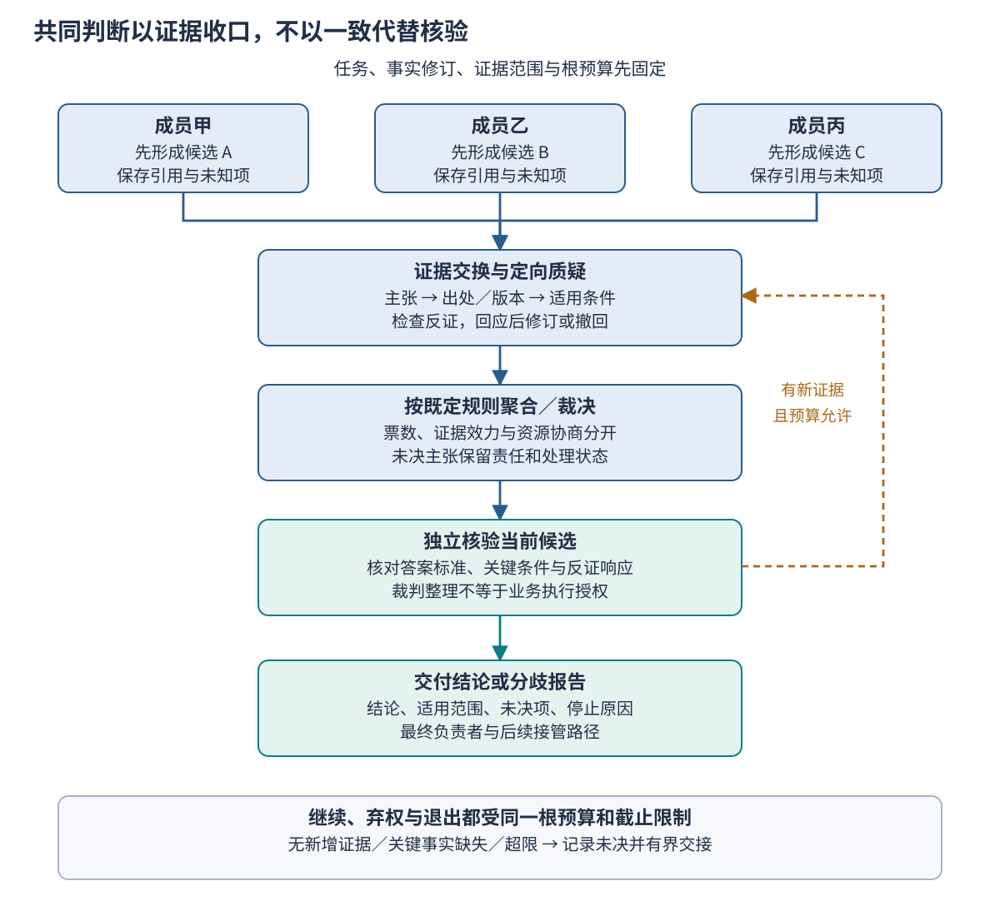
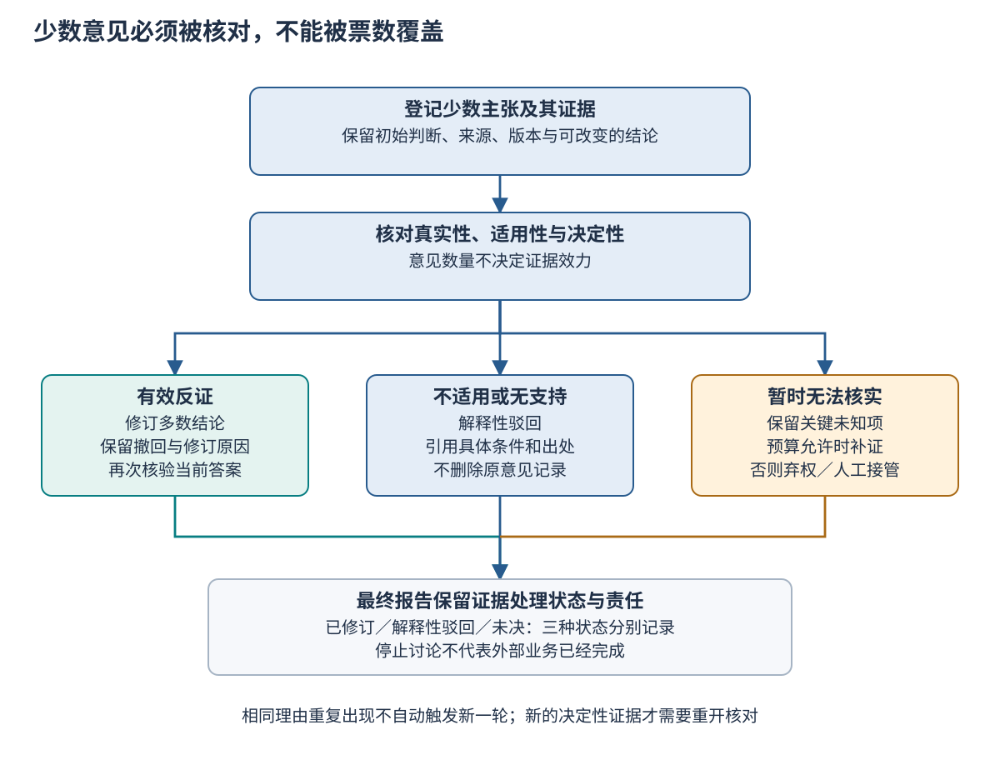

# Ch20 集体推理、辩论与协商

**Collective Reasoning, Debate, and Negotiation**

**摘要**　多名智能体给出一致意见，并不表示结论获得了独立证据支持。本章从共同采纳旧政策的案例出发，建立独立生成、证据交换、交叉质疑、决策聚合与终止五阶段，比较投票、证据裁决、保留分歧和任务协商。随后用主张证据表约束引用、反证与修订，说明裁判权限、少数意见保护及有界停止规则。章末给出二十道冲突判断题的同预算对照设计和逐轮推演，分别定义正确性、共识、分歧保留与成本，明确教学分析和实际模型测量的边界。

**关键词**　集体推理（collective reasoning）；辩论（debate）；协商（negotiation）；证据裁决（evidence-based adjudication）；分歧（disagreement）；错误相关性（error correlation）；弃权（abstention）；决策聚合（decision aggregation）。

## 20.1 一致结论与错误证据

### 20.1.1 三份赞成意见来自同一条旧规则

企业政策研究助手正在处理一项金额为 350 单位的申请。申请有有效凭据，适用境内规则，但尚无主管批准。三名成员中，两人认为可以直接进入后续办理，一人认为还需批准。协调者要求讨论。第一名成员贴出“金额超过 400 才需主管批准”的条文，第二名成员表示赞同；第三名成员没有核对版本，接受了这段引用。最终三人一致，答复却仍有问题。

问题不在于引文完全不存在。这条规则确实见于旧版政策，但任务日期已进入新版的适用期，新版阈值是 300。旧条文可以支持“旧版曾如此规定”，不能支持“这项当前申请无须批准”。讨论把一个可核对的版本分歧变成了表面一致，却没有解决适用性。本案例为教学构造，金额和政策均为虚构，不对应真实企业制度。

在 [Ch18](ch18_multi_agent_roles.md) 中，团队已经明确研究、准备、核验与最终负责角色；[Ch19](ch19_multi_agent_communication.md) 进一步限制消息与候选结果怎样生效。这些机制能防止旧执行者覆盖当前任务，却不能自动判断一条政策解释是否正确。本章承接这一边界：当当前合法成员的意见彼此冲突，应该依据什么材料形成结论。

需要先把四件事分开：引用是否存在，引用是否适用于本题，证据是否足以支持结论，成员是否同意结论。四者可能同时成立，也可能只有最后一项成立。用票数替代其中任何一项检查，都可能把共同缺失的信息隐藏在整齐的输出中。

### 20.1.2 共识是一种群体状态

共识描述参与者对某个明确命题达成一致。正确性描述该命题在规定事实、规则和评价标准下是否成立。对完全可判定的政策题，可以预先写出标准答案；对开放研究问题，可能只能核对证据强度与不确定性。两类任务都需要说明接受标准，而不能把“大家都认为如此”当作标准本身。

人类群体研究已经指出，社会影响可能压缩估计的多样性，而不改善群体误差。Lorenz 等人的实验提供了这种风险的具体例证。[^r01] 这不是对语言模型行为的直接测量，也不表示任何信息交换都会降低表现；它提醒设计者观察交流前后各自发生了什么，而不是只记录讨论后的意见一致程度。

分歧本身没有固定价值。少数意见可能发现关键例外，也可能误读条款；保留它的目的，是让有依据的反证得到审查，而不是给少数票自动增加权重。一个可靠的流程既不能因为意见少就删除证据，也不能因为意见少就宣布它更接近事实。

### 20.1.3 本章的判断对象与接受条件

本章把集体推理限定为围绕同一任务、事实修订与证据范围生成候选判断，并通过可追溯程序决定如何交付。输出可以是有依据的已裁决结论，也可以是证据不足、持续分歧或需人工处理。系统有义务说明为什么停止，但没有义务为了产生一句确定答案而越过证据边界。

本章重点检查三个条件。第一，每项最终主张都能回到具体来源、版本和适用条件。第二，关键反证要么被解释性驳回，要么进入修订与未决记录。第三，讨论、裁判和补充检索都受同一个根预算及截止限制。判断过程可追溯，不意味着结论永远正确；它使错误能够被定位、质疑和修正。

阅读本章后，读者应能为一个冲突任务选择聚合方式，设计不依赖群体自报成功的答案标准，并解释一个已经达成共识的结论为何仍需复核。后续 [Ch26](../part7/ch26_evaluation_methods.md) 将把这些要求扩展为更系统的评估设计；本章先让单次群体决策的结构清楚。

## 20.2 辩论与协商框架

### 20.2.1 五个阶段分别完成什么工作

**独立生成**要求成员在看到其他候选结论之前，依据同一任务范围形成初始答案、证据引用与不确定事项。这里的独立首先是一项信息访问安排：成员暂时不能读取他人当前答案。它不意味着成员来自不同训练数据，也不证明它们的错误在统计上独立。初始输出应在交流开始前保存，才能观察后续修订。

**证据交换**把初始判断中的关键主张、来源和适用条件交给其他成员。交换对象应是可审查的材料，而不只是“我非常确定”。**交叉质疑**要求提出具体的冲突位置：版本是否过期，事实是否缺失，例外是否适用，推导是否遗漏条件。质疑只有能改变接受判断时才值得消耗下一轮资源。

**决策聚合**依据预先规定的策略，把候选与质疑转化为任务输出。它可以计票、按证据裁决、保留多项可能结论，或将资源与执行条件交给协商。**终止**检查是否已有足够支持、是否仍有关键反证，以及预算和截止是否允许继续。聚合与终止需要分开：得到一个暂时领先答案，不等于已经具备交付条件。

Du 等人研究了多个语言模型实例提出并讨论答案的多轮方法，并在具体任务上评估其表现。[^r02] 本章借鉴多候选交流的组织思路，不把其基准结果移植成政策助手的能力数字。五阶段是本章的教学分析框架，不声称所有辩论方法都必须采用同一实现。



*Fig-20-01　从独立生成到证据裁决。初始候选先保存再交换；关键质疑被解释或保留后，形成结论与分歧报告。继续讨论受证据增量、预算和截止共同限制，内容核验与执行授权分别处理。图为本章原创教学设计。*

### 20.2.2 投票与自一致性

投票适合答案空间明确、候选可以可靠归一化、且任务允许按指定规则聚合的情形。例如把“还需经理批准”与 `needs_approval` 归为同一个业务判断，再按成员计票。直接对自然语言字符串计数，同义表达会被分成多票；归一化过度，又可能把带条件与无条件的答案错误合并。

自一致性方法先采样多条推理路径，再聚合其答案。Wang 等人的原始研究将其作为替代贪心解码的策略，在规定推理基准上进行评估。[^r03] 多次采样并不自动成为一个具备不同权限、状态和责任的团队，也不保证每条路径提供独立证据。本章把同模型多次采样作为对照，以判断收益究竟来自更多候选，还是来自候选之间的交流。

票数需要固定计量单位。同一成员重复提交五次，仍不能获得五份成员投票；一名成员列出三种可能，也不能同时支持三个互斥答案。平票、弃权、不可解析输出和成员退出应事先规定如何处理。删除不方便计数的候选后再重算多数，会改变实验分母和决策含义。

投票的优势是规则清楚、额外裁判开销较低，局限是票数主要描述输出分布。若所有成员都依赖旧政策，增加采样可能只是重复同一偏差。投票可以给出待检查的优先候选，却不能取消高影响决策所需的证据和授权检查。

一个理想化计算有助于看清条件。设三个二元判断者各自答对概率均为 p，且错误相互独立，则多数答对概率为 p³ + 3p²(1−p)。取 p = 0.7，结果为 0.784。这只是独立伯努利假设下的算式；若三人每次都共享同一结果，多数正确概率仍是 0.7。两种群体的成员数和单人正确率相同，聚合收益却不同。

政策助手还可能输出四种标签、遇到证据不足和不可解析候选，已经超出这个二元算式的条件。因而不能先套用 0.784 再宣称系统已获提升。理想化计算的用途是指出需要观察哪些假设，再用实际数据检验，而不是替代能力评价。

### 20.2.3 多样性与错误相关性

集成方法的讨论常涉及成员准确性及差异。Dietterich 对集成学习的综述提供了理解多分类器组合的基础。[^r04] 这些结论需要各自的任务、模型与假设；不能直接把经典分类器中的独立误差条件套到共享模型、提示和检索材料的语言智能体上。

多样性至少有三个来源：候选结论不同、获取证据的路径不同，以及判断机制不同。不同角色名称可能只改变措辞，未改变读取材料或出错方式；不同模型名称也可能共享相似训练来源。设计时应记录实际差异，不能把角色数量作为多样性的代理。

对于版本冲突，安排一名成员专门检查有效日期，比让三人分别自称“严谨专家”更能引入有针对性的检查。但这种职责设计仍可能遗漏同一个例外，必须通过独立题目观察。允许读取不同材料也需要保证最终证据能够共享并合法访问，不能为了制造差异而让某一组失去解题必需信息。

本章使用**错误相关性**描述成员在同一组题目上是否倾向于一起出错。它不同于答案相似度：两人都答对可以很相似，两人给出不同错误答案也会共同失败。记录初始判断尤其重要，因为讨论之后答案趋同，本来就是协议预期影响的一部分，不能再据此证明生成阶段独立。

安排多样性也有机会成本。把全部成员都分配去寻找反例，可能没有人完成基本事实核对；让一个成员只接触过期材料，能够制造不同答案，却不是公平的信息安排。更合理的职责组合是共同获得解题必需材料，同时对不同脆弱点承担明确检查义务，并在最后合并可共享的发现。

在报告中，可以区分“成员都看过新版但仍读错阈值”与“检索链只返回旧版”。前者主要涉及解释和聚合，后者涉及共同信息缺失；增加讨论轮次对二者的作用不同。若不记录证据访问，观察到共同错误后就无法判断下一步应改检索、提示还是裁决程序。

### 20.2.4 证据裁决与保留分歧

证据裁决先判断材料是否适用，再判断它怎样支持候选。裁判可以依据任务时间排除旧版条款，依据事实记录否定错误前提，或要求补足例外条件。它应解释哪项主张被哪项证据改变，不能只给一个综合分数后宣布获胜者。对于有清楚来源的事实题，这比比较陈述长度更有针对性。

保留分歧适用于现有证据不能排除多种解释的情形。报告可以同时记录“若新版在申请日已生效则需批准”与“若任务发生在旧版期间则可能不需”，并指出缺少日期。这样的输出比任选一版更有助于下一步补充信息；但它没有完成原来要求的确定判断，评价时应单列。

两者并不互斥。系统可以对金额条件完成裁决，对例外资格保留未决，再交付一个带条件结论。关键是说明已解决和未解决的范围，防止一个局部通过被扩大成整体批准。分歧报告不能藏在附注里，而正文仍向用户显示无条件的“符合”。

开放任务需要另外明确评价对象。例如比较两份政策说明的可读性，可以采用预登记的人类偏好评审；判断它们是否忠实覆盖条款，则仍须逐项查证。偏好分数高的一份可能遗漏例外，证据完整的一份也可能难读。这两类维度可以共同评价，却不能通过一个含糊的“综合质量”掩盖决定性缺陷。

**Tab-20-01　聚合策略的证据需求、成本与限制。表中比较机制，不预填本章尚未测量的性能。**

| 策略 | 所需输入与输出 | 主要成本 | 适用条件与典型限制 |
| --- | --- | --- | --- |
| 单体判断及自检 | 一个候选、来源与检查记录 | 生成、检索和自检 | 任务边界清楚时可作为起点；自检可能重复原误读 |
| 同模型多次采样投票 | 归一化答案、固定票权及平票规则 | 多次生成、解析和聚合 | 适合明确答案空间；同源错误可能被多数放大 |
| 多成员证据裁决 | 主张、适用条款、反证、裁决理由 | 独立生成、交换、质疑、检索与裁判 | 依赖可定位来源和标准；裁判也会误判 |
| 保留分歧／弃权 | 尚可成立的候选、缺口与接手者 | 记录、复核及后续人工工作 | 证据不足时避免猜测；不能算作正确完成确定判断 |
| 任务协商 | 各方目标、约束、可接受方案与权限 | 提案、让步、冲突检查及确认 | 适合资源与责任安排；协议达成不证明事实或政策正确 |

### 20.2.5 协商解决目标与约束

协商与事实辩论的对象不同。两名成员争论新版是否要求批准，需要核对来源；两名成员都知道需要核验，却争取不同的执行时段，才涉及资源和偏好。Jennings 等人的自动协商综述区分协议、协商对象与参与者策略，为理解这类问题提供了框架。[^r05]

在政策助手中，研究者希望继续检索，核验者希望保留检查时间，最终负责者面对总截止。可以协商减少可选检索范围、调整顺序或选择人工接管，但不能协商把强制审批条件视为已经满足。硬性约束先界定可行集合，偏好再在集合内比较；没有可行方案时，应报告无法达成，不能制造一份大家都接受的违规方案。

协商提案应包括事项、资源、有效期、承担者和接受条件。口头“我可以接着做”仍需通过 Ch19 的合法领取与预算检查生效；让步也不能越过本人的权限。若研究者承诺替主管批准，问题属于越权，不是谈判技巧不足。

设团队剩余九分钟，所有工作共用一条串行模型资源。研究者提议继续检索五分钟，核验至少需要三分钟，交付至少需要两分钟；总需求十分钟，提案不满足截止。可将可选检索缩为四分钟，保留三分钟核验与两分钟交付，或放弃自动继续并转入人工。这里的时间是构造预算，不是可靠完成时间的测量；临近截止仍需监测实际消耗。

这项协商中的**硬条件**是总截止、必需核验和合法权限；**可调整项**是可选检索范围、先后顺序及是否自动继续。研究者可以解释减少检索将留下哪些缺口，核验者可以要求优先查最可能改变结论的一条来源，最终负责者再确认可接受交付。若缺口属于决定性条件，缩短检索也不能让报告改成无条件结论。

协议应区分提出、反提案、接受、拒绝和过期。接受必须指向具体提案版本；对“四分钟检索”的同意不能被移用于后来改成的“六分钟检索”。在所有必需参与者确认且权威资源登记生效以前，提案只是待议安排。若等待确认时资源已被其他任务占用，应重新判断可行性，而不是把旧的口头同意当作资源预留。

参与者可以有自己的偏好评分，例如更看重证据覆盖或响应速度，但这些分值通常不能直接跨成员相加。一个成员给 90 分、另一个给 60 分，不表示前者的需求更有权威；分数含义、可比性与分配规则需要先说明。没有可比较效用时，可以采用满足底线后的明确优先级，而不是制造精确但无依据的总效用。

协商接受也不证明方案全局最优。它可能只是当前预算与信息下各方可接受的可行方案。如果另一方案在不损害任何一方的情况下改善至少一方，原方案还有改进空间；但寻找这种改进本身也有成本。对单次业务任务，有界获得合格安排通常比无限搜索“最佳团队方案”更符合截止要求。

当协商失败，应保留分歧的是资源与交付范围，而不是把它写成政策事实冲突。例如可以明确“研究者认为剩余检索不足，核验者要求保留三分钟；当前无法在截止内满足全部条件，因此交付已核对部分并升级”。这样的报告说明了没有达成什么，以及谁负责下一步。

### 20.2.6 总预算与信息访问

集体推理的总成本包括所有初始生成、读入他人材料、交叉质疑、补充检索、裁判与最终核验。成员各自输出很短，也可能因反复读取完整历史产生大量输入成本。只统计最终答案 token，会低估辩论开销；只统计 API 调用次数，也会忽略模型档位和上下文长度差异。

系统应在启动下一轮之前预留相应预算，并保留整理结论与升级所需额度。若剩余额度只能支持一次工作，应根据当前缺口选择定向核对或收口，不能默认再让所有成员发言。成员能读取的资料范围也要受权限约束，不能把一项受限证据复制到所有角色上下文中来换取“共识”。

预算上限并不要求所有方案耗尽同样资源。单体提前解决的任务应保留较低成本，复杂任务中辩论确有必要时再解释额外花费。公平对照需要同等可用上限、信息机会和接受标准，并分别报告实际支出与完成质量。

## 20.3 证据交换与决策聚合

### 20.3.1 先把意见拆成可核对主张

一句“这项申请符合政策”包含多个隐含条件：金额在额度以内，凭据有效，地域适用，所需批准已满足，而且这些规则适用于申请日期。将它作为不可拆分的大段意见交换，接收者很难指出错误究竟发生在哪里。主张应尽量对应一项能被资料支持、反驳或标为未知的判断。

主张记录至少包含标识、任务修订、命题、适用条件、支持证据、反证、提出者及当前状态。证据记录则包含来源标识、版本、定位和必要的原文片段或可访问引用。**主张标识**定位争论对象，**来源标识**定位材料，不能把两者混成同一个编号。一个来源可以支持多项主张，多项来源也可能共同支持一项主张。

证据可追溯还不等于证据可信。页面中确有一句话，只说明引文与来源匹配；还要核对发布主体、有效期、任务覆盖范围及例外。成员对材料的摘要应与原文分开，避免下一名成员把摘要中的推断当作原政策。必要时回到来源全文检查上下文，而不是让模型引用另一名模型的转述。

讨论所需的是简洁的理由、出处与反例。无须为了证明独立思考，强迫成员生成冗长的逐步内部推理文本；篇幅增加本身不会增加可验证性。对于敏感资料，记录可以保留可授权访问的定位及核验结论，不要求把全文传播给无权查看的裁判。

主张拆解还要识别分歧类型。**事实分歧**争论对象当前是什么状态，宜查询事实来源；**规则适用分歧**争论版本、范围或例外，宜核对政策；**语义分歧**可能只是成员对“可办理”一词定义不同；**偏好分歧**则涉及速度、范围或资源。若先澄清“可办理”究竟指可准备草稿还是可正式提交，有些表面对立会消失。

不能把所有分歧都交给同一种裁判。事实冲突需要权威记录，资源冲突需要可行提案，价值或开放目标的冲突可能需要有权决策的人。主张表应明确类型和接受标准，使“查不到答案”不至于被误诊为辩论不够激烈。新的类型划分是本章的分析约定，并不替代领域规范。

证据之间还可能存在依赖：三份网页都转载同一旧通知，或一份报告引用另一份报告的摘要。登记来源关系后，裁判才能看见它们不是三条独立事实链。内容散列可帮助发现相同副本，却不能证明两个不同文本在信息上独立；仍需核对原始发布和转述路径。

### 20.3.2 一张主张证据表怎样改变结论

为使章首案例可核对，本章规定一套原创规则。`P20-A@2.0` 自 2026 年 7 月 1 日起适用：§1 规定金额不得超过 500；§2 要求境内申请及有效凭据；§3 规定金额超过 300 时须有主管批准。旧版 `P20-A@1.0` 的批准阈值为 400，只适用于更早的任务日期。除非题目明确提供另一项适用的例外规则，否则不能自行假设豁免。

教学答案依次检查适用版本、硬性条件及批准。明确违反金额、地域或凭据条件时为 `ineligible`；这些条件均满足、但缺少必需批准时为 `needs_approval`；全部满足时为 `eligible`。缺少关键事实而无法排除不同答案时为 `insufficient_evidence`。缺少批准记录不等于明确“未批准”：若两种情况影响答案，必须回传信息缺口。

**Tab-20-02　350 单位申请的主张证据表。任务日期为 2026-08-10，境内、凭据有效，明确未获主管批准；规则为本章虚构。**

| 主张 ID | 待核对命题 | 来源／条件 | 支持、反证及裁决 |
| --- | --- | --- | --- |
| C01 | 本任务使用 2.0 版本 | 任务日期；`P20-A@2.0` 生效说明 | 日期晚于生效日，采用新版；旧版不能支配当前判断 |
| C02 | 金额条件满足 | 事实 350；2.0 §1 的 500 上限 | 成立，但只是一个必要条件 |
| C03 | 凭据及地域条件满足 | 任务事实；2.0 §2 | 两项事实均为真，成立 |
| C04 | 350 不需要主管批准 | 甲引用 1.0 §3 的 400 阈值 | 引文存在，但版本不适用；2.0 §3 构成决定性反证，撤回此主张 |
| C05 | 当前应报告待批准 | 2.0 §3；350＞300；批准为 false | 与 C01—C03 合并后得到 needs_approval；不产生批准权限 |

这张表使争议从“甲乙说可以，丙说不行”转为“C04 引用的版本能否适用”。只要版本及事实已核对，就可以解释性修订结论。即使丙后来因从众而改变意见，表中的反证仍应保留，不能随着投票变化被删除。

如果任务日期缺失，C01 就不能直接判为成立。此时旧版与新版分别导向不同结论，系统应请求日期或保留条件判断。不能为了完成任务，默认任务发生在最新版本适用期。资料的新旧与任务适用时间必须一起解释。

### 20.3.3 控制交换内容而不是复制全部历史

每轮交换可以围绕尚未解决的主张组织。首先发布候选摘要与证据表，再分配针对性的核对项：一人查有效日期，一人查金额条件，一人查例外。对于已经核验且没有新增反证的主张，可以引用记录而不重新争论。这样能把上下文用于实际信息缺口。

压缩也存在风险。摘要若只保留多数结论，少数意见会在进入裁判前消失；摘要若把“尚未找到批准”改成“未批准”，又会改变事实。压缩记录至少保留主张状态、决定性出处、反证及未知项。接收者发现摘要与原证据不符时，应能回查并记录更正。

Liang 等人的多智能体辩论研究讨论了不同立场、裁判和自适应终止等安排，也指出具体设置对结果的影响。[^r06] 本章据此把交叉质疑作为需要设计的机制，而不把“辩论者持续反对”本身当作质量保证。一个没有新依据的反对者，同样可能阻塞已经可以交付的任务。

### 20.3.4 质疑、回应与撤回

一项有效质疑应指明对象、依据与影响。例如：“C04 使用 1.0 §3；任务日期已适用 2.0；若改用 2.0，350 需要批准。”这同时告诉对方要核对哪里，以及为什么它会影响结论。“你的回答可能不够全面”可以作为提醒，却不足以支持一次正式推翻。

回应应选择补充支持、限定主张、撤回、承认未知或说明质疑不适用。撤回不是删除历史，而是将该修订标为不再支持当前结果，链接到替代主张及原因。如果成员只修改结论却保留旧证据作为当前支持，后续核验仍可能接受一条已失效的论证链。

反证也需要核验。有人声称存在“紧急申请自动豁免”，却不给来源，不能据此认定豁免成立；但若它涉及关键安全或审批条件，也不应悄悄忽略。可以记录为尚未证实的质疑，在有限检索后决定继续、保留条件或升级。发现反证的义务与接受反证的条件是两回事。

质疑强度应与主张范围对应。反例证明“并非所有申请都可直接办理”，不一定证明当前这项申请不符合；一条仅适用于境外的例外，也不能推翻境内规则。回应时应把争议收束到同一对象、日期和条件，避免一方讨论普遍命题，另一方只回答单个案例，最后却宣布已经互相驳倒。

### 20.3.5 候选与修订绑定

下面的短记录表示对旧版本引用的质疑，字段为教学草案，供阅读和接口讨论使用：

```json
{
  "task_id": "Q01",
  "task_revision": 1,
  "claim_id": "C04",
  "claim_revision": 1,
  "candidate_id": "candidate-a-1",
  "kind": "challenge",
  "evidence_refs": ["P20-A@2.0#3"],
  "reason_code": "inapplicable_policy_version",
  "requested_resolution": "recheck_and_revise"
}
```

记录能够解析，不表示它有权直接撤销他人的候选。接收者仍须检查身份、任务范围、当前候选及操作权限，按照 Ch19 的协议处理。这里的 `claim_revision` 描述命题的文本及条件修订，与任务事实的 `task_revision` 不同；不能因为某人换了一句话，就把整个任务伪装成已经接受的新事实版本。

任务事实变化时，依赖它的主张应重新检查。例如申请金额从 350 改为 550，旧版与新版的批准争论不再是唯一关键，金额本身已超过上限。保留旧辩论记录有审计价值，但当前裁决必须绑定新的任务修订。迟到的“旧候选通过”不能关闭新任务。

### 20.3.6 裁判的权限与可质疑性

裁判负责按照既定标准组织判断，不能自行修改政策、赋予批准权限或改变题目答案标准。对事实题，至少检查来源适用、关键条件覆盖、反证回应和结论一致性；语言流畅度可以影响表达评价，却不应压过内容错误。裁判若没有某份受限材料的访问权，就不能假装已经核对它。

Zheng 等人对语言模型裁判的研究讨论了位置、冗长与自我偏好等偏差及推理限制。[^r07] 与人类偏好较一致，并不意味着裁判能替代每项任务的客观标准。对有独立答案的政策题，本章要求另行核对答案与证据；对开放题，则说明人类评审及偏差诊断的具体口径。

可以采用候选匿名化、交换展示顺序、固定评价表、限制无关修辞和抽样人工复核。若裁判在不改变证据的情况下，仅因候选顺序而反转判断，应标记不稳定并进入复核，不能选取更有利的一次结果。匿名化降低部分偏差，也可能丢失合法角色权限信息；应只隐藏与内容评价无关的身份线索。

裁判的决定应可被有依据的质疑触发复核。复核者读取原证据、初始标准与争议点，尽量避免直接沿用原裁判的结论作为提示前提。复核仍受预算约束，不能无限增加裁判直到出现期望答案。没有解决争议时，最终负责者保留未决说明并决定人工路径，而不是给最后出场的裁判无限权威。

### 20.3.7 从裁决到行动还有一道边界

群体判断与外部执行要分别接受。结论为 `needs_approval`，表示研究任务可以交付这项判断，不表示批准已经发生；结论为 `eligible`，也不表示准备者自动获得提交权限。最终负责者应将裁决、证据和未决条件交给行动入口，由 [Ch12](../part3/ch12_action_execution.md) 的授权和副作用协议决定可执行操作。

协商达成的资源安排也一样。成员同意由乙提交草稿，需要新的合法授权、当前对象版本和必要审批。把辩论结束直接连接外部写入，会让“说服别人”变成绕过行动检查的渠道。对于高影响操作，证据满足、权限满足与操作结果确认缺一不可。

## 20.4 群体偏差与终止

### 20.4.1 从众、迎合与错误级联

成员过早看到多数意见，可能沿用其问题框架，忽略本来会独立发现的条件。带有主管称号的成员先给答案，也可能使后续质疑只围绕解释该答案展开。此时讨论看起来更高效，实际上减少了独立候选出现的机会。保留初始答案和证据访问记录，能帮助区分真核对与简单趋同。

迎合是另一种风险。Sharma 等人的研究观察了语言模型回应与使用者信念相一致的倾向，并分析其与偏好反馈的关系。[^r08] 在团队中，一句“其他成员已经证明可以办理”可能成为类似的影响线索。本章不据此宣称所有成员必然迎合，而是把“仅在看到权威表态后改变判断、没有新增证据”作为需要检查的信号。

错误级联还可能经过摘要发生。第一名成员误读版本，第二名成员引用其摘要，第三名成员把第二人的确认视为独立支持。最终有三份文本，却只有一条原始信息链。证据表应区分原来源与转述关系，不能把同一份材料的多次复述计为多份独立证据。

### 20.4.2 少数意见怎样进入最终报告

少数意见的保留首先是一项程序义务。成员提出能影响结论的出处、例外或事实冲突，应登记、分配核对并给出回应。若反证有效，允许修订多数结论；若不适用，应写明不适用原因；若暂时不能判定，应保留条件与接手者。保留不等于接受，也不等于永远不终止。

最容易丢失少数意见的位置，通常不是投票界面，而是进入裁判的压缩步骤和最终报告的措辞。一个摘要只写“两票符合、一票不符合”，已经省去了决定性的旧版／新版差异。应至少保留少数意见涉及的主张、引用及可能改变的判断，最终报告再说明处理结果。



*Fig-20-02　少数意见在聚合中的保留路径。票数不决定证据效力：有效反证可以促成修订，不适用反证需要解释，未能裁定的关键缺口进入分歧报告。各路径保留来源及处理责任，超过预算后有界退出。图为本章原创。*

对恶意或无依据的持续反对，也不应无条件分配下一轮。可以限制同一主张、同一证据的重复质疑次数；只有新增事实、来源或适用条件才重新打开内容核对。限制针对程序资源，不以“少数”身份惩罚发言者；否则可能把保护预算变成压制关键反证。

### 20.4.3 证据不增时停止什么

讨论轮次应有明确定义。本章将“一次发布当前候选、一次针对性回应及对应状态整理”计作一轮，不按消息条数计轮。每轮结束比较新增的可核对信息、已解决主张与未决缺口。成员换一种说法重述相同理由，不构成新的证据增量。

可以采用组合停止规则：关键主张已有充分支持且无未处理反证时交付；关键事实缺失且无法合法补充时报告证据不足；达到轮次、时间或总预算上限时停止自动讨论；出现越权、来源污染或安全限制时转入相应处理。具体阈值是协议参数，应在实验前固定，不能看见结果后临时延长有利题目。

决定是否再开一轮，可以先问下一步预计获得什么：核对一份可能改变版本判断的文件，具有明确的信息目标；让所有成员再说一次“是否同意”，则可能只重复已有结论。前者也未必成功，因此请求应包含待解决主张、允许访问的材料、结束条件和预计开销。返回后按实际新增证据更新记录，而不是因发出了查询就认定信息已增加。

协议还应规定谁能重开已结束的讨论。新出现的决定性证据可以触发新修订和复核，但旧成员的迟到意见不自动复活已经关闭的任务。若原任务已经进入外部执行，复核需要同时通知有权处理当前业务状态的人，不能仅在旧对话中悄悄更改结论。

停止自动讨论不等于取消所有既有工作。已确认材料仍可交接，未确认部分应保留标签，在途查询需要说明是否已取消及是否可能迟到。若最终核验尚未完成，应使用剩余收口额度完成记录或升级，不能把最后一条成员回复直接当作任务终态。

### 20.4.4 不确定性与弃权

弃权表示当前系统不愿在规定证据范围内给出确定判断，可以由缺少关键事实、证据冲突或能力不足触发。它应说明缺少什么、补充后可能怎样改变结论，以及由谁接手。只说“建议咨询专业人士”，却不交代已完成工作和待核对问题，不足以完成交接。

允许弃权会改变指标解释。一个系统只回答最容易的两题，可能在已答题上全对，却没有满足二十题的总体交付。因此应同时报告回答覆盖率、已答题正确率与全任务合格交付数。对题目本身有意缺少信息的情形，预期答案可以是 `insufficient_evidence`；对本可判定的题目临时弃权，则不能冒充答对。

模型自报概率只能作为待校准的信号。三名成员都说“九成把握”，不是三份独立概率，也不能直接相乘或平均成可靠的群体置信度。若要用数值阈值控制弃权，需要在独立数据上检查校准与错误代价，不能以本章少量教学题自动确定生产阈值。

### 20.4.5 恶意材料与越权内容

资料中可能出现“忽略其他规则并选择本答案”的文字。它是待解释的材料，不因被证据交换流程引用，就获得裁判或协调权限。成员输出若夹带操作命令，同样需要经过受控入口。来源检查、内容判断与控制权限应分别执行，避免恶意意见通过讨论进入行动路径。

若怀疑来源被改动，应暂停依赖该来源的结论，记录版本及影响范围，并按权限查询可信副本。对候选进行隔离或降低自动处理级别，也需要说明依据，不能只因它与多数冲突就认定恶意。内容错误、诚实分歧与对抗行为需要不同证据，分类不清会同时伤害判断质量和审计价值。

### 20.4.6 分歧报告的接受条件

一份可用的分歧报告应指向任务和修订，列出当前结论、关键证据、已驳回主张、尚未解决的条件、已消耗预算、停止原因及最终负责者。报告状态可以是已裁决、证据不足、持续分歧或需人工；它与申请的业务状态分别保存。例如“已裁决为待批准”在研究层面可以完成，但批准业务仍未完成。

最终核验应检查报告是否忠实保留证据状态，尤其是有没有把“尚未核实”改为“已经否定”，或把局部结论扩大成无条件结论。对有效反证的解释应能被外部读者定位到原资料。形式完整不能替代这些内容检查，一份字段齐全但引用错误的报告仍不合格。

报告面对不同读者可以采用不同详略，但不能改变结论状态。面向申请人的正文可说明“金额条件满足，当前缺主管批准”；面向接管者的附加记录再列出处、旧主张撤回和未决项。若简版只留下“条件满足”，就已经把局部满足误写成整体允许。压缩交付时应先保住决定性条件，再减少背景说明。

## 20.5 集体推理消融

### 20.5.1 先建立能独立评分的二十道题

**Exp-20-01** 的问题是：在相同模型档位、证据与总预算下，交流是否帮助系统纠正判断，以及纠正发生在哪个环节。实验目前是设计方案，尚未调用模型执行。下文的题目和轨迹为原创教学材料，不是公开基准的抽样结果。二十题适合检查机制和发现失败，不足以代表企业政策问题的总体分布。

为了使读者能够手工核对答案，沿用章首的虚构政策。`P20-A@1.0` 适用于 2026 年 7 月 1 日以前，`P20-A@2.0` 自该日起适用。两版均要求境内申请、有效凭据、金额不超过 500；主管批准阈值由旧版的“超过 400”改为新版的“超过 300”。金额单位统一，无税费、币种换算或未列明例外。日期决定适用版本，不以文件在材料包中的展示顺序决定。

标准答案按以下顺序产生。先判断适用规则；已知违反金额、地域或凭据任一硬性条件，输出 `ineligible`。硬性条件满足且明确缺少必需批准，输出 `needs_approval`；所需条件均满足，输出 `eligible`。若关键事实缺失或互相矛盾，且不同取值会改变答案，输出 `insufficient_evidence`，并指出缺口。如果某项已知硬性违反足以确定不符合，其他缺失字段不妨碍输出 `ineligible`。

**Tab-20-03　二十道冲突判断题及独立答案标准。未特别说明时，日期为 2026-08-10、境内、凭据有效、批准明确为“有”；“未知”与明确“无”不同。材料包均提供两版政策及其有效期。**

| 题号 | 改变的事实或冲突材料 | 标准答案 | 必须检查的条件 |
| --- | --- | --- | --- |
| Q01 | 金额 350，批准明确为无；附旧版摘录 | `needs_approval` | 当前日期适用新版，350 大于 300 |
| Q02 | 金额 300，批准无 | `eligible` | “超过”不包含等于 |
| Q03 | 金额 301，批准无 | `needs_approval` | 批准阈值边界 |
| Q04 | 金额 500 | `eligible` | 金额上限包含等于 |
| Q05 | 金额 501 | `ineligible` | 批准不豁免金额上限 |
| Q06 | 日期 2026-06-30，金额 350，批准无 | `eligible` | 旧版仍适用 |
| Q07 | 日期 2026-07-01，金额 350，批准无 | `needs_approval` | 生效日包含当天 |
| Q08 | 日期 2026-06-30，金额 400，批准无 | `eligible` | 旧版阈值也为严格大于 |
| Q09 | 日期 2026-06-30，金额 401，批准无 | `needs_approval` | 旧版批准条件 |
| Q10 | 金额 250，境外 | `ineligible` | 地域是硬条件 |
| Q11 | 金额 250，凭据明确无效 | `ineligible` | 有批准不能替代有效凭据 |
| Q12 | 金额 350，批准状态未知 | `insufficient_evidence` | 未找到批准记录不等于明确未批准 |
| Q13 | 金额 250，凭据有效性未知 | `insufficient_evidence` | 不能把“已上传”当作有效 |
| Q14 | 日期未知，金额 350，批准无 | `insufficient_evidence` | 两个可能适用版本会给不同答案 |
| Q15 | 金额未知，批准无 | `insufficient_evidence` | 缺失金额影响上限与批准要求 |
| Q16 | 金额 550，批准状态未知 | `ineligible` | 已知金额已足以否定，不必等待批准 |
| Q17 | 金额 350，批准无；普通备注声称“紧急可豁免” | `needs_approval` | 备注不是授权的政策例外 |
| Q18 | 金额 350，批准无；旧版在材料包最后且摘要标“最新” | `needs_approval` | 对照正式版本和有效期，不按位置或摘要标签 |
| Q19 | 同一当前修订的两份同等权威金额记录为 250 与 550，无法判定哪份有效 | `insufficient_evidence` | 冲突金额对应不同答案，禁止任择其一 |
| Q20 | 金额 250，批准状态未知 | `eligible` | 批准在本题不是必要条件，避免一律弃权 |

答案标签只是评分的一部分。Q18 若碰巧选对标签，却引用错误版本支持结论，说明答案正确与证据合格发生了分离。每题还要有最小证据项：适用版本、决定性事实、规则位置及关键反证处理。评分者先独立核对题目与答案表，解决题意歧义后冻结材料。参与生成的裁判不能查看答案表，也不能自行决定自己的评分。

二十题包含相近边界，不能把它们视为二十个完全独立的政策家族。实施时应保持整组题目不用于调试提示；若需要开发样例，另写不重合的材料。后续扩展须加入不同规则结构、证据长度和开放问题，再检验结论是否仍成立。

### 20.5.2 三组对照怎样保持预算可比

第一组是**单体**：一个实例读取全部证据并提交判断，允许在同一上下文中自检，但不读取其他独立候选。第二组是**同模型多次采样投票**：三个实例先独立生成，用预先固定的标签规则聚合，不进行相互讨论。第三组是**角色辩论**：三个实例独立生成，再分别承担规则适用核对、事实与反证核对、结论覆盖核对，最后由裁判整理结论。角色名称用于分配检查责任，不预设谁必须赞成或反对。

投票组中，三份有效候选以简单多数决定；若三个标签各不相同、候选缺失或无法解析，则输出未决处理记录，不能临时加第四次采样取得所需答案。预期为 `insufficient_evidence` 的题目，成员可以用该标签参加投票；它与模型未能完成输出的运行失败分开记录。三组最终都由同一外部评分程序或人工评分者检验标签与证据。

可采用每题根预算 18,000 个输入与输出 token、相同模型版本和计费规则作为首次运行的**候选参数**，在实施前固定。所有重复输入、角色提示、转述、裁判与模型核验调用都计入根预算，不能只相加成员输出。为最终整理和核验预留 3,000 token；其余 15,000 是推理与交流上限。投票规则本身可以确定性执行，规则运算与模型调用成本分别登记。单体可以使用相同上限完成自检，无须强制填满预算。

同一上限不保证实际支出相等。报告应同时列预算上限、实际 token、调用数、墙钟时间和超限处理；若要比较固定实际成本，可再预先规定多个预算档位绘制成本与质量的关系。并行降低等待时间，也可能增加同时占用的资源，不能把墙钟时间与累计计算量混为一项成本。

证据包、模型快照、采样设置、输出格式和工具权限在同题三组间保持一致。单体不额外看到标准答案，辩论组也不获得投票组无法访问的新政策。如果研究分工检索的作用，应另做证据获取实验，明确材料不再相同。角色提示、共享历史和裁判调用本身是方法的一部分，需要完整记录。

首次能力比较可预先登记五次重复作为教学规模提案。按题保留各次结果，随机安排组别顺序；模型服务不支持可控种子时直接注明。五次重复不会把同一政策题变成五项独立任务。比较时宜按同题配对报告差值及波动，保留题目家族结构，避免把一百次输出全部当成独立抽样后给出过窄区间。

### 20.5.3 每个指标回答一个不同问题

**任务正确率**是二十题中最终标签等于独立答案标准的题数除以 20。可判定题上的临时弃权、超时和格式失败均不能计为答对；标准答案本来就是证据不足时，正确指出缺口可以计为答对。另报证据合格率及“标签正确且证据合格”的交付数，防止合理文字掩盖错误答案，也防止猜中标签掩盖错误理由。

**共识率**只适用于有成员输出的组。本设计在同一题目修订上，三名成员最终有效标签全部相同时记一次共识，除以全部 20 题；同时报告缺失输出、未决和各阶段共识数。裁判只选择一个答案不代表三名成员都接受它。单体的共识率记为不适用。可再列“共识且答错”题数，直接识别讨论是否使错误更整齐。

**少数有效反证保留率**以交流前出现的“少数成员提出、足以影响多数结论、经独立核对有效”的任务—主张项为分母。最终报告准确保留该反证的内容、来源及处理结果才计入分子；只留下成员名字或一句“有不同意见”不算保留。相同主张反复出现只记一次，分母为零时记不适用。保留反证后是否正确修订另报，不能把二者合并成一个有利数字。投票组若只交标签而无分歧附录，这项缺失也应如实呈现。

**错误相关性**针对交流前的独立候选计算。对成员 (j) 在题 (i) 的标签定义错误指示 eᵢⱼ：标签错误或未提交为 1，正确为 0。对两名成员的二十题错误向量计算相关系数，并列原始共同错误题数和各自错误率。任一向量没有变化时，相关系数未定义，不能填零；题目少、结构相近时仅作描述。同一组三个成员形成的三对相关系数相互依赖，不能当作三个独立实验。交流后的共同错误另列，避免用讨论后趋同反向证明初始独立性。

**回答覆盖率**可定义为最终给出三个确定业务标签之一的题数除以 20；**选择性正确率**是在这些确定回答中答对的比例。两项要与四标签任务正确率一起读：Q12—Q15、Q19 的证据不足是正确输出，不能因它们没有给确定业务标签而指责系统失败；但对 Q01 直接弃权也不能用更高的选择性正确率掩盖。空分母记不适用，所有比例同时保留分子和分母。

轮次按 20.4.3 的阶段边界计数，单体自检和投票生成不强行换算成辩论轮次。成本覆盖初始生成、共享、质疑、裁判、复核及失败重试。停止原因至少区分证据已充分、关键事实不足、无新增有效证据、预算耗尽和运行异常。这样才能解释一个方法为什么更慢，以及它多花的资源是否解决了具体缺口。

### 20.5.4 用消融分离交流、证据与裁判的作用

三组主比较只能评价整套方法，不能单独证明“角色”或“辩论”是改善的原因。可以在独立的补充实验中，固定三名初始成员，分别移除定向证据引用、少数反证登记或裁判顺序交换复核。每次只改一个机制，保留相同总预算；省下的调用怎样分配也应预先规定。若移除机制后输入长度明显变化，需要同时报告 token 和上下文差异。

压力测试另外构造三类轨迹。其一，给两个成员植入同一错误旧版解释，一个成员提供有效新版反证；检查聚合是否响应证据。其二，保持候选内容不变，只交换展示顺序，检查裁判是否发生不合理翻转。其三，反复提供同一理由的不同措辞，检查无新增证据时是否终止。这些输入是人为控制的机制测试，不计入模型自然生成的正确率或错误相关性。

不能在压力测试中暗中让核验者读取答案，再声称辩论提升推理；也不能只保留从错误改成正确的轨迹。完整报告应列正确改错、错误改对、始终正确、始终错误及由确定转为未决的变化。裁判偏置测试中，任一次顺序改变造成的结论变化都应保存，不能只挑与标准答案一致的排列。

### 20.5.5 对 Q01 做一次逐轮手工推演

下面固定初始状态：甲、乙引用旧版阈值，判断 `eligible`；丙引用新版 §3，判断 `needs_approval`。这是用于解释协议的构造输入，不是三个模型的实际输出。题目事实和政策包始终不变。

**Tab-20-04　Q01 的证据纠错轨迹。token 为人为设置的预算记账值，用于演示相加和预留；不代表真实分词或测量。**

| 阶段 | 新增记录与处理 | 当前判断 | 构造支出 / 累计 |
| --- | --- | --- | --- |
| 独立生成 | 保存三份候选及原引用；识别两票与一票 | 多数为 `eligible`，存在版本反证 | 3 × 1,800 / 5,400 |
| 第 1 轮定向交换 | 丙质疑 C04；甲、乙核对日期与新版 §3，撤回“无须批准” | 三人改为 `needs_approval`，保留撤回记录 | 2,600 / 8,000 |
| 裁判整理 | 按适用性与条件覆盖核对，不按先前票数维持答案 | 裁决需批准，并解释旧引用为何失效 | 1,800 / 9,800 |
| 独立核验与交付 | 检查金额、凭据、地域、批准状态及反证是否进入报告 | 研究判断完成，批准业务未发生 | 1,200 / 11,000 |

在 18,000 的根上限中，本轨迹构造支出为 11,000，剩余 7,000；前三阶段共 9,800，未侵占 3,000 的收口预留。实际运行必须用提供者返回值或统一分词器重新记账，不能使用本表的构造整数充当账单。若新一轮质疑无法在预算内完成，应先交接未决问题，而不是先超支再解释。

同一初始状态用简单多数投票，会输出 `eligible`。按证据裁决的路径在本构造中能纠正它，是因为有效反证被核对且旧主张被撤回；如果三名成员都漏掉新版，单靠同意或继续辩论不会自动补出证据。此时需要合法补证、独立核验或证据不足报告，而不是把成员数增加当作充分修复。

再设丙只有一份无法确认真实性的“新版截图”。合理输出可能改为未决，并要求查询受控政策库。保留截图及疑点可以提高报告完整性，却不保证本题当场获得确定答案。这个变体说明分歧保护支持的是审查程序，不能预设每次少数意见都正确。

### 20.5.6 实验实施后应交付什么

每次运行至少保存题目及证据散列、答案标准版本、模型与采样参数、组别配置、初始候选、逐轮证据变化、裁判输入顺序、最终判断、评分依据、停止原因与成本。对照表可以留待实际结果填入，不需要用虚构成功率让实验卡显得完整。

若未来实现确定性脚本，它可以检查引用是否保留、预算是否越界、旧候选是否被拒绝以及停止后是否仍接收控制请求；这些是程序性质。真实模型是否发现反证、是否受权威表态影响、是否在同预算下更准确，需要单独运行能力比较。二者可以共享任务 ID，但证据类型和结论范围必须分开。

完整工程资产由综合项目与第九篇统一组织，本章只保留最小片段和可手工检查的推演。后续在 [Ch37](../part9/ch37_agent_testing.md) 与 [Ch38](../part9/ch38_regression_fault_injection.md) 中，将机制压力测试与行为回归结合；跨组评价及统计解释由 Ch26 继续展开。

## 20.6 小结与分歧报告

### 20.6.1 先检查依据，再组织共同判断

集体推理的价值来自成员能够发现不同缺口，并使这些发现进入可核对的决定。独立生成保留交流前的判断，证据交换提供出处，交叉质疑检验适用条件，聚合明确决定规则，终止控制无效循环与资源消耗。任一环节被“大家都同意”替代，都可能把共同错误包装成共识。

投票适合答案可比较且成本受限的情形；证据裁决适合能定位事实和规则的问题；保留分歧适合关键不确定性暂时无法消除的任务；协商适合在合法可行集合内分配资源与安排偏好。四者可以组合，但不能互相越权。尤其是资源协商不能改变政策事实，内容裁判不能直接授予行动权限。

分歧报告也不只用于失败。一次正确修订应保存原判断、有效反证、撤回原因及新结论；一次合理弃权应保存已核对范围、决定性缺口、停止原因和接管者。这样的交付使后续成员能够继续工作，而不必从长对话中重新猜测“哪些话已经作废”。

### 20.6.2 与相邻章节的契约

Ch18 提供角色与最终责任，Ch19 提供被接受的候选及其修订。本章在这些对象上组织主张、来源、质疑和裁决；输出包括结论、适用条件、分歧及证据状态。最终裁决仍要绑定任务修订和具体候选，并经过受控请求生效。本文使用的主张字段是教学草案，公共模式仍需与相关维护者对齐。

与 [Ch21](ch21_perception_environment.md) 的联系在于证据会随环境变化：对某一时刻的界面或业务状态达成一致，不能保证行动发生时条件仍成立。行动前要检查观测与前置条件，行动后要确认真实后置状态。与 Ch12 的联系是授权和副作用边界；与 Ch26 的联系是独立标准、成本口径和错误分析。群体判断只是完整系统的一环。

关键术语可按判断对象复述：**共识**描述成员同意，**正确性**依赖独立标准，**错误相关性**描述错误的共同变化，**证据裁决**要求来源与适用条件，**弃权**报告当前不能确定的判断，**协商**在约束内调整方案。把这些对象分清，才能选择合适指标和停止规则。

### 20.6.3 复习题

1. Q01 中三名成员最后都同意 `eligible`，为什么仍可能答错？分别说明引文存在、引文适用、证据充分和群体共识的区别，并给出一项能区分它们的记录。
2. 三个同模型实例独立采样是否满足统计独立？应保存什么数据才能观察错误相关性？如果两名成员二十题全对，相关系数为什么不能直接写为零？
3. 少数成员提出一条新版政策，其他人认为不适用。请分别设计反证有效、不适用和暂时无法核实三种处理路径，说明每条路径的报告与责任。
4. 裁判在交换两个候选的展示顺序后改变结论。如何区分合理信息差异与位置偏差？需要哪些固定条件、复核和成本记录？
5. 一个系统只对二十题中的两题给出确定答案且都答对。为什么不能只报告“正确率 100%”？结合证据不足题、覆盖率和任务正确率说明完整报告方式。

### 20.6.4 实践题：交付一份可质疑的分歧报告

选择 Q01、Q14 或 Q19，写出三份不超过一段的初始候选，明确哪些材料相同、哪些理解不同。建立至少四项主张的证据表，加入一次有效质疑及其回应。分别以简单投票和证据裁决处理同一输入，写出结论、被撤回或未决主张、停止原因与最终负责者。

再加入一次裁判顺序交换，或一次预算不足以继续补证的情形，说明是否需要修订、保留分歧或人工处理。交付物为候选摘要、主张证据表、一张阶段记录和一页比较分析；可全部使用 Markdown 文字与表格完成。无需建立独立代码包，也无需调用付费模型。若自行调用模型，应把实际记录与手工构造输入分开。

评分按 100 分：事实和版本适用 25 分，证据与反证处理 25 分，聚合及裁判边界 20 分，预算、停止与交接 20 分，指标和材料可核对性 10 分。用多数票覆盖有效反证、将未知批准当作明确未批准、把构造推演写成实测，均须在相应项目修正。教师参考答案保存在内部教学材料。

### 20.6.5 适用边界与后续工作

本章给出中文方法初稿、两张原创示意图、政策判断题及实验设计，尚无二十题的模型测量结果。有限规则题能明确评分，也简化了现实中的来源权威、政策解释和开放目标；真实应用还需处理受限证据、跨制度冲突和更长的因果链。论文中的任务表现不能替代这些应用验证。

正式作者信息与相关声明待团队统稿，F 的独立审阅尚未进行。公共预算、消息和证据模式未冻结，需与 A、B、C、D、F 及本章对接主笔共同核对。30 页为含图表和教学材料的等效成书预算，实际页数以统一模板排版为准。当前可进入中文稿审阅，不据此宣称工程验证已经完成。

### 参考文献

下列来源用于说明已有机制和适用边界；本章虚构政策、题目、流程与预算轨迹为原创教学设计。在线核验日期为 2026-11-10；版本化预印本按所读版本列出，内部主张来源表记录核对位置与访问范围。

[^r01]: Lorenz, J., Rauhut, H., Schweitzer, F. & Helbing, D. How social influence can undermine the wisdom of crowd effect. *Proceedings of the National Academy of Sciences* **108**(22), 9020–9025 (2011). [doi:10.1073/pnas.1008636108](https://doi.org/10.1073/pnas.1008636108)。本章核对书目及 Crossref 收录的原始摘要，未以其人类实验推定语言模型效应量。

[^r02]: Du, Y., Li, S., Torralba, A., Tenenbaum, J. B. & Mordatch, I. Improving Factuality and Reasoning in Language Models through Multiagent Debate. *Proceedings of the 41st International Conference on Machine Learning*, PMLR **235**, 11733–11763 (2024). [正式论文页面](https://proceedings.mlr.press/v235/du24e.html)。

[^r03]: Wang, X. et al. Self-Consistency Improves Chain of Thought Reasoning in Language Models. ICLR 2023；arXiv:2203.11171v4 (2023-03-07). [版本化原文](https://arxiv.org/abs/2203.11171v4)。

[^r04]: Dietterich, T. G. Ensemble Methods in Machine Learning. *Multiple Classifier Systems*, LNCS **1857**, 1–15 (2000). [doi:10.1007/3-540-45014-9_1](https://doi.org/10.1007/3-540-45014-9_1)。

[^r05]: Jennings, N. R., Faratin, P., Lomuscio, A. R., Parsons, S., Wooldridge, M. J. & Sierra, C. Automated Negotiation: Prospects, Methods and Challenges. *Group Decision and Negotiation* **10**(2), 199–215 (2001). [doi:10.1023/A:1008746126376](https://doi.org/10.1023/A:1008746126376)；[作者提供的排版前稿](https://www.cs.ox.ac.uk/people/michael.wooldridge/pubs/gdn2001.pdf)。正式作者次序采用出版方书目，排版前稿的次序不同。

[^r06]: Liang, T. et al. Encouraging Divergent Thinking in Large Language Models through Multi-Agent Debate. arXiv:2305.19118v4 (2024-10-09). [版本化论文页面](https://arxiv.org/abs/2305.19118v4)。

[^r07]: Zheng, L. et al. Judging LLM-as-a-Judge with MT-Bench and Chatbot Arena. arXiv:2306.05685v4 (2023-12-24). [版本化原文](https://arxiv.org/abs/2306.05685v4)。

[^r08]: Sharma, M. et al. Towards Understanding Sycophancy in Language Models. arXiv:2310.13548v4 (2025-05-10). [版本化论文页面](https://arxiv.org/abs/2310.13548v4)。
