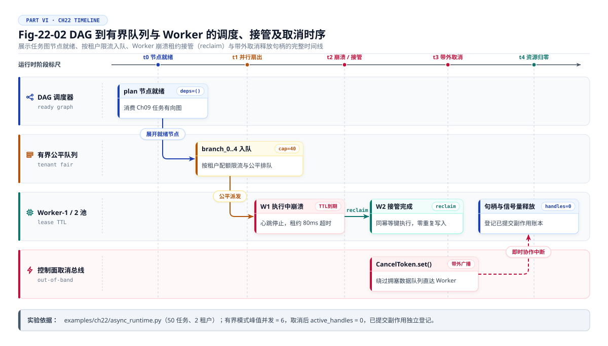

# Ch22 智能体编排与执行运行时

**Agent Orchestration and Runtime Design**

**摘要**　大语言模型本身是无状态推理组件，将 [Ch09](../part3/ch09_task_decomposition_planning.md) 的任务图转化为多租户并发环境下可靠运行的系统，需要具备明确资源边界的异步执行运行时。本章从一次任务并行展开拖垮工作池、连带阻塞用户取消指令的教学事故出发，按故障域拆分控制面、调度器、有界队列、工作池与可替换适配器，并结合插件化微内核与结构化并发原则，设计有界并发、租户配额、任务租约接管与带外取消传播机制。随后，本章在 50 项双租户模拟任务上对照串行、无界并发与有界并发三种调度模式，报告吞吐、尾延迟、资源峰值、崩溃接管与取消响应的本地异步模拟运行数据，并明确区分本地确定性模拟与生产级分布式容量的证据边界。

**关键词**　智能体运行时（agent runtime）；异步编排（asynchronous orchestration）；有界并发（bounded concurrency）；结构化并发（structured concurrency）；任务租约（task lease）；取消传播（cancellation propagation）；租户隔离（tenant isolation）；插件化底座（plugin harness）。

本章拟定主笔为 Xuhong Cao，内部执笔学生 F，独立审稿学生 A，当前版本为 `zh-draft-0.3`（2026-11-27），无商业利益冲突。先修知识包括 [Ch03 智能体架构基础](../part1/ch03_agent_architecture.md)、[Ch09 任务分解与规划](../part3/ch09_task_decomposition_planning.md)、[Ch11 工具发现与调用](../part3/ch11_tool_discovery_calling.md) 与 [Ch12 行动执行与副作用控制](../part3/ch12_action_execution.md)。代码与数据入口位于仓库 `examples/ch22/async_runtime.py`、`runtime_config.yaml` 与 `runtime_load_report.md`，沿用 MIT 许可。正文包含 `Fig-22-01`、`Fig-22-02` 与 `Tab-22-01` 至 `Tab-22-03`，32 等效页为混排预算，实际页数以出版模板为准。

---

## 22.1 任务扇出耗尽资源

### 22.1.1 一个请求拆出五路并发，为何把取消指令也堵死了

在分布式与并发系统中，一个父任务在执行途中同时派生出多个并行子任务，就像一把折扇从单点瞬间展开，工程上称为**任务扇出**（task fan-out）。扇出本意是加速检索与比对，但在缺乏资源上限的智能体系统中，它极易演变为拖垮全局的雪崩。

沿用全书的企业政策研究与工单助手场景。研发团队将 [Ch03](../part1/ch03_agent_architecture.md) 的最小同步循环改写成异步协程服务，同时开放给两个部门租户：`tenant-alpha` 负责日常单笔差旅报销查询与建单，`tenant-beta` 负责月末批量多条款比对审计。团队当时的直觉很朴素：异步协程本身很轻，多开几个并发分支能缩短响应时间，即使某次外部工具响应变慢，也只会拖慢发起该请求的任务本身，不会连累其他部门，更不会影响用户主动取消。

周一上午，`tenant-beta` 连续提交了 8 项复杂审计任务。表面上看入口流量并不高，但每项任务完成规划后都同时扇出 5 路外部政策与 ERP 查询，内部瞬间涌出 40 个并行子步骤，其中几路又恰好命中了响应缓慢的旧版 ERP 接口。几秒之内，`tenant-alpha` 原本只需百毫秒的普通查询开始卡顿到数秒；更令人意外的是，多名员工点击“停止任务”后界面毫无反应，后台日志显示已被要求取消的任务仍在持续调用外部接口。上述情节为说明并发运行时故障而构造的教学场景，并非真实企业生产事故记录。

沿着队列深度与工作槽状态逐段排查，事故根因很快浮出水面。首先，无界扇出让 40 余个工具调用瞬间灌满共享工作池，直接撞上了下游连接池与模型配额天花板。其次，慢工具长期占住共享执行槽，系统又没有按租户划分并发与队列配额，`tenant-beta` 的突发扇出彻底饿死了正常提交请求的 `tenant-alpha`，形成典型的“噪音邻居”干扰。最致命的一点在于控制路径设计失误：系统把用户的取消请求当成普通任务消息，塞进了同一条先进先出的数据队列末尾。在数据面已经严重积压的时刻，取消指令根本挤不到正在干活的工作者面前。

修复这类故障不能靠调大超时时间或加几台机器硬扛，而要从运行时的控制边界动手。团队将入口准入、取消广播与健康探测从数据队列中剥离，建成独立高优先级控制面；在调度层引入全局与单租户双层并发上限、有界队列以及显式过载拒绝策略；同时给每个执行中的步骤加上短期租约与协作式取消检查点。在 50 项双租户模拟负载下复测，并发峰值从失控的 60 稳定收敛至 6，取消信号绕过积压队列即时送达，并在任务退出前释放了全部工作槽与适配器句柄。当然，这套本地改造仅验证了单进程异步调度机制，跨机器分布式限流、真实数据库连接池竞争以及多区域容灾，仍需在 [Ch27](../part7/ch27_benchmarking_capacity.md) 与 [Ch30](../part7/ch30_production_governance.md) 继续补齐证据。

### 22.1.2 为什么单步循环之外必须建立智能体底座

[Ch03](../part1/ch03_agent_architecture.md) 的同步最小循环已经解释清楚单智能体如何完成“感知—决策—行动—验证”，但把它直接搬进多用户在线服务时，四类系统矛盾会立刻显现：

- **时间尺度极度悬殊**：一次大模型推理可能耗时数秒，一次慢工具或人工审批可能耗时数分钟甚至数小时，同步阻塞线程很快就会耗尽操作系统资源。
- **扇出非线性放大**：温和的入口请求频率经过任务图展开后，会被内部并发放大成数倍甚至数十倍的下游调用压力。
- **多租户争用缺乏边界**：共享同一套模型配额与工具连接池时，没有配额隔离意味着单个异常会话就能劫持整个系统的可用性。
- **控制权与生命周期脱节**：用户离开、网络断开或工作进程崩溃后，脱离父作用域约束的孤儿协程会继续在后台消耗 token，甚至发起不再被需要的写操作。

正因如此，近年工业界普遍把包裹在模型外部的调度、隔离、持久化与反馈基础设施抽象为**智能体底座**（agent harness）。Anthropic 在 *Building effective agents*[^r22-anthropic-agents] 与 *Effective harnesses for long-running agents*[^r22-anthropic-harness] 中反复强调，长程智能体能否稳定交付，关键往往在于底座如何管理跨窗口调度、环境初始化与可验证交接，而不是无休止地堆砌提示词；OpenAI 在 *Harness engineering*[^r22-openai-harness] 中进一步说明，生产级智能体需要将编排控制面与受限执行沙箱清晰解耦；DeepSeek 开源的 **DeepSeek Harness**[^r22-dsh] 则基于 Cordis 微内核展示了插件化路线——模型适配器、工具执行器、会话日志与执行循环均作为对等插件挂载于共享上下文，依靠显式依赖声明与可逆清理避免单体核心僵化。本章吸收这些开源实践背后的系统原则，但保持框架中立：所有设计均落在标准契约、有界队列与可验证状态转移上，不绑定任何专有 SDK。

---

## 22.2 运行时分层与故障域职责

### 22.2.1 按故障域而不是代码目录拆分组件

许多初版智能体服务把提示组装、模型 HTTP 请求、工具调用、重试循环和日志写入揉进同一个 `AgentRunner` 类。单次演示时代码很短，但只要某家模型接口触发限流、某个工具挂起或者单个租户突然发难，故障就会沿调用栈无阻隔地冲垮整套服务。

生产级运行时应当按**故障域**划分层级。所谓故障域，是指某类失效发生后能够被拦截、定位并独立处置的最大边界。如图 **Fig-22-01** 所示，本章将智能体运行时拆分为三大主层与六类核心组件：

1. **控制面**：由入口准入网关、带外取消传播总线 `CancelToken` 与插件微内核 `PluginContext` 组成。控制面拥有独立调度路径与极小内存开销，绝不与数据面共享阻塞队列，从而确保系统即使满载也能第一时间响应取消与限流调整。
2. **编排与调度域**：由 DAG 调度器、有界多租户公平队列与有界工作池组成。调度器消费 [Ch09](../part3/ch09_task_decomposition_planning.md) 经过静态校验的任务图，只在依赖全部满足时释放就绪节点；队列负责削峰与显式过载拒绝；工作池通过短期租约推进单步执行，并在工作者崩溃后把未完成步骤安全移交给新工作者。
3. **适配与持久化域**：由模型适配器、工具执行器与持久状态存储组成，其中状态存储对接 [Ch23](ch23_sessions_events_state.md)。适配器把外部供应商的非确定性协议翻译为全书统一的 `ToolResult` 与错误码契约，确保更换模型或工具实现时不必改动调度器代码。


**Fig-22-01　智能体编排运行时组件与故障域划分。** 控制面走独立高优先级通道，不排在拥塞数据队列末尾；编排域通过有界队列与租户信号量隔离噪音邻居；适配域屏蔽模型与工具厂商差异。图为本书原创可编辑 SVG。

### 22.2.2 插件微内核与可逆清理边界

一旦把某家模型 SDK 或具体存储硬编码进调度循环，每次新增工具协议或替换测试替身都要侵入核心代码。借鉴 DeepSeek Harness 的“无特权核心”与“可逆效果”思想[^r22-dsh]，运行时可以通过极简的插件上下文隔离能力提供者与消费者：调度器只声明依赖 `tool_executor` 与 `model_adapter` 这类抽象能力名，不关心底层挂载的是本地确定性替身还是远端服务；每个插件在注册服务或申请连接时同步登记清理钩子，卸载或测试结束时按逆序回卷全部注册项，防止野句柄与全局状态残留。

`examples/ch22/async_runtime.py` 中的 `PluginContext` 用不足 30 行标准库代码表达了这一边界：

```python
# 来源: examples/ch22/async_runtime.py :: PluginContext (zh-draft-0.3)
class PluginContext:
    def provide(self, plugin_name, service_name, instance, on_dispose=None):
        if service_name in self._services:
            raise RuntimeError(f"service already registered: {service_name}")
        self._services[service_name] = instance
        def _cleanup():
            if on_dispose is not None:
                on_dispose()
            self._services.pop(service_name, None)
        self._disposers[plugin_name].append(_cleanup)

    def unload(self, plugin_name):
        for cleanup in reversed(self._disposers.pop(plugin_name, [])):
            cleanup()
```

这种可逆注册思想不仅让运行时更易于单元测试和适配器替换，也将在 [Ch39](../part9/ch39_deployment_continuous_delivery.md) 的配置切换与五要素回滚中一脉相承。

### 22.2.3 与相邻章节的职责边界

为避免跨章概念重迭，本章守住四条清晰边界：任务分解与静态依赖校验归 [Ch09](../part3/ch09_task_decomposition_planning.md)，本章只管合法任务图的异步调度；权威会话日志与跨进程快照恢复归 [Ch23](ch23_sessions_events_state.md)，本章仅维护易失执行槽并通过接口写入事件；单步模型生成内部的 token 级水位线与语音打断归 [Ch24](ch24_streaming_interrupts.md)；外部写操作的幂等键与跨服务补偿归 [Ch12](../part3/ch12_action_execution.md)，本章只保证取消及时释放算力，绝不把取消等同于业务回滚。

---

## 22.3 异步调度、有界并发与资源控制

### 22.3.1 串行、无界并发与有界并发的工程取舍

面对同一批带依赖关系的智能体任务，调度器有三种典型策略。**串行执行**在任意时刻只跑 1 个步骤，实现简单且零锁竞争，但在 I/O 密集的智能体负载下会引发严重的**队头阻塞**——只要前面排着一个慢工具，后面所有短任务乃至取消信号都要干等。**无界并发**把所有就绪步骤立刻放出去跑，在没有外部限流的理想内存模拟里能跑出极快的完工时间，但在真实世界里却是极其危险的反模式：一次集中扇出就会瞬间制造数十倍瞬时并发，打穿模型网关限流与数据库连接池，诱发 [Ch28](../part7/ch28_reliability_failure.md) 所述的重试风暴。

唯一经得起生产负载考验的是**有界并发**。它通过全局工作池上限、单租户并发配额和有界队列容量共同构成护栏：在能力范围内充分并行压低延迟，一旦瞬时扇出超过承载极限，就以明确的过载错误快速拒绝超额请求，守住已受理请求的尾延迟与系统内存稳定。

### 22.3.2 为什么所有队列都必须有容量策略

无界队列看似“不会丢请求”，实则是延迟爆炸和内存溢出的温床。只要入队速率在高峰期持续高于处理速率，任务就会越积越深；等到某个请求终于熬过几十秒排队开始执行时，用户早已关闭页面离开，系统却仍在为过期意图烧钱调用大模型。

因此，生产级运行时的硬性红线是：**所有队列必须声明明确容量与溢出策略**。表 **Tab-22-01** 列出了 `examples/ch22/runtime_config.yaml` 中必须显式配置的五维资源控制项。

**Tab-22-01　运行时五维资源控制项与过载处置契约（同步自 `examples/ch22/runtime_config.yaml`）。**

| 控制维度 | 配置字段与本地实验基线值 | 解决的工程问题 | 触发条件与处置动作 | 对应可观测信号 |
| --- | --- | --- | --- | --- |
| 全局并发度 | `global_max_workers: 6` | 防止外部模型、工具连接池与沙箱宿主机过载 | 活跃步骤达到 6 时，新就绪步骤进入等待队列 | `runtime.in_flight_workers` |
| 队列容量策略 | `global_queue_capacity: 40`、`queue_overflow_policy: reject_with_retry_after` | 防止内存无限膨胀与过期任务堆积 | 排队数达到上限时立即拒绝新入队并返回过载错误 | `runtime.queue_depth`、`step_rejected_overload` |
| 租户公平配额 | `tenant_max_in_flight: 3`、`tenant_max_queue_depth: 18`（beta 16） | 隔离噪音邻居，防止单租户扇出饿死其他租户 | 单租户占满自身并发或队列上限时仅限流该租户 | `runtime.tenant_in_flight{tenant}`、`tenant_jain_fairness` |
| 分级超时预算 | `model_step_ms: 60`、`tool_read_ms: 50`、`tool_write_ms: 90`、`task_deadline_ms: 450` | 防止慢接口或死锁长期占住工作槽 | 单步超时取消该步骤并按读写属性决定重试或查询；总截止到达立即收口 | `runtime.step_timeout_total` |
| 业务调用预算 | `token_budget: 200000`、`tool_call_budget: 150` | 防止规划死循环或无效重试造成成本失控 | 预算耗尽拒绝新调用并转入 `budget_reached` 终态 | `runtime.budget_remaining` |

### 22.3.3 DAG 就绪调度与结构化并发

DAG 调度器遵循一条简洁的不变量：只有当步骤的全部前驱依赖都已通过验收、且所属任务的取消令牌未触发时，该步骤才允许入队执行。当任一关键节点因过载、不可恢复错误或外部取消而终止时，调度器必须立刻取消同任务下全部仍在运行的兄弟分支，并等待它们释放完所有资源后才允许父任务返回。

这就是 Nathaniel J. Smith 提出、并在 Python 3.11+ `asyncio.TaskGroup` 中落地的**结构化并发**原则[^r22-trio][^r22-asyncio]：子协程的生命周期严格受限于父任务作用域，杜绝“派发后就失联”的孤儿任务。如图 **Fig-22-02** 所示，无论并行扇出中发生工作进程崩溃还是带外取消，父任务退出时占用的工作槽与适配器句柄数都必须严格归零。



**Fig-22-02　DAG 到有界队列与 Worker 的调度、接管及取消时序。** 展示父节点展开扇出、有界排队、Worker-1 崩溃后经租约超时由 Worker-2 幂等接管，以及控制面带外取消绕过队列即时中断的完整时序。图为本书原创可编辑 SVG。

---

## 22.4 隔离、取消传播与 Worker 故障恢复

### 22.4.1 多租户双层准入与公平性度量

只设全局并发上限而不管单租户配额，挡不住噪音邻居的冲击。一旦 `tenant-beta` 集中触发多路扇出，它照样可以一口气吃光全部 6 个全局执行槽，让平稳使用的 `tenant-alpha` 动弹不得。因此，运行时在步骤入队和获取执行槽前都实施**双层准入**：先检查当前租户自身的排队深度与并发信号量，再申请全局工作槽。

衡量租户隔离效果不能只看平均值，需要把各租户独立的完成数、过载拒绝数、P95 延迟与 **Jain 公平性指数**[^r22-jain] 放在一起观察：

$$J(x_1, x_2, \dots, x_n) = \frac{\left(\sum_{i=1}^{n} x_i\right)^2}{n \sum_{i=1}^{n} x_i^2} \in \left[\frac{1}{n}, 1\right]$$

这里 $x_i$ 表示租户 $i$ 在观测窗口内的有效服务速率，例如完成任务 P95 延迟的倒数 $1000 / \text{P95}_i$。$J$ 越接近 1 说明不同租户之间的响应体验越接近；但必须注意，如果所有租户一起变慢，$J$ 同样可能接近 1，因此公平性指数永远要配合绝对尾延迟和拒绝率一起解读。

### 22.4.2 带外取消与外部副作用边界

异步取消最常踩进两个相反的坑。第一个坑是**带内排队**：把取消消息塞进普通任务队列，结果系统越拥堵、取消越慢。正确做法是使用独立于数据队列的**带外取消令牌** `CancelToken`，取消瞬间直接置位共享原子事件，由所有执行切片即时感知。

第二个坑是**把取消当撤销**。用户点击停止的那一刻，前一步的 `create_ticket` 可能已经发到远端并完成数据库提交。此时运行时能做且必须做的是立即中断后续步骤并归还全部算力资源，同时把已经发生的工单提交原原本本记在账本与事件日志中，交由 [Ch12](../part3/ch12_action_execution.md) 的补偿或人工核对流程处理，绝不能自欺欺人地把已提交记录从状态里抹掉。

### 22.4.3 Worker 生命周期、租约与崩溃接管

分布式系统无法指望故障节点临死前发来告别通知——进程可能直接被操作系统 OOM 强杀，或者宿主机瞬间断网。参考 Temporal 对 Activity 心跳与超时接管的设计[^r22-temporal]，运行时为每次步骤领取授予有时效的**租约**（lease）：工作者必须在租约到期前持续续租，一旦崩溃失联，租约自动失效，调度器在宽限后递增接管计数并将任务安全派发给健康工作者。表 **Tab-22-02** 归纳了工作者全生命周期的状态迁移与副作用安全前提。

**Tab-22-02　Worker 生命周期、租约超时与崩溃接管规则（对应 `async_runtime.py` 与 Ch19 协议）。**

| Worker 状态 | 进入条件 | 持有资源与权限 | 异常触发与接管规则 | 副作用安全前提 |
| --- | --- | --- | --- | --- |
| `idle` | 启动完成且插件上下文就绪 | 无任务租约、无适配器句柄 | 心跳失联超限则从调度池摘除 | 无副作用 |
| `leased` | 原子领取步骤并获得 80 ms 租约 | 占 1 个全局槽与 1 个租户槽 | 每 25 ms 续租；续租失败立即自停，防止脑裂继续写入 | 仅在租约有效期内允许调用工具 |
| `executing` | 按协作切片推进模型或工具调用 | 持有适配器连接与取消监听 | 崩溃或租约到期后递增 `reclaims` 并由新工作者接管，上限 2 次 | 写工具必须携带稳定 `operation_id`，接管前先查旧结果 |
| `cancelling` | 收到带外取消信号或父任务中止 | 正在执行清理逻辑归还句柄与信号量 | 超过 40 ms 强制关闭传输连接并标记结果不确定 | 已提交写副作用保留记录，不自动回滚 |
| `terminated` | 正常下线或插件卸载 | 活跃句柄与槽位严格为 0 | 触发 `PluginContext` 逆序清理，停止接收新分派 | 全部事件与审计已落盘 |

---

## 22.5 运行时负载对照实验

### 22.5.1 实验设置与工作负载

为检验上述设计在扇出爆发、慢工具、工作者崩溃与中途取消交织时的真实效果，我们在 `examples/ch22/async_runtime.py` 中构造了确定性对照实验 `Exp-22-01`。全部 50 项模拟任务采用原创 MIT 夹具，平分给两个租户：`tenant-alpha` 的 25 项任务包含 17 项常规快任务、4 项会在写步骤中途模拟进程崩溃的任务，以及 4 项中途取消任务，其中 2 项在写入前取消、2 项在工单提交后立刻取消；`tenant-beta` 的 25 项任务包含 12 项常规快任务、8 项一次展开 5 路并行查询的扇出爆发任务，以及 5 项命中 65 ms 慢 ERP 接口的任务。

三组对照共享完全相同的任务集、工具适配器与时间缩放比例（1 模拟毫秒对应 1 毫秒墙钟），仅切换调度模式与控制面开关。运行 `python examples/ch22/async_runtime.py` 即可完整复现，原始指标、任务明细与事件流分别保存在 `examples/ch22/results/` 及 `examples/ch22/runtime_load_report.md`。

### 22.5.2 模拟实验结果与机制对比

表 **Tab-22-03** 汇总了三组对照的本地异步运行时模拟输出，所有数值均直接取自本地运行报告。

**Tab-22-03　`Exp-22-01` 三种调度模式在 50 任务双租户负载下的模拟实验对照（本地异步模拟运行时测量）。**

| 评测指标 | `serial`（串行） | `unbounded_concurrency`（无界并发） | `bounded_concurrency`（有界并发） |
| --- | ---: | ---: | ---: |
| 完成任务数 / 取消数 / 过载拒绝数 | 46 / 4 / 0 | 46 / 4 / 0 | 32 / 3 / 15 |
| Worker 崩溃接管成功数 | 4 | 4 | 3（另 1 项入队前被过载拒收） |
| 取消任务中保留的已提交外部副作用数 | 2 | 2 | 1 |
| 总完工时间 (ms) | 10,032.82 | 325.20 | 1,042.24 |
| 有效吞吐 (tasks/s) | 4.58 | 141.45 | 30.70 |
| 完成任务延迟 P50 / P95 / P99 (ms) | 7,319.66 / 9,872.26 / 9,921.30 | 124.56 / 186.99 / 191.71 | 815.66 / 933.00 / 950.52 |
| 峰值活跃 Worker / 峰值适配器句柄 | **1 / 1** | **60 / 60** | **6 / 6** |
| 峰值排队深度 | 49 | 1 | 36（不超全局上限 40） |
| 取消响应延迟 P95 (ms) | **1,647.55** | 0.34 | 183.47 |
| `tenant-alpha` 完成 / 过载拒绝 | 21 / 0 | 21 / 0 | **19 / 3** |
| `tenant-beta` 完成 / 过载拒绝 | 25 / 0 | 25 / 0 | **13 / 12** |
| 结束时残留活跃句柄数 | 0 | 0 | 0 |

四条核心结论值得反复咀嚼。第一，**无界并发的极短耗时在真实生产中是危险幻觉**。本地内存中没有外部限流，因此无界并发把总耗时压到 325.20 ms，却让峰值并发和外部适配器句柄瞬间冲到 **60**——足足是配额 6 的十倍。放进真实生产环境，60 路瞬时并发不会换来高吞吐，只会瞬间击穿外部模型 API 与数据库限流。

第二，**有界并发用显式过载拒绝守住了系统边界与租户隔离**。有界模式将并发与句柄峰值牢牢锁在 **6** 以内，总耗时比串行缩短近十倍，P95 延迟从 9,872.26 ms 降至 933.00 ms。更关键的是分租户去向：在 15 项触发过载削峰的任务中，**12 项来自制造 5 路扇出爆发的 `tenant-beta`**，而平稳提交的 `tenant-alpha` 仅受 3 项波及并顺利完成 19 项，噪音邻居的冲击被有效围堵在其自身配额内。

第三，**带外取消与副作用诚实登记同时成立**。关闭控制面优先通道的串行模式中，取消响应 P95 被队头阻塞拖高到 **1,647.55 ms**；有界模式下取消及时响应，且全部模式运行结束时活跃句柄数均严格归零。与此同时，提交后取消的用例在三种模式下均保留了非零的 `committed_side_effects_in_cancelled`，印证了取消释放算力但不抹除已提交副作用的设计底线。

第四，**崩溃接管实现零丢失、零重复**。全部已准入的模拟崩溃步骤都在租约到期后由新工作者接管完成，外部幂等账本中未产生任何重复工单。

### 22.5.3 实验适用边界

本实验是在单进程、本地模拟适配器上完成的机制验证。`30.70 tasks/s` 等绝对数值依赖虚拟缩放时间，仅用于三种策略的横向机制对比，不能直接外推为真实生产集群容量，也不涵盖跨主机分布式锁竞争或真实网络分区下的脑裂租约。

---

## 22.6 小结、运行时契约与工程证据索引

### 22.6.1 公共契约与跨章回链

本章向全书冻结两项核心运行时资产：一是 `examples/ch22/runtime_config.yaml` 所规定的全局并发、有界队列、租户配额、超时与插件清单；二是基于 `PluginContext` 的适配器端口契约，确保更换模型或工具实现不影响调度层。易失运行时状态与事件的持久化交由 [Ch23 会话、事件与状态机](ch23_sessions_events_state.md) 承接，单步流式背压与毫秒级用户打断交由 [Ch24](ch24_streaming_interrupts.md) 展开，真实压力曲线与容量模型交由 [Ch27](../part7/ch27_benchmarking_capacity.md) 建立，多档位生产运维交由 [Ch30](../part7/ch30_production_governance.md) 与 [Ch39](../part9/ch39_deployment_continuous_delivery.md) 落地。

### 22.6.2 工程证据索引

| 主张 ID | 正文位置 | 输入与环境 | 接口与权限边界 | 实现入口 | 独立验收条件 | 成功与失败证据 | 证据状态与适用范围 |
| --- | --- | --- | --- | --- | --- | --- | --- |
| `CLM-22-01` | 22.2.2 | Python 3.13 离线标准库 | `PluginContext` 注册与逆序卸载 | `examples/ch22/async_runtime.py` | 替换适配器不改调度器；卸载后服务清除 | 三组运行结束后均洁净卸载无残留 | 确定性 mock 验证，单进程 |
| `CLM-22-02` | 22.3 / 22.5 | 50 任务双租户负载 | 全局 6 槽、队列上限 40、双层租户配额 | `examples/ch22/async_runtime.py` | 峰值并发不超 6；峰值排队不超 40；超限显式拒绝 | 模拟并发峰值 6（无界 60）、排队峰值 36、噪音租户承担 12/15 削峰 | 确定性 mock 测量，非生产容量 |
| `CLM-22-03` | 22.4.2 / 22.5 | 4 项中途取消任务 | 带外取消令牌与副作用账本 | `examples/ch22/async_runtime.py` | 结束时活跃句柄归零；已提交工单如实留存 | 句柄归零断言通过，提交后取消的副作用计数非零且保留记录 | 确定性 mock 验证 |
| `CLM-22-04` | 22.4.3 / 22.5 | 4 项工作者崩溃任务 | 租约超时与幂等键账本 | `examples/ch22/async_runtime.py` | 崩溃步骤自动接管且零重复写入 | 准入崩溃任务全部接管完成，外部账本无重复键 | 确定性 mock 验证，未测跨主机分区 |

### 22.6.3 关键术语

智能体底座（Agent Harness）、任务扇出（Task Fan-out）、故障域（Fault Domain）、有界并发（Bounded Concurrency）、结构化并发（Structured Concurrency）、队头阻塞（Head-of-Line Blocking）、带外取消（Out-of-Band Cancellation）、租约接管（Lease Reclaim）、噪音邻居（Noisy Neighbor）。

### 22.6.4 复习题与实践题

**复习题：**
1. **概念辨析**：解释控制面取消通道与数据面任务队列为何必须分离，并说明为何任务取消不能自动等价于业务副作用撤销。
2. **设计选择**：某租户偶尔会发起 10 路并行文档检索扇出。如果只设全局 `Semaphore(20)` 而不设单租户配额与队列容量上限，系统会出现哪两类失效？
3. **故障诊断**：在 `Exp-22-01` 中，无界并发总耗时仅 325.20 ms，远短于有界并发的 1,042.24 ms。为什么不能据此在生产环境中选择无界并发？
4. **指标解释**：若两个租户的 P95 延迟同时从 200 ms 恶化到 5,000 ms，Jain 公平性指数仍接近 1.0。单看公平性指数会掩盖什么问题？应当搭配哪些指标联合判定？
5. **跨章整合**：串联 [Ch09](../part3/ch09_task_decomposition_planning.md) 的任务图、[Ch12](../part3/ch12_action_execution.md) 的幂等键、本章的租约接管与 [Ch23](ch23_sessions_events_state.md) 的事件持久化，追踪一次“写工单途中 worker 崩溃”的完整数据与控制流。

**实践题：为有界运行时接入外部限流模拟器与优先级队列**
- **输入**：`examples/ch22/async_runtime.py` 与 `runtime_config.yaml`。
- **任务**：第一，在 `DeterministicToolAdapter` 中加入一个令牌桶限流器，模拟下游 ERP 每秒最多允许 15 次调用、超限返回 429 错误；第二，重跑无界并发与有界并发两组对照，观察下游存在硬限流时两者的失败率与有效吞吐反转；第三，为有界模式增加“高优单步交互与低优批处理”两级队列，提交代码、运行日志与一页分析报告。
- **评分依据**：共 100 分，其中限流模拟与可复现性 25 分、对照数据与图表 25 分、取消与崩溃不变量测试 25 分、适用边界分析 25 分。
- **进阶选项**：将单进程 `PluginContext` 扩展为可热插拔的慢工具熔断插件，连续 3 次超时后自动熔断，并验证卸载插件时所有统计与连接句柄洁净释放。
- **教师参考评分要点**：合格提交应证明在 15 RPS 硬限流下，无界并发的 60 路扇出会引发显著高于有界并发的 429 拒绝率；同时任何改动不得破坏 `active_handles == 0` 断言。

### 22.6.5 本章局限

本章异步运行时聚焦单进程内的确定性编排机制，未涵盖跨节点分布式共识、基于操作系统 cgroups 或 microVM 的强沙箱资源隔离，也未接入真实外部大模型网关的动态限流响应头。走向真实生产集群前，需结合 [Ch27](../part7/ch27_benchmarking_capacity.md) 的压力剖析、[Ch29](../part7/ch29_security_safety_alignment.md) 的沙箱隔离与 [Ch30](../part7/ch30_production_governance.md) 的多副本运维补齐对应证据。

---

## 参考文献与版本记录

[^r22-dsh]: DeepSeek-AI. *DeepSeek Harness (`dsh`): Plugin-Based Agent Runtime Built on Cordis* (MIT License). GitHub Repository: [https://github.com/deepseek-ai/deepseek-harness](https://github.com/deepseek-ai/deepseek-harness)（核验：2026-11-27）。本章借鉴其“Agent = Model + Harness”、无特权核心插件注入与可逆清理设计思想，不绑定特定 TypeScript 运行时。
[^r22-anthropic-agents]: Anthropic. *Building effective agents*. Anthropic Engineering Blog, Dec 19, 2024: [https://www.anthropic.com/research/building-effective-agents](https://www.anthropic.com/research/building-effective-agents)（核验：2026-11-27）。用于区分固定工作流编排与受控自主循环的适用边界。
[^r22-anthropic-harness]: Anthropic. *Effective harnesses for long-running agents*. Anthropic Engineering Blog, Nov 2025: [https://www.anthropic.com/engineering/effective-harnesses-for-long-running-agents](https://www.anthropic.com/engineering/effective-harnesses-for-long-running-agents)（核验：2026-11-27）。阐明长程智能体底座在跨会话调度与环境约束中的核心作用。
[^r22-openai-harness]: OpenAI. *Harness engineering: Leveraging Codex in an agent-first world*. OpenAI Engineering Blog, Feb 2026: [https://openai.com/index/harness-engineering/](https://openai.com/index/harness-engineering/)（核验：2026-11-27）。用于论证控制面编排与隔离执行环境解耦的工程价值。
[^r22-trio]: Smith N J. *Notes on structured concurrency, or: Go statement considered harmful*. 2018: [https://vorpus.org/blog/notes-on-structured-concurrency-or-go-statement-considered-harmful/](https://vorpus.org/blog/notes-on-structured-concurrency-or-go-statement-considered-harmful/)（核验：2026-11-27）。结构化并发作用域与消除孤儿协程的原始论述。
[^r22-asyncio]: Python Software Foundation. *asyncio — Asynchronous I/O (`TaskGroup` and Cancellation)*, Python 3.12+ Documentation: [https://docs.python.org/3/library/asyncio-task.html](https://docs.python.org/3/library/asyncio-task.html)（核验：2026-11-27）。
[^r22-temporal]: Temporal Technologies. *How Temporal Works: Durable Execution, Workers, and Task Queues*. Documentation: [https://docs.temporal.io/how-temporal-works](https://docs.temporal.io/how-temporal-works)（核验：2026-11-27）。用于参考 worker 队列派发、心跳租约与崩溃接管模型。
[^r22-jain]: Jain R, Chiu D-M, Hawe W R. *A Quantitative Measure of Fairness and Discrimination for Resource Allocation in Shared Computer System*. DEC Research Report TR-301, 1984. Jain 公平性指数的原始定义及适用条件。

本版：`zh-draft-0.3`，2026-11-27。已完成两张原创可编辑 SVG、可运行异步运行时、50 任务双租户对照实验与全书风格统一润色。
