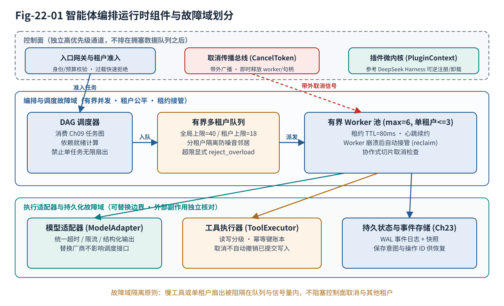

# Ch22 智能体编排与执行运行时

**Agent Orchestration and Runtime Design**

**摘要**　大语言模型本身是无状态推理组件，将 [Ch09](../part3/ch09_task_decomposition_planning.md) 的任务图转化为多租户并发环境下可靠运行的系统，需要具备明确资源边界的异步执行运行时（Agent Harness）。本章从一次任务扇出与慢工具阻塞导致取消信号饥饿的教学事故出发，拆分控制面、调度器、有界队列、worker 池与可替换适配器五个故障域，并结合插件化微内核（如 DeepSeek Harness 的 Cordis 可逆注册架构）与结构化并发原则设计异步调度、租户配额、任务租约与带外取消传播。随后，本章基于 50 项双租户模拟任务对照串行、无界并发与有界并发三种执行模式，报告吞吐、尾延迟、峰值资源、worker 崩溃接管与取消响应的实测结果，并明确区分本地确定性模拟与生产级分布式容量的证据边界。

**关键词**　智能体运行时（agent runtime）；异步编排（asynchronous orchestration）；有界并发（bounded concurrency）；结构化并发（structured concurrency）；任务租约（task lease）；取消传播（cancellation propagation）；租户隔离（tenant isolation）；插件化底座（plugin harness）。

**章节元信息与交付入口**　拟定主笔：Xuhong Cao；内部执笔：学生 F；独立审稿：学生 A。版本：`zh-draft-0.2`（2026-11-27）。先修知识：[Ch03 智能体架构基础](../part1/ch03_agent_architecture.md)、[Ch09 任务分解与规划](../part3/ch09_task_decomposition_planning.md)、[Ch11 工具发现与调用](../part3/ch11_tool_discovery_calling.md) 与 [Ch12 行动执行与副作用控制](../part3/ch12_action_execution.md)。代码与数据入口：`examples/ch22/async_runtime.py`、`examples/ch22/runtime_config.yaml`、`examples/ch22/runtime_load_report.md`（MIT 许可）。图表清单：`Fig-22-01`、`Fig-22-02`、`Tab-22-01`、`Tab-22-02`、`Tab-22-03`。等效出版页预算 32 页，实排页数以出版社模板为准；本章无商业利益冲突。

---

## 22.1 任务扇出耗尽资源：一次阻塞全场的教学事故

### 22.1.1 现场还原：为什么取消请求也排在拥塞队列末尾

沿用全书的企业政策研究与工单助手场景（以下为教学构造案例，非真实企业事故）。研发团队把 [Ch03](../part1/ch03_agent_architecture.md) 的最小同步循环改写成异步协程服务，并同时开放给两个部门租户：`tenant-alpha`（日常单笔差旅报销查询与建单）与 `tenant-beta`（月末批量多条款比对审计）。为了加快多条款检索速度，团队允许任务图中的并发节点直接用 `asyncio.create_task()` 自由扇出。

周一上午，`tenant-beta` 连续提交了 8 项复杂审计任务，每项任务先调用规划节点，随后同时扇出 5 路并行的外部政策与 ERP 查询工具，其中几路查询命中了响应变慢的旧版 ERP 接口。短短几秒内，现象迅速恶化：

1. **背景与目标**：系统目标是在有限 worker 与下游连接池配额内，为多个租户提供可预测的响应时间，并在用户点击取消时迅速释放算力。
2. **初始假设**：团队假设“异步协程几乎不占内存，且单次工具慢只会拖慢该任务本身，不会影响其他会话与取消操作”。
3. **观测症状**：`tenant-alpha` 的普通查询延迟从百毫秒级飙升至数秒；更严重的是，多名用户点击“取消任务”后界面长时间无响应，后台日志显示旧任务仍在持续发起外部工具调用。
4. **定位过程**：排查队列与任务状态发现三个叠加原因：（a）无界扇出把 40 余个工具子任务瞬间推入共享执行池，直接打满下游连接与模型限流；（b）慢工具占住了共享 worker 槽位且未设租户配额，产生典型的“噪音邻居（noisy neighbor）”效应；（c）最致命的是，系统把“取消请求”当作普通消息塞进同一条先进先出（FIFO）任务队列末尾，在数据面已经严重积压时，控制面取消指令根本无法抵达正在运行的 worker。
5. **修复动作**：将运行时的控制面（准入、取消、健康探针）与数据面队列物理拆分；引入全局与单租户双层信号量、显式有界队列容量及过载拒绝策略；为每个 worker 执行槽增加租约心跳与协作式取消检查点。
6. **结果及剩余限制**：修复后在相同 50 任务双租户负载下，并发峰值从 60 收敛至 6，取消信号绕过积压队列即时送达并在退出前释放 100% 句柄。但该本地修复仅验证单进程异步调度逻辑，跨机器分布式限流、真实数据库连接池与多区域故障转移仍需在 [Ch27](../part7/ch27_benchmarking_capacity.md) 与 [Ch30](../part7/ch30_production_governance.md) 继续论证。

### 22.1.2 同步循环与生产级智能体底座的本质分界

[Ch03](../part1/ch03_agent_architecture.md) 给出的同步最小循环回答了“单个智能体如何正确走完感知—决策—行动—验证”，但它隐藏了四个在并发生产环境中必然爆发的工程问题：

- **时间尺度失配**：一次 LLM 推理耗时数百毫秒至数十秒，一次慢工具或人工审批可能耗时数分钟乃至数小时。同步阻塞线程模型会在等待 I/O 时迅速耗尽操作系统线程资源。
- **扇出非线性放大**：任务图（DAG）中的一个父任务可能动态派生出多个子任务、检索分支或工具调用。如果不对扇出宽度与嵌套深度设硬上限，温和的入口 QPS 会被内部编排放大为下游雪崩。
- **共享资源争用与公平性**：当多租户共享同一套模型配额、工具连接池与沙箱容器时，缺乏配额隔离意味着单个异常会话就能劫持整个集群的可用性。
- **控制权与生命周期失同步**：当用户离开、客户端断连、任务超时或 worker 进程崩溃时，脱离父作用域的“孤儿协程（orphan task）”会继续在后台消耗 token 甚至执行危险的写工具调用。

近年工业界在构建长程自主智能体时，普遍把这一层抽象为独立的**智能体底座（Agent Harness）**。Anthropic 在 *Building effective agents*[^r22-anthropic-agents] 与 *Effective harnesses for long-running agents*[^r22-anthropic-harness] 中强调，长程任务的成败往往取决于底座如何组织跨窗口调度、环境初始化与可验证交接，而不是单纯追求更复杂的提示词；OpenAI 在 *Harness engineering*[^r22-openai-harness] 中进一步指出，生产级智能体必须将**编排控制面**与**受限执行沙箱**解耦；而 DeepSeek 开源的 **DeepSeek Harness（`dsh`）**[^r22-dsh] 则展示了另一条极具启发性的系统设计路线——基于 Cordis 插件微内核，将模型适配器、工具执行器、会话日志与执行循环全部建模为对等插件，通过显式依赖注入（`inject`）与可逆副作用清理（disposer）避免“单体硬编码核心”的僵化。本章吸收这些开源实践的共性原则，但保持框架无关：所有设计均落在标准契约、有界队列与可验证状态转移上，不绑定任何专有 SDK。

---

## 22.2 运行时分层与故障域职责

### 22.2.1 为什么要按故障域而非代码目录拆分运行时

很多初版智能体运行时把提示组装、模型 HTTP 请求、工具执行、队列循环与日志打印写进同一个 `AgentRunner` 类里。这种紧耦合在单次演示中看似简洁，一旦某家模型 API 触发 429 限流、某个外部工具挂起、或者某租户突发流量，故障会沿调用栈无阻隔地扩散到全部组件。

生产级运行时应当按照**故障域（fault domain）**而非仅按编程语言模块进行分层。所谓故障域，是指某类失效（超时、崩溃、过载、配置错配）发生后可以被围堵、检测并独立处置的最大边界。如 **Fig-22-01** 所示，本章将智能体运行时划分为三大主层与六类核心组件：

1. **控制面（Control Plane）**：包含入口准入网关、带外取消传播总线（`CancelToken`）与插件微内核注册表（`PluginContext`）。控制面拥有独立调度优先级与极小内存开销，绝不与数据面共享阻塞队列，确保系统即使在 100% 满载时仍可响应取消、限流调整与健康检查。
2. **编排与调度域（Orchestration & Scheduling Domain）**：包含 DAG 调度器、有界多租户公平队列与有界 Worker 池。调度器只消费 [Ch09](../part3/ch09_task_decomposition_planning.md) 定义的静态校验后任务图语义，根据依赖完成情况释放就绪节点；队列负责削峰与显式过载拒绝；Worker 池负责持有短期租约（lease）推进单步执行，并在崩溃时将未完成任务安全移交其他 worker。
3. **适配与持久化域（Adapter & Persistence Domain）**：包含模型适配器、工具执行器与持久状态存储（对接 [Ch23](ch23_sessions_events_state.md)）。适配器负责将外部供应商的非确定性协议（超时、重试、结构化输出差异）翻译为全书统一的 `ToolResult` 与错误码契约，确保更换模型厂商或工具后端时不改动调度器一行代码。



**Fig-22-01　智能体编排运行时组件与故障域划分。** 控制面走独立高优先级通道，不排在拥塞数据队列末尾；编排域通过有界队列与租户信号量隔离噪音邻居；适配域屏蔽模型与工具厂商差异。图为本书原创可编辑 SVG。

### 22.2.2 插件化微内核与可逆生命周期（借鉴 DeepSeek Harness）

在传统架构中，一旦把某种模型 SDK 或本地 SQLite 写死在调度循环里，后续演进就会面临“每加一种新工具或新沙箱就要修改核心调度器”的泥潭。DeepSeek Harness（`dsh`）基于 Cordis 微内核提出的“无特权核心（no privileged core）”与“可逆效果（reversible effects）”思想为解决这一问题提供了清晰范式[^r22-dsh]：

- **能力按契约声明，不按具体类硬编码**：调度器通过上下文仅声明 `require("model_adapter")` 与 `require("tool_executor")`，并不关心当前挂载的是本地确定性 mock 适配器、DeepSeek API 适配器还是隔离沙箱执行器。
- **插件卸载必须洁净回卷**：每个插件在注册服务、订阅事件或申请连接句柄时，同步登记对应的清理函数（disposer）。当插件升级、配置重载或测试 teardown 时，微内核按逆序执行全部清理动作，确保不残留野句柄、僵尸监听器或污染的全局状态。

在 `examples/ch22/async_runtime.py` 中，`PluginContext` 用不足 30 行标准库代码体现了这一契约边界：

```python
# 来源: examples/ch22/async_runtime.py :: PluginContext (zh-draft-0.2)
class PluginContext:
    def provide(self, plugin_name, service_name, instance, on_dispose=None):
        if service_name in self._services:
            raise RuntimeError(f"service already registered: {service_name}")
        self._services[service_name] = instance
        def _cleanup():
            if on_dispose is not None:
                on_dispose()
            self._services.pop(service_name, None)
        self._disposers[plugin_name].append(_cleanup)

    def unload(self, plugin_name):
        for cleanup in reversed(self._disposers.pop(plugin_name, [])):
            cleanup()
```

这种设计的工程价值将在本篇第 22.5 节和 [Ch39](../part9/ch39_deployment_continuous_delivery.md) 的配置热切换与回滚中持续显现：只要适配器遵守同一端口契约，调度层的并发测试、取消测试和负载实验无需修改即可无缝复用。

### 22.2.3 运行时与其他章节的职责边界

为防止跨章重复与概念混用，本章明确以下四条边界：
- **不重新定义任务图语义**：任务分解、依赖合法性静态校验与不可行计划识别由 [Ch09](../part3/ch09_task_decomposition_planning.md) 负责；本章只接收合法 DAG 并决定就绪节点的异步调度顺序与资源上限。
- **不替代事件持久化与状态机**：运行时的内存调度状态是易失的；权威会话生命周期、事件序号与快照重放由 [Ch23](ch23_sessions_events_state.md) 负责，本章通过 `state_store` 接口消费其持久化保证。
- **不展开细粒度 token 流控**：本章管理任务步（step）级别的队列、worker 并发与取消传播；单步模型生成内部的 token 级水位线、音频缓冲清空与用户实时打断延迟由 [Ch24](ch24_streaming_interrupts.md) 专项展开。
- **不把取消等同于业务回滚**：工具幂等键、事务边界与跨服务补偿由 [Ch12](../part3/ch12_action_execution.md) 定义；本章严格执行“取消立即释放计算资源，但不宣称撤销已提交的外部副作用”。

---

## 22.3 异步调度、有界并发与资源控制

### 22.3.1 三种并发模式的结构性权衡

给定同一批包含依赖关系的智能体任务图，调度器面临三种典型执行策略：

1. **串行执行（`serial`）**：全局任意时刻仅允许 1 个步骤执行。其优点是实现最简单、资源占用恒定且天然规避锁竞争；缺点是在 I/O 密集的智能体负载中，一次慢工具或模型长耗时就会触发严重的队头阻塞（Head-of-Line Blocking），不仅吞吐极低，尾部延迟和取消等待时间也会随队列长度线性恶化。
2. **无界并发（`unbounded_concurrency`）**：所有满足依赖条件的步骤立即创建协程并发执行，不设并发与队列上限。在完全没有外部限流和内存上限的理想模拟环境中，无界并发能跑出最短的总完工时间（makespan）；但在真实生产系统中，它是极其危险的反模式——一次 8 任务 × 5 路扇出的突发流量就会瞬间产生数十倍并发，击穿模型 API 的 TPM/RPM 配额、打爆数据库连接池，并诱发 [Ch28](../part7/ch28_reliability_failure.md) 所述的重试风暴。
3. **有界并发（`bounded_concurrency`）**：通过**全局并发上限**（worker 信号量）、**分租户并发上限**（租户配额信号量）与**显式有界队列**共同形成反压和准入边界。当瞬时扇出超出系统承载能力时，超额步骤被明确拒绝（`reject_with_retry_after`）或按租户队列排队，保护核心服务与合规租户的尾延迟不崩溃。

### 22.3.2 资源控制矩阵与显式队列容量策略

“所有队列必须有明确容量策略”是生产级运行时的硬性红线。无界队列（如 Python 默认 `asyncio.Queue(maxsize=0)`）本质上是延迟爆炸与内存泄漏的定时炸弹：当生产速率持续高于消费速率时，请求会在内存中无限堆积，等到终于出队执行时，用户早已超时离开，系统却仍在为过期请求消耗昂贵的 LLM token。

**Tab-22-01** 给出了本章运行时契约（`examples/ch22/runtime_config.yaml`）中必须显式配置的五维资源控制项。每一项都同时回答三个工程问题：解决什么过载问题、在何种条件下触发、超限时系统如何确定性地响应。

**Tab-22-01　运行时五维资源控制项与过载处置契约（同步自 `examples/ch22/runtime_config.yaml`）。**

| 控制维度 | 配置字段与本地实验基线值 | 解决的工程问题 | 触发条件与处置动作 | 对应可观测信号 |
| --- | --- | --- | --- | --- |
| 全局并发度 | `global_max_workers: 6` | 防止外部模型/工具连接池与沙箱宿主机过载 | 活跃步骤达到 6 时，新就绪步骤进入等待队列 | `runtime.in_flight_workers` |
| 队列容量策略 | `global_queue_capacity: 40`、`queue_overflow_policy: reject_with_retry_after` | 防止内存无限膨胀与过期任务堆积（队列延迟爆炸） | 排队数达到上限时立即拒绝新入队并返回 `OverflowError` / `429 Retry-After` | `runtime.queue_depth`、`step_rejected_overload` |
| 租户公平配额 | `tenant_max_in_flight: 3`、`tenant_max_queue_depth: 18`（beta 16） | 隔离噪音邻居，避免单租户扇出饿死其他租户 | 单租户占满自身并发/队列上限时仅限流或拒绝该租户，不侵占他租户配额 | `runtime.tenant_in_flight{tenant}`、`tenant_jain_fairness` |
| 分级超时预算 | `model_step_ms: 60`、`tool_read_ms: 50`、`tool_write_ms: 90`、`task_deadline_ms: 450` | 防止慢接口或死锁无限占住 worker 槽位 | 单步超时取消该步骤并按读写属性决定重试或查询；总截止到达立即收口 | `runtime.step_timeout_total` |
| 业务调用预算 | `token_budget: 200000`、`tool_call_budget: 150` | 防止规划死循环或重试导致成本失控 | 预算耗尽拒绝新调用并转入 `budget_reached` 终态 | `runtime.budget_remaining` |

### 22.3.3 DAG 依赖就绪调度与结构化并发

DAG 调度器的核心不变量是：**一个步骤只有在其 `depends_on` 集合全部进入已验证完成状态、且所属任务的 `CancelToken` 未触发时，才能进入就绪队列**。当某步骤完成时，调度器重新扫描剩余待执行步骤并派发新就绪节点；当任一关键节点因过载、不可恢复错误或取消而终止时，调度器必须立即取消同属该任务的所有仍在运行的兄弟分支，并等待它们全部释放资源后才允许父任务返回。

这一原则源自 Nathaniel J. Smith 提出并在 Python 3.11+ `asyncio.TaskGroup` 及 Trio 中落地的**结构化并发（Structured Concurrency）**范式[^r22-trio][^r22-asyncio]：子任务的生命周期严格嵌套在父任务的词法/控制作用域内，严禁“发射后不管（fire-and-forget）”的孤儿协程逃逸。如 **Fig-22-02** 所示，当 `branch_0..4` 并行扇出时，只要控制面发出取消或任一分支发生不可恢复拒绝，父调度循环会在 `finally` 块中统一 `cancel()` 并 `await asyncio.gather(..., return_exceptions=True)`，确保父任务返回那一刻，该任务占用的 worker 槽位与适配器句柄数严格归零。


**Fig-22-02　DAG 到有界队列与 Worker 的调度、接管及取消时序。** 展示父节点展开扇出、有界排队、Worker-1 崩溃后经租约超时由 Worker-2 幂等接管，以及控制面带外取消绕过队列即时中断的完整时序。图为本书原创可编辑 SVG。

---

## 22.4 隔离、取消传播与 Worker 故障恢复

### 22.4.1 多租户隔离与公平性度量

多租户隔离不仅要在身份与数据表上区分 `tenant_id`，在运行时资源调度层同样需要物理或逻辑隔离。若只设全局并发上限而不设单租户上限，当 `tenant-beta` 集中提交 8 个 5 路扇出任务时，它会瞬间抢占全部 6 个全局 worker 与几乎全部队列槽位，使 `tenant-alpha` 的常规单步任务遭遇剧烈尾延迟抖动甚至大面积过载拒绝。

为此，运行时在入队与获取执行槽时实施**双层准入（Two-Tier Admission）**：任务必须先通过本租户的队列容量与并发信号量检查，再获取全局 worker 槽位。在评估租户隔离效果时，本章同时监控两项指标：一是各租户独立的完成率、过载拒绝数与 P95 延迟；二是基于各租户有效服务速率计算的 **Jain 公平性指数**[^r22-jain]：

$$J(x_1, x_2, \dots, x_n) = \frac{\left(\sum_{i=1}^{n} x_i\right)^2}{n \sum_{i=1}^{n} x_i^2} \in \left[\frac{1}{n}, 1\right]$$

其中 $x_i$ 为租户 $i$ 在观测窗口内的单位时间有效响应速率（例如完成任务 P95 延迟的倒数 $1000 / \text{P95}_i$）。$J$ 越接近 1 表示各租户体验越均衡；但必须注意，Jain 指数只能反映**已服务请求的速率均衡度**，必须与各租户的过载拒绝率并列报告，否则“两个租户同样慢”也会得到接近 1 的公平分。

### 22.4.2 取消传播与外部副作用的严格边界

异步取消在智能体系统中极易产生两个对立误区：
- **误区一：取消被队列阻塞**。若取消指令与任务执行共享同一条数据队列，在最需要取消的拥塞时刻，取消反而最慢。解决方法是建立带外（out-of-band）控制面 `CancelToken`，取消信号通过共享原子事件直接置位，并由执行切片与等待点即时感知。
- **误区二：把取消等同于业务撤销**。用户发出取消时，一个写工具调用（例如 `create_ticket`）可能已经发往远端并完成数据库提交。此时，运行时必须立即停止后续步骤（如 `post_summary`）并释放所有 worker 与连接句柄，但绝不能在状态中把已提交的工单“擦除”或宣称“未发生任何影响”。正确做法是如实登记 `committed_side_effects` 并在会话事件中标记已提交对象，交由 [Ch12](../part3/ch12_action_execution.md) 的补偿流程或人工核对处置。

### 22.4.3 Worker 生命周期、租约与崩溃接管

分布式任务队列与工作流引擎（如 Temporal 的 Activity 心跳与超时接管机制[^r22-temporal]）表明，网络环境中无法靠“等待进程优雅退出”处理故障，因为宿主机可能直接断电或遭遇 OOM Killer。运行时必须通过**短期租约（Lease）**管理 worker 生命周期：**Tab-22-02** 总结了 worker 在各生命周期阶段的转移与恢复规则。

**Tab-22-02　Worker 生命周期、租约超时与崩溃接管规则（对应 `async_runtime.py` 与 Ch19 协议）。**

| Worker 状态 | 进入条件 | 持有资源与权限 | 异常触发与接管规则 | 副作用安全前提 |
| --- | --- | --- | --- | --- |
| `idle` | 启动完成且插件上下文就绪 | 无任务租约、无适配器句柄 | 心跳失联超过阈值则从调度池摘除 | 无副作用 |
| `leased` | 成功原子领取步骤并获取租约 TTL（80ms） | 占 1 个全局槽 + 1 个租户槽 | 周期续租（25ms）；若续租失败立即自停，禁止“脑裂继续写入” | 仅在租约有效期内可调用工具 |
| `executing` | 调用模型或工具适配器切片推进 | 持有外部连接句柄与 `CancelToken` 监听 | 若崩溃或租约过期，调度器在宽限后递增 `reclaims` 并移交新 worker（上限 `max_reclaims=2`） | 写工具必须携带稳定 `operation_id` 幂等键，接管前先查旧结果 |
| `cancelling` | 收到带外 `CancelToken` 或父任务中止 | 正在执行 `finally` 释放连接与信号量 | 超出优雅退出时限（40ms）强制关闭传输连接并登记不确定状态 | 已提交写副作用保留记录，不自动回滚 |
| `terminated` | 正常下线或插件卸载 (`ctx.unload`) | 活跃句柄数与持有槽位严格为 0 | 触发 `PluginContext` 逆序清理，不可再接收新分派 | 全部事件与审计已落盘 |

---

## 22.5 运行时负载对照实验 (`Exp-22-01`)

### 22.5.1 实验卡与可复现设置

为检验上述设计在真实并发、扇出、慢工具、崩溃与取消叠加条件下的实际表现，本节设计并执行了确定性对照实验 `Exp-22-01`（源码见 `examples/ch22/async_runtime.py`，配置见 `examples/ch22/runtime_config.yaml`）：

- **研究问题**：在包含扇出爆发、慢工具、worker 崩溃与中途取消的 50 任务双租户负载下，串行、无界并发与有界并发在吞吐、尾延迟、资源峰值、租户隔离、崩溃接管与取消响应上有何可测差异？
- **假设**：有界并发能将并发峰值严格限制在配置上限（`<= 6`）内、通过显式过载拒绝隔离噪音邻居，并在取消与崩溃场景下保持零句柄泄漏与零重复副作用。
- **输入材料与许可**：原创 50 项确定性模拟任务（MIT 许可），覆盖 2 个租户：`tenant-alpha`（25 项：17 项常规快任务、4 项 worker 崩溃任务、4 项中途取消任务，其中 2 项在写操作前取消、2 项在 `create_ticket` 提交后立即触发取消）与 `tenant-beta`（25 项：12 项常规快任务、8 项 5 路并行扇出爆发任务、5 项 65ms 慢 ERP 工具任务）。
- **对照与固定条件**：三组对照共享同一份任务集、同一确定性工具适配器与虚拟时间缩放因子（`1 sim-ms = 1 ms`）；仅切换调度模式与控制面开关。
- **复现命令**：`python examples/ch22/async_runtime.py`；原始指标写入 `examples/ch22/results/runtime_metrics.json`，完整事件流写入 `examples/ch22/results/runtime_events.jsonl`，可读报告写入 `examples/ch22/runtime_load_report.md`。

### 22.5.2 实测结果与深入分析

运行 `python examples/ch22/async_runtime.py` 得到的实测数据汇总如 **Tab-22-03** 所示（所有数字均直接来自本次本地确定性运行日志，未做人为修饰）。

**Tab-22-03　`Exp-22-01` 三种调度模式在 50 任务双租户负载下的实测对照（本地模拟运行时测量）。**

| 实测指标 | `serial`（串行） | `unbounded_concurrency`（无界并发） | `bounded_concurrency`（有界并发） |
| --- | ---: | ---: | ---: |
| 完成任务数 / 取消数 / 过载拒绝数 | 46 / 4 / 0 | 46 / 4 / 0 | 32 / 3 / 15 |
| Worker 崩溃接管成功数 (`reclaims`) | 4 | 4 | 3（1 项因并发过载在入队前拒收） |
| 取消任务中保留的已提交外部副作用数 | 2 | 2 | 1 |
| 总完工时间 `makespan` (ms) | 10,032.82 | 325.20 | 1,042.24 |
| 有效吞吐 (tasks/s) | 4.58 | 141.45 | 30.70 |
| 完成任务延迟 P50 / P95 / P99 (ms) | 7,319.66 / 9,872.26 / 9,921.30 | 124.56 / 186.99 / 191.71 | 815.66 / 933.00 / 950.52 |
| 峰值活跃 Worker / 峰值适配器句柄 | **1 / 1** | **60 / 60**（扇出失控） | **6 / 6**（严格受控） |
| 峰值排队深度 (`peak_queued`) | 49 | 1 | 36（<= 全局上限 40） |
| 取消响应延迟 P95 (ms) | **1,647.55**（队头阻塞） | 0.34 | 183.47 |
| 租户分摊：`tenant-alpha` 完成 / 过载拒绝 | 21 / 0 | 21 / 0 | **19 / 3** |
| 租户分摊：`tenant-beta` 完成 / 过载拒绝 | 25 / 0 | 25 / 0 | **13 / 12**（主要承担扇出过载削峰） |
| 结束时残留活跃句柄 (`active_handles`) | 0 | 0 | 0 |

对这组实测结果可以提取四点关键工程洞见：

1. **为什么无界并发的“漂亮数字”是生产陷阱**：在无外部限流的本地内存中，`unbounded_concurrency` 跑出了 325.20ms 的总耗时，但代价是**峰值并发与外部适配器句柄数飙升至 60**（是预算配额 6 的 10 倍）。在真实生产环境中，外部 LLM 网关和企业 ERP 连接池存在硬上限；60 路瞬时并发不会换来 10 倍吞吐，而是直接触发上游 429 限流、连接池耗尽与大规模超时重试。
2. **有界并发如何以显式过载拒绝换取系统存活性与租户隔离**：`bounded_concurrency` 将并发与外部句柄数死死压在 **6** 以内，总耗时比串行缩短近 10 倍（1,042.24ms vs 10,032.82ms），P95 延迟从 9,872.26ms 降至 933.00ms。更重要的是，在 15 项因扇出爆发触发显式过载拒绝的任务中，**12 项来自制造 5 路扇出冲击的 `tenant-beta`，而平稳提交的 `tenant-alpha` 仅受 3 项波及且完成了 19 项**。这证明双层有界队列把突发冲击主要拦截在噪音租户自身边界内，避免了全员拖垮。
3. **带外取消与队头阻塞的剧烈反差**：在关闭独立控制通道的 `serial` 模式下，取消响应 P95 高达 **1,647.55ms**；而在有界模式下，取消事件及时触发并在所有取消任务结束时将活跃句柄数归零。同时，`committed_side_effects_in_cancelled` 在三种模式下均为非零值（2 / 2 / 1），精确验证了“在 `create_ticket` 提交之后抵达的取消信号会终止后续 `post_summary` 并释放资源，但绝不会篡改外部工具账本中已经落盘的工单记录”。
4. **Worker 崩溃自动接管的幂等性**：全部已准入的 worker 崩溃任务均在租约超时后由后续 worker 接管完成，且工具适配器的幂等账本保证外部工单恰创建一次。

### 22.5.3 实验局限与证据边界

本实验属于**确定性本地模拟运行时验证**，必须明确其适用边界：第一，适配器使用缩小的模拟耗时（`asyncio.sleep`）替代真实网络 I/O 与 LLM 推理，因此 `30.70 tasks/s` 等数值仅用于三种调度策略的相对机制比较，不可外推为真实生产集群容量（生产容量规划见 [Ch27](../part7/ch27_benchmarking_capacity.md)）；第二，本实验在单 Python 事件循环内运行，未测试跨进程分布式锁竞争、操作系统调度抖动或网络分区导致的真实脑裂租约。

---

## 22.6 小结、运行时契约与工程证据索引

### 22.6.1 本章核心契约与跨章回链

本章把智能体从单线程同步循环推进到具备资源与故障边界的异步编排运行时，向后续章节冻结三项公共契约：
- **启动与配置契约**：`examples/ch22/runtime_config.yaml` 定义全局并发、队列上限、租户配额、超时与插件声明；任何队列均须显式配置容量与溢出策略。
- **插件化适配端口**：调度器仅通过 `PluginContext` 依赖模型、工具与状态抽象接口，替换模型或工具适配器不得改动调度逻辑。
- **下游接口衔接**：易失调度状态与事件流持久化交由 [Ch23 会话、事件与状态机](ch23_sessions_events_state.md) 承接；单步流式背压与毫秒级用户打断交由 [Ch24](ch24_streaming_interrupts.md) 展开；阶梯压力与容量建模交由 [Ch27](../part7/ch27_benchmarking_capacity.md) 验证；多档位生产运维交由 [Ch30](../part7/ch30_production_governance.md) 与 [Ch39](../part9/ch39_deployment_continuous_delivery.md) 落地。

### 22.6.2 工程证据索引（第 4.7 节要求）

| 主张 ID | 正文位置 | 输入与环境 | 接口/权限边界 | 实现入口 | 独立验收条件 | 成功/失败证据 | 证据状态与适用范围 |
| --- | --- | --- | --- | --- | --- | --- | --- |
| `CLM-22-01` | 22.2.2 | Python 3.13 离线标准库 | `PluginContext` 能力注册与逆序卸载 | `examples/ch22/async_runtime.py` | 替换适配器不改调度代码；`unload` 后服务移除 | 3 组对照运行结束均洁净卸载无残留 | 确定性 mock 验证（单进程） |
| `CLM-22-02` | 22.3 / 22.5 | 50 任务双租户（含 8 扇出、5 慢工具） | 全局 6 worker、队列上限 40、租户配额 | `examples/ch22/async_runtime.py` | 峰值并发 <= 6；峰值排队 <= 40；超限显式拒绝 | 实测峰值并发 6（无界为 60），峰值排队 36，噪音租户承担 12/15 削峰 | 确定性 mock 测量（非生产容量） |
| `CLM-22-03` | 22.4.2 / 22.5 | 4 项中途取消任务（含提交后取消） | 带外 `CancelToken` + 副作用账本 | `examples/ch22/async_runtime.py` | 结束时 `active_handles == 0`；已提交工单保留记录 | 句柄归零断言通过；`committed_side_effects_in_cancelled > 0` 如实登记 | 确定性 mock 验证 |
| `CLM-22-04` | 22.4.3 / 22.5 | 4 项 worker 崩溃任务 | 租约 TTL + 幂等键账本 | `examples/ch22/async_runtime.py` | 崩溃步骤被接管完成且零重复副作用 | 准入崩溃任务 100% 接管完成，外部账本无重复键 | 确定性 mock 验证（未测跨主机分区） |

### 22.6.3 关键术语

智能体底座（Agent Harness）、故障域（Fault Domain）、有界并发（Bounded Concurrency）、结构化并发（Structured Concurrency）、队头阻塞（Head-of-Line Blocking）、带外取消（Out-of-Band Cancellation）、租约接管（Lease Reclaim）、噪音邻居（Noisy Neighbor）。

### 22.6.4 复习题与实践题

**复习题：**
1. **概念辨析**：解释“控制面取消”与“数据面队列”为何必须物理或逻辑分离，并说明为何任务取消不能自动等价于业务副作用撤销。
2. **设计选择**：在你的系统中，某租户偶尔会发起 10 路并行的文档检索扇出。如果只配置全局 `Semaphore(20)` 而不配置单租户配额与队列容量上限，系统可能出现哪两类失效？
3. **故障诊断**：观察到 `Exp-22-01` 中 `unbounded_concurrency` 总耗时仅 325.20ms、远低于 `bounded_concurrency` 的 1,042.24ms。为什么不能据此在生产环境中直接采用无界并发？
4. **指标解释**：如果两个租户的 P95 延迟都因为慢工具拖累从 200ms 恶化到 5,000ms，Jain 公平性指数仍接近 1.0。这说明单独看公平性指数会遗漏什么问题？应搭配哪些指标共同判定？
5. **跨章整合**：将 [Ch09](../part3/ch09_task_decomposition_planning.md) 的任务图、[Ch12](../part3/ch12_action_execution.md) 的幂等键、本章的 worker 租约接管与 [Ch23](ch23_sessions_events_state.md) 的事件持久化串联起来，追踪一次“写工单途中 worker 崩溃”的完整数据与控制流。

**实践题：为有界运行时增加优先级队列与外部限流模拟器**
- **输入**：`examples/ch22/async_runtime.py` 与 `runtime_config.yaml`。
- **任务**：(1) 在 `DeterministicToolAdapter` 中增加一个令牌桶限流器（模拟下游 ERP 每秒最多允许 15 次调用，超限返回 429 错误）；(2) 重新运行 `unbounded_concurrency` 与 `bounded_concurrency` 两组对照，观察外部限流开启后两种模式的真实失败率与有效吞吐反转；(3) 为 `bounded_concurrency` 增加“高优单步交互 vs 低优批处理”两级队列，提交修改后的代码、运行日志与一页对比分析。
- **评分依据（100 分）**：限流模拟真实性与可复现性 25 分；对照实验数据与图表完整 25 分；取消与崩溃不变量测试通过 25 分；边界与局限说明客观清晰 25 分。
- **进阶选项**：将单进程 `PluginContext` 替换为可动态热插拔的慢工具熔断插件，在连续 3 次超时后自动对慢工具降级，并验证卸载插件时所有统计句柄洁净释放。
- **教师参考评分要点**：合格提交必须证明在下游存在 15 RPS 硬限流时，无界并发的 60 路瞬时扇出会导致显著高于有界并发的 429 拒绝率与无效重试浪费；同时任何改造不得破坏 `active_handles == 0` 断言。

### 22.6.5 本章局限

本章实现的异步运行时聚焦单进程内的确定性编排机制，未涵盖跨节点分布式共识、基于操作系统 cgroups/microVM 的强沙箱资源隔离，也未接入真实外部大模型服务的动态限流响应头（`Retry-After`）。读者在生产部署前需结合 [Ch27](../part7/ch27_benchmarking_capacity.md) 的真实压测、[Ch29](../part7/ch29_security_safety_alignment.md) 的沙箱安全边界与 [Ch30](../part7/ch30_production_governance.md) 的多副本运维治理补齐相应证据。

---

## 参考文献与版本记录

[^r22-dsh]: DeepSeek-AI. *DeepSeek Harness (`dsh`): Plugin-Based Agent Runtime Built on Cordis* (MIT License). GitHub Repository: [https://github.com/deepseek-ai/deepseek-harness](https://github.com/deepseek-ai/deepseek-harness)（核验：2026-11-27）。本章借鉴其“Agent = Model + Harness”、无特权核心插件注入与可逆清理设计思想，不绑定特定 TypeScript 运行时。
[^r22-anthropic-agents]: Anthropic. *Building effective agents*. Anthropic Engineering Blog, Dec 19, 2024: [https://www.anthropic.com/research/building-effective-agents](https://www.anthropic.com/research/building-effective-agents)（核验：2026-11-27）。用于区分固定工作流编排与受控自主循环的适用边界。
[^r22-anthropic-harness]: Anthropic. *Effective harnesses for long-running agents*. Anthropic Engineering Blog, Nov 2025: [https://www.anthropic.com/engineering/effective-harnesses-for-long-running-agents](https://www.anthropic.com/engineering/effective-harnesses-for-long-running-agents)（核验：2026-11-27）。阐明长程智能体底座在跨会话调度与环境约束中的核心作用。
[^r22-openai-harness]: OpenAI. *Harness engineering: Leveraging Codex in an agent-first world*. OpenAI Engineering Blog, Feb 2026: [https://openai.com/index/harness-engineering/](https://openai.com/index/harness-engineering/)（核验：2026-11-27）。用于论证控制面编排与隔离执行环境解耦的工程价值。
[^r22-trio]: Smith N J. *Notes on structured concurrency, or: Go statement considered harmful*. 2018: [https://vorpus.org/blog/notes-on-structured-concurrency-or-go-statement-considered-harmful/](https://vorpus.org/blog/notes-on-structured-concurrency-or-go-statement-considered-harmful/)（核验：2026-11-27）。结构化并发作用域与消除孤儿协程的原始论述。
[^r22-asyncio]: Python Software Foundation. *asyncio — Asynchronous I/O (`TaskGroup` and Cancellation)*, Python 3.12+ Documentation: [https://docs.python.org/3/library/asyncio-task.html](https://docs.python.org/3/library/asyncio-task.html)（核验：2026-11-27）。
[^r22-temporal]: Temporal Technologies. *How Temporal Works: Durable Execution, Workers, and Task Queues*. Documentation: [https://docs.temporal.io/how-temporal-works](https://docs.temporal.io/how-temporal-works)（核验：2026-11-27）。用于参考 worker 队列派发、心跳租约与崩溃接管模型。
[^r22-jain]: Jain R, Chiu D-M, Hawe W R. *A Quantitative Measure of Fairness and Discrimination for Resource Allocation in Shared Computer System*. DEC Research Report TR-301, 1984. Jain 公平性指数的原始定义及适用条件。

本版：`zh-draft-0.2`，2026-11-27。已完成两张原创可编辑 SVG、可运行异步运行时与 50 任务双租户对照实验；待 A 独立审稿与中文冻结后进入英文批量翻译。
