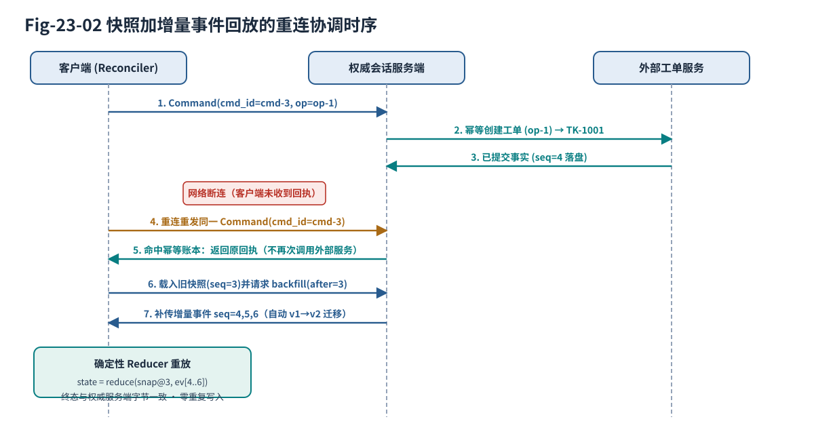

# Ch23 会话、事件与状态机

**Sessions, Events, and State Machines**

**摘要**　长时交互智能体跨越多次网络重连、人工审批暂停、进程重启与代码版本升级，仅保存一段非结构化聊天文本无法可靠重建权威业务状态。本章从一次断连重发导致工单重复创建且恢复快照落后于已确认事件的教学事故出发，将长会话建模为显式状态机与追加式事件日志，严格分离命令意图、已发生事件、物化状态与快照，并结合事件溯源、Temporal 确定性回放、LangGraph 检查点以及 Anthropic 长程智能体结构化状态移交实践，给出 `session_id`/`turn_id`/`event_id`/`sequence`/`schema_version` 公共协议、确定性 `reducer`、`event-v1` 到 `event-v2` 模式升级器与客户端重连协调规则。在 3 条完整会话与 20 种断连、缺序号、乱序、重复与旧快照故障变体的对照实验中，事件加快照方案实现 20/20 终态字节一致与零重复外部副作用，显著优于仅存聊天文本基线（2/20 一致、4 次重复副作用）。

**关键词**　会话生命周期（session lifecycle）；事件溯源（event sourcing）；状态机（state machine）；确定性归约器（deterministic reducer）；快照与回放（snapshot and replay）；重连协调（reconnection reconciliation）；命令幂等（command idempotency）；模式迁移（schema upcasting）。

**章节元信息与交付入口**　拟定主笔：Xuhong Cao；内部执笔：学生 F；独立审稿：学生 A。版本：`zh-draft-0.2`（2026-11-27），优先级：P0 公共接口章。先修知识：[Ch03 智能体架构基础](../part1/ch03_agent_architecture.md) 与 [Ch14 任务状态与工作记忆](../part4/ch14_state_working_memory_context.md)。代码与契约入口：`examples/ch23/session_state_machine.yaml`、`examples/ch23/event_schema.json`、`examples/ch23/session_replay.py`（MIT 许可），公共事件模式同步冻结至 [附录 C](../appendix_c_schemas.md)。图表清单：`Fig-23-01`、`Fig-23-02`、`Tab-23-01`、`Tab-23-02`、`Tab-23-03`。等效出版页预算 30 页；本章无商业利益冲突。

---

## 23.1 重连造成重复执行：从两条时间线定位不一致

### 23.1.1 教学事故还原：已提交的工单为何又建了一次

在企业政策研究与工单助手中，员工发起一笔 250 元的境内差旅报销会话（以下为教学构造案例，非真实生产事故）。前端客户端通过长连接向智能体服务端发送“创建工单”指令。服务端调用模拟工单服务成功落盘 `TK-1001`，正准备把确认消息发回前端时，员工所在的移动网络切换基站导致连接瞬间中断。

1. **背景与目标**：系统要求在网络抖动、页面刷新或审批等待数小时后重新打开会话时，用户能无缝看到准确进度，且外部工单绝不重复创建。
2. **初始假设**：初版系统直接把对话消息列表持久化为一张 `chat_messages` 表，并定时覆盖写一份“当前会话 JSON 快照”；团队以为“客户端没收到成功回复时重发一次请求，或者重连时读取最新快照”就足以保证恢复。
3. **观测症状**：客户端超时重连后自动重发了“提交工单”请求，服务端因未对客户端命令去重，再次调用工单接口生成了重复工单 `TK-1002`；更糟糕的是，服务端另一副本在恢复时加载了落后于已提交事件的旧快照，界面竟然还显示“尚未提交”，诱使用户手动点击第三次提交。
4. **定位过程**：把客户端命令时间线与服务端事件时间线并列还原后，根因一目了然：（a）系统混用了“客户端想做什么（命令）”与“服务端已经持久化了什么（事件）”，重发命令被当成了全新意图；（b）快照缺乏单调序号标记（`last_sequence`），客户端与服务端无法识别某份快照已经落后于已确认事实；（c）状态迁移依赖隐式布尔标记和自然语言历史推断，没有显式状态机阻止已终结会话被重复写入。
5. **修复动作**：建立命令幂等账本（按 `command_id` 返回既有回执）；用单调递增的追加式事件日志作为唯一事实源；给所有快照绑定 `last_sequence` 并强制在恢复时拉取 `seq > last_sequence` 的增量事件；使用纯函数确定性 `reducer` 重建物化状态。
6. **结果及剩余限制**：在 20 种断连、丢包、乱序、重复与旧快照故障注入下，终态一致率达到 20/20 且重复外部副作用归零。限制在于本例假设单一权威事件日志（如单主 SQLite/PostgreSQL）；多活跨区强一致事件复制与时钟偏斜需在分布式存储层另行保障。

### 23.1.2 本章与 Ch14、Ch24 的清晰边界

- **[Ch14 任务状态与工作记忆](../part4/ch14_state_working_memory_context.md)** 定义业务状态字段的语义（目标、事实、约束、隐私与摘要边界）；**本章（Ch23）** 解决这些状态如何通过命令、事件、快照与确定性回放实现跨中断持久化与一致恢复。
- **[Ch24 流式流水线、流量控制与用户打断](ch24_streaming_interrupts.md)** 解决单个轮次内毫秒级 token/音频片段失效与背压清理；**本章** 关注跨轮次、跨进程与跨重连的权威会话真相。

开源智能体工程报告反复印证了这一持久化边界的重要性。Anthropic 在 *Effective harnesses for long-running agents*[^r23-anthropic-harness] 中指出，仅靠对话上下文窗口无法跨越长时任务中断，必须将任务进度落盘为结构化状态工件（如 JSON 清单与 Git 检查点），因为模型对非结构化 Markdown 文本更容易产生静默覆写或状态漂移；Temporal 的持久化执行模型[^r23-temporal] 与 LangGraph 的 `thread_id` 检查点机制[^r23-langgraph] 则分别从**确定性事件历史重放**与**超步（superstep）状态快照**两条路径验证了同一核心原则：**副作用必须与状态重放彻底隔离，重放绝不能重新执行已经提交过的外部工具调用**。DeepSeek Harness（`dsh`）同样将会话事件流作为独立插件与模型推理循环解耦[^r23-dsh]，使审计、断点续跑与测试回放共享同一事件协议。

---

## 23.2 会话生命周期与显式状态机

### 23.2.1 六种显式状态与禁止转换规则

长时会话如果只用 `is_done: bool` 或靠解析最后一条助手消息来判断进度，必然会在人工审批暂停、工具超时未知或中途取消时陷入状态歧义。本章在 `examples/ch23/session_state_machine.yaml` 中定义六种互斥状态：

- **非终态（3 种）**：`created`（会话已创建并绑定模式版本，尚未开始轮次）、`running`（存在活跃 `turn_id`，允许受控推理与已授权工具执行）、`paused`（等待人工审批、外部长任务回调或用户补充信息，状态已落盘快照）。
- **终态（3 种）**：`completed`（业务目标通过独立后置验收）、`cancelled`（用户或控制面主动取消，已释放算力并如实登记既有外部副作用）、`failed`（不可恢复错误、预算耗尽或契约违背）。

如 **Fig-23-01** 所示，显式状态机的价值不仅在于列出“允许怎么走”，更在于用硬守卫强制拦截**禁止转换（forbidden transitions）**：
1. **禁止未经执行直接完成（`created → completed`）**：没有轮次事件与独立验收记录，任何模型文本都不得直接宣布成功。
2. **禁止终态复活（`completed / cancelled / failed → running`）**：终态一旦落盘即不可逆；如果用户在已完成会话上发起新需求，必须创建新 `session_id` 并通过父引用关联，防止污染既有审计闭环。
3. **禁止取消后被迟到回调翻转为成功（`cancelled → completed`）**：即使远端工具在取消后返回成功，会话终态仍保持 `cancelled`，仅在审计载荷中追加事实核对记录。


**Fig-23-01　显式会话状态机与禁止转换规则。** 实线箭头表示合法事件驱动的状态迁移，红色虚线表示被 `apply_event` 强制拒绝的非法迁移。图为本书原创可编辑 SVG。

### 23.2.2 五类核心标识符的分工

混用标识符是重连与重放故障的头号诱因。本章公共事件协议（同步写入 `examples/ch23/event_schema.json` 与 [附录 C](../appendix_c_schemas.md)）严格区分以下五个标识符与时间戳，如 **Tab-23-01** 所示：

**Tab-23-01　Ch23 公共事件字段规范（`schema_version: event-v2`，同步至附录 C）。**

| 字段名 | 类型与约束 | 权威生成方 | 核心职责 | 严禁混用点 |
| --- | --- | --- | --- | --- |
| `session_id` | 非空字符串 (`<=128`) | 会话入口服务 | 标识一条完整持久会话及其独立事件流分区 | 不得在网络重连或进程重启时重新随机生成 |
| `turn_id` | 非空字符串 (`<=128`) | 会话协调器 | 标识会话内的一次用户—智能体交互轮次 | 不替代 `session_id`，也不等同于 [Ch24](ch24_streaming_interrupts.md) 的流代次 `generation_id` |
| `event_id` | 非空字符串 (`<=128`) | 事件生产者 | 在 `producer` 命名空间内唯一标识一条已发生事实（参考 CloudEvents 1.0.2[^r23-cloudevents]） | 重投递同一事件保持不变；不同事实禁止复用 |
| `sequence` | 正整数 (`>=1`) | **权威事件存储** | 单会话内严格连续单调递增序号（1, 2, 3, ...），决定唯一全序 | 绝不由客户端本地时钟或多线程竞态自行分配 |
| `schema_version` | 枚举 (`event-v1` / `event-v2`) | 事件生产者 | 显式声明事件载荷格式版本，供读取时 `upcaster` 安全升级 | 不得静默忽略未知主版本 |
| `command_id` | 可空字符串 | 客户端 / 触发源 | 客户端命令幂等键，服务端据此去重并返回原回执 | 命令意图可被拒绝；事件是已落盘事实，二者分离 |
| `occurred_at_ms` | 非负整数 (ms) | 权威服务端单调源 | 审计与耗时参考时间 | **不作为分布式状态排序唯一依据**，排序以 `sequence` 为准 |
| `causation_id` / `correlation_id` | 可空字符串 | 权威服务端 | 串联“触发前因事件”与“全链路追踪上下文” | 仅作诊断与审计关联，不构成执行授权 |

---

## 23.3 命令、事件、快照与确定性 Reducer 实现

### 23.3.1 四种概念的严格分离

事件溯源（Event Sourcing）的核心纪律是将“请求变化”与“已经发生的变化”彻底拆开[^r23-fowler]：
1. **命令（Command）**：表达外部意图（例如 `execute_ticket_write`），携带幂等键 `command_id`。命令可以被校验拒绝、因终态被拦截，或在重连重发时直接命中幂等账本返回原回执而不再次触发业务逻辑。
2. **事件（Event）**：表达已经通过校验并持久化落盘的不可变事实（例如 `tool_intent_recorded`、`tool_effect_committed`）。事件一旦追加到事件日志（append-only log），**严禁就地修改或删除**；纠错只能通过追加新的补偿事件表达。
3. **物化状态（Materialized State）**：对当前会话截至 `last_sequence` 的全部事件依次应用纯函数 `reducer` 得到的查询视图（当前状态机位置、已提交工单映射、审批挂起标记、已见事件集合）。
4. **快照（Snapshot）**：物化状态在某个确切 `sequence`（例如每 3 条或每 100 条事件）处的只读缓存副本，用于加速长会话恢复。快照**不是真相源**；它永远附带 `last_sequence`，且可以通过从 `seq = 1` 全量重放随时重新生成并核验一致性。

### 23.3.2 确定性 Reducer 与禁止重放副作用

确定性归约器必须满足数学上的纯函数性质：

$$S_k = \text{reduce}(S_{k-1}, e_k), \quad \text{且对任意快照位置 } m \le n: \quad \text{reduce}(S_m, [e_{m+1}, \dots, e_n]) \equiv \text{reduce}(S_0, [e_1, \dots, e_n])$$

正如 Temporal 在确定性工作流约束中所强调的[^r23-temporal]，**`reducer` 内部绝不允许读取系统当前墙钟、生成随机数、访问网络或重新调用工具**。所有非确定性结果（生成的工单号 `TK-1001`、政策评估结论、审批人 ID）都必须在首次执行时作为事实载荷固化在 `tool_effect_committed` 等事件中；后续无论回放 1 次还是 100 次，`reducer` 只读取事件载荷重建内存视图，从而在结构上保证“合法重放永不重复触发外部副作用”。

以下是 `examples/ch23/session_replay.py` 中确定性 `apply_event` 与快照增量重放的核心片段：

```python
# 来源: examples/ch23/session_replay.py :: apply_event & replay_from_snapshot (zh-draft-0.2)
def apply_event(state, raw_event):
    ev = upcast_event(raw_event)  # 显式将 event-v1 迁移为 event-v2，不改写原始日志
    if ev["event_id"] in state["seen_event_ids"] or ev["sequence"] <= state["last_sequence"]:
        return state              # 幂等去重与陈旧序号忽略
    if ev["sequence"] != state["last_sequence"] + 1:
        raise ReconciliationError(f"sequence_gap: expected {state['last_sequence'] + 1}")
    # 校验显式状态机合法迁移，拦截任何终态复活或越级完成
    allowed = ALLOWED_TRANSITIONS.get(state["status"], {})
    if ev["event_type"] != "session_created" and ev["event_type"] not in allowed:
        raise StateTransitionError(f"forbidden transition: {state['status']} + {ev['event_type']}")
    ...
    return next_state

def replay_from_snapshot(session_id, events, snapshot=None):
    state = copy(snapshot) if snapshot is not None else initial_state(session_id)
    for ev in sorted((e for e in events if e["sequence"] > state["last_sequence"]),
                     key=lambda e: e["sequence"]):
        state = apply_event(state, ev)
    return state
```

### 23.3.3 事件模式演进：Upcaster 机制

生产系统运行数月后，事件模式不可避免会升级——例如 `event-v1` 时代尚未引入 `command_id`/`causation_id`，且把工单号命名为 `payload.ticket_ref`，而 `event-v2` 统一改名为 `payload.ticket_id`。如果直接修改历史数据库，会破坏审计不可变性并带来停机迁移风险；如果让 `reducer` 写满 `if v1 else v2` 分支，核心状态逻辑会迅速腐化。

标准工程解法是在事件读取入口插入无副作用的**模式升级器（Upcaster）**：读取时在内存中把 `event-v1` 确定性地转换为 `event-v2` 结构，原始持久化日志保持逐字节不可变，而下游 `reducer` 只需面向最新的 `event-v2` 契约编写。遇到未知主版本时，`upcast_event` 立即显式报错拒绝静默降级。

---

## 23.4 客户端重连与权威状态协调

### 23.4.1 权威服务端与弱网客户端的协调协议

在浏览器、移动端或边缘代理场景中，网络传输天然可能产生重复包、丢包缺口（gap）与乱序到达。如果客户端盲目把收到的推送事件直接覆盖本地 UI 状态，或者把本地缓存的旧快照写回服务端，就会引发状态倒退与重复操作。

正确的重连协调遵循**服务端权威（Server-Authoritative）**原则，如 **Fig-23-02** 与 **Tab-23-02** 所示：



**Fig-23-02　快照加增量事件回放的重连协调时序。** 客户端断连重发同一 `command_id` 命中服务端幂等账本，避免重复创建外部工单；重连载入旧快照后按 `last_sequence` 请求缺口补传并经确定性 `reducer` 收敛至一致终态。图为本书原创可编辑 SVG。

**Tab-23-02　重连与投递异常协调判定矩阵（对应 `ClientReconciler` 实现）。**

| 异常场景 | 可观测信号 | 客户端 / 服务端判定规则 | 最终状态与安全保证 |
| --- | --- | --- | --- |
| 重复命令重发 | 同一 `command_id` 再次抵达服务端 | 服务端查询 `command_receipts`，直接返回原回执（`deduplicated=true`） | 外部工具零重复调用，工单唯一 |
| 重复事件投递 | `ev.sequence <= state.last_sequence` 或 `event_id` 已见 | 客户端幂等丢弃并递增 `duplicates_ignored` 计数 | 物化状态不变 |
| 序号缺口 (Gap) | `ev.sequence > state.last_sequence + 1` | 禁止跳跃应用；先暂存至 `buffer[seq]`，立即向服务端请求 `fetch_backfill(after=last_sequence)` | 补齐缺失序号后按严格顺序排出缓冲 |
| 乱序到达 | `seq=4` 早于 `seq=3` 到达 | 同样落入缺口缓冲机制，待 `seq=3` 补齐后依序连续执行 `apply_event` | 消除乱序导致的状态机非法迁移报错 |
| 过期快照覆盖 | 待加载快照的 `last_sequence < 当前 state.last_sequence` | 拒绝倒退，保留更高序号状态；若快照领先本地则载入后**强制拉取尾增量事件** | 杜绝界面“时间倒流”诱导用户重复提交 |
| 历史模式升级 | 补传或重放流中包含 `event-v1` 记录 | `upcast_event` 实时无损转换为 `event-v2` 并记录 `schema_migrations` | 跨版本快照与新事件无缝衔接 |

---

## 23.5 回放与恢复对照实验 (`Exp-23-01`)

### 23.5.1 实验设计与 20 种故障变体

为严格检验本章协议在各类中断与投递异常下的鲁棒性，我们在 `examples/ch23/session_replay.py` 中构建了 `Exp-23-01`：

- **输入材料**：3 条完整业务会话——`S23-01-standard`（标准建单）、`S23-02-approval`（审批暂停与恢复）和 `S23-03-schema-upgrade`（`event-v1` 历史事件与 `event-v2` 新事件混排升级）——以及覆盖全部典型故障的 **20 种中断、重连与投递变体**（`V23-01` 至 `V23-20`，含断连重发、3 次重复命令、丢 `seq=2`/`seq=4` 缺口补传、尾事件倒序、相邻交换、旧快照恢复、旧快照覆写攻击、重复事件风暴、审批暂停期重连、终态后迟到写命令、提交后取消、禁止终态重启尝试、v1 快照加 v2 尾重放等）。
- **对照基线**：
  1. `chat_text_only`（仅保存聊天文本的传统基线，缺少命令幂等账本、严格事件序号与显式状态机守卫）；
  2. `events_plus_snapshots`（本章实现的权威事件日志 + 周期快照 + Upcaster + `ClientReconciler`）。
- **验收标准**：每个变体均独立核验四项条件——（1）客户端协调终态 == 权威服务端终态；（2）全量重放终态 == 快照加尾事件重放终态；（3）外部工单执行账本重复副作用数为 0；（4）非法状态迁移（`V23-15`）与终态后迟到写命令（`V23-13`）被确定性拦截。
- **复现命令**：`python examples/ch23/session_replay.py`；完整 20 条变体明细输出至 `examples/ch23/results/replay_report.json`。

### 23.5.2 实测对比结果与失败机制解析

**Tab-23-03　`Exp-23-01` 20 种中断、重连与投递变体实测汇总（来源：`examples/ch23/results/replay_report.json`）。**

| 评价维度 | `chat_text_only`（仅存聊天文本基线） | `events_plus_snapshots`（本章方案） | 差异根因 |
| --- | ---: | ---: | --- |
| 终态一致变体数（共 20 项） | **2 / 20** (10%) | **20 / 20** (100%) | 文本历史无法表达序号缺口、乱序缓冲与旧快照水位 |
| 重复外部副作用次数 | **4 次** | **0 次** | 缺少 `command_id` 幂等账本与终态写守卫 |
| 缺口与乱序自动修复率 | 0% | 100% | `ClientReconciler` 缓冲并向权威服务端拉取 `backfill` |
| 过期快照倒退拦截 | 不支持 | 100% 拦截并追齐尾事件 | 快照携带权威 `last_sequence` |
| `event-v1 → event-v2` 跨版本重放 | 不支持 | 全部无损收敛（`V23-03/06/09/12/15/18/20`） | 显式 `upcast_event` 隔离模式演进 |
| 终态复活尝试 (`V23-15`) | 无守卫 | 抛出 `StateTransitionError` 拦截 | 显式状态机禁止迁移表 |

值得特别指出 `V23-14`（`cancel_after_write_no_undo`）与 `V23-13`（`late_command_after_completed`）两项边界验证：在 `V23-14` 中，工单已落盘后会话收到取消命令，最终状态严格落入 `cancelled`，但 `committed_effects` 中仍保留已创建的 `TK-1001` 证据，绝不自欺欺人地擦除历史；在 `V23-13` 中，会话达到 `completed` 终态后抵达的新写命令被直接拒收（`reason="terminal_session"`），防止延迟重试在业务关闭后再改写外部世界。

---

## 23.6 小结、冻结公共事件协议与工程证据索引

### 23.6.1 公共接口冻结与跨章交接

本章将 `examples/ch23/event_schema.json` 与 `session_state_machine.yaml` 送入 [附录 C：接口、模式与事件轨迹](../appendix_c_schemas.md) 作为全书公共会话与事件协议基线：
- **上游消费**：承接 [Ch03](../part1/ch03_agent_architecture.md) 的 `Event` 契约、[Ch14](../part4/ch14_state_working_memory_context.md) 的业务状态字段与 [Ch19](../part5/ch19_multi_agent_communication.md) 的多智能体消息关联；
- **下游输出**：为 [Ch22](ch22_orchestration_runtime.md) 提供持久化状态存储接口，为 [Ch24](ch24_streaming_interrupts.md) 提供 `session_id`/`turn_id` 作用域以隔离流式代次失效，并与 [Ch36](../part9/ch36_reference_implementation.md) 的本地双 SQLite 恢复演示及 [Ch38](../part9/ch38_regression_fault_injection.md) 的轨迹回放断言保持语义一致。

### 23.6.2 工程证据索引（第 4.7 节要求）

| 主张 ID | 正文位置 | 输入与环境 | 接口/权限边界 | 实现入口 | 独立验收条件 | 成功/失败证据 | 证据状态与适用范围 |
| --- | --- | --- | --- | --- | --- | --- | --- |
| `CLM-23-01` | 23.2.1 | 显式 FSM 与非法事件注入 (`V23-15`) | 终态不可逆、禁越级完成 | `examples/ch23/session_replay.py` | 非法迁移必抛 `StateTransitionError` | `V23-15` `forbidden_transition_blocked=true` | 确定性 mock 验证 |
| `CLM-23-02` | 23.3.2 / 23.5 | 3 会话 × 20 故障变体 | 纯函数 `apply_event`、禁止重放 I/O | `examples/ch23/session_replay.py` | 客户端 == 服务端 == 全量重放 == 快照重放；重复副作用为 0 | 20/20 终态摘要一致，`duplicate_side_effects=0`（基线为 2/20 与 4 次重复） | 确定性本地模拟验证 |
| `CLM-23-03` | 23.3.3 | `S23-03` 混合 v1/v2 日志与快照 | `upcast_event` 只读升级 | `examples/ch23/session_replay.py` | v1 旧记录与 v2 新记录回放一致 | 含 `V23-12` 与 `V23-20` 全部一致收敛 | 确定性本地模拟验证 |
| `CLM-23-04` | 23.4.1 | 丢包、乱序、旧快照覆写变体 | 权威服务端 `fetch_backfill` | `examples/ch23/session_replay.py` | 缺口自动补齐，旧快照不覆盖新状态 | `V23-04/05/06/07/08/09/16` 全部一致恢复 | 确定性本地模拟验证（未测多主分布式复制） |

### 23.6.3 关键术语

事件溯源（Event Sourcing）、命令与事件分离（Command-Event Separation）、显式状态机（Explicit State Machine）、确定性归约器（Deterministic Reducer）、快照与增量回放（Snapshot + Tail Replay）、模式升级器（Upcaster）、服务端权威协调（Server-Authoritative Reconciliation）。

### 23.6.4 复习题与实践题

**复习题：**
1. **概念辨析**：说明命令（Command）、事件（Event）、物化状态（Materialized State）与快照（Snapshot）四者的本质区别，为什么快照不能替代事件日志作为真相源？
2. **设计选择**：在实现跨进程会话恢复时，为什么不能把 `time.time()` 或 `uuid.uuid4()` 直接写进确定性 `reducer`？应该把它们放在哪个边界？
3. **故障诊断**：某系统在客户端重连后收到了事件序列 `[seq=1, seq=2, seq=4]`。如果客户端为了降低延迟直接跳过 `seq=3` 先应用 `seq=4`，可能引发哪两类严重后果？
4. **指标解释**：在 `Exp-23-01` 中，为什么我们把“终态字节一致率”和“重复外部副作用数”分开统计，而不是合并为一个“恢复成功率”？
5. **跨章整合**：当会话处于 `paused` 等待人工审批期间，用户又通过流式界面发起了新轮次修改金额。请结合 [Ch14](../part4/ch14_state_working_memory_context.md) 的状态版本与本章的 `session_state_machine.yaml`，设计一套合法且不混淆审批对象的事件序列。

**实践题：为事件日志增加 SQLite 持久化与加密完整性链**
- **输入**：`examples/ch23/session_replay.py` 与 `examples/ch23/event_schema.json`。
- **任务**：(1) 将 `AuthoritativeSessionServer` 的内存列表替换为 SQLite 持久表（对 `(session_id, sequence)` 建立唯一主键约束，对 `(session_id, command_id)` 建立幂等回执表）；(2) 为每条事件增加 `prev_event_hash` 形成防篡改哈希链，并在回放时校验完整性；(3) 重跑 20 项故障变体，额外构造一条“人为篡改历史事件载荷”的测试证明回放器能准确拒绝。
- **评分依据（100 分）**：SQLite 原子落盘与约束 25 分；20 项变体全通过且零重复副作用 25 分；防篡改哈希链与负面测试 25 分；模式演进与边界分析 25 分。
- **进阶选项**：实现 `event-v2 → event-v3` 的二级级联 `upcaster`（新增多币种字段并给出默认值），验证 v1/v2/v3 三代事件同流回放一致。
- **教师参考评分要点**：严禁在 `reducer` 内读写外部工具或数据库；篡改测试必须真正触发验证失败并报告出错 `sequence`。

### 23.6.5 本章局限

本章的事件存储与协调实验基于单权威日志与确定性模拟网络投递，未覆盖多数据中心主从复制延迟（读到落后副本导致虚假缺口）、大规模事件流归档冷热分层以及长会话 PII 隐私字段的加密粉碎（crypto-shredding，涉及 [Ch15](../part4/ch15_long_term_memory.md) 与 [Ch29](../part7/ch29_security_safety_alignment.md) 合规删除要求）。

---

## 参考文献与版本记录

[^r23-fowler]: Fowler M. *Event Sourcing*. martinfowler.com, Dec 2005: [https://martinfowler.com/eaaDev/EventSourcing.html](https://martinfowler.com/eaaDev/EventSourcing.html)（核验：2026-11-27）。事件溯源、状态重放与快照重建的基础理论来源。
[^r23-temporal]: Temporal Technologies. *Deterministic Constraints and Event History Replay*. Temporal Documentation: [https://docs.temporal.io/workflow-definition](https://docs.temporal.io/workflow-definition)（核验：2026-11-27）。确定性重放约束与将非确定性副作用隔离在 Activity 中的工业实践。
[^r23-langgraph]: LangChain / LangGraph. *Persistence, Checkpointers, and Threads (`thread_id`)*. Documentation: [https://langchain-ai.github.io/langgraph/concepts/persistence/](https://langchain-ai.github.io/langgraph/concepts/persistence/)（核验：2026-11-27）。用于对照超步检查点快照与基于事件的回放模型差异。
[^r23-anthropic-harness]: Anthropic. *Effective harnesses for long-running agents*. Anthropic Engineering Blog, Nov 2025: [https://www.anthropic.com/engineering/effective-harnesses-for-long-running-agents](https://www.anthropic.com/engineering/effective-harnesses-for-long-running-agents)（核验：2026-11-27）。阐述跨会话结构化 JSON 状态工件相对于非结构化文本历史在防状态漂移上的优势。
[^r23-dsh]: DeepSeek-AI. *DeepSeek Harness (`dsh`)*. GitHub Repository: [https://github.com/deepseek-ai/deepseek-harness](https://github.com/deepseek-ai/deepseek-harness)（核验：2026-11-27）。参考其会话事件日志与推理核心解耦的插件化组织方式。
[^r23-cloudevents]: Cloud Native Computing Foundation (CNCF). *CloudEvents Specification v1.0.2*. [https://github.com/cloudevents/spec/blob/v1.0.2/cloudevents/spec.md](https://github.com/cloudevents/spec/blob/v1.0.2/cloudevents/spec.md)（核验：2026-11-27）。参考 `(source, id)` 唯一标识命名空间与重投递去重约定。
[^r23-jsonschema]: JSON Schema Specification Draft 2020-12: [https://json-schema.org/draft/2020-12/schema](https://json-schema.org/draft/2020-12/schema)（核验：2026-11-27）。用于规范 `event_schema.json` 结构校验。
[^r23-young]: Young G. *Versioning in an Event Sourced System*. Leanpub, 2017. 事件溯源系统中不可变日志与读时 Upcaster 模式演进的经典实践。

本版：`zh-draft-0.2`，2026-11-27。已完成两张原创可编辑 SVG、公共事件模式、状态机契约与 20 项故障变体实跑验证；公共模式已同步至附录 C。
