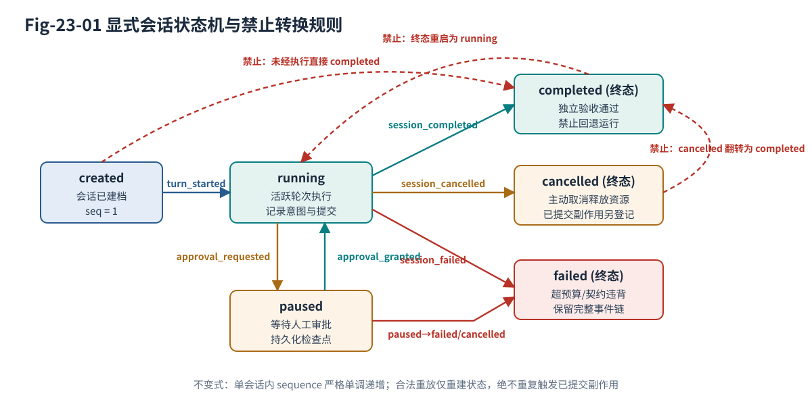

# Ch23 会话、事件与状态机

**Sessions, Events, and State Machines**

**摘要**　长时交互智能体常常跨越多次网络重连、人工审批暂停、进程重启与模式版本升级，仅保存一段非结构化聊天记录无法可靠重建权威业务状态。本章从一次网络重连导致工单重复创建且恢复快照落后于已确认事件的教学事故出发，将长会话建模为显式状态机与追加式事件日志，严格分离命令意图、已发生事件、物化状态与快照，并结合事件溯源、Temporal 确定性回放、LangGraph 检查点以及 Anthropic 长程智能体结构化状态移交实践，给出 `session_id`、`turn_id`、`event_id`、`sequence` 与 `schema_version` 公共协议、确定性归约器、模式升级器与客户端重连协调规则。在 3 条完整会话与 20 种断连、缺序号、乱序、重复与旧快照故障变体的对照实验中，事件加快照方案实现 20/20 终态字节一致与零重复外部副作用，显著优于仅存聊天文本基线的 2/20 一致与 4 次重复副作用。

**关键词**　会话生命周期（session lifecycle）；事件溯源（event sourcing）；状态机（state machine）；确定性归约器（deterministic reducer）；快照与回放（snapshot and replay）；重连协调（reconnection reconciliation）；命令幂等（command idempotency）；模式迁移（schema upcasting）。

本章拟定主笔为 Xuhong Cao，内部执笔学生 F，独立审稿学生 A，当前版本为 `zh-draft-0.3`（2026-11-27），属于 P0 公共接口章，无商业利益冲突。先修知识为 [Ch03 智能体架构基础](../part1/ch03_agent_architecture.md) 与 [Ch14 任务状态与工作记忆](../part4/ch14_state_working_memory_context.md)。代码与契约入口为 `examples/ch23/session_state_machine.yaml`、`event_schema.json` 与 `session_replay.py`，沿用 MIT 许可，公共事件模式同步冻结至 [附录 C](../appendix_c_schemas.md)。正文包含 `Fig-23-01`、`Fig-23-02` 与 `Tab-23-01` 至 `Tab-23-03`，30 等效页为混排预算。

---

## 23.1 重连造成重复执行

### 23.1.1 工单已经落盘，客户端为何又建了一次

在企业政策研究与工单助手中，员工发起一笔 250 元的境内差旅报销会话。系统需要支持用户在移动网络波动、刷新页面或等待主管审批数小时后重新打开会话，既能准确看到当前进度，又能保证外部工单绝不重复创建。初版实现看似省事：服务端把对话消息存进一张聊天记录表，再定时覆盖写入一份当前会话的 JSON 快照；团队假定客户端没收到回执时重发一次请求，或者重连时读出最新快照，就能恢复原样。

故障发生在一次普通的基站切换中。前端发出“创建工单”请求后，服务端顺利调用工单接口落盘了 `TK-1001`，正准备把确认回执发回前端时网络断开。客户端超时重连，自动把同一条创建请求又发了一遍；服务端没有记录客户端请求的幂等凭证，将其当成一笔全新申请再次调用工单接口，生出重复工单 `TK-1002`。更糟糕的是，服务端另一副本在恢复界面时读取了一份尚未刷新的旧快照，页面上竟然还显示“尚未提交”，诱使员工手动点击了第三次提交。上述情节是用于剖析状态恢复问题的教学构造案例，并非真实企业生产事故记录。

把客户端发出的命令时间线与服务端落盘的事件时间线并排对照，三个结构性缺口一目了然。第一，系统把“客户端想要做什么”和“服务端已经持久完成了什么”混为一谈，重发命令失去了去重依据。第二，快照上没有绑定单调递增的权威事件序号，接收方无法分辨手中的快照究竟领先还是落后于已确认事实。第三，状态流转只靠零散布尔字段与聊天文本推断，缺少显式状态机去拦截已经终结的会话再次触发写入。

针对这三个缺口，修复方案沿着四条边界展开：在服务端入口建立按 `command_id` 索引的命令幂等账本；用单调递增的追加式事件日志作为唯一事实源；给每份快照打上确切的 `last_sequence`，重连恢复时强制拉取该序号之后的全部增量事件；用不含外部 I/O 的纯函数归约器重建状态。在后文 20 种断连、缺序号、乱序、重复与旧快照故障变体中，这套机制把终态一致率推至 20/20，重复外部副作用降至 0。需要说明的是，该验证以单一权威事件日志为前提，跨区域多活强一致事件复制与时钟偏斜仍需由底层分布式存储保障。

### 23.1.2 与 Ch14、Ch24 的分工及开源实践印证

本书把状态相关职责清晰切分到三个章节：[Ch14 任务状态与工作记忆](../part4/ch14_state_working_memory_context.md) 定义业务状态字段的语义、来源与摘要边界；**本章**解决这些状态如何通过命令、事件、快照与确定性回放实现持久化与一致恢复；[Ch24](ch24_streaming_interrupts.md) 则聚焦单个轮次内毫秒级流式分片失效与背压清理。

这一分层在近年开源智能体工程报告中已成共识。Anthropic 在 *Effective harnesses for long-running agents*[^r23-anthropic-harness] 中指出，仅靠对话上下文窗口无法跨越长程任务中断，必须将进度固化为结构化状态工件而非易被模型改写的自由文本；Temporal 的持久化执行模型[^r23-temporal] 与 LangGraph 基于 `thread_id` 的检查点机制[^r23-langgraph] 分别从确定性事件历史重放与超步状态快照两条路线印证了同一底线——**状态重建必须与外部副作用彻底隔离，回放绝不能重新执行已提交的工具动作**。DeepSeek Harness 同样把会话事件流作为独立插件与推理循环解耦[^r23-dsh]，使审计、断点续跑和测试回放共享同一套事件协议。

---

## 23.2 会话生命周期与显式状态机

### 23.2.1 六种显式状态与禁止转换守卫

如果只靠 `is_done` 布尔标志或最后一条自然语言消息来猜测会话进度，一旦遇到人工审批暂停、工具超时未知或用户中途取消，系统就会立刻陷入语义混乱。本章在 `examples/ch23/session_state_machine.yaml` 中定义六种互斥状态。三种非终态分别为：`created` 表示会话已建档并绑定模式版本，尚未开始轮次；`running` 表示当前存在活跃轮次，允许受控推理与已授权工具调用；`paused` 表示正在等待人工审批、外部回调或用户补充输入，检查点已落盘。三种终态分别为：`completed` 表示目标通过独立后置验收；`cancelled` 表示主动取消、算力已释放且既有副作用已如实登记；`failed` 表示因不可恢复错误、预算耗尽或契约违背终止。

显式状态机真正的工程威力不在“画出一张正常流程图”，而在用硬守卫强制拦截**禁止转换**，如图 **Fig-23-01** 红色虚线所示。未经任何执行轮次与独立验收，系统禁止从 `created` 直接跃迁至 `completed`；一旦落入 `completed`、`cancelled` 或 `failed` 任一终态，绝不允许复活回到 `running`，后续新需求必须开启新会话并显式关联父会话；即使远端工具在取消之后才迟到返回成功，`cancelled` 终态也不得被翻转为 `completed`，只能将事实追加进审计记录。



**Fig-23-01　显式会话状态机与禁止转换规则。** 实线箭头表示合法事件驱动的状态迁移，红色虚线表示被 `apply_event` 强制拒绝的非法迁移。图为本书原创可编辑 SVG。

### 23.2.2 五类核心标识符的清晰分工

重连与回放故障大多始于标识符混用。表 **Tab-23-01** 给出了同步至 `examples/ch23/event_schema.json` 与 [附录 C](../appendix_c_schemas.md) 的公共事件核心字段。其中最关键的一条纪律是：**分布式状态排序以权威存储分配的单调 `sequence` 为准，绝不拿客户端本地墙钟 `occurred_at_ms` 决定先后**。

**Tab-23-01　Ch23 公共事件字段规范（`schema_version: event-v2`，同步至附录 C）。**

| 字段名 | 类型与约束 | 权威生成方 | 核心职责 | 严禁混用点 |
| --- | --- | --- | --- | --- |
| `session_id` | 非空字符串，最长 128 | 会话入口服务 | 标识一条完整持久会话及其独立事件流分区 | 不得在网络重连或进程重启时重新随机生成 |
| `turn_id` | 非空字符串，最长 128 | 会话协调器 | 标识会话内的一次用户—智能体交互轮次 | 不替代 `session_id`，也不等同于 [Ch24](ch24_streaming_interrupts.md) 的流代次 `generation_id` |
| `event_id` | 非空字符串，最长 128 | 事件生产者 | 在 `producer` 命名空间内唯一标识已发生事实，参考 CloudEvents 1.0.2[^r23-cloudevents] | 重投递同一事件保持不变；不同事实禁止复用 |
| `sequence` | 正整数，从 1 起 | **权威事件存储** | 单会话内严格连续单调递增序号，决定唯一全序 | 绝不由客户端本地时钟或并发线程自行分配 |
| `schema_version` | `event-v1` / `event-v2` | 事件生产者 | 显式声明载荷格式版本，供读时升级器安全迁移 | 不得静默忽略未知主版本 |
| `command_id` | 可空字符串 | 客户端或触发源 | 客户端命令幂等键，服务端据此去重并返回原回执 | 命令是待审意图，事件是既成事实，二者分离 |
| `occurred_at_ms` | 非负整数 (ms) | 权威服务端单调源 | 审计与耗时参考时间 | 不作为分布式状态排序的唯一依据 |
| `causation_id` / `correlation_id` | 可空字符串 | 权威服务端 | 串联触发前因事件与全链路追踪上下文 | 仅作诊断与审计关联，不构成执行授权 |

---

## 23.3 命令、事件、快照与确定性归约器

### 23.3.1 四种对象的边界分离

**事件溯源**（event sourcing）[^r23-fowler] 的核心思想，是不直接覆盖数据库的“当前状态字段”，而是把每一次经验证的状态变化按顺序追加记录下来，再由这些不可变事件推导出当前状态。为此必须严格区分四类对象：**命令**表达外部意图，携带 `command_id`，允许被校验拒绝或在重发时直接命中幂等账本返回原回执；**事件**表达已持久化落盘的不可变事实，追加后严禁就地修改，纠错只能追加新的补偿事件；**物化状态**是对截至 `last_sequence` 的事件流依次应用归约器得到的内存或查询视图；**快照**只是物化状态在某个确切序号处的只读缓存副本，用于避免长会话每次都从第 1 条事件重放。快照不是真相源，随时可以从头重放重新校验。

### 23.3.2 确定性归约器与零副作用重放

确定性归约器必须满足严格的纯函数性质：

$$S_k = \text{reduce}(S_{k-1}, e_k), \quad \text{且对任意快照位置 } m \le n: \quad \text{reduce}(S_m, [e_{m+1}, \dots, e_n]) \equiv \text{reduce}(S_0, [e_1, \dots, e_n])$$

沿用 Temporal 确定性工作流的核心约束[^r23-temporal]，归约器函数内部绝不允许读取系统当前时间、生成随机数或发起任何网络与工具调用。首次执行工具时产生的工单号、审批人标识或错误码，必须在落盘 `tool_effect_committed` 等事件时固化进载荷；后续无论为了进程恢复、客户端重连还是离线回归测试重放多少次，归约器都只读事件载荷推演内存状态，从结构上保证合法重放绝不会重复触发外部副作用。

以下为 `examples/ch23/session_replay.py` 中确定性归约与快照增量重放的核心片段：

```python
# 来源: examples/ch23/session_replay.py :: apply_event & replay_from_snapshot (zh-draft-0.3)
def apply_event(state, raw_event):
    ev = upcast_event(raw_event)  # 读时将 event-v1 升为 event-v2，原始日志保持不可变
    if ev["event_id"] in state["seen_event_ids"] or ev["sequence"] <= state["last_sequence"]:
        return state              # 幂等去重并忽略已应用序号
    if ev["sequence"] != state["last_sequence"] + 1:
        raise ReconciliationError(f"sequence_gap: expected {state['last_sequence'] + 1}")
    allowed = ALLOWED_TRANSITIONS.get(state["status"], {})
    if ev["event_type"] != "session_created" and ev["event_type"] not in allowed:
        raise StateTransitionError(f"forbidden transition: {state['status']} + {ev['event_type']}")
    ...
    return next_state

def replay_from_snapshot(session_id, events, snapshot=None):
    state = copy(snapshot) if snapshot is not None else initial_state(session_id)
    for ev in sorted((e for e in events if e["sequence"] > state["last_sequence"]),
                     key=lambda e: e["sequence"]):
        state = apply_event(state, ev)
    return state
```

### 23.3.3 读时模式升级器

系统长期运行必然遭遇事件格式演进。例如 `event-v1` 时代尚未记录 `command_id` 与因果字段，工单号字段名叫 `ticket_ref`，而 `event-v2` 统一更名为 `ticket_id`。直接改写历史数据库会破坏审计不可变性，把一堆版本分支塞进归约器又会让状态逻辑迅速腐化。成熟的工程做法是在读取入口放置无副作用的**模式升级器**（upcaster）[^r23-young]：读取历史 `event-v1` 时在内存中确定性地转换为 `event-v2`，磁盘上的原始事件逐字节不动，归约器只面向最新模式编写；一旦遇到未知主版本则立即显式报错，拒绝静默吞错。

---

## 23.4 客户端重连与权威状态协调

真实网络通道天然伴随重传、丢包缺口和乱序到达。若客户端盲目相信收到的每一帧推送，或者用本地旧快照直接覆盖内存状态，界面很快就会与后台事实分道扬镳。稳健的重连协议坚持**服务端权威**：服务端事件日志是唯一裁决者，客户端协调器在本地严格按连续序号推进，遇到缺口就先暂存乱序事件并向服务端请求补传，收到旧快照时绝不向后倒退，并在加载快照后强制追齐尾部增量事件。这一完整交互时序见图 **Fig-23-02**，六类投递异常的判定规则汇总于表 **Tab-23-02**。


**Fig-23-02　快照加增量事件回放的重连协调时序。** 客户端断连重发同一 `command_id` 命中服务端幂等账本，避免重复创建外部工单；重连载入旧快照后按 `last_sequence` 请求缺口补传并经确定性归约器收敛至一致终态。图为本书原创可编辑 SVG。

**Tab-23-02　重连与投递异常协调判定矩阵（对应 `ClientReconciler` 实现）。**

| 异常场景 | 可观测信号 | 客户端与服务端判定规则 | 最终状态与安全保证 |
| --- | --- | --- | --- |
| 重复命令重发 | 同一 `command_id` 再次抵达服务端 | 服务端查询 `command_receipts`，直接返回原回执并标明已去重 | 外部工具零重复调用，工单唯一 |
| 重复事件投递 | 序号不大于当前 `last_sequence` 或 `event_id` 已见 | 客户端幂等丢弃并记录 `duplicates_ignored` | 物化状态不变 |
| 序号缺口 | 到达序号大于 `last_sequence + 1` | 禁止跳跃应用；先暂存至 `buffer`，立即请求服务端 `fetch_backfill` | 补齐缺失序号后按严格顺序排出缓冲 |
| 乱序到达 | 靠后的事件先于前序事件抵达 | 自动进入缺口缓冲，待前序事件补齐后依序连续归约 | 消除乱序引发的虚假状态机异常 |
| 过期快照覆盖 | 待载入快照序号小于当前状态序号 | 拒绝状态倒退；若快照更新则载入后强制拉取尾部增量事件 | 杜绝界面时间倒流诱导重复提交 |
| 历史模式升级 | 补传或重放流中包含 `event-v1` 记录 | `upcast_event` 读时无损升为 `event-v2` 并登记迁移计数 | 跨版本快照与新事件无缝收敛 |

---

## 23.5 回放与恢复对照实验

### 23.5.1 实验设计与 20 种故障变体

我们在 `examples/ch23/session_replay.py` 中构建了确定性对照实验 `Exp-23-01`。材料包含 3 条完整业务会话——标准建单 `S23-01-standard`、审批暂停与恢复 `S23-02-approval` 以及跨版本升级 `S23-03-schema-upgrade`——并在此基础上展开 20 种中断、重连与投递变体 `V23-01` 至 `V23-20`，覆盖断连重发、三次重复命令、丢 `seq=2` 与丢 `seq=4` 缺口补传、尾事件倒序、相邻事件互换、旧快照恢复、旧快照覆写尝试、重复事件风暴、审批暂停期重连、终态后迟到写命令、提交后取消、禁止终态重启尝试以及 v1 快照加 v2 尾事件重放。

实验将本章的 `events_plus_snapshots` 方案与仅保存聊天文本的传统基线 `chat_text_only` 进行对照。每个变体都须独立满足四项验收：客户端协调终态与权威服务端终态一致、全量重放与快照加尾重放字节一致、外部工单账本重复副作用数为 0、非法迁移与终态后迟到写命令被准确拦截。运行 `python examples/ch23/session_replay.py` 即可复现，完整 20 条记录输出至 `examples/ch23/results/replay_report.json`。

### 23.5.2 实测结果对比

表 **Tab-23-03** 直接汇总了实测结果。

**Tab-23-03　`Exp-23-01` 20 种中断、重连与投递变体实测汇总（来源：`examples/ch23/results/replay_report.json`）。**

| 评价维度 | `chat_text_only`（仅存聊天文本基线） | `events_plus_snapshots`（本章方案） | 差异根因 |
| --- | ---: | ---: | --- |
| 终态一致变体数（共 20 项） | **2 / 20** (10%) | **20 / 20** (100%) | 文本历史无法表达序号缺口、乱序缓冲与旧快照水位 |
| 重复外部副作用次数 | **4 次** | **0 次** | 缺少 `command_id` 幂等账本与终态写守卫 |
| 缺口与乱序自动修复率 | 0% | 100% | `ClientReconciler` 缓冲并向权威服务端拉取补传 |
| 过期快照倒退拦截 | 不支持 | 100% 拦截并追齐尾事件 | 快照携带权威 `last_sequence` |
| `event-v1` 到 `event-v2` 跨版本重放 | 不支持 | 全部无损收敛 | 显式 `upcast_event` 隔离模式演进 |
| 终态复活尝试 (`V23-15`) | 无守卫 | 抛出 `StateTransitionError` 拦截 | 显式状态机禁止迁移表 |

两项边界变体尤其具有工程警示意义：在 `V23-14` 中，工单已提交后会话收到取消指令，系统终态严格落入 `cancelled`，但 `committed_effects` 仍完整保留已创建的 `TK-1001` 证据；在 `V23-13` 中，会话达到 `completed` 终态后才抵达的延迟写命令被直接拒收，避免网络滞后重试在业务关闭后继续改写外部世界。

---

## 23.6 小结、公共协议冻结与工程证据索引

### 23.6.1 公共协议冻结与跨章交接

本章将 `examples/ch23/event_schema.json` 与 `session_state_machine.yaml` 送入 [附录 C：接口、模式与事件轨迹](../appendix_c_schemas.md) 作为全书公共会话与事件基线。向上承接 [Ch03](../part1/ch03_agent_architecture.md) 的 `Event` 语义、[Ch14](../part4/ch14_state_working_memory_context.md) 的业务状态定义与 [Ch19](../part5/ch19_multi_agent_communication.md) 的多智能体消息关联；向下为 [Ch22](ch22_orchestration_runtime.md) 提供持久化状态契约，为 [Ch24](ch24_streaming_interrupts.md) 提供 `session_id` 与 `turn_id` 作用域边界，并与 [Ch36](../part9/ch36_reference_implementation.md) 的双 SQLite 跨进程恢复以及 [Ch38](../part9/ch38_regression_fault_injection.md) 的轨迹回放断言保持一致。

### 23.6.2 工程证据索引

| 主张 ID | 正文位置 | 输入与环境 | 接口与权限边界 | 实现入口 | 独立验收条件 | 成功与失败证据 | 证据状态与适用范围 |
| --- | --- | --- | --- | --- | --- | --- | --- |
| `CLM-23-01` | 23.2.1 | 显式 FSM 与非法迁移注入 `V23-15` | 终态不可逆、禁越级完成 | `examples/ch23/session_replay.py` | 非法迁移必抛 `StateTransitionError` | `V23-15` 拦截标记为 `true` | 确定性 mock 验证 |
| `CLM-23-02` | 23.3.2 / 23.5 | 3 会话 × 20 故障变体 | 纯函数 `apply_event`、禁重放 I/O | `examples/ch23/session_replay.py` | 客户端、服务端、全量与快照重放一致且零重复写入 | 20/20 终态摘要一致，重复副作用为 0；基线为 2/20 与 4 次重复 | 确定性本地模拟验证 |
| `CLM-23-03` | 23.3.3 | `S23-03` 混合 v1/v2 日志与快照 | `upcast_event` 读时升级 | `examples/ch23/session_replay.py` | 跨版本事件与快照回放一致 | `V23-12` 与 `V23-20` 等全部一致收敛 | 确定性本地模拟验证 |
| `CLM-23-04` | 23.4 | 丢包、乱序、旧快照覆写变体 | 权威服务端 `fetch_backfill` | `examples/ch23/session_replay.py` | 缺口自动补齐，旧快照不覆写高序号状态 | 对应变体全部无损收敛 | 确定性本地模拟验证，未测多主复制 |

### 23.6.3 关键术语

事件溯源（Event Sourcing）、命令与事件分离（Command-Event Separation）、显式状态机（Explicit State Machine）、确定性归约器（Deterministic Reducer）、快照与增量回放（Snapshot + Tail Replay）、模式升级器（Upcaster）、服务端权威协调（Server-Authoritative Reconciliation）。

### 23.6.4 复习题与实践题

**复习题：**
1. **概念辨析**：说明命令、事件、物化状态与快照四者的区别，解释为什么快照不能替代事件日志作为真相源。
2. **设计选择**：实现跨进程会话恢复时，为什么不能在确定性归约器中直接调用 `time.time()` 或 `uuid.uuid4()`？这些非确定性值应当在哪个边界产生并落盘？
3. **故障诊断**：客户端重连后收到序号为 1、2、4 的事件。如果为了追求低延迟跳过 3 直接应用 4，可能引发哪两类严重错误？
4. **指标解释**：在 `Exp-23-01` 中，为何将“终态字节一致率”与“重复外部副作用数”分开统计，而不是合并为单一的恢复成功率？
5. **跨章整合**：当会话处于 `paused` 等待人工审批时，用户通过流式界面发起了修改金额的新请求。请结合 [Ch14](../part4/ch14_state_working_memory_context.md) 的状态版本与本章状态机，设计一套合法且不混淆审批对象的事件序列。

**实践题：为事件日志增加 SQLite 持久化与防篡改哈希链**
- **输入**：`examples/ch23/session_replay.py` 与 `event_schema.json`。
- **任务**：第一，将 `AuthoritativeSessionServer` 的内存事件列表替换为 SQLite 持久表，对 `(session_id, sequence)` 建立唯一主键，并对 `(session_id, command_id)` 建立幂等回执表；第二，为每条事件增加 `prev_event_hash` 构成哈希链并在回放时校验；第三，重跑 20 项故障变体并新增一条人为篡改历史事件载荷的负面测试，证明回放器能够精准拒绝。
- **评分依据**：共 100 分，SQLite 原子约束 25 分、20 项变体全通过且零重复写入 25 分、哈希链与负面测试 25 分、模式演进与边界分析 25 分。
- **进阶选项**：实现 `event-v2` 到 `event-v3` 的二级级联模式升级器，引入多币种字段及默认值，验证三代事件同流回放一致。
- **教师参考评分要点**：归约器内严禁读写外部工具或数据库；篡改测试必须真正触发校验失败并报告出错序号。

### 23.6.5 本章局限

本章实验建立在单权威事件日志与确定性模拟投递之上，未涵盖多数据中心主从复制延迟导致的陈旧读、超长历史事件流的冷热归档分层，以及涉及个人隐私合规删除时的加密粉碎机制，相关安全与删除传播边界可分别回链 [Ch15](../part4/ch15_long_term_memory.md) 与 [Ch29](../part7/ch29_security_safety_alignment.md)。

---

## 参考文献与版本记录

[^r23-fowler]: Fowler M. *Event Sourcing*. martinfowler.com, Dec 2005: [https://martinfowler.com/eaaDev/EventSourcing.html](https://martinfowler.com/eaaDev/EventSourcing.html)（核验：2026-11-27）。事件溯源、状态重放与快照重建的基础理论来源。
[^r23-temporal]: Temporal Technologies. *Deterministic Constraints and Event History Replay*. Temporal Documentation: [https://docs.temporal.io/workflow-definition](https://docs.temporal.io/workflow-definition)（核验：2026-11-27）。确定性重放约束与将非确定性副作用隔离在 Activity 中的工业实践。
[^r23-langgraph]: LangChain / LangGraph. *Persistence, Checkpointers, and Threads (`thread_id`)*. Documentation: [https://langchain-ai.github.io/langgraph/concepts/persistence/](https://langchain-ai.github.io/langgraph/concepts/persistence/)（核验：2026-11-27）。用于对照超步检查点快照与基于事件的回放模型差异。
[^r23-anthropic-harness]: Anthropic. *Effective harnesses for long-running agents*. Anthropic Engineering Blog, Nov 2025: [https://www.anthropic.com/engineering/effective-harnesses-for-long-running-agents](https://www.anthropic.com/engineering/effective-harnesses-for-long-running-agents)（核验：2026-11-27）。阐述跨会话结构化 JSON 状态工件相对于非结构化文本历史在防状态漂移上的优势。
[^r23-dsh]: DeepSeek-AI. *DeepSeek Harness (`dsh`)*. GitHub Repository: [https://github.com/deepseek-ai/deepseek-harness](https://github.com/deepseek-ai/deepseek-harness)（核验：2026-11-27）。参考其会话事件日志与推理核心解耦的插件化组织方式。
[^r23-cloudevents]: Cloud Native Computing Foundation (CNCF). *CloudEvents Specification v1.0.2*. [https://github.com/cloudevents/spec/blob/v1.0.2/cloudevents/spec.md](https://github.com/cloudevents/spec/blob/v1.0.2/cloudevents/spec.md)（核验：2026-11-27）。参考 `(source, id)` 唯一标识命名空间与重投递去重约定。
[^r23-jsonschema]: JSON Schema Specification Draft 2020-12: [https://json-schema.org/draft/2020-12/schema](https://json-schema.org/draft/2020-12/schema)（核验：2026-11-27）。用于规范 `event_schema.json` 结构校验。
[^r23-young]: Young G. *Versioning in an Event Sourced System*. Leanpub, 2017. 事件溯源系统中不可变日志与读时 Upcaster 模式演进的经典实践。

本版：`zh-draft-0.3`，2026-11-27。已完成两张原创可编辑 SVG、公共事件模式、状态机契约、20 项故障变体实跑验证与全书文风统一润色。
