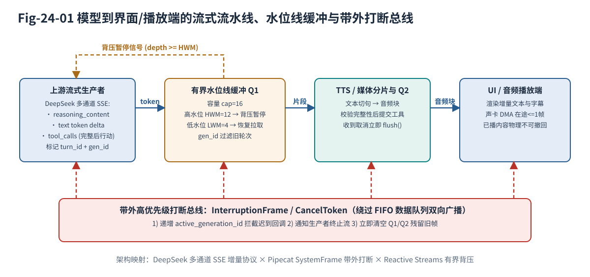

# Ch24 流式流水线、流量控制与用户打断

**Stream Processing, Flow Control, and User Interruption**

> **提案指定样章（Proposal Sample Chapter）**：本章为全书 Springer 提案指定样章，可独立阅读并完整演示“流式输出 → 水位线背压 → 带外取消传播 → `generation_id` 围栏 → 迟到结果隔离 → 五时间点打断延迟实测”的端到端工程闭环。专项审稿分工：学生 F 主写、学生 C 复核副作用边界、学生 A 复核测量口径。

**摘要**　在交互式智能体系统中，流式输出将首字响应延迟从数秒压缩到百毫秒级，但也把模型生成、队列缓冲、语音合成与外部工具执行拉入同一条异步流水线。当用户中途发出“停止”或发起新指令时，仅隐藏界面按钮无法阻断后台生产者，缓冲中的旧语音继续播报，迟到的工具回调还会污染下一轮上下文。本章从这一典型流式打断故障出发，区分思考链、文本片段、工具事件与媒体块四类增量流及可提交边界，结合 DeepSeek 多通道 SSE 流式协议、Pipecat 带外高优先级 `InterruptionFrame`、LiveKit 实时缓冲清空与 Reactive Streams 背压原则，构建以 `turn_id` 与 `generation_id` 围栏、高低水位线缓冲和带外取消总线为核心的流控架构。最后，本章在 40 个涵盖满队列、迟到回调、重复取消、工具提交后取消与取消—完成竞态的确定性时序用例上开展三组对照实测，将端到端可见打断延迟 P95 从仅改 UI 的 850.0 ms 降至 21.0 ms，实现旧轮次迟到回调零泄露，并明确界定物理已播放内容与已提交远端副作用的不可撤回边界。

**关键词**　流式处理（stream processing）；流量控制（flow control）；水位线与背压（watermarks and backpressure）；用户打断（user interruption）；取消传播（cancellation propagation）；代次围栏（generation fencing）；打断延迟（interruption latency）；过期输出清理（stale-output cleanup）。

**章节元信息与交付入口**　拟定主笔：Xuhong Cao；内部执笔：学生 F；独立审稿：学生 A；专项审稿：学生 C（副作用）、学生 A（测量）。版本：`zh-draft-0.2`（2026-11-27），优先级：P0 样章。先修知识：[Ch06 上下文与结构化输出](../part2/ch06_context_structured_outputs.md)、[Ch12 行动执行与副作用控制](../part3/ch12_action_execution.md)、[Ch22 编排运行时](ch22_orchestration_runtime.md) 与 [Ch23 会话与状态机](ch23_sessions_events_state.md)。代码与数据入口：`examples/ch24/stream_interrupt_demo.py`、`examples/ch24/interrupt_timeline.jsonl`、`examples/ch24/results/ch24_summary.json`、`examples/ch24/sample_ch24_zh.md`（MIT 许可）。图表清单：`Fig-24-01`、`Fig-24-02`、`Fig-24-03`、`Tab-24-01`、`Tab-24-02`、`Tab-24-03`。等效出版页预算 34 页；本章无商业利益冲突。

---

## 24.1 用户停止后仍被旧输出打断：一条失控的流式时间线

### 24.1.1 教学事故还原：界面说“已停止”，声音和工具却还在跑

考虑一个接入了流式文本、语音播报（TTS）和工单工具的企业政策助手（以下为教学构造案例，非真实企业事故）。员工语音询问：“请查询 2026 年海外差旅住宿上限，并帮我草拟一张报销单。”模型流式生成解释文本的同时，调用了响应较慢的海外政策查询工具，并把第一批文字推给了 TTS 语音合成器。

1. **背景与目标**：系统目标是在流式呈现答案的同时，允许用户随时点击“停止”或插话改问新问题，并保证旧回复在数十毫秒内安静退出、绝不串味到下一轮。
2. **初始假设**：研发团队在前端实现了“点击停止即把按钮重置、隐藏旧气泡”的逻辑，同时默认浏览器关闭事件流后后端会自动停止一切工作。
3. **观测症状**：在 `t = 150 ms` 时员工发现自己说错了目的地，立刻说“停止，改成查境内差旅”。前端界面瞬间显示“已停止”，但扬声器里仍把已经缓存在播放队列中的 8 段旧语音念了近一秒；更糟的是，95 ms 后旧轮次的“海外政策查询工具”延迟返回结果，后端未校验轮次代次，直接把这条海外上限塞进了员工新发起的“境内差旅”回答上下文中，导致新一轮直接给出错误的海外报销标准。
4. **定位过程**：沿模型生产者 → 文本缓冲 → TTS 队列 → 播放端与工具回调四层逐一比对时间戳发现：（a）前端仅改 UI 状态并未向下游发出可传播的取消令牌，上游模型与 TTS 仍在白白消耗算力并继续往队列里灌帧；（b）文本到音频之间存在未清空的 FIFO 缓冲区，即便上游停了，积压在队列里的旧音频块仍按 24–35 ms/块的消费速度慢慢播完；（c）工具回调既无 `generation_id` 标签也无接收端围栏，迟到响应直接越界污染了新轮次。
5. **修复动作**：为流式流水线的每一层显式绑定 `(turn_id, generation_id)`；建立带高低水位线（HWM/LWM）的有界缓冲实施上游背压；引入绕过数据队列的带外取消总线，在取消瞬间同步递增 `active_generation_id`、终止上游生产者并清空各级队列旧帧；在工具回调入口加装代次围栏并把迟到已提交副作用转入审计核对通道。
6. **结果及剩余限制**：在 40 项确定性时序用例中，端到端可见停止 P95 从 850.0 ms 降至 21.0 ms，迟到工具泄露从 14 次降至 0 次。剩余物理边界同样必须透明披露：已经交付给声卡 DMA 硬件缓冲的最后半帧音频，以及在取消前已经完成远端数据库提交的写工具动作，均**无法被流取消撤回**。

### 24.1.2 为什么流式打断是实时智能体的核心试金石

在传统批处理或单轮 HTTP 请求—响应架构中，“生成完成才返回”天然屏蔽了中间态。而现代生产级智能体为了压缩首响延迟（TTFT / TTFB），必须一边解码模型 token，一边增量渲染文本、分句送入 TTS、甚至并行触发只读检索。正如 Pipecat 的帧流水线文档[^r24-pipecat] 与 LiveKit Agents 的实时交互架构[^r24-livekit] 共同指出的：**流式流水线把原本串行的步骤变成了多级并发生产—消费队列，任何一次用户打断都等价于跨越多个异步边界的瞬时状态作废（state invalidation）**。本章专注于把这条流水线的流量控制、取消传播与五点延迟测量讲透、写实、验清；跨文本/语音/视觉/文件/传感器的双时钟同步与降级则留待 [Ch25](ch25_multimodal_realtime.md) 展开。

---

## 24.2 流与增量行动模型：不是所有增量都可以立即执行

### 24.2.1 四类增量流与“可提交边界”

一条看似单一的智能体输出流，实际上混合了语义与风险截然不同的四类增量载荷。以 DeepSeek-R1 / V3 的 SSE（Server-Sent Events）流式协议[^r24-deepseek-r1][^r24-deepseek-sse] 为典型工业对照，单个 HTTP 响应流中会交错推送思考增量（`reasoning_content`）、面向用户的回答增量（`content`）与工具调用参数碎片（`tool_calls` delta）；而在语音智能体中还会衍生出第四类——媒体音频块（audio frames）。如果运行时把这四类碎片一视同仁地直接向下游放行，就会酿成严重的半截执行事故：

1. **内部思考/推理增量（`reasoning` channel）**：如 DeepSeek 推理端点输出的 `reasoning_content`。它适合在受控界面以折叠流形式向用户展示进度以缓解等待焦虑，但**绝不应作为执行权限依据，也不应未经脱敏直接送入 TTS 朗读或写入长期业务状态**。
2. **面向用户的文本片段（`text` channel）**：可按字词或标点切分后低延迟流式渲染，也可在攒够语义短句后增量送入 TTS。其特点是“可增量呈现、允许随时截断”，但一旦呈现给用户即成为人类已感知的既成事实。
3. **工具调用事件（`tool_event` channel）**：模型在流式输出 JSON 参数时，前一半可能只是 `{"amount": 25`（甚至最终会被模型自我修正或因中断截断）。严格呼应 [Ch06](../part2/ch06_context_structured_outputs.md) 与 [Ch12](../part3/ch12_action_execution.md) 的铁律：**未完成且未通过 Schema 与业务权限双校验的结构化工具流，严禁触发任何带副作用的外部行动**。即便只读检索工具，也必须等待完整参数闭合与权限校验通过后才允许派发。
4. **媒体块（`audio` / `video` channel）**：由 TTS 或渲染器按固定时长切片（如 20–40 ms PCM/Opus 帧）送入播放缓冲。媒体块的消费速度受物理播放时间刚性约束（1 秒音频必须播满 1 秒），是流式系统中最容易产生速率失配与背压堆积的环节。

### 24.2.2 `turn_id` 与 `generation_id` 双重身份标记

仅靠 `session_id`（[Ch23](ch23_sessions_events_state.md)）远远不足以在毫秒级流式通道中区分新旧输出。在单个会话内，用户可能先发起了第 1 轮（`turn-01`），中途打断又重试同一意图，或者抢占发起第 2 轮（`turn-02`）。因此，流水线中的每一个分片（`StreamChunk`）在诞生那一刻就必须携带不可变的身份元组：

$$\text{ChunkIdentity} = (\texttt{session\_id},\; \texttt{turn\_id},\; \texttt{generation\_id},\; \texttt{seq},\; \texttt{channel})$$

其中 `generation_id` 是**严格单调递增的生成代次号**。每当用户发起停止、重生成或抢占新轮次时，协调器在控制面原子递增 `active_generation_id`。下游每一级缓冲区、TTS 合成器、工具回调入口和前端渲染器只执行一条极简、无锁的不变式检查：

```python
if chunk.generation_id != active_generation_id:
    drop_and_audit(chunk, reason="stale_generation_fenced")
```

这一条代次围栏（generation fencing）彻底消除了“旧轮次碎片靠网络延迟绕过取消信号、混入新轮次”的结构性漏洞。

---

## 24.3 有界缓冲、水位线背压与带外取消传播

### 24.3.1 为什么“生产快、消费慢”会放大打断延迟

在典型语音或慢网客户端场景中，LLM 解码速度可达每秒 50–100 个 token（约 15–30 秒的语音文本在 1 秒内就能全部吐完），而用户耳朵和声卡每秒只能消费 1 秒音频。如果 LLM 生产者与 TTS/播放端之间放置了无界队列，短短 2 秒内队列里就会囤积长达 20 秒的待播语音！

这种失配带来双重灾难：第一，队列内存无限制膨胀；第二，当用户在第 3 秒说“停止”时，即便上游 LLM 瞬间停止生成，如果缺乏背压限速与主动清队列机制，已经堆积在缓冲区里的 17 秒旧语音仍会源源不断地念出来。

### 24.3.2 高低水位线（HWM / LWM）与背压治理

借鉴 TCP 滑动窗口与 Reactive Streams 规范[^r24-reactive] 的流量控制思想，本章在流水线的每一个速率失配边界设置**有界水位线缓冲（Bounded Watermark Buffer）**，如 **Fig-24-01** 与 **Tab-24-01** 所示：

- **容量上限（`capacity`）**：缓冲允许驻留的最大片段数（例如 16 帧），从根本上把最坏情况下的驻留时间与内存锁定在有限上界内。
- **高水位线（High-Water Mark, `HWM`）**：当队列深度达到 `HWM`（如 12 帧，75% 容量）时，缓冲向上游生产者发出背压暂停信号（`pause_pull` / 停止拉取新 token），防止继续无意义地预生成大量极可能被打断废弃的 token（直接节省模型 API 成本）。
- **低水位线（Low-Water Mark, `LWM`）**：当消费者消化缓冲使深度回落至 `LWM`（如 4 帧，25% 容量）时，才解除背压恢复上游拉取。`HWM` 与 `LWM` 之间保留滞回区间（hysteresis band），避免队列深度在单一阈值附近高频抖动导致“启停震荡”。



**Fig-24-01　模型到界面/播放端的流式流水线、水位线缓冲与带外打断总线。** 上游多通道流经有界水位线缓冲 Q1 与媒体分片队列 Q2 送达呈现端；当深度触及高水位线时向上游施加背压暂停；用户打断通过底部红色带外总线绕过 FIFO 队列直达全部组件。图为本书原创可编辑 SVG。

**Tab-24-01　流式流水线各层缓冲治理契约（容量、水位、背压、清理与责任人）。**

| 缓冲层位置 | 典型容量与水位 | 背压策略 | 取消时的清理动作 | 责任组件 |
| --- | --- | --- | --- | --- |
| 模型 SSE 解析缓冲 (`Q0`) | 8 帧（HWM=6, LWM=2） | 暂停读取 TCP/SSE 套接字，促发上游连接级流控 | 关闭上游流连接，丢弃未闭合工具 JSON 碎片 | 模型流式适配器 |
| 文本分句与行动路由缓冲 (`Q1`) | 16 帧（HWM=12, LWM=4） | 触发 `backpressure_active`，通知 `Q0` 暂停拉取 | 按 `generation_id < active` 即时 `flush()` 全量清空 | 流协调器（Ch24） |
| TTS 合成与音频分片缓冲 (`Q2`) | 16 帧（约 320–560 ms 音频；HWM=12, LWM=4） | 暂停向 TTS 发送新文本短句 | 中断 TTS 合成请求、重置词级时间戳、清空待播音频队列 | 媒体/音频子系统（Ch25） |
| 客户端呈现与声卡 DMA 缓冲 | 1–2 帧（20–40 ms 硬件最小粒度） | 不可反压上游，超龄旧帧直接丢弃 | 立即停止写入新帧；最多 1 帧已在 DMA 的音频自然播完 | 前端 UI / 播放端 |

### 24.3.3 带外高优先级取消传播：Pipecat `InterruptionFrame` 模式

与 [Ch22](ch22_orchestration_runtime.md) 的控制面独立通道一脉相承，流式打断最忌讳把“停止消息”排在普通数据帧后面等待消费。Pipecat 框架给出了非常清晰的工程实现参考[^r24-pipecat]：它把流水线帧划分为普通数据帧（`DataFrame`）、控制帧（`ControlFrame`）与高优先级系统帧（`SystemFrame`）。当用户触发打断时，系统注入的 `InterruptionFrame` 继承自 `SystemFrame`，**直接绕过全部 FIFO 数据队列，沿上下游双向立即广播**：

1. **所有处理器立即取消当前异步任务**并丢弃队列中全部可中断的数据帧（同时保留标为 `interruptible=False` 的关键生命周期帧，例如会话关闭审计帧）；
2. **上游 LLM 流立即中止连接**，不再继续吐出新 token；
3. **TTS 服务立即清空合成缓冲与词时间戳**；
4. **输出传输层立即排空待播音频队列**，使人耳在几十毫秒内感受到干净、利落的停止。

---

## 24.4 迟到输出、竞态矩阵与不可逆副作用边界

### 24.4.1 四类高频竞态与确定性处置

真实流式系统中，取消很少发生在风平浪静的时刻，而是与完成、重试、工具回调和新轮次抢占剧烈交织。**Tab-24-02** 系统梳理了四类高频竞态的成因与确定性处置规则（对应 `examples/ch24/stream_interrupt_demo.py` 的全部竞态用例）。

**Tab-24-02　流式打断高频竞态矩阵与确定性处置规则。**

| 竞态类型 | 发生时序特征 | 错误实现后果 | 正确确定性处置 |
| --- | --- | --- | --- |
| 取消与完成同时 (`cancel_complete_race`) | 上游生产者已在 `t2` 取消抵达前 4 ms 自然结束 | 状态机抛出冲突异常或把已完成结果误标为未完成 | 以权威服务端事件先落盘者为准；若已完成但前端已被用户停止，标记 `valid_output_lost` 审计计数且不覆盖用户新轮次界面 |
| 重复取消 (`duplicate_cancel`) | 用户连点两次停止，或语音 VAD 与界面按钮相隔 12 ms 均触发停止 | 二次取消误杀了刚启动的下一轮次，或重复释放句柄崩溃 | 取消令牌绑定目标 `(turn_id, generation_id)`，对已失效代次的二次取消幂等返回成功（no-op） |
| 迟到工具回调 (`late_tool_callback`) | 旧工具在用户停止 95–210 ms 后才返回 HTTP 200 结果 | 旧结果插入当前上下文，直接污染新轮次答案 | 回调入口执行 `resp.generation_id != active_generation_id` 围栏拦截；丢弃上下文注入，仅写入审计日志 |
| 新轮次抢占 (`next_turn_preempt`) | 用户未点停止，直接发起新问题抢占当前输出 | 两轮文本交错打印，或旧轮音频与新轮音频混音叠加 | 新轮次受理前自动合成针对旧 `generation_id` 的隐式 `InterruptionFrame`，严格先清旧流再启新流 |

### 24.4.2 五个时间点与打断延迟的严格测量口径

很多原型系统宣称“打断延迟只有 2 毫秒”，仔细查看代码才发现它们测的仅仅是 `cancel_token.set()` 这个内存赋值函数的返回时间！这种口径完全脱离用户体验。如 **Fig-24-02** 所示，本章强制定义**五个可独立观测的时间点**，从用户物理动作出发分解端到端打断延迟：

- **$t_0$（`t0_user_stop_ms`）**：用户按下停止键或开始有效插话的物理起点；
- **$t_1$（`t1_stop_perceived_ms`）**：系统入口（UI 事件处理器或 VAD/语义打断模型）识别到停止意图；
- **$t_2$（`t2_cancel_propagated_ms`）**：带外取消信号抵达上游生产者与各级缓冲，完成 `active_generation_id` 递增与队列清空；
- **$t_3$（`t3_producer_stopped_ms`）**：上游模型流/工具生产者真正退出并释放连接句柄；
- **$t_4$（`t4_last_stale_rendered_ms`）**：UI 界面或扬声器呈现最后一个旧片段的时刻（即人类主观感受到“彻底安静下来”的时刻）。

据此，我们严格分开报告三项延迟：
1. **控制传播延迟** $= t_2 - t_0$；
2. **生产者停止延迟** $= t_3 - t_0$（反映成本止损速度）；
3. **端到端可见停止延迟** $= t_4 - t_0$（反映真实用户体验）。


**Fig-24-02　用户打断传播五时间点分解与迟到结果隔离。** 明确以用户动作 $t_0$ 为测量起点，分别定义控制传播（$t_2 - t_0$）、生产者退出（$t_3 - t_0$）与可见停止（$t_4 - t_0$）；晚于 $t_4$ 抵达的旧工具回调被 `generation_id` 围栏阻断在下一轮上下文之外。图为本书原创可编辑 SVG。

### 24.4.3 明确声明：取消无法撤回的两类既成事实

工程严谨性要求明确说明技术的物理与分布式边界：
1. **已呈现/已播放的输出不可撤回**：在 $t_0$ 之前已经渲染在屏幕上或已经由声卡 DMA 播放入耳的片段（实验中记为 `already_played_before_t0_chunks`）是客观物理历史，取消只能阻止尚未播放的队列残余，无法抹除用户已经听见的内容。
2. **已提交的远端外部副作用不可自动撤销**：当取消发生在远端工单服务完成数据库提交之后（用例 `C24-31` 至 `C24-35`），流取消只能切断后续解说生成并释放连接，必须将 `tool_already_committed=true` 如实保留在会话事件与用户提示中（例如告知“已停止播报，但工单 TK-1001 在停止前已提交，如需作废请执行撤销流程”），严禁伪造“已取消且未提交”的虚假回执。

---

## 24.5 打断延迟与竞态对照实验 (`Exp-24-01`)

### 24.5.1 实验卡与 40 个确定性取消时序用例

我们在 `examples/ch24/stream_interrupt_demo.py` 中构造了 **40 个覆盖全部典型故障与竞态的确定性取消时序用例**（`C24-01` 至 `C24-40`），在完全相同的输入事件时间线上运行三组对照：

- **40 用例分布**：常规流中打断 10 例（`C24-01..10`）、满队列背压状态打断 8 例（`C24-11..18`，队列深度 14–16 >= HWM 12）、迟到工具回调 7 例（`C24-19..25`，工具响应在 $t_0 + 95\text{–}215$ ms 抵达）、重复取消 5 例（`C24-26..30`）、工具提交后取消 5 例（`C24-31..35`，`tool_already_committed=true`）、取消—完成竞态与新轮次抢占 5 例（`C24-36..40`）。
- **三组对照**：
  1. `ui_only_stop`（仅修改 UI 状态，不传播取消、不清缓冲、无代次围栏）；
  2. `cancel_propagation_only`（传播取消终止上游生产者，但不主动清空各级中间缓冲、未启用 `generation_id` 迟到过滤）；
  3. `cancel_plus_gen_and_flush`（带外取消传播 + `generation_id` 围栏 + 立即清空各级旧队列）。
- **独立验收标准**：单个用例判定通过须同时满足：（1）迟到回调零泄露（`late_tool_leaked == false`）；（2）上游生产者句柄完全释放（`resources_released == true`）；（3）端到端可见停止延迟 $t_4 - t_0 \le 60.0$ ms；（4）重复取消幂等无异常。
- **复现命令**：`python examples/ch24/stream_interrupt_demo.py`；全部 120 条（40 × 3）含五时间点与判定原因的原始事件日志保存在 `examples/ch24/interrupt_timeline.jsonl`，汇总表保存在 `examples/ch24/results/ch24_summary.json`。

### 24.5.2 实测结果与尾延迟分布分析

**Tab-24-03** 与由真实实验日志直接生成的 **Fig-24-03** 呈现了三组对照的完整实测表现。

**Tab-24-03　样章验收对照表（`Exp-24-01`，40 个确定性时序用例实测结果；数据源：`examples/ch24/results/ch24_summary.json`）。**

| 验收维度与实测指标 | `ui_only_stop`（仅改 UI） | `cancel_propagation_only`（仅传播取消） | `cancel_plus_gen_and_flush`（完整方案） |
| --- | ---: | ---: | ---: |
| 综合验收通过用例数（分母 = 40） | **0 / 40** | **2 / 40** | **40 / 40** |
| **可见停止**延迟 P50 / P95 / Max ($t_4 - t_0$, ms) | 376.0 / **850.0** / 850.0 | 147.5 / **570.0** / 570.0 | **16.0 / 21.0 / 21.0** |
| **控制传播**延迟 P50 / P95 ($t_2 - t_0$, ms) | 6.0 / 11.0（仅本地 UI） | 10.0 / 26.0 | **9.0 / 15.0** |
| **生产停止**延迟 P50 / P95 ($t_3 - t_0$, ms) | 246.0 / 290.0（自然跑完） | 20.0 / 34.0 | **14.0 / 19.0** |
| **旧内容清理**：旧片段继续渲染总数 | **670 帧** | **299 帧** | **37 帧**（仅每例 <=1 帧物理在途 DMA） |
| **旧内容清理**：主动清空丢弃旧片段数 | 0 帧 | 0 帧 | **262 帧** |
| 迟到工具回调混入新轮次次数 (`late_tool_leaks`) | **14 次** | **14 次** | **0 次** |
| 上游生产者资源释放率 (`resources_released_rate`) | 0.0% | 100.0% | **100.0%** |
| 提交后取消场景中如实保留的外部副作用数 | 5 / 5 | 5 / 5 | **5 / 5** |
| 取消—完成竞态下的有效尾部损失用例数 | 0 | 0 | **3**（`C24-36..38` 透明登记） |


**Fig-24-03　三组对照下的端到端可见打断延迟分布（由 `examples/ch24/interrupt_timeline.jsonl` 真实实验日志生成）。** 红色虚线标出 60 ms 交互验收门槛；仅传播取消虽停止了上游生产，但未清空队列与缺少代次过滤导致 P95 仍高达 570.0 ms；叠加 `generation_id` 与立即清队列后，全部 40 例可见停止延迟压低至 21.0 ms 以内且零泄露。图为本书原创数据驱动 SVG。

这组对照揭示了三点在工程落地中极易被忽视的事实：
1. **“仅传播取消”远不足以带来丝滑体验**：`cancel_propagation_only` 把上游生产者停止时间 P95 从 290.0 ms 压低到了 34.0 ms（成功止损了模型算力），但因为没有清空已经积压在缓冲中的 299 个旧片段、也没有拦截 14 次迟到工具回调，用户主观可见停止 P95 依然高达 **570.0 ms**，40 个用例里仅有 2 例通过验收！
2. **完整方案的代价必须诚实报告**：在 `C24-36..38` 三例“取消—完成竞态”中，上游实际上在取消抵达前 4 ms 刚好生成完毕，立即清队列丢弃了这 3 例尚未渲染的尾部输出（`valid_output_lost_cases = 3`）。这是为换取确定性静音体验所付出的可预期微弱代价，设计者应如实记录而非藏匿。
3. **三项指标必须分开判定**：正如 **Tab-24-03** 所示，可见停止、生产停止与旧内容清理（含迟到回调隔离）描述的是流水线的三个不同切面，不能用一个模糊的“停止耗时”混为一谈。

---

## 24.6 样章总结、验收清单与工程证据索引

### 24.6.1 样章独立阅读与复现指南

作为全书指定样章，本章交付了可直接运行的流式打断与五时间点评测基线（运行说明见 `examples/ch24/sample_ch24_zh.md`）。读者只需在仓库根目录执行 `python examples/ch24/stream_interrupt_demo.py`，即可复现全部 40 个时序用例并生成 `interrupt_timeline.jsonl` 与统计汇总。

跨章衔接关系：本章复用 [Ch06](../part2/ch06_context_structured_outputs.md) 的结构化完整校验、[Ch12](../part3/ch12_action_execution.md) 的外部副作用边界、[Ch22](ch22_orchestration_runtime.md) 的带外控制面与 [Ch23](ch23_sessions_events_state.md) 的会话轮次标识；向下游将流式取消信号和 `generation_id` 围栏交付给 [Ch25 多模态交互与实时协调](ch25_multimodal_realtime.md) 承接音视频打断，其分位数延迟统计口径与 [Ch27](../part7/ch27_benchmarking_capacity.md) 保持一致。

### 24.6.2 工程证据索引（第 4.7 节要求）

| 主张 ID | 正文位置 | 输入与环境 | 接口/权限边界 | 实现入口 | 独立验收条件 | 成功/失败证据 | 证据状态与适用范围 |
| --- | --- | --- | --- | --- | --- | --- | --- |
| `CLM-24-01` | 24.2 / 24.3 | 40 确定性取消时序用例 | `turn_id` + `generation_id` + 高低水位线 | `examples/ch24/stream_interrupt_demo.py` | 40 例均满足可见停止 <= 60ms、零泄露、资源释放 | 完整方案 40/40 通过（P95=21.0ms，泄露 0）；对照组 0/40 与 2/40 | 确定性离散事件模拟（非真实声卡硬件测量） |
| `CLM-24-02` | 24.4.1 | 14 例含迟到工具回调用例（`C24-19..25, 31..35, 39..40`） | 回调入口 `generation_id` 围栏 | `examples/ch24/interrupt_timeline.jsonl` | 旧代次工具回调 0 次混入新轮次 | 完整方案泄露 0 次；两对照组均泄露 14 次 | 确定性模拟验证 |
| `CLM-24-03` | 24.4.3 | 5 例提交后取消用例（`C24-31..35`） | 取消不篡改已提交外部工单 | `examples/ch24/interrupt_timeline.jsonl` | `tool_already_committed == true` 如实保留 | 5/5 完整保留已提交标记并转审计 | 确定性模拟验证 |

### 24.6.3 关键术语

多通道流式输出（Multi-Channel Streaming）、高低水位线（High/Low Watermark）、背压（Backpressure）、带外取消传播（Out-of-Band Cancellation Propagation）、代次围栏（Generation Fencing）、可见停止延迟（Visible Stop Latency）、迟到回调隔离（Late Callback Isolation）。

### 24.6.4 复习题与实践题

**复习题：**
1. **概念辨析**：为什么在 DeepSeek 推理模型的 SSE 流中，必须把 `reasoning_content`、`text` 和未闭合的 `tool_calls` 增量分通道处理？未闭合工具流直接触发执行会导致什么风险？
2. **设计选择**：有界缓冲为何要同时设置高水位线（HWM）和低水位线（LWM），而不是只用一个阈值控制上游启停？
3. **故障诊断**：在 `Exp-24-01` 中，`cancel_propagation_only` 已经把上游生产者停止延迟 P95 压到了 34.0 ms，为何其端到端可见停止延迟 P95 仍高达 570.0 ms 且出现 14 次泄露？
4. **指标解释**：说明 $t_0, t_1, t_2, t_3, t_4$ 五个时间点的含义，为什么不能用 `cancel()` 函数返回时间替代端到端打断延迟？
5. **跨章整合**：当用户在语音流播报到一半时说“停止”，而 20 ms 前后端刚提交了一张模拟工单。请综合 [Ch12](../part3/ch12_action_execution.md)、[Ch23](ch23_sessions_events_state.md) 与本章机制，设计前端呈现文案、会话事件记录与后续人工处置路径。

**实践题：为真实异步流管道实现水位线滞回与代次围栏**
- **输入**：`examples/ch24/stream_interrupt_demo.py` 与 `interrupt_timeline.jsonl`。
- **任务**：(1) 将离散事件模拟器扩展为一个真实 `asyncio` 异步生产者—缓冲—慢消费者管道，显式实现 `HWM=12 / LWM=4` 滞回背压事件；(2) 增加一个模拟 DeepSeek SSE 多通道解码器，验证当打断发生在 `tool_calls` JSON 输出到一半时，不完整的工具调用被 100% 丢弃且不触发 `ToolExecutor`；(3) 输出包含实际墙钟 `t0..t4` 的 JSONL 日志与对照报告。
- **评分依据（100 分）**：水位线背压与防震荡验证 25 分；带外取消与 `generation_id` 围栏 25 分；半截工具 JSON 防执行负面测试 25 分；五时间点日志与诚实局限分析 25 分。
- **进阶选项**：在慢消费者端加入随机网络抖动（正态分布 10–60 ms），重复运行 5 次并报告 P50/P95/P99 波动区间（参考 [Ch27](../part7/ch27_benchmarking_capacity.md) 统计口径）。
- **教师参考评分要点**：必须以用户动作 $t_0$ 为起点计测，必须出现至少 1 例“已提交远端副作用无法被流取消撤回”的诚实记录。

### 24.6.5 本章局限

本章实验通过确定性离散事件模拟严格复现了 40 种时序与竞态路径，但未在真实浏览器 WebAudio / WebRTC 声卡硬件、公网 TLS 长连接或真实外部 LLM SSE 端点上测量网络抖动与 TCP 缓冲滞留。真实音频端到端实测还需计入浏览器音频回调周期与编解码帧长（如 Opus 20 ms 帧），相关多模态时钟同步问题将在 [Ch25](ch25_multimodal_realtime.md) 进一步展开。

---

## 参考文献与版本记录

[^r24-deepseek-r1]: DeepSeek-AI. *DeepSeek-R1: Incentivizing Reasoning Capability in LLMs via Reinforcement Learning*. arXiv:2501.12948, Jan 22, 2025: [https://arxiv.org/abs/2501.12948](https://arxiv.org/abs/2501.12948)（核验：2026-11-27）。推理链与最终答案分阶段生成的架构背景。
[^r24-deepseek-sse]: DeepSeek API Documentation. *Streaming and Reasoning Content (`reasoning_content` / SSE `stream: true`)*. [https://api-docs.deepseek.com/](https://api-docs.deepseek.com/)（核验：2026-11-27）。用于参考思考增量、正文增量与工具参数增量多通道流语义。
[^r24-pipecat]: Daily / Pipecat. *Frames and Interruption Handling (`InterruptionFrame` / `SystemFrame`)*. Pipecat Documentation: [https://docs.pipecat.ai/](https://docs.pipecat.ai/)（核验：2026-11-27）。带外高优先级系统帧绕过 FIFO 数据队列实现双向取消与队列清空的开源参考实现。
[^r24-livekit]: LiveKit. *LiveKit Agents: Real-Time Voice Pipelines, Streaming, and Interruption Flushing*. Documentation: [https://docs.livekit.io/agents/](https://docs.livekit.io/agents/)（核验：2026-11-27）。级联流水线中 LLM/TTS/传输三层同步清空的工程设计。
[^r24-reactive]: Reactive Streams Initiative. *Reactive Streams Specification for Non-Blocking Backpressure* (v1.0.4): [https://www.reactive-streams.org/](https://www.reactive-streams.org/)（核验：2026-11-27）。异步背压与显式需求拉取（demand-driven flow control）的规范基础。
[^r24-sse]: WHATWG. *HTML Living Standard — Server-Sent Events*. [https://html.spec.whatwg.org/multipage/server-sent-events.html](https://html.spec.whatwg.org/multipage/server-sent-events.html)（核验：2026-11-27）。HTTP 流式事件分帧与重连协议标准。
[^r24-anthropic-agents]: Anthropic. *Building effective agents*. Anthropic Engineering Blog, Dec 19, 2024: [https://www.anthropic.com/research/building-effective-agents](https://www.anthropic.com/research/building-effective-agents)（核验：2026-11-27）。关于工具执行边界与受控反馈循环的论述。
[^r24-rfc9293]: Eddy W (Ed.). *Transmission Control Protocol (TCP)*, IETF RFC 9293, Aug 2022: [https://datatracker.ietf.org/doc/html/rfc9293](https://datatracker.ietf.org/doc/html/rfc9293)（核验：2026-11-27）。窗口流量控制与背压稳定性的经典传输层原理。

本版：`zh-draft-0.2`，2026-11-27（提案指定样章）。已完成三张原创可编辑 SVG（含真实实验日志数据驱动尾延迟图）、40 用例确定性评测脚本与样章说明；待 C 复核副作用、A 复核测量口径。
