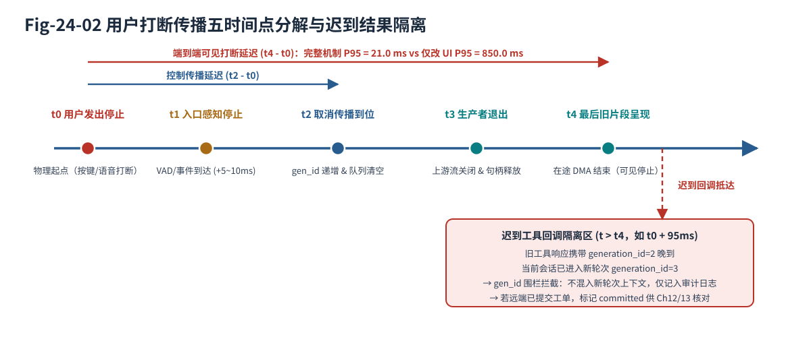
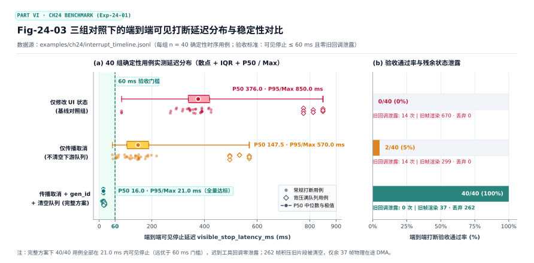

# Ch24 流式流水线、流量控制与用户打断

**Stream Processing, Flow Control, and User Interruption**

> **提案指定样章**：本章为全书 Springer 提案指定样章，可独立阅读，完整演示从流式增量输出、高低水位背压、带外取消传播、代次围栏与迟到回调隔离，到五时间点打断延迟实测的端到端工程闭环。专项审稿分工为学生 F 主写、学生 C 复核副作用边界、学生 A 复核测量口径。

**摘要**　在交互式智能体系统中，流式输出将首字响应延迟从数秒压缩到百毫秒级，同时也把模型生成、队列缓冲、语音合成与外部工具执行拉入同一条异步流水线。当用户中途发出停止指令或插话改问新问题时，仅隐藏前端界面无法阻断后台生产者，缓冲中的旧语音继续播报，迟到的工具回调还会污染下一轮上下文。本章从这一典型流式打断故障出发，区分思考链、文本片段、工具事件与媒体块四类增量流及其可提交边界，结合 DeepSeek 多通道 SSE 流式协议、Pipecat 带外高优先级系统帧、LiveKit 实时缓冲清空与 Reactive Streams 背压原则，构建以 `turn_id` 与 `generation_id` 代次围栏、高低水位缓冲和带外取消总线为核心的流控架构。最后，本章在 40 个涵盖满队列、迟到回调、重复取消、工具提交后取消与取消—完成竞态的确定性时序用例上开展三组对照实测，将端到端可见打断延迟 P95 从仅改界面的 850.0 ms 降至 21.0 ms，实现旧轮次迟到回调零泄露，并明确界定物理已播放内容与已提交远端副作用的不可撤回边界。

**关键词**　流式处理（stream processing）；流量控制（flow control）；水位线与背压（watermarks and backpressure）；用户打断（user interruption）；取消传播（cancellation propagation）；代次围栏（generation fencing）；打断延迟（interruption latency）；过期输出清理（stale-output cleanup）。

本章拟定主笔为 Xuhong Cao，内部执笔学生 F，独立审稿学生 A，专项审稿由学生 C 核对副作用边界、学生 A 核对测量口径，当前版本为 `zh-draft-0.3`（2026-11-27），属于 P0 指定样章，无商业利益冲突。先修知识包括 [Ch06 上下文与结构化输出](../part2/ch06_context_structured_outputs.md)、[Ch12 行动执行与副作用控制](../part3/ch12_action_execution.md)、[Ch22 编排运行时](ch22_orchestration_runtime.md) 与 [Ch23 会话与状态机](ch23_sessions_events_state.md)。代码与数据入口为 `examples/ch24/stream_interrupt_demo.py`、`interrupt_timeline.jsonl`、`results/ch24_summary.json` 与 `sample_ch24_zh.md`，沿用 MIT 许可。正文包含 `Fig-24-01` 至 `Fig-24-03` 与 `Tab-24-01` 至 `Tab-24-03`，34 等效页为混排预算。

---

## 24.1 用户停止后仍被旧输出打断

### 24.1.1 界面显示“已停止”，声音和工具为何还在跑

设想一个接入了流式文本、语音播报与工单工具的企业政策助手。系统既希望一边生成一边向用户展示文字和语音以压低等待感，又要求用户随时能喊停或改问新问题，让旧回复在几十毫秒内安静退出、绝不串味到下一轮。初版前端把这件事想得过于简单：用户点击“停止”时，前端立刻重置按钮状态并隐藏旧气泡，开发团队则默认浏览器关闭流连接后，后端各项任务会跟着自动停下来。

一次普通的语音查账立刻打破了这一假设。员工开口问道：“请查询 2026 年海外差旅住宿上限，并帮我草拟一张报销单。”模型一边吐出解释文字并推给语音合成器，一边发起了响应较慢的海外政策查询工具。在 150 ms 时员工意识到自己说错了目的地，立刻插话喊停：“停止，改成查境内差旅。”屏幕瞬间切出了“已停止”状态，但扬声器里依然把已经囤在播放队列里的 8 段旧语音念了将近一秒。更糟的是，95 ms 后旧轮次的海外政策查询工具延迟返回结果，后端没有核对轮次代次，直接把这份海外标准插进了新发起的境内差旅上下文里，导致新一轮直接报出了错误的海外住宿限额。上述情节是用于剖析流式打断与竞态的教学构造案例，并非真实企业事故记录。

沿着模型生产者、文本缓冲、语音合成队列、播放端与工具回调逐层比对时间戳，问题根源清晰可见。首先，仅修改前端界面并未向下游广播可传播的取消信号，后台模型与语音合成器还在照常消耗算力并不断往队列灌入新片段。其次，文本到语音之间存在未经清理的先入先出缓冲区，即便上游停了，囤在队列里的旧音频块仍按固定播放节奏逐块念完。最后，异步工具回调既没有轮次代次标记，也没有入口过滤围栏，迟到的旧响应直接越界污染了下一轮对话。

修复这一顽疾需要贯穿整条流水线的四项协同机制：给每个流式片段和工具调用打上不可变的轮次与代次标签；用带高低水位线的有界缓冲控制上游生产速率；通过绕过数据队列的带外取消总线瞬间同步递增活跃代次、终止上游流并清空各级旧缓冲；在工具回调入口加装代次围栏，并把取消前已经落盘的远端写副作用诚实转入审计核对通道。在后文 40 项确定性时序用例实测中，端到端可见停止延迟 P95 从 850.0 ms 降至 21.0 ms，迟到工具泄露从 14 次归零。与此同时，两道物理与分布式红线也必须事先讲透：取消前已经送进声卡硬件缓冲的最后半帧音频，以及取消前已经完成远端数据库提交的写工具动作，都无法靠流取消撤回。

### 24.1.2 为什么流式打断是实时智能体的试金石

传统请求—响应架构等到全部生成结束才一次性返回，天然藏住了中间态。现代交互式智能体为了把首字延迟压到百毫秒级，不得不把模型解码、文本渲染、语音合成和工具调用接成一条并发流动的装配线。正如 Pipecat 帧流水线文档[^r24-pipecat] 与 LiveKit Agents 实时架构[^r24-livekit] 共同指出的，**流式系统中的每一次用户打断，本质上都是一次跨越多个异步缓冲边界的瞬时状态作废**。本章先把单通道与音文混合流中的背压、取消传播与五时间点延迟测量彻底讲透，跨视觉、文件与传感器的多模态双时钟同步留待 [Ch25](ch25_multimodal_realtime.md) 展开。

---

## 24.2 流与增量行动模型

### 24.2.1 四类增量流与“可提交边界”

智能体向外吐出的流表面看是一连串字节，内部其实交织着风险等级截然不同的四类载荷。以 DeepSeek-R1 与 DeepSeek-V3 的 SSE 流式接口[^r24-deepseek-r1][^r24-deepseek-sse] 为典型参照，单条响应流里会交替出现思考增量 `reasoning_content`、正文增量 `content` 与工具参数碎片 `tool_calls`，而在语音场景中还会衍生出媒体音频块。把这四类碎片不加区分地放行下游，必然引发半截执行事故：

1. **内部思考增量**：例如推理模型流式吐出的 `reasoning_content`。它适合在受控界面折叠展示以缓解等待焦虑，但既不能充当执行权限依据，也不应未经脱敏直接送去语音朗读或写入长期业务状态。
2. **面向用户的文本片段**：适合按字词或标点低延迟呈现，也可按语义短句切分送入语音合成。它可以随时截断，但已经显示给用户的文字属于既成事实。
3. **工具调用事件**：流式生成的 JSON 参数在闭合前可能只有半截字段，甚至可能被中途打断或由模型自我修正。呼应 [Ch06](../part2/ch06_context_structured_outputs.md) 与 [Ch12](../part3/ch12_action_execution.md) 的底线，**未闭合且未通过模式校验与权限检查的结构化工具流，严禁触发任何带副作用的外部行动**。
4. **媒体音频块**：语音合成器通常按 20 至 40 ms 切片输出音频帧。媒体块的消费速率受物理时间刚性锁死——1 秒语音必须播满 1 秒，因此它是最容易在流水线中诱发速率失配与队列淤积的环节。

### 24.2.2 轮次与代次的双重身份围栏

仅有 [Ch23](ch23_sessions_events_state.md) 的 `session_id` 不足以在毫秒级流式通道里区分新旧输出。同一会话内，用户可能先发起了第一轮提问，中途打断重试同一轮，或者直接抢占开启第二轮。因此，每个流式分片从诞生起就必须携带不可变的身份元组：

$$\text{ChunkIdentity} = (\texttt{session\_id},\; \texttt{turn\_id},\; \texttt{generation\_id},\; \texttt{seq},\; \texttt{channel})$$

其中的 `generation_id` 是严格单调递增的**生成代次号**。每当用户点击停止、要求重生成或发起新轮次抢占，协调器立刻在控制面把 `active_generation_id` 加 1。下游的缓冲区、语音合成器、工具回调入口和前端渲染器只需执行一条极简、无锁的**代次围栏**检查——凡是分片自带的 `generation_id` 不等于当前 `active_generation_id`，一律就地丢弃并记入审计日志。正是这道围栏，从根源上杜绝了迟到的旧碎片混入新轮次。

---

## 24.3 有界缓冲、水位线背压与带外取消传播

### 24.3.1 生产快、消费慢为何会把打断拖成一秒

在语音或弱网客户端场景里，大模型每秒可以解码数十上百个 token，短短一秒钟就能吐出够念十几秒的文本；而人耳和扬声器每秒只能老老实实播放一秒音频。如果在模型和播放端之间放一条无界队列，两三秒钟就能囤积十几秒待播语音。这不仅造成内存膨胀，更会在用户喊停时制造极其糟糕的体验——上游明明停了，队列里积压的十几秒旧声音依然停不下来，而且为这些最终被丢弃的片段付出的模型推理费用已经白白花掉了。

### 24.3.2 高低水位线与背压治理

借鉴 TCP 滑动窗口[^r24-rfc9293] 与 Reactive Streams 规范[^r24-reactive] 的流控思想，当下游消费跟不上上游生产时，下游必须向上游发回减速或暂停信号，工程上称为**背压**（backpressure）。为了避免缓冲在单个阈值附近来回抖动、造成上游频繁启停，工程上通常同时设定**高水位线**与**低水位线**，如图 **Fig-24-01** 与表 **Tab-24-01** 所示：队列先规定硬容量上限，例如 16 帧；深度涨到高水位线 12 帧时，缓冲向上游发出背压暂停信号，停止拉取新 token；等到下游消费消化、深度回落到低水位线 4 帧时，才解除背压恢复拉取。高低水位之间的滞回区间让整条流水线既不会无节制囤货，也不会神经质地反复启停。

**Fig-24-01　模型到界面/播放端的流式流水线、水位线缓冲与带外打断总线。** 上游多通道流经有界水位线缓冲 Q1 与媒体分片队列 Q2 送达呈现端；当深度触及高水位线时向上游施加背压暂停；用户打断通过底部红色带外总线绕过先入先出队列直达全部组件。图为本书原创可编辑 SVG。

**Tab-24-01　流式流水线各层缓冲治理契约（容量、水位、背压、清理与责任人）。**

| 缓冲层位置 | 典型容量与水位 | 背压策略 | 取消时的清理动作 | 责任组件 |
| --- | --- | --- | --- | --- |
| 模型 SSE 解析缓冲 (`Q0`) | 容量 8 帧，高水位 6，低水位 2 | 暂停读取网络套接字，促发连接级流控 | 关闭上游流连接，丢弃未闭合工具 JSON 碎片 | 模型流式适配器 |
| 文本分句与行动路由缓冲 (`Q1`) | 容量 16 帧，高水位 12，低水位 4 | 置位背压标志，通知上游暂停拉取 | 按旧 `generation_id` 即时全量清空 | 流协调器（Ch24） |
| 语音合成与音频分片缓冲 (`Q2`) | 容量 16 帧（约 320–560 ms 音频），高水位 12，低水位 4 | 暂停向语音合成器送入新短句 | 中断合成请求、重置词级时间戳、清空待播音频队列 | 媒体子系统（Ch25） |
| 客户端呈现与声卡 DMA 缓冲 | 1 至 2 帧硬件最小粒度 | 不可反压上游，过期旧帧直接丢弃 | 停止写入新帧；至多 1 帧已入声卡 DMA 的音频自然播完 | 前端界面与播放端 |

### 24.3.3 带外高优先级取消传播

与 [Ch22](ch22_orchestration_runtime.md) 的控制面独立通道一脉相承，流式打断绝不能把停止指令排在普通数据帧后面。Pipecat 框架提供了一个非常干净的开源蓝本[^r24-pipecat]：它把流水线里的帧分为普通数据帧、控制帧和高优先级系统帧三类。用户触发打断时，系统注入继承自系统帧的 `InterruptionFrame`，**绕过全部先入先出数据队列，沿上下游双向立即广播**。收到该系统帧后，所有处理器瞬间取消当前异步协程并清空可中断的积压数据帧，同时保留标为不可中断的关键审计帧；上游大模型连接立即中止，语音合成器丢弃待合成短句，输出传输层立即排空待播音频队列，让用户在几十毫秒内听见干脆利落的静音。

---

## 24.4 迟到输出、竞态矩阵与不可逆边界

### 24.4.1 四类高频竞态的确定性处置

真实流式交互里，打断经常与自然完成、重复点击、慢工具返回以及新轮次抢占撞在一起。表 **Tab-24-02** 系统列出了四类高频竞态的时序特征、常见误区与确定性处置规则。

**Tab-24-02　流式打断高频竞态矩阵与确定性处置规则。**

| 竞态类型 | 发生时序特征 | 错误实现后果 | 正确确定性处置 |
| --- | --- | --- | --- |
| 取消与完成同时 (`cancel_complete_race`) | 上游生产者在取消信号抵达前数毫秒刚刚自然结束 | 状态机抛异常，或把已完成结果误标为未完成 | 以权威服务端先落盘事件为准；若已被用户停止则透明记录有效尾部损失计数，不覆盖用户新界面 |
| 重复取消 (`duplicate_cancel`) | 用户连点两次停止，或语音检测与界面按钮相隔 12 ms 均发停止 | 二次取消误杀刚启动的新一轮，或重复释放句柄报错 | 取消令牌绑定目标 `(turn_id, generation_id)`，针对已失效代次的二次取消幂等返回空操作 |
| 迟到工具回调 (`late_tool_callback`) | 旧工具在用户停止 95 至 210 ms 后才返回成功响应 | 旧结果混入当前上下文，直接污染下一轮回答 | 回调入口执行代次围栏拦截，禁止注入新轮次上下文，仅写入审计日志 |
| 新轮次抢占 (`next_turn_preempt`) | 用户未按停止键，直接发出新指令抢占当前输出 | 两轮文字交错刷屏，或新旧两段语音混音叠加 | 受理新轮次前自动合成针对旧代次的隐式打断信号，严格先清旧流再启新流 |

### 24.4.2 从用户物理动作出发的五时间点测量口径

不少演示项目宣称打断延迟只有两三毫秒，翻看代码才发现测的仅仅是 `cancel_token.set()` 这行内存赋值函数的返回耗时，与用户耳朵实际听到的停顿相去甚远。如图 **Fig-24-02** 所示，本章强制使用**五个可独立观测的时间点**拆解整条打断链路：

- **$t_0$**：用户按下停止键或开口有效插话的物理起点；
- **$t_1$**：系统入口识别到停止意图的感知时刻；
- **$t_2$**：带外取消信号抵达上游生产者与各级缓冲，完成代次递增与清队列的时刻；
- **$t_3$**：上游模型流或工具生产者真正退出并归还连接句柄的时刻；
- **$t_4$**：界面或扬声器呈现最后一个旧片段的时刻，即用户主观感受到彻底安静下来的时刻。

据此，报告必须把**控制传播延迟** $t_2 - t_0$、反映算力止损速度的**生产者停止延迟** $t_3 - t_0$，以及反映真实用户体验的**端到端可见停止延迟** $t_4 - t_0$ 分开统计，绝不能混为一谈。

**Fig-24-02　用户打断传播五时间点分解与迟到结果隔离。** 明确以用户动作 $t_0$ 为测量起点，分别定义控制传播、生产者退出与可见停止延迟；晚于 $t_4$ 抵达的旧工具回调被 `generation_id` 围栏阻断在下一轮上下文之外。图为本书原创可编辑 SVG。

### 24.4.3 不可撤回的两类既成事实

严格的工程设计从不向用户许诺物理上做不到的事。第一，在 $t_0$ 之前已经显示在屏幕上或送进声卡硬件播放出来的片段属于已发生物理历史，取消只能止住尚未播放的残余队列。第二，如果取消指令抵达时远端工单服务已经完成数据库提交，流取消只能切断后续语音播报并释放连接，系统必须诚实保留 `tool_already_committed=true` 的事实记录并向用户明确提示，不能用一句“已取消”掩盖已经落盘的外部操作。

---

## 24.5 打断延迟与竞态对照实验

### 24.5.1 实验设计与 40 个确定性取消时序用例

我们在 `examples/ch24/stream_interrupt_demo.py` 中构造了 40 个确定性取消时序用例 `C24-01` 至 `C24-40`，覆盖常规流中打断 10 例、满队列背压状态打断 8 例、迟到工具回调 7 例、重复取消 5 例、工具提交后取消 5 例以及取消—完成竞态与新轮次抢占 5 例。

实验在完全相同的 40 条时间线上对比三种实现：第一组 `ui_only_stop` 仅修改界面状态；第二组 `cancel_propagation_only` 将取消信号传到上游生产者，但不主动清空中间队列也未启用代次过滤；第三组 `cancel_plus_gen_and_flush` 完整启用带外取消传播、代次围栏与各级缓冲立即清空。单个用例同时满足迟到回调零泄露、生产者句柄完全释放、可见停止延迟不超过 60.0 ms 且重复取消幂等，才判通过。运行 `python examples/ch24/stream_interrupt_demo.py` 即可复现，全部 120 条明细写入 `examples/ch24/interrupt_timeline.jsonl`，汇总写入 `examples/ch24/results/ch24_summary.json`。

### 24.5.2 实测结果与尾延迟分析

表 **Tab-24-03** 与由真实实验日志直接生成的图 **Fig-24-03** 给出了三组对照的完整实测表现。

**Tab-24-03　样章验收对照表（`Exp-24-01`，40 个确定性时序用例实测结果；数据源：`examples/ch24/results/ch24_summary.json`）。**

| 验收维度与实测指标 | `ui_only_stop`（仅改界面） | `cancel_propagation_only`（仅传播取消） | `cancel_plus_gen_and_flush`（完整方案） |
| --- | ---: | ---: | ---: |
| 综合验收通过用例数（分母 40） | **0 / 40** | **2 / 40** | **40 / 40** |
| 可见停止延迟 P50 / P95 / Max ($t_4 - t_0$, ms) | 376.0 / **850.0** / 850.0 | 147.5 / **570.0** / 570.0 | **16.0 / 21.0 / 21.0** |
| 控制传播延迟 P50 / P95 ($t_2 - t_0$, ms) | 6.0 / 11.0 | 10.0 / 26.0 | **9.0 / 15.0** |
| 生产停止延迟 P50 / P95 ($t_3 - t_0$, ms) | 246.0 / 290.0 | 20.0 / 34.0 | **14.0 / 19.0** |
| 旧片段继续渲染总数 | **670 帧** | **299 帧** | **37 帧**（仅每例至多 1 帧在途 DMA） |
| 主动清空丢弃旧片段数 | 0 帧 | 0 帧 | **262 帧** |
| 迟到工具回调混入新轮次次数 | **14 次** | **14 次** | **0 次** |
| 上游生产者资源释放率 | 0.0% | 100.0% | **100.0%** |
| 提交后取消中如实保留的外部副作用数 | 5 / 5 | 5 / 5 | **5 / 5** |
| 取消—完成竞态下的有效尾部损失用例数 | 0 | 0 | **3**（`C24-36..38` 如实登记） |

**Fig-24-03　三组对照下的端到端可见打断延迟分布（由 `examples/ch24/interrupt_timeline.jsonl` 真实实验日志生成）。** 红色虚线标出 60 ms 交互验收门槛；仅传播取消虽停止了上游生产，但未清队列与缺代次过滤导致可见停止 P95 仍高达 570.0 ms；完整方案将全部 40 例压低至 21.0 ms 以内且零泄露。图为本书原创数据驱动 SVG。

这组实测揭示了一个极具现实意义的反直觉现象：**只把取消传给上游模型远远不够**。第二组 `cancel_propagation_only` 确实把模型停产延迟 P95 从 290.0 ms 压到了 34.0 ms，成功省下了算力；但由于没有同步清空积压在中间缓冲里的 299 个旧片段、也没有拦住 14 次迟到工具回调，用户体验到的可见停止 P95 仍高达 **570.0 ms**，40 个用例中只有 2 例达标。同时，完整方案也在 3 例取消—完成竞态中诚实记录了尚未渲染的尾部输出损失，这是换取干脆静音体验所必须透明公开的取舍。

---

## 24.6 样章总结、验收清单与工程证据索引

### 24.6.1 样章复现入口与跨章回链

本章作为全书提案指定样章，完整运行入口与产物清单汇总于 `examples/ch24/sample_ch24_zh.md`。在仓库根目录运行 `python examples/ch24/stream_interrupt_demo.py` 即可重现全部 40 个时序用例与数据图源。本章承接 [Ch06](../part2/ch06_context_structured_outputs.md) 的结构化校验、[Ch12](../part3/ch12_action_execution.md) 的副作用边界、[Ch22](ch22_orchestration_runtime.md) 的控制面取消与 [Ch23](ch23_sessions_events_state.md) 的会话轮次标识，向下游把带外取消与代次围栏交给 [Ch25 多模态交互与实时协调](ch25_multimodal_realtime.md)，其分位数测量口径与 [Ch27](../part7/ch27_benchmarking_capacity.md) 保持一致。

### 24.6.2 工程证据索引

| 主张 ID | 正文位置 | 输入与环境 | 接口与权限边界 | 实现入口 | 独立验收条件 | 成功与失败证据 | 证据状态与适用范围 |
| --- | --- | --- | --- | --- | --- | --- | --- |
| `CLM-24-01` | 24.2 / 24.3 | 40 确定性取消时序用例 | 轮次代次围栏与高低水位线 | `examples/ch24/stream_interrupt_demo.py` | 40 例均满足可见停止不超 60 ms、零泄露、资源全释放 | 完整方案 40/40 通过，P95 为 21.0 ms；两对照组仅 0/40 与 2/40 | 确定性离散事件模拟，非真实声卡实测 |
| `CLM-24-02` | 24.4.1 | 14 例含迟到工具回调用例 | 回调入口代次围栏 | `examples/ch24/interrupt_timeline.jsonl` | 旧代次工具回调 0 次混入新轮次 | 完整方案泄露 0 次；两对照组均泄露 14 次 | 确定性模拟验证 |
| `CLM-24-03` | 24.4.3 | 5 例提交后取消用例 | 取消不篡改已提交外部工单 | `examples/ch24/interrupt_timeline.jsonl` | 已提交标记如实留存 | 5/5 完整保留已提交记录并转审计 | 确定性模拟验证 |

### 24.6.3 关键术语

多通道流式输出（Multi-Channel Streaming）、高低水位线（High/Low Watermark）、背压（Backpressure）、带外取消传播（Out-of-Band Cancellation Propagation）、代次围栏（Generation Fencing）、可见停止延迟（Visible Stop Latency）、迟到回调隔离（Late Callback Isolation）。

### 24.6.4 复习题与实践题

**复习题：**
1. **概念辨析**：为什么在 DeepSeek 推理模型的 SSE 流中必须将 `reasoning_content`、正文与未闭合的 `tool_calls` 分通道治理？未闭合工具流直接触发执行会带来什么风险？
2. **设计选择**：有界缓冲为何同时设定高水位线与低水位线，而不采用单一阈值控制上游启停？
3. **故障诊断**：在 `Exp-24-01` 中，`cancel_propagation_only` 已把上游生产停止 P95 降到 34.0 ms，为什么可见停止 P95 仍高达 570.0 ms 且出现 14 次泄露？
4. **指标解释**：说明 $t_0$ 至 $t_4$ 五个时间点的含义，为什么不能用 `cancel()` 函数返回耗时冒充用户打断延迟？
5. **跨章整合**：用户在语音播报途中喊停，而 20 ms 前后端已提交一张模拟工单。请综合 [Ch12](../part3/ch12_action_execution.md)、[Ch23](ch23_sessions_events_state.md) 与本章机制，设计前端提示文案、会话事件记录与人工处置路径。

**实践题：为真实异步流管道实现水位线滞回与代次围栏**
- **输入**：`examples/ch24/stream_interrupt_demo.py` 与 `interrupt_timeline.jsonl`。
- **任务**：第一，将离散事件模拟器扩展为真实 `asyncio` 异步生产者—缓冲—慢消费者管道，显式实现高水位 12、低水位 4 的滞回背压事件；第二，增加一个模拟 DeepSeek 多通道 SSE 解码器，验证当打断落在工具 JSON 输出到一半时，半截工具调用被 100% 丢弃且绝不触发工具执行器；第三，输出含真实墙钟五时间点的 JSONL 日志与对比报告。
- **评分依据**：共 100 分，水位线滞回防震荡验证 25 分、带外取消与代次围栏 25 分、半截工具 JSON 防执行负面测试 25 分、五时间点日志与诚实局限分析 25 分。
- **进阶选项**：在慢消费者端注入 10 至 60 ms 随机网络抖动，重复运行 5 次并按 [Ch27](../part7/ch27_benchmarking_capacity.md) 口径报告分位数波动区间。
- **教师参考评分要点**：必须以用户动作 $t_0$ 为起点计测，必须保留至少 1 例“已提交远端副作用无法被流取消撤回”的诚实记录。

### 24.6.5 本章局限

本章实验以确定性离散事件模拟严格复现 40 种时序与竞态路径，未在真实浏览器音频引擎、公网 TLS 长连接或真实外部大模型 SSE 端点上测量 TCP 缓冲滞留与声卡回调周期。真实端到端音视频同步与硬件抖动问题将在 [Ch25](ch25_multimodal_realtime.md) 进一步展开。

---

## 参考文献与版本记录

[^r24-deepseek-r1]: DeepSeek-AI. *DeepSeek-R1: Incentivizing Reasoning Capability in LLMs via Reinforcement Learning*. arXiv:2501.12948, Jan 22, 2025: [https://arxiv.org/abs/2501.12948](https://arxiv.org/abs/2501.12948)（核验：2026-11-27）。推理链与最终答案分阶段生成的架构背景。
[^r24-deepseek-sse]: DeepSeek API Documentation. *Streaming and Reasoning Content (`reasoning_content` / SSE `stream: true`)*. [https://api-docs.deepseek.com/](https://api-docs.deepseek.com/)（核验：2026-11-27）。用于参考思考增量、正文增量与工具参数增量多通道流语义。
[^r24-pipecat]: Daily / Pipecat. *Frames and Interruption Handling (`InterruptionFrame` / `SystemFrame`)*. Pipecat Documentation: [https://docs.pipecat.ai/](https://docs.pipecat.ai/)（核验：2026-11-27）。带外高优先级系统帧绕过 FIFO 数据队列实现双向取消与队列清空的开源参考实现。
[^r24-livekit]: LiveKit. *LiveKit Agents: Real-Time Voice Pipelines, Streaming, and Interruption Flushing*. Documentation: [https://docs.livekit.io/agents/](https://docs.livekit.io/agents/)（核验：2026-11-27）。级联流水线中 LLM、TTS 与传输三层同步清空的工程设计。
[^r24-reactive]: Reactive Streams Initiative. *Reactive Streams Specification for Non-Blocking Backpressure* (v1.0.4): [https://www.reactive-streams.org/](https://www.reactive-streams.org/)（核验：2026-11-27）。异步背压与显式需求拉取的规范基础。
[^r24-sse]: WHATWG. *HTML Living Standard — Server-Sent Events*. [https://html.spec.whatwg.org/multipage/server-sent-events.html](https://html.spec.whatwg.org/multipage/server-sent-events.html)（核验：2026-11-27）。HTTP 流式事件分帧与重连协议标准。
[^r24-anthropic-agents]: Anthropic. *Building effective agents*. Anthropic Engineering Blog, Dec 19, 2024: [https://www.anthropic.com/research/building-effective-agents](https://www.anthropic.com/research/building-effective-agents)（核验：2026-11-27）。关于工具执行边界与受控反馈循环的论述。
[^r24-rfc9293]: Eddy W (Ed.). *Transmission Control Protocol (TCP)*, IETF RFC 9293, Aug 2022: [https://datatracker.ietf.org/doc/html/rfc9293](https://datatracker.ietf.org/doc/html/rfc9293)（核验：2026-11-27）。窗口流量控制与背压稳定性的经典传输层原理。

本版：`zh-draft-0.3`，2026-11-27（提案指定样章）。已完成三张原创可编辑 SVG（含实测日志数据驱动尾延迟图）、40 用例确定性评测脚本、样章说明与全书文风统一润色。
