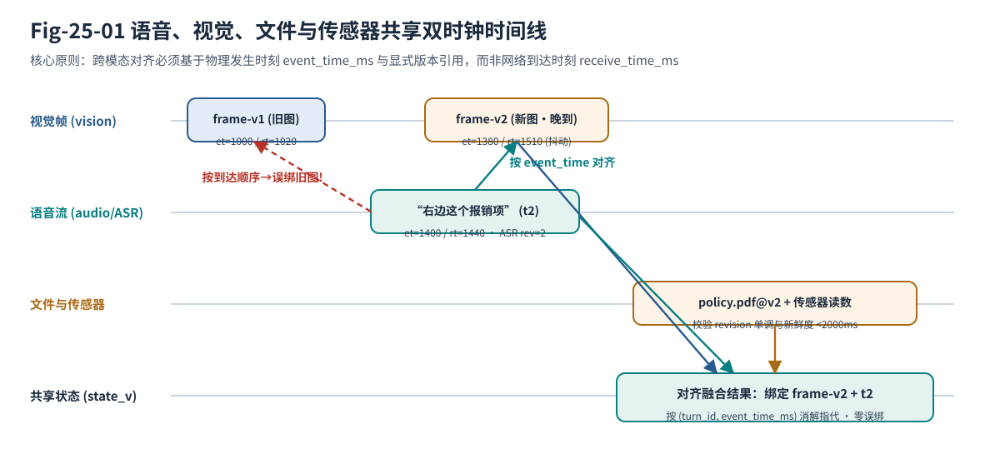
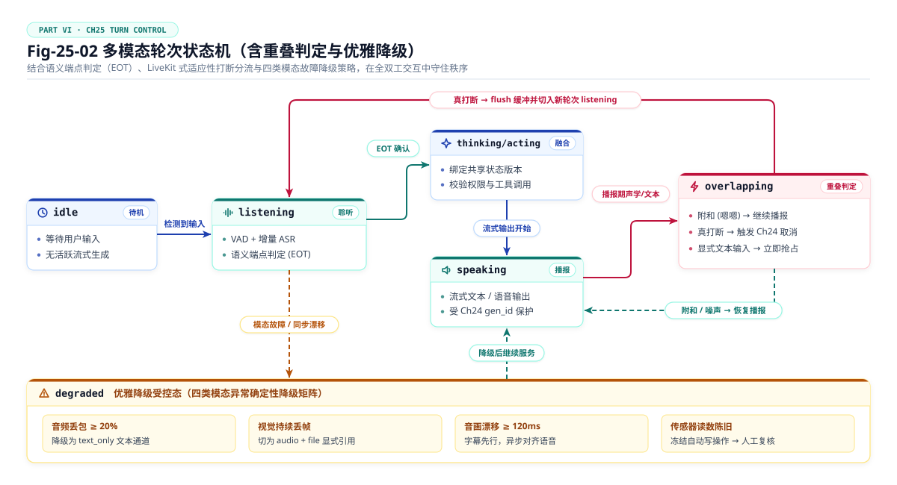

# Ch25 多模态交互与实时协调

**Multimodal Interaction and Real-Time Coordination Mechanisms**

**摘要**　当智能体同时接收文本、语音、视觉画面、上传文件与外部传感器读数时，网络抖动、压缩延迟与增量转写修订会打破“先发生即先到达”的朴素假设，导致语音指代错误指向旧画面、短附和词误触发打断或音画字幕严重错位。本章从一次“语音指向旧图片”的教学事故出发，建立覆盖五类模态的统一事件模式（`mm-event-v1`），严格区分物理事件时间（`event_time_ms`）与系统接收时间（`receive_time_ms`），比较级联语音链与全双工实时链的工程取舍，并借鉴 LiveKit 语义轮次检测与适应性打断、Pipecat 传输无关帧同步以及 RTP 抖动缓冲原理，设计多模态轮次状态机、版本化指代消解与优雅降级矩阵。在 20 项覆盖旧图新语音、增量 ASR 修订、重叠说话、丢包抖动与文件/传感器融合的合成交互实验中，按轮次/引用/事件时间融合方案将对象关联准确率从按到达顺序融合的 55% 提升至 100%，轮次误判从 11/20 降至 0/20，降级成功率为 5/5，并明确声明模拟时间戳实验与真实语音/硬件媒体的证据边界。

**关键词**　多模态交互（multimodal interaction）；实时协调（real-time coordination）；双时钟对齐（dual-clock alignment）；轮次交替（turn-taking）；适应性打断（adaptive interruption）；指代消解（reference resolution）；媒体同步（media synchronization）；优雅降级（graceful degradation）。

**章节元信息与交付入口**　拟定主笔：Xuhong Cao；内部执笔：学生 F；独立审稿：学生 A。版本：`zh-draft-0.2`（2026-11-27）。先修知识：[Ch14 任务状态与工作记忆](../part4/ch14_state_working_memory_context.md)、[Ch21 环境感知与交互](../part5/ch21_perception_environment.md)、[Ch23 会话与状态机](ch23_sessions_events_state.md) 与 [Ch24 流式打断](ch24_streaming_interrupts.md)。代码与数据入口：`examples/ch25/multimodal_event_schema.json`、`examples/ch25/media_sync_cases.jsonl`、`examples/ch25/degradation_matrix.md`、`examples/ch25/multimodal_coordinator.py`（MIT 许可）。图表清单：`Fig-25-01`、`Fig-25-02`、`Tab-25-01`、`Tab-25-02`、`Tab-25-03`。等效出版页预算 34 页；本章无商业利益冲突。

---

## 25.1 语音指向了旧图片：时间与语义为何双双错位

### 25.1.1 教学事故还原：多模态错配的连锁反应

考虑企业报销与合规巡检助手的实时多模态场景（以下为教学构造案例，非真实生产事故）。员工正通过手机摄像头和语音与智能体通话，依次核对两张纸质票据。在 `t = 1380 ms` 时，员工把摄像头对准了第二张新票据（`frame-v2`，金额 480 元），并在 `t = 1400 ms` 说出：“帮我核对右边这个报销项。”由于高分辨率图片编码上传较慢，`frame-v2` 直到 `t = 1510 ms` 才到达协调器，比语音转写结果（`t = 1440 ms` 到达）晚了 70 ms。

1. **背景与目标**：系统目标是在语音、画面、上传文件与传感器数据并行到达的实时交互中，准确绑定用户指代的真实对象，并在网络抖动或单模态失效时保持状态一致与可控降级。
2. **初始假设**：初版多模态网关按**到达顺序（arrival order）**拼接上下文——每当语音结束时，直接抓取“当前内存中最新到达的那张图片”发给多模态模型；同时只要麦克风能量超过阈值，就立刻判定为用户打断。
3. **观测症状**：（a）在 `t = 1440 ms` 语音到达瞬间，内存里只有旧画面 `frame-v1`（金额 120 元），系统据此误答“金额未超 300 元，无需主管审批”；（b）智能体播报期间用户自然附和了一声“嗯嗯”，粗粒度能量检测误将其当作打断，粗暴截断了关键合规提示；（c）网络抖动达到 240 ms 时，界面字幕与语音播报彻底错位，用户无法判断系统到底在解释哪一条条款。
4. **定位过程**：把各模态的物理发生时间与服务端接收时间对齐后发现三个结构性缺陷：一是混用了网络到达时间与物理采集时间；二是未对增量语音识别（ASR）的修订版本号（`revision`）做单调合并，旧 partial 包晚到覆盖了新 final 文本；三是缺少模态失效检测与替代通路。
5. **修复动作**：推行统一五模态事件模式（`mm-event-v1`），强制双时钟记录 `event_time_ms` 与 `receive_time_ms`；引入有界抖动重排窗口，按 `(turn_id, ref_target_id, event_time_ms)` 执行指代消解；引入区分附和词（backchannel）与真实插话（barge-in）的多模态轮次状态机；建立可观测的优雅降级矩阵。
6. **结果及剩余限制**：在 20 项合成多模态交互用例中，对象绑定准确率由 55% 提升至 100%，轮次误判由 11 降至 0，平均同步误差从 68.9 ms 降至 17.61 ms，5 项模态故障全部成功触发预期降级。但本实验采用模拟时间戳与合成事件流，**不代表真实 ASR 词错率（WER）、真实声学 VAD 性能或真实 WebRTC 跨网抖动表现**。

### 25.1.2 与 Ch21、Ch24 的边界划分

- **[Ch21 智能体感知与环境交互](../part5/ch21_perception_environment.md)** 关注面向数字界面、仿真器与具身环境的 `observe / act / reset` 行动闭环；**本章（Ch25）** 聚焦人机多模态交互中的媒体时钟、轮次交替、引用消解、同步缓冲与降级协调，不展开 ASR、TTS 或视觉编码器的神经网络训练教材。
- **[Ch24](ch24_streaming_interrupts.md)** 提供了流式缓冲与带外取消基础设施；**本章** 在其之上回答“何时应当触发打断（轮次判定）”以及“多个并行模态如何进入同一共享状态版本”。

---

## 25.2 多模态事件契约与双时钟共享状态

### 25.2.1 覆盖五类模态的统一事件模式（`mm-event-v1`）

现实世界的多模态智能体远不止“语音+图片”：企业工单场景经常同时伴随用户上传的 PDF 政策/票据文件（`file`），而工业巡检或冷链监控智能体还会持续接入温湿度、位置或门禁状态等遥测数据（`sensor`）。**Tab-25-01**（同步自 `examples/ch25/multimodal_event_schema.json` 与 [附录 C](../appendix_c_schemas.md)）将五类模态统一纳入同一共享状态写入契约。

**Tab-25-01　多模态事件公共模式核心字段（`schema_version: mm-event-v1`）。**

| 字段组 | 字段定义 | 核心工程语义与校验不变量 |
| --- | --- | --- |
| 模态与来源 | `modality` (`text`/`audio`/`vision`/`file`/`sensor`)、`source_id` | 标明采集设备或上传通道；不同来源可拥有不同时钟漂移与隐私等级 |
| **双时钟字段** | `event_time_ms`（物理采集/发生时刻）、`receive_time_ms`（协调器收到时刻） | **时间对齐与指代消解只认 `event_time_ms`**；网络抖动、超时与陈旧传感器判定依赖 `receive_time_ms - event_time_ms` |
| 轮次与代次 | `session_id`、`turn_id`、`generation_id` | 复用 [Ch23](ch23_sessions_events_state.md) 与 [Ch24](ch24_streaming_interrupts.md) 身份围栏，拦截过期轮次的迟到媒体帧 |
| 分片与修订 | `chunk_id`、`revision`、`is_final` | 增量 ASR 转写与异步文件解析按 `revision` 单调覆盖；低版本晚到包必须丢弃，禁止覆写已确认的 `is_final=true` 文本 |
| 引用与状态版本 | `ref_target_id`、`state_version`、`privacy_class` | 将语言中的指示词（“右边这个”“刚传的文件”）显式绑定到目标对象 ID 与确切共享状态版本；原始音视频遵循最小保留原则 |

### 25.2.2 时间对齐与语义对齐的区别

工程实践中常把“时间对齐”当成“语义对齐”的全部，这是危险的简化：
- **时间对齐（Temporal Alignment）** 解决“两路信号在物理世界何时发生”——通过共享参考时钟（如 WebRTC RTP/RTCP 时间戳映射[^r25-rtp]）和有界抖动缓冲，把晚到 70 ms 的 `frame-v2` 放回它在 `t = 1380 ms` 的真实时间位置，如 **Fig-25-01** 所示。
- **语义对齐（Semantic Alignment）** 解决“用户这句话到底指代哪个对象版本”——例如用户在 `t = 3050 ms` 说“解释这一条”，随后在 `t = 3500 ms` 把屏幕滚到了下一节（`clause-4.2`），语音转写直到 `t = 3550 ms` 才到达。此时语义对齐不能绑定最新画面，而必须回查 `event_time = 3050 ms` 且同属 `turn_id = t1` 时的共享状态快照（`clause-3.1`）。同样，当用户上传新版 `policy.pdf@v2` 后旧版 `v1` 的 OCR 解析才姗姗来迟，语义对齐必须依赖 `revision` 围栏锁定 `v2`。

**Fig-25-01　语音、视觉、文件与传感器共享双时钟时间线。** 红色虚线展示按网络到达顺序融合如何错误绑定旧图 `frame-v1`；绿色实线展示依据 `(turn_id, event_time_ms)` 与 `revision` 围栏精确对齐晚到的新图 `frame-v2` 与新版文件进入同一 `state_version`。图为本书原创可编辑 SVG。

---

## 25.3 实时协调流水线与轮次交替机制

### 25.3.1 级联语音链与全双工实时链的工程取舍

当前生产级语音/多模态智能体存在两条主流流水线架构（参见 LiveKit Agents 与 Pipecat 的架构比较[^r25-livekit][^r25-pipecat]）：

1. **级联实时链（Cascaded Pipeline：`VAD + STT → LLM/Agent → TTS`）**：语音先经增量转写变为带 `revision` 的文本流，再进入支持工具调用与权限校验的智能体核心，最后增量分句送入 TTS。其显著优势在于**可观测性强、工具调用确定性高、易于复用 [Ch05](../part2/ch05_prompt_instruction_hierarchies.md)—[Ch12](../part3/ch12_action_execution.md) 的策略检查与文本审计日志**；缺点是链路存在三段串行首响累加，且必须显式处理增量 ASR 修订（例如先把“三百元”误识别，130 ms 后才修订为“三千元”——绝不能基于未定稿 partial 文本抢先触发有副作用的报销提交！）。
2. **原生全双工端到端链（Speech-to-Speech / Multimodal Live API）**：模型直接消费原始音频/视频帧并输出语音流，将交互延迟压到接近人类自然对话（300–500 ms），且能感知语调、犹豫与情绪。但其工程代价是中间语义透明度低、工具参数与权限边界仍需外置受控执行器隔离，且原始媒体带宽与计费显著更高。

无论采用哪条链路，**共享状态版本（`state_version`）、工具授权边界与 [Ch24](ch24_streaming_interrupts.md) 的带外取消围栏都位于外置运行时协调器内**，绝不把权限判断交给端到端语音模型隐式承担。

### 25.3.2 端点检测误差与适应性打断（LiveKit 模式）

在自然人机对话中，“用户是否说完了（End-of-Turn, EOT）”和“用户是否真的要打断我（Barge-in）”是两类极易误判的实时决策：

- **停顿不是结束**：单纯基于静音时长（如静音 > 500 ms 即切句）的传统 VAD 会在用户停顿思考时粗暴截断句子——例如用户在“查一下……”后停顿 450 ms 才说出“……不是境内的海外差旅”（用例 `MM25-09`），过早切句会导致完全相反的业务判断。LiveKit Agents 开源实践[^r25-livekit-turn] 通过在声学 VAD 之上叠加轻量级**语义轮次检测器（Semantic Turn Detector）**，结合上下文判断语义是否闭合，动态延长或缩短等待窗口，大幅降低过早抢话率。
- **附和不是打断**：当智能体正在播报复杂条款时，用户发出“嗯嗯”“好的”等短附和词（backchannel）或背景出现一声咳嗽（noise burst），并不希望中止播报。借鉴 LiveKit 的**适应性打断处理（Adaptive Interruption Handling）**[^r25-livekit-turn]，协调器在播报期检测到声音后进入 `overlapping` 观察态：仅当声学/文本特征判定为真实打断（`barge_in`）或用户提交了显式文本控制指令时，才向 [Ch24](ch24_streaming_interrupts.md) 总线广播 `InterruptionFrame` 清空播放队列并切换至新轮次；若判定为 `backchannel` 或瞬时噪声，则保持当前轮次平滑继续（如 **Fig-25-02** 所示）。

**Fig-25-02　多模态轮次状态机（含重叠判定与优雅降级）。** 展示 `idle`、`listening`、`thinking/acting`、`speaking`、`overlapping` 与 `degraded` 六态转移；播报期间区分附和/噪声恢复与真实打断抢占，模态异常时显式转入受控降级态并向用户提示。图为本书原创可编辑 SVG。

---

## 25.4 媒体同步、抖动缓冲、降级与隐私边界

### 25.4.1 抖动缓冲与音画同步误差控制

在 WebRTC / RTP 等实时传输中[^r25-rtp]，数据包到达时间受无线信道重传与路由波动影响会产生抖动（jitter）。协调器在消费前设置**有界抖动缓冲（Jitter Buffer）**：缓冲窗口越大，吸收乱序与抖动的能力越强、对象对齐越准，但端到端响应延迟也随之上升。经验上，交互式智能体的对齐缓冲窗口通常控制在 60–150 ms 之间；一旦实测音画漂移 `av_drift_ms` 持续超过 120 ms（人类已能明显察觉声画错位），与其无限拉大缓冲拖垮交互节奏，不如主动触发**字幕先行降级（`captions_first_av_resync`）**——优先保证带准确 `turn_id` 的文本结论送达，同时异步重对齐音视频轨。

### 25.4.2 失模态优雅降级矩阵与用户可见状态

多模态系统绝不能因为单个外设断连（如麦克风丢包、摄像头黑屏或传感器离线）就整机报错退出，更不能**静默降级却让用户蒙在鼓里**（例如摄像头已经卡在 10 秒前的旧画面，系统却不提示、继续拿旧画面回答“右边这个”）。**Tab-25-02**（同步自 `examples/ch25/degradation_matrix.md`）规定了六类典型模态故障的替代通路、用户可见状态提示与恢复判据。

**Tab-25-02　多模态失模态优雅降级与恢复矩阵（同步自 `examples/ch25/degradation_matrix.md`）。**

| 失效模态 / 故障信号 | 触发阈值 | 降级模式 (`degraded_mode`) | 替代通路与安全动作 | 用户可见提示 | 恢复判据 |
| --- | --- | --- | --- | --- | --- |
| 语音上行丢包 / ASR 超时 | 连续 2s 丢包率 >= 20% | `text_only` | 保留 `session_id` 与 `state_version`，切回文字输入 | 明确提示“语音不稳定，已切文字，草稿已保留” | 丢包连续 5s < 5% 且用户确认恢复 |
| 视频丢帧 / 摄像头断连 | 连续丢帧 >= 3s | `audio_plus_file` | **冻结旧视觉帧禁止隐式指代**，切语音+静态文件上传 | 提示“画面中断，已停用旧图指代，可上传文件” | 收到新完整关键帧且 `event_time` 更新 |
| 音画同步漂移 | `av_drift_ms >= 120ms` | `captions_first_av_resync` | 抖动缓冲重对齐，字幕优先下发 | 提示“网络抖动，字幕将优先显示” | 连续 3 窗口同步误差 < 60ms |
| 传感器数据陈旧 | `receive_time - event_time >= 2000ms` | `sensor_stale_manual_check` | **阻断自动写操作或自动放行**，转人工现场核对 | 提示“传感器读数已过期，已暂停自动执行” | 收到新鲜校验读数 |
| 文件旧版本解析晚到 | 同 `file_id` 收到更低 `revision` | `version_fence_drop` | 仅保留最高 `revision` 进入共享状态，旧包审计丢弃 | 界面持续展示当前生效文件名与版本号 | 自动完成，留痕审计 |
| 全部实时媒体断连 | 音视频断连 >= 5s | `text_only`（Ch23 重连） | 触发 [Ch23](ch23_sessions_events_state.md) 快照+序号回放，文本续办草稿 | 提示“实时音视频已断开，已切回持久文本会话” | WebRTC/WS 传输重建并通过心跳 |

### 25.4.3 多模态采集许可与隐私最小化

相比纯文本，原始语音波形、摄像头画面和上传票据包含高敏感生物特征与个人身份信息（PII）。多模态会话契约要求：（1）开启麦克风、摄像头或传感器前须具备显式用户采集许可并展示持续录制指示；（2）除明确授权的审计合规保留外，事件日志默认仅保存脱敏后的结构化提取摘要、对象引用哈希（`ref_target_id` / `payload_digest`）与双时钟元数据，不把原始音视频裸流永久写入普通调试日志（与 [Ch29](../part7/ch29_security_safety_alignment.md) 与 [Ch38](../part9/ch38_regression_fault_injection.md) `TA-04` 保持一致）。

---

## 25.5 多模态交互与错位对照实验 (`Exp-25-01`)

### 25.5.1 实验卡与 20 项合成交互片段

我们在 `examples/ch25/multimodal_coordinator.py` 中构造并持久化了 **20 项原创合成多模态交互片段**（`examples/ch25/media_sync_cases.jsonl`，MIT 许可，无真实个人音视频隐私风险），覆盖全部五类典型故障：
- **旧图/新图错位与语音指代（5 例，`MM25-01..05`）**：含新图晚到 90 ms、两张发票乱序到达、滚屏前语音指代旧条目、正常同步对照与旧帧重传晚到；
- **增量 ASR 转写修订（4 例，`MM25-06..09`）**：含“三百→三千”跨审批阈值修正、旧 partial 包晚于 final 包到达、中英文政策编号修正与 450 ms 停顿后补充否定词；
- **重叠说话与跨模态抢占（4 例，`MM25-10..13`）**：含附和词“嗯嗯”、真实打断、咳嗽噪声与语音未完时文本显式抢占；
- **丢包、抖动与优雅降级（4 例，`MM25-14..17`）**：含 28% 语音丢包、3 秒丢帧转文件上传、240 ms 音画漂移与全媒体断连；
- **文件版本与传感器新鲜度融合（3 例，`MM25-18..20`）**：含 `policy.pdf@v2` 与晚到 `v1` 冲突、过期 4200 ms 的陈旧传感器暂停自动执行与三模态协同写入。

**对照方案**：比较 `arrival_order_fusion`（按 `receive_time_ms` 到达顺序融合、无修订围栏、任一声音即打断、无降级）与 `turn_ref_time_fusion`（按 `turn_id` + `ref_target_id` + `event_time_ms` 融合、单调 `revision`、适应性打断与优雅降级）。复现命令：`python examples/ch25/multimodal_coordinator.py`；结果写入 `examples/ch25/results/ch25_report.json`。

### 25.5.2 实测结果与分析

**Tab-25-03　`Exp-25-01` 20 项多模态同步与错位交互实测对照（数据源：`examples/ch25/results/ch25_report.json`，模拟时间戳实验）。**

| 实测指标 | `arrival_order_fusion`（按到达顺序） | `turn_ref_time_fusion`（轮次/引用/事件时间） | 机制归因 |
| --- | ---: | ---: | --- |
| 对象关联准确率 (`object_binding_accuracy`) | **11 / 20 (55.0%)** | **20 / 20 (100.0%)** | 双时钟 `event_time_ms` 与单调 `revision` 彻底消除错位与旧包覆写 |
| 轮次决策误判次数 (`turn_misjudgment_count`) | **11 / 20** | **0 / 20** | 适应性打断过滤附和/噪声；等待 `is_final` 避免 partial 抢跑 |
| 模态失效降级成功率 (`degradation_success`) | **0 / 5** | **5 / 5** | 显式监测丢包、丢帧、同步漂移与传感器陈旧并切换替代通路 |
| 平均音画/跨模态同步误差 (`mean_sync_error_ms`) | **68.90 ms** | **17.61 ms** | 有界抖动缓冲吸收乱序与网络抖动 |
| 最大同步误差 (`max_sync_error_ms`) | **300.0 ms** | **48.0 ms** | 高抖动场景触发 `captions_first_av_resync` 兜底 |
| 平均协调响应延迟 (`mean_response_latency_ms`) | 89.25 ms | **81.15 ms** | 在正常同步用例上略有等待缓冲开销（+20–30ms），但在丢包场景避免了 260ms 盲等卡死 |

仔细审视延迟折中可以发现一个关键工程规律：在 `MM25-01..09` 等需要等待抖动窗口或 `is_final` 修订的用例上，`turn_ref_time_fusion` 主动付出了约 30–65 ms 的受控缓冲延迟，换取对象绑定准确率从 55% 跃升至 100%；而在 `MM25-14..17` 的丢包与断连故障下，因为能即时触发降级替代通路而不盲等超时，整体平均响应延迟反而低于天真基线（81.15 ms vs 89.25 ms）。

---

## 25.6 小结、媒体会话契约与工程证据索引

### 25.6.1 媒体会话契约与全篇收束

本章冻结 `examples/ch25/multimodal_event_schema.json` 与 `degradation_matrix.md` 并汇入 [附录 C](../appendix_c_schemas.md)，完成第六篇“异步调度（Ch22）→ 持久会话（Ch23）→ 流式打断（Ch24）→ 多模态实时协同（Ch25）”的完整基础设施拼图。向下游交接：本篇全部运行时与同步指标进入 [Ch27 性能剖析与容量规划](../part7/ch27_benchmarking_capacity.md) 的压力建模，多模态隐私采集与权限回链 [Ch29](../part7/ch29_security_safety_alignment.md)，更复杂的真实具身实时控制议题交由 [Ch35](../part8/ch35_open_problems.md) 探讨。

### 25.6.2 工程证据索引（第 4.7 节要求）

| 主张 ID | 正文位置 | 输入与环境 | 接口/权限边界 | 实现入口 | 独立验收条件 | 成功/失败证据 | 证据状态与适用范围 |
| --- | --- | --- | --- | --- | --- | --- | --- |
| `CLM-25-01` | 25.2 / 25.5 | 20 项合成多模态片段 (`media_sync_cases.jsonl`) | `event_time_ms` vs `receive_time_ms`、`revision` 围栏 | `examples/ch25/multimodal_coordinator.py` | 对象绑定准确率显著高于到达顺序基线 | 20/20 (100%) vs 基线 11/20 (55%) | 确定性模拟时间戳验证（非真实语音/视觉模型性能） |
| `CLM-25-02` | 25.3.2 / 25.5 | 4 例重叠说话与 4 例 ASR 修订 | 适应性打断 + `is_final` 等待 | `examples/ch25/multimodal_coordinator.py` | 附和/噪声不误打断；partial 修订不抢跑 | 轮次误判 0/20（基线 11/20） | 确定性模拟验证 |
| `CLM-25-03` | 25.4.2 / 25.5 | 5 例丢包、丢帧、漂移与陈旧传感器故障 | `degradation_matrix.md` 阈值与替代通路 | `examples/ch25/multimodal_coordinator.py` | 5 例均触发对应降级模式且同步误差受控 | 降级成功 5/5，最大同步误差 48.0ms（基线 300.0ms） | 确定性模拟验证（无真实 WebRTC 网络实测） |

### 25.6.3 关键术语

事件时间与接收时间（Event Time vs. Receive Time）、时间对齐（Temporal Alignment）、语义对齐（Semantic Alignment）、增量转写修订（Incremental ASR Revision）、语义端点检测（Semantic End-of-Turn）、适应性打断（Adaptive Interruption）、抖动缓冲（Jitter Buffer）、优雅降级（Graceful Degradation）。

### 25.6.4 复习题与实践题

**复习题：**
1. **概念辨析**：解释 `event_time_ms` 与 `receive_time_ms` 分别回答什么工程问题，以及时间对齐与语义对齐为何不能互相替代。
2. **设计选择**：对比级联语音链（STT→LLM→TTS）与全双工端到端语音模型在工具调用确定性、审计透明度与端到端延迟上的取舍；在金融或企业审批场景应如何选型？
3. **故障诊断**：在 `MM25-07` 中，最终转写包“不要提交，只存草稿”（`revision=2`）先到达，旧的草稿包“直接提交草稿”（`revision=1`）因重传晚到 40 ms。如果协调器未校验 `revision` 单调性，会引发什么业务事故？
4. **指标解释**：为什么本节明确禁止用 `Exp-25-01` 中 100% 的对象绑定准确率去宣称系统具备“100% 真实语音识别或视觉理解能力”？
5. **跨章整合**：当视频摄像头断连 4 秒触发 `audio_plus_file` 降级后，用户随后点击“停止”并上传了一份新 PDF。请串联 [Ch23](ch23_sessions_events_state.md) 的 `state_version`、[Ch24](ch24_streaming_interrupts.md) 的 `generation_id` 与本章的降级矩阵，写出该过程的事件序列与不变式检查点。

**实践题：扩展多模态协调器的自适应抖动窗口与时钟偏斜校准**
- **输入**：`examples/ch25/multimodal_coordinator.py`、`multimodal_event_schema.json` 与 `media_sync_cases.jsonl`。
- **任务**：(1) 新增 5 个“客户端设备本地时钟快于服务端 800 ms（clock skew）”的错位用例；(2) 实现基于握手 RTT 估计的时钟偏移校正器，将客户端 `event_time_ms` 映射到统一会话单调时间基后再执行指代消解；(3) 验证开启校准前后的对象关联准确率差异并输出对比 JSON 报告。
- **评分依据（100 分）**：时钟偏斜用例构造合理 20 分；偏移估算与单调映射正确 30 分；原有 20 用例回归零退化 25 分；边界与真实媒体局限说明完整 25 分。
- **进阶选项**：接入开源本地音频文件（如 2 段明确 CC0/原创授权短 WAV）测量真实 VAD 触发耗时，并将真实媒体测量表与模拟时间戳表严格分栏报告。
- **教师参考评分要点**：严禁在未测量真实音频的情况下将模拟数字改写成真实 ASR/VAD 性能；必须清晰区分时钟偏移（clock offset）与网络抖动（jitter）。

### 25.6.5 本章局限

本章主实验基于原创合成事件与模拟时间戳验证多模态状态协调、指代消解、轮次状态机与降级规则，未包含真实麦克风回声消除（AEC）、真实多语言声学噪声数据集、视频关键帧编解码带宽自适应或跨运营商 WebRTC ICE/TURN 弱网实测。真实部署时须在预发布环境按 [Ch27](../part7/ch27_benchmarking_capacity.md) 与 [Ch39](../part9/ch39_deployment_continuous_delivery.md) 补测真实媒体指标。

---

## 参考文献与版本记录

[^r25-livekit]: LiveKit. *LiveKit Agents Architecture: Multimodal Pipelines and Real-Time Transport*. Documentation: [https://docs.livekit.io/agents/](https://docs.livekit.io/agents/)（核验：2026-11-27）。级联语音链与全双工模型架构取舍的开源工程参考。
[^r25-livekit-turn]: LiveKit. *Turn Detection and Adaptive Interruption Handling (`TurnHandlingOptions`)*. LiveKit Blog & Docs: [https://docs.livekit.io/agents/build/turns/](https://docs.livekit.io/agents/build/turns/)（核验：2026-11-27）。语义端点检测、附和词过滤与误打断恢复的实践依据。
[^r25-pipecat]: Daily / Pipecat. *Transport-Agnostic Real-Time Multimodal Frame Pipeline*. [https://docs.pipecat.ai/](https://docs.pipecat.ai/)（核验：2026-11-27）。多模态帧抽象与 WebRTC/WebSocket 传输解耦设计。
[^r25-rtp]: Schulzrinne H, Casner S, Frederick R, Jacobson V. *RTP: A Transport Protocol for Real-Time Applications*, IETF RFC 3550, Jul 2003: [https://datatracker.ietf.org/doc/html/rfc3550](https://datatracker.ietf.org/doc/html/rfc3550)（核验：2026-11-27）。媒体采集时间戳、同步源与抖动缓冲估算的标准规范。
[^r25-webrtc]: W3C / IETF. *WebRTC: Real-Time Communication in Browsers* (W3C Recommendation): [https://www.w3.org/TR/webrtc/](https://www.w3.org/TR/webrtc/)（核验：2026-11-27）。实时音视频传输、采集权限与轨道中断语义。
[^r25-oviatt]: Oviatt S. *Ten Myths of Multimodal Interaction*. Communications of the ACM, 1999, 42(11): 74–81. 多模态人机交互中时间异步与互补指代的经典实证基础。
[^r25-skantze]: Skantze G. *Turn-taking in Conversational Systems and Human-Robot Interaction: A Review*. Computer Speech & Language, 2021, 67: 101178. 对话轮次交替、重叠说话与背渠反馈机制的系统综述。
[^r25-jsonschema]: JSON Schema Specification Draft 2020-12: [https://json-schema.org/draft/2020-12/schema](https://json-schema.org/draft/2020-12/schema)（核验：2026-11-27）。用于约束 `multimodal_event_schema.json`。

本版：`zh-draft-0.2`，2026-11-27。已完成两张原创可编辑 SVG、五模态事件模式、降级矩阵与 20 项合成同步错位对照实验；公共模式已同步至附录 C。
