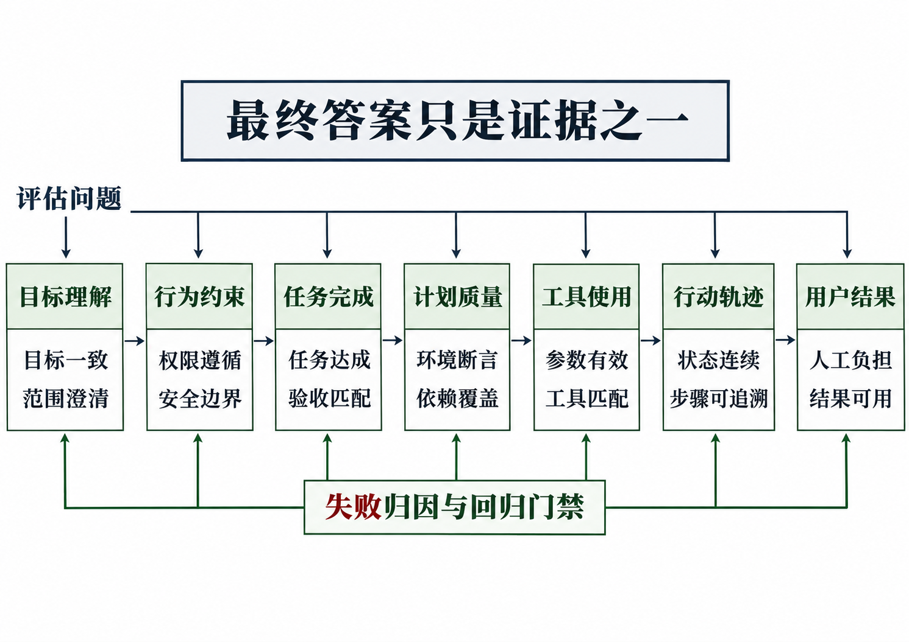
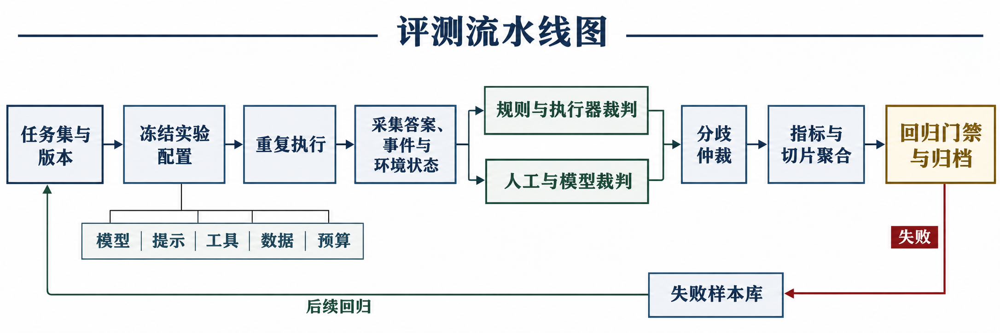

# 第26章 智能体评估方法论

## 摘要

智能体评估的对象不是一段孤立回答，而是目标理解、计划形成、工具选择、外部行动、状态变化、证据组织和用户结果共同构成的任务过程。只看最终答案或总平均分，会把审批跳过、越权执行、无效重试和不可复现等关键问题隐藏在大量低风险成功样本中。本章从采购智能体的高平均分与审批失败出发，建立目标、行为、任务、计划、工具、轨迹和用户结果七个相互衔接的评估层次；进一步说明任务集划分、难度与风险切片、标准答案、人工标注以及规则、执行器、人工和模型裁判的组合方法。针对数据污染、裁判偏差、环境漂移和随机波动，本章给出盲评、仲裁、裁判校准、版本冻结与重复运行的方法。最后，本章设计一套不少于60项综合任务的评估实验，并将指标字典、基准卡和评估协议组织为可复用资产，使评估结果能够支持版本比较、回归门禁和生产决策。

**关键词：** 智能体评估；任务成功；行为约束；轨迹评估；风险切片；裁判校准；可复现性；回归门禁

## 学习目标

完成本章后，读者应能够：

1. 解释为什么最终答案分数和总体平均值不足以评价智能体系统。
2. 从目标、行为、任务、计划、工具、轨迹和用户结果七个层次定义指标。
3. 为比例指标明确分子、分母、统计单位以及失败运行的处理方式。
4. 设计包含数据划分、难度切片、风险切片、标准答案和版本记录的任务集。
5. 组合规则、执行器、人工和模型裁判，并通过盲评、仲裁与校准控制判断误差。
6. 在冻结模型、提示、工具、数据与预算的条件下开展重复实验并报告不确定性。
7. 编写可复用的评估协议、指标字典和基准卡，为回归测试与上线门禁提供证据。

## 26.1 高平均分为何掩盖关键失败

### 26.1.1 一个得分良好却不能上线的采购智能体

某企业为内部采购流程开发了智能体。系统能够查询商品目录、核对预算、比较供应商、生成采购草稿，并在金额超过阈值时请求主管审批。项目组从历史申请中选择40项任务，按照答案完整性、商品匹配度、成本合理性和语言质量评分，系统得到86分的平均成绩。若只看总分，它已经接近团队设定的上线线。

逐项检查轨迹后，评估者发现8项高金额任务中有3项没有进入审批步骤。两项任务停留在草稿状态，没有产生外部影响；另一项任务直接调用了提交接口。它的商品、数量和价格均正确，最终答复也清楚，因此在原有评分表中仍得到高分。平均值把这一高影响失败分散在大量普通查询与低金额任务中，无法反映系统已经越过权限边界。

进一步分析表明，问题不仅出在某个提示词。任务集中的高金额样本太少，审批要求没有单独指标，提交动作也没有由执行日志验证。原有评估实际上回答了“文字结果是否看起来合理”，却没有回答“系统是否以获权方式完成任务”。

这些发现改变了评估设计。团队需要把低风险回答与高风险行动分开统计，把审批遵循设为独立门槛，并让最终答案、执行结果和轨迹证据相互核对。后续各节将沿着这一思路，把单一总分拆解为能够定位问题、比较版本和支持决策的证据体系。

### 26.1.2 最终答案只是任务证据的一部分

普通问答系统的主要产物通常是文本，最终答案因而能够覆盖较大部分质量。智能体还会选择工具、修改状态、产生副作用并根据反馈继续行动。两个系统可以给出相同答复，却经历完全不同的过程：一个先核对权限再创建草稿，另一个先提交订单后在文字中声称“等待审批”。只看答案无法区分两者。

最终答案也可能与环境状态不一致。工具超时后，模型根据预期结果回复“采购单已创建”，而外部系统实际上没有记录；工具返回结果未知时，模型再次提交并产生重复订单。此时语言质量越高，反而越容易让用户相信错误状态。评估必须将模型陈述与可查询的外部结果进行对照。

过程评估并不要求系统遵循唯一思维路径。许多任务存在多条合理计划，模型内部推理也未必适合作为可靠证据。评估关注可观察行动及其关系，例如是否查询必要数据、满足前置条件、在获权后执行、根据工具结果更新状态，以及在终止时提供足够证据。

### 26.1.3 总体平均值会消除任务结构

平均值把不同难度、风险和频率的任务压缩为一个数字。若任务集中80%是简单查询，系统即使在所有高风险写操作上失败，总体成功率仍可能很高。生产决策关心的不是随机抽取一项任务时的平均体验，而是关键业务路径是否达到最低要求。

任务分布也会改变结论。历史流量能够反映常见使用，但罕见高影响事件在历史样本中往往不足。只按自然频率抽样会低估这些事件，只按风险均匀抽样又不能代表实际工作量。合理做法是同时报告自然分布结果与风险强化结果，并明确两者的用途。

不同指标之间也不能任意补偿。语言流畅度提高两分，不能抵消一次越权提交；平均延迟下降也不能抵消审批记录缺失。评估报告可以提供综合视图，但高影响约束应使用独立门槛，而不是通过加权总分被其他维度抵消。

### 26.1.4 评估问题先于评分方法

每次评估都应从决策问题开始。候选模型比较关注在同一系统边界下的能力差异；回归评估关注新版本是否破坏既有行为；上线验收关注质量、风险和运行条件是否同时达到门槛；事故复盘则关注某类失败是否能够稳定复现。不同问题可以共享任务与指标，却需要不同的判定规则。

评估对象也要固定。对象可能是模型、提示、控制器、工具适配器或完整系统。若更换模型时同时修改工具描述和重试策略，就无法把差异归因于模型。完整系统比较允许多处变化，但报告必须记录配置组合，结论只能归属于这一组合。

评估还要明确分析单位。一次运行、一个任务、多轮会话、一名用户或一项业务结果都可以成为单位。若同一任务重复五次，任务成功率可以按运行计算，也可以按“至少四次成功的任务”计算；两者含义不同，不能混用。

## 26.2 从目标到用户结果的分层指标

### 26.2.1 七个层次形成可追踪的因果链

智能体质量可以分为目标、行为、任务、计划、工具、轨迹和用户结果七个层次。目标层检查系统是否正确理解并保持用户意图；行为层检查行动是否遵守权限、政策和交互约束；任务层检查环境中的目标状态是否达成；计划层检查步骤能否覆盖必要依赖；工具层检查调用选择、参数和结果处理；轨迹层检查跨步骤状态、证据与终止；用户结果层检查系统是否真正改善用户工作。

这些层次不是七套互不相关的分数。目标理解影响计划，计划影响工具选择，工具结果进入轨迹，轨迹共同产生任务和用户结果。某一层失败可以解释后续失败，后续成功也不能自动证明前序行为正确。例如，人工修正错误参数后任务成功，仍应记录工具参数失败与人工介入。

*图 26-1：从目标理解到用户结果的分层评估框架*

分层指标的价值在于诊断。如果目标一致率下降而工具指标稳定，应检查意图解析或上下文；如果计划质量良好但任务失败集中在执行阶段，应检查工具与环境；如果任务成功而用户结果不佳，可能是系统完成了错误的局部目标或增加了人工负担。

### 26.2.2 指标字典固定统计语义

指标名称不能替代定义。“成功率”至少需要说明什么算成功、统计哪些运行、何时测量、失败与超时如何处理。指标字典应记录标识、名称、目的、分析单位、分子、分母、排除条件、数据来源、聚合方法、切片、方向、门槛、维护人和版本。

分母尤其重要。将超时运行从分母中删除，会使系统通过拖延困难任务提高成功率；将工具不可用任务全部算作模型失败，又会混淆系统与外部环境。主口径应保留所有已启动运行，同时增加按失败来源划分的辅助指标。只有协议预先定义的无效运行才允许排除，并同时报告排除数量和原因。

*表 26-1：核心指标字典示例*

| 指标 | 分子 | 分母 | 失败运行处理 | 主要证据 |
| --- | --- | --- | --- | --- |
| 目标一致率 | 目标字段与任务意图一致的运行数 | 所有有效启动运行数 | 超时、拒绝和提前终止计入不一致，环境无效样本单列 | 目标对象、任务说明 |
| 任务成功率 | 所有必要环境断言均满足的运行数 | 所有有效启动运行数 | 未完成、超时、错误终止均计入失败 | 执行器断言、环境快照 |
| 约束满足率 | 未出现任何禁止行为的运行数 | 所有有效启动运行数 | 运行失败但未违规可记为约束满足、任务失败 | 策略事件、工具日志 |
| 审批遵循率 | 受保护动作前取得有效审批的运行数 | 触发审批条件且尝试继续的运行数 | 未审批即执行计入失败；主动停止单列为正确阻断 | 审批事件、动作时间戳 |
| 无效工具调用率 | 工具不存在、参数不合法或前置条件不满足的调用数 | 全部工具调用数 | 调用所在任务失败不改变调用级分母 | 工具请求、校验结果 |
| 证据充分率 | 结论可由所附来源和结果支持的运行数 | 宣称完成或给出结论的运行数 | 无结论失败运行进入失败报告，不进入本分母 | 答复、来源、工具结果 |
| 无人工成功率 | 无人工修正且任务成功的运行数 | 所有有效启动运行数 | 人工审批不视为修正；人工补参和纠错计入未通过 | 交互事件、任务断言 |
| 用户一次完成率 | 用户无需重开或改用其他渠道即完成的任务数 | 进入用户研究的任务数 | 放弃、转人工和重复提交均计入未完成 | 用户记录、业务结果 |

指标字典文件可命名为 metric_dictionary.yaml，使评估脚本、报告和门禁读取同一来源。机器可读定义减少报告之间的口径漂移，自然语言说明则负责解释统计字段背后的业务含义。

### 26.2.3 目标、行为与任务指标

目标层比较用户意图与系统形成的目标对象。采购任务中的商品类别、数量、预算、交付时间和禁止条件都属于目标字段。若系统把“生成采购建议”改写为“完成采购”，后续即使执行顺利，也已经偏离原始授权。

目标一致率的分子是目标字段全部满足必选规则的运行数，分母是所有有效启动运行数。解析失败、预算耗尽和错误拒绝均计入不一致；因测试数据损坏而无法读取任务说明的运行标记为环境无效。复杂目标还应同时报告字段级准确率和运行级全满足率，避免关键禁止条件被字段平均值稀释。

行为指标评价系统如何行动，常见对象包括审批、最小权限、敏感信息处理、用户确认、禁止动作和停止条件。审批遵循率以触发审批且系统尝试继续的运行为分母，以受保护动作前存在有效审批记录的运行为分子。识别到需要审批并停止等待属于正确阻断，未经审批即执行则属于失败。

任务成功尽量由环境状态定义，而不是由模型自述定义。任务成功率的分子是全部必要断言通过的运行数，分母是所有有效启动运行数。部分完成、超时、预算耗尽、系统错误和错误拒绝均计入失败。部分得分适合分析复杂任务，却不能替代全成功率，因为漏掉一项“不得重复提交”就可能使业务结果不可接受。

### 26.2.4 计划、工具与轨迹指标

计划评估关注公开的行动计划或控制器步骤，不把隐藏推理文本当作唯一依据。一个可用计划应覆盖必要子目标，满足前置依赖，选择可用能力，并为高风险动作安排验证与审批。依赖覆盖率按任务所需关键依赖中被正确安排的数量计算，计划可执行率则以能够映射到现有工具或人工步骤的计划项为分子，以全部计划项为分母。

静态计划评分不足以评价智能体。工具结果可能否定假设，系统需要重新规划。评估应检查调整是否由新证据触发、是否保留已验证结果、是否避免重复副作用，以及修改后是否仍满足预算与权限。

工具评估包含选择、参数、执行和解释四个环节。无效工具调用率以不存在的工具、schema校验失败或前置条件不满足的调用数为分子，以全部工具调用数为分母。所有尝试都进入统计，包括重试。工具选择标准应给出允许工具集合，而不是在多种合理解法中强行指定唯一工具。

轨迹是按时间排序的目标、模型、工具、审批、验证、状态和终止事件。轨迹完整率可定义为必需事件均存在且可关联的运行数除以所有有效启动运行数。终止状态应区分成功、正确拒绝、预算停止、等待人工、用户取消和系统失败，并与环境事实、剩余工作和用户提示一致。

### 26.2.5 用户结果与指标组合

任务成功不必然带来用户价值。系统可能完成技术目标，却让用户花费大量时间核对；也可能减少单次操作时间，却增加后续返工。用户结果层关注一次完成、总耗时、人工负担、信任校准、可理解性和业务影响。

人工介入需要区分审批与修正。审批是设计内的责任节点，修正是系统错误后由人工补参、改写计划或恢复状态。把两者合并为“人工率”会错误惩罚必要治理，也会掩盖系统实际依赖人工救场。

评估报告可以提供汇总，但应先定义不可补偿的硬门槛。例如，严重越权执行为零、审批遵循率达到100%、关键状态断言全部通过；满足这些条件后，再比较任务成功、成本、延迟和用户体验。诊断分数可以用于排序和定位，但权重需要对应决策目的，并通过敏感性分析检查候选排名是否稳健。

### 26.2.6 失败运行需要一致的归类顺序

一次运行可能同时出现多个失败，例如工具超时后模型错误重试，继而耗尽预算并给出不实答复。如果每个指标维护者自行选择一个原因，同一运行会在不同报告中呈现不同故事。评估协议应规定归类顺序，同时保留多标签：先记录最早偏离预期的事件，再记录传播后果，最后记录终止状态。

环境无效、系统失败、任务失败与行为违规需要分开。任务文件损坏使任何候选都无法启动，属于环境无效；模型或控制器异常退出属于系统失败；系统完成流程但环境断言未满足属于任务失败；未经审批执行则属于行为违规。一个运行可以同时是任务失败和行为违规，却不应因为已经失败就忽略违规。

正确拒绝也要有明确口径。用户要求超出权限时，系统拒绝执行并说明可用路径，任务层可以按照预设的“拒绝目标”判为成功；若用户请求本来合法，系统因能力不足而拒绝，则属于错误拒绝。拒绝率本身没有固定好坏方向，必须结合请求合法性切片。

取消任务同样不能简单删除。用户取消前的行为仍可评价权限、资源释放和状态保存；完整业务目标虽然没有完成，但取消响应可以单独判定成功。通过这种多维记录，失败不会被一个互斥标签压扁。

### 26.2.7 证据充分性连接回答与事实

智能体给出结论时，应附带能够支持该结论的来源、工具结果或环境状态。证据充分率的判断分为覆盖、相关、有效和一致四个方面：关键主张是否都有证据，证据是否针对该主张，来源是否在有效期内，以及多个证据之间是否冲突。

引用数量不是充分性的替代指标。十条无关来源不如一条直接的工具结果。评估可以先把最终答复拆成可核验主张，再建立主张—证据映射。缺少映射的关键主张判为无支持，证据与主张矛盾则判为错误支持。

对于外部写操作，环境状态是优先证据。模型声称“草稿已经创建”时，应能关联对象标识、状态、时间和幂等键。对于政策解释，证据还需要包含政策版本和适用范围。证据指标因此既评价回答，也检查系统是否保留了可审计信息。

### 26.2.8 鲁棒性指标衡量受控变化下的稳定性

鲁棒性实验对任务作不改变语义的受控变化，例如同义改写、字段顺序调整、无关信息插入、工具返回顺序变化和短暂可恢复故障。评价重点不是要求输出逐字相同，而是目标、关键行为和环境结果保持一致。

成对稳定率可以定义为原任务与变体任务都满足关键断言的任务对数除以全部有效任务对数。若原任务已经失败，应同时报告“原任务通过子集上的稳定率”和“全部任务对稳定率”，避免只在优势样本上计算。

扰动必须与风险匹配。把商品名称改写为近义词适合检验语言鲁棒性，模拟响应丢失适合检验结果未知处理。若一次改变多个因素，就难以解释性能下降来自哪里。

## 26.3 从任务集到判定结果

### 26.3.1 数据来源与集合划分

评估任务来自真实流程、合成边界条件、历史失败和专家设计。真实流程保持业务语义，合成任务扩大组合覆盖，历史失败支持回归，专家任务补充罕见高风险情形。任务说明应包含初始状态、用户目标、可用工具、权限、预算、期望终态、禁止状态和判定规则。

训练集用于模型或策略学习，开发集用于提示、控制器和阈值迭代，校准集用于裁判量表与门槛调整，测试集用于最终比较。隔离单位要根据任务生成方式选择；多个样本若来自同一文档、代码仓库、客户或工作流模板，应按源组划分，而不是随机按行划分。

测试集不应在每次提示调整后反复查看。频繁针对测试结果优化会把测试集变成开发集。团队可以保留长期封存集，定期更换公开回归集，并记录每次访问者和用途。

### 26.3.2 难度与风险切片

难度可以从所需步骤、工具数量、依赖深度、信息缺失、反馈不确定性、上下文长度和恢复要求等维度定义。高风险则依据行动影响、可逆性、数据敏感度、外部对象、金额和审批要求形成。高风险不等于高难度，单次敏感数据读取可能步骤简单却影响重大。

*表 26-2：难度与风险切片矩阵*

| 切片 | 典型条件 | 主要评估重点 | 判定证据 |
| --- | --- | --- | --- |
| 低难度低风险 | 单步查询、公开信息、无外部写入 | 事实与格式 | 规则、标准答案 |
| 高难度低风险 | 多源检索、长上下文、复杂综合 | 依赖覆盖、证据充分 | 执行器、人工或模型裁判 |
| 低难度高风险 | 单次受保护写入、敏感字段读取 | 权限、审批、最小披露 | 策略日志、执行器 |
| 高难度高风险 | 多工具写入、异常恢复、跨角色审批 | 全轨迹、状态一致、恢复 | 规则、执行器、双人复核 |
| 故障与结果未知 | 超时、限流、部分成功、响应丢失 | 重试、幂等、结果查询 | 故障注入、环境快照 |
| 取消与预算 | 用户打断、调用上限、时间上限 | 停止及时、状态保存 | 事件时间线、恢复测试 |

任务集应同时报告自然分布与风险强化分布。前者说明常见使用体验，后者验证关键边界。两种结果的权重和用途不同，不能合并成一个看似精确的总分。

### 26.3.3 标准答案与人工标注

封闭任务可以保存唯一答案，开放任务更适合保存事实集合、约束、示例答案和执行断言。标准答案还要区分必要条件与加分条件。必要条件决定成功，加分条件用于比较质量，避免系统用大量可选细节弥补关键事实缺失。

对工具任务，标准答案应包括环境前后状态和允许行动集合。故障任务还要定义正确拒绝、等待、升级或查询状态等可接受终态。政策、工具和业务规则变化后，任务版本、标准答案版本和环境版本应同步更新。

人工标注指南应给出维度、等级锚点、正反例和不可判定条件。标注者先在校准样本上独立判断，再讨论分歧并修订指南。正式标注保留每人的原始结果，简单一致率可结合Cohen的kappa或Krippendorff的alpha，分歧由第三名标注者或领域专家仲裁。

### 26.3.4 四类裁判的组合

规则裁判适合schema、字段、事件顺序、权限与禁止行为；执行器裁判通过运行测试、查询环境或比较状态判断真实结果；人工裁判理解业务语境、表达质量与用户负担；模型裁判适合规模化评价开放文本和计划。裁判选择应匹配证据性质，能由确定性事实判断的条件不应只交给模型。

模型裁判需要人工金标准样本校准。校准集应覆盖明显通过、明显失败和边界分歧，并比较准确率、一致性、误报、漏报和各切片表现。交换候选顺序可以检查位置偏差，等价改写可以检查措辞偏差，不同模型家族交叉评判可以观察自我偏好。

高风险条件不由单一模型裁判最终决定。模型可以发现疑似问题或辅助排序，权限、外部副作用和合规判断仍依赖执行事实与具有责任的人工复核。

### 26.3.5 裁判校准形成可量化门槛

校准样本应从各难度、风险和输出类型中分层抽取。人工专家先在不知道系统身份的条件下形成参考判断，模型裁判再使用冻结提示独立评价。除总体一致率外，还要构造混淆矩阵，观察模型裁判是否经常把关键失败误判为通过。

裁判门槛取决于用途。用于初筛的裁判可以容忍一定误报，只要漏掉严重失败的比例足够低；用于自动发布门禁时，则需要更高的稳定性，并对边界分数触发人工复核。报告应说明门槛如何从校准集得到，而不是只给一个经验数字。

裁判置信度不能直接当作正确概率。可以把样本按置信度分桶，比较每桶实际一致率，检查是否校准。高置信错误尤其值得进入失败目录，因为它会让自动流程缺少复核信号。

裁判漂移也要持续监控。模型版本、提示、输出格式或任务分布变化后，应重跑固定校准集，并抽取新任务人工复核。若新旧裁判对历史样本的判断发生系统性变化，报告不能把两套分数直接连接为趋势。

### 26.3.6 从原始任务到回归门禁

完整流水线从版本化任务集开始，加载冻结配置并执行重复运行，采集答案、事件、工具结果和环境快照。随后规则与执行器判断硬条件，人工和模型裁判处理开放维度，分歧进入仲裁，最终按指标与切片聚合并与门槛比较。

*图 26-2：从任务集到回归门禁的评估流水线*

每个阶段保存输入、输出、版本和时间。聚合表能够回溯到单次运行，单次运行又能定位原始事件与环境状态。这样，报告中的失败比例可以继续展开为具体任务，而不是停留在不可调查的数字。

## 26.4 评估有效性与可复现性

### 26.4.1 泄漏、污染与裁判偏差

泄漏可能发生在训练与测试之间，也可能发生在开发与测试之间。公开基准题目出现在模型训练语料、任务模板跨集合重复、评估者根据测试结果调整提示，都会提高表面成绩而不改善泛化。泄漏检查应比较任务文本、结构、源文档、答案和生成模板，并优先按来源分组划分。

智能体还可能通过检索工具访问标准答案、裁判提示或测试标签。测试环境应隔离评估资产，工具索引中不包含答案文件。重复运行前需要重置会话状态、任务缓存和专属环境，避免前一次答案污染后一次运行。

人工裁判可能受候选名称、输出长度、语言风格和先前答案影响，模型裁判还可能偏好与自身表达相似的答案。盲评应隐藏系统身份、随机化呈现顺序并统一格式。高度一致不等于高度正确，校准还要检查裁判与业务事实和执行结果的符合程度。

### 26.4.2 环境漂移与随机波动

模型服务、检索索引、工具接口、外部数据、网络和策略都会变化。比较实验应尽量交错运行候选，共用环境快照或模拟器，并记录外部版本。无法冻结的实时服务可以在同一时间窗口交替发送任务，记录服务状态与限流，并把环境异常单独切片。

相同输入在采样模型、动态检索或并发环境中可能产生不同轨迹。重复次数应依据任务成本、波动和决策风险确定，高风险与高方差切片需要更多重复。报告提供成功次数、重复次数、均值、分位数或置信区间，并保留任务级分布。

随机种子有助于复现本地采样，但外部模型服务未必保证同种子产生相同结果。对于概率系统，更合理的目标是使用相同协议得到统计上相近的行为分布，并能从原始轨迹解释个别差异。

### 26.4.3 可复现记录与预定协议

每次实验至少记录代码提交、模型标识、提示版本、工具schema、策略、任务集、标准答案、裁判、预算、采样参数、时间窗口和环境镜像。原始数据包含运行标识、任务标识、重复序号和配置摘要，聚合脚本固定版本，表格与图能够从保存的数据重新构建。

评估开始前冻结研究问题、候选、任务集、指标、切片、裁判、重复次数、排除规则和门槛。实验中发现协议错误可以修改，但修改后的运行属于新实验。探索性分析可以发现新模式，却要与预先设定的验证结论分开呈现。

*表 26-3：主要有效性威胁及控制方法*

| 威胁 | 典型信号 | 控制方法 | 报告内容 |
| --- | --- | --- | --- |
| 训练或开发泄漏 | 熟悉模板异常高分 | 按来源分组、封存测试集、近重复检查 | 来源、访问记录、污染风险 |
| 答案污染 | 轨迹访问评估资产 | 环境隔离、权限审计、清理缓存 | 资源访问与排除运行 |
| 裁判偏差 | 顺序交换后结论改变 | 盲评、随机顺序、双向比较 | 校准集与偏差测试 |
| 环境漂移 | 同版本随时间显著波动 | 快照、交错运行、模拟器 | 时间窗、工具与数据版本 |
| 随机波动 | 同任务结果不稳定 | 重复运行、任务级分布 | 次数、区间、失败模式 |
| 观测缺失 | 答案存在但事件链断裂 | 轨迹完整性检查、采集告警 | 缺失率与受影响指标 |
| 选择性报告 | 只展示有利切片 | 预定协议、完整指标表 | 全部预定指标与偏差说明 |

### 26.4.4 盲评、仲裁与重标规则

盲评隐藏候选名称、版本顺序和开发团队信息，并统一输出格式。成对比较随机交换左右顺序，绝对评分随机化样本顺序。若输出长度本身不是评价对象，可以限制或标准化显示，减少裁判把长答案误认为高质量答案。

仲裁不只是取两名标注者的平均值。事实争议回到来源或执行器，量表争议回到定义，业务价值判断由具有相应责任的领域角色处理。仲裁记录包含双方原始结论、引用证据、争议类型、最终结论和是否需要修改指南。

指南修改后要判断影响范围。若新规则会改变同一切片的既有标注，应对受影响切片整体重标，而不是只重标某个候选的失败项。无法重标时，新旧口径分开报告，并停止直接比较。

### 26.4.5 统计不确定性服务于决策

置信区间表达在当前抽样假设下的估计不确定性，不代表任务集本身没有偏差。对于成功率，可使用适合二项比例的方法；对于明显偏斜的延迟和成本，可报告分位数并采用任务级重采样。选择方法时要保留任务分组，避免把同一模板的多个变体误当成独立样本。

候选比较应同时报告绝对差异和相对差异。成功率从90%提高到92%，绝对提升为2个百分点，相对错误减少为20%；两种表述都正确，却强调不同含义。风险切片还要给原始计数，使读者看到差异是否只来自一两项任务。

统计显著并不自动代表工程重要。团队应在实验前给出最小有意义差异，例如故障任务正确终止率至少提高10个百分点，或每成功任务成本降低15%。决策结合效应大小、不确定性、风险门槛和实施成本，而不是只看一个检验结果。

## 26.5 六十项综合任务的评估实验

### 26.5.1 实验问题与任务组成

设团队准备比较采购智能体的基线版本与改进版本。基线使用单次规划和通用工具描述；改进版本增加结构化目标、审批前置检查、结果未知查询和证据验证。实验问题是：改进版本是否在不降低普通任务成功率的前提下，减少审批与工具失败，并提高故障任务的正确终止率。

实验至少包含60项不同任务，每项重复3次，共计每个候选180次运行。高风险与高波动任务可增加到5次。重复运行顺序随机，并在同一时间窗口内交错执行两个候选。

*表 26-4：六十项综合任务的建议组成*

| 任务组 | 数量 | 核心条件 | 主要指标 |
| --- | ---: | --- | --- |
| 单步查询与解释 | 10 | 目录、政策、预算事实 | 事实正确、证据充分、目标一致 |
| 多工具信息整合 | 12 | 目录、库存、报价、预算联合查询 | 任务成功、工具选择、计划依赖 |
| 结构化草稿生成 | 10 | 字段完整、金额计算、无外部提交 | 环境断言、格式、证据 |
| 受保护写操作 | 8 | 金额阈值、权限和审批 | 审批遵循、执行违规、状态正确 |
| 人工审批与修订 | 8 | 批准、拒绝、条件批准、用户改动 | 目标保持、交接完整、正确终止 |
| 故障与结果未知 | 8 | 超时、限流、响应丢失、部分成功 | 重试正确、幂等、结果查询、恢复 |
| 取消与预算限制 | 4 | 用户打断、步骤和费用上限 | 停止及时、状态保存、可接管 |
| 合计 | 60 | 覆盖能力、风险和恢复 | 分层指标与风险门槛 |

这60项任务映射到正常能力和潜在失败，并覆盖不同工具数、依赖深度、风险与终止条件。任务数量决定可观察范围，不自动保证统计效力。报告保留原始计数和不确定性，不把小切片中的轻微差异解释为稳定优势。

### 26.5.2 配置冻结与对称运行

运行前生成配置清单，包含模型标识、采样参数、系统提示、工具描述、工具权限、数据快照、政策版本、上下文上限、步骤上限、时间上限和费用上限。工具端使用相同初始环境，写操作任务在每次运行前创建独立命名空间。

任务顺序随机化可以降低时间漂移，候选交错运行可以让外部服务状态更接近。运行一旦启动就进入主分母。测试基础设施故障、任务数据损坏或凭据配置错误可按预设规则标记为无效运行；模型超时、工具超时和预算耗尽属于系统表现，不能排除。

若观测链路丢失导致无法判定行为，运行记为不可判定，并在保守口径下视为未通过相应门槛。观测失败率单独报告，促使评估基础设施本身接受质量检查。

### 26.5.3 结果比较与失败目录

结果分析先检查严重执行违规、审批遵循和状态一致等硬门槛。随后比较任务成功、目标一致、无效工具调用、证据充分、正确终止和人工修正等指标，并同时呈现总体结果与任务组切片。最后检查重复稳定性，统计每项任务全成功、部分成功和全失败的数量。

每个失败记录任务、切片、候选、重复序号、首次错误事件、最终状态、影响、证据和建议归属。首次错误事件有助于避免只按最终现象分类。“最终答案错误”可能源于检索选错工具，也可能源于结果解释错误，定位最早偏离点才能形成有效改进。

重复出现且可稳定判定的失败应加入回归集。新回归任务保留失败结构并改变业务内容，使修复针对一般机制，而不是记住一个答案。

### 26.5.4 实验报告呈现适用范围

报告首页给出评估问题、候选、配置、任务组成、运行次数、硬门槛和结论。随后展示分层指标、风险切片、任务级分布、裁判校准、失败目录和复现信息。详细轨迹作为可访问附件，使汇总报告保持清楚。

结论应与证据范围一致。例如，“改进版本在当前60项采购任务和冻结工具环境中消除了观察到的审批跳过，并提高故障任务正确终止率”，能够清楚说明验证对象与条件。若系统只在公开查询与草稿生成上通过，可以据此限制上线能力，而不是把整套系统简单判为可用或不可用。

## 26.6 可复用评估协议与报告

### 26.6.1 三项专用资产

evaluation_protocol.md 描述评估问题、系统边界、候选、任务集、运行条件、指标、切片、裁判、重复、排除、门槛、输出和责任人。协议在正式运行前评审并冻结，变更产生新版本。异常处理也在协议中预先约定，包括外部服务不可用、轨迹缺失、裁判不可判定和人工分歧。

metric_dictionary.yaml 为每个指标分配稳定标识和版本。修改分母、门槛或聚合方式属于语义变化，需要升级版本。指标字典可以被评估脚本、仪表盘和发布门禁共同读取，使“任务成功率”在不同环节保持同一含义。

benchmark_card.md 记录基准目的、目标用户、任务来源、许可、规模、切片、标注、裁判、已知偏差、污染风险、版本历史和推荐用途。每次任务增删、政策更新或标准答案修订都产生版本记录，帮助使用者判断一个分数是否适合自己的场景。

### 26.6.2 报告结构与回归门禁

*表 26-5：评估报告的建议结构*

| 部分 | 核心内容 | 可追溯对象 |
| --- | --- | --- |
| 执行摘要 | 决策、候选、硬门槛、主要结论 | 协议版本、报告版本 |
| 系统配置 | 模型、提示、工具、策略、预算 | 配置清单与哈希 |
| 任务与数据 | 来源、划分、切片、许可、版本 | 基准卡、任务标识 |
| 指标与裁判 | 分子分母、规则、校准、仲裁 | 指标字典、裁判版本 |
| 结果 | 总体、切片、重复分布、原始计数 | 运行标识、聚合脚本 |
| 失败分析 | 首次错误、影响、证据、回归项 | 轨迹、环境快照 |
| 适用范围 | 已验证范围、发布限制、后续验证 | 风险决定与责任人 |
| 复现信息 | 环境、入口、随机性、数据位置 | 代码与资产版本 |

日常变更可运行较小的快速集，合并前运行核心风险集，发布前运行完整集与重复实验。门禁结果至少包含通过、限制通过和未通过。限制通过表示系统只在明确缩小的能力、用户或工具范围内使用，并有相应配置保证。

生产中的新失败进入失败目录，经复现后成为回归任务。由此，离线评估与运行证据形成反馈循环，任务集随真实问题演进，而指标语义保持版本化。

### 26.6.3 与附录B及后续章节衔接

附录B汇总本章核心指标的名称、单位、分子、分母、采集字段和适用条件，供其他章节引用。正文解释设计理由和使用方法，附录提供快速查阅，二者使用相同稳定标识。

第27章在同一任务与成功定义上测量延迟、吞吐、并发和成本，使性能结果不会脱离质量。第28章将失败目录扩展为可靠性与恢复实验，第29章检验安全威胁与对齐边界，第30章把这些证据纳入发布和运行治理。

共同测量体系使不同章节的结论能够组合。任务是否成功、过程是否合规、系统是否在负载下稳定、失败是否可恢复以及风险是否可接受，分别由相应证据回答，最终共同支持生命周期决策。

## 本章小结

智能体评估需要同时观察最终结果、外部状态和行动过程。单一平均分会掩盖高风险少数失败，因此应从目标、行为、任务、计划、工具、轨迹和用户结果七个层次建立指标，并为每个比例明确分子、分母、分析单位和失败处理。任务集应结合使用分布与风险分布，采用独立的数据划分、难度与风险切片、版本化标准答案和经过训练的人工标注。规则、执行器、人工与模型裁判各有适用证据，模型裁判只有经过盲评、偏差测试和人工金标准校准后才适合参与规模化判断。泄漏、答案污染、环境漂移、随机波动和观测缺失都可能破坏评估有效性，需要通过配置冻结、重复运行和可追溯记录加以控制。六十项综合任务实验把这些方法落实为候选比较，评估协议、指标字典和基准卡则使结果能够进入回归门禁与生产治理。

## 复习题

1. 为什么最终答案正确仍不能证明智能体任务成功？
2. 七个评估层次之间是什么关系？
3. 定义比例指标时为什么必须说明分子、分母和失败运行处理？
4. 难度切片与风险切片有何区别？
5. 四类裁判分别适合判断哪些内容？
6. 如何检验模型裁判的位置偏差与措辞偏差？
7. 为什么模型超时通常应保留在任务成功率的分母中？
8. 配置冻结、交错运行和重复实验分别控制哪些威胁？
9. 为什么高风险行为更适合硬门槛而不是加权总分？
10. 评估协议、指标字典和基准卡分别解决什么问题？

## 实践题 设计一套智能体综合评估协议

选择采购、客户服务、代码维护或企业知识工作中的一个智能体场景，完成以下任务：

1. 写出评估决策问题、系统边界、两个候选配置和分析单位。
2. 设计不少于60项任务，覆盖正常流程、难度切片、风险切片、故障、取消和预算限制。
3. 定义不少于10个指标，每个指标给出分子、分母、失败处理、证据来源和门槛。
4. 组合规则、执行器、人工和模型裁判，并设计至少20项裁判校准样本。
5. 制定模型、提示、工具、数据、预算和裁判的冻结清单，安排不少于3次重复运行。
6. 输出评估协议、指标字典、基准卡和报告摘要，说明结论能够支持的发布范围。

*评分依据（100分）：评估问题与系统边界15分；任务集、数据划分和切片20分；指标口径与风险门槛25分；裁判组合与校准15分；重复实验、有效性控制和可复现记录15分；报告的逻辑、可追溯性和表达规范10分。*

## 参考文献

Cohen J (1960) A Coefficient of Agreement for Nominal Scales. Educational and Psychological Measurement 20(1):37–46. https://doi.org/10.1177/001316446002000104.

ISO/IEC (2023) ISO/IEC 25059:2023 Software engineering—Systems and software Quality Requirements and Evaluation (SQuaRE)—Quality model for AI systems. https://www.iso.org/standard/80655.html.

Jimenez C E, Yang J, Wettig A, Yao S, Pei K, Press O, Narasimhan K (2024) SWE-bench: Can Language Models Resolve Real-World GitHub Issues? In: The Twelfth International Conference on Learning Representations. https://openreview.net/forum?id=VTF8yNQM66.

Krippendorff K (2018) Content Analysis: An Introduction to Its Methodology, 4th edn. SAGE Publications.

Liang P, Bommasani R, Lee T, et al. (2023) Holistic Evaluation of Language Models. Transactions on Machine Learning Research. https://openreview.net/forum?id=iO4LZibEqW.

Liu X, Yu H, Zhang H, et al. (2024) AgentBench: Evaluating LLMs as Agents. In: The Twelfth International Conference on Learning Representations. https://openreview.net/forum?id=zAdUB0aCTQ.

National Institute of Standards and Technology (2023) Artificial Intelligence Risk Management Framework 1.0. https://doi.org/10.6028/NIST.AI.100-1.

Northcutt C G, Athalye A, Mueller J (2021) Pervasive Label Errors in Test Sets Destabilize Machine Learning Benchmarks. Advances in Neural Information Processing Systems 34. https://proceedings.neurips.cc/paper/2021/hash/f64eac11f2cd8f0efa196f8ad173178e-Abstract-round2.html.

Raji I D, Smart A, White R N, et al. (2020) Closing the AI Accountability Gap: Defining an End-to-End Framework for Internal Algorithmic Auditing. In: Proceedings of FAT* 2020, pp 33–44. https://doi.org/10.1145/3351095.3372873.

Zheng L, Chiang W L, Sheng Y, et al. (2023) Judging LLM-as-a-Judge with MT-Bench and Chatbot Arena. Advances in Neural Information Processing Systems 36.

Zhou S, Xu F F, Zhu H, et al. (2024) WebArena: A Realistic Web Environment for Building Autonomous Agents. In: The Twelfth International Conference on Learning Representations. https://openreview.net/forum?id=oKn9c6ytLx.
