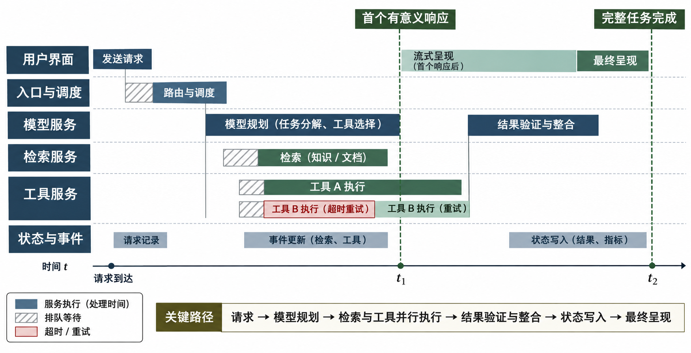
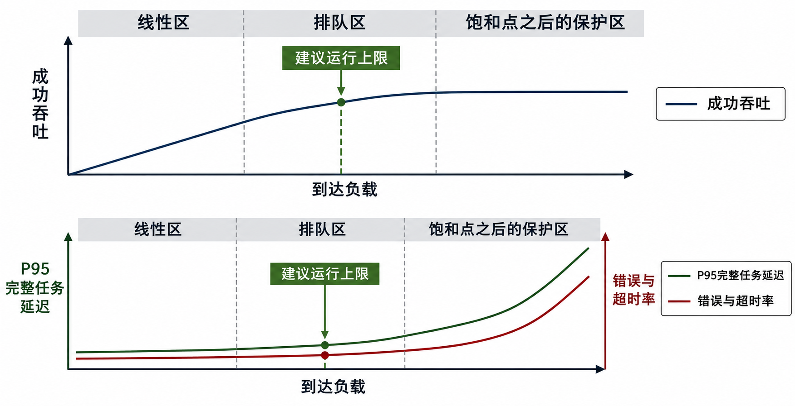

# 第27章 基准评测、性能剖析与容量规划

## 摘要

智能体系统的性能不是一次模型调用的耗时，而是模型、检索、工具、调度、传输、呈现和排队共同形成的端到端结果。平均延迟看似稳定时，长任务、工具限流和队列竞争仍可能使P95延迟、超时率与每成功任务成本迅速恶化。本章从一个平均响应正常却在业务高峰失守的服务出发，区分首响应延迟、完整任务延迟、服务时间、等待时间、并发和吞吐，建立可用于测量与诊断的时间分解。随后，本章设计五级以上负载、三类任务时长以及阶梯、突发、混合、冷启动四类实验，说明如何识别模型、工具、队列、连接池和外部限流瓶颈。最后，本章把质量门槛、性能预算、成本、受限并发和排队容量放入同一容量模型，区分实测范围与外推假设，并以负载配置、容量模型和剖析报告支持部署和运行治理。

**关键词：** 基准评测；端到端延迟；吞吐；并发；排队；负载测试；性能剖析；容量规划；每成功任务成本

## 学习目标

完成本章后，读者应能够：

1. 区分首响应延迟、完整任务延迟、服务时间、等待时间、吞吐和并发。
2. 将端到端任务时间分解到模型、检索、工具、调度、传输和呈现阶段。
3. 设计至少五个负载档位和短、中、长三类任务的可重复基准实验。
4. 使用阶梯、突发、混合和冷启动实验识别不同运行条件下的性能边界。
5. 判断模型配额、工具服务、队列、连接池、外部限流和负载发生器是否成为瓶颈。
6. 计算每成功任务成本，比较串行、受限并发和队列容量方案的扩容收益。
7. 将实测容量、性能预算和外推假设组织为可执行的容量规划资产。

## 27.1 平均延迟正常为何服务仍然失守

### 27.1.1 高峰期出现的长尾故障

某企业将第26章的采购智能体开放给多个部门。试运行报告显示，完整任务平均耗时为18秒，低于团队设定的25秒目标。工作日上午流量较低时，用户能够连续完成目录查询、预算核对和采购草稿生成，仪表盘上的模型延迟也没有明显异常。

月末采购集中提交后，用户开始报告页面长时间停留在“正在查询报价”。监控显示平均耗时只上升到23秒，看起来仍接近目标，但P95已经达到92秒，约8%的任务超时。进一步检查发现，模型调用时间变化不大，主要等待发生在报价工具之前：工具连接池已经占满，后续调用在本地队列中等待；少量长任务多次扇出查询，又持续占用连接。

平均值没有呈现用户实际遇到的长尾，也没有说明时间花在哪里。若只优化模型推理，系统的主要瓶颈仍然存在；若直接增加应用副本，所有副本又会共同争用同一外部工具配额，超时可能更加严重。

这一场景说明，性能判断需要同时观察时间分布、任务结构、排队位置、失败和资源约束。本章将先建立端到端时间模型，再通过受控负载找出容量边界，并把质量与成本纳入扩容决策。

### 27.1.2 平均值无法描述长尾与超时

平均延迟容易被大量短任务拉低。一百项任务中，九十项在10秒内完成、十项耗时100秒，平均值为19秒，却有十分之一用户等待远超正常体验。P50描述典型任务，P90、P95和P99描述尾部，最大值与超时率则揭示极端情况。

分位数必须附带样本数与时间窗。只有20次运行时，P99几乎等同于最大值，难以稳定代表分布；把全天数据聚合为一个P95，也可能掩盖高峰时段。报告应按固定窗口、任务类型和成功状态切片。

超时任务不能从延迟统计中消失。若系统在60秒终止，报告可以把其延迟记为删失值并单独统计超时率，同时给出成功任务延迟与全部启动任务的限时分布。只报告成功任务会让更容易超时的版本显得更快。

### 27.1.3 模型速度不等于任务速度

智能体任务可能包含多次模型调用、检索、工具执行、审批等待和状态保存。模型首个令牌很快，不代表工具完成很快；单次工具很快，也不代表十个串行步骤很快。端到端延迟由调用次数、依赖结构和等待共同决定。

并行也不会自动缩短全部时间。两个独立查询可以并行，但后续汇总必须等待两者；过大的扇出会争用连接、触发限流并增加失败。性能优化需要识别关键路径，而不是简单把每一步都并发执行。

完整任务还可能跨越人工审批。用户等待审批的业务时间与系统计算时间应分别记录。前者影响业务周转，后者反映平台容量；混成一个数字既无法优化系统，也无法评价流程。

### 27.1.4 基准评测从明确问题开始

性能实验可以回答不同问题：单实例能够处理多少任务，增加副本是否提高吞吐，哪类资源首先饱和，突发流量需要多大队列，或者一次成功任务的成本是多少。问题不同，负载模型和指标也不同。

基准对象应绑定第26章的质量定义。性能比较只统计达到相同任务成功与风险门槛的系统，否则一个跳过验证步骤的版本可能看起来更快。原始报告同时保留全部尝试的资源消耗，使失败和重试不会被排除在成本之外。

## 27.2 端到端时间与容量的基本量

### 27.2.1 首响应与完整任务延迟

首响应延迟从请求被系统接受开始，到用户看到第一个有意义反馈为止。对于流式界面，它可以是第一段可理解文本；“已收到”这类固定占位不应被当作有效首响应。完整任务延迟从请求接受到达到终态，包括成功、正确拒绝、取消、超时和失败。

首个令牌时间是模型服务指标，不一定等于用户首响应。请求可能先在调度队列等待，模型输出又可能经过安全过滤和网络缓冲。呈现层只有在内容真正到达用户界面后才能结束首响应计时。

交互式任务还应记录阶段进展时间，例如开始检索、等待审批和工具完成。良好的进展反馈能够改善体验，却不能代替完整任务性能。系统需要同时保证反馈及时和任务最终完成。

### 27.2.2 服务时间、等待时间与业务时间

服务时间表示请求实际占用某资源处理的时间，等待时间表示请求在获得该资源前的排队时间。端到端系统中，每个阶段都可能同时包含两者：模型网关排队后推理，工具池排队后执行，事件写入也可能等待连接。

系统时间可以表示为各关键路径阶段服务时间与等待时间之和，再加传输和呈现开销。对于并行分支，取决定后续步骤开始的最长分支，而不是把所有分支简单相加。重试与回退会形成新的阶段，应按真实轨迹计入。

人工审批时间属于业务周转时间。容量报告可以分别给出系统主动处理时间、系统排队时间和人工等待时间，使技术优化与流程优化各自有明确对象。

*图 27-1：智能体任务端到端时间分解*

### 27.2.3 模型、检索、工具与平台时间

模型时间至少记录排队、首个令牌、生成和完整响应。若系统多次调用模型，应记录调用级分布、每任务调用次数与累计时间。累计模型时间可能大于端到端时间，因为并行调用会重叠。

检索时间可分为查询构造、向量或关键词搜索、重排和文档获取。工具时间包括适配器校验、网络连接、服务端处理、重试和结果转换。调度时间包括任务入队、worker取得租约和并发许可等待。

传输与呈现常被忽略。跨区域网络、流式缓冲、序列化、前端渲染和客户端设备都会影响用户所见延迟。服务端结束时间与浏览器完成时间应使用可关联事件，而不是假设二者相同。

### 27.2.4 并发、吞吐与到达率

并发表示某一时刻系统中正在处理或占用资源的任务数量，吞吐表示单位时间完成的任务数量，到达率表示单位时间进入系统的任务数量。三者相关但不相同。提高并发在资源未饱和时可以提高吞吐，饱和后只会增加排队和失败。

稳态下，Little定律给出平均系统中任务数L、平均到达率λ和平均停留时间W之间的关系：L等于λ乘以W。它要求观察窗口近似稳定，进入与离开的任务得到一致统计。快速增长的队列、突发流量或大量超时阶段不能机械套用稳态结论。

吞吐要明确完成定义。每分钟启动多少任务不等于每分钟成功完成多少任务。报告至少区分到达吞吐、完成吞吐和成功吞吐，并给出失败、超时与取消数量。

### 27.2.5 利用率、饱和点与背压

利用率描述资源忙碌程度。单个资源接近满载时，微小流量波动就可能导致等待迅速增加。饱和点不是CPU达到100%的唯一时刻，也可能是模型令牌配额、工具并发、数据库连接或外部速率限制先达到上限。

背压使上游在下游拥塞时减速、拒绝或降级。没有背压，队列会持续增长，任务在真正执行前就已过期。合理的系统为队列长度、等待时间和任务期限设置上限，并向用户返回清楚状态。

取消也属于容量控制。用户离开或任务已超时后，后台工作若继续占用模型和工具，会形成无效负载。取消信号需要沿调度、模型、工具和状态层传播，并记录释放延迟。

### 27.2.6 分位数、窗口与统计单位

延迟分位数应从任务级数据计算，不能把每台实例的P95再次平均。跨实例聚合需要合并原始直方图或使用兼容的可合并摘要。直方图区间还要覆盖长尾，否则高延迟会全部落入最后一桶。

固定时间窗便于不同负载阶段比较。预热、稳定测量和冷却阶段分别标记，主结果只使用协议规定的稳定窗口；突发测试则保留完整时间序列，以观察队列增长与恢复。

任务时长、成功状态和风险切片都影响分布。短任务的P95不能代表长任务，失败任务也可能因快速拒绝而显得更快。性能表必须与任务组合一起阅读。

### 27.2.7 关键路径决定并行任务的完整时间

串行步骤的时间近似相加，并行分支的完成时间则由最慢的必要分支决定。设规划耗时2秒，两个独立查询分别耗时3秒和5秒，验证耗时1秒；若查询真正并行且没有额外等待，关键路径约为2加5加1，共8秒，而不是11秒。

真实系统还存在调度与汇合开销。两个查询虽然逻辑上独立，却可能争用同一个连接池而实际串行；一个非必要分支若被错误设为汇合条件，也会延长关键路径。瀑布图应同时显示逻辑依赖和实际开始时间，以识别“写成并行、运行时串行”的情况。

优化关键路径优先处理位于最长依赖链上的阶段。缩短非关键分支只有在它超过当前关键分支或释放共享资源时才会改善完整任务延迟。这一原则可以避免团队针对最显眼却不影响端到端结果的调用反复优化。

### 27.2.8 服务需求支持初步容量估算

服务需求表示一类任务对某资源的平均占用量。例如，中任务平均调用模型3次，每次占用推理并发2秒，则模型服务需求约为6并发秒；若平均调用报价工具2次，每次0.8秒，则工具需求约为1.6连接秒。该估算用于发现潜在上限，最终仍需负载实验校正。

在理想条件下，资源可持续吞吐受资源并发上限除以单位任务服务需求约束。模型允许60个并发、平均需求6并发秒时，理论上限约为每秒10项中任务。若工具连接上限为8、需求为1.6连接秒，其理论上限约为每秒5项，因此工具可能先成为瓶颈。

该计算假设任务组合稳定、资源利用均匀且没有限流与重试。长尾、批处理、缓存和不同任务争用会改变实际结果。容量模型把它作为实验起点，不把理论值直接当作生产承诺。

## 27.3 可重复的负载实验设计

### 27.3.1 负载模型来自实际到达与任务组合

负载模型描述到达方式、并发、任务类型、持续时间、用户停顿、重试和突发。直接让虚拟用户无限循环会产生不现实的封闭负载，使更慢的系统反而降低到达率。开放负载按预定速率产生请求，更适合检验服务承受外部到达的能力。

生产日志可以提供到达率和任务比例，但需要去除事故重试、机器人和异常流量。新系统缺少日志时，可使用业务事件估计，并把假设写入容量模型。负载模型随后由试点数据修正。

### 27.3.2 五个以上负载档位定位性能拐点

实验至少设置空闲基线、低负载、常态负载、预计峰值、高负载和极限负载六档。例如以预计峰值R为基准，可选择0.1R、0.3R、0.6R、1.0R、1.3R和1.6R。具体比例依据系统成本和风险调整。

每档先预热，再保持固定测量窗口，最后冷却或重置。窗口太短会被缓存、连接建立和随机波动支配；窗口太长则成本过高且环境漂移增大。协议记录每档持续时间、并发限制、到达率和样本数。

负载升高时同时观察成功吞吐、P50、P95、P99、队列长度、等待时间、错误率和资源利用率。吞吐停止增长而延迟继续升高，通常表示系统已经越过有效容量。

*表 27-1：负载档位与主要观察目标*

| 档位 | 相对预计峰值 | 主要目的 | 重点信号 |
| --- | ---: | --- | --- |
| 空闲基线 | 近零 | 测量单任务和固定开销 | 阶段服务时间、冷启动 |
| 低负载 | 0.1R | 建立无竞争基线 | P50、调用次数、成本 |
| 常态负载 | 0.3R | 模拟日常运行 | 成功吞吐、资源利用率 |
| 较高负载 | 0.6R | 观察排队开始 | P95、队列等待 |
| 预计峰值 | 1.0R | 验证规划目标 | SLO、错误率、余量 |
| 超峰负载 | 1.3R | 识别拐点与背压 | 饱和资源、拒绝与超时 |
| 极限负载 | 1.6R | 验证保护与恢复 | 队列上限、降级、恢复时间 |

### 27.3.3 短、中、长任务同时进入实验

短任务可以是单次模型调用与一个查询工具，中任务包含两到四次调用和少量分支，长任务包含多步规划、多工具与验证。分类依据轨迹结构和资源需求，而不是只按历史耗时贴标签。

单独测试三类任务可建立服务需求基线，混合测试则揭示相互干扰。少量长任务可能占用worker、连接或模型并发，使大量短任务排队。报告应分别给出三类任务指标和总体指标。

任务比例在所有候选和负载档位中固定。若高负载阶段恰好包含更多短任务，吞吐提升就不能归因于系统扩容。负载配置文件应保存任务池、权重和随机种子。

### 27.3.4 阶梯、突发、混合与冷启动实验

阶梯负载按固定间隔提高到达率，适合观察吞吐拐点和队列增长。每一级需要足够时间接近稳定，若队列仍持续增长，就不应把该级结果解释为稳态容量。

突发负载在短时间把到达率提高数倍，再恢复常态，用于检查队列吸收、背压、自动扩缩容和恢复。关键结果包括峰值队列、拒绝率、P95恶化、扩容生效时间和流量恢复后队列清空时间。

混合负载保持真实的短中长任务比例，也可加入高风险任务的受控写操作。它最接近用户竞争同一资源的情况，应作为容量结论的主要依据。单一任务微基准用于诊断，不代表综合容量。

冷启动实验在无缓存、无连接、实例刚启动或模型会话未建立时运行。记录首个任务与稳定阶段差异，检查扩容产生的新实例是否会在流量已经上升时进一步拉长尾部。

### 27.3.5 固定实验窗口与环境配置

每次实验记录代码、模型、提示、工具、数据、实例规格、实例数、连接池、队列、并发限制、超时、重试、网络区域和外部配额。性能对配置高度敏感，缺少其中一项就难以复现。

实验时间窗尽量避开已知外部维护，同时记录实际服务状态。候选版本采用交错或随机顺序运行，避免一个总在空闲时段、另一个总在繁忙时段。环境发生明显漂移时，整组配对实验应重跑。

负载发生器与被测系统分离部署，确保其CPU、网络和连接能力足够。发生器达到上限时，请求发送不出去，会产生“系统吞吐不再增长但延迟仍正常”的假象。

### 27.3.6 质量检查贯穿性能实验

压力下的任务必须继续使用第26章的成功与约束判定。系统可能通过快速失败、截断答案或跳过验证降低延迟。每档负载都应报告任务成功、审批遵循、证据充分和状态一致。

性能目标由质量门槛约束。例如，有效容量可以定义为任务成功率和风险门槛均通过时能够持续达到的最高成功吞吐。这样，超载下产生大量错误结果的“高吞吐”不会进入容量结论。

### 27.3.7 预热、稳态与冷却需要分别观察

预热阶段建立连接、加载缓存、初始化运行时并让自动扩缩容达到起始规模。若直接把预热纳入稳态数据，低负载档位可能被一次初始化放大；若完全丢弃预热，又会看不到用户在真实冷启动中的体验。因此，预热单独报告，稳定窗口用于主容量比较。

稳态并不意味着所有指标成为水平直线，而是到达率、完成率和队列在统计上没有持续单向漂移。若队列每分钟都增长，即使窗口内平均吞吐稳定，该负载也无法长期维持。团队应延长观察或降低档位，直到能够判断系统是否真正平衡。

冷却阶段用于观察积压清空、连接释放、取消传播和自动缩容。负载停止后仍有大量调用持续，可能说明任务没有响应取消或重试队列缺少期限。冷却证据会直接影响突发流量后的恢复评估。

### 27.3.8 测量系统本身需要校验

客户端、入口、调度器、模型网关和工具服务的时钟应同步，并使用同一任务标识关联事件。分布式时钟仍可能有微小偏差，持续时间优先由同一进程的单调时钟测量，跨服务时间线则保留时钟误差范围。

采样会影响长尾可见性。只采集少量详细轨迹可以降低观测成本，但请求计数、错误和延迟直方图应覆盖全部运行。若详细轨迹只保留成功任务，瓶颈分析会系统性缺少失败路径。

观测本身也消耗CPU、网络和存储。测试可以在相同负载下比较完整观测与生产采样配置，确认监控开销是否显著。不能为了得到漂亮的性能数字关闭发布后必需的审计与安全事件。

## 27.4 从曲线与轨迹定位瓶颈

### 27.4.1 模型服务瓶颈

模型瓶颈表现为模型排队增加、首个令牌变慢、令牌配额接近上限或限流响应上升。需要同时观察每任务模型调用次数和输出令牌数，因为控制器循环失控也会制造模型负载。

可行优化包括减少不必要调用、压缩上下文、限制输出、合并可合并步骤、选择合适模型和设置受限并发。更换更快模型前要重新验证第26章的质量门槛。

### 27.4.2 工具与外部服务瓶颈

工具瓶颈表现为特定工具等待或服务时间上升、连接占用、429限流、超时和重试增多。外部服务即使平均很快，也可能有严格并发或速率上限，成为整个系统的容量上界。

缓存适合稳定且允许复用的查询，不能用于需要实时一致性的写操作。批处理可以减少往返，但会增加单批等待和失败范围。所有优化都要保持权限、时效和幂等语义。

### 27.4.3 队列、worker与连接池瓶颈

队列瓶颈的典型信号是服务时间稳定而等待时间持续增长。增加worker只有在下游尚有余量时有效；下游已经饱和时，更多worker会加剧竞争。队列应记录进入、取得、开始、结束和过期时间。

连接池过小会让请求在本地等待，过大则可能压垮数据库或外部服务。池大小需要结合下游上限、调用时长和实例数设置。每个应用副本都有独立连接池时，总连接数等于副本数与池上限的乘积，扩容必须考虑这一放大效应。

### 27.4.4 限流、超时与失败形成反馈回路

外部限流触发重试，重试增加负载，更多负载又触发更多限流。若重试没有指数退避、抖动和总预算，系统会形成重试风暴。性能报告要把初始请求与重试分别计数。

超时设置过短会制造不必要失败，过长则长期占用资源。合理超时来自阶段延迟分布、任务期限和恢复语义。写操作超时后若结果未知，应先查询状态或幂等键，而不是直接重试。

### 27.4.5 负载发生器也可能成为瓶颈

发生器需要记录计划发送、实际发送、发送延迟和客户端错误。当实际到达率低于目标而被测系统资源仍空闲，应先检查发生器、网络和客户端连接，而不是宣称系统达到容量上限。

多发生器可以提高负载，但需要统一时钟和任务标识。结果聚合以服务端接收事件为准，同时保留客户端时间测量用户侧延迟。

### 27.4.6 联合曲线识别有效容量

单看吞吐曲线容易误判。应将负载、成功吞吐、P95延迟、错误率和队列长度放在同一时间轴或同一负载横轴上。当到达率继续上升、成功吞吐趋平、P95和错误率明显上升时，系统接近或越过容量拐点。

*图 27-2：负载、成功吞吐、P95延迟与错误率的联合容量曲线*

建议运行上限通常低于实验饱和点，以吸收流量波动、故障和外部服务抖动。余量大小由业务期限、扩容速度和风险决定，不能简单固定为某个百分比。

*表 27-2：常见瓶颈信号与验证实验*

| 候选瓶颈 | 主要信号 | 验证方法 | 可能措施 |
| --- | --- | --- | --- |
| 模型服务 | 模型排队、限流、首令牌变慢 | 固定工具负载，改变模型并发 | 调用削减、上下文控制、路由 |
| 工具服务 | 特定工具P95和429上升 | 单工具阶梯负载、配额核对 | 受限并发、缓存、批处理 |
| 调度队列 | 服务时间稳定、等待增长 | 比较入队和开始时间 | 背压、优先级、扩worker |
| 连接池 | 池等待高、下游仍有余量 | 改变池上限并观察下游 | 调整池、连接复用 |
| 数据库 | 查询和锁等待上升 | 查询剖析、索引与锁检查 | 索引、事务缩短、读写分离 |
| 外部限流 | 429与重试同步增长 | 限速实验、配额核对 | 全局限流、退避、配额申请 |
| 负载发生器 | 实际发送低于计划 | 客户端资源与发送延迟 | 分布式发生器、连接调整 |

### 27.4.7 受控实验验证瓶颈而不只依赖相关性

指标同时变化只能产生瓶颈假设。例如，模型排队和端到端P95一起升高，可能是模型容量不足，也可能是上游一次任务生成了更多模型调用。验证时每次改变一个关键约束，如固定任务调用次数后提高模型并发，或保持模型配置不变而降低到达率。

若调整某资源后成功吞吐提高、对应等待下降且其他资源尚有余量，瓶颈证据得到加强。若端到端表现不变，原指标可能只是伴随信号。所有验证实验保持任务组合和质量门槛一致，避免通过减少工作量制造改善。

剖析工具给出的热点也要放回任务语义。CPU热点可能来自必要的安全校验，直接删除会破坏约束；大量事件写入可能是审计要求。优化可以采用批量、异步或更高效实现，但不能只因为它消耗资源就取消必要控制。

## 27.5 成本、并发方案与容量边界

### 27.5.1 每成功任务成本

每成功任务成本的分子是观察窗口内所有相关成本，包括成功、失败、超时和重试消耗；分母是满足第26章成功与风险门槛的任务数。只把成功运行自身成本相加，会隐藏失败尝试带来的实际支出。

成本可拆为模型输入输出令牌、检索与工具调用、计算实例、存储与网络、第三方服务以及必要人工处理。固定成本在所选窗口内按一致规则分摊，报告同时给出可变成本，便于不同规模比较。

质量、延迟和成本需要在同一任务集与预算上比较。一个低成本候选若成功率更低，可能具有更高的每成功任务成本；一个高质量候选若调用过多，也可能超出业务可接受范围。

*表 27-3：每成功任务成本的报告口径*

| 成本项 | 统计范围 | 分配方法 | 注意事项 |
| --- | --- | --- | --- |
| 模型调用 | 全部尝试与重试 | 按运行实际用量 | 记录输入、输出和缓存计价 |
| 工具与检索 | 全部请求 | 按调用或服务账单 | 外部失败调用仍可能收费 |
| 计算资源 | 完整测量窗口 | 按实例时间分摊 | 包含空闲余量和扩容延迟 |
| 存储与网络 | 轨迹、状态和传输 | 按窗口或实际用量 | 长轨迹会增加后续成本 |
| 人工处理 | 审批与错误修正分开 | 按角色时间估算 | 正常审批不与返工混合 |
| 每成功任务 | 上述成本之和 | 除以验证成功任务数 | 失败、超时不能从分子删除 |

### 27.5.2 串行、受限并发与无界扇出

串行执行资源可控、轨迹清楚，但独立工具较多时完整延迟较高。受限并发允许有限数量的独立分支同时运行，在缩短关键路径的同时保护下游。无界扇出可能短期降低单任务时间，却在多任务并发时迅速耗尽连接和配额。

并发上限应分层设置：每任务扇出、每用户任务、每实例工具调用、全服务外部请求和供应商配额。只在单个worker内限流，增加副本后仍可能突破全局上限。

比较并发方案时保持同一负载、任务和质量门槛，报告端到端延迟、成功吞吐、错误率、每成功任务成本和下游利用率。最优方案通常位于收益开始递减而风险尚未迅速上升的位置。

### 27.5.3 队列容量与任务期限

队列不是容量本身，只是把瞬时到达与处理能力错开。若长期到达率大于成功服务率，再大的队列也会持续增长。容量规划要先保证稳态处理能力，再用队列吸收可预期的短时突发。

队列上限可以根据允许等待时间和稳定成功吞吐估算，并用突发实验验证。任务进入队列时应携带期限；预计开始时间已晚于期限的任务可以尽早拒绝或降级，避免消耗资源后仍超时。

优先级适合区分交互任务、后台任务和高影响恢复任务，但需要防止低优先级长期饥饿。调度指标应按优先级报告等待和完成，不能只看总体。

### 27.5.4 扩容收益与共享瓶颈

扩容收益可表示为新增资源带来的成功吞吐增量，并同时观察P95、错误率和成本。应用实例翻倍而成功吞吐只增加20%，说明共享模型、工具、数据库或配额已经限制扩展。

横向扩容还会放大连接池、缓存击穿和模型并发。容量模型要列出每副本资源与全局资源，分别计算上限。扩容测试至少覆盖一个、两个和多个副本，观察收益是否近似线性以及何处开始递减。

自动扩容依据CPU可能不适合主要受外部配额限制的智能体服务。队列等待、在途任务、令牌速率或工具限流可能是更直接信号，但任何策略都需要考虑扩容生效时间和冷启动代价。

### 27.5.5 实测范围与外推假设

容量结论只在实测配置、任务组合、负载范围和环境中成立。若最高测试到每分钟100项任务，就不能直接声称系统支持每分钟1000项。外推可以用于规划，但要明确假设并安排后续验证。

简单线性外推要求资源利用和扩展效率近似稳定，而排队系统接近饱和时通常呈非线性。外部配额、长任务比例、缓存命中和故障重试都会破坏线性关系。

容量表应分别列出实测上限、建议运行上限、计划峰值和未验证目标。建议运行上限由质量、P95、错误和余量共同决定，而不是选择实验中仍勉强返回结果的最高负载。

### 27.5.6 容量模型把需求转化为资源计划

容量模型输入包括峰值到达率、任务比例、每类任务服务需求、质量目标、延迟目标、外部配额、增长预测和故障余量。输出包括实例数、worker、并发上限、队列上限、连接池、模型与工具配额、成本和扩容触发条件。

模型先用低负载测量建立单任务资源需求，再用混合负载校正竞争效应。估算结果必须由阶梯与突发实验验证，偏差返回模型参数。容量规划因此是“估算—测试—修正”的循环。

*表 27-4：容量规划的核心输入与输出*

| 类别 | 核心字段 | 来源 |
| --- | --- | --- |
| 业务负载 | 常态、峰值、突发倍数、增长率 | 业务计划、生产日志 |
| 任务组合 | 短中长比例、工具分布、风险切片 | Ch26任务集、轨迹 |
| 服务需求 | 模型、工具、检索、状态服务时间 | 低负载剖析 |
| 质量约束 | 成功率、审批、状态一致 | Ch26指标字典 |
| 性能目标 | 首响应、完整P95、超时、吞吐 | 性能预算 |
| 外部约束 | 模型令牌、工具速率、连接上限 | 供应商与平台配置 |
| 资源输出 | 实例、worker、并发、队列、连接 | 容量模型 |
| 经济输出 | 每成功任务成本、峰值成本、余量成本 | 账单与负载实验 |

### 27.5.7 一个受限工具场景的估算示例

假设工作日峰值预计每分钟到达120项任务，其中短、中、长任务分别占50%、35%和15%。低负载测量显示三类任务对报价工具的平均调用次数为1、2和4次，平均单次占用连接0.75秒。加权后，每项任务的平均工具服务需求为1.575连接秒。

若报价工具全局允许8个并发连接，忽略长尾与其他开销时，理论处理能力约为每秒5.08项任务，即每分钟305项。这个数字高于预计峰值，但不能直接说明容量充足，因为工具还可能有每分钟请求数限制，长任务的四次调用也会形成阶段性扇出。

混合负载实验进一步发现，在每分钟180项任务时，工具P95从1.1秒升至4.8秒，429响应开始出现；每分钟220项时成功吞吐趋平。团队据此把建议运行上限设在每分钟160项成功任务，并为预计峰值保留约25%的到达余量。该结论以真实P95和质量门槛为依据，而不是采用305项的理想上限。

若业务预测半年后峰值达到每分钟170项，规划可以比较申请更高工具配额、增加缓存覆盖的只读查询、错开后台任务和引入第二供应商。每个方案都需要重新测试结果一致性、成本和故障语义。

### 27.5.8 故障余量与正常增长余量应分开

增长余量用于吸收业务量逐步上升，故障余量用于单实例、单区域或外部服务性能下降时维持关键任务。把二者合成一个百分比会掩盖不同恢复目标。例如，20%空闲容量可能足以吸收日常增长，却不足以在一个区域失效后承接流量。

容量模型应为正常、峰值和降级三种状态分别列出可用资源与允许任务。故障状态可以降低后台任务优先级、收紧长任务并发或把高风险写操作转为人工确认，但不能悄悄降低正确性和权限标准。

故障余量还要考虑相关性。多个应用副本共用同一模型供应商时，副本冗余不能抵抗供应商限流；两个工具区域使用同一数据库时，也不构成完整故障隔离。容量规划与第28章的故障域分析需要共享资源依赖图。

## 27.6 性能预算与可复用资产

### 27.6.1 性能预算分配到关键路径

性能预算把用户可接受的端到端目标分配到入口、调度、模型、检索、工具、验证、状态和呈现阶段。预算不是要求每次调用恰好落在固定值，而是为P50、P95、超时和错误设定可监控边界。

首响应预算与完整任务预算分别制定。交互系统可以在完整任务仍需数十秒时先提供可理解进展，但进展事件必须来自真实状态。后台任务则更关注完成期限、成功吞吐和队列等待。

预算还要按任务类型区分。用短查询目标约束长任务会产生大量无意义告警，用长任务目标覆盖短查询又会掩盖体验退化。共同的服务级目标可以由各任务切片按业务权重组合。

### 27.6.2 三项专用资产

capacity_model.md 记录负载需求、任务组合、服务需求、外部配额、Little定律估算、实例与并发计算、队列、余量、成本和验证结果。每个数值标明来源、时间窗、实测或假设状态。

load_profile.yaml 保存到达模型、负载档位、任务池及权重、短中长分类、持续时间、预热与冷却、用户停顿、并发上限、突发模式和随机种子。负载发生器与报告读取同一配置，减少实验描述与实际执行不一致。

profiling_report.md 汇总环境、时间分解、负载曲线、瓶颈证据、质量结果、成本、容量边界和改进建议。建议必须指向观测证据，例如“工具池等待占P95的46%”，而不是笼统写“优化性能”。

### 27.6.3 性能报告使用统一结构

*表 27-5：性能剖析报告的建议结构*

| 部分 | 主要内容 | 关键证据 |
| --- | --- | --- |
| 目标与范围 | 决策问题、对象、任务、质量门槛 | 协议和Ch26基准卡 |
| 环境配置 | 版本、实例、并发、队列、连接、配额 | 配置快照 |
| 负载设计 | 档位、时长、到达模型、任务组合 | load_profile.yaml |
| 时间分解 | 首响应、完整任务、服务与等待 | 关联事件、瀑布图 |
| 负载结果 | 吞吐、分位数、错误、队列、利用率 | 原始时间序列 |
| 瓶颈分析 | 候选瓶颈、验证实验、结论 | 阶段指标、轨迹 |
| 成本与容量 | 每成功任务成本、上限、余量、外推 | 账单、容量模型 |
| 改进与复测 | 措施、预期影响、复测条件 | 责任和验收指标 |

报告中的曲线由保存的原始数据生成。模拟端点与真实端点分开标记，不能用模拟延迟代表供应商真实表现。原始时间序列、运行标识和配置快照使聚合结论能够复查。

### 27.6.4 从性能预算进入运行治理

容量模型向第30章提供建议运行上限、扩容触发、队列保护、外部配额和成本预算。上线后，实际到达率、任务组合与服务需求持续回写模型，使容量计划随业务变化更新。

性能实验中发现的超时、重试风暴、取消失效和部分执行问题进入第28章的可靠性分析。性能与可靠性相互影响：故障增加重试负载，过载又会制造更多故障，因此两类证据需要共同审查。

变更模型、提示、工具、并发或任务组合都可能使旧容量结论失效。团队可以建立影响矩阵，明确哪些变更需要微基准、局部压力测试或完整容量复测。

## 本章小结

智能体性能由模型、检索、工具、调度、传输、呈现与排队共同决定。平均延迟不足以描述长尾，需要同时报告首响应、完整任务、P50、P95、P99、超时和任务切片。服务时间与等待时间的分解能够定位关键路径，并发、吞吐和到达率则描述系统在负载下的不同侧面。可重复实验至少包含五个负载档位、短中长任务以及阶梯、突发、混合和冷启动测试，并在固定配置和窗口中持续检查质量。瓶颈可能位于模型、工具、队列、连接池、外部配额或负载发生器，只有联合曲线与验证实验才能确认。每成功任务成本把失败和重试纳入经济评价，容量模型则把业务负载、性能预算、外部约束和资源方案连接起来。负载配置、容量模型和剖析报告共同形成从实验到生产治理的性能证据。

## 复习题

1. 为什么模型首个令牌时间不能代表用户首响应延迟？
2. 服务时间、等待时间和业务周转时间有何区别？
3. 并发、吞吐和到达率之间是什么关系？
4. Little定律在智能体容量分析中需要满足哪些条件？
5. 为什么P95必须附带样本数、时间窗和任务切片？
6. 阶梯、突发、混合和冷启动实验分别回答什么问题？
7. 如何判断队列等待而不是模型推理成为主要瓶颈？
8. 为什么增加应用副本可能加剧外部工具限流？
9. 每成功任务成本为什么要把失败、超时和重试放入分子？
10. 实测容量、建议运行上限和外推目标应如何区分？

## 实践题 完成一次智能体容量基准评测

选择一个包含模型、检索和至少两个工具的智能体系统，完成以下任务：

1. 定义短、中、长三类任务及共同质量门槛。
2. 建立不少于六个负载档位，分别设计阶梯、突发、混合和冷启动实验。
3. 采集首响应、完整任务、阶段服务与等待、成功吞吐、错误、超时、队列和资源利用率。
4. 绘制端到端瀑布与联合容量曲线，使用验证实验确认至少一个瓶颈。
5. 比较串行与受限并发方案，计算每成功任务成本和扩容收益。
6. 编写负载配置、容量模型和剖析报告，区分实测范围、建议运行上限和外推假设。

*评分依据（100分）：任务与质量基线15分；负载模型和实验控制20分；时间分解与指标采集20分；瓶颈证据与验证20分；成本、并发和容量模型15分；报告的可复现性与表达规范10分。*

## 参考文献

Barroso L A, Clidaras J, Hölzle U (2013) The Datacenter as a Computer: An Introduction to the Design of Warehouse-Scale Machines, 2nd edn. Morgan & Claypool. https://doi.org/10.2200/S00516ED2V01Y201306CAC024.

Dean J, Barroso L A (2013) The Tail at Scale. Communications of the ACM 56(2):74–80. https://doi.org/10.1145/2408776.2408794.

Gregg B (2020) Systems Performance: Enterprise and the Cloud, 2nd edn. Addison-Wesley.

Gunther N J (2007) Guerrilla Capacity Planning: A Tactical Approach to Planning for Highly Scalable Applications and Services. Springer. https://doi.org/10.1007/978-3-540-31010-5.

Jain R (1991) The Art of Computer Systems Performance Analysis. Wiley.

Kleppmann M (2017) Designing Data-Intensive Applications. O'Reilly Media.

Kreps J (2014) Questioning the Lambda Architecture. O'Reilly Radar. https://www.oreilly.com/radar/questioning-the-lambda-architecture/.

Little J D C (1961) A Proof for the Queuing Formula L = λW. Operations Research 9(3):383–387. https://doi.org/10.1287/opre.9.3.383.

Menasce D A, Almeida V A F, Dowdy L W (2004) Performance by Design: Computer Capacity Planning by Example. Prentice Hall.

NIST (2011) The NIST Definition of Cloud Computing. Special Publication 800-145. https://doi.org/10.6028/NIST.SP.800-145.

Schroeder B, Wierman A, Harchol-Balter M (2006) Open Versus Closed: A Cautionary Tale. In: Proceedings of the 3rd USENIX Symposium on Networked Systems Design and Implementation, pp 239–252. https://www.usenix.org/conference/nsdi-06/open-versus-closed-cautionary-tale.

Smith C U, Williams L G (2001) Performance Solutions: A Practical Guide to Creating Responsive, Scalable Software. Addison-Wesley.
