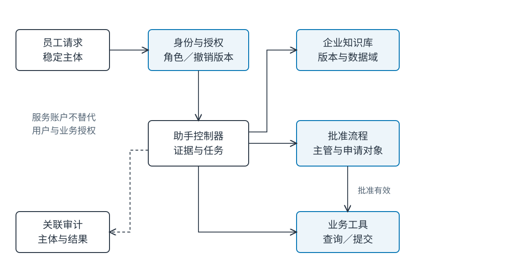
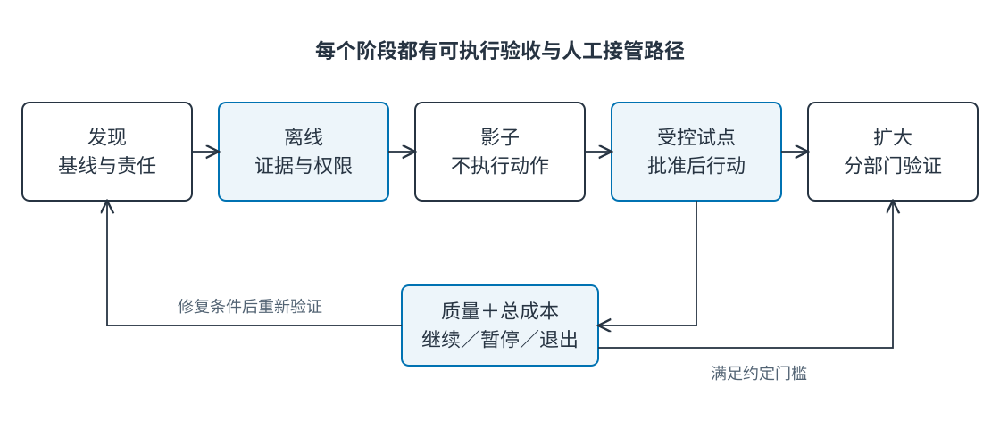

# Ch33 企业级智能体系统与组织融合

**Enterprise Agent Systems and Organizational Integration**

**作者：王柯**

**摘要**　企业采用智能体，需要把技术能力连接到既有身份、知识、业务服务和责任关系。本章从跨部门复制试点的失败出发，区分知识、服务和流程用例，设计数据域、服务账户、审批与审计接口，并将培训、申诉、退出和责任转移纳入流程变更。通过两部门教学流程与可运行成本模型，比较原流程、建议型辅助和审批后行动，分析审核工时、返工、固定运维与失败成本如何改变收益。最终形成可以决定试点、扩大、暂停或退出的采用决策包。

**关键词**　企业集成（enterprise integration）；委托授权（delegated authorization）；人机协作（human-agent collaboration）；变更管理（change management）；责任矩阵（RACI）；总拥有成本（total cost of ownership）；试点验收（pilot acceptance）。

**前置与配套材料**　安全边界见 [Ch29](../part7/ch29_security_safety_alignment.md)，生产运作见 [Ch30](../part7/ch30_production_governance.md)，场景见 [Ch31](ch31_software_knowledge_work.md)、[Ch32](ch32_education_healthcare_finance.md)。本章关注组织采用与业务集成，实例代码、采用计划和责任表位于 `examples/ch33/`。案例企业及成本参数均为教学构造；计算结果与真实采用效果分开解释。

## 33.1 跨部门复制为什么失败

### 33.1.1 受欢迎的试点遇到第二个部门

虚构企业“星河服务”在部门 A 试点政策助手。助手检索费用标准、生成申请草稿，由一名熟悉制度的管理员核对后创建工单。试点用户认为查找更快，项目组便把同一系统复制到部门 B。

B 的员工看不到 A 的例外附件，审批人也不是同一角色；A 管理员还承担了没有写进流程的纠错工作。迁移后，助手使用共享服务账户检索全部附件，B 主管不断退回不适用申请，人工核对量增加。用户仍喜欢交互体验，组织却没有得到预期收益。

这是教学构造案例。表面看是模型没有理解部门差异，实质涉及数据域、审批链和隐性劳动。复制提示与界面容易，复制适用条件与责任关系需要重新建模。


**Fig-33-03　跨部门服务中的人机分工（场景插画）。** 共享服务桌连接两部门，各自档案保留边界；助手准备材料，负责人对具体申请签核。来源：本书原创，教学情境示意，可编辑 SVG。

### 33.1.2 先区分价值主张与实现假设

价值主张是减少员工寻找政策和录入申请的时间；实现假设包括当前知识可用、权限能按请求主体执行、草稿可核验、审核负担可控。每个假设都应对应可观察证据。

用户满意能说明交互有吸引力，不能独自证明总成本下降。审批通过率也可能因为员工避开困难申请而上升。应记录任务分布、被拒绝与退出的任务，以及人工补救时间，才能解释试点与原流程的差异。

真实企业中的生成式 AI 采用研究显示，不同工作者和任务的收益可能不同。[^work] 将平均效果直接用于另一部门的预算，容易忽略经验水平、知识质量和工作流程差别。本章使用显式假设而非套用外部研究的收益百分比。

### 33.1.3 采用对象是完整服务流程

一次申请从员工提出需求开始，经过资料查找、草稿、审批、提交、异常处理和归档。助手可能只改善前两步，瓶颈却在审批等待。若采用指标只测生成速度，就会把局部加速误当作端到端改善。

对每个步骤记录执行者、输入、数据访问、业务决定和输出。再标明哪些步骤由助手辅助，哪些仍由人负责，哪里允许自动执行。这个流程图比“接入一个聊天窗口”更接近组织实际采用的对象。

## 33.2 企业用例与价值假设

### 33.2.1 知识型助手：解释有依据的信息

知识用例包括制度检索、产品说明和内部技术问答。输入来自文档库，输出是可核验解释，通常不直接改变业务状态。验收者是提问者与知识责任人，关注答案支持、时效和无答案路径。

低动作风险并不代表没有数据风险。一次回答可能跨越部门边界，或将过期条款传播给大量员工。知识型试点应优先保证版本与权限，再追求回答覆盖。知识缺口需要有责任人接收，否则无答案统计不会转化为改进。

对于重复、稳定的问题，搜索页或结构化问答可能已足够。助手的价值可以来自多来源综合、口语理解和上下文解释，需与已有搜索流程比较。以没有搜索能力的弱基线对照，会高估新增价值。

### 33.2.2 服务型助手：辅助完成一次业务请求

服务用例包括重置申请、差旅工单和采购草稿。输入既有知识，也有用户表单与当前业务状态。输出可能是建议、待审批记录或已提交工单，验收标准因此更接近业务后置条件。

从建议到行动需要明确跃迁。生成“建议创建住宿申请”不会自动获得创建权；用户点击确认也不一定等于主管批准。界面应展示动作对象、金额、依据和批准角色，使人知道自己确认的是什么。

服务助手通常适合渐进授权：先只读建议，再创建草稿，再在已批准条件下提交限定类别。每一步都用原流程作对照，观察返工和人工负担。授权扩大由业务责任人决定。

### 33.2.3 流程型助手：连接多个阶段

流程用例跨越申请、审批、履行和异常处理，持续时间更长，参与角色更多。任务状态要独立于聊天会话存在，等待审批时可以暂停，审批撤销时必须阻止后续动作。

流程自动化的收益常来自减少交接和重复录入，代价则是状态、责任和异常路径更复杂。把多个系统的服务账户集中到助手，并不等于建立了统一流程。每个跨系统动作仍需要权限、幂等与结果查询。

选择流程试点时，应优先找规则明确、结果可查、动作可控、失败可接管的任务。高频但无人能定义“完成”的流程不适合作为第一项自动化。

**Tab-33-01　三类用例的集成与验收。**

| 类型 | 输入系统 | 允许产出 | 最终验收者 | 核心指标 |
| --- | --- | --- | --- | --- |
| 知识 | 政策库、术语库 | 带证据解释、材料不足 | 知识责任人 | 支持率、时效、越权 |
| 服务 | 政策库、表单、工单 | 草稿或批准后的限定动作 | 服务流程负责人 | 完成、返工、审核时间 |
| 流程 | 多服务状态、审批事件 | 跨阶段任务与异常交接 | 端到端业务负责人 | 周期、积压、责任闭合 |

### 33.2.4 设定试点的边界

试点卡写出服务对象、任务类别、允许数据域、可执行动作、排除事项、观察周期和退出条件。星河服务先覆盖普通费用申请，排除付款、制度例外裁决与跨企业数据。

边界使成本和质量可比较。若试点中途不断加入新任务，指标变化可能来自任务结构改变；需要另记扩展批次与版本。对困难任务的人工转交也属于流程结果，不应从分母消失。

## 33.3 身份、数据与业务系统集成

### 33.3.1 身份与授权回答不同问题

认证确定请求主体，授权决定该主体在当前情境下能访问什么、执行什么。统一登录方便身份绑定，但不能自动统一所有部门权限。一个人在 A、B 两个项目担任不同角色，权限需按当前数据域与用途判断。

智能体服务使用稳定主体 ID；显示名用于展示。租户、部门、角色、授权版本来自可信身份上下文，模型不能通过填写“管理员”获得权限。匿名会话转为登录会话时，也不能仅凭姓名合并历史数据。

### 33.3.2 代表用户与代表服务

服务账户可能拥有读取索引或调用工单接口的技术权限，但一次具体请求还需限定为当前用户可做的动作。保留真实发起者、代理服务与目标资源，才能解释是谁授权了什么。

令牌的目标服务、范围与有效期应与用途相符。OAuth 安全最佳实践讨论授权流程与令牌保护，[^oauth] 但协议配置不能代替业务审批。例如令牌允许创建工单，仍不意味着可以替主管批准费用。

工具适配器应验证业务字段，禁止模型任意指定租户或更换批准记录。所有动作请求绑定任务 ID 与幂等键，使重试不产生重复申请。Ch12、Ch13 分别讨论外部动作及恢复。

### 33.3.3 数据边界沿处理链保持

数据经过检索、重排、模型、日志和缓存，每一环都可能扩大访问范围。允许读取政策正文，不一定允许向另一服务发送所有附件；允许使用个性化偏好，也不表示可用于员工绩效推断。

为每条数据流记录来源域、处理目的、接收方和保留方式。检索前过滤与返回前检查共同执行，缓存绑定授权版本。调试日志尽量保留片段 ID 与判断结果，在排查确需正文时按访问流程取回。



**Fig-33-01　企业身份、知识与业务服务集成。** 身份、知识、动作与审批各有责任系统；助手连接它们并保留来源。来源：本书原创，可编辑 SVG。

### 33.3.4 批准必须绑定具体对象

批准记录至少绑定申请人、对象、金额、用途、有效期与批准者。若金额或对象改变，应重新判断原批准是否仍适用。聊天中的“可以”缺少对象时，应要求澄清，而非解释为全局授权。

星河服务将员工确认草稿与主管批准分开。员工确认输入真实，主管批准业务例外或费用，执行器只在两者满足时提交。政策问答可以继续，工单动作则等待缺失条件。

### 33.3.5 撤销要影响进行中的请求

离职、调岗、角色撤销和批准作废都可能发生在检索后、提交前。执行器应在提交时重新检查授权或有效授权版本，避免长任务持有旧权限持续行动。缓存命中也不能绕过撤销。

令牌撤销与令牌状态查询有相应协议，但实施方式和生效时延依服务架构而异。[^revocation][^introspection] 采用计划应给出本系统可测的撤销时限，并验证在该时限后无法继续读取或提交。

配套 `Directory` 使用授权世代使缓存失效：Alice 初始可读 A，Bob 只能读 B；Alice 被撤销后，即使先前缓存命中，下一次读取仍被拒绝。这是本地逻辑验证，不涉及真实身份供应商的传播延迟。

### 33.3.6 审计与可解释交接

审计串联请求主体、任务、证据版本、批准、工具调用、业务结果和人工接管。不同系统的事件 ID 应能关联，避免每套日志都声称成功却无法还原同一次申请。

来源模型可参考 W3C PROV 对实体、活动和参与者的区分。[^prov] 日志记录“哪个服务生成了哪个工单”有助于追踪，但日志本身不证明批准合法。审计与实时权限判断承担不同职责。

## 33.4 组织变更与人机责任

### 33.4.1 从现有流程画到目标流程

原流程是员工搜索、填写、主管审批、服务台录入；建议型流程让助手检索并起草，员工核对，后两步保留；审批后行动流程在主管批准后由执行器提交，服务台处理异常。

自动化减少了录入，却增加了证据核验、配置维护和异常归因。目标流程应把这些新增劳动画出来，否则它们会默默落在试点管理员身上，形成不可持续的隐性支持。

### 33.4.2 一个决定只有一个最终负责者

RACI 中 R 表示执行，A 表示最终负责，C 表示参与咨询，I 表示知会。最终负责必须落在可承担责任的岗位，不能将“AI”填为 A。角色可以有多人协作，但一项验收应有明确收口者。

**Tab-33-02　星河服务的人机 RACI。**

| 决定/活动 | 员工 | 主管 | 服务负责人 | 知识负责人 | 平台团队 | 助手 |
| --- | --- | --- | --- | --- | --- | --- |
| 申请内容真实 | A/R | I | I | — | — | 起草 |
| 政策解释与修订 | C | C | I | A/R | I | 检索解释 |
| 费用批准 | C | A/R | I | C | — | 展示依据 |
| 限定工单提交 | I | I | A | C | R | 执行受控调用 |
| 权限集成与撤销 | I | C | A | C | R | 执行检查 |
| 异常申诉与退出 | C | C | A/R | C | C | 保存交接材料 |

“助手执行”描述技术功能，不替代人类岗位的 RACI。若主管不在岗，流程需要正式代理规则；系统不能为了提高完成率自行选择另一个批准者。

### 33.4.3 培训围绕判断与接管

培训内容包括怎样查看证据、哪些字段必须核对、怎样识别材料不足、如何撤销和转交。只教提示技巧会让用户擅长得到流畅答案，却不一定知道何时停止。

不同岗位需要不同训练。员工核对输入，主管理解批准对象，服务台处理重复和异常，知识负责人处理制度冲突，平台团队观察权限与性能。采用成本应计入培训时间和岗位替代安排。

### 33.4.4 申诉、退出与人工服务

被拒绝的员工需要知道拒绝基于缺权限、材料不足还是规则不满足，并有可用的申诉路径。不能要求用户先说服模型，才允许联系人工。人工接管应收到申请、证据、未决项与已执行动作。

退出包括单个任务退出、个人选择人工渠道和组织停止试点。停止后已有工单继续按业务流程处理，持久化任务不应失踪。保存必要记录、停止新动作和清理数据分别有责任人。

### 33.4.5 防止复核成为新瓶颈

助手处理速度上升可能把更多草稿推向主管，导致审核队列增长。队列等待应与审核操作时间分开测量：两分钟点击并不意味着两分钟完成。积压超过阈值时限制新增任务或回到建议模式。

低质量草稿还会产生自动化偏误与审阅疲劳。抽样复核可以补充全量审核，但抽样范围、严重错误阈值与恢复全审条件需要预先确定。不能以低风险任务平均正确率授权所有高影响动作。

### 33.4.6 把隐性劳动纳入责任与成本

试点管理员可能每天帮助员工改写问题、修正分类、补充批准和解释错误。这些劳动让试点结果良好，却不出现在模型日志里。扩大前应记录其内容与时间，判断能否转成文档、界面或正式岗位能力。

如果每份申请都需要专家重新阅读全部政策，助手可能只减少起草时间，没有减少真正瓶颈。可以将审核分为输入真实性、政策适用、动作授权与异常四类，分别测耗时；改进最昂贵环节，比优化回复措辞更有价值。

组织采用还可能改变岗位评价。若员工因为谨慎核验而显得比自动点击确认更慢，不合理指标会鼓励风险行为。采用计划应认可接管与纠错的价值，避免只奖励提交数量。

### 33.4.7 部门差异如何成为配置

A 与 B 的制度例外、批准角色和数据范围应作为受控配置，不写进无人维护的长提示。每项配置有责任人、版本和生效日期；变更后运行相应回归，再扩大使用。

可以复用共同普通政策，但例外附件仍留在所属域。用户跨部门参与项目时，当前申请选择具体业务域，工具据此验证批准者。把“该用户属于多个部门”解释为所有数据可混用，会破坏用途边界。

配置之外的差异也要记录：B 的审批岗位可能只有半天处理申请，A 可能已有结构化表单。相同软件不必产生相同采用效果，阶段目标应结合这些条件设定。

## 33.5 从试点到扩大：质量、成本与门槛

### 33.5.1 原流程、建议辅助与审批后行动

比较时固定任务类别和观察窗口，记录各路径的端到端时间、人工操作时间、通过、返工、越权与接管。建议辅助的最终动作由原人工流程完成；审批后行动增加受控工具提交。两者可能带来不同收益与责任成本。

随机分组或分阶段交叉可以减少人员和时间差异，组织不允许时使用匹配任务并明确限制。困难任务不应只分给人工基线；丢弃失败任务会使自动化路径看起来更快。

本书代码计算透明的教学成本情景，并执行两部门授权检查；未进行真人时间实验。因此下面工时、通过率与风险参数是可替换输入，不是实测员工效率。

### 33.5.2 总成本公式与完整样例

设月任务数为 `N`，人工时薪为 `w`，每项原流程耗时为 `t0`；辅助后的操作、审核与期望返工分钟分别为 `ta, tr, p×tf`，月固定成本为 `F`。月净收益为：

```text
净收益 = N × (t0 − ta − tr − p×tf) × w / 60 − F
```

`F` 应含服务费、维护与约定的失败成本准备。一次性建设与培训可在采用周期中摊销，现金支出与机会成本另列。节省工时只有被重新安排或减少实际支出时，才会转化为相应经济收益。

**Tab-33-03　教学假设，单位为人民币；N=1000，时薪 120 元。**

| 项目 | 原流程 | 建议辅助 | 审批后行动 |
| --- | ---: | ---: | ---: |
| 每项操作分钟 | 12 | 4 | 2 |
| 每项审核分钟 | 已含于 12 | 2 | 2 |
| 返工概率×分钟 | 已含于 12 | 0.10×6 | 0.05×8 |
| 月人工成本 | 24000 | 13200 | 8800 |
| 月服务费 | 0 | 1200 | 1800 |
| 月维护 | 基线不增计 | 1800 | 2400 |
| 月失败成本准备 | 基线不增计 | 1000 | 1600 |
| 月总成本 | 24000 | 17200 | 14600 |
| 相对基线净收益 | 0 | 6800 | 9400 |

原流程的共同固定开销未列入，因比较只计增量；若智能体不能替代原开销，不应把它当作额外节省。失败成本准备来自本例假设，实际项目应依据事故类型、概率和损失范围估计，重大风险仍需单独约束。

### 33.5.3 审核工时改变结论

```bash
uv run --frozen python examples/ch33/run_adoption.py
```

实际执行情景计算：月 1000 项时，审核从 2 分钟增加到 6 分钟，建议辅助净收益由 6800 变为 −1200，审批后行动由 9400 变为 1400；增加到 10 分钟，两条路径都为负。月 200 项、审核 2 分钟时，两者也分别为 −1840、−2760。

固定成本使低业务量难以回收投入，审核时间使高业务量方案也可能失去收益。试点因此不仅要测模型调用费用，还要测每个岗位的真实新增工作量。对最敏感的输入优先收集证据，比给出单一漂亮 ROI 更有决策价值。

建议辅助在本例审核 2 分钟时，每项节省价值为 10.8 元，固定成本 4000 元，盈亏平衡量约 371 项/月；审批后行动每项节省 15.2 元、固定成本 5800 元，约 382 项/月。这个阈值依赖全部教学假设，不能直接成为企业承诺。

### 33.5.4 人工审核积压的队列演练

配套用60项任务、每5分钟到达一项、单审核员模拟排队。原流程假设准备8分钟、审核4分钟；建议辅助准备4分钟、审核2分钟；审批后行动准备2分钟、审核2分钟。所有分钟值是教学假设，程序实际计算等待与完成时间。

正常审核下，三条路径平均完成时间分别为12、6、4分钟，审核工时分别为240、120、120分钟，没有等待积压。将两条辅助路径的审核改为6分钟后，每5分钟到达一项却需6分钟处理，平均等待均达29.5分钟，峰值等待10项，平均完成分别39.5、37.5分钟。

这个演练说明前段准备更快不能消除后段容量不足。结果属于给定到达与服务时间的确定性队列，并非员工实测；真实试点应加入到达波动、异常任务、休息与多审核员，再测尾延迟与积压。

运行结果在 `flow_simulation` 中逐项保留到达、就绪、审核开始与完成时间。对第二部门，可以先用实际排班替换审核容量，再判断扩大是否会将节省转成队列压力。

### 33.5.5 阶段门槛应可执行

发现阶段明确问题、数据责任和原流程基线；离线阶段验证证据与权限；影子运行生成结果但不执行业务动作；受控试点只对限定任务在批准后行动；扩大阶段逐步增加用户、部门和任务类型。



**Fig-33-02　试点、影子运行与受控扩大。** 失败回到对应条件修复，退出保留人工服务路径。来源：本书原创，可编辑 SVG。

本例采用门槛包括：所有动作可关联批准与证据；越权事件为零；撤销用例通过；审核积压不超过约定上限；纳入复核与返工后净收益为正。具体质量阈值由服务负责人结合任务影响确定，不能让模型自评代替。

发现越权、无法解释的重复提交或关键审计缺失时暂停行动。成本连续偏离或岗位负担不可接受时停止扩大，重新设计流程。停止条件与扩大条件同时写入计划，避免试点因沉没成本无限延续。

### 33.5.6 跨部门扩大是一次新验证

第二部门需要重新确认权限、制度例外、岗位配置、任务分布与培训。可复用技术接口，不能复用未经确认的访问范围。扩大批次保留独立版本和指标，使局部问题可以回退而不影响所有部门。

隐性经验应转成显式材料：试点管理员怎样纠错、哪些问题总需要人工、哪些政策经常冲突。将这些依赖整理出来，才知道哪些能力可以工程化，哪些必须由业务岗位继续承担。

### 33.5.7 在扩大前收集什么证据

优先收集成本模型最敏感又最不确定的输入：审核与返工时间、困难任务比例、维护频率和业务量。无需一开始测所有可能指标，先确定哪些参数能够改变继续或停止的结论。

质量抽查由独立验收者按任务切片进行，记录失败严重性与影响范围。一次严重越权不能被大量普通正确回答平均抵消；同样，大量无答案可能只是知识缺失，需要补材料而非提高行动权限。

扩大记录应给出新增部门的差异、已执行测试、未解决事项、责任资源和回退路径。阶段通过表示约定范围内条件满足，后续变化仍需重新验证。

## 33.6 采用决策包与练习

### 33.6.1 一个可以审阅的决定

采用包包括现有与目标流程、用例卡、数据流、身份权限矩阵、RACI、基线与试点指标、成本敏感性、培训与申诉方案，以及扩大、暂停、退出条件。决策者据此确定可用范围和责任资源。

项目负责人不能只交架构图，业务负责人也不能只给满意度。技术可运行、业务可接受和组织可持续是互相连接的证据：前者解释能做什么，后两者决定在哪些条件下值得做。

### 33.6.2 与综合项目和治理章节的衔接

Ch34 把本章的费用申请任务实现为三个本地参考项目，验证证据、动作与恢复协议。真实组织采用还需要身份供应商、业务系统、人员培训和实际工时证据。Ch30 的生产监控与治理承接持续运营，附录 D 可汇总阶段验收模板。

采用记录也应回流知识维护：频繁无答案可能意味着制度不完整，频繁批准例外可能意味着流程需要改写。组织学习不等于让模型自动修改制度，而是让可观察问题进入有责任人的决策流程。

### 33.6.3 复习与实践

1. 为什么试点用户满意与端到端净收益可能同时一高一低？
2. 统一登录为什么不能替代部门授权和业务批准？
3. 服务账户代表用户行动时，审计应保留哪些主体与对象？
4. RACI 中为什么不能把最终负责者填写为智能体？
5. 给出一个停止扩大但仍保留建议功能的可执行条件。

**实践题**　使用两部门流程，设计原流程、建议辅助、审批后行动的对照。把审核时间、任务量和返工概率各设置三个水平，计算敏感性；执行一次缓存命中后的身份撤销。提交采用计划、责任矩阵、成本模型和申诉交接样例，并标出哪些参数来自实测、哪些仍是假设。

## 参考文献

[^work]: Brynjolfsson、Li 与 Raymond，*Generative AI at Work*，NBER Working Paper 31161，2023 起发布修订，[工作论文页](https://www.nber.org/papers/w31161)，访问 2026-11-09。本章引用其工作场景与效果异质性，不移用其数值作为本例预测。
[^oauth]: Lodderstedt, T.; Bradley, J.; Labunets, A.; Fett, D.，*Best Current Practice for OAuth 2.0 Security*，RFC 9700，2025，[规范](https://www.rfc-editor.org/rfc/rfc9700.html)。
[^revocation]: Lodderstedt, T.（编）; Dronia, S.; Scurtescu, M.，*OAuth 2.0 Token Revocation*，RFC 7009，2013，[规范](https://www.rfc-editor.org/rfc/rfc7009.html)。
[^introspection]: Richer, J.（编），*OAuth 2.0 Token Introspection*，RFC 7662，2015，[规范](https://www.rfc-editor.org/rfc/rfc7662.html)。
[^prov]: Moreau, L.; Missier, P.（编），W3C，*PROV-DM: The PROV Data Model*，2013，[推荐标准](https://www.w3.org/TR/prov-dm/)。
