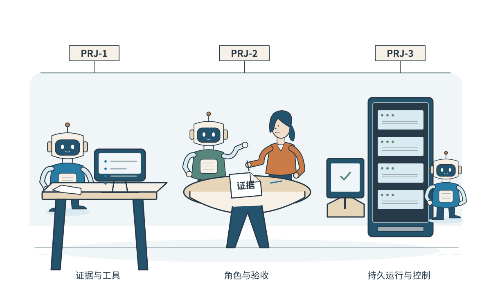
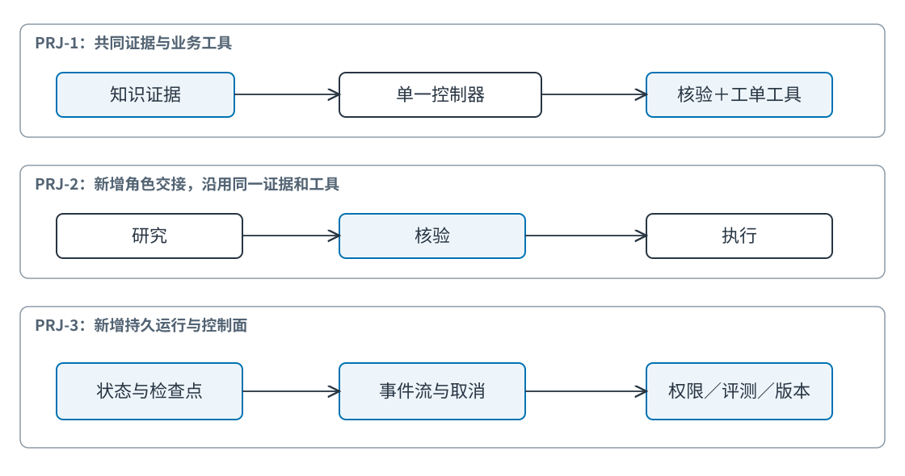
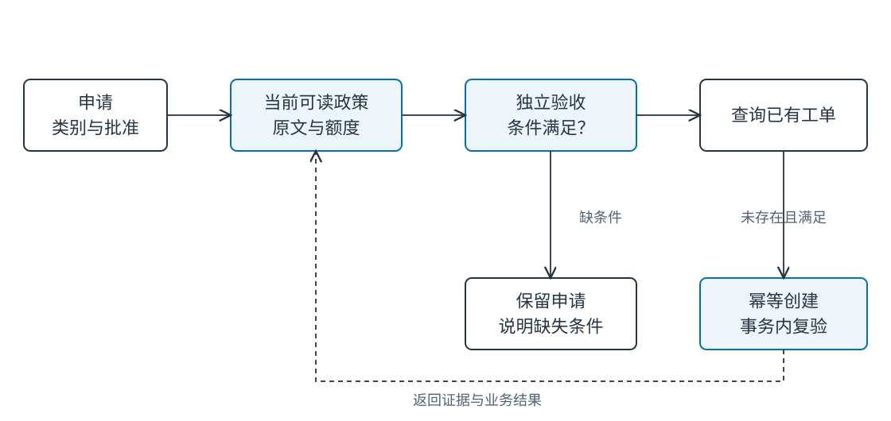
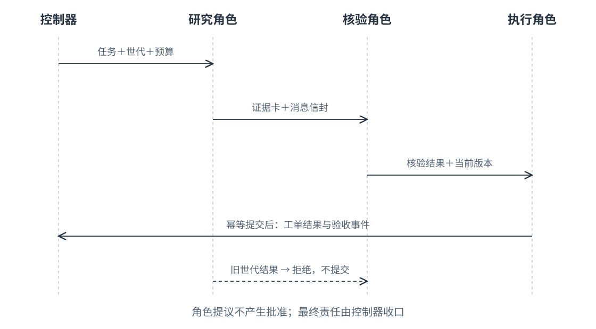
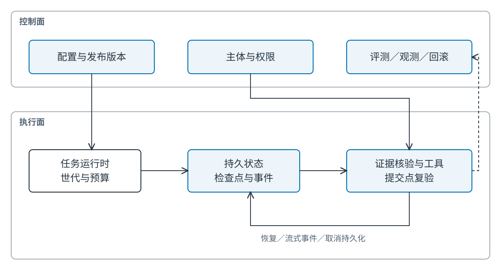

# Ch34 智能体系统参考架构与综合实践

**Agent System Reference Architectures and Integrated Practice**

**作者：王柯**

**摘要**　本章通过三个递进项目连接知识、计划、工具、角色交接、持久化、打断与发布治理。三项目共用 50 份原创政策、60 条费用任务和两个本地工单工具，以统一证据、任务世代与配置版本保持可比。PRJ-1 建立单智能体知识工具助手的完整路径；PRJ-2 显式分离研究、核验与执行角色；PRJ-3 增加持久检查点、事件流、取消与版本回退。可运行参考实现使用确定性决策与 SQLite 沙箱，实际报告正常任务和故障结果，并给出替换为模型及真实服务时的扩展接口。

**关键词**　参考架构（reference architecture）；端到端验收（end-to-end acceptance）；角色交接（role handoff）；持久检查点（durable checkpoint）；取消世代（cancellation generation）；幂等（idempotency）；发布回滚（release rollback）。

**前置与配套材料**　能力原理见 Ch03、Ch09—30；本章解释连接与取舍，第九篇负责进一步展开环境、测试、回归和交付。三个入口为 `projects/PRJ-1/run.py`、`PRJ-2/run.py`、`PRJ-3/run.py`，公共实现为 `examples/d_shared/`，综合报告为 `examples/ch34/results/report.json`。本地参考路径由 D 提供，用于成章与接口核对；C/E/F 的项目模块及 A/B 的评估、安全签核需在团队合稿时另行接入与确认。

## 34.1 三项目的共同任务与边界

### 34.1.1 从模块正确到整体完成

检索模块返回 `source_id`，核验器期待 `chunk_id`；调度器认为取消只停止显示，工具服务却继续提交；新提示发布后，恢复进程读取旧任务却套用新配置。各模块单独通过测试，整体仍无法完成一个可解释的申请。

这是教学构造案例。综合实践首先统一对象与语义，再比较架构。任务身份、证据版本、批准对象与取消生效点应在项目开始时确定。若每个项目使用不同问题、工具和答案标准，性能差异无法归因于新增架构。

### 34.1.2 一项有明确后置条件的任务

用户提出费用申请，提供类别、用途、金额与部门。系统查找当前普通政策，解释额度；缺批准或超额时保留申请并说明条件，已批准且额度内时创建唯一模拟工单。助手始终没有付款、修改政策或批准自身申请的权限。

统一数据包含 20 个费用主题，每题三个变体：额度内未批准、额度内已批准、超额未批准。只有第二类创建工单，共 20 项；其余 40 项保留。超额且已批准的扩展用例应另行加入，普通批准不等于例外批准。

申请表中的 `topic` 是用户选择的业务类别，用于限定检索。评测标签 `expected_action`、`expected_evidence` 仅供评分，公开运行入口移除它们后执行。这个结构化输入使项目有别于 Ch16 的自由表述检索实验，不能混用两章的正确率。



**Fig-34-05　从桌面助手到协作工作室与运行平台（场景插画）。** 三个项目分别表现为独立工作台、协作桌和运行机柜，突出工作方式与工程尺度的变化。来源：本书原创，教学情境示意，可编辑 SVG。

### 34.1.3 共同接口与禁止操作

**Tab-34-01　跨项目对象与版本矩阵。**

| 对象 | 共同字段 | 验收语义 | 版本 |
| --- | --- | --- | --- |
| 任务 | `task_id, tenant_id, owner_id, topic` | 同 ID 不可替换负载 | `1.0` |
| 申请 | `amount_yuan, approved, department` | 当前批准是教学夹具，生产需验证记录 | `1.0` |
| 证据 | `evidence, quote, limit_yuan` | 定位当前允许片段并核对原文 | `1.0` |
| 交接 | `message_id, task_id, generation` | 可关联、可拒绝迟到结果 | `1.0` |
| 工具 | `query_ticket, create_ticket` | 按任务查询、每任务至多一张工单 | `1.0` |
| 运行 | `release, stage, generation, cancelled` | 可恢复、可停止、版本一致 | `teaching-0.1` |

原始政策数据版本为 `original-policies-0.1`，目标时间为 2026-11-09。本地 SQLite 是业务端点，不连接真实企业、邮件、付款或身份供应商。语言模型可在后续替换确定性提议器，验收与提交接口继续保留。



**Fig-34-01　三项目递进架构。** 每次新增能力都复用数据、证据与工单契约。来源：本书原创，可编辑 SVG。

### 34.1.4 如何阅读本章的证据

本章有三类材料：可运行代码的实际结果，教学构造的任务与故障，以及生产扩展设计。确定性参考路径适合验证接口与副作用边界；它不测语言模型的规划能力，也不宣称已经形成生产平台。

每个项目按目标边界、输入、实现、运行验证、常见错误、扩展练习与正文回链七块组织。读者可以先完成最小路径，再逐步替换一个模块，观察指标与故障是否变化。

## 34.2 PRJ-1：单智能体知识工具助手

### 34.2.1 目标边界：先完成一项闭环服务

PRJ-1 的目标是让一次费用申请从输入走到可核验结论和唯一工单。单一控制器依次取得证据、形成决策、调用工具并验证结果；不增加角色讨论或开放网络浏览。

“单智能体”描述控制权集中，不要求所有逻辑都在一个函数。检索、状态和工具应保持独立模块，控制器负责选择顺序与收口。固定步骤已足以完成本例时，无需为了形式增加模型推理。

### 34.2.2 输入：申请字段与政策快照

样例 `T01-1` 选择差旅住宿，金额 499 元，部门 B，已批准。当前 `P01@2#1` 额度为 500 元，适用于 A/B，且不允许直接付款。输入需要同时保留金额、批准和类别，不能仅给模型一句“帮我处理”。

同主题的 `T01-0` 没有批准，应返回保留；`T01-2` 为 501 元，也应保留。系统允许解释原因，但不自动将超额申请改成 500 元，也不把“用户想完成”解释成业务批准。

### 34.2.3 实现：计划、证据与两个工具

参考计划是有条件的四步：读取适用政策；验证额度与批准；提交前按任务查询已有工单；满足条件才创建或返回已有结果。固定计划可写成程序，复杂输入则由模型提议计划，独立核验不变。

`research()` 先按租户、部门与日期过滤，再依据表单类别取当前普通政策，返回原文和额度。`verify()` 检查任务、世代、发布版本、证据类别、权限与原文一致性，形成 `create/hold` 决定。仅有模型自述“合规”不会通过。

两个业务工具是 `query_ticket(task_id)` 与 `create_ticket` 的提交路径。前者处理已有结果查询，后者在事务中检查取消和版本，按任务唯一键写工单。知识检索属于只读知识能力，单列为证据接口。



**Fig-34-02　PRJ-1 的任务与证据链。** 信息性解释与业务动作分别验收。来源：本书原创，可编辑 SVG。

### 34.2.4 幂等不是忽略所有重复

同一任务重试可以返回原结果，不应创建第二张工单；同一 `task_id` 携带不同金额则是冲突，应拒绝。否则客户端错误复用 ID 会让新请求误拿旧结果。

参考实现将任务负载规范化后保存，同 ID 再次打开时比较负载。工单表以 `task_id` 为主键，提交与完成事件在同一事务内发生。SQLite 事务使本地写入可以作为一组完成或回滚。[^sqlite]

真实远程工具无法总和本地状态共享事务，需要幂等键、查询和补偿。HTTP 超时后先查询已有业务结果，再决定重试；若服务不支持幂等，则必须明确重复风险与人工处理路径，不能把本地事务保证直接搬到远程系统。

### 34.2.5 运行验证：成功、保留和重复

在仓库根目录运行：

```bash
uv run --frozen python projects/PRJ-1/run.py \
  --database /tmp/book-prj1-review.sqlite3 --task T01-1
```

预期决定为 `create`，证据为 `P01@2#1`，额度为 500，工单 ID 为 `ticket:T01-1`。再次运行相同命令，仍然只有一张工单。换成 `T01-0`，决定为 `hold`，查询结果为空。

需要一份新实验时使用新的数据库路径。持久库中重复运行是恢复与幂等测试，不能误当作从零执行的耗时。失败注入可用 `--fault missing_evidence`，它应返回拒绝并以非零状态退出，数据库中不出现工单。

### 34.2.6 常见错误与排查顺序

如果返回错误政策，先看表单类别、候选集合与证据片段；如果金额正确却没有工单，检查批准与决定；如果出现重复，检查任务身份与唯一约束；如果显示成功但查询为空，检查提交与事件是否原子完成。

参考实现会拒绝篡改引用原文或额度的候选。这个检查只覆盖本章结构化金额任务，复杂自由文本推理需要 Ch16 的主张级证据判断。不能把对象字段一致称为完整语义证明。

### 34.2.7 按一次任务读代码与数据库

`open()` 首次保存任务负载并发出启动事件；同ID重试先比较规范化负载。`research()` 在当前部门与日期范围内取得类别证据；`verify()` 产生候选决定；`commit()` 在写事务中重验世代、取消和发布版本，再写工单与完成状态。

观察顺序很重要：候选验证发生后，提交前仍可能有取消。事务里的第二次检查处理这一窗口；若先查取消再在另一个不受保护的步骤写入，取消与提交可能交错。数据库唯一键保证重复提交不能创建第二张，但不能替代取消检查。

可以在临时库中查询三张表，比较任务状态、工单存在和事件类型。如果任务显示完成而工单不存在，要先看决定是否为hold；如果决定为create而无工单，才是后置条件问题。状态含义必须结合业务决定解释。

### 34.2.8 让模型提议而不直接写库

模型适配器可以接收任务、允许工具和证据包，输出结构化计划或决定候选。程序检查输出字段和引用后，再执行相同核验。模型输出的批准标志不覆盖可信任务输入，模型提及的片段不在证据包中则拒绝。

替换时先固定正常路径，再运行缺证据、错误额度、错类别、重复调用和超预算。模型若输出无法解析内容，应记录为候选失败，不能在评分阶段手工补齐。这样可以清楚比较语言提议质量与协议可靠性。

提示与工具模式应绑定发布版本。仅修改提示而沿用同一版本，会使同任务不同运行产生无法追溯的行为差异。真正比较模型时，还应保存请求配置、用量和未完成结果。

### 34.2.9 扩展练习与正文回链

基础作业增加“额度恰好等于上限”的申请，验证边界；进阶作业替换为真实模型提议器，保持工具与核验器不变，比较错误来自提议还是执行。只允许模型生成受限结构，不给它任意数据库写入能力。

设计关系回链 Ch09 的任务分解、Ch11 的工具契约、Ch12 的动作、Ch13 的恢复、Ch14 的任务版本和 Ch16 的证据。这里不重复这些原理，而是检查它们是否在同一次申请中保持一致。

## 34.3 PRJ-2：多角色协作与结果验收

### 34.3.1 目标边界：让交接成为可检查协议

PRJ-2 沿用相同申请与工具，将研究、核验、执行分开。研究者只提供证据，核验者判断支持与条件，执行者提交并查询结果。最终服务责任仍由控制器收口。

本地路径用确定性函数模拟三个逻辑角色，记录结构化交接；没有调用三次语言模型，也没有实施真正的并行协作。因此它验证角色协议，尚不能回答多模型团队是否提升开放任务质量。

增加角色的理由应来自专业化、上下文隔离或并行任务。本例短小且规则稳定，团队并未提高正确率，反而增加消息与状态开销。保留这个结果有助于判断何时单体足够。

### 34.3.2 输入：同一任务与消息信封

交接信封包含 `schema_version`、`message_id`、`task_id`、`parent_task_id`、发送方、接收方、`generation`、剩余步骤与发布版本。证据仍使用 PRJ-1 的卡片，不能由各角色自由更换名称。

自然语言解释可以附在消息中，控制字段必须由程序检查。接收者不是 `verify`、消息版本不符、预算耗尽或世代迟到时，核验器拒绝。消息 ID 用于关联，本地副作用去重依任务唯一键；两者用途不相同。

### 34.3.3 实现：职责、预算与最终收口

研究者的输出必须引用当前可读政策，不得批准或创建；核验者只检查输入和证据，不能修改原政策；执行者只消费通过的决定。控制器负责总预算、停止和人工交接，不能把失败留在角色之间循环传递。

参考路径最多保留三步候选预算，并采用固定拓扑，无递归委派。复杂扩展应在每次交接扣减共享预算，使用 Ch19 的确认、租约和重分配协议，不能仅让每个角色拥有独立的“大预算”。



**Fig-34-03　PRJ-2 角色通信与验收时序。** 角色意见不会自行产生业务副作用，工具提交仍检查当前世代。来源：本书原创，可编辑 SVG。

### 34.3.4 失联与迟到如何处理

研究者失联发生在提交前，任务仍没有工单，可由控制器重试或转交。若已有副作用，先查询结果再恢复。重分配后的旧角色可能迟到，必须携带旧世代并被拒绝，不能覆盖新决定。

本地 `worker_lost` 在提交前抛出异常，再启动同数据库的项目实例重试，验证可恢复且不重复。它没有模拟网络分区、真实租约和复杂调度，后续模块应通过同一故障断言扩展。

### 34.3.5 运行验证与同预算比较

```bash
uv run --frozen python projects/PRJ-2/run.py \
  --database /tmp/book-prj2-review.sqlite3 --task T01-1
uv run --frozen python projects/PRJ-2/run.py \
  --database /tmp/book-prj2-failure.sqlite3 --task T01-1 --fault worker_lost
```

第一条应产生同 PRJ-1 的业务决定，事件中另有研究到核验、核验到执行的交接。第二条在提交前失败；去掉故障参数重跑同一数据库，可以完成任务。这里比较的是相同最大步骤与相同确定性证据，不涉及模型 token 预算。

若接入模型，必须先确定团队共享的总输入输出 token、时间和工具调用上限，再比较同预算单体。不能给每个角色完整预算后，将团队多倍计算带来的收益归因于组织结构。

### 34.3.6 一个交接失败的归因方法

若研究者返回错误片段，核验者正确拒绝，整体任务虽然未完成，边界仍按设计工作。报告应分别记研究失败与核验成功；不能为了端到端分数把拒绝改成接受。

若研究证据正确、核验决定正确，执行器却创建两张工单，则问题在动作协议。若旧世代被接受，先查消息字段与提交点检查，而非重新训练研究角色。每个角色的职责越清楚，失败越容易定位。

保留角色输入、输出、拒绝理由和预算变化，可以计算重复工作。两名研究者读同一政策可能有核验价值，也可能只是浪费；需要比较新增信息与实际质量，不能把消息多当作协作深入。

### 34.3.7 扩展为异步团队时的增量

真正异步执行增加领取、确认、租约与重分配。消息可能至少投递一次，也可能乱序；接收者按任务与世代判断是否仍有用，再按业务幂等键提交。自然语言讨论不能替代控制消息。

共享预算由控制器维护，每次委派继承剩余范围与额度。角色不能因为局部失败自行创建无限子任务。成员失联后由控制器选择重试、改派或人工交接，最终责任不转移给消息队列。

与本地顺序参考比较时，先保持角色逻辑不变，只加入异步通信故障，验证协议；再引入不同模型或专业知识，评价质量收益。一次改变两层会使错误来源难以解释。

### 34.3.8 常见错误、作业与回链

常见错误包括角色同时写工单、核验者只复述研究者意见、失联后无人接管、旧消息在新任务生效。排查时沿消息 ID、任务 ID 与世代还原交接，查看谁拥有最终提交权。

基础作业增加一个证据缺失消息，证明执行者无法提交；进阶作业用三名异步 worker 实现领取、租约与迟到拒绝，在相同预算下比较单体与团队。报告消息数、重复工作、完成质量和关键路径时间。

回链 Ch18 的角色责任、Ch19 的通信协议与 Ch20 的证据裁决。辩论共识可以作为候选决定，独立验收仍以原始证据与业务状态为准。

## 34.4 PRJ-3：面向生产要求的平台参考路径

### 34.4.1 目标边界与新增控制面

PRJ-3 在单次执行之外管理持久任务、可恢复阶段、事件流、用户取消和发布版本。参考实现仍是单机教学平台路径；生产扩展需要服务身份、队列、租户配额、远程工具、监控和实际负载证据。

平台价值可以表现为失败后任务可恢复、取消后不再提交、历史结果可解释，并不一定表现为答案正确率提高。把可靠性与语言质量分别评价，才能解释新增组件的作用。

### 34.4.2 输入：持久会话与绑定版本

任务启动时记录负载、阶段、世代、取消标志与发布版本。应用可将多个任务关联到会话，但业务任务身份不依赖终端连接。用户关闭页面不应让已批准的业务任务无声消失，是否取消由明确协议决定。

本地数据库保存 `tasks`、`tickets` 和有序 `events`。`stage` 区分就绪、已取证、完成与取消；世代在取消时递增；发布版本决定恢复进程是否可以继续处理。跨版本恢复必须先验证兼容性或回到已知版本。

### 34.4.3 实现：检查点与恢复

研究完成后，核验候选并写入 `researched` 检查点，事件记录 `checkpoint`。进程重启从数据库读取候选，再执行提交前验证，避免仅凭“曾经检查过”跳过当前状态。

检查点包含的是可继续的候选，不是最终完成事实。提交写入工单和 `completed` 事件后才形成最终结果。恢复时若看到完成状态，直接返回结果；看到检查点则继续；看到取消则退出。

SQLite 只代表本地事务范围。真实平台如果业务副作用在远端，恢复要查询远端幂等结果；分布式队列可能重复投递，执行器仍需业务键去重。平台架构不能靠“消息只送一次”的假设消除重复。

### 34.4.4 事件流与用户打断

运行入口以逐行 JSON 输出事件：先 `evidence_ready`，再 `completed`。这是业务事件流，未模拟模型逐 token 输出、语音或多媒体同步。事件有序列号与世代，客户端可以从已读序号继续读取。

用户在取证后取消，服务端先持久化取消标志并增加世代，再拒绝旧候选提交。仅停止前端渲染会留下后台动作；仅关闭生成器也不等于业务取消。Ch24 进一步讨论背压、流控和打断，Ch23 讨论会话事件。

```bash
uv run --frozen python projects/PRJ-3/run.py \
  --database /tmp/book-prj3-review.sqlite3 --task T01-1
uv run --frozen python projects/PRJ-3/run.py \
  --database /tmp/book-prj3-cancel.sqlite3 --task T01-1 --cancel-after-evidence
```

第二条应先输出证据事件，再返回拒绝，不创建工单。取消发生在提交之后时，已完成副作用不能被世代递增抹去，需要业务补偿或人工处理。实验特意把取消点放在证据就绪与提交之间，保证检查的竞争窗口清楚。

### 34.4.5 权限、评测与观测

本地权限固定为任务的部门 B 与当前政策过滤，批准为教学输入。真实平台需验证用户身份、批准记录、工具授权和撤销传播；不能让用户任意填写 `approved=true` 获得行动权。

评测读取同一 60 条任务，分别检查决定、证据与工单数；故障检查取消、恢复和重复。观测记录阶段、事件序列、拒绝原因与任务关联，不将“模型回答完毕”当作业务完成。



**Fig-34-04　PRJ-3 控制面与执行面。** 本地路径实现持久化、事件、取消和版本检查；外部身份、分布式调度与生产监控按相同接口接入。来源：本书原创，可编辑 SVG。

### 34.4.6 发布版本与回滚演练

任务绑定 `teaching-0.1`。用 `bad-release` 实例恢复该任务时，运行时拒绝版本不符；恢复已知版本实例后可以继续。这验证了版本保护与切回路径，没有模拟容器编排的滚动发布。

```bash
uv run --frozen python projects/PRJ-3/run.py \
  --database /tmp/book-prj3-review.sqlite3 --task T01-1 --release bad-release
```

在先前数据库中，这条命令应拒绝；去掉错误版本参数后恢复。新的空数据库若以新版本启动，则没有旧任务可比较，不能用它证明跨版本保护生效。

实际发布包还应绑定提示、工具模式、知识快照、编码器与代码版本。回滚前检查状态模式兼容性，回滚后执行关键回归。恢复旧程序不能自动删除新版本已造成的外部动作，需另行处理。

### 34.4.7 恢复、重放与副作用

重放事件用于还原状态或展示历史，不应再次执行历史工具动作。任务重试则需要确定哪些阶段已完成，查询已有业务结果，再继续未完成步骤。把事件订阅者直接连接到创建接口，会在重新连接时重复产生副作用。

参考事件序列号便于客户端从已读位置继续读取，任务世代便于拒绝失效候选。序列号是日志顺序，世代是任务有效性，两者不能互相替代。另一任务更大的序列号不会让当前任务的旧候选重新有效。

检查点兼容性涉及字段与语义。新增可选展示字段通常容易迁移；改变批准含义或证据模式可能需要显式迁移与重新核验。恢复进程遇到未知版本时，应停止并提供可定位原因。

### 34.4.8 取消与提交的两种合法结果

若取消先获得事务并更新世代，随后旧提交应失败；若提交先完成事务，取消不能让已经创建的工单消失。两个结果都可能符合明确的线性化语义，关键是报告实际先后并提供后续业务处理。

教学测试在证据就绪处固定取消点，避免用不稳定时间延迟猜测竞争顺序。生产并发测试应控制屏障或持久事件，分别验证两种顺序。只统计“取消响应成功”不足以证明没有后续动作。

用户界面可区分已停止新动作与已完成需撤回。这个区别来自业务状态，不能只由前端动画决定。工具支持补偿时提供正式撤回路径，不支持时交人工处理。

### 34.4.9 常见错误、作业与回链

常见错误包括把检查点当完成、取消不持久化、世代只在前端检查、恢复时混用版本、事件显示成功早于事务提交。排查沿数据库状态、事件和工单三条线对照。

基础作业在证据事件后重启进程，证明任务完成且没有重复工单；进阶作业接入持久队列与两个 worker，实现重新投递、取消优先处理和授权撤销。报告队列积压、恢复耗时、取消后动作数与回滚回归结果。

回链 Ch22—25 的运行时和交互，Ch27 的性能，Ch28 的失败工程，Ch29—30 的安全与治理；第九篇复用同一项目资产展开实际测试与交付。

## 34.5 统一评估、故障与课程扩展

### 34.5.1 正常任务的实际报告

```bash
uv run --frozen python examples/ch34/run_projects.py
uv run --frozen pytest
```

统一 runner 为每个项目建立临时数据库，执行 60 个任务，再分别执行故障。报告保存逐题决定、工单数、事件数与耗时；运行结束临时库清理，JSON 证据保留。

**Tab-34-02　确定性本地路径的实际结果。**

| 指标 | PRJ-1 | PRJ-2 | PRJ-3 |
| --- | ---: | ---: | ---: |
| 正确决定/60 | 60 | 60 | 60 |
| 创建工单 | 20 | 20 | 20 |
| 正常任务事件 | 120 | 240 | 180 |
| 模型调用 | 0 | 0 | 0 |
| 外部业务调用 | 0 | 0 | 0 |
| 主要新增能力 | 证据到动作 | 显式角色交接 | 检查点与事件恢复 |

三个项目使用相同规则核，正确率相同符合设计。PRJ-2 多出的交接事件构成实际协调开销；PRJ-3 重点证明生命周期不变量。零模型调用意味着本表不包含模型能力或 token 费用结论。

本轮本地运行的 p95 分别约为 1.42、2.406、1.692 毫秒，原始值保存在报告中。单机小数据、操作系统缓存与数据库连接影响显著，这组数值用于检查运行量级，不足以支持平台比单体更快的判断。容量比较应按 Ch27 增加并发、慢工具与重复运行。

### 34.5.2 故障实验的断言

**Tab-34-03　故障、预期不变量与回链。**

| 故障 | 预期 | 实际检查 | 回链 |
| --- | --- | --- | --- |
| 缺证据 | 不提交 | 工单数 0，明确拒绝原因 | Ch16 |
| 重复调用 | 至多一张 | 工单数 1，完成事件一次 | Ch12—14 |
| 角色失联 | 重试可完成 | 新实例恢复后工单数 1 | Ch19、Ch28 |
| 服务重启 | 检查点继续 | 重读候选、提交前复验 | Ch22—23 |
| 取消/流式取消 | 无后续动作 | 工单数 0，旧世代拒绝 | Ch24 |
| 迟到输出 | 不覆盖当前状态 | 旧世代提交失败 | Ch14、Ch19 |
| 错误版本 | 拒绝混用 | 错版本失败，切回可完成 | Ch30、Ch39 |

三项目各检查九种情景，共 27 项，当前全部通过。部分共享内核的故障在三个项目重复运行，用来确认入口一致，不表示三种完全独立实现都获外部验证。

并发测试额外让八次提交竞争同一任务，断言只有一张工单和一个完成事件。测试直接观察业务结果，避免仅检查函数调用次数。真实远端端点仍需独立测试其幂等行为。

### 34.5.3 同预算与跨项目比较

如果研究问题是“多角色是否改善复杂任务”，使用相同模型、工具和总预算，并保留单体基线；如果研究问题是“平台是否可靠恢复”，固定提议器，用故障与状态不变量比较。不能用开放任务质量来替代恢复证据，也不能用确定性规则全对证明智能体普遍可靠。

当前最小路径的预算是固定候选步骤，没有搜索或采样差异。扩展报告应增加 token、工具与重试、人工时间、冷暖启动与尾延迟。成本计算可接 Ch33 的审核与维护模型，使架构比较与实际采用连接。

### 34.5.4 课程作业与评分

**Tab-34-04　三档综合作业，每档总分 100。**

| 档位 | 必交内容 | 评分分配 | 关键验收 |
| --- | --- | --- | --- |
| 基础：单体闭环 | 新边界任务、证据卡、两工具、失败日志 | 正确 30、证据 25、幂等 25、复现 20 | 无证据不动作 |
| 进阶：角色协作 | 角色契约、共享预算、失联与迟到 | 质量 25、协议 30、成本 20、故障 25 | 单一收口、相同预算 |
| 综合：平台路径 | 检查点、事件、取消、权限、回滚 | 状态 25、取消权限 30、回归 25、报告 20 | 可恢复且不越权 |

每个项目另有基础与进阶作业，读者可先运行本章路径，再替换模块。只交架构图没有可运行结果不构成项目完成；遇到外部依赖不可用时，保存失败命令与缺失证据，不填入推测数字。

## 34.6 最短复现、团队交接与总结

### 34.6.1 从数据到报告的最短路径

先使用仓库锁定环境，运行公共数据生成器，执行三个项目入口，再运行综合报告与测试。已有生成数据可直接使用；重新生成应得到相同的 50/40/60 数量与稳定标识。

```bash
uv sync --frozen --extra test
uv run --frozen python examples/d_shared/build_data.py
uv run --frozen python examples/ch34/run_projects.py
uv run --frozen pytest
uv run --frozen mkdocs build --clean --strict
```

阅读报告时先核对数据版本和任务分母，再查不变量与故障，最后查看性能。这样可以避免在配置不一致时比较毫秒差异。

### 34.6.2 接入团队模块的验收

C 提供 PRJ-1 模块时保留证据与工具契约，E 提供 PRJ-2 时保留角色与预算语义，F 提供 PRJ-3 时保留世代、检查点与发布记录。D 负责成章与整合，A/B 分别复核评估和安全口径。

独立学生需在干净环境运行每个项目，并记录命令、预期差异和问题。当前本地自动检查已执行，外部学生独立运行与团队签核尚待安排；书稿保留该状态，不能把自检记录签成他人审稿。

### 34.6.3 复习与实践

1. 为什么三项目必须共享数据与接口，仍要分别报告能力与成本？
2. 同任务重试与同 ID 不同负载应怎样区分？
3. 为什么取消必须持久化并在提交点检查？
4. 多角色共识与独立业务验收有什么区别？
5. 代码回滚后，哪些业务状态仍可能需要补偿？

**实践题**　任选一个公共模块替换为自己的实现，保持输入输出模式和任务集不变。执行正常任务及九类故障，提交新旧结果对照、一次负面结果、最短复现和独立运行记录。若接入模型，增加相同总预算单体基线；若接入远程工具，增加超时后结果查询与幂等验证。

## 参考文献

[^sqlite]: SQLite，*Transaction*，[官方文档](https://www.sqlite.org/lang_transaction.html)，访问 2026-11-09。本章依赖本地事务与唯一键保证，不把它解释为跨远程服务的原子提交。
