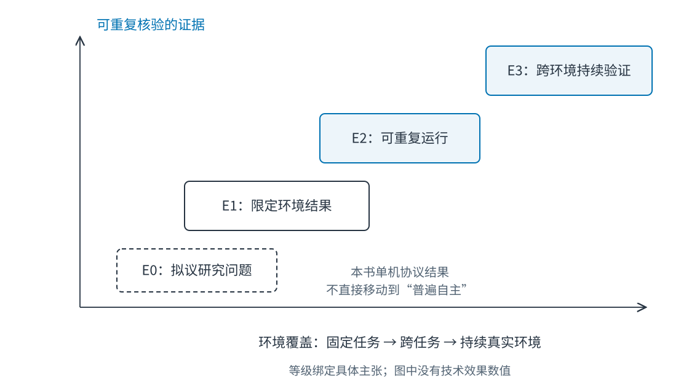
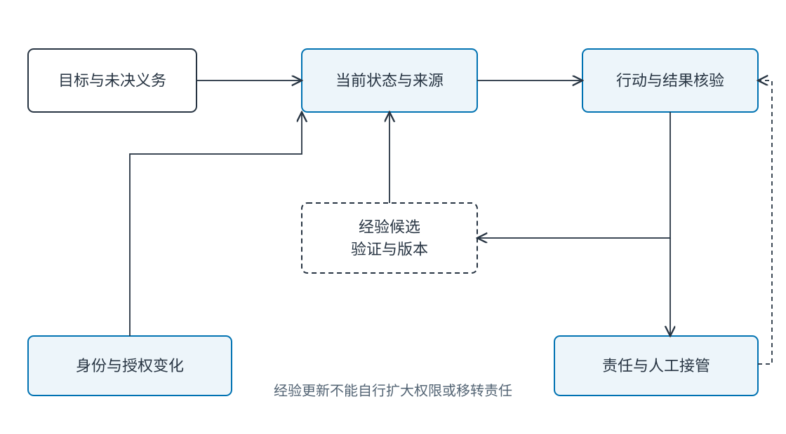

# Ch35 开放问题与未来方向

**Open Problems and Future Directions**

**作者：王柯**

**摘要**　短任务成功并不充分解释智能体能否跨领域、跨时间与跨组织持续工作。本章以证据成熟度组织开放问题，连接通用性、受控持续学习、长程自主、持久身份、社会智能、具身迁移、评估和治理。每项问题给出已有证据、未解决瓶颈、最小实验、测量与否定条件，形成可执行研究卡。全书的状态、来源、权限、行动验收和恢复机制提供研究基线，研究结论则始终绑定任务、环境、预算与版本。

**关键词**　通用智能体（general-purpose agent）；长程自主（long-horizon autonomy）；持续学习（continual learning）；持久身份（persistent identity）；社会智能（social intelligence）；具身迁移（embodied transfer）；评估有效性（evaluation validity）；制度治理（institutional governance）。

**材料范围**　本章使用前文教学失败、可复现代码与经核验公开研究，资料核验截至 2026-11-09。它是一组有依据的研究入口，并非该日期全部前沿成果的穷尽调查。研究卡中的实验为拟议方案，未执行者不填结果；配套登记见 `examples/ch35/` 与[附录 H](../appendix_h_reading.md)。

## 35.1 从短任务成功到长期退化

### 35.1.1 同一个助手运行一个月以后

助手在十次演示中能检索政策并创建工单。持续使用后，它积累了临时偏好、旧工具经验和跨部门摘要；员工调岗，政策换版，部分任务等待数日审批。一次旧角色的迟到结果又让已取消任务继续执行。

这是教学构造案例，连接 Ch14 的状态陈旧、Ch15 的作用域、Ch16 的知识时效、Ch17 的错误经验与 Ch34 的取消世代。每个模块可能都在局部任务上有效，跨时间组合仍会暴露新的失效方式。

长程能力因此不只是把上下文窗口增大。系统需要维护哪些事实仍有效、哪些经验能继续使用、谁仍有权限、未完成任务由谁接管，以及怎样判断整体目标是否真正推进。

**Fig-35-03　走向长程自主的研究旅程（场景插画）。** 研究者与助手沿曲折山路前行，沿途检查点、未完工的桥和远方观测站表现需要持续验证的研究过程。来源：本书原创，教学情境示意，可编辑 SVG。

### 35.1.2 用证据范围标记成熟度

本章采用四种证据状态：E0 是待检验假设；E1 是在明确条件下得到的局部结果；E2 是有公开材料且可重复执行的结果；E3 是在多个任务或真实工作环境中得到持续验证的结论。等级描述某项主张的证据范围，不给整个技术贴永久标签。

复现也有层次：重新运行公开程序、独立重建方法与跨环境重复结论不同。单机事务不变量可以有很强的直接证据，但不说明分布式平台已经解决；生产观察可能覆盖真实工作，却仍受任务分配与组织差异影响。

**Fig-35-01　工程机制与研究主张的证据地图。** 位置表示本书讨论范围，非技术排名或接受概率。来源：本书原创，可编辑 SVG。

将“记忆有用”细化为“在某数据集和检索配置下提高时间问答正确性”，结论才可以被检验。将“智能体会自主学习”细化为“经过指定反馈后，未见任务收益提高且旧任务退化受限”，实验才有明确分母。

## 35.2 通用性与受控持续学习

### 35.2.1 通用性是跨变化保持能力

通用性可以来自跨任务、工具、界面、知识域或用户群迁移。一个系统处理多种预写工作流，说明覆盖较广；在没有专门配置的新环境仍能建立合适计划，则是另一种更强主张。评价需要明确允许多少适配数据和人工配置。

AgentBench 在多个交互环境组织评测，SWE-bench 用真实软件问题评价代码修改，OSWorld 将任务扩展到真实桌面环境。[^agentbench][^swe][^osworld] 这些基准扩大了可观察范围，同时保留各自环境、动作空间和验收脚本的条件。

研究问题 Q1 是：在总预算固定时，通用控制器能否在未见工具与任务组合中优于专门路由？实验可以固定基础模型与工具契约，留出一个工具域，比较共享控制、任务路由与少量适配。若收益只来自额外领域提示，应将其计入适配成本。

### 35.2.2 记忆更新、策略更新与参数学习

记忆更新增加可检索材料，策略更新改变选择与行动，参数学习改变模型权重。三者都可能改善未来任务，也有不同遗忘与污染路径。组合系统应分别记录改变对象，避免把所有改善笼统称为“自我进化”。

Voyager 在 Minecraft 中结合课程、技能库和迭代反馈，展示可组合技能积累。[^voyager] 这一证据支持特定环境中的开放式探索机制，尚不直接支持企业制度下的跨权限持续自主行动。

参数持续学习面临旧能力退化，EWC 等工作研究如何保留重要任务信息。[^ewc] 工程系统还面临知识删除、用户退出和权限变化：即使模型能记住，也不意味着每项信息都应永久影响行为。

### 35.2.3 受控学习的研究单位

Q2 关注经验接受：条件化经验与全局提示相比，能否在未见任务提高收益并减少跨域退化？固定候选生成器，比较只看修复集、加入保留集和分范围发布，测修复、新错、成本与回滚频率。Ch17 的协议实验可作为机械基线，真实模型候选需另测。

Q3 关注可撤销学习：用户删除一条记忆后，它的派生摘要和行为影响能否在限定时间内退出？记录依赖链与缓存，比较简单删除和带撤销传播的版本机制，既测读取残留，也测旧快照恢复后的再出现。

删除后的输出相似并不必然证明记忆仍在：模型也可能从公开知识生成同样内容。实验需设计可识别但不含真实敏感信息的合成事实，区分直接检索、派生摘要和参数影响。参数遗忘与应用层删除是不同研究问题。

## 35.3 长程自主、持久身份与社会智能

### 35.3.1 长时任务需要状态与信用分配

长程任务可能有等待、并行与目标调整。失败发生在末尾，却由早期错误假设造成；局部奖励可能鼓励快速提交，掩盖后续返工。评价不能只把交互轮数变多，还需加入延期结果和恢复成本。

Q4 是：显式义务状态能否减少长任务中的目标遗漏？将目标、待证条件、已承诺动作和退出条件保存为结构化状态，对照完整对话、摘要和显式状态，在任务中注入审批等待、政策更新与用户中断。测最终完成、遗忘约束、恢复和人工干预。

若显式状态的收益完全依赖人工实时维护，需把维护量计入成本；若只在短任务有效，也不足以支持长程主张。Ch14 的版本与 Ch34 的检查点提供可复用实验对象。

### 35.3.2 持久身份不是持久昵称

持久身份涉及用户主体、代理身份、代表权限、记忆归属和责任延续。一个智能体跨会话使用相同名字，不代表它仍被允许代表同一个人，也不代表过去权限一直有效。

Q5 是：任务绑定身份与授权世代，能否在调岗、合并账户和撤销后保持边界？构造多租户用户和长任务，在检索、交接、提交之间改变角色。对照启动时固定权限与提交时重验，测越权动作、错误拒绝和恢复成本。

实验不能用真实员工身份冒险；合成主体足以验证机制。进一步研究需要组织对角色代理、责任与申诉的制度定义，技术标识无法独自回答谁应承担损失。

### 35.3.3 社会智能需要理解规则与分歧

协作不仅是多模型互发消息，还包括理解他人目标、知识范围、利益冲突与制度角色。多数一致可能来自共享错误；少数意见可能掌握关键证据。评价应区分沟通流畅、达成共识与决定正确。

Q6 是：带来源的少数意见保留，能否改善共同错误下的团队决定？固定模型与总预算，设置一名掌握正确证据的角色，比较多数投票、角色辩论与可追踪证据裁决。测正确率、少数证据利用、错误相关和消息成本。

若所谓多样性只来自不同角色名称，信息与模型仍高度相同，应记录这种相关性。Ch20 的主张—证据表可作为决策接口，Ch19 的结构化消息提供可观察轨迹。

### 35.3.4 自主性与可接管性共同增长

自主性越高，系统可能越少请求帮助，但未必更值得信任。理想研究应同时测任务推进与必要接管：什么时候知道证据不足，什么时候保留责任边界，什么时候把材料交给合适的人。

**Fig-35-02　长程自主中的状态、学习与责任。** 三者变化具有不同依据，不能由单一自评分数统一替代。来源：本书原创，可编辑 SVG。

## 35.4 具身迁移、评估与制度约束

### 35.4.1 数字、仿真与物理环境

浏览器操作与机器人控制都包含观测、行动与反馈，但误差、延迟、可逆性和安全限制不同。仿真中可以重置的失败，在物理系统可能造成损坏。不能仅凭动作成功率相似就声称迁移安全。

Open X-Embodiment 通过跨机器人数据与模型研究正迁移。[^oxe] 它提供大规模跨平台学习的具体证据，仍需要针对目标机器人、传感器、环境和动作限制做验证。Minecraft 中的技能复用同样不直接等于现实操作能力。

Q7 关注观测时效：带时间与不确定性约束的行动门控，能否减少迁移中的陈旧观测错误？先在网格或桌面沙箱注入延迟与状态变化，比较无门控、固定超时与不确定性门控，再决定是否进入实机阶段。测成功、安全停止、误停和任务耗时。

### 35.4.2 评估脚本也可能偏离目标

SWE-bench 的测试、WebArena 的网页任务和 OSWorld 的执行判定提供不同的可复现验收方式。[^swe][^webarena][^osworld] 每种判定都需要审查是否覆盖真实目标：测试通过但破坏其他功能、网页字段正确但过程越权，都可能被单一分数忽略。

Q8 是：当代理指标与真实任务分离时，智能体是否会优化容易得分的行为？准备带独立业务审阅的任务，比较公开评分脚本与保留验收，检查模型是否绕过约束。报告表面成功与真实完成之间的差距，并保存人工分歧。

模型、工具、网页和数据会同时变化，纵向比较需要固定可重放环境或记录变化。基准泄漏与反复调参也影响结论；让测试集永久承担训练反馈，会逐渐失去未见任务意义。

### 35.4.3 制度与治理也是系统约束

组织决定哪些授权可以委托、哪些决定必须人工承担、哪些数据用途可以接受。模型规模增加不会自动给出这些规范。技术机制可以执行明确规则，规则的合法性、适当性和变更程序仍需要制度。

Q9 关注申诉与接管：可解释的任务交接是否减少错误决定持续时间，同时保持服务效率？在虚构流程或经批准的人类研究中，比较只给结论与提供证据、未决项、动作历史的交接，测纠错时间、错误维持、审核负担与理解程度。

该问题涉及人的体验，正式研究应按机构要求完成参与者招募与研究审查；本书不将拟议人类实验写成已完成结果。可以先用合成任务验证材料是否完整，再开展真实参与研究。

### 35.4.4 将研究主张与反证成对保存

一个主张可能在某模型和环境有效，在另一环境失效。证据登记应保留正面结果与对应条件，也保留负面结果和替代解释。这样后续研究可以检查差异来自任务、预算、反馈还是环境，而不是按论文结论简单投票。

例如长期记忆基准说明特定任务上的记忆利用问题，应用层身份测试说明主体过滤是否执行。两种证据不能相互覆盖：开放对话分数高不能消除跨主体错误，严格过滤也不保证模型能完成时间推理。

同样，公开技能库有助于持续积累，制度约束决定哪些技能可以使用。研究将这两层同时建模时，才开始接近在真实组织中长期工作的智能体。

### 35.4.5 研究资源与可复现性

最小实验应能由课程团队完成：先用小型合成任务验证机制，再用公开环境检查外部有效性，最后根据条件开展真实组织或实机研究。每一阶段都有独立学习价值，无需把小实验包装成解决全部问题。

资源预算包括模型、工具、存储、人工标注和运行维护。对照方法的资源应可比较；开源代码只提供运行可能，还需要数据版本、入口、预期结果和失败解释。研究卡把这些内容预先写出，使后续复现更具体。

## 35.5 可执行研究问题卡

### 35.5.1 从方向转成可否定主张

研究卡应写出比较对象与条件。例如“更好地利用记忆”过于宽泛；“在相同检索预算下，范围化经验减少跨用户错误且不降低个性化正确性”可以转成实验。至少一个明确的否定条件，可以防止实验结束后不断改写目标。

**Tab-35-01　研究问题卡，均为拟议实验。**

| ID与问题 | 现有依据/瓶颈 | 最小对照与指标 | 否定条件与风险 |
| --- | --- | --- | --- |
| Q1 跨工具通用性 | AgentBench、OSWorld；适配成本常不透明 | 留出工具域；共享控制/路由；完成、配置工时、总预算 | 只在额外专用提示下改善；领域泄漏 |
| Q2 受控经验更新 | Reflexion、Ch17；错误经验可能扩散 | 全局/范围化/保留集门控；修复、新错、回退 | 未见任务无收益或退化更大；裁判偏差 |
| Q3 可撤销记忆 | LoCoMo、LongMemEval、Ch15；派生影响难追踪 | 简单删除/依赖传播；召回残留、恢复再现、时延 | 撤销后仍从已知派生层出现；测试事实被其他来源推知 |
| Q4 长程义务状态 | Ch14、Ch34；延迟结果与目标遗漏 | 对话/摘要/显式状态；完成、遗漏、接管 | 收益由未计入的人工维护解释；任务过短 |
| Q5 持久身份边界 | Ch33—34；权限在任务中变化 | 启动快照/提交重验；越权、误拒、恢复 | 重验后仍接受旧角色输出；身份夹具失真 |
| Q6 少数证据保留 | Ch20；共识与正确性分离 | 投票/辩论/证据裁决；正确、相关、消息 | 仅增加消息无质量收益；答案线索泄漏 |
| Q7 具身观测时效 | OXE、Ch21/25；延迟与迁移差异 | 无门控/超时/不确定性；误动作、误停、耗时 | 只靠频繁停止提高安全；仿真过简 |
| Q8 评估有效性 | SWE-bench、WebArena；指标代理 | 公开脚本/保留验收；表面与真实成功差 | 新指标仍可被同类绕过；人工判定不一致 |
| Q9 制度与申诉 | Ch33；责任与接管材料不足 | 结论/完整交接；纠错、理解、审核工时 | 负担上升却未减少错误维持；选择偏差 |

### 35.5.2 一张完整展开的研究卡：Q4

**假设**　在包含等待、政策更新与中断的长任务中，显式义务状态比仅压缩对话更少遗漏尚未满足的条件；增加的状态维护成本不超过预先约定预算。

**材料**　复用 60 条费用任务，将其中部分扩展为跨阶段任务：先收集资料，再等待批准，期间注入政策更新、用户金额修改或撤销。任务变化由固定脚本控制，标准答案按最后有效事件计算。

**对照**　完整历史、滚动摘要、显式义务状态三组使用同一模型、同一工具和相同总 token 与时间上限。显式状态包含未决条件和来源版本；不得人工在实验中替某组修正状态。

**测量**　主指标为最终业务决定与唯一工单正确性；次指标为约束遗漏、无效重试、恢复时间、人工接管、输入输出量和维护调用。按变更类型与任务长度切片，不只报告总体平均。

**否定与解释**　若收益只在超出预算时出现，或降低遗漏却显著增加误拒，应收窄原主张。若全部组都失败，检查任务是否缺少可观察事件；若全部全对，则增加能区分机制的变化，而非宣称问题已解决。

**证据状态**　本书已提供状态、检查点和事件机制，完整模型长程实验尚未执行。报告保留这一差别，并链接实际实现与拟议评测。

### 35.5.3 预先约定分析与失败报告

研究开始前确定主要指标、预算、任务划分和排除规则。结束后同时报告成功、失败、预算耗尽和无法判定，不把后两类从分母删除。对显著的正负变化查看轨迹，解释机制是否符合假设。

小样本适合定位失效，不适合给出精确普遍效果。扩大样本应围绕任务差异与重复性，而非只增加相似模板。公开代码、数据卡和环境后，邀请他人独立运行，使复现从自检进入外部证据。

## 35.6 全书主线与后续阅读

### 35.6.1 工程能力为研究提供基线

全书从目标与架构出发，经由模型交互、规划与工具、记忆与知识、多智能体、运行时和治理，落到应用与项目。贯穿其中的对象是有权限和预算的任务：读取有来源的信息，提出可核验行动，观察结果，必要时恢复或交接。

**Tab-35-02　已建立的能力与尚未解决的问题。**

| 能力来源 | 可以提供的工程基线 | 仍需研究的问题 |
| --- | --- | --- |
| Ch03—08 架构与模型交互 | 能力契约、指令与结构化输入输出 | 跨域通用性与可靠推理 |
| Ch09—13 规划行动 | 明确步骤、工具、验收与恢复 | 长时信用分配与开放目标 |
| Ch14—17 状态知识学习 | 来源、范围、版本与受控变更 | 可撤销影响、持续适应 |
| Ch18—21 协作与环境 | 角色、协议、观测行动 | 社会推理、协作有效性、迁移 |
| Ch22—30 运行与治理 | 事件、取消、测试、监控与责任 | 长期边界保持、真实有效评估 |
| Ch31—39 应用与实践 | 场景、共同项目与可运行证据 | 跨组织采用与长期社会影响 |

### 35.6.2 选择下一步的阅读路线

关注记忆，可先复现 Ch15，再阅读 LoCoMo 与 LongMemEval 的任务设计。[^locomo][^longmem] 关注受控学习，从 Ch17 的候选接受开始，对比 Self-Refine、Reflexion 与自纠错局限。关注交互环境，比较 AgentBench、WebArena、SWE-bench、OSWorld 的观测、动作与验收方式。

关注具身迁移，结合 Ch21、Ch25 与 OXE，先研究接口和分布变化；关注企业治理，结合 Ch29、Ch30、Ch33 的权限、采用与申诉，再为真实组织收集证据。附录 H 按主题给出导航和阅读问题。

### 35.6.3 复习与实践

1. 为什么一项可复现的局部机制不能直接证明通用智能体成熟？
2. 如何区分记忆、策略和参数更新的长期影响？
3. 长任务评估为什么需要等待、撤销和延期结果？
4. 给出一个共识提高但正确率下降的实验设计。
5. 为什么仿真成功与制度允许分别需要不同证据？

**实践题**　从 Q1—Q9 选择一个问题，填写完整研究卡并执行最小机械基线。提交任务、对照、预算、指标、否定条件、失败轨迹及未执行项。若研究涉及模型，记录版本与真实调用；若涉及人类参与或实机，先按所在机构要求准备相应研究流程，机械基线可先用合成数据或仿真完成。

## 参考文献

[^agentbench]: Liu, Xiao; Yu, Hao; Zhang, Hanchen; 等，*AgentBench: Evaluating LLMs as Agents*，预印本初版 2023，核对版本 v3（2025-10-04），[arXiv:2308.03688v3](https://arxiv.org/abs/2308.03688v3)。
[^swe]: Jimenez, Carlos E.; Yang, John; Wettig, Alexander; 等，*SWE-bench: Can Language Models Resolve Real-World GitHub Issues?*，预印本初版 2023，核对版本 v3（2024-11-11），[arXiv:2310.06770v3](https://arxiv.org/abs/2310.06770v3)。
[^osworld]: Xie, Tianbao; Zhang, Danyang; Chen, Jixuan; 等，*OSWorld: Benchmarking Multimodal Agents for Open-Ended Tasks in Real Computer Environments*，预印本初版 2024，核对版本 v2（2024-05-30），[arXiv:2404.07972v2](https://arxiv.org/abs/2404.07972v2)。
[^voyager]: Wang, Guanzhi; Xie, Yuqi; Jiang, Yunfan; 等，*Voyager: An Open-Ended Embodied Agent with Large Language Models*，预印本初版 2023，核对版本 v2（2023-10-19），[arXiv:2305.16291v2](https://arxiv.org/abs/2305.16291v2)。
[^ewc]: Kirkpatrick, James; Pascanu, Razvan; Rabinowitz, Neil; 等，*Overcoming catastrophic forgetting in neural networks*，*PNAS* 114(13): 3521–3526，2017，DOI：[10.1073/pnas.1611835114](https://doi.org/10.1073/pnas.1611835114)。预印本初版 2016，核对 [arXiv:1612.00796v2](https://arxiv.org/abs/1612.00796v2)。
[^oxe]: Open X-Embodiment Collaboration，*Open X-Embodiment: Robotic Learning Datasets and RT-X Models*，预印本初版 2023，核对版本 v9（2025-05-14），[arXiv:2310.08864v9](https://arxiv.org/abs/2310.08864v9)。
[^webarena]: Zhou, Shuyan; Xu, Frank F.; Zhu, Hao; 等，*WebArena: A Realistic Web Environment for Building Autonomous Agents*，预印本初版 2023，核对版本 v4（2024-04-16），[arXiv:2307.13854v4](https://arxiv.org/abs/2307.13854v4)。
[^locomo]: Maharana, Adyasha; Lee, Dong-Ho; Tulyakov, Sergey; 等，*Evaluating Very Long-Term Conversational Memory of LLM Agents*，预印本初版 2024，核对版本 v1（2024-02-27），[arXiv:2402.17753v1](https://arxiv.org/abs/2402.17753v1)。
[^longmem]: Wu, Di; Wang, Hongwei; Yu, Wenhao; 等，*LongMemEval: Benchmarking Chat Assistants on Long-Term Interactive Memory*，预印本初版 2024，核对版本 v2（2025-03-04），[arXiv:2410.10813v2](https://arxiv.org/abs/2410.10813v2)。
