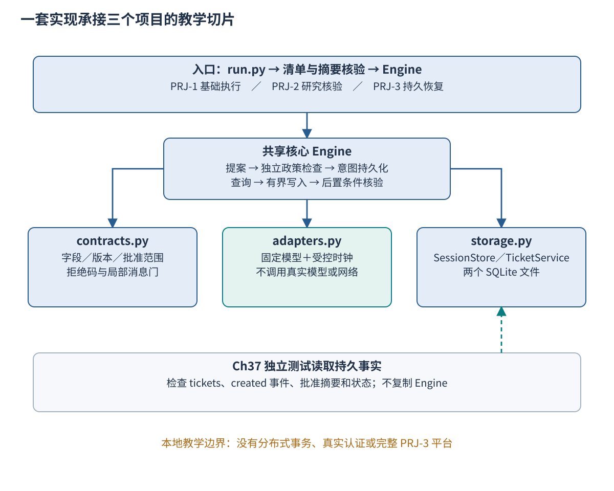
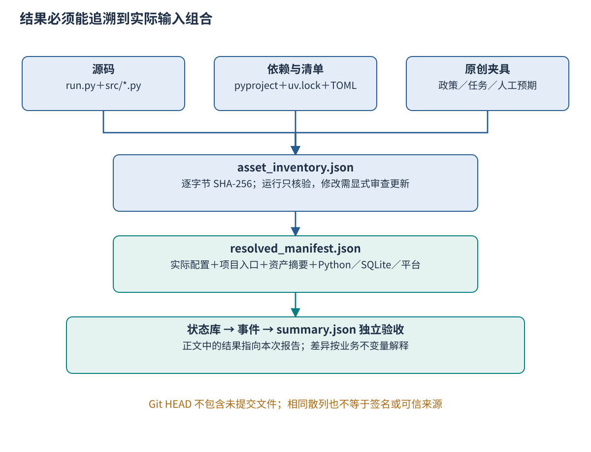
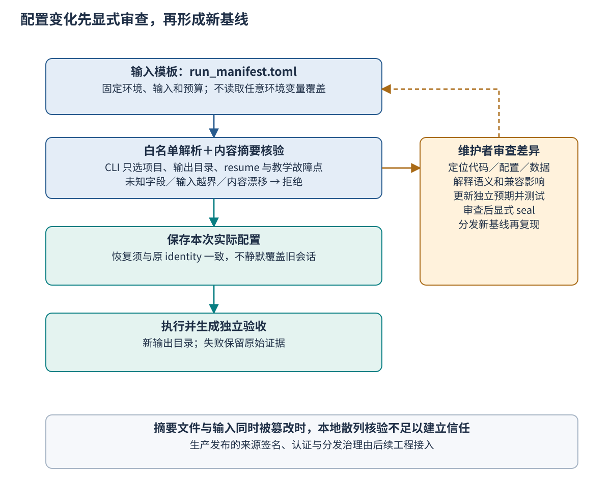

# Ch36 参考实现架构、配置与可复现环境

**Reference Implementation Architecture, Configuration, and Reproducible Environments**

**摘要**　智能体系统的运行结果同时受源码、依赖、配置、数据、模型与外部服务影响，仅记录提交号或随机种子不足以说明一次运行。本章从同一任务在两台机器上得到不同结果的案例出发，建立共享参考实现的模块边界，区分环境声明、依赖锁、输入清单与实际运行记录。随后以无密钥的本地工单助手演示内容核验、独立验收、提交后中断与持久恢复，讨论配置覆盖、版本兼容和变更审查。示例提供三个综合项目的有界教学切片；本章记录同机自检，不将其解释为真实模型质量、跨主机复现或生产平台验收。

**关键词**　参考实现（reference implementation）；可复现环境（reproducible environment）；运行清单（run manifest）；配置漂移（configuration drift）；内容摘要（content digest）；依赖锁定（dependency locking）；来源追溯（provenance）；独立验收（independent acceptance）。

本章由学生 E 执笔，作者姓名与单位随全书作者信息统一补齐。先修知识为 [Ch12 行动执行](../part3/ch12_action_execution.md)、[Ch13 轨迹与恢复](../part3/ch13_action_traces_recovery.md) 和 [Ch23 会话与状态](../part6/ch23_sessions_events_state.md)。完整代码与数据入口为仓库 `examples/ch36/`，测试入口为 `examples/ch37/`；代码、原创夹具与原创图形沿用仓库 MIT 许可。正文包含 Fig-36-01—03 和 Tab-36-01—03，26 等效页为混排预算，实际页数须经出版模板试排。

## 36.1 配置漂移：为什么同一个任务得到不同结果

### 36.1.1 两次“运行成功”可能不是同一个实验

企业政策助手处理一份金额为 250 的申请。开发者甲使用政策 `P20-A@2.0`，境内、票据有效且金额不超过 300 的任务可以进入基础写入流程；开发者乙的目录仍留着旧政策，又把默认重试次数从 2 改成了 5。两人运行相同脚本，都看到“处理完成”，便认为参考实现已经复现。后来核对才发现，两次判断依据、调用上限和输出目录都不同，乙还读取了上次留下的工单。

这个案例是对常见漂移机制的教学构造，不是本书团队的真实事故。它说明，文件名和命令相同，只能证明入口看起来一致。若脚本会从当前工作目录寻找数据、从环境变量覆盖配置、自动下载最新政策，或直接复用旧输出，执行的实际输入就可能不同。没有运行记录时，读者难以判断差异来自算法、条件还是残留状态。

应当先定义需要复现的对象。对本章基础路径，对象是“指定政策和批准范围下，同一申请只创建一份符合字段要求的工单，并留下可检查的状态和事件”。读者不必得到与作者逐字相同的终端输出，也不必生成字节完全相同的 SQLite 文件；但目标对象、业务字段、作用次数和最终状态必须满足同一验收条件。若研究目标改为延迟或真实模型质量，还须补充计时口径、任务集合和统计方案。

### 36.1.2 参考实现是一组可以核对的约定

**参考实现**是把接口与关键行为具体化、供读者运行和比较的基线。它应明确输入格式、控制流程、拒绝条件和结果检查方式。参考实现可以很小，但不能把“还有很多文件待创建”作为默认成功路径，也不能把生产环境才有的能力写进本地示例的保证。

可复现计算的一个基本要求，是让结果能够回溯到产生它的程序版本、输入、参数和步骤。Sandve 等人的规则同时强调保留过程信息和把文字主张连接到具体结果。[^r36-sandve] 对智能体系统，还要记录模型配置、知识版本、工具语义及外部状态，因为这些因素可能在源码未变时发生变化。本章先把能够控制的本地部分固定，再说明外部部分需要补什么证据。

固定随机种子只控制特定随机源。它不锁定远程模型版本，不重建外部数据库，也不保证两个硬件或数值库具有相同运算结果。本章直接采用确定性模型替身，使读者能把注意力放在配置、状态和恢复机制上。替身输出固定，不能据此报告语言模型准确率或推理能力；它降低了一部分变动来源，并没有替整个系统建立普遍的确定性证明。

### 36.1.3 本章要让读者独立完成什么

读完本章，读者应能画出共享实现的依赖边界，解释代码、配置、数据与结果之间的版本关系，并从清单重建本地运行环境。进一步应能区分输入模板与本次实际配置，定位文件缺失、内容漂移、环境不兼容及旧会话冲突，而不是反复重试直到出现成功文字。

本章承接 [Ch34 综合项目](../part8/ch34_capstone_reference_architectures.md) 的架构语境，为 [Ch37](ch37_agent_testing.md) 提供唯一被测核心。对模型效果的回归评估、复杂故障注入和观测，继续交给 [Ch38](ch38_regression_fault_injection.md)；发布、灰度和回滚则与 [Ch39](ch39_deployment_continuous_delivery.md) 衔接。将职责放在同一套资产上，能够避免每章各自运行一份逐渐分叉的“参考版本”。

## 36.2 参考实现的仓库与模块边界

### 36.2.1 从目录结构识别谁负责什么

本章的唯一核心位于 `examples/ch36/src/book_reference/`。`contracts.py` 定义任务和提案约束、政策判定及批准范围；`adapters.py` 提供固定模型和受控时钟；`storage.py` 实现客户端会话库与本地工单服务；`engine.py` 连接这些边界；`cli.py` 负责清单、内容核验、输出和复现命令。`run.py` 仅提供稳定入口，不再实现一套业务规则。

测试位于 `examples/ch37/tests/`，固定行为夹具位于 `examples/ch37/fixtures/`。测试可以调用共享核心，但不在测试目录复制一个“更容易通过”的引擎。相反，测试应从业务要求出发，独立读取持久化结果。如果实现和验收都调用同一段错误的字段映射，二者可能一起错误而全部变绿；目录分开只是开始，判断依据也要相对独立。

```text
examples/
├── ch36/
│   ├── run.py
│   ├── run_manifest.toml
│   ├── pyproject.toml / uv.lock / asset_inventory.json
│   ├── fixtures/                  # 政策、任务、固定提案、人工预期
│   └── src/book_reference/        # 唯一运行核心
└── ch37/
    ├── fixtures/cases.jsonl        # 30 个固定行为夹具
    ├── tests/                     # 契约、集成、本地端到端
    └── regression_probe.py        # 受控缺陷对照
```



**Fig-36-01　仓库与模块依赖。** 三个项目入口复用同一个 Engine，清单和摘要核验在入口完成。箭头表示调用或依赖关系，不表示并行智能体之间的通信。Ch37 从存储边界外检查事实；图为本书原创。

依赖应朝向稳定契约。引擎关心“模型提出了什么”“服务是否已有该操作”“后置条件是否成立”，不应直接依赖某个云供应商的 HTTP 字段。适配器负责把外部响应转换为契约中的结果，并保留拒绝、超时、未知等语义。这样，更换模型或工具时能够集中检查一个边界，而不必修改每个教学入口。

### 36.2.2 先固定最小输入，不把自由文本当执行权限

基础任务必须包含 `schema_version`、`task_id`、`tenant`、`revision`、`assignment_epoch`、金额、境内标记、票据标记和政策版本。字段集合按白名单校验，旧版本、未知字段和类型错误均拒绝。这里特别使用严格整数检查，避免 Python 中布尔值作为整数子类而被误当作合法金额。标识与修订绑定，防止恢复时把新任务误接到旧状态。

模型替身只给出 `decision` 与条款引用，包装后形成当前任务的提案消息。执行端校验任务、修订、分配轮次和消息标识，再用确定性政策规则独立核对提案。条款引用存在只是最低结构条件；本地规则再核对判断是否与事实相容。真实系统中，引用是否实际支持主张仍须由证据检验完成，不能只检查字符串中出现了某个编号。

模型提案不能提供行动批准。本地驱动另行构造 `Approval`，绑定租户、目标载荷摘要、有效期和许可标记。服务在新写入前核对这些条件，模型生成“已获批准”不会改变 grant。本章的 grant 是受信内存对象，目的是表达职责隔离；它没有签名、登录或真实审批人的验证，不能直接替代部署中的身份认证与授权服务。

任务标识与运行标识也应分开。`task_id` 标识业务任务，`operation_id` 标识一次逻辑行动，输出目录标识一次执行记录；一次任务恢复可以产生多段运行记录，却仍对应同一个逻辑行动。将三者都换成每次启动时生成的随机 ID，虽然日志看起来彼此独立，却可能切断恢复和去重关系。相反，让不同业务意图长期复用同一操作标识，又可能把合法的新行动误认为旧请求。

### 36.2.3 按业务事实串起最小执行链

基础链先验证任务，再接受和核对提案；只有符合政策的任务才保存写入意图。意图包含目标载荷和稳定操作标识，随后查询工单服务是否已有相同操作。没有旧作用且时间、尝试预算允许时，才请求创建；服务返回之后还要验证保存的字段与批准摘要，最后把会话记为 `completed`。返回成功之前发生的每一个条件都有可定位的拒绝或等待状态。

示例政策只接受境内、票据有效且金额不超过 500 的申请；金额超过 300 时需要主管另行批准。基础路径不代办主管审批，因此该分支停在 `needs_approval` 的拒绝理由，不会由固定模型自行补足批准。本示例将“是否符合政策”和“是否有本次写入许可”分开，两者都通过才允许产生作用。政策允许不等于权限允许，权限允许也不能覆盖政策不满足。

关键顺序可以压缩为以下片段；完整异常分支以源码为准。

```python
state = store.transition(task, "pending", "intent_saved",
                         operation_id=operation_id, payload_json=payload_json)
ticket_id = service.lookup(task["tenant"], operation_id, payload)
if ticket_id is None:
    ticket_id = service.create(task["tenant"], operation_id,
                               payload, approval, clock.now_ms)
if service.verify(task["tenant"], ticket_id, payload):
    store.transition(task, "completed", "completed", ticket_id=ticket_id)
```

这段代码用于说明先存意图、先查旧结果和独立核验的关系，省略了预算、超时、取消及中断记录，不能直接视为完整实现。尤其不能把 `lookup` 返回为空与查询超时合并：前者在本地服务约定下表示当前没有记录，后者表示尚未取得答案。实际 Engine 对查询超时保留 `pending`，不立即发起另一次写入。

### 36.2.4 三个项目入口只扩展各自需要的切片

PRJ-1 展示基础提案、政策核对、受控写入和独立验收。它使用一个原创任务和两条政策，适合从零检查结果链；它没有承诺覆盖综合项目的正式政策库、检索算法和全部工具。PRJ-2 在同一核心上增加研究证据核验事件，展示研究、执行和核验职责如何落在不同检查位置。此入口仍按顺序调用，不是完整的并发多智能体系统。

PRJ-3 复用同一任务与工单服务，在服务提交之后、客户端完成之前结束一个子进程，再由另一个子进程打开持久会话继续。它具体展示跨进程的状态保存和未知结果恢复。完整生产平台还需要会话并发、流式打断、真实认证、评测、观测、发布和回滚，这些内容不能从一次本地恢复成功推导出来。

三个入口的价值是让新增能力能够与同一基础行为对照。若每个项目都复制一套数据、权限逻辑和服务实现，最终差异就无法归因于组织或运行时机制。后续接入公共项目时，应保留核心契约和验收口径，按适配边界逐步替换；若公共字段与本地 `demo-1` 不同，先显式转换并测试，而不是把两个版本同时称作已冻结的公共协议。

### 36.2.5 两个存储文件保留真实的不一致窗口

`session.sqlite` 保存客户端任务、稳定操作标识、尝试次数及事件；`service.sqlite` 保存工单和服务事件。服务把工单写入与 `created` 事件放在同一本地事务里，并以 `(tenant, operation_id)` 唯一约束阻止同一调用者操作重复生效。客户端保存意图与自己的事件也在本地事务中完成，但两份数据库不处于同一个事务。

这个选择保留了最需要理解的窗口：服务已经提交，客户端还没有记录收到结果。此时重启客户端不能靠“本地还没完成”推断外部未执行，更不能生成新操作标识重新创建。它应读取先前保存的标识并查询旧结果。相同标识、不同载荷则拒绝，避免把两个不同意图错误合并。

本地唯一约束也不等于全系统恰好一次语义。示例没有验证多副本服务、跨区域复制、外部对象删除或幂等记录过期等情况。取消只是阻止后续新动作，若服务已经提交，取消结果仍要登记已产生的工单。对已完成会话再次运行，示例返回保存的完成状态，不会重新证明外部对象未被后来修改；持续核对现状属于另一个任务。

### 36.2.6 为真实模型留下替换位置

真实模型适配器应实现与固定替身相同的提案边界，并明确处理格式错误、拒绝、截断、限流和请求超时。模型标识、提示版本、结构化输出约定和生成参数应进入运行记录；若供应商不保证固定快照，就要明确记录这种漂移可能。替换后首先重跑契约与权限测试，再增加真实任务评价。

接入模型时不能把批准 grant、数据库连接或任意脚本执行能力交给模型自由构造。工具适配器应保留固定动作集合和校验逻辑，实际凭证由受信运行环境按最小权限提供。把 API 调用成功当作任务正确，或把固定替身通过当作真实模型通过，都会扩大本章证据的适用范围。

### 36.2.7 将前文章节的概念落实到模块

读者可以沿三个方向核对前文与代码。第一条是判断到行动：[Ch11](../part3/ch11_tool_discovery_calling.md) 的工具边界在本例对应受限的查询、创建和核验方法，[Ch12](../part3/ch12_action_execution.md) 的授权与验收对应服务侧 grant 检查和后置条件。模型没有直接执行 SQL，也不能通过自由文本增加第三种工具动作；工具集合的改变应作为显式接口变更。

第二条是状态到恢复：[Ch14](../part4/ch14_state_working_memory_context.md) 区分工作状态与长期信息，本例把决定是否继续执行的意图和尝试次数保存在会话库，而非依赖模型的对话记忆。[Ch22](../part6/ch22_orchestration_runtime.md) 的运行时负责安排步骤，本例以顺序 Engine 表达最小编排；[Ch23](../part6/ch23_sessions_events_state.md) 的事件与状态对应 sessions 和 events。自然语言总结可以帮助理解轨迹，但不能代替这些决定后续动作的结构字段。

第三条是组织到证据：[Ch18](../part5/ch18_multi_agent_roles.md) 的研究、执行和核验职责在本例落为不同检查位置，[Ch19](../part5/ch19_multi_agent_communication.md) 的修订和分配轮次在 ReplyGate 中得到局部检查。这里适合先定位输入、生产者和消费者，再对照公共协议补持久消息与接管。增加角色名称只改变表达，只有新增的职责实际约束了输入、权限或验收，才构成可检查的工程变化。

这张概念到模块的映射可以用于评审。某条正文保证若找不到负责组件，应判断它属于尚待接入的设计，还是实现遗漏；某个组件若同时生成判断、批准行动并宣布成功，则要重新核对职责集中是否符合业务要求。映射不能只列文件名，还应说明该组件提供的证据以及失败如何暴露给调用者。

## 36.3 配置、数据与环境清单

### 36.3.1 环境声明、锁和运行清单各回答一个问题

`pyproject.toml` 说明项目元数据和依赖约束，`uv.lock` 记录工具解析后的依赖关系，`run_manifest.toml` 指定这次教学运行选择哪些输入、预算和环境约定。Python Packaging 规范为项目与工具配置提供结构，不能把其中任何一个文件自动视为“完整实验说明”。[^r36-pyproject] 缺少任务和预期结果，即使环境能够安装，也无法判断运行是否正确。

本章基础核心没有第三方运行依赖，仍保留项目声明与锁，以便明确 Python 允许范围和后续变更入口。项目声明允许 Python 3.11 至 3.14，实际教学清单要求 3.12；二者的交集才是本次验收环境。自检具体使用 CPython 3.12.14，不能把文档网页当前展示的补丁版本误写成实际运行版本。

任务书使用的 `environment.lock` 与 `run_manifest.yaml` 在这里分别映射为 `pyproject.toml` 加 `uv.lock`，以及 TOML 清单。映射依据是现有仓库使用 uv、Python 3.12 已内置 `tomllib`。保持职责完整比增加两个内容相同的空壳文件更有意义；若团队以后统一采用 YAML，应在入口转换一次，并保留相同字段约束和测试。

**Tab-36-01　运行清单与结果记录的字段分工。** 示例值来自本章本地基线；内容摘要和实际环境由运行时记录，不手工猜测。

| 对象或字段 | 本地形式与含义 | 缺失或变化时的处理 |
| --- | --- | --- |
| `schema_version`、`baseline_id` | `reference-demo-1`、`ch36-local-0.1` | 未支持的格式拒绝；基线变化另建记录 |
| `projects` | 三个可选教学入口 | CLI 只能从白名单选择 |
| `environment` | Python 次版本、锁路径、标准库运行方式 | 版本不兼容先修环境，不改结果掩盖 |
| `inputs.task`、`inputs.policy` | 任务与政策文件 | 必须存在且位于 fixtures 范围 |
| `inputs.model_response`、`inputs.prompt` | 固定提案及提示接口说明 | 固定替身不执行提示，但两者均记录版本 |
| `inputs.expected` | 人工列出的业务字段与作用数量 | 规则变更时独立审查，不能从运行答案自动反填 |
| `budget` | 尝试上限、截止、受控起点和 grant 有效期 | 类型和顺序错误拒绝 |
| `asset_inventory.json` | 明确资产集合的逐字节 SHA-256 | 缺失、额外代码或摘要变化阻止默认运行 |
| `resolved_manifest.json` | 实际清单、项目、摘要与真实环境 | 恢复须与原 identity 一致 |
| 状态、事件与验收 | 两个 SQLite、`events.json`、`summary.json` | 保留原始事实和失败原因，不能只留终端截图 |

### 36.3.2 输入模板与解析后记录不能混用

模板描述希望运行什么，解析后记录描述实际运行了什么。例如模板写“Python 3.12”，实际环境还具有补丁号、SQLite 版本和操作系统；模板提供任务路径，运行时要记录该文件的内容摘要。只有同时保存这两层，后续读者才能发现“路径相同但内容不同”或“约束相同但安装不同”的情况。

本例不从任意环境变量读取配置覆盖。命令行只选择项目、输出位置、是否恢复和明确的教学故障点，政策、输入、时间与预算仍由清单控制。这样牺牲了一些临时便利，换来较小的隐式状态面。未来若支持团队、环境、用户等多层配置，必须公开优先级，并把合并后的最终值及来源保存下来。

配置覆盖还需要区分哪些字段可以调整。输出目录通常不改变业务语义，租户、权限、政策版本和任务载荷却可能改变授权范围。本例恢复时将项目、完整清单和资产摘要一起比较；改变其中任意一项都会拒绝继续原会话。读者确实要执行新条件时，应建立新基线和新运行，而不是修改旧报告以保持“复现成功”。

清单中的预算片段如下。它配置的是尝试次数与受控时间，不是模型 token 预算或远程请求收费上限。接入真实模型时，应增加对应计量与硬限制，并明确多角色是否共享根预算，不能把 `max_attempts` 改名后当作已经实现成本治理。

```toml
[budget]
max_attempts = 2
deadline_ms = 5000
clock_start_ms = 1000
approval_expires_at_ms = 4000
```

当前时间约定满足起点早于 grant 到期、到期不晚于任务截止；类型和顺序由解析器检查。时间值必须放在同一时钟域中理解。若把这里的 4000 当作真实 Unix 毫秒时间戳，批准会早已过期；若把相对时长直接与真实当前时间比较，也会得到错误结果。真实运行时应明确单调时钟、绝对期限与重启后的转换规则，再扩展测试。



**Fig-36-02　代码、配置、数据与结果的版本谱系。** 内容清单连接实际资产，解析后清单连接本次环境，状态与事件支持独立验收。谱系表示可追踪关系，不等于已实现签名的供应链证明；图为本书原创。

SLSA 将 provenance 描述为能够追踪软件制品在何处、何时、如何产生的可验证信息。[^r36-slsa] 本章借此强调追踪对象和生产过程，而不声称本地 JSON 报告符合某个 SLSA 等级。Git 提交、内容摘要、运行时间和人工审查各有用途，不能相互替代；若需要可信分发，还须由受信发布流程提供签名及验证。

### 36.3.3 数据卡使教学输入的边界可见

`fixtures/` 包含原创政策、一个基础任务、固定提案、提示接口说明、人工预期和数据卡。基础金额是教学整数，不连接支付系统；工单是本地 SQLite 记录，没有真实人员和账号。数据卡记录版本、许可、生成方式、适用目的及没有覆盖的范围，避免读者把少量构造数据误认为完整企业样本。

人工预期包含最终状态、工单数、`created` 事件数和目标字段。它不由引擎执行结果生成。若政策门槛发生变化，应先解释新业务规则，再由人修订预期并新增边界夹具；直接把当前输出保存成新标准，会把实现错误固化为“正确答案”。本例还检查批准摘要是否对应目标载荷，使结果记录与授权范围相连。

固定模型响应同样是数据。改变一个 `decision` 或漏掉一条证据，会改变控制分支，应进入摘要核验。提示文件虽然在固定替身中不被执行，仍作为未来模型接口的版本材料保存；正文必须说明这一点，不能声称固定提案是模型根据该提示推理得到的。模型实验需要另行记录真实输入、响应和评价。

### 36.3.4 内容摘要定位漂移，也引出换行约定

内容清单覆盖 `.gitattributes`、入口、项目声明、锁、运行清单、源码和全部夹具，排除自身、虚拟环境、缓存及生成结果。运行时重算同一集合并比较，因此新增一个未审查的 Python 文件也会导致失败。这里保存的是原始文件字节的 SHA-256，便于定位“分发的究竟是不是同一个资产”。

字节摘要意味着行尾也属于内容。若作者使用 LF、读者检出时由 Git 自动改为 CRLF，业务语义可能没变，摘要却会变化。示例目录因此提供 `.gitattributes` 固定 LF，并将该约定本身纳入清单。对 Unicode 规范化、编码和压缩等变化也应先约定处理层次，不能在失败后随意忽略所有差异。

摘要相同只能支持内容一致，不能证明内容来自可信作者。若攻击者同时替换源码和清单，本地比较仍可能通过。本章将摘要用作漂移检查，维护者须从可信位置取得基线；发布包的签名、源头验证和权限控制需要与后续发布流程一起设计。把一个散列值写进报告不自动形成安全证明。

### 36.3.5 锁定依赖不等于复制虚拟环境

虚拟环境用于隔离解释器所使用的包，不应作为可以随目录移动的部署制品。Python 文档明确说明，虚拟环境通常不可移植，位置变化时应根据声明重新创建。[^r36-venv] 本例的干净复现不复制 `.venv`，而是在目标位置用锁重建环境，同时保存真实解释器与 SQLite 版本。

`uv sync --locked` 会检查锁与项目元数据是否一致，并在需要更新锁时失败；`--frozen` 使用现有锁但省略过时检查。[^r36-uv] 因此接受检查采用前者。维护时可以显式重新解析依赖，但普通复现命令不应默默把锁更新成“今天能装上的版本”，否则读者得到的是新的环境组合。

锁文件也不能替代操作系统、系统库和硬件条件。标准库 SQLite 的实际版本随解释器构建而变化；路径语义、文件锁和时钟精度也受平台影响。当前报告记录这些信息，以便解释差异。基础核心不需要 GPU，真实模型或向量索引扩展若增加系统依赖，应补充相应环境条件，而不是继续沿用本章较小的保证。

### 36.3.6 秘密只通过受信边界进入

基础路径不需要 API key，也不枚举或保存用户整份环境变量。未知配置字段会被拒绝，测试只用固定假值检查多余的 `api_key` 字段，不读取用户凭证。未来真实模型适配器可以从受信凭证系统取得密钥，但运行清单应保存凭证引用或权限范围等必要元数据，不保存秘密本身。

OWASP 的秘密管理指南讨论集中管理、轮换、审计和生命周期控制。[^r36-owasp] 对本书工程记录，审计重点应是何种身份在什么条件下使用了哪个权限，而不是把密钥打印出来作为“配置完整”的证据。错误信息、异常堆栈和测试附件也可能泄露配置，接入时须检查这些输出通道。

秘密管理与可复现并不冲突。可以固定认证方式、权限范围和凭证来源约定，同时让每个操作者使用自己的授权。若任务只有在作者私有账号或未说明的手工操作下才可完成，应把这些前提列入缺失条件，不能将它包装成面向普通读者的无密钥基础路径。

### 36.3.7 解析配置时同时检查结构与语义

配置文件能够被 TOML 解析，只说明语法合法。`max_attempts = 0`、起点晚于截止、输入路径指向目录，都可能是语法正确而运行意义不成立的配置。解析器因此分两层处理：先检查字段集合和类型，再检查允许范围、文件存在性及相互关系。错误尽量在创建工单之前暴露，避免系统走到一半才发现没有足够输入。

白名单检查也有兼容性代价。添加一个可选字段，在宽松消费者中可能只是忽略，在本例严格解析器中则会拒绝。发布新清单时，维护者应说明新旧消费者如何共存，必要时提高模式版本并提供转换。静默忽略未知字段虽然方便，却可能让操作者误以为一项安全限制已经生效；显式拒绝可以使这种误解在启动时暴露。

路径处理应以清单所在资产包为基准，而非依赖当前工作目录。示例从入口自身位置找到 `fixtures/`，并检查解析后的输入仍位于该范围。绝对路径、目录穿越或错误的符号链接目标都不应被自然拼接成可读输入。这个限制服务于可分发的教学包：读者能够知道运行读了哪份材料，也避免作者机器上的偶然文件成为隐藏依赖。

最后要区分运行配置与维护操作。选择项目和新输出目录属于普通运行；修改政策、预算和预期意味着改变条件；更新 inventory 则意味着接受新的内容基准。把三类动作设计成同一个“自动修复”命令，容易在修环境时同时改变实验对象。较小而明确的入口更便于审查，也让失败原因保持可解释。

## 36.4 从干净检出到可复现运行

### 36.4.1 在新环境中确认来源与前提

正式发布后，读者应检出指定版本并记录提交号，核对附带资产清单。本章编写时仍存在尚未提交的新资产，因此本轮证据使用内容清单标识源码，不能仅以 Git HEAD 代表完整新实现。Git 的 `archive` 导出指定树的内容，未提交的新文件不会因工作目录中存在就自动进入归档。[^r36-git] 用它制作复现包之前，必须先核对目标树是否真的包含交付资产。

本轮另在同一机器的新目录复制明确的交付文件，排除旧虚拟环境、缓存和输出，再重建环境运行。这属于“干净副本自检”，不能写成已发布提交的干净检出，更不能替代其他学生独立运行。发布前仍要由维护者确认版本、从实际发布包再次运行并保存差异记录。

运行前只需准备 uv 与 Python 3.12。首次下载解释器或根项目测试依赖可能需要网络；示例执行阶段使用本地夹具和标准库，不访问模型服务或外部工单。若网络受限，应事先准备可信解释器与依赖缓存，记录来源；不要把安装阶段的联网需求与运行阶段的外部调用混在一起。

**Tab-36-02　干净环境复现检查表。** 每次复现均应填写实际记录；作者自检通过不代填独立复现人。

| 检查点 | 接受条件 | 应保留的记录 |
| --- | --- | --- |
| 源码来源 | 发布树或披露了未提交内容的交付副本 | revision、资产清单、差异说明 |
| 环境重建 | 不复制旧 `.venv`；版本符合清单 | Python、uv、SQLite、操作系统 |
| 依赖一致 | `uv sync --locked` 成功 | 安装命令与错误输出 |
| 输入存在 | 指定夹具完整、摘要一致 | 输入路径、逐文件摘要 |
| 配置生效 | 无未知覆盖，解析结果保存 | `resolved_manifest.json` |
| 输出隔离 | 新目录或空目录，不复用旧工单 | 本次运行目录 |
| 三个入口 | 基础、角色核验、跨进程恢复均通过 | 项目报告、进程退出码 |
| 业务验收 | 1 个目标工单、1 次创建，字段与批准范围匹配 | 数据库、事件、独立检查结果 |
| 失败诊断 | 漂移与冲突能被拒绝，保留原因 | 失败日志、修复说明 |
| 独立复现 | 另一位学生按公开步骤运行 | 操作者、日期、环境与签认，当前待补 |

### 36.4.2 用同一条命令生成可检查的结果

从仓库根目录执行以下命令。输出目录 `outputs/ch36-first` 必须是新的或为空；已有结果应保留，重跑时换一个目录名。

```powershell
uv sync --project examples/ch36 --python 3.12 --locked
uv run --project examples/ch36 --python 3.12 --locked python examples/ch36/run.py reproduce --output outputs/ch36-first
```

末行预期为 `{"passed": true, "project_slices": 3}`。复现驱动分别调用三个入口，并把子进程的退出码与输出保存到 `reproduction.json`。PRJ-3 的第一阶段在服务提交后触发显式中断，子进程按约定退出 42；第二阶段重新启动并使用 `--resume`，预期退出 0。顶层复现命令只有在整个组合符合预期时才退出 0。

每个项目目录含解析后清单、两份数据库、事件和汇总。先看 `summary.json` 的 `oracle_passed`，再检查其中状态、数量、载荷与批准范围各项判断。若只有终端显示通过，却拿不出对应的持久结果，就不能完成复现验收。此处将运行过程与检查结果同时保存，便于读者从汇总继续追到原始记录。

### 36.4.3 比较业务不变量，而不是无关字节

三个切片的共同预期是最终状态为 `completed`，工单数与 `created` 事件数均为 1，保存金额为 250，政策版本为 `P20-A@2.0`，其他字段与人工预期一致，批准摘要覆盖同一载荷。PRJ-2 还必须出现 `research_verified`，PRJ-3 恢复后出现 `outcome_resolved`，并继续使用原操作标识。

报告中的 UTC 时间、平台字符串和绝对路径可以不同；这些差异用于定位环境，不是业务失败。数据库页布局也无需相同。若声称字节级复现，就必须另外控制序列化、时间字段、数据库布局等因素，本章没有作这种承诺。反过来，金额、租户或作用次数不同不能以“输出格式差异”为由忽略。

本轮自检的解释器为 CPython 3.12.14、SQLite 3.53.1，uv 为 0.12.8。三个教学入口均达到上述业务不变量，其中 PRJ-3 确实使用两个先后运行的客户端子进程。相关报告保存于 `examples/ch36/reports/`；它们说明本地机制可执行，不提供真实模型、跨主机或生产吞吐的结论。

### 36.4.4 失败时按最早破坏的边界定位

若启动即报告 `asset_drift`，先比较代码、配置和夹具摘要；不要直接更新清单。若 Python 次版本不符，先切换解释器；若锁与元数据不一致，判断是漏交锁还是有意更新依赖。只有明确变更意图并完成测试后，才能形成新基线。

`output_not_empty` 表示存在可能污染运行的旧内容，处理方式是改用新目录。`resume_baseline_conflict` 表示当前资产与原会话身份不同，应先恢复原基线或新建任务。`session_task_conflict` 则说明同一租户和任务标识下的内容发生变化，不能把修改后的任务继续当成原任务恢复。

若客户端保持 `pending`，应继续核对是响应超时、查询失败还是后置条件未确认。未知结果不是已失败且无副作用，也不是已完成。查看服务的持久记录，能够把“尚未执行”和“已执行但未收到响应”区分开；若查询渠道本身不可用，保留未知、停止新增作用并交接，比猜测结果更符合契约。

恢复同样要遵守边界。基础实现的查询是本地权威 SQLite 读取，真实远程服务可能有最终一致性、缓存或查询权限限制。接入时需要重新验证“查不到”到底支持什么结论，不能直接沿用本地代码的判断。相同方法的适用条件应与替换的服务一起更新。

### 36.4.5 逐项读懂提交后恢复的报告

以 PRJ-3 的基础任务为例，持久意图中的操作标识为 `T-DEMO-01:1:create`。第一段运行已经留下 `intent_saved` 与 `action_requested`，服务库存在一份工单和一次 `created`，客户端仍没有 `completed`。此时结束的是客户端进程，业务作用已经在另一个数据库中提交；检查点的位置使这两件事可以分别观察。

第二段运行先核对原清单身份，打开原会话，发现意图已保存，因而无需重新征询固定模型。随后查询同一租户、同一标识与同一载荷，取得既有工单，并增加 `outcome_resolved`。字段与批准摘要核验后，才依次记录 `postcondition_verified` 和 `completed`。报告中的尝试次数仍为 1，因为结果查询不等于又发起了一次创建。

这条轨迹提供两个诊断方向。如果服务里有两份目标工单，应先核对标识是否随尝试改变，或服务是否违反唯一约束；如果服务里只有一份而客户端无法完成，应查看查询、载荷比较和批准范围是否一致。先定位哪条事实不成立，比统一将所有错误命名为“恢复失败”更容易形成针对性修复。

原始输出还保留每个事件的顺序号与必要详情，汇总只提取验收需要的字段。读者应能够从 `summary.json` 返回对应数据库和 `events.json`，而不是面对无法追踪的一张成绩表。若交付时需要脱敏或缩减附件，要保留稳定的事件关联与内容身份，并说明删减范围。

### 36.4.6 环境矩阵按实际验证逐格填写

“支持 Python 3.12”与“在某种操作系统上完成一次验证”是不同结论。当前实际环境为 Windows、CPython 3.12.14 和 SQLite 3.53.1；仓库工作流声明了 Ubuntu 与 Python 3.12，但本轮没有远程运行，不能因此预填 Linux 验证通过。读者可以把系统、解释器补丁号和服务版本作为矩阵维度，逐格记录命令与证据。

平台差异通常先出现在路径、编码和文件句柄。本例统一使用 UTF-8 读写 JSON 与文本，资产固定 LF 行尾，测试结束关闭 SQLite 连接。运行命令不要求复制用户配置或凭证。中文在终端显示异常时，应分别检查输出编码与原文件内容；显示问题不自动说明业务输入损坏，也不能据此忽略文件摘要差异。

扩展环境矩阵应由目标读者决定。如果课程只要求单机无密钥运行，优先验证公开支持的平台即可；如果要声称支持容器、队列 worker 或多租户部署，则要增加相应启动、状态和权限检查。矩阵中的未验证项保留为未验证，比把一个安装成功的环境当作整个任务已经通过更准确。

## 36.5 变更治理与维护

### 36.5.1 将四类变化分别审查

源码变更可能改变执行顺序与错误处理；配置变更可能改变预算、工具和权限；数据变更可能改变答案依据；依赖变更可能改变解析与运行行为。这四类变化都能影响结果，即使 Git 差异只有一行。审查应说明“行为为什么改变”以及哪些预期仍然成立，而不能只看代码行数。

例如将主管门槛从 300 改成 200，会让基础任务 250 进入不同政策分支。这不是重新跑一次就能消除的噪声，需要修改教学预期或更换基础任务，并增加门槛附近的测试。若只把运行结果抄入 `expected.json`，读者无法知道这是政策修订还是错误被接受。

与之相比，调整图片颜色或章节措辞通常不改变运行资产；本地清单没有纳入整本书，因此这些编辑不会使核心运行失效。这一覆盖范围必须公开。清单能证明所列资产一致，不能代表书稿、团队正式数据或部署配置都已经被锁定。



**Fig-36-03　配置覆盖与审查。** 本地入口没有隐式环境覆盖；配置与内容核验通过后才保存实际运行身份。发生漂移时先定位和测试，再由维护者显式更新清单。虚线表示形成新基线后的返回路径；图为本书原创。

### 36.5.2 版本号应描述兼容性

SemVer 以公开 API 的兼容性区分主版本、次版本和修订版本。[^r36-semver] 采用这种约定之前，团队要先说明哪些接口属于公开 API：任务字段、消息模式、清单格式、服务动作和结果语义都可能是消费者依赖的内容。没有边界定义，仅把版本从 0.1 改为 0.2 并不能告诉读者能否继续使用旧资产。

本例分别使用 `demo-1` 任务模式、`reference-demo-1` 清单模式和 `ch36-local-0.1` 资产基线。它们不是同一个概念。任务可以保持兼容，而夹具或代码发生修订；反过来，源码只改少量字段名也可能破坏所有消费者。版本记录应明确模式变化与行为变化，不依赖单一总版本号承担所有含义。

恢复状态的兼容性尤其需要保守处理。若新版本改变操作标识生成规则，却继续读取旧会话，可能把一次未确认写入当成新操作。迁移应显式读取旧格式、转换并核验，或要求旧任务在原版本完成；不能在读取失败时自动清空数据库。本章采用同一资产 identity 才允许恢复，以便把此类迁移留给明确的维护流程。

### 36.5.3 维护流程应留下可审查的差异

维护者首先记录问题和预期行为，再修改实现或数据，运行受影响的行为测试，并核对现有固定预期。对于实际缺陷，新增测试应能够在缺陷版本失败、修复版本通过；若测试只检查刚添加的函数存在，无法证明原问题被约束住。Ch37 的重复写入对照具体展示这一要求。

本地 `seal` 命令只在维护时显式重算资产清单，不会由 `run` 或 `reproduce` 自动调用。审查后可以运行以下命令，并把新的摘要差异与理由一起检查。

```powershell
uv run --project examples/ch36 --python 3.12 python examples/ch36/run.py seal --reason reviewed-change-description
```

`seal` 不是批准系统，也不能证明操作者已完成审查。它只是把“接受新基线”从普通执行中分出来，减少运行失败后自动吞掉漂移的机会。团队仍须明确维护人、审阅人和交接范围；本章编写的自检记录不能代签其他同学的确认。

更新后应在新目录复现，再运行共享测试和文档检查。若只是替换真实模型适配器，还应确认原有无密钥路径继续可用，使普通读者能够独立检查控制逻辑。涉及外部服务的新条件和成本另行记录，不能让基础路径悄悄依赖作者账号。

### 36.5.4 回滚代码与回滚业务作用是两件事

将源码切回旧版本，并不会删除已经创建的工单。恢复旧配置也不会自动恢复旧数据库状态。发布回滚需要区分代码、配置、状态模式和外部副作用，明确哪些可以逆转、哪些只能补偿。若新旧版本都可能处理同一任务，幂等标识和状态迁移的兼容性会直接影响是否重复执行。

本章没有提供上线控制面，也不把删掉输出目录称为生产回滚。教学输出可以在确认无用后由操作者处理，但实验记录应保留到结果解释完成。后续发布演练应由 Ch39 记录发布版本、恢复目标、业务核验和责任人，接入本章的运行身份与 Ch37 的回归测试。

维护证据还要避免重复计算。同一次本地恢复可以同时支撑“状态可持久化”和“重试不重复写入”两个主张，但它仍是一条实验轨迹，不是两个独立样本。报告应标识共同来源，便于编辑和读者判断证据强度。

### 36.5.5 交接时给出消费者可以检查的材料

公共资产维护与本章执笔职责需要同时保留。环境维护者可以提供锁和运行清单规范，工具维护者可以提供动作与验收接口，运行时维护者可以提供事件、时间及恢复协议；本章整合这些材料时，仍须逐项核对实际入口。只有生产者写了一份字段文档，不能说明所有消费者已经按同一语义实现。

一次有效交接至少包含模式版本、字段含义、成功与失败示例、允许状态转换和执行命令。消费者应能用一个正常场景和一个拒绝场景证明自己理解了契约，涉及副作用时再检查幂等与未知结果。若存在分歧，记录是字段名称、授权含义还是时间边界的问题，给出负责修订的组件，而不是只在合稿说明中写“接口已对齐”。

本地 `demo-1` 目前以 `(tenant, task_id)` 作为会话主键，并绑定整个任务摘要。因此，仅提高 `revision` 不能在原会话上静默继续；基础教学中应使用新任务标识与新输出，或由后续明确的迁移流程处理。接入公共版本协议时，维护者需要决定会话是否按修订分支、旧行动如何收口，以及新批准何时生效，这些决定应进入测试。

独立复现交接还应让操作者留下自己的记录。作者可以准备文件、排查文档和解释预期，却不能代写对方已运行的结论。若对方遇到问题，应保留原失败条件和修复前后差异，再决定是说明不足、环境不符还是实现缺陷；只有这样，独立复现才能提供作者自检以外的信息。

## 36.6 小结与复现验收

### 36.6.1 用实验卡界定本轮证据

`Exp-36-01` 的问题是：在明确控制代码、配置和原创输入后，读者能否重建环境，运行三个本地教学切片，并独立核对同一业务后置条件。基础对照是正常运行；恢复切片在服务提交后、客户端确认前触发中断。成功标准在运行前由人工预期固定，不以最终文本是否通顺为准。

本轮每个项目入口执行一次验证；另有一次同机干净副本验证，用于检查是否依赖原目录的虚拟环境、缓存或旧输出。它们是确定性机制检查，不进行统计显著性分析，也不报告任务成功率。相同业务不变量成立，仍不足以说明不同机器、真实模型和真实远程服务均能复现。

**Tab-36-03　本轮复现证据与适用范围。** 数量表示机制验证结果，不是语言模型基准成绩。

| 验证项 | 本地观察 | 能支持的结论与限制 |
| --- | --- | --- |
| PRJ-1 | completed；1 个工单、1 次创建 | 基础控制链可执行；不是完整知识助手验收 |
| PRJ-2 | 同上，含研究核验事件 | 角色职责切片存在；未验证并行消息与通信预算 |
| PRJ-3 | 提交后退出 42，重启恢复退出 0；仍为 1 次创建 | 同一基线可跨客户端进程恢复；未验证机器掉电或远程服务 |
| 漂移与目录保护 | 固定输入、锁、额外代码等变化被拒绝；已有输出保留 | 指定资产范围有检查；不证明来源可信 |
| 干净副本 | 同机新目录、新环境运行通过 | 排除原目录残留依赖；独立学生和跨主机复现待补 |

### 36.6.2 本章的验收标准

参考实现的核心价值是让读者知道如何从输入走到可检查的事实。合格的复现记录应能回答：代码来自哪里，使用了哪份清单和数据，环境如何建立，动作是否得到授权，实际写入了什么，以及失败或恢复时发生了什么。这里任何一项只剩口头说明，都可能使结果无法核对。

本地验收应同时具有正常结果和失败能力。合法任务产生一个目标工单；未知字段、批准不匹配和配置漂移被拒绝；响应未知不伪装成功；取消不抹掉已经发生的作用。随后由 Ch37 持续约束这些行为，使未来扩展不必依靠人工逐步点击验证。

关键术语可以按对象记忆：参考实现负责具体化契约，依赖锁负责固定解析组合，运行清单负责选择输入与预算，解析后记录负责保存实际条件，内容摘要负责定位漂移，独立验收负责检查业务后置条件。它们相互连接，共同形成可追踪基线。

### 36.6.3 复习题

1. 两位读者使用同一 Git 提交和同一随机种子，结果仍可能不同。列出三类原因，并说明各自应记录在哪个文件或报告中。
2. 为什么 `run_manifest.toml` 与 `resolved_manifest.json` 都需要保留？恢复任务时只核对 `task_id` 会漏掉什么变化？
3. 服务已经创建工单、客户端尚未记录完成时发生中断，为什么不能生成新操作标识重试？两份 SQLite 文件分别支持什么保证？
4. `uv sync --locked` 与 `--frozen` 在锁一致性检查上有何区别？为什么不应把原机器的 `.venv` 直接复制给另一位同学？
5. 同机干净副本自检通过、文件摘要一致，是否足以声明生产系统可复现且来源可信？分别指出缺少的证据。

### 36.6.4 实践题：交付一份可复核的复现记录

在新目录取得本地参考基线，记录源码身份、环境和输入摘要，运行三个入口并独立读取数据库核对目标工单、创建事件与批准范围。随后在另一个副本中只改变政策文件的一个字符，记录默认运行如何拒绝；解释这属于字节漂移还是业务语义变化。不要直接更新 inventory 使错误消失。

提交复现检查表、命令、解析后清单、原始结果及一页差异说明。基础项共 100 分：来源与环境 20 分，输入及配置追溯 20 分，三个切片与独立验收 30 分，漂移定位 20 分，限制与交接 10 分。进阶可让另一位同学按说明独立运行，记录环境差异；不得代填复现人或把作者自检改名为独立复现。教师答案与评分细则随本章内部教学材料维护。

### 36.6.5 局限与后续接入

本章实现只有原创小型夹具、固定模型、受信本地 grant 和单客户端顺序调用，未冻结团队公共模式。局部消息门没有持久收件箱；真实认证、并发事务、外部系统一致性、正式项目数据与发布控制面仍须补齐。独立学生复现及 F 的章节审阅当前待完成，英文稿另行维护。

因此，本章交付的是可以运行、可以检查、也可以通过故障输入被否定的中文教学基线。后续扩展应沿着已有边界替换组件，并增加相应证据。能够解释一条失败轨迹及其输入条件，是持续复现工作的必要部分。

## 参考文献与版本记录

[^r36-sandve]: Sandve G K, Nekrutenko A, Taylor J, Hovig E. Ten Simple Rules for Reproducible Computational Research. *PLoS Computational Biology*, 2013, 9(10): e1003285. [DOI:10.1371/journal.pcbi.1003285](https://doi.org/10.1371/journal.pcbi.1003285)。本章使用规则 1、6、9 的过程追踪、随机性记录和主张连接原则，不把随机种子解释为外部系统确定性保证。
[^r36-pyproject]: Python Packaging Authority. [pyproject.toml specification](https://packaging.python.org/en/latest/specifications/pyproject-toml/)。项目元数据、依赖与工具配置结构；访问并核对：2026-11-11。
[^r36-slsa]: SLSA. [Provenance, specification v1.2](https://slsa.dev/spec/v1.2/provenance)。使用 provenance 的总体定义，不声称本示例达到 SLSA 认证或等级；访问并核对：2026-11-11。
[^r36-venv]: Python Software Foundation. [venv — Creation of virtual environments, Python 3.12](https://docs.python.org/3.12/library/venv.html)。参见虚拟环境的非可移植性和重建说明；访问并核对：2026-11-11。
[^r36-uv]: Astral. [Locking and syncing](https://docs.astral.sh/uv/concepts/projects/sync/)。参见锁检查、`--locked` 与 `--frozen`；访问并核对：2026-11-11。
[^r36-owasp]: OWASP. [Secrets Management Cheat Sheet](https://cheatsheetseries.owasp.org/cheatsheets/Secrets_Management_Cheat_Sheet.html)。秘密管理、审计与生命周期；访问并核对：2026-11-11。
[^r36-git]: Git. [git-archive documentation](https://git-scm.com/docs/git-archive)。归档对象为指定树；访问并核对：2026-11-11。
[^r36-semver]: Preston-Werner T. [Semantic Versioning 2.0.0](https://semver.org/spec/v2.0.0.html)。主、次、修订版本与公开 API 兼容性约定；访问并核对：2026-11-11。

本版：`zh-draft-0.1`，2026-11-11。已提供三张原创可编辑 SVG、共享运行核心和复现资产；本地验证范围以报告为准。书稿页数、跨章公共契约、独立复现与审阅仍待后续确认。
