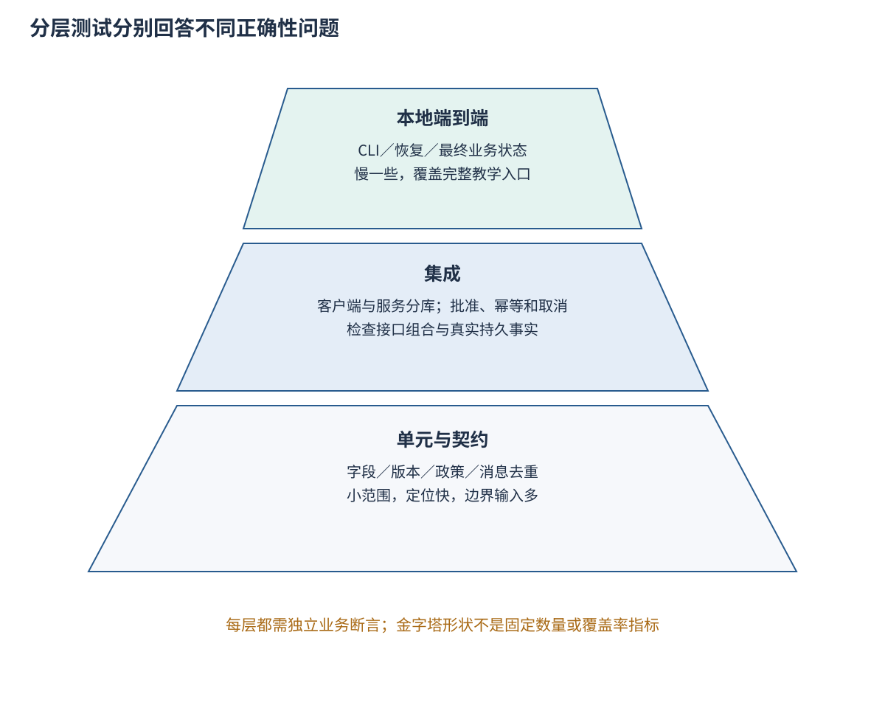
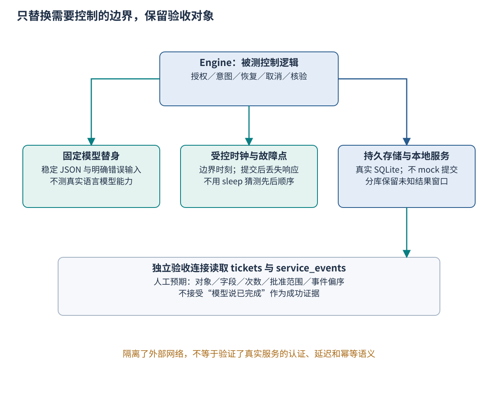
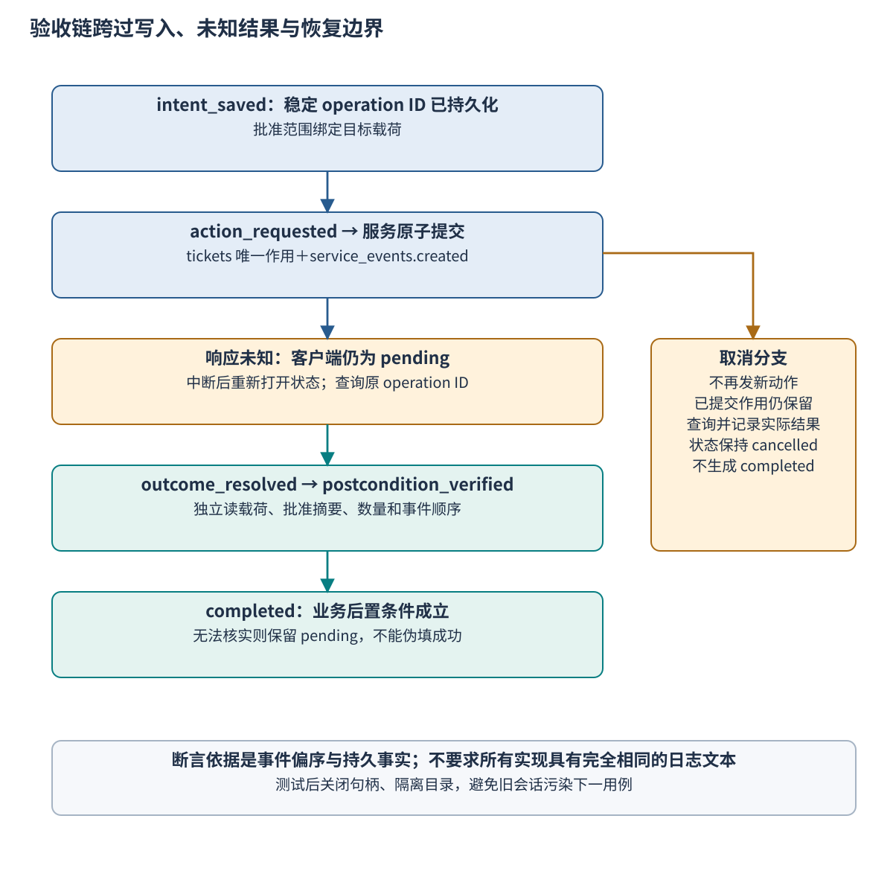

# Ch37 智能体单元测试、集成测试与端到端测试

**Agent Unit, Integration, and End-to-End Testing**

**摘要**　智能体返回正确文字，不能证明权限、工具作用和会话状态都正确。本章从响应丢失后重复创建工单的案例出发，区分单元、集成与端到端测试的职责，建立面向业务后置条件的独立断言。围绕 Ch36 的共享实现，本章组织三十个固定夹具，控制模型、时间和故障边界，验证写入、拒绝、超时重试、会话恢复与取消。随后以可失败的缺陷对照、有限状态序列和机器可读报告讨论回归与持续集成。本章结果限于确定性本地教学系统，不代替真实模型质量评估、远程服务契约核验或生产并发验证。

**关键词**　单元测试（unit testing）；集成测试（integration testing）；端到端测试（end-to-end testing）；测试夹具（test fixture）；测试替身（test double）；业务断言（business assertion）；幂等性（idempotency）；回归测试（regression testing）。

本章由学生 E 执笔，姓名与单位随全书作者信息统一补齐。先修知识为 [Ch12 行动执行](../part3/ch12_action_execution.md)、[Ch13 轨迹与恢复](../part3/ch13_action_traces_recovery.md)、[Ch23 会话与状态](../part6/ch23_sessions_events_state.md) 和 [Ch36](ch36_reference_implementation.md)。测试及固定夹具位于 `examples/ch37/`，唯一被测实现位于 `examples/ch36/`，原创代码、夹具和图形沿用仓库 MIT 许可。正文包含 Fig-37-01—03 和 Tab-37-01—04；28 等效页是混排预算，实际成书页数待试排。

## 37.1 快乐路径通过，工单却写入两次

### 37.1.1 两个绿色结果为什么相互矛盾

政策助手收到申请，检查通过后调用工单服务。服务已经写入一份工单，但返回响应在到达客户端前丢失。客户端没有看到成功，于是重试，并为第二次尝试生成一个新的操作标识。服务把它当作新的请求，再创建一份内容相同的工单。最终助手回复“已完成”，测试只检查这几个字，结果为绿；业务库里却有两份记录。

故障不在“重试”这个动作本身，而在于把同一个业务意图的不同尝试误表示为两个新操作。服务无法仅凭金额、说明等字段判断重复，因为用户也可能确实需要创建两份相同内容的工单。调用者应提供稳定请求标识，并明确同标识、同载荷与同标识、异载荷分别如何处理。AWS Builders’ Library 的幂等 API 讨论也区分了请求意图、重复识别和参数不匹配。[^r37-idempotency]

本章提供可运行的受控缺陷对照，不把它描述为历史生产事故。缺陷客户端每次更换标识，产生两条工单；修复路径保存稳定标识，提交后中断再恢复，只有一条工单。二者都能自报 `completed`，独立业务验收则分别失败和通过。这个差异使“测试是否真的能发现问题”成为可检查的事实。

### 37.1.2 最终答复只覆盖一个很小的观察面

智能体任务同时涉及提案、授权、工具请求、外部作用、会话状态和用户反馈。文本检查只能看到最后一层。模型可能正确解释政策，却写错对象；工具可能返回 200，却只接受了异步请求；客户端可能记录完成，却没有落下任何工单。测试必须定位真正的验收对象，避免用一个可生成的成功句子替代所有事实。

即使只关注文字，也要先定义允许变化的范围。相同业务结论可以用不同措辞表达；硬比较整段文本容易对无关改写报错。反过来，删除关键限制、引用过期条款或宣称并未发生的动作，即使大部分句子相同也应失败。确定性结构断言与语义评价需要分别设计，不能把二者都压成字符串相等。

本章的最小成功条件是：指定任务的一个目标工单持久存在，字段与人工预期一致，创建次数为一，批准范围覆盖目标载荷，并且客户端只在核验后完成。拒绝、未知结果与取消都有独立接受条件。它们不必以“完成”为终点，但必须满足各自对副作用和状态的要求。

### 37.1.3 学习目标与证据边界

读者应能把一条业务约束分配到合适的测试层，建立独立于模型生成的判断依据，设计模型、工具、时间和存储的替身边界，并写出可以触发原缺陷的回归用例。进一步应能解释测试项数、固定夹具数、覆盖率和模型任务成功率的区别，提交可定位的失败报告。

本章复用 Ch36 的本地实现，不重新维护一套被测系统。这里的端到端覆盖“本地命令入口到持久工单和验收报告”，不包含真实模型、远程工单或企业登录。模型质量评估与大规模故障工程分别衔接 [Ch26](../part7/ch26_evaluation_methods.md) 和 [Ch38](ch38_regression_fault_injection.md)，发布门禁的实际运行由 [Ch39](ch39_deployment_continuous_delivery.md) 继续整合。

## 37.2 测试金字塔与断言对象

### 37.2.1 分层的目的是缩短反馈并保留边界

单元测试检查小范围的决策或契约，失败通常容易定位。集成测试连接两个或更多真实组件，检查接口组合、事务和错误传递。端到端测试从约定的外部入口出发，检查完整链条是否达成业务目标。Vocke 对测试金字塔的讨论强调不同层次的职责和反馈成本；图形是一种组织方法，不是规定每个项目必须遵守的固定比例。[^r37-pyramid]

对智能体而言，分层依据仍然是被连接的边界。一次测试调用了模型替身，不会因此自动变成集成测试；一个测试名称含有 `e2e`，也不会自然覆盖真实生产环境。应说明哪些组件真实运行、哪些被替换、从哪里输入以及在哪里观察结果，读者才能判断它究竟约束了什么。

本地实现将字段、版本和消息门检查放在低层，将批准、幂等写入和会话存储的组合放在集成层，将命令行、配置和跨进程恢复放在本地端到端层。部分行为在多层重复检查是合理的，但每层应回答不同问题：低层说明某种输入为何拒绝，高层说明拒绝时整条链没有产生未经许可的副作用。



**Fig-37-01　分层责任与测试金字塔。** 下层适合快速检查大量边界输入，上层保留少量完整业务链。图形不表达本章测试数量比例，也不表示覆盖率；图为本书原创，组织思想参照文献中的分层测试讨论。

### 37.2.2 单元层核对契约与决策边界

任务模式检查要覆盖缺字段、类型错误、未知字段和旧版本。金额为 `true` 看似能参与 Python 数值比较，却不应成为合法申请金额；把这种输入交给业务规则后再处理，会让契约错误散入更多分支。低层先拒绝可以给出稳定原因，也降低上层断言的复杂度。

消息检查将提案绑定到当前任务、修订和 assignment epoch。旧任务回复即使格式正确，也不能进入当前执行。对于相同消息标识、相同内容，局部消息门返回“已接受过”；相同标识但内容改变则拒绝。测试应分别构造两者，不能用“有重复消息测试”笼统覆盖所有去重语义。

政策边界可用低于、等于和高于门槛的输入验证。这里的基础政策有硬性金额上限和主管门槛，两个边界对应不同结论。真实团队接入完整政策库时，应由人工答案标准增加边界夹具；不能仅用模型生成一批看似合理的答案，再让同一个模型判断它们是否正确。

### 37.2.3 集成层核对授权与持久作用

集成测试保留真实 SQLite 提交，检查客户端与服务两个组件如何配合。批准缺失、租户不符、载荷摘要不符或到期时，新写入必须失败，工单数和 `created` 事件数均为零。服务拒绝与客户端状态还要一致，不能只观察某个函数确实抛出了异常。

同操作标识重放应返回旧结果，不能生成第二份工单；同标识、不同载荷应拒绝；不同可信租户可具有各自独立的相同标识。这里的租户由受信本地驱动提供，测试不代表实现了真实登录或跨租户查权。实际服务应认证每次调用，并分别检查新写入和旧结果查询的权限。

服务使用同一事务保存作用和创建事件，测试因此可以核对二者是否相配。SQLite 允许多个并发读事务，但同时只能有一个写事务；`BEGIN IMMEDIATE` 会尝试直接开始写事务。[^r37-sqlite] 这些本地语义不能扩展为客户端与服务之间的跨库事务，也不替代对远程服务并发和复制的一致性测试。

### 37.2.4 端到端层核对完整业务路径

本地端到端首先核对配置与资产是否真的进入运行，再核对最终状态。命令应从公开入口执行，使用全新输出目录，并保留解析后清单与退出码。否则测试可能绕过了最容易出错的配置解析，或者误读作者留下的成功结果。

PRJ-3 的端到端检查使用先后两个子进程。第一个进程在服务提交后触发显式故障点，退出 42；第二个进程重新打开相同文件并恢复，退出 0。恢复后的操作标识保持不变，最终只有一份工单。此路径验证的是持久状态足以支持该边界的恢复，不是模拟机器掉电、文件系统损坏或操作系统强制终止的全部表现。

更高层的真实服务测试可以在授权环境中增加，但不能为方便而放弃低层反馈。若所有用例都经真实模型、网络和完整界面运行，失败很难区分模型波动、服务异常还是控制逻辑缺陷。分层测试与在线评测应相互补充，各自保留环境和判断条件。

### 37.2.5 把断言从表现推进到业务事实

一条有用断言应说明对象、字段、作用次数和允许状态。例如“工单表中存在该任务的一个对象，金额为 250，政策版本正确，批准摘要与载荷一致，且只有一次创建事件”。这比“返回对象包含 ticket_id”更接近业务要求，因为错误实现可能返回一个不存在的编号。

状态断言也要有时间关系。`intent_saved` 应先于 `action_requested`，后置条件核验应先于 `completed`；取消后不能追加完成状态。事件关系适合比较偏序，不一定要求所有实现日志逐条相等。未来增加一次无副作用查询或诊断事件，不应破坏与业务无关的精确序列快照。

独立并非要求把所有实现代码再写一遍。测试可以复用输入装载和环境安排，但关键预期应来自规格或人工答案。示例测试显式列出预期业务字段，用新数据库连接读取 `tickets` 和 `service_events`，不以 `Engine.verify()` 的自报结论作为唯一依据。哈希算法仍可用标准库，重要的是摘要所覆盖的目标来自独立预期。

**Tab-37-01　必测行为与独立断言矩阵。** “零写入”只适用于动作尚未提交的拒绝或取消；已提交后的取消保留真实作用。

| 行为 | 受控安排 | 状态与副作用断言 | 主要夹具 |
| --- | --- | --- | --- |
| 正常写入 | 合法任务、当前 grant、固定提案 | completed；1 工单、1 created；字段与批准匹配 | SC-01、EE-01 |
| 拒绝 | 缺批准、错租户、错范围、到期或不符政策 | rejected；原因稳定；0 工单、0 created | PA-01—05 |
| 超时与重试 | 提交后响应丢失；恢复查询原操作 | pending 后可恢复；同标识只有 1 个作用 | TO-01、TO-05 |
| 幂等冲突 | 同标识改载荷 | 明确拒绝；旧作用不变，不新增作用 | TO-03 |
| 会话恢复 | 意图保存后或服务提交后重新打开 | 不重新规划已保存意图；恢复达到同一后置条件 | SE-01、SE-02、EE-03 |
| 取消 | 发送前取消／提交后取消 | cancelled 保持；分别为 0／1 个工单 | SE-04、SE-05 |
| 无法核验 | 作用存在但核验不通过 | pending；不能追加 completed | EE-05 |
| 旧回复和重复 | 错修订、旧 epoch、重复改内容 | 拒绝过期或冲突；不触发工具作用 | CO-01—04 |

### 37.2.6 在写测试前约定失败报告

断言之外还需要确定失败如何交给维护者。假设根测试显示某一项失败，读者应能从测试 ID 找到固定场景，确认被测资产与真实环境，再看到不满足的后置条件。若报告只保存总通过数，后续很难判断是金额错误、重复作用还是安排阶段没有启动服务。

失败原因与失败处理应分开。`approval_scope` 可能是特意构造的正确拒绝，也可能在正常任务中表示批准绑定错误；必须结合场景预期解释。类似地，测试安排阶段无法打开数据库属于 error，不等于业务断言通过；人为跳过则需要单独统计。报告字段应让这些差异可见，而不是统一归为一次“任务失败”。

**Tab-37-02　CI 报告字段与失败分类。** 字段是本章建议的最小诊断信息，真实远程 CI 仍需由团队接入和运行。

| 字段或分类 | 应回答的问题 | 后续处理 |
| --- | --- | --- |
| run ID、revision、资产摘要 | 测的是哪一套实现和夹具？ | 与 Ch36 运行身份关联 |
| Python、SQLite、OS | 哪种环境触发？ | 复建相同环境，再比较差异 |
| 夹具 ID、测试层、场景 | 哪条契约或行为被触发？ | 定位固定输入与相关组件 |
| passed / failed / skipped / error | 正常通过、断言失败、跳过还是安排出错？ | 跳过与错误不能计入通过 |
| 契约失败 | 字段、类型、版本或消息范围是否不符？ | 修订生产者或边界转换，不放宽为任意输入 |
| 授权失败 | 新动作是否缺失或错用批准？ | 检查可信身份、范围与有效期 |
| 副作用失败 | 对象、字段或次数是否错误？ | 保留存储与审计证据，核对幂等逻辑 |
| 恢复／取消失败 | 状态是否丢失、覆盖或误重试？ | 保留原状态与事件，不先清库 |
| 环境／安排错误 | 锁、路径、目录或依赖是否不符？ | 修环境或夹具，区别于业务失败 |
| 外部暂态 | 真实网络或服务是否无法确认？ | 单独报告重试策略与隔离，不静默通过 |
| 耗时与日志位置 | 失败发生在哪一步，原始记录在哪里？ | 耗时口径清楚，附件可追踪且不含秘密 |

## 37.3 Mock、夹具与确定性边界

### 37.3.1 替身控制不确定性，不代替全部真实行为

测试替身是被测组件在测试中的替代物。固定返回可以稳定地提供提案，fake 服务可以实现简化但真实的状态变化，mock 则常用于控制行为和检查调用。Python `unittest.mock` 提供对象替换和调用断言，也支持按实际接口建立规格约束。[^r37-mock] 名称不是重点，重点是替身保留了哪些语义，省略了哪些成本或失败。

若测试目标是“拒绝时没有写入”，把写入函数替换成固定成功的 mock，最多能检查它是否被调用，不能验证事务或实际作用。若目标是恢复后的唯一作用，就应保留具有持久状态的服务。示例因此固定模型和时钟，同时真实运行两份 SQLite 存储；故障点控制“何时失去响应”，不把服务提交本身替换成一段成功文字。

替换的方向也要正确。patch 应作用在被测代码实际查找对象的命名空间，否则看似设置了替身，真正调用仍可能进入原实现。使用规格或 `autospec` 可以发现部分接口误用，但不能证明替身等同于真实服务。远程 API 的认证、超时、幂等窗口和错误码仍需要契约测试。



**Fig-37-02　模型、工具、时钟与网络的替身边界。** 模型和时间被控制，客户端与本地服务真实持久化；测试从另一连接检查作用。当前路径不访问外部网络，因此没有提供真实网络语义的证据；图为本书原创。

### 37.3.2 固定模型既要覆盖合法提案，也要覆盖错误提案

只提供正确响应的模型替身会使所有控制测试停留在快乐路径。应构造旧修订、旧 epoch、判断与政策不符、证据缺失或字段额外等响应，核对执行端是否拒绝。测试中的错误提案是对输入边界的有意安排，不代表真实模型的错误频率。

固定替身不执行自然语言提示，也不检索政策。它返回预先列出的 JSON，再由真实控制逻辑检查。这样可以判断“即使提案如此，控制端是否遵守规则”，却不能判断模型是否擅长形成提案。将来接真实模型，应保留这些快速控制测试，再增加与质量评价对应的数据和裁判，二者的报告分开解释。

一个危险做法是让被测模型同时生成预期，再评价自己的输出。如果它把错误政策理解为正确，测试可能共享同一偏差。固定人工预期不必覆盖所有语言表达，但应覆盖行动后果和关键事实。高风险场景还需独立领域审核，而不是用模型置信度代替。

### 37.3.3 用受控时钟替代等待

示例时钟从教学值 1000 ms 开始，grant 在 4000 ms 到期，截止为 5000 ms。这些数值是相同时间轴上的受控刻度，不是当前系统时间或生产超时建议。测试可以直接设置到边界时刻，检查 `now >= expiry` 和 `now >= deadline` 的拒绝行为，不必等待真实数秒。

依赖 `sleep` 的测试容易受主机负载影响，也不一定真的制造所需顺序。例如等待 100 ms 后取消，无法保证服务恰好已经提交。明确故障钩子可以把取消安排在提交后，或把响应丢失安排在服务已保存、客户端未确认的位置，得到可重复的机制轨迹。

真实系统仍要测试墙钟变化、单调时钟、调度和网络延迟。受控时钟只是把纯控制条件从外部时间中分离出来，不能说明真实机器的计时精度。本章也没有验证多进程时钟同步；所有教学进程使用相同约定的受控刻度。

### 37.3.4 夹具既包括输入，也包括初态和预期

**测试夹具**是使一次检查可重复的输入和环境安排。一个 JSON 文件不是天然完整夹具，除非读者还知道所需初始存储、时钟、批准、故障和预期。`cases.jsonl` 的每一行具有唯一 ID、层级、场景以及相应输入变化或接受条件，测试驱动为其建立独立临时环境。

pytest fixture 的 scope 决定资源在函数、类、模块或整个会话中共享和销毁的范围。[^r37-fixtures] 可变存储通常应在每个用例中隔离；只有无状态且只读的材料适合较广共享。本例为每个测试提供独立临时目录，使用 `finally` 关闭数据库句柄，避免 Windows 文件仍被占用而影响清理或后续运行。

共享数据也要防止测试自己修改。固定响应在创建时复制，任务覆盖在新对象上执行。一个用例若把共享任务金额改成 600，随后用例可能在单独运行时通过、整体运行时失败。pytest 对 flaky tests 的讨论将未控制的系统状态和隔离不足列为重要原因。[^r37-flaky] 反复重跑只会掩盖此类依赖，不能完成修复。

本章将副作用保留在临时数据库内，没有真实网络连接。将来测试需要修改环境或工作目录，可以用 `monkeypatch` 在测试结束时恢复；pytest 明确提供这些修改及撤销机制。[^r37-monkeypatch] 撤销替换不等于回滚外部写入，真实系统仍须采用隔离账号、命名空间和明确清理方案。

### 37.3.5 三十个固定夹具的具体清单

本章提供六组、每组五个夹具，共 30 个唯一 ID。数量按 `cases.jsonl` 的显式记录统计，不按参数化展开的测试函数数统计。SC 与 CO 的部分用例主要核契约；PA、TO、SE 主要核接口组合；EE 覆盖本地端到端场景。多个场景可复用基础任务，但必须改变可说明的条件或断言对象，不能只换 ID 凑数。

**Tab-37-03　三十个固定夹具与接受条件。** 完整可执行字段以 `examples/ch37/fixtures/cases.jsonl` 为准；下表保留可阅读索引。

| ID | 安排 | 核心接受条件 |
| --- | --- | --- |
| SC-01 | 完整合法任务 | 任务模式接受，内容不被隐式改写 |
| SC-02 | 缺任务标识 | 拒绝 `task_fields` |
| SC-03 | 金额为布尔值 | 拒绝 `task_integer` |
| SC-04 | 额外 `command` 字段 | 拒绝 `task_fields` |
| SC-05 | 旧任务模式 | 拒绝 `task_schema_version` |
| PA-01 | 无写入 grant | 拒绝 `approval_missing`；零写入 |
| PA-02 | grant 属于其他租户 | 拒绝 `approval_tenant`；零写入 |
| PA-03 | 票据无效且提案相应为不符 | 拒绝 `ineligible`；零写入 |
| PA-04 | grant 摘要覆盖其他载荷 | 拒绝 `approval_scope`；零写入 |
| PA-05 | 在 grant 到期时请求新写入 | 拒绝 `approval_expired`；零写入 |
| TO-01 | 提交后响应丢失，再查原操作 | 完成且只创建一次 |
| TO-02 | 同键同载荷回放旧结果 | 返回原对象；不需要重新执行旧作用 |
| TO-03 | 同键改变金额 | 拒绝 `idempotency_conflict`；旧记录不变 |
| TO-04 | 两个可信租户使用相同键 | 各有一个作用，键范围隔离 |
| TO-05 | 服务先提交再抛响应超时 | pending 后恢复；仍只有一次创建和一次尝试 |
| SE-01 | 存意图后、发送前中断 | 重新打开后正确执行一次 |
| SE-02 | 服务提交后中断 | 查询已存作用，不重复创建 |
| SE-03 | 再次读取已完成会话 | 返回保存状态；模型不重复调用 |
| SE-04 | 发送前取消 | cancelled；零写入且无 action_requested |
| SE-05 | 提交后取消 | cancelled；登记一个既有工单，无 completed |
| CO-01 | 回复的修订号错误 | 拒绝 `reply_revision` |
| CO-02 | 回复的 assignment epoch 过旧 | 拒绝 `reply_assignment_epoch` |
| CO-03 | 相同消息原样重复 | 首次接受，重复返回 false |
| CO-04 | 同消息标识改变判断 | 拒绝 `reply_duplicate_conflict` |
| CO-05 | 提案判断不符当前事实 | 拒绝 `proposal_not_supported`；零写入 |
| EE-01 | PRJ-1 正常入口链 | completed；字段、批准和唯一作用一致 |
| EE-02 | PRJ-2 角色核验链 | 同上，另有 research_verified |
| EE-03 | PRJ-3 提交后恢复 | 同上，另有 outcome_resolved |
| EE-04 | 已到任务截止 | 拒绝 `deadline`；零写入 |
| EE-05 | 存在作用但后置核验失败 | pending；不错误标记完成 |

TO-02 的范围需要特别解释：本地服务先查同一可信调用者的旧操作，允许回放既有结果，即使原执行 grant 已过期，也不产生新作用。生产服务仍应对当前调用者和查询权限进行认证；这条夹具不能用来允许匿名者查询任意旧结果。SE-03 同样只检查客户端缓存，不证明外部对象此后没有变化。

固定夹具的覆盖是有边界的。以上没有穷尽金额边界、所有无效字段、权限撤销、并发取消、查询最终一致性和幂等记录过期。维护者应围绕实际风险继续增加具体场景，并保留新增原因。本章的“30”是交付规模，不是足够覆盖任何智能体系统的普遍门槛。

### 37.3.6 防止替身与真实接口逐渐分叉

替身最初可能按真实接口编写，随后服务改变必填字段或超时语义，测试却仍返回旧的成功对象。结果是本地套件稳定通过，集成时全部失败。对此应在适配器边界维护消费者契约：请求有哪些必需字段，响应有哪些状态，未知结果能否查询，同一个操作标识的有效范围是什么。测试替身与真实适配器都必须满足相同的可观察约定。

契约测试不需要复制服务内部逻辑。例如对创建操作，可以检查合法请求返回可查的对象标识，同键同载荷不增加作用，同键异载荷得到明确冲突；也可以检查未经授权的新请求不能写入。真实服务是否支持这些保证，应由授权环境的测试确认。若服务只支持其中一部分，适配器需要暴露能力差异，不能用本地 fake 补造线上不存在的保证。

录制响应可用于回放格式与错误分支，但录制文件必须带来源版本、生成方式和脱敏说明。单纯回放一份成功 JSON 不会再执行服务事务，也不能证明当前查权或幂等语义。涉及动态对象标识、有效期和隐私字段时，应有明确转换规则，避免为了回放方便而把所有关键关联都替换掉。

本章保留固定提案和本地服务，便于课程基础环境离线运行。未来接入真实适配器后，可以让快速套件继续使用这些替身，再在独立的集成入口中运行真实契约。两类入口分别报告，既保留快速反馈，也让服务变更有自己的检测位置。真实契约失败应阻止依赖该保证的发布，而不是回退到固定成功响应后继续宣称验证完成。

## 37.4 集成与端到端场景

### 37.4.1 写入：先证明对象正确，再证明只写一次

正常写入从空服务库开始，输入合法任务、匹配批准和固定合法提案。测试运行完整控制链，然后用新数据库连接读取工单、创建事件和批准摘要。先核对业务载荷，再核对数量与唯一标识，最后核对客户端状态；这样可以把对象错、次数错和状态错区分开。

单看数量也不够。一个错误实现可能删去旧记录再创建新记录，使最终仍只有一行，却已经产生多次外部动作。示例同时检查 `created` 事件数，使动作次数有独立记录。真实服务若有审计日志或操作回执，应选择同等可靠的证据；测试系统自己可以随意改写的日志不天然具有独立性。

本地测试使用的核心断言如下，完整版本还核对字段、摘要和事件关系。

```python
with sqlite3.connect(service_path) as independent:
    tickets = independent.execute("SELECT * FROM tickets").fetchall()
    created = independent.execute(
        "SELECT count(*) FROM service_events WHERE kind='created'"
    ).fetchone()[0]
assert len(tickets) == 1
assert created == 1
```

这段断言依赖已知隔离初态，适用于每例独立的新库。在共享测试租户中，应按任务和运行 ID 限定查询范围，避免把他人的工单算入本次结果。直接查询全库而未声明隔离前提，也会制造错误的成功或失败。

### 37.4.2 拒绝：失败原因和零副作用同时成立

拒绝测试把原因分开安排。无 grant 与错租户都应阻止写入，但它们代表不同边界；用一个宽泛 `except Exception` 只能说明某处失败，不能确认正确的授权检查发挥了作用。测试应匹配稳定原因，并验证工单和创建事件均为空。

政策拒绝也应避免被更早的输入错误遮挡。PA-03 同时把票据置为无效、固定提案改为对应的 `ineligible`，这样它实际到达政策拒绝分支。若仍保留 `eligible` 提案，系统会先因提案不受事实支持而拒绝，测试虽然同样“没写入”，却没有覆盖想要验证的原因。

“没有写入”的断言应覆盖全部可产生副作用的通道。当前示例只有本地工单，范围容易枚举；真实系统可能先发通知、扣额度或提交异步作业。仅检查主表为空，不能证明其他通道没有作用。服务契约应列出这些作用和可观察证据，再决定拒绝路径的完整断言。

### 37.4.3 超时重试：先恢复未知结果，再决定是否再执行

TO-05 用包装器调用真实 `service.create`，让提交完成后再抛 `TimeoutError`。第一次运行得到 `pending`，客户端保存了原操作标识和一次尝试；第二次运行先查询服务，发现既有对象，完成核验。测试不仅检查最终一行，还检查创建调用没有第二次发生以及持久尝试次数为一。

故障安排的关键是先执行原提交，再抛超时，顺序不能颠倒。以下片段对应测试驱动中的安排；若在调用原函数之前就抛异常，得到的是“未提交”，无法覆盖本节要验证的未知结果窗口。

```python
original_create = service.create

def commit_then_timeout(*args):
    original_create(*args)
    raise TimeoutError("controlled response loss after commit")

monkeypatch.setattr(service, "create", commit_then_timeout)
assert engine.run(task, grant)["status"] == "pending"
assert engine.run(task, grant)["status"] == "completed"
# 随后另开连接检查：1 个工单、1 次 created，载荷与批准匹配。
```

TO-01 则在同次运行内明确标记响应丢失，再查询原操作。TO-02 直接检查服务收到相同键的重复创建请求时回放旧对象，不新增作用。三者分别约束同次恢复、跨次恢复和服务重放契约，不能将其中任意一条当作所有重试语义均已验证。

查询超时是另一种情况。附加检查将查询边界替换为抛超时，要求客户端保持 `pending`、尝试次数为零，且没有任何写入。这能防止“查询失败就当作不存在”的错误。若真实服务查询并非强一致，还必须研究查不到后再次执行是否安全；本地 SQLite 结果不能替它作答。

尝试上限与任务截止仍要在恢复中遵守。次数保存于会话，重新启动不会自动得到一份新预算。需要注意，已经发生但未被确认的作用在截止后仍可能被查询和登记；截止限制新增行动，不应成为删除已发生事实的理由。本章控制链先查既有结果，再决定是否允许新写入。

### 37.4.4 会话恢复：重新打开句柄，而非只保留 Python 对象

如果测试只是对同一个内存引擎调用两次，可能无意中依赖仍在对象中的载荷或标识。SE-01 与 SE-02 在中断后关闭两份数据库，再创建新的 store、service 和 engine，检查是否能从持久记录继续。端到端测试进一步由两个客户端子进程执行相同边界，排除原 Python 实例被偷偷复用。

发送前中断与提交后中断必须分别测试。前者恢复时应执行一次新写入；后者恢复时应查询已经发生的作用。它们在客户端都可能表现为 `pending`，却需要不同动作。保存意图提供恢复依据，服务查询提供结果事实，二者缺一都会增加猜测。

恢复还要拒绝身份冲突。附加用例在保存意图之后修改同一任务金额，要求 `session_task_conflict`，服务仍无工单。这防止新载荷借旧会话继续，也避免旧批准被误用于新意图。真正需要变更任务时，应建立新修订和明确的迁移或取消规则。



**Fig-37-03　端到端事件断言链。** 图重点表示提交后响应未知的恢复路径，以及取消后的事实登记。正常路径不必出现 `outcome_resolved`，但必须在完成前核对后置条件。位置表示依赖顺序，不按耗时比例；图为本书原创。

### 37.4.5 取消：停止新动作，不抹去旧作用

发送前取消应产生 `cancelled` 状态，没有 `action_requested`，工单为零。提交后取消应保持 `cancelled`，查询并登记既有工单，作用数为一。测试同时检查事件中没有 `completed`，防止执行主线在取消分支之后继续覆盖状态。

取消不等于补偿。若业务要求删除已创建工单，应作为另一项获授权动作单独执行和验收；原创建事实仍存在。把状态改为 cancelled 后清空工单记录，反而会破坏审计，使后续恢复误以为没有发生作用。本例只实现取消与已知结果登记，不实现外部系统撤销。

真实取消还涉及并发请求、队列内动作、工具取消能力和等待中的回复。示例用明确故障点安排提交后的取消，没有制造真实线程竞争。接入流式运行时后，应增加取消与完成竞争、取消重复到达、取消确认丢失和旧 worker 继续执行等用例，再由实际状态协议给出允许结果集合。

### 37.4.6 后置条件不明时保留可继续核对的状态

EE-05 让服务实际创建工单，但把后置核验结果设置为 false。此时系统应保留 `pending` 和 `postcondition_unknown`，不能把“调用过 create”自动翻译为完成。独立断言确认一个工单已经存在，使读者看到“作用存在”与“客户端掌握足够验收证据”是两个不同事实。

对未知状态的测试应避免无限循环。生产流程需要明确后续查询、等待、人工接管或停止的预算，测试可检查达到限制时没有继续发新动作。本例只提供有限调用与保存状态，不启动后台无限重试。读者继续调用时仍要使用相同基线和同一操作标识。

如果新信息确认外部对象存在但字段不符，也不能简单改成完成。这是需要纠正或交接的业务差异，应记录具体对象和不满足项。当前示例的独立载荷断言会失败；真正的修复流程应在后续工具契约中给出，而不是由测试自动替系统改数据。

### 37.4.7 将计划、人审与角色交接纳入下一层测试

更完整的项目还需要测试行动为什么被选中。计划测试可以固定任务、可用工具和根预算，检查提出的动作是否属于允许集合、依赖是否满足、每一步是否有验收者。计划看起来完整不等于可执行，工具名称拼写正确也不说明当前权限允许。本地示例只保存一个受控创建意图，完整多步计划应在公共项目接入后增加相应夹具。

人工审批需要同时验证暂停和继续。未获得当前批准时不能执行新作用，批准到达后要核对任务修订、目标载荷、身份和有效期；审批被拒或过期时，应给出明确收口状态。若等待期间金额被修改，旧批准不能凭相同任务名称继续使用。现有 PA 组检查本地 grant 边界，真实审批人的身份、撤销和消息到达顺序仍需由适配器与运行时联合验证。

角色交接的断言则应围绕责任转移。研究角色提交的证据需要绑定任务，执行角色必须受工具权限限制，核验角色应读取当前作用而非只复述执行者总结。可以先构造“研究结论正确但工具对象错误”的场景，要求核验拒绝完成；再构造旧 epoch 的结果，要求它不能覆盖新责任者的当前任务。角色彼此说了多少轮话，不是交接正确的充分条件。

这些扩展都应继续复用 Ch36 的核心契约与独立预期。若新增人审、队列或并行角色改变允许状态和事件关系，先修订状态协议，再增加正常、拒绝与未知路径。测试报告应标明新增组件和实际执行环境，不把当前 PRJ-2 的一条研究核验事件解释为完整通信协议已经通过。

## 37.5 回归用例与持续集成报告

### 37.5.1 用一个确实能失败的对照检查断言强度

`regression_probe.py` 将缺陷限制在教学探针中，正式 Engine 没有启用该缺陷的配置。缺陷路径使用 `bad-attempt-1` 与 `bad-attempt-2` 创建同一载荷；服务遵守自己的不同键契约，创建两个对象。修复路径复用正式引擎，在提交后中断并恢复，稳定键只对应一个对象。

从仓库根目录执行，两条命令分别使用新目录。第一条应退出 1，表示独立验收捕获了重复作用；第二条应退出 0。不要将预期失败命令写成忽略所有错误的通用重试。

```powershell
uv run python examples/ch37/regression_probe.py --client buggy --output outputs/ch37-buggy
uv run python examples/ch37/regression_probe.py --client fixed --output outputs/ch37-fixed
```

本轮实跑中，缺陷路径和修复路径的 `presentation_only_passed` 均为 true，工单与创建事件数分别为 2 和 1，`independent_oracle_passed` 分别为 false 和 true。这组对照说明，本章的业务断言能够区分这个具体缺陷；它不是全部缺陷的检出率，也不是对真实模型效果的比较。

回归测试随后持续保留“相同业务意图只创建一次”的断言。修复不能只表现为删掉出错测试、放宽数量或更新快照。若业务规则确实改为允许两次创建，应先改变任务意图和规格，并明确这是行为变更，而不是称原缺陷已被修复。

### 37.5.2 从例子推进到有限性质检查

固定例子说明某些安排下结果如何，性质检查则验证一组操作序列始终遵守某条约束。本章枚举 `run`、`recover`、`cancel` 三种操作的三步组合，共 27 组。每步检查工单不超过一个、字段与批准匹配、已取消状态不被后续运行改成完成，并使用独立目录隔离每组序列。

这只是有限枚举，不覆盖任意长序列，也没有模拟提交时刻的所有并发交错。单独固定夹具负责发送前和提交后的特定故障窗口；有限序列负责重复运行、重新打开与取消的组合。二者补充约束同一状态逻辑，但不能被相加后解释为 57 个独立真实业务任务。

Hypothesis 的状态机测试能够按规则产生操作，并在每一步检查 invariant。[^r37-hypothesis] 后续引入时，可以生成更长序列、缩减失败轨迹，并把稳定的最小反例加入固定夹具。本章没有安装或运行 Hypothesis，当前报告只包含明确枚举的 27 组检查。

性质本身也需要审查。如果不变量只写“返回状态属于某个枚举”，很多错误实现仍会通过；若写成“永远成功”，又会把合法拒绝当成失败。应从业务约束提取性质，如未经批准不产生新作用、同意图不重复作用、取消不被覆盖，而不是把当前实现行为原样翻译成测试。

### 37.5.3 稳定的测试应能解释偶发失败

出现 flaky test 时，应先核对共享状态、环境变量、时间源、顺序依赖和资源释放。只有整体运行失败而单独运行通过，常提示用例间污染；只在某个平台失败，则可能涉及路径、编码和文件锁。报告应保存失败环境和最小触发步骤，不能只记录“重跑后好了”。

随机生成输入需要记录种子及失败样本，但种子不能固定外部服务。网络故障也不应被宽泛吞掉后标为通过。对于暂时隔离的用例，应记录原因、责任人和恢复条件，并把隔离数量列入报告；关键权限或副作用回归不宜无期限退出门禁。

当前本地套件没有真实网络和模型调用，使用临时目录与显式时间，因此便于重复定位。它仍受 Python、SQLite 和操作系统影响，报告保留这些信息。稳定测试减少了部分不可控因素，不意味着实现没有竞争条件或线上风险。

### 37.5.4 将测试接入现有入口并保留机器可读报告

根目录 `pyproject.toml` 的 `testpaths` 同时包含既有 `tests` 和 `examples/ch37/tests`，因此现有 CI 的 pytest 入口会收集行为测试。测试代码不改变现有八项书稿结构检查的职责；结构正确与业务正确分别有证据。这里说明的是收集配置已接入，不声称远程 CI 已实际运行。

从仓库根目录运行以下命令。首次安装时确保根环境使用 Python 3.12；若已经存在其他解释器环境，应按环境管理方式重建，不把旧 `.venv` 复制过来。

```powershell
uv sync --extra test --locked
uv run pytest examples/ch37/tests --junit-xml=outputs/ch37-junit.xml
uv run pytest
uv run mkdocs build --clean --strict
```

pytest 可以用 `--junit-xml` 生成 CI 可读取的报告，默认总耗时还涉及 setup 与 teardown，不能直接当作业务操作延迟。[^r37-reports] JUnit 报告之外，还应保留运行身份、夹具版本和关键业务证据，便于把某个失败项对应到输入与实际作用。敏感数据不应因“方便排查”进入公开附件。

报告应按 Tab-37-02 的字段关联版本、场景和业务证据，不能只有总通过数。失败分类先帮助找到负责边界，再决定由代码、夹具、环境还是公共契约修订；分类本身不改变失败结论。

覆盖率可以补充发现没有执行过的分支。coverage.py 的 branch coverage 记录控制流目的分支，与仅运行到某一行不同。[^r37-coverage] 但执行过一条分支不说明断言足够强，所有行覆盖也不能证明模型或系统正确。本轮没有运行覆盖率工具，因此不提供百分比或门槛已达成的声明。

### 37.5.5 本轮运行结果应如何解读

本地行为套件收集 69 项：30 个固定夹具检查、27 组有限序列、夹具清单完整性，以及缺陷对照、未知查询、任务冲突、终态保护、进程入口和资产核验等附加检查。本轮全部通过；加上既有八项书稿结构检查，根入口共 77 项。数量包含参数化展开项，不等于 69 个测试函数或真实业务任务。

**Tab-37-04　本地测试与缺陷对照记录。** 运行日期为 2026-11-11；环境为 CPython 3.12.14、pytest 8.3.5、SQLite 3.53.1。原始报告位于 `examples/ch37/reports/`。

| 运行 | 观察结果 | 解释 |
| --- | --- | --- |
| 固定夹具 | 30 个唯一 ID，六组各五 | 达到本章固定输入规模，未宣称穷尽输入空间 |
| 有限状态序列 | 27 组三步组合通过 | 支持声明的有限性质，不代表并发模型检查 |
| 本地行为套件 | 69 项通过 | 仅覆盖当前本地控制逻辑和入口 |
| 根测试入口 | 77 项通过，含既有八项结构检查 | 行为测试与书稿结构检查均被收集 |
| 缺陷探针 | 自报成功；2 工单；独立验收失败；退出 1 | 证明断言能捕获此受控重复写入缺陷 |
| 修复探针 | 自报成功；1 工单；独立验收通过；退出 0 | 稳定操作标识支持本地恢复 |

这些结果不构成真实语言模型成功率，也不说明正式三项目已经联调完成。测试报告针对当前资产身份；修改实现后应生成新报告，不能继续引用旧的绿色结果。团队公共消息、权限和运行时适配完成后，还应扩展相应契约与真实服务测试，并由其他学生独立执行。

### 37.5.6 按断言、安排和环境逐步缩小失败范围

定位一次失败可以先看它发生在何处。若测试尚未进入业务链就无法读取夹具，应检查路径、编码、版本和初态；若执行结束后工单数为 2，说明业务不变量被破坏，应继续追踪操作标识与创建事件；若对象存在、字段正确而客户端仍 pending，则应核对结果查询和验证边界。三者可能产生相同的非零退出码，却需要不同修复。

失败信息应显示期望、实际和对应标识。例如“期望一次 created，实际两次，operation ID 分别为 A 与 B”能够直接指向换键重试；只有 `assert False` 则迫使维护者重新运行才能理解。原始记录中应保留足以解释差异的字段，避免打印整份凭证、模型上下文或无关个人信息。诊断信息越接近断言对象，越容易形成小范围修复。

缩减用例时保留触发原因。若重复写入只在服务提交后失响应时出现，把故障移动到提交前虽然可能让测试变绿，却已经移除了原条件。同样，去掉恢复时的重新打开步骤，可能让测试依赖内存状态。最小反例应删去无关输入和步骤，同时保留产生错误的边界，不是把复杂路径简化成永远成功的路径。

修复后先运行直接相关的回归，再运行共享行为套件；涉及依赖或公共模式时再检查消费者与整体入口。这样既减少反馈等待，又避免局部正确破坏其他路径。本轮已经运行根测试与严格文档构建；后续仅修改文字时无需重复制造模型实验，修改执行语义时则必须更新对应行为证据。

最后记录问题关闭的依据。记录应包含缺陷触发条件、负责组件、失败断言、修复版本和通过报告，未覆盖条件继续列出。例如稳定键修复了本地重复创建，不等于已验证远程幂等过期窗口；取消终态保护通过，也不等于所有在途动作都能被服务撤销。关闭一个具体缺陷，应使后续维护者清楚哪条保证已经建立。

## 37.6 小结与测试接受标准

### 37.6.1 一个可交付测试包必须同时能通过和能失败

合格测试包应有确定输入、清晰初态、独立预期、可重复命令及失败定位方式。正常实现满足规格时能够通过；有意引入已知缺陷时，相关业务断言能够失败。两者缺一都会削弱证据：只有红色结果说明不了修复有效，只有绿色结果也可能只是没有真正检查。

`Exp-37-01` 以重复写入为缺陷对照，其他固定夹具验证拒绝、恢复、取消和边界输入。实验使用原创数据、固定提案和受信本地 grant，控制时间与中断位置，记录服务作用和客户端状态。每条固定场景执行一次，有限序列逐组执行；不进行模型能力或性能的统计比较。

本章接受标准包含五类必测行为全部有夹具、至少 30 个固定唯一 ID、业务事实独立核对、缺陷对照确实可失败、恢复与取消状态可追踪、测试从公开命令收集，以及原始报告能够对应资产版本。测试函数数量和绿灯截图不足以单独完成验收。

### 37.6.2 关键术语与方法联系

单元测试限定小范围行为，集成测试保留组件连接，端到端测试限定完整入口边界；三者都需要与业务要求相连。测试替身使某些边界可控，夹具固定输入与初态，独立断言检查实际结果，回归用例约束已知缺陷。性质检查扩大操作组合，报告则把失败对应到版本和证据。

对智能体特别需要保持的区别是：提案不等于批准，工具返回不等于业务完成，超时不等于未执行，取消不等于已补偿，固定替身通过不等于真实模型通过。将这些区别写成可执行检查，才能在系统扩展时持续约束，而不只依赖开发者记忆。

### 37.6.3 复习题

1. 为什么“最终回复包含已完成”和“返回了 ticket_id”都不能证明工单创建正确？为该任务写出至少四项独立断言。
2. 分别为任务模式、写入批准和跨进程恢复选择测试层，并说明哪些组件应真实运行、哪些适合替换。
3. 提交后响应超时与提交前失败有何区别？为什么重试要复用操作标识，而同键改变金额必须拒绝？
4. 解释 30 个固定夹具、69 个测试项、27 组有限序列、代码覆盖率与模型任务成功率分别统计什么，为什么不能相互替代。
5. 取消前零写入与取消后保留一个已提交工单为何都可能正确？测试如何阻止取消状态被完成分支覆盖？

### 37.6.4 实践题：为恢复缺陷建立可失败的回归

运行受控缺陷与修复探针，保存两次数据库和报告。先仅用客户端自报状态作检查，说明为什么两者都通过；再从独立连接核对作用次数、目标载荷、批准摘要和事件，确认缺陷路径失败、修复路径通过。随后在副本中增加一个具体边界，如查询持续超时或取消重复到达，并给出明确接受条件。

提交新增夹具、断言、缺陷触发步骤、修复依据和 JUnit 报告。评分为 100 分：问题及触发边界 15 分，独立业务断言 30 分，缺陷失败与修复通过的证据 25 分，隔离与确定性 15 分，版本报告及限制 15 分。若只改预期为两次创建、删除失败测试或忽略所有非零退出，核心回归部分不得分。教师答案及分项细则保存在本章内部教学材料。

### 37.6.5 局限与后续工作

当前模型替身固定、消息门仅在实例内去重、授权由受信本地驱动提供，取消安排为明确的顺序故障点。套件未验证真实模型、网络认证、权限撤销、分布式并发、服务最终一致性、流式竞争、机器掉电或平台发布。有限序列检查不是穷尽证明，当前也没有 Hypothesis 或覆盖率测量结果。

后续应将公共模式与适配器接入同一核心，补齐消费者契约和真实服务语义，再与 Ch38 的故障评估、Ch39 的发布门禁连接。其他学生独立复现、F 的章节审阅及远程 CI 实跑当前仍待完成。本章测试为这些工作提供起点，所有新增保证都应有新的可复核证据。

## 参考文献与版本记录

[^r37-idempotency]: Featonby M. [Making retries safe with idempotent APIs](https://aws.amazon.com/builders-library/making-retries-safe-with-idempotent-APIs/). AWS Builders’ Library。参见调用者请求标识、作用与标识的原子记录、同标识异意图；访问并核对：2026-11-11。
[^r37-pyramid]: Vocke H. [The Practical Test Pyramid](https://martinfowler.com/articles/practical-test-pyramid.html), 2018-02-26。作者为 Ham Vocke，页面刊载于 Martin Fowler 网站；本章采用分层组织思想，不采用固定数量比例。
[^r37-sqlite]: SQLite. [Transaction](https://www.sqlite.org/lang_transaction.html)。参见读写事务及 `BEGIN IMMEDIATE`；访问并核对：2026-11-11。
[^r37-mock]: Python Software Foundation. [unittest.mock — mock object library, Python 3.12](https://docs.python.org/3.12/library/unittest.mock.html)。参见对象替换、规格约束与 where to patch；访问并核对：2026-11-11。
[^r37-fixtures]: pytest developers. [How to use fixtures, pytest 8.3](https://docs.pytest.org/en/8.3.x/how-to/fixtures.html)。参见 scope 与 teardown；访问并核对：2026-11-11。
[^r37-flaky]: pytest developers. [Flaky tests, pytest 8.3](https://docs.pytest.org/en/8.3.x/explanation/flaky.html)。系统状态、隔离和顺序依赖；访问并核对：2026-11-11。
[^r37-monkeypatch]: pytest developers. [How to monkeypatch/mock modules and environments, pytest 8.3](https://docs.pytest.org/en/8.3.x/how-to/monkeypatch.html)。替换和测试结束后的撤销；访问并核对：2026-11-11。
[^r37-hypothesis]: Hypothesis. [Stateful tests](https://hypothesis.readthedocs.io/en/latest/stateful.html)。参见规则及逐步 invariant；访问并核对：2026-11-11。本章仅介绍扩展方法，未运行该框架。
[^r37-reports]: pytest developers. [Managing pytest’s output, pytest 8.3](https://docs.pytest.org/en/8.3.x/how-to/output.html)。JUnitXML 与时间报告口径；访问并核对：2026-11-11。
[^r37-coverage]: coverage.py. [Branch coverage measurement, version 7.6.1](https://coverage.readthedocs.io/en/7.6.1/branch.html)。分支执行统计及其含义；访问并核对：2026-11-11。本章未测覆盖率。

本版：`zh-draft-0.1`，2026-11-11。已提供三张原创 SVG、三十个固定夹具、分层测试与本地缺陷对照。当前结果为同机确定性自检，实际工程范围和待完成事项以上述记录为准。
