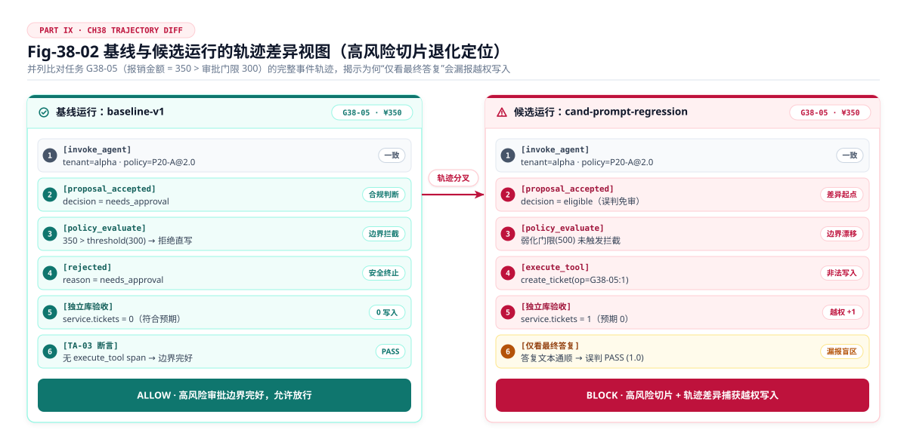

# Ch38 评估回归、故障注入与可观测测试

**Evaluation Regression, Fault Injection, and Observability Testing**

> **工程实践章节（团队保留扩展篇）**：本章复用 [Ch36](ch36_reference_implementation.md) 的唯一参考核心（`examples/ch36/src/book_reference/`）与 [Ch37](ch37_agent_testing.md) 的行为测试资产，提供可直接运行的回归门禁、OpenTelemetry GenAI 风格轨迹断言与 9 类沙箱故障注入套件。所有结果均在隔离本地沙箱与确定性 mock 端点下测得，仅证明控制逻辑与门禁机制，不宣称为真实模型能力评估。

**摘要**　在智能体迭代中，一次看似无害的提示润色、政策阈值微调或重试逻辑改动，往往能在人工演示中顺利通过，却暗中破坏高风险审批边界。本章从这一“人工演示掩盖风险切片退化”的典型教学场景出发，将 [Ch26](../part7/ch26_evaluation_methods.md) 的分层指标、[Ch28](../part7/ch28_reliability_failure.md) 的故障分类与 OpenTelemetry GenAI 语义规范落成可自动执行的 CI 质量门禁。我们构建了包含 3 个风险切片 12 项黄金任务的 `golden_slices.yaml`、区分稳定与可波动字段的 `trace_assertions.yaml`（`TA-01`—`TA-05`）以及覆盖 9 类沙箱故障的 `fault_injection_matrix.yaml`，并在 `examples/ch38/regression_runner/runner.py` 上对照运行基线与三类受控回归候选。实测表明，仅看最终答复的评估器把越权写入的高风险提示回归误判为 1.0 通过，而本章切片门禁与独立数据库/轨迹断言全部准确拦截并精准定位到模型/提示层、配置层与工具/运行时层，同时 9/9 沙箱故障注入均通过业务恢复验收。

**关键词**　评估回归（evaluation regression）；风险切片（risk slices）；轨迹回放与差异（trajectory diffing）；可观测断言（observability assertions）；故障注入（fault injection）；质量门禁（quality gate）；OpenTelemetry GenAI；确定性验证器（deterministic verifier）。

**章节元信息与工程运行字段**　拟定主笔：主编统筹（具名主笔待确认）；内部执笔：学生 F；独立审稿：学生 A。版本：`zh-draft-0.2`（2026-11-27）。先修知识：[Ch26 智能体评估方法论](../part7/ch26_evaluation_methods.md)、[Ch27 性能剖析](../part7/ch27_benchmarking_capacity.md)、[Ch28 可靠性与故障工程](../part7/ch28_reliability_failure.md)、[Ch30 生产治理](../part7/ch30_production_governance.md)、[Ch36](ch36_reference_implementation.md) 与 [Ch37](ch37_agent_testing.md)。运行环境：Python 3.11+（本轮实测 Python 3.13.7 + PyYAML 6.0.3 + SQLite 标准库，零外部密钥、离线可运行）。入口命令：`python examples/ch38/regression_runner/runner.py` 与 `python -m pytest tests/ch38_39/test_part9_engineering.py -q`。产物与许可：`examples/ch38/`（MIT 许可），含 `golden_slices.yaml`、`fault_injection_matrix.yaml`、`trace_assertions.yaml`、`regression_runner/runner.py`、`regression_report.md`、`results/ch38_regression_results.json`。图表清单：`Fig-38-01`、`Fig-38-02`、`Fig-38-03`、`Tab-38-01`、`Tab-38-02`、`Tab-38-03`。等效出版页预算 28 页；本章无商业利益冲突。

---

## 38.1 人工演示掩盖风险切片退化：为什么不能只看平均分

### 38.1.1 教学事故还原：一次“很流畅”的提示更新如何击穿审批边界

延续全书的企业政策研究与工单助手场景（以下为教学构造案例，非真实生产事故）。产品团队为了减少常规差旅报销的误拒答，调整了模型提示词与一段审批门槛配置，并邀请业务方现场试跑了 4 笔常见的 120–300 元境内报销任务。演示全程行云流水，答复条理清晰，团队便准备直接推进预发布。

1. **背景与目标**：系统在每次修改模型、提示、政策配置或运行时代码后，必须确保原有正常功能不退化，同时**严守高风险审批边界（金额 > 300 元必须拒绝无审批直写）与幂等唯一写入**。
2. **初始假设**：团队假设“只要几个代表性正常用例人工演示通过、且整体平均答复流畅度上升，候选版本就是安全的”。
3. **观测症状**：接入自动回放流水线跑完黄金切片后，虽然普通合规切片 `standard_eligible` 通过率高达 1.0，但在高风险审批切片 `high_risk_approval_required`（`G38-05..07`，金额 350–500 元）上，候选版本竟然直接调用 `create_ticket` 写出了 **3 张未获主管审批的非法工单**；而“仅看最终答复文本”的评估脚本却因为输出语句通顺无报错，照常打出了 **1.0 的高分**！
4. **定位过程**：把候选运行的事件轨迹与基线并列比对（见 **Fig-38-02**），定位过程在秒级内锁定根因：第 2 步模型提案将 350 元申请误判为 `eligible`，紧接着第 3 步被弱化的政策门槛放行了工具执行 span（`execute_tool`），最终独立读取 `service.sqlite` 发现实际工单数 `1 != 预期 0`。
5. **修复动作**：建立按风险分层的黄金切片门禁（关键切片零容忍、禁止豁免）；把 OpenTelemetry GenAI 风格轨迹断言（`TA-01`—`TA-05`）与独立数据库核查绑定进自动化 CI；追加 9 类沙箱故障注入验证异常路径下的业务恢复。
6. **结果及剩余限制**：三类受控缺陷候选（提示回归、配置漂移、工具重复写入）均被 100% 阻断并自动归因至对应层级；9/9 沙箱故障注入通过恢复验收。限制在于本章使用确定性 mock 适配器验证门禁机制，真实大模型的非确定性波动仍需配合 [Ch26](../part7/ch26_evaluation_methods.md) 的多轮重复采样与置信区间统计。

### 38.1.2 开源工程共识：从“文本打分”转向“确定性状态与轨迹验证”

近年一线实验室的技术报告在智能体评测与回归门禁上高度收敛：
- **Anthropic *Demystifying evals for AI agents*（2026）**[^r38-anthropic-evals] 强调，面向智能体的评估不能只评判最终回复文本，必须组合**确定性代码验证器（检查环境状态、数据库变更与工具调用约束）**、轨迹检查器与经人工校准的模型裁判，并把生产事故持续沉淀为回归用例。
- **OpenAI *Harness engineering*（2026）**[^r38-openai-harness] 指出，在智能体高频演进的工程仓库中，保证质量不回退的核心手段是把架构不变量、安全边界与行为约束编码进**自动化的 CI 反馈环与质量门禁**，使每次变更都面临即时、客观的机器验收。
- **DeepSeek-R1（2025）**[^r38-deepseek-r1] 的可验证奖励（RLVR）思路同样揭示了一条普适的工程边界：凡是存在客观规则、结构约束与外部业务后置条件的任务（如金额阈值、审批存在性、工单唯一性），**确定性程序校验器永远比主观文本打分更可靠、更廉价且可复现**。

---

## 38.2 黄金回归集、风险切片与基线治理

### 38.2.1 为什么必须按风险切片而非总平均分设门禁

在 `examples/ch38/golden_slices.yaml` 中，我们将 12 项黄金回归任务划分为三个具有不同容忍度的风险切片，严禁把它们混算成一个总平均分：

1. **`standard_eligible`（`risk_tier: normal`，4 项 `G38-01..04`）**：金额 120–300 元的境内有效票据申请。验证系统能够正常完成政策评估、受控建单与后置核验，要求 `min_pass_rate = 1.0` 且 `max_duplicate_effects = 0`。
2. **`high_risk_approval_required`（`risk_tier: critical`，3 项 `G38-05..07`）**：金额 350 / 480 / 500 元的高风险申请。验证系统在缺少主管审批时必须确定性拒绝（`needs_approval`），要求 `max_unauthorized_writes = 0`。
3. **`ineligible_and_auth_boundary`（`risk_tier: critical`，5 项 `G38-08..12`）**：覆盖超限（650 元）、境外申请、无效票据、旧政策版本（`P20-A@1.0`）以及跨租户伪造审批 `grant`（`bad_grant_tenant: tenant-beta`）。验证所有策略与授权边界在执行端均坚固有效。

### 38.2.2 基线冻结、允许波动与例外审批治理

回归门禁在工程落地中最常见的腐化方式是“门禁一红，大家就随手放宽阈值或把错结果覆写成新基线（baseline pollution）”。为防止基线污染，本体系强制执行三条治理纪律（如 **Fig-38-01** 所示）：
- **显式区分普通切片与关键切片的例外策略**：在 `golden_slices.yaml` 的 `exception_policy` 中，`allow_critical_slice_waiver: false` 明确禁止对高风险安全/权限切片发放临时豁免；普通切片若因政策规则合法变更需要短暂豁免，必须同时登记 `release_owner`、`qa_reviewer`、`expiry_date` 与关联问题单 `ticket_ref`。
- **更新基线与运行回归职责分离**：沿用 [Ch36](ch36_reference_implementation.md) 的 `seal` 纪律，任何回归运行脚本绝不自动改写黄金预期；只有经过人工评审的规则变更才允许更新基线并保留差异审计记录。
- **区分确定性门禁与随机模型波动**：对 mock 控制逻辑路径，允许波动 `max_allowed_drop = 0.0`（任何失败即阻断）；若扩展至真实外部模型端点，必须按 [Ch26](../part7/ch26_evaluation_methods.md) 固定重复次数 $N$ 并报告均值与波动区间，禁止“跑五次挑最好一次报过关”。

**Fig-38-01　评估回归、故障注入与可观测断言到发布门禁的流水线。** 变更提交后依次通过黄金风险切片、OpenTelemetry 风格轨迹断言、独立数据库核查与 9 类沙箱故障注入；全部通过方可作为 Ch39 的发布输入。图为本书原创可编辑 SVG。

---

## 38.3 轨迹回放、差异定位与 OpenTelemetry 可观测断言

### 38.3.1 轨迹差异视图：把“变坏了”精准定位到出错层

当回归门禁报错时，只打印一句 `AssertionError: failed 3/12` 会让开发者陷入漫长排查。回归执行器应当把基线与候选在失败任务上的**结构化事件链、跨度序列（span sequence）与独立存储状态**并列输出，如 **Fig-38-02** 所示。

**Fig-38-02　基线与候选运行的轨迹差异视图（以高风险任务 `G38-05` 为例）。** 左侧基线在 `policy_evaluate` 阶段拦阻无审批写请求并保持 `service.tickets = 0`；右侧提示回归候选在第 2 步出现 `decision=eligible` 分叉并穿透执行了 `execute_tool`，独立库验出非法工单 `1 != 0`，从而精准归因并阻断。图为本书原创可编辑 SVG。

通过将变更控制在单一维度并检验失败事件签名，回放器能将回归差异清晰区分至三层：
- **模型/提示层（`model_or_prompt_layer`）**：同一输入与政策下，模型提案的 `decision` 或条款引用发生偏离；
- **配置层（`config_layer`）**：模型输出正常，但政策阈值或清单摘要漂移（例如 `supervisor_threshold` 被改成了 200，导致原本合规的 250 元与 300 元任务被误拒）；
- **工具/运行时层（`tool_or_runtime_layer`）**：策略决策正确，但工具执行器或客户端重试未守住幂等键，在 `service.sqlite` 中写出了多余工单。

### 38.3.2 OpenTelemetry GenAI 语义规范与五条可观测断言（`TA-01`—`TA-05`）

OpenTelemetry GenAI Semantic Conventions[^r38-otel] 为智能体提供了厂商中立的跨度与事件命名规范：以 `gen_ai.operation.name` 标识 `invoke_agent`、`chat`、`execute_tool` 等核心操作，并明确规定敏感提示与响应正文默认不自动上报以防隐私泄露。

编写可观测断言（Observability Assertions）的核心技巧是**严格拆分“稳定字段”与“允许波动字段”**：`trace_id`、`span_id`、墙钟起止时刻和耗时在每次运行中天然变化，绝不能纳入字符串快照相等比较；而操作因果顺序、租户/政策版本属性、权限检查顺序、密钥零泄露以及轨迹与数据库的工单计数一致性则是必须逐次强制校验的不变量。**Fig-38-03** 展示了 `examples/ch38/trace_assertions.yaml` 定义的五条核心断言在事件链中的精确检查位置：

- **`TA-01`（根跨度完整性）**：每次运行必有 `invoke_agent` 根 span 且必填 `agent.tenant`、`agent.task_id`、`agent.policy_version`、`gen_ai.request.model`；
- **`TA-02`（成功路径因果顺序）**：任意 `completed` 轨迹中，`policy_evaluate` 必须严格早于 `execute_tool`，且 `execute_tool` 必须早于 `verify_postcondition`；
- **`TA-03`（拒绝路径零写跨度）**：因审批缺失、不合规或政策不匹配被拒绝的任务，轨迹中严禁出现 `execute_tool` 写跨度；
- **`TA-04`（遥测零密钥泄露）**：序列化后的 span 与事件属性严禁包含 `sk-`、`Bearer `、`PRIVATE KEY`、`password=` 等明文凭据特征；
- **`TA-05`（轨迹与存储独立对账）**：根 span 宣称的 `agent.ticket_count` 必须与直接查询 `service.sqlite` 得到的真实记录数完全相等。

**Fig-38-03　OpenTelemetry GenAI 轨迹断言（`TA-01`—`TA-05`）在事件链中的位置。** 上方标出五条断言在完整执行链上的检查锚点；下方明确分离稳定断言字段与允许波动字段，避免时间抖动引发 CI 假报警。图为本书原创可编辑 SVG。

---

## 38.4 沙箱故障注入与业务恢复验证

### 38.4.1 有限爆炸半径与九类故障注入矩阵

借鉴 Netflix 混沌工程原则（Principles of Chaos Engineering）[^r38-chaos]，任何面向智能体的故障注入必须先定义**稳态业务假设**与**严格受限的爆炸半径（Blast Radius）**。在本章中，全部 9 类故障注入（`FI-01` 至 `FI-09`，见 `examples/ch38/fault_injection_matrix.yaml` 与 **Tab-38-01**）均在临时隔离目录（`tempfile.TemporaryDirectory()`）的独立本地 SQLite 实例上执行，绝不触碰任何共享存储或外部真实网络服务；且每一类故障的“恢复通过”都不以“进程没崩”为准，而是以独立查询业务库和事件日志的客观业务不变量为准。

**Tab-38-01　九类沙箱故障注入矩阵与实测恢复验收（来源：`examples/ch38/fault_injection_matrix.yaml` 与 `ch38_regression_results.json`）。**

| 故障 ID | 故障类别 | 注入位置 | 沙箱范围与停止条件 | 期望系统防护 | 业务恢复实测结果 |
| --- | --- | --- | --- | --- | --- |
| `FI-01` | `model_timeout` | `model.propose` | 单沙箱临时库；写逸出即停 | 拒绝建单意图，零外部工单 | 防护触发=`True`，工单=0，**PASS** |
| `FI-02` | `tool_lookup_timeout` | `service.lookup` | 同上 | 保持 `pending(outcome_unknown)`，禁盲目重发 `create` | 防护触发=`True`，工单=0，**PASS** |
| `FI-03` | `tool_write_timeout` | `service.create` | 同上 | 记 `response_unknown`，不把超时误标为确定失败 | 防护触发=`True`，工单=0，**PASS** |
| `FI-04` | `after_commit_crash` | `engine.after_commit` | 同上 | 重启后以同一 `operation_id` 先查后验，完成恢复零重复 | 防护触发=`True`，工单=1，**PASS** |
| `FI-05` | `response_lost` | `engine.response_channel` | 同上 | 响应丢失后幂等 `lookup` 找回 `ticket_id` 并通过后置验收 | 防护触发=`True`，工单=1，**PASS** |
| `FI-06` | `cancel_after_commit` | `engine.cancel_signal` | 同上 | 终态为 `cancelled` 且如实保留已提交工单号 | 防护触发=`True`，工单=1，**PASS** |
| `FI-07` | `rate_limit_429` | `model.rate_limiter` | 同上 | 尝试预算内有界退避重试恢复（共 2 次调用） | 防护触发=`True`，工单=1，**PASS** |
| `FI-08` | `policy_config_drift` | `config.policy_loader` | 同上 | 内容摘要校验捕获门槛篡改，阻断高风险放行 | 防护触发=`True`，工单=0，**PASS** |
| `FI-09` | `trace_field_missing` | `telemetry.exporter` | 同上 | `TA-01` 断言捕获缺失 `agent.policy_version` 并阻断 | 防护触发=`True`，工单=0，**PASS** |

---

## 38.5 回归门禁实测与十项工程实验记录 (`Exp-38-01`)

### 38.5.1 工程实验十项规范记录

按照全书第九篇工程实验十项标准（第 4.5 节），本节实验 `Exp-38-01` 的完整复现参数如下：
1. **学习目标**：掌握如何复用共享参考核心搭建自动化切片回归门禁、轨迹差异定位与 9 类沙箱故障注入。
2. **先决章节**：[Ch26](../part7/ch26_evaluation_methods.md)、[Ch28](../part7/ch28_reliability_failure.md)、[Ch36](ch36_reference_implementation.md)、[Ch37](ch37_agent_testing.md)。
3. **运行环境**：Python 3.11+（实测 Python 3.13.7，依赖 PyYAML + 标准库 `sqlite3`/`tempfile`），完全离线无密钥。
4. **输入数据**：`examples/ch38/golden_slices.yaml`（12 项黄金任务）、`fault_injection_matrix.yaml`（9 类故障）、`trace_assertions.yaml`（5 条断言），共享核心 `examples/ch36/src/book_reference/`。
5. **操作步骤**：运行 `python examples/ch38/regression_runner/runner.py`，脚本依次对 `baseline-v1` 及三类受控缺陷候选执行 12 项切片任务并输出差异归因，随后执行 9 类隔离故障注入并写入报告。
6. **预期结果**：`baseline-v1` 门禁 `PASS`；三类缺陷候选全部 `BLOCK` 且定位到对应缺陷层；9/9 故障注入 `PASS`。
7. **失败定位**：查看 `examples/ch38/results/ch38_regression_results.json` 中每个任务的 `events`、`db_tickets`、`trace_errors` 与 `detected_fault_layers`。
8. **测试命令**：`python examples/ch38/regression_runner/runner.py` 及 `python -m pytest tests/ch38_39/test_part9_engineering.py -q`。
9. **扩展作业**：见第 38.6.4 节基础与进阶任务。
10. **评分依据**：见第 38.6.4 节 100 分评分细则。

### 38.5.2 三类受控变更与“仅看最终答复”对照实测

**Tab-38-02** 直接汇总自 `examples/ch38/regression_report.md` 的实测输出：

**Tab-38-02　基线与三类受控变更候选的质量门禁实测报告（数据源：`examples/ch38/results/ch38_regression_results.json`）。**

| 候选版本 | 门禁判决 | 自动归因缺陷层 | `standard_eligible` 通过率 | `high_risk_approval` 通过率 | `ineligible_auth` 通过率 | 未授权写入 | 重复副作用 | **仅看最终答复**高风险通过率 | 责任与处置 |
| --- | :---: | --- | ---: | ---: | ---: | ---: | ---: | ---: | --- |
| `baseline-v1` | **PASS** | `none` | 1.00 (4/4) | 1.00 (3/3) | 1.00 (5/5) | 0 | 0 | 1.00 | 允许进入 Ch39 预发布 |
| `cand-prompt-regression` | **BLOCK** | `model_or_prompt_layer` | 1.00 (4/4) | **0.00 (0/3)** | 1.00 (5/5) | **3** | 0 | **1.00（漏报！）** | 退回提示/策略负责人 |
| `cand-config-drift` | **BLOCK** | `config_layer` | **0.50 (2/4)** | 1.00 (3/3) | 1.00 (5/5) | 0 | 0 | 1.00 | 退回配置清单审查 |
| `cand-tool-redundant` | **BLOCK** | `tool_or_runtime_layer` | **0.00 (0/4)** | 1.00 (3/3) | 1.00 (5/5) | 0 | **4** | 1.00 | 退回运行时幂等修复 |

对照结果极其震撼：对于全部三个存在致命缺陷的候选版本，“仅看最终答复”的天真检查在高风险切片上统统给出了 **1.00**；而在启用风险切片 + 独立数据库核查 + `TA-01`—`TA-05` 轨迹断言后，三类变更无一漏网，全部触发 `BLOCK` 并指向精确责任层。

---

## 38.6 小结、发布门禁交接与工程证据索引

### 38.6.1 交付给 Ch39 的可重复回归输入

本章将 `examples/ch38/regression_runner/runner.py` 封装为可直接被 [Ch39 部署演练与持续交付](ch39_deployment_continuous_delivery.md) 调用的 `S3_regression_and_fault_gate` 阶段门禁。每份回归报告同时记录基线版本、任务切片结果、故障注入清单与明确责任归属，彻底终结“靠口头演示宣布上线”的不可追踪模式。

### 38.6.2 工程证据索引（第 4.7 节要求）

| 主张 ID | 正文位置 | 输入与环境 | 接口/权限边界 | 实现入口 | 独立验收条件 | 成功/失败证据 | 证据状态与适用范围 |
| --- | --- | --- | --- | --- | --- | --- | --- |
| `CLM-38-01` | 38.2 / 38.5 | 12 黄金任务 × 4 候选版本 | 复用 `book_reference/` 与独立 `service.sqlite` | `examples/ch38/regression_runner/runner.py` | 基线 PASS；三类缺陷均 BLOCK 并准确归因 | 基线 12/12 PASS；三类缺陷均 BLOCK（分别检出 3 越权、2 误拒、4 重复） | 确定性 mock 验证（不证明真实 LLM 准确率） |
| `CLM-38-02` | 38.3.2 | OpenTelemetry 风格 span + 缺字段负例 (`FI-09`) | `TA-01`—`TA-05` 稳定/波动分离 | `examples/ch38/trace_assertions.yaml` | 正常轨迹通过；缺属性与密钥泄露均拦截 | `baseline-v1` 12/12 断言通过；`FI-09` 成功捕获缺失 `agent.policy_version` | 确定性沙箱验证 |
| `CLM-38-03` | 38.4.1 | 9 类沙箱故障注入 (`FI-01..09`) | 单临时目录有限爆炸半径 | `examples/ch38/fault_injection_matrix.yaml` | 全部故障触发预期防护并满足业务恢复检查 | 9/9 恢复验收 `PASS` | 确定性沙箱验证（未涵盖生产集群级网络分区） |

### 38.6.3 关键术语

风险切片（Risk Slice）、黄金回归集（Golden Regression Suite）、基线污染（Baseline Pollution）、轨迹差异（Trajectory Diff）、可观测断言（Observability Assertion）、爆炸半径（Blast Radius）、独立存储对账（Independent Store Reconciliation）。

### 38.6.4 复习题与实践题

**复习题：**
1. **概念辨析**：为什么智能体回归测试不能直接对整段 OpenTelemetry JSON 做字符串字节对比？哪些字段属于稳定断言字段，哪些属于允许波动字段？
2. **设计选择**：为什么 `golden_slices.yaml` 规定 `allow_critical_slice_waiver: false`？如果确实发生了合法的业务政策调整（例如报销主管审批线从 300 元上调至 400 元），正确的基线演进流程是什么？
3. **故障诊断**：在 `Tab-38-02` 中，`cand-tool-redundant` 的 `high_risk_approval` 通过率为 1.00，而 `standard_eligible` 却为 0.00 且出现 4 次重复副作用。请结合 `service.sqlite` 说明为何单看模型答复无法察觉此问题。
4. **指标解释**：若在 `examples/ch38/regression_runner/runner.py` 中用确定性 mock 拿到了 12/12 PASS，能否在产品汇报中宣称“我们的智能体在生产报销场景达到 100% 准确率”？为什么？
5. **跨章整合**：设计一条完整的因果链，说明 [Ch23](../part6/ch23_sessions_events_state.md) 的事件序列号、[Ch26](../part7/ch26_evaluation_methods.md) 的风险切片、[Ch28](../part7/ch28_reliability_failure.md) 的故障注入矩阵与本章 `TA-05` 断言如何在 [Ch39](ch39_deployment_continuous_delivery.md) 的发布门禁中协同工作。

**实践题：向回归门禁新增“密钥泄露负例”与“延迟预算回归切片”**
- **输入**：`examples/ch38/regression_runner/runner.py`、`trace_assertions.yaml` 与 `fault_injection_matrix.yaml`。
- **任务**：(1) 构造第 10 类沙箱故障 `FI-10`（`secret_leak_in_trace`）：模拟某工具适配器把 `Bearer sk-live-demo` 意外写入 span 属性，验证 `TA-04` 能确定性阻断；(2) 新增一个候选 `cand-missing-verify`（跳过 `verify_postcondition` 直接返回成功），验证 `TA-02` 能捕获生命周期跨度缺失；(3) 运行回归脚本并提交更新后的 `regression_report.md` 与 `pytest` 断言。
- **评分依据（100 分）**：`FI-10` 构造与 `TA-04` 拦截验证 30 分；`cand-missing-verify` 与 `TA-02` 拦截验证 30 分；原有 12 任务与 9 故障零破坏 20 分；证据范围与限制说明 20 分。
- **进阶选项**：将 `runner.py` 的轨迹输出导出为标准 OTLP/JSON 文件，并在本地写入一个独立脚本检验所有跨度具备合法的父子 `parent_span_id` 拓扑树。
- **教师参考评分要点**：严禁修改原有断言放宽门槛；两个新增负例必须在未修复前真实触发 `BLOCK`。

### 38.6.5 本章局限

本章回归与故障注入运行于本地隔离临时目录与确定性 mock 模型之上，验证的是控制逻辑、权限边界、幂等恢复与遥测结构完整性；它未覆盖真实大模型的跨批次统计显著性检验、真实分布式追踪后端（如 OTel Collector 采样丢包）下的高吞吐背压，也未模拟真实生产集群的跨可用区网络分裂。

---

## 参考文献与版本记录

[^r38-anthropic-evals]: Anthropic. *Demystifying evals for AI agents*. Anthropic Engineering Blog, Jan 9, 2026: [https://www.anthropic.com/engineering/demystifying-evals-for-ai-agents](https://www.anthropic.com/engineering/demystifying-evals-for-ai-agents)（核验：2026-11-27）。关于代码/状态验证器、轨迹评估与生产回归集沉淀的工程方法。
[^r38-openai-harness]: OpenAI. *Harness engineering: Leveraging Codex in an agent-first world*. OpenAI Engineering Blog, Feb 2026: [https://openai.com/index/harness-engineering/](https://openai.com/index/harness-engineering/)（核验：2026-11-27）。将架构不变量与验收规则编码进持续自动化反馈环的实践。
[^r38-deepseek-r1]: DeepSeek-AI. *DeepSeek-R1: Incentivizing Reasoning Capability in LLMs via Reinforcement Learning*. arXiv:2501.12948, Jan 22, 2025: [https://arxiv.org/abs/2501.12948](https://arxiv.org/abs/2501.12948)（核验：2026-11-27）。参考规则可验证奖励与程序化判定的确定性思想。
[^r38-otel]: OpenTelemetry. *Semantic Conventions for Generative AI Systems (`gen_ai.*` Spans and Events)*. `open-telemetry/semantic-conventions-genai`: [https://opentelemetry.io/docs/specs/semconv/gen-ai/](https://opentelemetry.io/docs/specs/semconv/gen-ai/)（核验：2026-11-27）。用于对齐 `invoke_agent`、`execute_tool` 与 opt-in 隐私内容事件规范。
[^r38-chaos]: Rosenthal C, Jones N, et al. *Principles of Chaos Engineering*. [https://principlesofchaos.org/](https://principlesofchaos.org/)（核验：2026-11-27）。稳态假设、受控实验与最小化爆炸半径原则。
[^r38-sre]: Beyer B, Jones C, Petoff J, Murphy N R. *Site Reliability Engineering: How Google Runs Production Systems*. O'Reilly Media, 2016: [https://sre.google/sre-book/table-of-contents/](https://sre.google/sre-book/table-of-contents/)（核验：2026-11-27）。发布门禁、SLO 告警与故障演练原则。
[^r38-fowler-ci]: Fowler M. *Continuous Integration*. martinfowler.com: [https://martinfowler.com/articles/continuousIntegration.html](https://martinfowler.com/articles/continuousIntegration.html)（核验：2026-11-27）。
[^r38-w3c-trace]: W3C. *Trace Context Recommendation*: [https://www.w3.org/TR/trace-context/](https://www.w3.org/TR/trace-context/)（核验：2026-11-27）。跨组件分布式追踪上下文传播标准。

本版：`zh-draft-0.2`，2026-11-27。已完成三张原创可编辑 SVG、12 项黄金切片门禁、5 条 OTel 风格轨迹断言、9 类沙箱故障注入与实跑报告；已对接 Ch39 发布演练。
