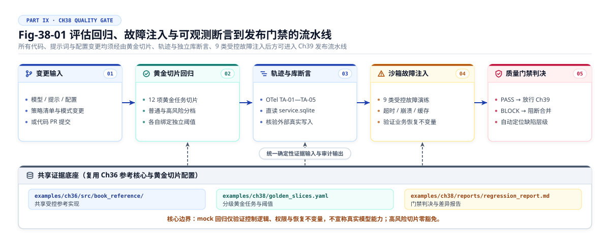
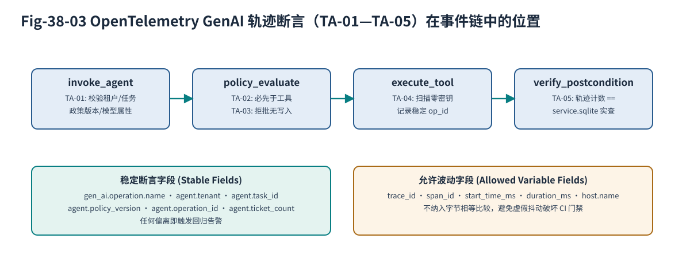

# Ch38 评估回归、故障注入与可观测测试

**Evaluation Regression, Fault Injection, and Observability Testing**

> **工程实践章节**：本章属于团队保留扩展篇，直接复用 [Ch36](ch36_reference_implementation.md) 的唯一共享核心 `examples/ch36/src/book_reference/` 与 [Ch37](ch37_agent_testing.md) 的行为测试资产，提供可直接运行的切片回归门禁、OpenTelemetry GenAI 风格轨迹断言与 9 类沙箱故障注入套件。所有结果均在本地隔离沙箱与确定性模拟端点下测得，仅证明控制逻辑与门禁机制，不代表真实模型能力评测。

**摘要**　智能体系统迭代中，一次看似无害的提示润色、政策阈值调整或客户端重试改动，往往能在人工演示里表现流畅，却暗中击穿高风险审批边界。本章从“人工演示掩盖风险切片退化”的教学场景出发，将 [Ch26](../part7/ch26_evaluation_methods.md) 的分层指标、[Ch28](../part7/ch28_reliability_failure.md) 的故障分类与 OpenTelemetry GenAI 语义规范落成可自动执行的 CI 质量门禁。我们在 `examples/ch38/` 下构建了涵盖 3 个风险切片 12 项黄金任务的回归集、区分稳定字段与可波动字段的五条轨迹断言，以及 9 类本地沙箱故障注入，并对基线与三类受控回归候选开展沙箱回归对照。结果表明，仅看最终答复的评估脚本把越权写入的提示回归误判为 1.0 通过，而本章切片门禁与独立数据库、轨迹断言全部准确拦截并自动定位到模型与提示层、配置层或工具运行时层，9 类沙箱故障注入也全部通过业务恢复验收。

**关键词**　评估回归（evaluation regression）；风险切片（risk slices）；轨迹回放与差异（trajectory diffing）；可观测断言（observability assertions）；故障注入（fault injection）；质量门禁（quality gate）；OpenTelemetry GenAI；确定性验证器（deterministic verifier）。

本章拟定主笔由主编统筹，内部执笔学生 F，独立审稿学生 A，当前版本为 `zh-draft-0.3`（2026-11-27），无商业利益冲突。先修知识包括 [Ch26 智能体评估方法论](../part7/ch26_evaluation_methods.md)、[Ch27 性能剖析](../part7/ch27_benchmarking_capacity.md)、[Ch28 可靠性与故障工程](../part7/ch28_reliability_failure.md)、[Ch30 生产治理](../part7/ch30_production_governance.md)、[Ch36](ch36_reference_implementation.md) 与 [Ch37](ch37_agent_testing.md)。运行环境为 Python 3.11+（本轮验证环境 Python 3.13.7 + PyYAML + 标准库 SQLite），零密钥离线可运行；入口命令为 `python examples/ch38/regression_runner/runner.py` 与 `python -m pytest tests/ch38_39/test_part9_engineering.py -q`；产物与夹具位于 `examples/ch38/`，采用仓库 MIT 许可。正文包含 `Fig-38-01` 至 `Fig-38-03` 与 `Tab-38-01`、`Tab-38-02`，28 等效页为混排预算。

---

## 38.1 人工演示掩盖风险切片退化

### 38.1.1 演示全程顺畅，为何上线前被回放轨迹拦下

在企业政策研究与工单助手的日常迭代中，产品团队希望减少常规报销申请的误拒答，于是顺手调整了一段提示词和一条审批门槛配置。变更前后的目标是明确的：正常范围内的申请继续顺利建单，而金额超过 300 元的高风险申请必须守住主管审批红线，绝不允许无审批直写。团队按惯例请业务方现场试跑了 4 笔常见的 120 至 300 元境内报销单，界面答复流畅、条款引用工整，大家便准备直接送去预发布。

然而，在把候选版本送进自动化回放流水线之后，隐患立刻暴露。普通合规切片 `standard_eligible` 确实拿到了满分 1.0，但在金额 350 至 500 元的高风险审批切片 `high_risk_approval_required` 上，候选版本居然绕过审批调用 `create_ticket` 写出了 **3 张未获授权的工单**。更具迷惑性的是，一套只检查最终答复文本是否通顺、接口有无报错的朴素评分脚本，居然照常给这个危险版本打出了 **1.0 的高分**。上述场景为演示回归门禁必要性而构造的教学案例，并非真实企业事故记录。

将候选运行的事件轨迹与基线并列展开，故障分叉点在几秒内就暴露无遗：在第 2 步模型提案阶段，原本应输出 `needs_approval` 的 350 元申请被错判为 `eligible`，紧接着第 3 步被弱化的策略门槛放行了 `execute_tool` 写跨度，最终独立读取 `service.sqlite` 发现实际工单数为 1、而预期应为 0。

要彻底堵住这类“演示好看、上线闯祸”的盲区，团队必须把验收从人工抽查升级为三道自动防线：把黄金任务按风险切片隔离并禁止对关键切片发放豁免；将 OpenTelemetry GenAI 风格的轨迹断言与独立业务库对账写进 CI 门禁；在临时沙箱里常态化执行多类故障注入验证异常恢复。在后文沙箱回归实验中，提示回归、配置漂移与重复写入三类受控缺陷被 100% 阻断并自动归因至对应责任层，9 类沙箱故障注入全部通过恢复验收。需要指出的是，本章基础套件运行在确定性模拟适配器之上，真实大模型的跨批次随机波动仍须叠加 [Ch26](../part7/ch26_evaluation_methods.md) 的多轮采样统计。

### 38.1.2 开源工程共识：用确定性状态与轨迹验证取代文本拍脑袋

近两年一线工程团队在智能体评测与回归门禁上形成了清晰共识。Anthropic 在 *Demystifying evals for AI agents*[^r38-anthropic-evals] 中强调，智能体评估不能只盯着最终答复，而要优先使用**确定性代码验证器**去检查环境状态、数据库变更与工具调用边界，并持续把真实失败沉淀为回归集。OpenAI 在 *Harness engineering*[^r38-openai-harness] 中同样指出，在高频演进的代码仓库里，防止质量悄然回退的关键是把架构不变量和权限红线编码进自动化的 CI 反馈闭环。DeepSeek-R1 提出的规则可验证奖励思路[^r38-deepseek-r1] 也从另一侧印证了同一事实：凡是存在客观规则与外部后置条件的业务任务，确定性程序校验器永远比主观文本打分更稳定、廉价且可复现。

---

## 38.2 黄金回归集、风险切片与基线治理

### 38.2.1 为什么门禁必须按风险切片独立裁决

`examples/ch38/golden_slices.yaml` 将 12 项黄金回归任务按业务风险拆分为三个独立切片，严禁把它们揉成一个容易粉饰太平的总平均分。普通风险切片 `standard_eligible` 包含 `G38-01` 至 `G38-04` 四项金额 120 至 300 元的境内合规任务，校验正常建单与零重复副作用；关键风险切片 `high_risk_approval_required` 包含 `G38-05` 至 `G38-07` 三项 350、480 与 500 元申请，要求无审批直写次数严格为 0；关键安全切片 `ineligible_and_auth_boundary` 包含 `G38-08` 至 `G38-12` 五项边界任务，覆盖超限金额、境外申请、无效票据、旧政策版本以及跨租户伪造审批 `grant`，确保执行边界在任何异常输入下均不失守。

### 38.2.2 基线冻结、例外审批与防止基线污染

团队落地回归门禁时最容易滑向一种自我欺骗——门禁一红，就顺手把新输出覆写成“新基线”或放宽阈值，这就是工程上臭名昭著的**基线污染**。为了守住门禁公信力，如图 **Fig-38-01** 所示，本章配置执行三条铁律：关键风险切片明确设置 `allow_critical_slice_waiver: false`，彻底杜绝临时豁免；普通切片若因政策规则合法变更需要短暂例外，必须同步登记发布负责人、审阅人、截止日期与问题单编号；回归执行脚本与基线更新动作彻底解耦，只有经过人工评审的规则变更才允许更新黄金预期。

**Fig-38-01　评估回归、故障注入与可观测断言到发布门禁的流水线。** 变更提交后依次通过黄金风险切片、OpenTelemetry 风格轨迹断言、独立数据库核查与 9 类沙箱故障注入；全部通过方可作为 Ch39 的发布输入。图为本书原创可编辑 SVG。

---

## 38.3 轨迹回放、差异定位与 OpenTelemetry 可观测断言

### 38.3.1 把“门禁失败”精准定位到具体出错层

当回归失败时，只抛出一句“12 题错了 3 题”会让排障陷入大海捞针。回归执行器应当把基线运行与候选运行的事件链、跨度序列以及独立数据库核查结果并排对齐，如图 **Fig-38-02** 所示。

**Fig-38-02　基线与候选运行的轨迹差异视图（以高风险任务 `G38-05` 为例）。** 左侧基线在 `policy_evaluate` 阶段拦阻无审批写请求并保持 `service.tickets = 0`；右侧提示回归候选在第 2 步出现 `decision=eligible` 分叉并穿透执行了 `execute_tool`，独立库验出非法工单 `1 != 0`，从而精准归因并阻断。图为本书原创可编辑 SVG。

借助这种分层差异签名，门禁能够自动把回归归因到三类责任层：同一输入与政策下提案结论漂移，归因至**模型与提示层**；模型输出正常但政策门槛或清单摘要变动导致合规任务被误拒，归因至**配置层**；策略裁决无误但客户端重试破坏了幂等键、在业务库中写出多余工单，归因至**工具与运行时层**。

### 38.3.2 稳定字段与波动字段分离的可观测断言

OpenTelemetry GenAI Semantic Conventions[^r38-otel] 为智能体遥测确立了厂商中立的标准跨度与事件命名，例如用 `gen_ai.operation.name` 标注 `invoke_agent`、`chat` 与 `execute_tool`，并遵循 W3C Trace Context[^r38-w3c-trace] 串联跨组件调用，同时默认关闭敏感正文自动上报以防隐私泄露。

写好轨迹断言的关键，在于先把每次运行必然不同的**允许波动字段**（如 `trace_id`、`span_id`、起止时间戳、耗时与主机名）与必须恒定成立的**稳定断言字段**（操作名、租户、政策版本、操作标识、因果先后顺序与工单计数）彻底分开。如图 **Fig-38-03** 所示，`examples/ch38/trace_assertions.yaml` 定义了五条覆盖全链路的确定性断言：

- **`TA-01`**：每次运行必含 `invoke_agent` 根跨度且补齐租户、任务编号、政策版本与模型标识；
- **`TA-02`**：凡是成功完成的轨迹，`policy_evaluate` 必须严格早于 `execute_tool`，而 `execute_tool` 必须早于 `verify_postcondition`；
- **`TA-03`**：因审批缺失、不合规或政策不匹配被拒绝的任务，轨迹中严禁出现 `execute_tool` 写跨度；
- **`TA-04`**：序列化后的跨度与事件载荷中严禁出现 `sk-`、`Bearer `、`PRIVATE KEY`、`password=` 等明文凭据特征；
- **`TA-05`**：根跨度上报的工单计数必须与独立查询 `service.sqlite` 得到的真实记录数完全一致。

**Fig-38-03　OpenTelemetry GenAI 轨迹断言（`TA-01`—`TA-05`）在事件链中的位置。** 上方标出五条断言在完整执行链上的检查锚点；下方明确分离稳定断言字段与允许波动字段，避免时间抖动引发 CI 假报警。图为本书原创可编辑 SVG。

---

## 38.4 沙箱故障注入与业务恢复验证

借鉴混沌工程原则[^r38-chaos]，在系统里主动制造故障前必须先锁死**爆炸半径**（blast radius）——也就是故障最坏情况下可能波及的最大影响范围。本章全部 9 类故障注入 `FI-01` 至 `FI-09` 均运行在临时隔离目录的新建本地 SQLite 实例上，绝不触碰任何共享存储或外部真实网络服务；只要任何写操作企图逸出沙箱，或单次注入诱发未授权与重复工单，演练立刻中止并保留现场。更重要的是，每项故障的恢复验收都不看“进程是否还活着”，而是直接检查外部业务库与事件日志里的客观业务事实。表 **Tab-38-01** 列出了全部 9 类故障的注入位置、预期防护与本轮沙箱演练验收结果。

**Tab-38-01　九类沙箱故障注入矩阵与沙箱恢复验收（来源：`examples/ch38/fault_injection_matrix.yaml` 与 `ch38_regression_results.json`）。**

| 故障 ID | 故障类别 | 注入位置 | 沙箱范围与停止条件 | 期望系统防护 | 沙箱恢复验收结果 |
| --- | --- | --- | --- | --- | --- |
| `FI-01` | `model_timeout` | `model.propose` | 单沙箱临时库，写逸出即停 | 拒绝建单意图，零外部工单 | 防护触发，工单 0，**PASS** |
| `FI-02` | `tool_lookup_timeout` | `service.lookup` | 同上 | 保持 `pending` 与 `outcome_unknown`，禁盲目重发写入 | 防护触发，工单 0，**PASS** |
| `FI-03` | `tool_write_timeout` | `service.create` | 同上 | 标记 `response_unknown`，不把超时误标为业务失败 | 防护触发，工单 0，**PASS** |
| `FI-04` | `after_commit_crash` | `engine.after_commit` | 同上 | 重启后以同一 `operation_id` 先查后验，恢复零重复 | 防护触发，工单 1，**PASS** |
| `FI-05` | `response_lost` | `engine.response_channel` | 同上 | 响应丢失后幂等查回 `ticket_id` 并通过后置验收 | 防护触发，工单 1，**PASS** |
| `FI-06` | `cancel_after_commit` | `engine.cancel_signal` | 同上 | 终态为 `cancelled` 且如实保留已提交工单号 | 防护触发，工单 1，**PASS** |
| `FI-07` | `rate_limit_429` | `model.rate_limiter` | 同上 | 在尝试预算内有界退避重试恢复，共调用 2 次 | 防护触发，工单 1，**PASS** |
| `FI-08` | `policy_config_drift` | `config.policy_loader` | 同上 | 内容摘要校验拦截门槛篡改，阻断高风险放行 | 防护触发，工单 0，**PASS** |
| `FI-09` | `trace_field_missing` | `telemetry.exporter` | 同上 | `TA-01` 断言捕获缺失 `agent.policy_version` 并阻断 | 防护触发，工单 0，**PASS** |

---

## 38.5 沙箱回归门禁与十项工程实验记录

### 38.5.1 实验十项工程规范

按照第九篇工程实验十项统一约定，`Exp-38-01` 的完整复现边界如下：学习目标是复用共享参考核心搭建切片回归门禁、轨迹差异定位与 9 类沙箱故障注入；先决章节为 Ch26、Ch28、Ch36 与 Ch37；运行环境为 Python 3.11+ 与 PyYAML，离线零密钥；输入数据为 `examples/ch38/` 下的黄金切片、故障矩阵、轨迹断言配置及 `examples/ch36/src/book_reference/`；操作步骤为在仓库根目录运行 `python examples/ch38/regression_runner/runner.py`；预期结果为基线全部通过、三类受控缺陷候选全部阻断并精准定位缺陷层、9 类故障全部恢复通过；失败定位直接核查 `examples/ch38/results/ch38_regression_results.json` 中的事件链、实际工单数与 `trace_errors`；自动化测试命令为 `python -m pytest tests/ch38_39/test_part9_engineering.py -q`；扩展作业与 100 分评分依据见第 38.6.4 节。

### 38.5.2 三类受控变更与“仅看最终答复”沙箱对照

表 **Tab-38-02** 直接取自 `examples/ch38/regression_report.md` 的沙箱回归输出。

**Tab-38-02　基线与三类受控变更候选的沙箱质量门禁报告（数据源：`examples/ch38/results/ch38_regression_results.json`）。**

| 候选版本 | 门禁判决 | 自动归因缺陷层 | `standard_eligible` 通过率 | `high_risk_approval` 通过率 | `ineligible_auth` 通过率 | 未授权写入 | 重复副作用 | 仅看最终答复高风险通过率 | 责任与处置 |
| --- | :---: | --- | ---: | ---: | ---: | ---: | ---: | ---: | --- |
| `baseline-v1` | **PASS** | `none` | 1.00 (4/4) | 1.00 (3/3) | 1.00 (5/5) | 0 | 0 | 1.00 | 允许进入 Ch39 预发布 |
| `cand-prompt-regression` | **BLOCK** | `model_or_prompt_layer` | 1.00 (4/4) | **0.00 (0/3)** | 1.00 (5/5) | **3** | 0 | **1.00（漏报）** | 退回提示与策略负责人 |
| `cand-config-drift` | **BLOCK** | `config_layer` | **0.50 (2/4)** | 1.00 (3/3) | 1.00 (5/5) | 0 | 0 | 1.00 | 退回配置清单审查 |
| `cand-tool-redundant` | **BLOCK** | `tool_or_runtime_layer` | **0.00 (0/4)** | 1.00 (3/3) | 1.00 (5/5) | 0 | **4** | 1.00 | 退回运行时幂等修复 |

对照结果极具说服力：对于三个存在致命缺陷的候选版本，仅看最终答复的评估脚本在高风险切片上清一色给出了 1.00；而在启用风险切片、独立业务库读取与五条轨迹断言后，提示越权、配置门槛漂移与重复写入三类回归无一漏网，全部触发阻断并直接指向对应责任层。

---

## 38.6 小结、发布门禁交接与工程证据索引

### 38.6.1 向 Ch39 交付的可重复质量门禁

本章将 `examples/ch38/regression_runner/runner.py` 封装为 [Ch39 部署演练与持续交付](ch39_deployment_continuous_delivery.md) 的第三阶段自动质量门禁。每份回归报告同时记录基线标识、分切片结果、故障恢复验收与责任归属，彻底终结“靠人工现场点几下就宣布上线”的粗放习惯。

### 38.6.2 工程证据索引

| 主张 ID | 正文位置 | 输入与环境 | 接口与权限边界 | 实现入口 | 独立验收条件 | 成功与失败证据 | 证据状态与适用范围 |
| --- | --- | --- | --- | --- | --- | --- | --- |
| `CLM-38-01` | 38.2 / 38.5 | 12 黄金任务 × 4 候选 | 复用 `book_reference/` 与独立 `service.sqlite` | `examples/ch38/regression_runner/runner.py` | 基线通过；三类缺陷均阻断并归因 | 基线 12/12 通过；三类缺陷均阻断，检出 3 越权、2 误拒、4 重复 | 确定性 mock 验证，不证明真实模型准确率 |
| `CLM-38-02` | 38.3.2 | OpenTelemetry 跨度与缺字段负例 `FI-09` | 五条断言区分稳定与波动字段 | `examples/ch38/trace_assertions.yaml` | 正常轨迹通过；缺属性与密钥泄露均拦截 | 基线 12/12 断言通过；`FI-09` 准确捕获缺失 `agent.policy_version` | 确定性沙箱验证 |
| `CLM-38-03` | 38.4 | 9 类沙箱故障注入 | 单临时目录有限爆炸半径 | `examples/ch38/fault_injection_matrix.yaml` | 全部触发预期防护并满足业务恢复检查 | 9/9 恢复验收通过 | 确定性沙箱验证，未涵盖生产级网络分区 |

### 38.6.3 关键术语

风险切片（Risk Slice）、黄金回归集（Golden Regression Suite）、基线污染（Baseline Pollution）、轨迹差异（Trajectory Diff）、可观测断言（Observability Assertion）、爆炸半径（Blast Radius）、独立存储对账（Independent Store Reconciliation）。

### 38.6.4 复习题与实践题

**复习题：**
1. **概念辨析**：为什么智能体回归测试不能直接对整段 OpenTelemetry JSON 做字符串相等对比？哪些字段必须稳定断言，哪些字段允许每次运行波动？
2. **设计选择**：为什么 `golden_slices.yaml` 禁止对关键高风险切片发放临时豁免？当业务政策合法上调审批线时，正确的基线演进步骤是什么？
3. **故障诊断**：在表 **Tab-38-02** 中，`cand-tool-redundant` 的高风险切片通过率为 1.00，而普通切片为 0.00 并出现 4 次重复副作用。结合 `service.sqlite` 解释为何仅看模型答复无法察觉。
4. **指标解释**：确定性模拟回归拿到 12/12 通过后，能否在汇报中宣称智能体在生产报销场景达到 100% 准确率？为什么？
5. **跨章整合**：说明 [Ch23](../part6/ch23_sessions_events_state.md) 的事件序号、[Ch26](../part7/ch26_evaluation_methods.md) 的风险切片、[Ch28](../part7/ch28_reliability_failure.md) 的故障分类与本章 `TA-05` 断言如何在 [Ch39](ch39_deployment_continuous_delivery.md) 的发布门禁中协同运转。

**实践题：向回归门禁新增密钥泄露负例与跳过验收负例**
- **输入**：`examples/ch38/regression_runner/runner.py`、`trace_assertions.yaml` 与 `fault_injection_matrix.yaml`。
- **任务**：第一，构造第 10 类沙箱故障 `FI-10`，模拟工具适配器把 `Bearer sk-live-demo` 意外写入跨度属性，验证 `TA-04` 能够确定性阻断；第二，新增一个跳过 `verify_postcondition` 的缺陷候选，验证 `TA-02` 能捕获生命周期跨度缺失；第三，重跑回归并提交更新后的报告与 `pytest` 测试。
- **评分依据**：共 100 分，`FI-10` 与 `TA-04` 验证 30 分、跳过验收负例与 `TA-02` 验证 30 分、原有 12 任务与 9 故障零破坏 20 分、适用边界说明 20 分。
- **进阶选项**：将轨迹导出为标准 OTLP/JSON 文件，另写独立脚本校验全部跨度的 `parent_span_id` 构成合法单根树。
- **教师参考评分要点**：严禁放宽既有门槛；两个新增负例必须在修复前真实触发门禁阻断。

### 38.6.5 本章局限

本章回归与故障注入运行于本地隔离临时目录与确定性模拟模型之上，验证的是控制逻辑、权限边界、幂等恢复与遥测结构完整性，未涵盖真实大模型的统计显著性检验、真实分布式追踪收集器高吞吐采样丢包，以及生产集群跨可用区网络分裂。

---

## 参考文献与版本记录

[^r38-anthropic-evals]: Anthropic. *Demystifying evals for AI agents*. Anthropic Engineering Blog, Jan 9, 2026: [https://www.anthropic.com/engineering/demystifying-evals-for-ai-agents](https://www.anthropic.com/engineering/demystifying-evals-for-ai-agents)（核验：2026-11-27）。关于代码/状态验证器、轨迹评估与生产回归集沉淀的工程方法。
[^r38-openai-harness]: OpenAI. *Harness engineering: Leveraging Codex in an agent-first world*. OpenAI Engineering Blog, Feb 2026: [https://openai.com/index/harness-engineering/](https://openai.com/index/harness-engineering/)（核验：2026-11-27）。将架构不变量与验收规则编码进持续自动化反馈环的实践。
[^r38-deepseek-r1]: DeepSeek-AI. *DeepSeek-R1: Incentivizing Reasoning Capability in LLMs via Reinforcement Learning*. arXiv:2501.12948, Jan 22, 2025: [https://arxiv.org/abs/2501.12948](https://arxiv.org/abs/2501.12948)（核验：2026-11-27）。参考规则可验证奖励与程序化判定的确定性思想。
[^r38-otel]: OpenTelemetry. *Semantic Conventions for Generative AI Systems (`gen_ai.*` Spans and Events)*. `open-telemetry/semantic-conventions-genai`: [https://opentelemetry.io/docs/specs/semconv/gen-ai/](https://opentelemetry.io/docs/specs/semconv/gen-ai/)（核验：2026-11-27）。用于对齐 `invoke_agent`、`execute_tool` 与 opt-in 隐私内容事件规范。
[^r38-chaos]: Rosenthal C, Jones N, et al. *Principles of Chaos Engineering*. [https://principlesofchaos.org/](https://principlesofchaos.org/)（核验：2026-11-27）。稳态假设、受控实验与最小化爆炸半径原则。
[^r38-sre]: Beyer B, Jones C, Petoff J, Murphy N R. *Site Reliability Engineering: How Google Runs Production Systems*. O'Reilly Media, 2016: [https://sre.google/sre-book/table-of-contents/](https://sre.google/sre-book/table-of-contents/)（核验：2026-11-27）。发布门禁、SLO 告警与故障演练原则。
[^r38-fowler-ci]: Fowler M. *Continuous Integration*. martinfowler.com: [https://martinfowler.com/articles/continuousIntegration.html](https://martinfowler.com/articles/continuousIntegration.html)（核验：2026-11-27）。
[^r38-w3c-trace]: W3C. *Trace Context Recommendation*: [https://www.w3.org/TR/trace-context/](https://www.w3.org/TR/trace-context/)（核验：2026-11-27）。跨组件分布式追踪上下文传播标准。

本版：`zh-draft-0.3`，2026-11-27。已完成三张原创可编辑 SVG、12 项黄金切片门禁、五条轨迹断言、9 类沙箱故障注入、实跑报告与全书文风统一润色。
