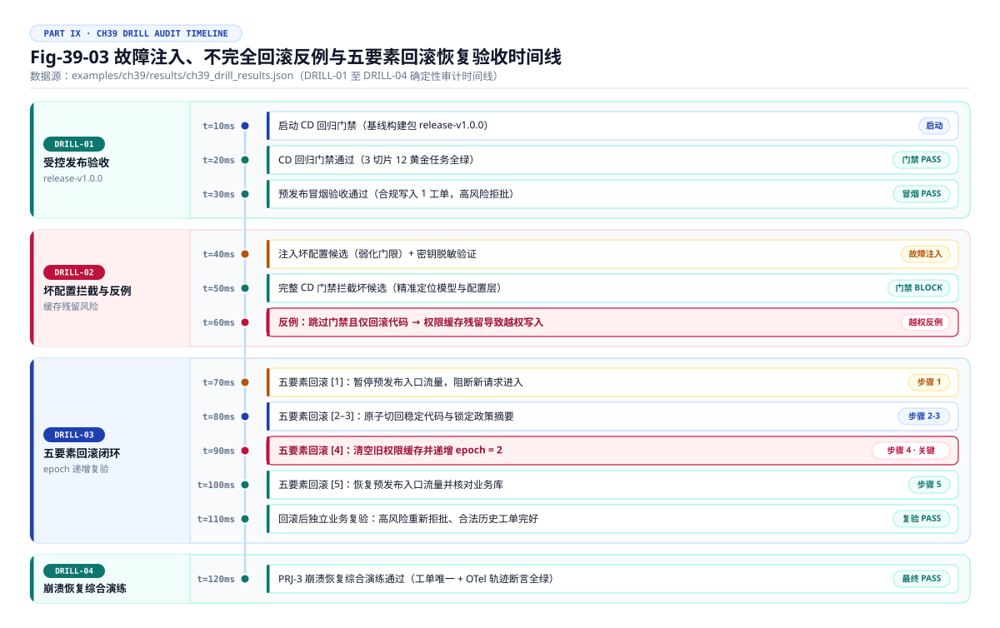

# Ch39 部署演练、持续交付与工程综合实践

**Deployment Drills, Continuous Delivery, and Engineering Capstone**

> **工程实践收束章**：本章属于团队保留扩展篇，将 [Ch30 生产治理](../part7/ch30_production_governance.md)、[Ch34 综合项目](../part8/ch34_capstone_reference_architectures.md) 以及 [Ch36](ch36_reference_implementation.md) 至 [Ch38](ch38_regression_fault_injection.md) 整合为一条可离线复现的持续交付与五要素回滚演练链路，并给出 100 分最终工程综合实践评分标准。本演练仅证明所声明沙箱边界内的发布门禁、缓存清理与幂等恢复机制，明确公开与真实生产集群之间的适用差距。

**摘要**　智能体系统的发布不同于传统无状态 Web 服务：代码、提示模板、政策配置、工具模式与权限缓存共同决定运行时行为。只切回旧代码指针却遗留坏配置写入的权限缓存，会让看似已经回滚的系统继续发生越权写入。本章从这一“不完全回滚”预发布事故出发，定义本地、测试与预发布三档部署边界并与 [附录 D](../appendix_d_deployment.md) 对齐，串联从构建锁定到预发布冒烟验收的七阶段持续交付流水线，并借鉴 OpenAI Harness 持续反馈环、DeepSeek Harness 插件可逆卸载以及 Google SRE 运行手册实践，设计覆盖入口暂停、代码、配置、权限与缓存清空、业务数据对账的五要素回滚序列。在 `examples/ch39/drill_runner.py` 的四项自动化演练中，受控发布、坏配置与缓存残留反例、五要素完整回滚以及 PRJ-3 崩溃恢复均全部通过，审计日志实现明文密钥零泄露；章末给出面向课程与团队考核的 100 分最终综合实践作业与评分细则。

**关键词**　部署演练（deployment drill）；持续交付（continuous delivery）；发布门禁（release gate）；五要素回滚（five-element rollback）；权限缓存残留（stale permission cache）；运行手册（runbook）；工程综合实践（engineering capstone）；证据可追溯性（evidence traceability）。

本章拟定主笔由主编统筹，内部执笔学生 F，独立审稿学生 A，当前版本为 `zh-draft-0.3`（2026-11-27），无商业利益冲突。先修知识包括 [Ch30 生产部署、监控与治理](../part7/ch30_production_governance.md)、[Ch34 综合项目](../part8/ch34_capstone_reference_architectures.md)、[Ch36](ch36_reference_implementation.md)、[Ch37](ch37_agent_testing.md) 与 [Ch38](ch38_regression_fault_injection.md)。运行环境为 Python 3.11+（本轮验证环境 Python 3.13.7 + PyYAML + 标准库 SQLite），零密钥离线可运行；入口命令为 `python examples/ch39/drill_runner.py` 与 `python -m pytest tests/ch38_39/test_part9_engineering.py -q`；产物与运行手册位于 `examples/ch39/`，采用仓库 MIT 许可。正文包含 `Fig-39-01` 至 `Fig-39-03` 与 `Tab-39-01` 至 `Tab-39-03`，30 等效页为混排预算。

---

## 39.1 版本错配后的不完全回滚

### 39.1.1 代码已经切回旧版，越权为何还在继续

预发布环境准备上线企业政策研究与工单助手的候选版本 `release-v1.1.0-bad-config`。团队希望在预发布验证新版本，一旦出现异常能够迅速回滚到已经通过验收的 `release-v1.0.0`，同时保证此前生成的合法工单完好无损。值班工程师沿用了传统无状态微服务的运维习惯，以为只要把应用代码指针切回旧版、看到健康检查接口返回正常，系统就已经彻底复原。

但这次回滚留下了极其隐蔽的暗雷。该候选版本里混入了一处配置错配，将主管审批阈值错误抬高到了 500 元，并在启动后向共享权限缓存写入了一条允许高风险直写的条目。在模拟跳过回归门禁、且回滚时只切回代码与静态配置的演练对照中，版本号明明已经变回 `release-v1.0.0`，健康接口也一片绿灯，可随后打入的一笔 420 元高风险报销探针任务，居然因为命中了未清理的旧权限缓存，绕过主管审批直接写出了工单。更雪上加霜的是，排查过程中还有开发人员顺手把带有 `Bearer sk-test-secret` 的调试头打进了日志。上述情节是为剖析不完全回滚而构造的教学演练场景，并非真实企业生产事故记录。

沿着发布审计时间线逐条回查，三处薄弱环节清晰浮现：候选版本绕过了 Ch38 风险切片门禁直接进入预发布；回滚脚本只管代码和静态文件，没有清空权限缓存或递增缓存代次；回滚结束后只看了进程存活，没有执行“高风险任务必须被拒”的负向安全探针。

对应的工程整改建立了完整的发布护栏：强制执行七阶段持续交付门禁；将回滚升级为覆盖入口暂停、代码、配置摘要、权限与缓存清空、业务数据对账的**五要素原子序列**，回滚后必须同时跑通合规建单与高风险拒批双向探针；并在审计写入层加装强制密钥脱敏过滤。在后文四项自动化演练中，完整门禁提前拦截了坏候选，五要素回滚彻底清除了旧缓存并恢复了审批拦截，既有合法工单完好无损，日志中零明文密钥泄露。需要如实声明的是，本演练基于单机本地模拟环境，真实生产中的分布式 Redis 缓存失效广播、容器滚动连接排空与跨区数据库模式降级仍须按组织基础设施另行压测。

### 39.1.2 从微内核可逆卸载到发布五要素回滚

[Ch22](../part6/ch22_orchestration_runtime.md) 曾借鉴 DeepSeek Harness 的可逆插件生命周期[^r39-dsh]：组件挂载时留下的任何注册项与副作用，卸载时必须对称清理。把这一原则推演到预发布与生产运维层面，就能看清智能体持续交付的本质——**智能体的真实发布单元不是单一代码包，而是代码、配置与提示、数据与模式、权限授权、运行时缓存组成的五元组**。只回滚其中一项，其余四项残留就会以配置错配或缓存越权的形式制造比直接宕机更危险的静默事故。

---

## 39.2 三档部署边界与交付物契约

为防止开发者本机配置、自动化测试沙箱与预发布环境互相污染，`examples/ch39/deploy/profiles.yaml` 明确划分了 `local`、`test` 与 `staging` 三档部署边界，与学生 E 维护的 [附录 D：部署档位与验收模板](../appendix_d_deployment.md) 保持字段一致，如图 **Fig-39-02** 所示。


**Fig-39-02　`local`、`test` 与 `staging` 三档部署拓扑及身份、数据与网络边界。** 逐级收紧制品不可变性、身份认证边界、秘密管理方式、数据隔离策略、网络出站白名单与可观测深度；明确声明本地与预发布演练不等同生产多活集群。图为本书原创可编辑 SVG。

三档之间晋升遵循三条刚性纪律。第一，借鉴 SLSA 制品来源与不可变构建理念[^r39-slsa]，从测试晋升到预发布的必须是同一份带 SHA-256 清单摘要的不可变发布包，绑定代码、依赖锁、提示包、政策版本与模式版本，严禁在预发布主机上手工改配置。第二，遵循 OWASP 秘密管理准则[^r39-owasp-secrets]，本地档位坚持零密钥确定性路径，预发布档位通过受控密钥服务运行时注入凭证，并在日志与遥测出口强制脱敏。第三，所有文档和报告清楚区分本地演练边界与真实企业生产集群的 IAM、TLS 和多活容灾要求。

---

## 39.3 持续交付流水线与发布门禁

结合 OpenAI *Harness engineering* 将约束前移进持续自动化反馈环的实践[^r39-openai-harness] 与经典持续交付方法论[^r39-cd]，`examples/ch39/ci/cd_pipeline.yaml` 把前序各章的工程资产串成七阶段发布流水线，如图 **Fig-39-01** 所示：

- **S1 构建与锁定**：检出源码、验证依赖锁与资产清单 SHA-256 摘要，衔接 [Ch36](ch36_reference_implementation.md)。
- **S2 分层行为测试**：运行 [Ch37](ch37_agent_testing.md) 的单元、集成与端到端行为断言。
- **S3 回归与故障门禁**：运行 [Ch38](ch38_regression_fault_injection.md) 的 12 项黄金风险切片、五条轨迹断言与 9 类沙箱故障注入，关键切片零容忍。
- **S4 安全与密钥扫描**：核查发布包与遥测链零明文凭证，核对策略清单版本一致。
- **S5 发布审批**：负责人逐项核对发布就绪检查表（见表 **Tab-39-01**，同步自 `examples/ch39/release_checklist.md`）并签认目标档位。
- **S6 预发布部署与双向冒烟**：上线后同时运行正向合规建单探针与负向高风险拒批探针，独立核对业务库与轨迹一致。
- **S7 运行观测与异常回滚**：持续监测 SLO 与审计日志，任一异常即触发五要素自动回滚。


**Fig-39-01　从提交到预发布的持续交付流水线与发布门禁（S1—S7）。** 将 Ch36 清单核验、Ch37 行为测试、Ch38 回归与故障门禁、安全扫描、人工审批与预发布双向冒烟闭环连接；任意异常沿左侧红色路径自动触发五要素回滚。图为本书原创可编辑 SVG。

**Tab-39-01　发布就绪检查表（同步自 `examples/ch39/release_checklist.md`，含 `release-v1.0.0` 已填写基线样例）。**

| 检查项 ID | 核查维度 | 必须验证的客观条件 | 对应证据路径 | `release-v1.0.0` 状态 |
| --- | --- | --- | --- | --- |
| `RC-01` | 制品与配置绑定 | 代码、模型、提示、政策与模式绑定同一清单摘要 | `examples/ch39/results/ch39_drill_results.json` | 已通过 |
| `RC-02` | 分层行为测试 | Ch37 行为断言全通过，零跳过高风险用例 | `examples/ch37/tests/test_behaviour.py` | 已通过 |
| `RC-03` | 切片回归门禁 | Ch38 黄金切片全通过，高风险零越权、零重复 | `examples/ch38/regression_report.md` | 已通过 (12/12) |
| `RC-04` | 可观测与防泄 | `TA-01`—`TA-05` 全绿，日志与轨迹零明文凭证 | `examples/ch38/trace_assertions.yaml` | 已通过（零泄露） |
| `RC-05` | 权限缓存隔离 | 版本切换递增缓存代次，旧权限不跨版本残留 | `examples/ch39/drill_runner.py` | 已通过 |
| `RC-06` | 回滚可演练 | 五要素回滚序列与双向探针已在沙箱演练通过 | `examples/ch39/rollback_runbook.md` | 已通过 (`DRILL-03`) |
| `RC-07` | 适用边界声明 | 明确区分本地演练与真实生产集群容灾及身份治理 | `examples/ch39/release_report.md` | 已声明 |

---

## 39.4 观测、事故响应与五要素回滚演练

### 39.4.1 五要素回滚序列契约

参考 Google SRE 运行手册实践[^r39-sre] 与 `examples/ch39/rollback_runbook.md`，预发布或生产触发回滚条件时必须严格按表 **Tab-39-02** 的五步顺序执行，不得遗漏缓存清空，更不允许靠清空业务表掩盖错误写入。

**Tab-39-02　智能体五要素回滚序列（代码、配置、数据、权限、缓存）与恢复验收判据。**

| 顺序 | 回滚对象 | 标准执行动作 | 客观验证判据 | 典型致命误区 |
| :---: | --- | --- | --- | --- |
| 1 | 入口流量 | 暂停新任务接入，等待在途幂等写入到达安全检查点 | `intake_enabled == false` 且在途写入排空 | 粗暴强杀写入中事务且不核对外部状态 |
| 2 | 代码与依赖 | 切换活跃发布指针至上一已验收不可变版本 | `active_release == target_release` | 原地拉代码却未核对依赖锁 |
| 3 | 配置与政策 | 恢复上一版本政策、提示、模型路由与预算清单并复算摘要 | `active_config_digest == target_digest` | 只回滚代码却忘了回滚门槛配置 |
| 4 | 权限与缓存 | 撤销候选临时授权，强制清空权限缓存并递增代次 `epoch` | `cleared_entries >= 0` 且旧缓存键全部失效 | 忽略权限缓存导致越权在旧版本上继续生效 |
| 5 | 数据对账与双向探针 | 核对既有合法工单完好无损；恢复入口后同时跑通高风险拒批与合规建单探针 | 合法工单保留、高风险被拒、合规任务通过 | 只看健康检查接口返回 200 就宣布事故结束 |

### 39.4.2 四项自动化预发布沙箱演练结果

在仓库根目录执行 `python examples/ch39/drill_runner.py`，脚本在隔离临时沙箱中连续完成四项演练：受控发布、配置错配与缓存残留对照、五要素完整回滚以及 PRJ-3 端到端崩溃恢复。沙箱演练汇总见表 **Tab-39-03**，由演练审计日志自动生成的运行时间线见图 **Fig-39-03**。

**Tab-39-03　`Exp-39-01` 四项预发布与回滚沙箱演练结果（数据源：`examples/ch39/results/ch39_drill_results.json`）。**

| 演练编号 | 演练场景与对照 | 沙箱演练关键证据与状态 | 验收结论 |
| --- | --- | --- | :---: |
| `DRILL-01` | 受控发布 `release-v1.0.0` | Ch38 回归门禁 12/12 通过；合规探针建单 1 条，高风险探针被拒 `needs_approval`，五条轨迹断言全绿 | **PASS** |
| `DRILL-02` | 配置错配、缓存残留与密钥防泄对照 | 完整门禁提前阻断坏候选并定位至模型与配置层；反例复现了跳过门禁且只回滚代码时缓存残留致 420 元探针越权建单；注入的 `Bearer sk-test-secret` 脱敏为 `[REDACTED_SECRET]`，零泄露 | **PASS** |
| `DRILL-03` | 五要素完整回滚与双向恢复验收 | 暂停入口、恢复代码与配置摘要 `a9e8573067b0`、清空 1 条旧权限缓存并递增 `epoch=2`；回滚后高风险探针重新被拒，合规探针成功建单，既有合法工单完好保留 | **PASS** |
| `DRILL-04` | PRJ-3 端到端综合实践演练 | 注入 `after_commit` 提交后崩溃，重启恢复后终态 `completed`、独立库工单数恰为 1、轨迹断言通过 | **PASS** |



**Fig-39-03　故障注入、不完全回滚反例与五要素回滚恢复验收时间线（由 `examples/ch39/results/ch39_drill_results.json` 沙箱演练审计日志生成）。** 清晰展示从 `t=10 ms` 启动门禁到 `t=120 ms` 完成 PRJ-3 综合验收的全部 12 个审计节点，包含 `t=60 ms` 不完全回滚反例与 `t=70–110 ms` 五要素回滚闭环。图为本书原创数据驱动 SVG。

---

## 39.5 最终工程综合实践

作为全书九篇的工程总验收，本节复用 [Ch34](../part8/ch34_capstone_reference_architectures.md) 的三项目递进资产与 [Ch36](ch36_reference_implementation.md) 至 [Ch39](ch39_deployment_continuous_delivery.md) 的同一代码仓库，给出可直接用于研究生课程大作业、训练营或团队上线考核的最终综合实践要求与 100 分评分标准，完整细则同步维护于 `examples/ch39/final_capstone_rubric.md`。

### 39.5.1 实验十项规范与执行链路

学习目标是使读者在全新干净检出环境中端到端跑通参考实现、分层行为测试、切片回归与故障注入，以及预发布部署和五要素回滚，并产出相互可追溯的审计证据包；先决章节覆盖第六至九篇；输入资产为本仓库 `examples/ch22` 至 `ch25` 与 `examples/ch36` 至 `ch39`，无需外部付费账号。读者在全新目录记录操作系统、Python 版本与 Git 提交号后，依次执行以下四条命令即可复现全链路并检查退出码均为 0：

```powershell
python -m pytest tests/test_book_structure.py -q
python -m pytest examples/ch37/tests/test_behaviour.py -q
python examples/ch38/regression_runner/runner.py
python examples/ch39/drill_runner.py && python -m pytest tests/ch38_39/test_part9_engineering.py -q
```

若任一步失败，依序核对 `ch38_regression_results.json` 中的 `detected_fault_layers`、`ch39_drill_results.json` 中的运行时间线与 `service.sqlite` 真实记录数即可定位。

### 39.5.2 100 分评分标准与零容忍退回条件

| 评分维度 | 满分 | 客观核查依据与交付产物 |
| --- | ---: | --- |
| 1. 干净环境复现 | 15 | 在全新目录按说明执行全套命令，记录机器、系统、Python 版本、命令、耗时与退出码，无本机绝对路径依赖 |
| 2. 任务与证据正确 | 20 | 独立读取 `service.sqlite` 与事件日志核对业务后置条件，保留任务 ID 与政策引用，不以模型文本替代核验 |
| 3. 权限与副作用控制 | 20 | 高风险审批零越权写入；崩溃与重连恢复保持唯一 `operation_id` 与唯一工单；取消后如实登记已提交副作用 |
| 4. 测试与回归门禁 | 20 | 跑通 Ch37 行为测试、Ch38 切片回归、五条轨迹断言与不少于 8 类沙箱故障注入，受控缺陷可被捕获 |
| 5. 发布、故障与回滚 | 15 | 完成一次受控发布、一次配置或缓存故障注入与一次五要素完整回滚，并附回滚后正负双向业务验收证据 |
| 6. 报告与适用局限 | 10 | 清晰区分确定性模拟演练与真实模型及生产环境，如实列出未验证边界，无伪造数字或夸大结论 |

> **零容忍退回条件（不可由其他项得分抵消）**：遗漏权限控制或允许自由文本绕过审批直写；无法在干净环境复现核心路径且未给出可定位原因；伪造结果、篡改基线掩盖回归或将模拟演练宣称为真实生产验收；日志、轨迹或发布包中泄露明文密钥。

基础必做任务要求完整复现 `DRILL-01` 至 `DRILL-04` 并交付可相互追溯的测试、回归、时间线与人工签认报告包。进阶可选任务提供两个方向：一是在 `StagingEnvironment` 中增加“不兼容数据库模式升级”演练分支，实现升级前快照校验与禁止盲目降级保护；二是将 [Ch24](../part6/ch24_streaming_interrupts.md) 的流式打断探针接入预发布冒烟检查，验证发布前后可见停止延迟 P95 不超过 60 ms。

---

## 39.6 小结、工程交付包与工程证据索引

### 39.6.1 全书工程实践收束与附录回链

本章将发布就绪清单、三档部署配置、五要素回滚手册与最终综合实践评分标准全部沉淀为可检出资产，并分别回链至 [附录 C](../appendix_c_schemas.md)、[附录 D](../appendix_d_deployment.md) 与 [附录 F](../appendix_f_security.md)。至此，读者手中所掌握的不只是概念架构图，而是一套贯穿异步编排、持久状态机、流式打断、多模态协同、回归门禁与五要素回滚的可运行工程基线。

### 39.6.2 工程证据索引

| 主张 ID | 正文位置 | 输入与环境 | 接口与权限边界 | 实现入口 | 独立验收条件 | 成功与失败证据 | 证据状态与适用范围 |
| --- | --- | --- | --- | --- | --- | --- | --- |
| `CLM-39-01` | 39.2 / 39.3 | 三档配置、七阶段门禁与 `DRILL-01` | 不可变清单摘要与双向冒烟 | `examples/ch39/drill_runner.py` | 门禁全绿、合规 1 工单、高风险拒批、轨迹通过 | `DRILL-01` 通过 | 确定性本地预发布演练，非真实集群 |
| `CLM-39-02` | 39.1 / 39.4 | `DRILL-02` 坏配置与缓存残留反例 | 门禁拦截与审计日志脱敏 | `examples/ch39/drill_runner.py` | 门禁阻断坏候选；反例暴露缓存越权；日志零明文密钥 | 全部断言通过，零泄露 | 确定性本地预发布演练 |
| `CLM-39-03` | 39.4.2 | `DRILL-03` 五要素回滚与 `DRILL-04` PRJ-3 恢复 | 入口、代码、配置、权限缓存与数据联动 | `examples/ch39/drill_runner.py` | 清缓存后高风险重新被拒、合法工单完好、崩溃恢复 1 工单 | 四项演练全部通过 | 确定性本地预发布演练，未测分布式缓存与多活集群 |

### 39.6.3 关键术语

持续交付（Continuous Delivery）、不可变发布包（Immutable Release Bundle）、部署档位（Deployment Tier）、五要素回滚（Five-Element Rollback）、权限缓存代次（Permission Cache Epoch）、双向冒烟探针（Bidirectional Smoke Probe）、运行手册（Runbook）。

### 39.6.4 复习题与实践题

**复习题：**
1. **概念辨析**：为什么智能体系统的发布回滚必须联动处置代码、配置、数据、权限与缓存五要素，而不能等同于传统无状态服务的镜像回切？
2. **设计选择**：在预发布冒烟阶段，除了验证正常合规申请能够建单，为什么必须强制运行“高风险无审批被拒”的负向探针？
3. **故障诊断**：观察 `DRILL-02` 的演练时间线，若团队只在回滚脚本里切回代码并重启进程，却漏掉了外置 Redis 权限缓存，会出现什么隐蔽现象？应如何在架构上根治？
4. **指标解释**：在 100 分最终综合实践评分表中，为什么把遗漏权限控制与虚报模拟结果列为零容忍退回项，而不是扣减若干分数？
5. **跨章整合**：当预发布环境中新版本已经误创建了 2 张不合规的模拟工单，请综合 [Ch12](../part3/ch12_action_execution.md) 的补偿机制、[Ch30](../part7/ch30_production_governance.md) 的治理审计、[附录 D](../appendix_d_deployment.md) 的回滚记录与本章五要素回滚手册，写出完整的事故处置与恢复验收流程。

**实践题：完成最终工程综合实践并提交独立复核档案包**
- **输入**：本仓库 `examples/ch36` 至 `ch39` 全部资产。
- **任务**：按第 39.5.1 节与 `examples/ch39/final_capstone_rubric.md` 要求，在全新干净目录完成全链路复现，并额外在 `drill_runner.py` 中新增 `DRILL-05`，演练“不兼容状态模式升级禁止盲目降级、必须从升级前快照恢复”，提交命令、退出码、原始 JSON 日志、扩展后的 `release_report.md` 与生产局限说明。
- **评分依据**：直接采用第 39.5.2 节与 `final_capstone_rubric.md` 的六维 100 分标准与零容忍退回条款。
- **进阶选项**：将 `ci/cd_pipeline.yaml` 转化为一条可在 GitHub Actions 上运行的最小工作流，自动触发测试、回归与演练并归档报告产物。
- **教师参考评分要点**：须在干净目录独立复跑提交的命令，核对全部数字均来自真实生成日志且未跳过任何高风险负向探针。

### 39.6.5 本章局限

本章预发布部署与五要素回滚演练运行在单机隔离目录与内存权限缓存之上，旨在提供离线可复现的确定性工程实训基线；它未包含真实容器编排集群的优雅终止与金丝雀流量切分、外部密钥服务轮转、多副本分布式缓存失效广播以及跨区数据库模式零停机迁移。走向真实企业生产时，须结合 [Ch30](../part7/ch30_production_governance.md) 与 [附录 D](../appendix_d_deployment.md) 补齐对应基础设施验证。

---

## 参考文献与版本记录

[^r39-openai-harness]: OpenAI. *Harness engineering: Leveraging Codex in an agent-first world*. OpenAI Engineering Blog, Feb 2026: [https://openai.com/index/harness-engineering/](https://openai.com/index/harness-engineering/)（核验：2026-11-27）。持续反馈闭环与仓库约束治理的工程参考。
[^r39-dsh]: DeepSeek-AI. *DeepSeek Harness (`dsh`)*. GitHub Repository: [https://github.com/deepseek-ai/deepseek-harness](https://github.com/deepseek-ai/deepseek-harness)（核验：2026-11-27）。参考其插件化可逆注册/卸载生命周期对配置与状态洁净回滚的启示。
[^r39-anthropic-harness]: Anthropic. *Effective harnesses for long-running agents*. Anthropic Engineering Blog, Nov 2025: [https://www.anthropic.com/engineering/effective-harnesses-for-long-running-agents](https://www.anthropic.com/engineering/effective-harnesses-for-long-running-agents)（核验：2026-11-27）。长程智能体端到端独立验收与状态工件移交原则。
[^r39-cd]: Humble J, Farley D. *Continuous Delivery: Reliable Software Releases through Build, Test, and Deployment Automation*. Addison-Wesley, 2010. 部署流水线、不可变制品与发布门禁的基础理论。
[^r39-sre]: Beyer B, Jones C, Petoff J, Murphy N R. *Site Reliability Engineering: How Google Runs Production Systems*. O'Reilly Media, 2016: [https://sre.google/sre-book/table-of-contents/](https://sre.google/sre-book/table-of-contents/)（核验：2026-11-27）。发布就绪评审、事故响应运行手册与回滚恢复验证原则。
[^r39-slsa]: SLSA. *Supply-chain Levels for Software Artifacts (SLSA) Specification v1.2 — Provenance*: [https://slsa.dev/spec/v1.2/provenance](https://slsa.dev/spec/v1.2/provenance)（核验：2026-11-27）。用于参考不可变制品来源与摘要绑定概念（不宣称本教学示例已获 SLSA 认证等级）。
[^r39-owasp-secrets]: OWASP. *Secrets Management Cheat Sheet*: [https://cheatsheetseries.owasp.org/cheatsheets/Secrets_Management_Cheat_Sheet.html](https://cheatsheetseries.owasp.org/cheatsheets/Secrets_Management_Cheat_Sheet.html)（核验：2026-11-27）。凭证管理、最小暴露与日志防泄准则。
[^r39-otel]: OpenTelemetry. *Semantic Conventions for Generative AI Systems*: [https://opentelemetry.io/docs/specs/semconv/gen-ai/](https://opentelemetry.io/docs/specs/semconv/gen-ai/)（核验：2026-11-27）。预发布观测与轨迹对账标准依据。

本版：`zh-draft-0.4`，2026-11-28。已完成三张原创可编辑 SVG（含沙箱演练审计时间线图）、三档部署配置、七阶段持续交付流水线、四项预发布回滚演练、100 分综合实践评分标准与全书文风统一润色。
