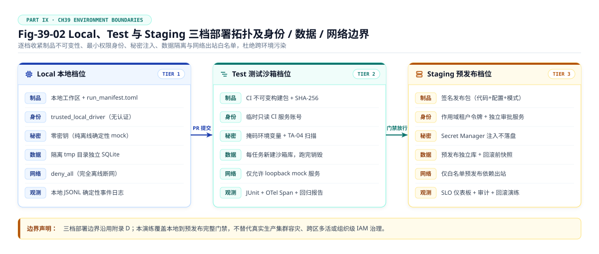
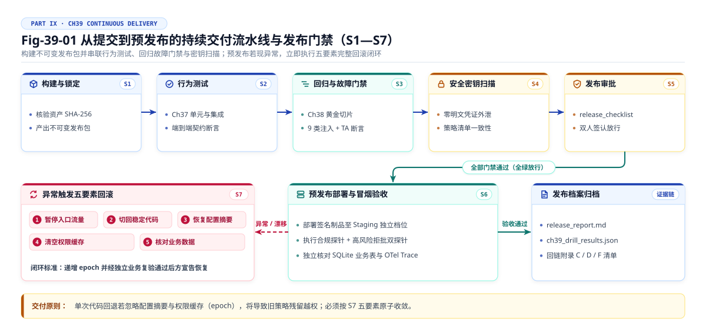

# Ch39 部署演练、持续交付与工程综合实践

**Deployment Drills, Continuous Delivery, and Engineering Capstone**

> **工程实践收束章（团队保留扩展篇）**：本章把 [Ch30 生产治理](../part7/ch30_production_governance.md)、[Ch34 综合项目](../part8/ch34_capstone_reference_architectures.md)、[Ch36 参考实现](ch36_reference_implementation.md)、[Ch37 分层测试](ch37_agent_testing.md) 与 [Ch38 回归门禁](ch38_regression_fault_injection.md) 整合为一条可离线复现的“本地 → 测试 → 预发布”持续交付与五要素回滚演练链路，并给出 100 分最终工程综合实践评分标准。本演练仅证明所声明沙箱边界内的发布门禁、缓存清理与幂等恢复机制，明确公开与真实生产集群的适用边界。

**摘要**　智能体系统的发布不同于传统无状态 Web 服务：代码、提示模板、政策配置、工具模式与权限缓存共同决定系统行为。只回滚代码指针却遗留了坏配置污染的权限缓存，会让“看似已回滚”的系统继续发生越权写入。本章从这一“不完全回滚”预发布事故出发，定义本地（`local`）、测试（`test`）与预发布（`staging`）三档部署边界（与 [附录 D](../appendix_d_deployment.md) 对齐），串联从构建锁定到预发布冒烟验收的七阶段持续交付流水线（`S1`—`S7`），并借鉴 OpenAI Harness 持续反馈环、DeepSeek Harness 插件可逆卸载以及 Google SRE 运行手册实践，设计涵盖**入口暂停、代码、配置、权限与缓存清空、业务数据对账**的五要素回滚序列。在 `examples/ch39/drill_runner.py` 的四项自动化演练（受控发布、配置错配与缓存残留反例、五要素完整回滚、PRJ-3 崩溃恢复综合实践）中，完整发布门禁与五要素回滚均 4/4 通过且审计日志实现密钥零泄露；章末给出面向课程与团队验收的 100 分最终综合实践作业与评分细则。

**关键词**　部署演练（deployment drill）；持续交付（continuous delivery）；发布门禁（release gate）；五要素回滚（five-element rollback）；权限缓存残留（stale permission cache）；运行手册（runbook）；工程综合实践（engineering capstone）；证据可追溯性（evidence traceability）。

**章节元信息与工程运行字段**　拟定主笔：主编统筹（具名主笔待确认）；内部执笔：学生 F；独立审稿：学生 A。版本：`zh-draft-0.2`（2026-11-27）。先修知识：[Ch30 生产部署、监控与治理](../part7/ch30_production_governance.md)、[Ch34 综合项目](../part8/ch34_capstone_reference_architectures.md)、[Ch36](ch36_reference_implementation.md)、[Ch37](ch37_agent_testing.md) 与 [Ch38](ch38_regression_fault_injection.md)。运行环境：Python 3.11+（实测 Python 3.13.7 + PyYAML + SQLite 标准库，零外部密钥、离线可运行）。入口命令：`python examples/ch39/drill_runner.py` 与 `python -m pytest tests/ch38_39/test_part9_engineering.py -q`。产物与许可：`examples/ch39/`（MIT 许可），含 `deploy/profiles.yaml`、`ci/cd_pipeline.yaml`、`release_checklist.md`、`rollback_runbook.md`、`final_capstone_rubric.md`、`drill_runner.py`、`release_report.md`、`results/ch39_drill_results.json`。图表清单：`Fig-39-01`、`Fig-39-02`、`Fig-39-03`、`Tab-39-01`、`Tab-39-02`、`Tab-39-03`。等效出版页预算 30 页；本章无商业利益冲突。

---

## 39.1 版本错配后的不完全回滚：为什么切回代码仍未恢复

### 39.1.1 教学事故还原：代码回滚了，越权为什么还在发生

设想在预发布环境部署企业政策研究与工单助手的候选版本 `release-v1.1.0-bad-config`（以下为教学构造案例，非真实企业生产事故）。该候选包含一处将主管审批阈值错误抬高至 500 元的配置错配，且在预发布启动后向共享权限缓存写入了一条 `allow_high_risk=true` 的策略条目。

1. **背景与目标**：团队希望在预发布环境验证候选版本并在出现异常时快速回滚至已验收版本 `release-v1.0.0`，同时保留此前已创建的合法工单数据。
2. **初始假设**：值班工程师沿用传统无状态微服务的运维习惯，认为“只要把容器镜像/Git 指针切回 `release-v1.0.0` 并看到 `/health` 返回 200，系统就完全恢复了”。
3. **观测症状**：在模拟“跳过回归门禁且仅切回代码指针”的对照组（`DRILL-02` 反例）中，虽然版本号已显示 `release-v1.0.0`、健康检查变绿，但随后发入一笔 420 元的高风险报销探针任务（`STG-03-stale-cache-probe`）竟然因为命中了未清理的旧权限缓存，绕过主管审批直接创建了工单！同时，事故排查过程中还有一名开发者随手把包含 `Bearer sk-test-secret` 的调试头打向了日志。
4. **定位过程**：核对发布时间线发现三个相互叠加的失守环节：（a）候选绕过了 Ch38 切片回归门禁才进入预发布；（b）回滚脚本只恢复了代码与静态配置文件，既没有清空权限缓存也没有递增缓存代次（`cache.epoch`）；（c）缺乏回滚后的“负向安全探针（高风险必须被拒）”，仅凭进程存活就草率关闭了事故单。
5. **修复动作**：实施 `S1`—`S7` 强制持续交付门禁；把回滚升级为**五要素原子序列**（暂停入口 → 恢复代码 → 校验配置摘要 → 撤销临时授权并清空/递增权限缓存代次 → 独立核对业务数据并跑通正/负双向业务探针）；在审计日志入口加装强制密钥脱敏过滤器。
6. **结果及剩余限制**：在 `drill_runner.py` 的四项自动化演练中，完整门禁提前拦截了坏候选，五要素回滚彻底清除了残留权限缓存并使 420 元高风险探针重新被正确拒绝（`needs_approval`），既有合法工单完好保留，审计日志零明文密钥泄露。限制在于本演练为单机本地预发布模拟，真实生产分布式 Redis 集群、Kubernetes 连接排空与数据库模式降级需结合组织实际设施另行压测。

### 39.1.2 从 DeepSeek Harness 可逆生命周期到五要素回滚

我们在 [Ch22](../part6/ch22_orchestration_runtime.md) 中讨论过 DeepSeek Harness（`dsh` / Cordis）的一个核心设计洞见：**任何组件挂载时留下的状态、路由与钩子，在卸载时都必须具备对称、可逆的清理动作**[^r39-dsh]。把这一微内核原则放大到预发布与生产持续交付层面，就得到了智能体运维的黄金法则——**智能体的发布单元从来不是单一代码包，而是五元组 `(code, config/prompt/policy, schema/data, permissions, cache)`**；如果回滚只撤回了五分之一，剩下的五分之四就会以“配置错配”或“权限缓存残留”的形式制造比宕机更隐蔽的静默安全事故。

---

## 39.2 三档部署边界与交付物契约

为了把开发者的笔记本电脑、自动化 CI 沙箱与预发布环境清晰隔离开，本章在 `examples/ch39/deploy/profiles.yaml` 中定义 `local`、`test` 与 `staging` 三档部署配置，并与学生 E 维护的 [附录 D：部署档位与验收模板](../appendix_d_deployment.md) 保持字段语义完全一致，如 **Fig-39-02** 所示：

**Fig-39-02　`local`、`test` 与 `staging` 三档部署拓扑及身份/数据/网络边界。** 逐级收紧制品不可变性、身份认证边界、秘密管理方式、数据隔离策略、网络出站白名单与可观测深度；明确声明本地/预发布边界不等同生产多活集群。图为本书原创可编辑 SVG。

在三档之间流转的核心原则有三点：
1. **制品不可变性与内容摘要绑定（参考 SLSA v1.2[^r39-slsa]）**：从 `test` 晋升至 `staging` 的必须是同一个带有 SHA-256 清单摘要的不可变发布包（绑定源码、依赖锁、提示包、政策版本与 Schema 版本），严禁在预发布机器上临时手改配置文件。
2. **秘密永不落盘与日志自动脱敏**：`local` 档位采用零密钥确定性 mock 路径；`staging` 档位必须通过外部 Secret Manager 运行时注入凭证，并在遥测与审计写入层强制拦截 `sk-`、`Bearer `、`PRIVATE KEY` 等敏感模式（`DRILL-02` 中已实测验证替换为 `[REDACTED_SECRET]`）。
3. **教学声明与生产边界透明分开**：`local` 与本仓库 `drill_runner.py` 中的 `StagingEnvironment` 用于可重复教学演练与机制验证，明确不宣称已替代真实组织 IAM、TLS 双向认证或跨区域多活容灾。

---

## 39.3 持续交付流水线与发布门禁（`S1`—`S7`）

借鉴 OpenAI *Harness engineering*[^r39-openai-harness] 关于“把全部质量与安全约束前移至自动化 CI/CD 反馈环”的实践以及持续交付经典方法论[^r39-cd]，本章在 `examples/ch39/ci/cd_pipeline.yaml` 中将全书前序工程资产串联为七阶段流水线（如 **Fig-39-01** 与 **Tab-39-01** 所示）：

- **`S1_build_and_lock`**：检出代码、核验依赖锁与资产清单内容摘要（对接 [Ch36](ch36_reference_implementation.md)）。
- **`S2_behavior_tests`**：执行 [Ch37](ch37_agent_testing.md) 的单元、集成与端到端行为断言，守住基础幂等、授权与状态机不变量。
- **`S3_regression_and_fault_gate`**：执行 [Ch38](ch38_regression_fault_injection.md) 的 12 项黄金风险切片、OpenTelemetry `TA-01`—`TA-05` 轨迹断言与 9 类沙箱故障注入；**任何关键高风险切片失败直接阻断流水线**。
- **`S4_security_and_secret_scan`**：校验发布包与遥测无明文密钥、策略版本与清单一致。
- **`S5_release_approval`**：人工发布负责人核对发布就绪检查表（**Tab-39-01**，同步自 `examples/ch39/release_checklist.md`）并签认目标档位。
- **`S6_staging_deploy_and_smoke`**：部署至预发布档位后，同时运行**正向合规探针**（验证能正确建单）与**负向高风险探针**（验证无审批必须被拒），并独立读取业务库与 trace 对账。
- **`S7_post_deploy_observability_or_rollback`**：持续观察 SLO 与审计日志；一旦发现漂移、越权或探针失败，立即触发自动五要素回滚。

**Fig-39-01　从提交到预发布的持续交付流水线与发布门禁（`S1`—`S7`）。** 将 Ch36 清单核验、Ch37 行为测试、Ch38 回归与故障门禁、安全扫描、人工审批与预发布双向冒烟闭环连接；任意异常沿左侧红色路径自动触发五要素回滚。图为本书原创可编辑 SVG。

**Tab-39-01　发布就绪检查表（同步自 `examples/ch39/release_checklist.md`，含 `release-v1.0.0` 已填写基线样例）。**

| 检查项 ID | 核查维度 | 必须验证的客观条件 | 对应证据路径 | `release-v1.0.0` 状态 |
| --- | --- | --- | --- | --- |
| `RC-01` | 制品与配置绑定 | 代码、模型、提示、政策、Schema 绑定同一清单 SHA-256 摘要 | `examples/ch39/results/ch39_drill_results.json` | 已通过 |
| `RC-02` | 分层行为测试 | Ch37 单元/集成/E2E 行为断言全部通过，零跳过高风险用例 | `examples/ch37/tests/test_behaviour.py` | 已通过 |
| `RC-03` | 切片回归门禁 | Ch38 全部黄金切片通过，高风险零越权写入、零重复副作用 | `examples/ch38/regression_report.md` | 已通过 (12/12) |
| `RC-04` | 可观测与防泄 | `TA-01`—`TA-05` 全绿；日志、指标与 trace 零明文凭证 | `examples/ch38/trace_assertions.yaml` | 已通过（零泄露） |
| `RC-05` | 权限缓存隔离 | 版本切换同步递增缓存 `epoch`，旧权限条目不跨版本残留 | `examples/ch39/drill_runner.py` | 已通过 |
| `RC-06` | 回滚可演练 | 五要素回滚序列与正/负向恢复探针已在沙箱演练通过 | `examples/ch39/rollback_runbook.md` | 已通过 (`DRILL-03`) |
| `RC-07` | 适用边界声明 | 明确区分本地/预发布演练与真实生产集群容灾及 IAM 治理 | `examples/ch39/release_report.md` | 已声明 |

---

## 39.4 观测、事故响应与五要素回滚演练 (`Exp-39-01`)

### 39.4.1 五要素回滚序列契约

依据 Google SRE 运行手册实践[^r39-sre] 与 `examples/ch39/rollback_runbook.md`，当预发布或生产版本触发回滚条件时，必须严格按 **Tab-39-02** 的五步顺序执行，禁止跳过缓存清理或以“清空业务库”掩盖故障。

**Tab-39-02　智能体五要素回滚序列（代码、配置、数据、权限、缓存）与恢复验收判据。**

| 顺序 | 回滚对象 | 标准执行动作 | 客观验证判据 | 典型致命误区 |
| :---: | --- | --- | --- | --- |
| 1 | 入口流量 (`intake`) | 暂停新任务接入，等待在途幂等写入到达安全检查点 | `intake_enabled == false` 且在途写入排空 | 粗暴强杀写入中事务且不核对外部结果 |
| 2 | 代码与依赖 (`code`) | 切换活跃发布指针至上一已验收不可变版本（`release-v1.0.0`） | `active_release == target_release` | 原地拉代码却未核对依赖锁 |
| 3 | 配置与政策 (`config`) | 恢复上一版本政策、提示、模型路由与预算清单并复算摘要 | `active_config_digest == target_digest` | 只回滚代码而忘了回滚门槛配置 |
| 4 | 权限与缓存 (`permissions + cache`) | 撤销候选临时授权，强制清空权限缓存并递增代次（`epoch += 1`） | `cleared_entries >= 0` 且旧缓存键全部失效 | **忽略权限缓存导致越权继续生效（`DRILL-02` 反例）** |
| 5 | 数据对账与恢复探针 (`data + verify`) | 核对既有合法工单完好无损；恢复入口后同时跑通**高风险拒批探针**与**合规建单探针** | `legit_preserved == true`、`post_highrisk == rejected`、`post_eligible == completed` | 只看 `/health` 返回 200 就宣布事故结束 |

### 39.4.2 四项自动化预发布演练实测结果

在仓库根目录运行 `python examples/ch39/drill_runner.py`，脚本在隔离临时目录中依次完成四项完整演练（覆盖 Ch39 任务卡要求的“一次受控发布、一次注入失败、一次完整回滚与一次端到端综合实践”），实测汇总见 **Tab-39-03**，由真实审计日志生成的运行时间线见 **Fig-39-03**。

**Tab-39-03　`Exp-39-01` 四项预发布与回滚演练实测结果（数据源：`examples/ch39/results/ch39_drill_results.json`）。**

| 演练编号 | 演练场景与对照 | 实测关键证据与状态 | 验收结论 |
| --- | --- | --- | :---: |
| `DRILL-01` | 受控发布 (`release-v1.0.0`) | `S3` 回归门禁 12/12 PASS；合规探针 `STG-01` `completed`（`service.sqlite` 恰 1 工单），高风险探针 `STG-02` `rejected(needs_approval)`，`TA-01`—`TA-05` 全部通过 | **PASS** |
| `DRILL-02` | 配置错配 + 权限缓存残留 + 密钥防泄对照 | （a）完整门禁提前阻断 `release-v1.1.0-bad-config`（定位 `config_layer, model_or_prompt_layer`）；（b）反例证明若跳过门禁且仅切回代码，缓存残留导致 420 元探针 `STG-03` 越权 `completed`；（c）注入 `Bearer sk-test-secret` 被脱敏为 `[REDACTED_SECRET]`，零泄露 | **PASS** |
| `DRILL-03` | 五要素完整回滚与双向恢复验收 | 暂停入口 → 恢复代码与配置摘要（`a9e8573067b0`）→ 清空 1 条旧权限缓存并递增 `epoch=2` → 恢复入口；回滚后高风险探针 `STG-04` 重新被拒（`needs_approval`），合规探针 `STG-05` 成功建单，`STG-01` 原合法工单完好保留 | **PASS** |
| `DRILL-04` | PRJ-3 端到端综合实践演练 | 对 `CAP-PRJ3-01` 注入 `after_commit` 提交后崩溃，重启恢复后终态 `completed`、独立库工单数恰为 `1`、`TA-01`—`TA-05` 全部通过 | **PASS** |

**Fig-39-03　故障注入、不完全回滚反例与五要素回滚恢复验收时间线（由 `examples/ch39/results/ch39_drill_results.json` 实测审计日志自动生成）。** 清晰展示从 `t=10ms` 启动 CD 门禁到 `t=120ms` 完成 PRJ-3 综合验收的全部 12 个审计里程碑，含 `t=60ms` 不完全回滚反例与 `t=70–110ms` 五要素完整回滚闭环。图为本书原创数据驱动 SVG。

---

## 39.5 最终工程综合实践（Engineering Capstone）

作为全书九篇的实践总验收，本节复用 [Ch34](../part8/ch34_capstone_reference_architectures.md) 的三项目递进资产与 [Ch36](ch36_reference_implementation.md)—[Ch39](ch39_deployment_continuous_delivery.md) 的同一代码仓库，给出可直接用于研究生课程大作业、工程训练营或团队上线考核的最终综合实践任务与 100 分评分标准（完整细则同步维护于 `examples/ch39/final_capstone_rubric.md`）。

### 39.5.1 实验十项规范与执行命令

1. **学习目标**：在干净检出环境中端到端跑通“参考实现 → 分层行为测试 → 切片回归与故障注入 → 预发布部署、故障注入与五要素回滚”，并产出可相互追溯的审计报告包。
2. **先决章节**：[Ch22—Ch25](../part6/index.md)、[Ch26—Ch30](../part7/index.md)、[Ch34](../part8/ch34_capstone_reference_architectures.md)、[Ch36—Ch38](index.md)。
3. **输入资产**：本仓库完整代码树（`examples/ch22`—`ch25`、`examples/ch36`—`ch39`）与原创夹具，无需外部付费账号。
4. **操作步骤与命令**：
   - 步骤 A（环境与基线）：克隆至全新目录，记录 `python --version` 与 Git commit，运行 `python -m pytest tests/test_book_structure.py -q`；
   - 步骤 B（行为与回归）：运行 `python -m pytest examples/ch37/tests/test_behaviour.py -q` 与 `python examples/ch38/regression_runner/runner.py`；
   - 步骤 C（部署与回滚演练）：运行 `python examples/ch39/drill_runner.py` 与 `python -m pytest tests/ch38_39/test_part9_engineering.py -q`；
   - 步骤 D（自主故障与报告）：按基础/进阶要求注入一项额外故障并提交完整证据包（含命令、退出码、原始 JSON/JSONL、独立 SQLite 核验记录与局限声明）。
5. **预期结果**：四项演练与全套 `pytest` 退出码均为 `0`；受控负例（坏候选、不完全回滚、密钥样本）均产生预期阻断或脱敏记录。
6. **失败定位**：依序核对 `ch38_regression_results.json` 的 `detected_fault_layers`、`ch39_drill_results.json` 的 `timeline` 与 `service.sqlite` 真实记录数。

### 39.5.2 100 分评分标准与零容忍退回条件

| 评分维度 | 满分 | 客观核查依据与交付产物 |
| --- | ---: | --- |
| 1. 干净环境复现 | 15 | 在全新目录按说明执行全套命令，记录机器/OS/Python 版本、命令、运行时长与退出码，无本机绝对路径依赖 |
| 2. 任务与证据正确 | 20 | 独立读取 `service.sqlite` 与事件日志核对业务后置条件，保留任务 ID 与政策引用，不以模型文本替代核验 |
| 3. 权限与副作用控制 | 20 | 高风险审批零越权写入；崩溃/重连恢复保持唯一 `operation_id` 与唯一工单；取消后如实登记已提交副作用 |
| 4. 测试与回归门禁 | 20 | 跑通 Ch37 行为测试、Ch38 切片回归、`TA-01`—`TA-05` 轨迹断言与 >=8 类沙箱故障注入；受控缺陷可被捕获 |
| 5. 发布、故障与回滚 | 15 | 完成一次受控发布、一次配置/缓存故障注入与一次五要素完整回滚，并给出回滚后正/负双向业务验收证据 |
| 6. 报告与适用局限 | 10 | 明确区分确定性 mock 演练与真实模型/生产环境，如实列出未验证项，无任何伪造数字或夸大结论 |

> **直接退回项（零容忍，不能由其他项得分抵消）**：（1）遗漏权限控制检查，或允许自由文本绕过审批直写；（2）无法在干净环境复现核心路径且未给出可定位原因；（3）伪造结果、篡改基线掩盖回归或将 mock 演练宣称为真实生产验收；（4）日志、轨迹或发布包中泄露明文密钥。

- **基础必做任务**：完整复现 `DRILL-01` 至 `DRILL-04` 并交付可相互追溯的测试、回归、运行时间线与人工签认报告包。
- **进阶可选任务**：（1）为 `StagingEnvironment` 增加一个“数据库模式向前不兼容升级（`schema_v2 → schema_v3`）”的演练分支，实现升级前自动快照备份与不兼容降级阻断；（2）接入 [Ch24](../part6/ch24_streaming_interrupts.md) 的流式打断探针作为预发布冒烟检查项，验证发布前后可见打断延迟 P95 不超过 60 ms。

---

## 39.6 小结、工程交付包与工程证据索引

### 39.6.1 全书工程实践收束与附录回链

本章作为全书正文与工程实践篇的收束，将发布清单、三档部署配置、五要素回滚手册与最终综合实践评分标准全部沉淀为仓库可检出资产，并分别回链至 [附录 C（接口、模式与事件轨迹）](../appendix_c_schemas.md)、[附录 D（部署档位与验收模板）](../appendix_d_deployment.md) 与 [附录 F（安全、隐私与治理清单）](../appendix_f_security.md)。至此，读者手中拥有的不再是一份停留在纸面上的“架构框图”，而是一套从单步契约、异步运行时、持久状态机、流式打断、多模态协同直到回归门禁与五要素回滚的完整、可运行、可证伪工程基线。

### 39.6.2 工程证据索引（第 4.7 节要求）

| 主张 ID | 正文位置 | 输入与环境 | 接口/权限边界 | 实现入口 | 独立验收条件 | 成功/失败证据 | 证据状态与适用范围 |
| --- | --- | --- | --- | --- | --- | --- | --- |
| `CLM-39-01` | 39.2 / 39.3 | `profiles.yaml` + `cd_pipeline.yaml` + `DRILL-01` | S1–S7 门禁与不可变摘要 | `examples/ch39/drill_runner.py` | 门禁全绿、合规 1 工单、高风险拒批、轨迹 PASS | `DRILL-01` `passed=true`（`ch39_drill_results.json`） | 确定性本地预发布演练（非真实集群） |
| `CLM-39-02` | 39.1 / 39.4 | `DRILL-02` 坏配置候选与缓存残留反例 | 回归门禁拦截 + 日志密钥脱敏 | `examples/ch39/drill_runner.py` | 完整门禁阻断坏候选；不完全回滚暴露缓存越权；日志零明文密钥 | `full_cd_gate_blocked=true`；反例越权复现；`secret_leaked=false` | 确定性本地预发布演练 |
| `CLM-39-03` | 39.4.2 | `DRILL-03` 五要素回滚 + `DRILL-04` PRJ-3 崩溃恢复 | 入口/代码/配置/权限缓存/数据联动 | `examples/ch39/drill_runner.py` | 清空旧缓存后高风险重新拒批、合法工单完好、崩溃恢复 1 工单 | `DRILL-03` 与 `DRILL-04` 均 `passed=true`，`all_drills_passed=true` | 确定性本地预发布演练（未测分布式缓存与多活集群） |

### 39.6.3 关键术语

持续交付（Continuous Delivery）、不可变发布包（Immutable Release Bundle）、部署档位（Deployment Tier）、五要素回滚（Five-Element Rollback）、权限缓存代次（Permission Cache Epoch）、双向冒烟探针（Bidirectional Smoke Probe）、运行手册（Runbook）。

### 39.6.4 复习题与实践题

**复习题：**
1. **概念辨析**：为什么智能体系统的发布回滚必须同步处置“代码、配置、数据、权限与缓存”五要素，而不能等同于传统无状态服务的容器镜像回切？
2. **设计选择**：在 `S6_staging_deploy_and_smoke` 中，为什么除了运行“正常合规建单”探针，还必须强制运行“高风险无审批被拒”的负向探针？
3. **故障诊断**：观察 `DRILL-02` 的时间线，如果团队只在回滚脚本里执行了 `git checkout release-v1.0.0` 并重启应用进程，但外置 Redis 权限缓存未清理，会出现什么隐蔽现象？如何在架构上根治？
4. **指标解释**：在最终综合实践 100 分评分表中，为什么把“遗漏权限控制”和“将 mock 结果宣称为生产验收”列为零容忍退回项，而不是扣减 10 分？
5. **跨章整合**：当预发布环境中新版本已经误创建了 2 张不合规的模拟工单，请综合 [Ch12](../part3/ch12_action_execution.md) 的补偿机制、[Ch30](../part7/ch30_production_governance.md) 的审计治理、[附录 D](../appendix_d_deployment.md) 的回滚记录与本章的五要素回滚手册，写出完整的事故处置与恢复验收流程。

**实践题：完成最终工程综合实践并提交独立复核档案包**
- **输入**：本仓库 `examples/ch36`—`ch39` 全部资产。
- **任务**：按第 39.5.1 节与 `examples/ch39/final_capstone_rubric.md` 要求，在全新干净目录完成全链路复现，并额外在 `drill_runner.py` 中增加一项 `DRILL-05`（演练“不兼容状态模式升级导致禁止盲目降级，必须从升级前快照恢复”），提交完整证据包（含命令、退出码、JSON 原始日志、`release_report.md` 扩展章节与生产适用局限说明）。
- **评分依据（100 分）**：直接采用第 39.5.2 节与 `final_capstone_rubric.md` 六维 100 分标准与零容忍退回条款。
- **进阶选项**：将 `ci/cd_pipeline.yaml` 实际转换为一条可在 GitHub Actions 上运行的最小本地 workflow（触发 `pytest`、`ch38` 回归与 `ch39` 演练并上传报告 artifact）。
- **教师参考评分要点**：须亲自在干净目录复跑学生提交的复现命令；核对所有数字均来自真实生成日志且未跳过任何高风险负向探针。

### 39.6.5 本章局限

本章预发布部署与五要素回滚演练运行在单机隔离目录与内存权限缓存之上，旨在提供人人可离线复现的确定性工程实训基线；它未包含真实容器编排集群（如 Kubernetes Pod 优雅终止、滚动发布金丝雀流量切分）、真实外部 Secret Manager 轮转、多副本分布式缓存失效广播以及跨区数据库模式零停机迁移。读者在走向真实企业生产时，须结合 [Ch30](../part7/ch30_production_governance.md) 与 [附录 D](../appendix_d_deployment.md) 补齐对应生产基础设施验证。

---

## 参考文献与版本记录

[^r39-openai-harness]: OpenAI. *Harness engineering: Leveraging Codex in an agent-first world*. OpenAI Engineering Blog, Feb 2026: [https://openai.com/index/harness-engineering/](https://openai.com/index/harness-engineering/)（核验：2026-11-27）。持续反馈闭环与仓库约束治理的工程参考。
[^r39-dsh]: DeepSeek-AI. *DeepSeek Harness (`dsh`)*. GitHub Repository: [https://github.com/deepseek-ai/deepseek-harness](https://github.com/deepseek-ai/deepseek-harness)（核验：2026-11-27）。参考其插件化可逆注册/卸载生命周期对配置与状态洁净回滚的启示。
[^r39-anthropic-harness]: Anthropic. *Effective harnesses for long-running agents*. Anthropic Engineering Blog, Nov 2025: [https://www.anthropic.com/engineering/effective-harnesses-for-long-running-agents](https://www.anthropic.com/engineering/effective-harnesses-for-long-running-agents)（核验：2026-11-27）。长程智能体端到端独立验收与状态工件移交原则。
[^r39-cd]: Humble J, Farley D. *Continuous Delivery: Reliable Software Releases through Build, Test, and Deployment Automation*. Addison-Wesley, 2010. 部署流水线、不可变制品与发布门禁的基础理论。
[^r39-sre]: Beyer B, Jones C, Petoff J, Murphy N R. *Site Reliability Engineering: How Google Runs Production Systems*. O'Reilly Media, 2016: [https://sre.google/sre-book/table-of-contents/](https://sre.google/sre-book/table-of-contents/)（核验：2026-11-27）。发布就绪评审、事故响应运行手册与回滚恢复验证原则。
[^r39-slsa]: SLSA. *Supply-chain Levels for Software Artifacts (SLSA) Specification v1.2 — Provenance*: [https://slsa.dev/spec/v1.2/provenance](https://slsa.dev/spec/v1.2/provenance)（核验：2026-11-27）。用于参考不可变制品来源与摘要绑定概念（不宣称本教学示例已获 SLSA 认证等级）。
[^r39-owasp-secrets]: OWASP. *Secrets Management Cheat Sheet*: [https://cheatsheetseries.owasp.org/cheatsheets/Secrets_Management_Cheat_Sheet.html](https://cheatsheetseries.owasp.org/cheatsheets/Secrets_Management_Cheat_Sheet.html)（核验：2026-11-27）。凭证管理、最小暴露与日志防泄准则。
[^r39-otel]: OpenTelemetry. *Semantic Conventions for Generative AI Systems*: [https://opentelemetry.io/docs/specs/semconv/gen-ai/](https://opentelemetry.io/docs/specs/semconv/gen-ai/)（核验：2026-11-27）。预发布观测与轨迹对账标准依据。

本版：`zh-draft-0.2`，2026-11-27。已完成三张原创可编辑 SVG（含实测审计时间线图）、三档部署配置、七阶段 CD 流水线、四项预发布/回滚/PRJ-3 演练与 100 分综合实践评分标准；产物已回链附录 C/D/F。
