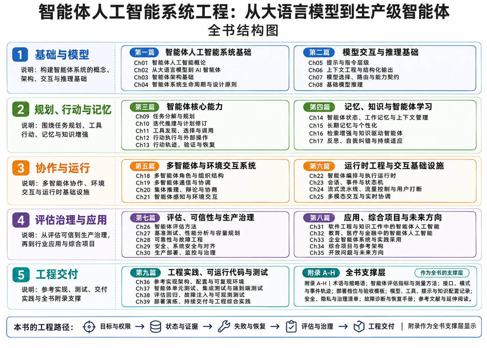

# 序言

大语言模型能够理解和生成内容，却不会仅凭模型接口自动成为可靠的任务执行系统。智能体还需要明确目标与权限，维护必要状态，调用工具并核验结果，并在预算耗尽、失败或需要人工判断时停止或交接。智能体工程因此关注的不只是模型输出质量，也包括行动边界、运行证据、失败恢复和责任归属。

本书从系统工程视角组织这些问题，覆盖智能体基础、模型交互、规划行动、记忆知识、多智能体、运行时、评估治理、应用和工程实践。内容面向研究人员、研究生、AI 与软件工程师、系统架构师及技术负责人；既讨论方法，也说明取舍、失败模式和适用限制。固定工作流可能适合边界稳定的任务，开放任务则可能需要规划和反馈。全书不指定唯一架构或供应商，而是帮助读者依据目标、授权、成本、延迟、可靠性和风险作出可复核的设计选择。

## 全书结构与阅读路径

本书共九篇、39 章。前八篇建立系统概念、能力、运行与治理框架；第九篇补充参考实现、测试和部署演练。附录 A-H 汇集术语、指标、接口、部署、配置、安全、故障和延伸阅读资料。

*图 FM-1：全书架构图。*

第一篇（Ch01-Ch04）建立概念、目标边界、架构和生命周期基础；第二篇（Ch05-Ch08）讨论提示、上下文、模型选择与推理；第三篇（Ch09-Ch13）从任务规划延伸到工具调用、行动执行和结果验证。

第四篇（Ch14-Ch17）聚焦状态、记忆、检索知识与适应；第五篇（Ch18-Ch21）讨论多智能体组织、协调、集体推理和环境交互；第六篇（Ch22-Ch25）介绍编排运行时、会话事件、流式打断及多模态实时协同。

第七篇（Ch26-Ch30）涵盖评估、性能、可靠性、安全、部署与治理；第八篇（Ch31-Ch35）考察软件和行业应用、企业采用、综合项目与开放问题；第九篇（Ch36-Ch39）提供参考实现、分层测试、回归和持续交付实践。附录用于查阅和复用，不替代正文的方法说明。

初学者可从第一篇顺读至第三篇；关注记忆或协作的读者可转入第四、五篇；平台工程师可重点阅读第六、七篇；研究评估、安全和治理的读者可从第七篇进入；课程与项目团队可结合 Ch34 和第九篇安排实践。阅读时应关注各方法的假设和适用边界，并区分教学案例、模拟结果与真实测量。代码、数据和实验结论也应结合其版本、预算和运行条件理解。

## 从概念走向可检查的实践

本书使用贯穿案例把各篇连接起来。政策研究与费用申请同时涉及语言理解、知识时效、用户身份、审批和外部动作：模型需要理解问题，检索器提供可定位证据，运行时维护当前状态，工具在授权条件下改变业务对象，验收器检查实际结果。读者可以沿同一条任务链观察方法之间的接口，而不是把每种能力当作独立演示。

配套实践采用透明的教学数据与最小路径。原创政策和模拟工单使读者能够修改规则、注入故障、重复运行，并看见取消、重试和恢复的结果。需要语言模型或外部服务的扩展另行记录版本与预算；确定性示例用于解释协议与边界，其结果不替代模型能力或真实组织采用的证据。

阅读时可以把每章的方法变成三个问题：输入中的哪些信息可以信任，输出怎样获得支持，失败后谁接管？答案会随着任务和环境改变，但这种检查方式可以贯穿模型更新、架构选择和生产变更。

中文稿先在团队中完成技术与教学审阅，再统一翻译，保留相同的图表、术语和实验口径。代码与数据随版本维护，勘误通过仓库记录，使读者能够区分方法结论、实现版本与后续变化。
